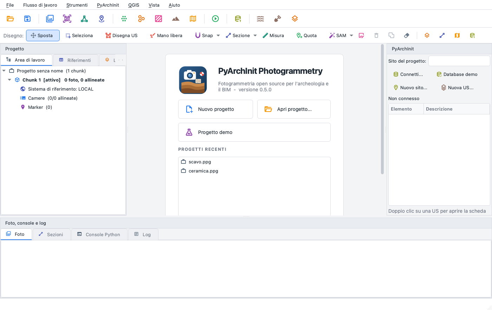
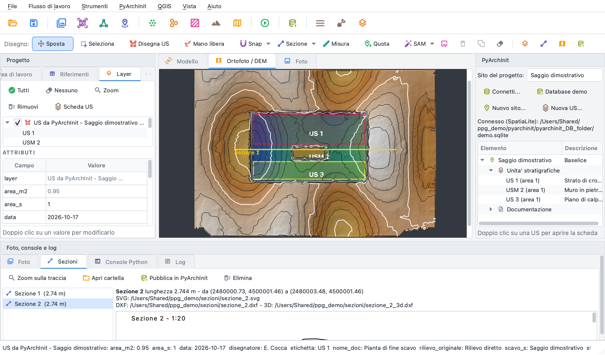
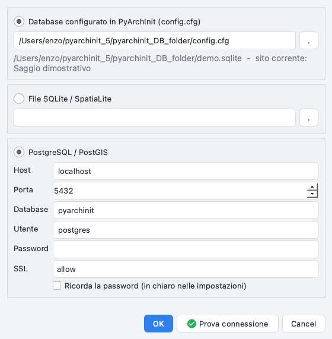
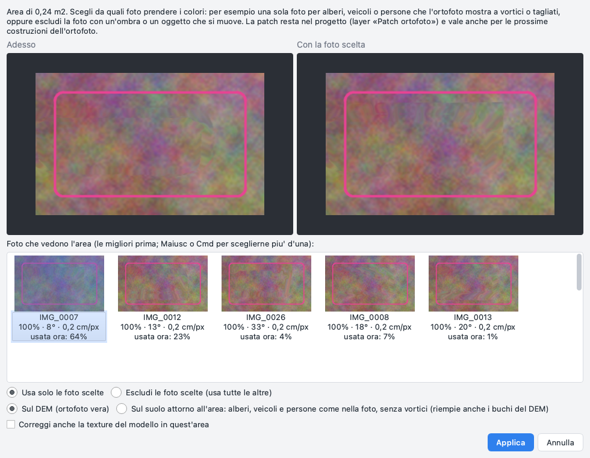
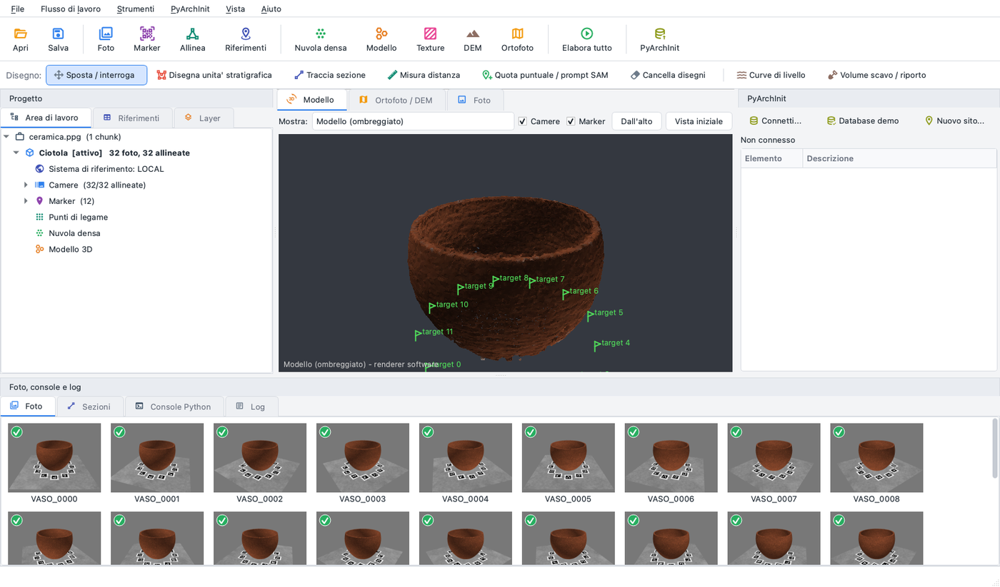
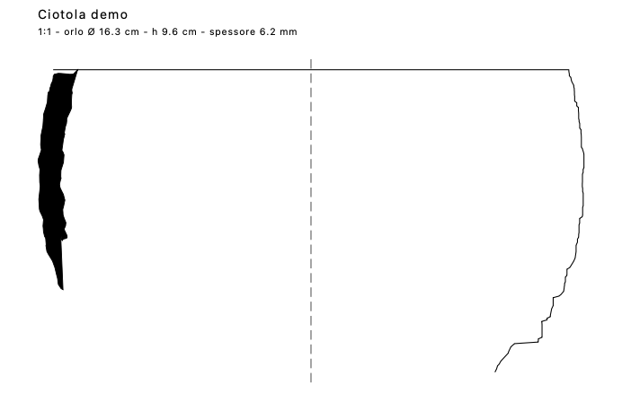
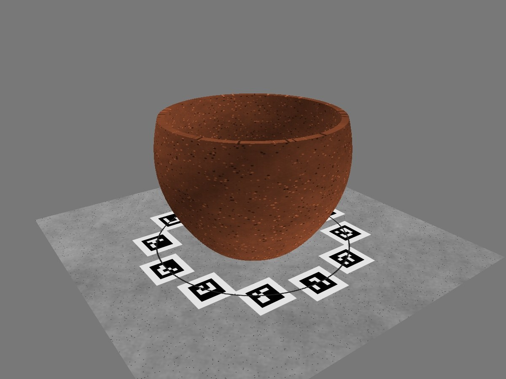
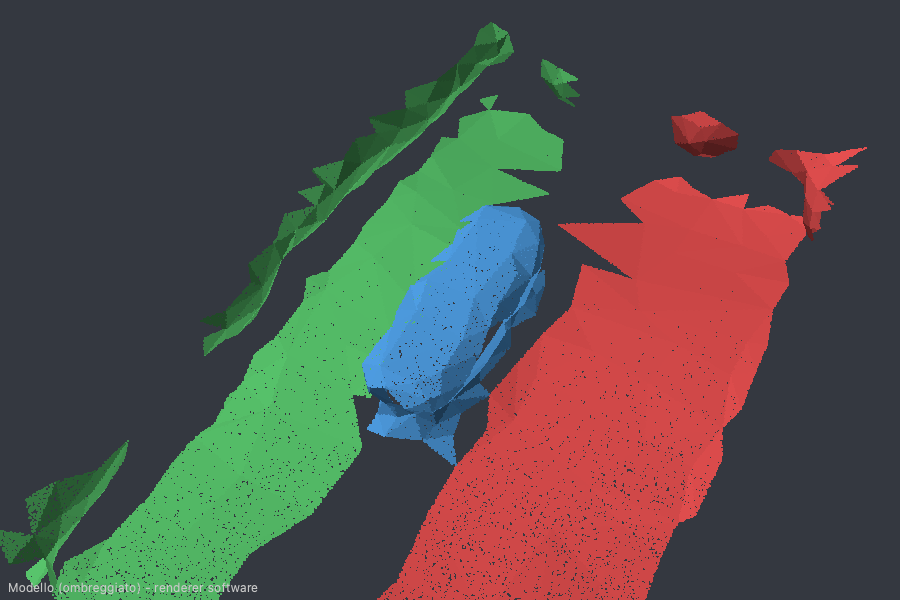

# pyarchinit-photogrammetry

Open-source photogrammetry engine for archaeology and heritage BIM, integrated with
[PyArchInit](https://github.com/pyarchinit/pyarchinit).

From photos to georeferenced point clouds, meshes, DEMs and orthophotos, with the tools an
excavation needs: coded targets, ground control, sections, pottery profiles, contour lines,
cut/fill volumes, point-cloud classification, Segment Anything 2.1, IFC export, and direct
publishing into a PyArchInit database. Everything is scriptable in Python and runs on CPU,
Apple Silicon included.

> Status: **1.0**. Python library, command line and desktop application (on the same
> API, with a built-in Python console). Italian version: [README.it.md](README.it.md).

Documentation, tutorials and a benchmark against Metashape and WebODM/ODM:
<https://enzococca.github.io/pyarchinit-photogrammetry/>

[](https://paypal.me/enzococca)

**If pyarchinit-photogrammetry is useful to you, support its development with a donation on
[PayPal](https://paypal.me/enzococca).** Development, benchmarks and builds for every platform are the work of one person.

## Desktop application (no Python needed)

Download the build for your system from the
[Releases](https://github.com/enzococca/pyarchinit-photogrammetry/releases) page:

| Platform | File |
| --- | --- |
| macOS 15 or newer (Apple Silicon) | `PyArchInit-Photogrammetry-<version>-macos-arm64.dmg` |
| Windows 10/11 (64 bit) | `PyArchInit-Photogrammetry-<version>-windows-x64.zip` |

Open the disk image and drag the app to *Applications* (macOS), or unzip and run
`PyArchInit Photogrammetry.exe` (Windows). The application starts on a page with *Nuovo
progetto*, *Apri progetto* and *Progetto demo*: the demo creates a synthetic trench and a
bowl on a turntable and processes them in a few minutes. If PyArchInit 5 is installed
(`~/pyarchinit_5`), the interface connects to its database at start and the demo database is
written inside `pyarchinit_DB_folder` so that QGIS can open it too; PostgreSQL/PostGIS servers
are reachable from *PyArchInit > Connetti*. The builds are unsigned: on macOS right-click > *Open*
the first time (or `xattr -dr com.apple.quarantine "/Applications/PyArchInit Photogrammetry.app"`),
on Windows choose *More info > Run anyway*. Details in [docs/packaging.md](docs/packaging.md).
The application looks for new versions at start-up (at most once a day) and, on macOS, installs
them and restarts; see *Updates* in [docs/gui/help.md](docs/gui/help.md#updates).

## Installation with pip

Use a dedicated virtual environment (not the Anaconda `base` environment, see
*Troubleshooting*). With [uv](https://docs.astral.sh/uv/):

```bash
uv venv --seed --python 3.12 ~/venvs/ppg && source ~/venvs/ppg/bin/activate
uv pip install "pyarchinit-photogrammetry[all]"      # engine, mesh (Open3D), IFC, PostGIS, desktop GUI
```

With the standard tools:

```bash
python3 -m venv ~/venvs/ppg && source ~/venvs/ppg/bin/activate   # Windows: ~\venvs\ppg\Scripts\activate
pip install -U pip && pip install "pyarchinit-photogrammetry[all]"
```

Optional: `pip install "pyarchinit-photogrammetry[sam]"` adds Segment Anything 2.1 (PyTorch).
Linux on ARM (aarch64): pycolmap and Open3D publish no wheels there; install the ones attached to the
[release](https://github.com/enzococca/pyarchinit-photogrammetry/releases/latest) for your Python first
(`pip install pycolmap-*-cp312-*.whl open3d-*-cp312-*.whl`), and `sudo apt install libxerces-c-dev` for
the E57 support of `[all]` (see [packaging.md](docs/packaging.md)). Windows on ARM (Snapdragon): a native
application (`...-windows-arm64.zip`, with the VTK 3D view and E57 scans from 1.3.5) is attached to the releases; the
x64 one runs under emulation too.
A global `ppg`/`ppg-gui` without activating anything: `uv tool install "pyarchinit-photogrammetry[all]"`
(or `pipx install`).

From source:

```bash
git clone https://github.com/enzococca/pyarchinit-photogrammetry
cd pyarchinit-photogrammetry
uv venv --seed --python 3.12 .venv && source .venv/bin/activate
uv pip install -e ".[all,dev]"
uv pip install ./native     # optional: native kernels in Rust (needs a Rust toolchain)
pytest -q
```

The native core (`native/`, imported as `ppg_core`) runs the heaviest numpy steps of the depth maps,
the orthomosaic and the confidence in Rust on every core: CPU depth maps about six times faster.
It also brings PatchMatch multi-view stereo without a GPU (backend `patchmatch`, chosen by `auto`
for surveys from the air: a plane per pixel checked against up to six photos at once; on the synthetic
trench the DEM error is about a third of the two-view one; on a drone survey of a tell it removes the
contour-like terraces and the stripes of the two-view depths and covers more of the edges, at about
eight times the time).
Without it the same numpy code runs (see [docs/packaging.md](docs/packaging.md#native-core-rust));
the desktop applications include it.

Python 3.10-3.12. Writing geometries into a PyArchInit **SQLite** database needs `mod_spatialite`
(found automatically in QGIS, MacPorts, Homebrew and Linux locations, or set
`SPATIALITE_LIBRARY_PATH`). On headless Linux servers Open3D needs the EGL/GL libraries:
`sudo apt-get install libegl1 libgl1 libgomp1`.

## Start

```bash
ppg doctor                        # checks the environment and says what to fix
ppg demo ~/ppg_demo --process     # synthetic trench + 8 targets, bowl on a turntable, pottery meshes, PyArchInit DB
ppg-gui ~/ppg_demo/scavo.ppg      # open the processed trench in the interface
ppg-gui ~/ppg_demo/ceramica/ceramica.ppg   # the bowl (local metric frame from the turntable targets)
ppg-gui                           # start page: new, open, demo, recent projects
```

`ppg-gui` is the same as `ppg gui` and `python -m pyarchinit_photogrammetry.gui`. The
interface writes a log in `~/Library/Logs/pyarchinit-photogrammetry` (macOS),
`%LOCALAPPDATA%\pyarchinit-photogrammetry\logs` (Windows) or `~/.local/state/pyarchinit-photogrammetry/logs`
(Linux); *Aiuto > Apri cartella dei log* opens it.

## Troubleshooting

* **`ppg-gui` does nothing, or crashes on start.** Run `ppg doctor`. A frequent cause is an
  old copy of the package installed in another Python (for example Anaconda's `base`) that
  comes first on `PATH`: activate the right environment (`which ppg-gui` must point inside it)
  or uninstall the other copy (`/opt/anaconda3/bin/python -m pip uninstall pyarchinit-photogrammetry`).
* **Anaconda `base` environment**: its SciPy wheels may not load on recent macOS
  (`ImportError ... __thread_bss ... zero-fill section`) and its PROJ data is picked up by
  rasterio. Use a dedicated virtual environment; `PROJ_LIB`/`PROJ_DATA`/`GDAL_DATA` exported
  by Anaconda or QGIS are redirected to the data bundled with rasterio.
* **The mesh step says "Poisson reconstruction failed... height field instead".** Poisson
  reconstruction runs in a separate process because PoissonRecon (Open3D) can crash on some
  clouds; the pipeline retries and then builds a 2.5D surface. Open3D 0.20.0 crashes
  systematically on macOS and is excluded (`open3d!=0.20.0`); 0.19 works.
* **Native dialogs crashing on macOS 26/27** (`NSInternalInconsistencyException ...
  targetSizeInPoints`): the interface uses Qt's own message boxes, no action needed.
* **The 3D view hangs on macOS**: pyvistaqt older than 0.13 hangs on start; `pip install -U pyvistaqt`.

## Screenshots

| | |
| --- | --- |
|  |  |
|  |  |
|  |  |
|  |  |

First row, right: the DEM view with the US polygons loaded from PyArchInit, contour lines and a
section trace as layers, the *Sezioni* pane with the drawing, and the PyArchInit pane. Second
row, right: a patch of the orthophoto - the photos that frame the area, best first, each with
the area as it would come out. Third row: the bowl of the turntable demo reconstructed from 32
synthetic photos (one of them below) and its profile drawing (rim 16.3 cm measured against
16.0 cm true, wall 6.2 mm against 6 mm). Last, right: the IFC export opened with IfcOpenShell,
one element per unit.

## Working with QGIS, Metashape, WebODM and Photo3D

* **QGIS, live**: *QGIS > Apri in QGIS* opens orthophoto, DEM and every drawn layer in a QGIS
  project; drawings and attribute edits appear in QGIS within a second.
* **Metashape**: *File > Importa > Progetto Metashape* reads a `.psx` directly (calibrated
  cameras, markers, tie points, model with its colours and texture, exported DEM/orthophoto)
  and continues here (dense cloud, sections, PyArchInit, IFC) without aligning again; *Modello e
  texture dal progetto Metashape* brings the textured model into projects imported earlier.
* **WebODM/ODM**: the task folder or `all.zip` becomes a project with orthophoto, DEM, point
  cloud and mesh.
* **Photo3D**: `ppg photo3d-job` is a ready Photo3D engine; sessions can also be imported.

Details in [docs/integrations.md](docs/integrations.md). In the packaged application, SAM 2.1
is installed on first use (PyTorch in a separate environment, see the same page).

## Excavation records, point classes and SAM

* **One site per project**: the excavation is chosen once (*PyArchInit > Sito del progetto* or
  the combo at the top of the PyArchInit pane) and used by every drawing, form and publication;
  a PyArchInit database with several sites shows only the project's one.
* **Units and spot heights with the PyArchInit fields**: drawn units carry the columns of
  `pyunitastratigrafiche` (site, area, US, unit type, stratigraphic index, type, draughtsman,
  date, original survey); the *Quota* tool (separate from SAM) reads the elevation on the DEM
  and fills in `pyarchinit_quote`. Both are saved in the project and published once.
* **Segment Anything 2.1**: *Tocco* (click an object), *Riquadro* (one object in a box),
  *Area* (every object in a box) or the whole orthomosaic scanned in overlapping tiles; a mask
  can be corrected with more clicks before it is saved.
* **Point classes you can see and correct**: the 3D view colours the cloud by class with a
  legend, the lasso gives groups of points the right class, and a classifier trained on those
  corrections classifies the rest (models reusable on other excavations).
* **Classes drive the products**: a terrain model (DTM) from the ground alone, an orthophoto
  without tools, people or vegetation, models, sections and exports of chosen classes, and one
  class per stratigraphic unit with its points, plan area and elevations (CSV).
* **Versions of the products**: dense clouds, models, DEMs and orthophotos built again keep the
  earlier ones, listed in the workspace; show, make active or compare them (difference of two DEMs).
* **Mesh from the depth maps** (TSDF fusion), **camera optimisation on the control points**, and
  **chunks aligned and merged** (by markers, common photos or overlapping clouds).

## Cleaning, confidence and cropping

* **Confidence**, as Metashape calls it: how many depth maps confirm each point of the dense
  cloud and each vertex of the model. The fused cloud gets it at once; *Flusso di lavoro >
  Pulizia e confidenza > Calcola la confidenza* adds it to any other cloud (cropped, merged,
  imported) and to the model. The 3D view colours by confidence with a legend whose rows hide
  a range; PLY and LAS files keep it (CloudCompare reads it as a scalar field).
* **Clean the dense cloud**: low confidence, isolated points, points without neighbours, small
  groups detached from the surface (birds, dust, the sky), chosen classes or a colour; the
  points found are shown in red in the 3D view before they are removed.
* **Clean the model**: faces no depth map saw (vertex confidence), detached pieces, stretched
  triangles, broken topology, holes closed up to a radius, smoothing that keeps the borders,
  decimation.
* **Gradual selection of the tie points**: reprojection error, image count, reconstruction
  uncertainty and projection accuracy, with live counts, then the camera optimisation.
* **Lasso** in the 3D view: give points a class, delete them or keep only them; on the model,
  delete or keep faces.
* **Crop with a box or a polygon** drawn on the orthophoto or the DEM (or a selected unit): the
  DEM, orthophoto, model and dense cloud exported cut to a folder (with the polygon as GeoJSON)
  or cut in the project with the originals kept as versions. Files of other programs (the DEM
  and orthophoto exported by Metashape an imported project points to) are never changed.
* **Photos kept online only** (Dropbox, iCloud, OneDrive placeholders): every step that reads
  the photos lists them and offers to link them to another copy (*Flusso di lavoro > Ricollega
  foto*, e.g. the mission folder on an external disk) or to go on without them.
* **Textures that can be read**: for terrain seen from the air the texture of the model is its
  orthophoto, with separate cells for walls and sections (adaptive orthophoto mapping, as
  Metashape; chosen by itself for large models facing up); colours and texture survive the
  cleaning, the cropping and the confidence. Textures beyond 8192 pixels (16384, 32768) are split
  into pages of 8192, as in Metashape, and so are the multi-page textures imported from it.
* **3D view and workspace**: small points with an adjustable size, millions of points on the
  graphics card; points, faces or pixels in brackets next to every product, as Metashape shows them.
* **Large orthophotos**: built tile by tile, in parallel, with overviews; a 45,000 x 46,000 px
  orthophoto of a tell at 1.35 cm/px takes 4-6 minutes on an Apple M4 Pro. Cells seen only at
  grazing angles (more than 70 degrees from the vertical, adjustable) stay transparent instead
  of smearing the photos.
* **Video and image quality**: frames chosen from a video (sharp, with the overlap the
  reconstruction needs), with the GPS of DJI drones from their `.SRT`; blurred photos found and
  disabled.
* **PyArchInit media**: the photos, drawings and models linked to a US shown in the PyArchInit pane.
* **3D view tools**: sections and plan slices picked on the model or the cloud, markers moved in 3D.
* **Laser scans**: E57 and PTX imported as point clouds, registered on the photogrammetric chunk and
  coloured from its photos.
* **Plugins**: packages that add menu actions, commands and export formats, installed from
  *Strumenti > Plugin* or with `ppg plugins install` from the
  [plugin repository](https://github.com/enzococca/pyarchinit-photogrammetry-plugins); writing one:
  [plugins.md](docs/plugins.md).
* **Exports for the web**: Cloud Optimized GeoTIFF (JPEG, WebP, ZSTD), Cloud Optimized Point Cloud
  (COPC), binary glTF with the texture, Cesium 3D Tiles of the model placed on the globe, I3S scene
  layer packages (`.slpk`) of the textured model for ArcGIS Pro, ArcGIS Online and CesiumJS, light
  models with a normal map baked from the full one, fly-through videos.
* **Measures**: area in plan and of the surface (DEM and model), slope, aspect and height above the
  ground under the cursor, slope and aspect rasters, the dense cloud coloured by height above the
  ground.
* **Paradata**: W3C PROV provenance (JSON-LD) of every exported or published product, from the
  photos and the georeference to the file (`ppg paradata`).
* **QField package** for the tablet in the trench (orthomosaic, DEM, units, spot heights, QGIS project)
  and the edits brought back to the project and to PyArchInit (`ppg qfield export|import`).
* **Munsell colour** of an area of the orthomosaic, calibrated with a ColorChecker photographed in
  the trench (`ppg munsell`).
* **Stone-by-stone drawing** with SAM 2.1 on orthomosaics and wall elevations: DXF, SVG at scale,
  GeoJSON (`ppg stones`).
* **Excavation phases**: chunks by date, the volume removed from one survey to the next and in every
  US, stratigraphic relations suggested by the order of removal and written to the US forms
  (`ppg timeline`).
* **US proposal for the Extended Matrix**: the units SAM finds get a US number, a kind (USM from the
  classified cloud), area, elevations and Munsell colour; their contacts and the DEM suggest the
  relations (covers, fill and cut, abuts); after a check they go into the US forms of PyArchInit,
  from which the Extended Matrix is built (`ppg us-proposal`).
* **Relief visualisations** of the DEM: sky-view factor, positive and negative openness, local and
  multi-scale relief (MSRM), multi-directional hillshade (`ppg relief`), for faint walls and ditches.
* **Pottery**: rim diameter and percentage kept from the circle of the lip, also on a sherd
  (uncertain below 40 degrees of arc), profile and drawing; the most similar forms of PyArchInit's
  `pottery_table` by measurements and shape of the profile, and the save of measurements (cm) and
  drawing in the pottery form (*Strumenti > Profilo ceramico da mesh*, `ppg pyarchinit
  pottery-search`, `ppg pyarchinit pottery-save`).
* **Diagnostics**: matching graph, matches between two photos, residuals of the tie points in the
  photos, camera calibration with a distortion plot and a calibration that can be held, merging
  markers.
* **Undo and redo** of drawings, spot heights, sections, markers, scale bars, patches, the region and
  the edits of the dense cloud, the model and the tie points.
* **Batch processing**: steps over several chunks (alignment, products, exports), the project saved
  after every step; an interrupted batch goes on from where it stopped, failing steps are retried.
* **Field check before leaving the site**: right after the alignment, the map of the areas seen by
  fewer than three photos, photos not aligned or blurred, markers in too few photos.
* **Precision**: standard deviation of cameras, markers and tie points from the covariance of the
  bundle adjustment (with the accuracy of the control points), the map of the vertical precision of
  the DEM, spot heights with their ± in PyArchInit and in the IFC.
* **360-degree photos and fisheye lenses**: equirectangular photos split into the faces of a cube
  and aligned as a rig (one centre, known rotations) - tombs, caves, cisterns and narrow trenches
  with a 360-degree camera; fisheye lenses recognised from the EXIF and calibrated with their own
  model.
* **Reconstruction region**: a box around the subject (from the tie points, a plan polygon or typed
  values, turned to the view); depth maps, dense cloud, model, DEM and orthomosaic stay inside it.
* **DEM editing**: an area drawn on the DEM filled from the ground around it (plane, linear, IDW or a
  constant height, breaklines kept): trees, tents and spoil heaps out of contours and volumes; the DEM
  as it was stays as a version.
* **Elevations**: orthophoto and relief of a wall on the vertical plane of a section trace or of three
  markers, development of a well or a tower on a cylinder; what stands in front of the wall can be left
  out.
* **Masks of the photos**: drawn on the photo, imported (also from the alpha channel), from photos of
  the background, from a backdrop colour, from the model or with SAM 2.1; masked parts are not used
  to align, in the depth maps, in the orthomosaic or in the texture. Stationary points (a turntable
  with a fixed camera) can be left out of the alignment.
* **No seams**: the orthomosaic takes the details of every cell from its best photo and fades the
  differences of light along the seams (two-band blending); the exposure of every photo and the
  vignetting of every lens are measured on points seen by several photos and corrected
  (*Strumenti > Calibra i colori delle foto*, also in the texture); people and vehicles seen by a
  few photos can be left out, small holes are filled.

Command line: `ppg confidence`, `ppg clean-cloud`, `ppg clean-model`, `ppg clean-tie-points`,
`ppg calibrate-colours`, `ppg crop`, `ppg relink`, `ppg export --bbox/--wkt` (see `--help`).

## Orthophoto at full resolution, and patches

* **Full resolution in the view**: a large orthophoto or DEM opens from a reduced copy (one of
  its overviews) and, when you zoom in, the visible part is read again from the file at the
  resolution of the screen, up to the full one: the 45,000 px orthophoto of a tell opens in under
  a second and shows its 1.35 cm pixels in a third of a second.
* **Assign photos to an area** (patches, as in Metashape): draw an area on the orthophoto (*Patch*
  in the drawing bar: drag a box or click a polygon) or use a selected polygon. The photos that
  frame it are listed best first, each with the area as it would come out, its angle from the
  vertical, its ground pixel and how much of the area the orthophoto takes from it now. Use only
  the chosen photos, or every photo but them; on the DEM (a true orthophoto) or on the ground
  around the area: trees, vehicles and people come out as the photo shows them instead of
  swirls over a DEM that does not fit them, and holes of the DEM inside the area are filled.
* Only the cells of the patch are drawn again, with the overviews of that window (2 seconds on
  the tell, instead of a minute for all the overviews). Patches stay in the project (layer
  *Patch ortofoto*: select one and press Delete to take it away) and apply to every later build;
  an orthophoto of another program is copied first, and its pixels come back when a patch is
  removed.
* **The texture too**: the same patch can correct the texture of the model in the area, and the
  lasso in the 3D view offers *Correggi la texture di queste facce* (each face from the best of
  the chosen photos that sees it).

Command line: `ppg patch PROJECT --bbox ... --suggest` lists the photos of an area, `--photos A,B`
(with `--exclude`, `--ground`, `--texture`) adds a patch, `--list`, `--remove ID|all`.

## Scale bars

* **The distance between two markers scales the whole chunk**, as with the scale bars of
  Metashape: select two markers (targets detected in the photos or placed by hand) in the
  *Riferimenti* pane, right click > *Crea barra di scala tra A e B...* (or *Barra di scala...*),
  write their distance in metres and update. No coordinates are needed: an object on a
  turntable, a find, a wall or a trench without GNSS is scaled in local coordinates.
* **Markers where Metashape puts them**: a marker measured in one photo only lies where its ray
  meets the surface (dense cloud or tie points), so it has coordinates, shows on the model and the
  orthophoto and can end a scale bar at once; measured in a second photo it is triangulated. A
  marker can also be added without a photo, as Metashape's *Add Marker*: *Marker* in the 3D view
  (a click on the model or the cloud) and in the drawing bar (a click on the orthophoto, height
  from the DEM); it is projected on the photos that see it. *Coordinate stimate* in *Riferimenti*
  shows the estimated X, Y, Z of the markers (on by itself when they have no reference ones).
* **Guided placement, as in Metashape**: a marker placed on one photo (or in 3D) gets blue flags,
  its estimated place, on the other photos that see it, and the *Foto* pane is filtered on it
  (badges: green = measured, blue = to confirm). A double click opens a photo centred on the
  marker: drag the blue flag onto the point (it turns green) or double click it when it is right;
  Page Down/Up go through the photos. Photos can be filtered by marker (right click in
  *Riferimenti*), by point (right click on the orthophoto, *Foto del punto* in the 3D view) or by
  area (a selected polygon). Blue flags are not measurements: with two green ones the marker is
  triangulated from them. *Affina le bandierine blu* finds the point of every blue flag in its
  photo by image correlation on the surface around the marker (to a fraction of a pixel): one
  marker placed by hand becomes measured in all the photos that show it clearly.
* **Several bars**: each control bar asks for a scale and the bars are averaged, weighted by
  the accuracy of each distance. A **check** bar does not scale: it measures how far the model
  is from the true distance. The table lists, for every bar, the distance given, the distance
  measured on the model and the error; the summary has the RMSE of the control bars and of the
  check bars, and the 3D view draws the bars (control in cyan, check dashed in orange) with
  their length and error.
* **Photos with GPS** (a phone, a drone): over an object or a trench of a few metres the photo
  positions are noise of several metres, so with scale bars they are left out and the chunk
  stays in local coordinates. When the photos cover an area much larger than their accuracy (a
  flight over a site), or with three or more control points, photos, points and bars are fitted
  together, each weighted by its accuracy, as in Metashape: the photos and the points place and
  turn the survey, and the scale comes from all of them (a bar measured to the millimetre
  outweighs a phone GPS, RTK positions over a whole site outweigh a short bar). On a
  georeferenced chunk a new bar is proposed as a check; a control bar on a chunk georeferenced
  elsewhere (an imported project) with no reference to fit it again scales it about the bar, in
  its CRS, and the DEM and orthophoto are to be built again.
* **Bars from a file** (*Importa barre...*): one bar per line, `marker_a, marker_b, distance[,
  accuracy[, check]]`, markers by name or target code, distances in metres. **Printable scale
  bars** (*Strumenti > Target > Barra di scala stampabile...*): two coded targets at a known
  distance on a page, a 10 cm ruler to check the print, and the CSV of the bars to import once
  the targets are detected.
* **In the camera optimisation**, as in Metashape: with two control bars or more (or with
  control points) *Ottimizza camere* fixes the markers at the ends of the bars where the bars
  get their lengths, each moved as little as its precision in the photos allows, and the block
  bends towards them as far as the photos allow; the bar errors before and after are reported.
  The own adjustment engine (`ppg optimize --engine ppg`, *Motore: Proprio*) keeps the bars as
  distances and the control points by their accuracy inside the adjustment, and adds the GNSS
  positions of the photos with a bias per flight (`--gnss bias`) and the rolling shutter of drones
  (`--rolling-shutter`).
* **From Metashape and WebODM**: the scale bars of a Metashape project come with the import
  (distance, accuracy, check bars). WebODM has no scale bars, but its tasks now bring the camera
  poses and the GCPs as markers measured in the photos, so bars can be drawn between them.

Command line: `ppg scalebar PROJECT --markers "target 3,target 9" --distance 0.18` (`--check`,
`--accuracy`, `--import bars.csv`, `--list`, `--remove LABEL|all`); `ppg markers scalebar bar.pdf
--distance-mm 200` prints the bars.

## Desktop interface

`ppg-gui` opens the desktop application (Italian or English UI, *Vista > Lingua / Language*;
by default the language of the system): start page with recent projects; a
toolbar with the workflow (photos, markers, alignment, references, dense cloud, model,
texture, DEM, orthophoto, *Elabora tutto*); workspace with chunks, cameras, markers and
products; 3D view (VTK, with a software fallback renderer); orthomosaic and DEM view with
drawing tools (stratigraphic units, section traces, measurements, spot heights, SAM 2.1
prompts); photo view with manual marker placement; reference pane with GCP and check point
errors; Python console bound to the project (`doc`, `chunk`); background processing with
progress, cancel and a status-bar indicator; a drawing toolbar and a *Layer* pane (show/hide,
zoom, attributes on click) for units, sections, contour lines and spot heights; a *Sezioni*
pane with the drawings; a log pane with level filter, search, copy and
save; error windows with a hint, the traceback and a *Copia* button; light and dark themes;
*Aiuto > Diagnostica ambiente* (the same checks as `ppg doctor`); a PyArchInit menu to
connect, publish orthophotos, DEMs and models, and write unit polygons and spot heights.
See [docs/gui/index.md](docs/gui/index.md).

## Quick start (Python)

```python
import pyarchinit_photogrammetry as ppg

doc = ppg.Document()
chunk = doc.add_chunk("Saggio 1")
chunk.add_photos(["foto/"])
chunk.detect_markers("aruco_4x4_50")          # coded targets, decoded automatically
chunk.match_photos(quality="high")
chunk.align_cameras()
chunk.import_reference("gcp.csv", crs="EPSG:3004")
report = chunk.update_transform()             # GCP georeferencing + accuracy report
print(report["control_rmse"])

chunk.build_depth_maps(quality="medium")
chunk.build_point_cloud()
chunk.build_model()                           # Poisson; surface="height_field" for terrain
chunk.build_texture()
chunk.build_dem()                             # GeoTIFF in the chunk CRS
chunk.build_orthomosaic()                     # GeoTIFF RGBA, true-ortho with occlusion test
chunk.generate_report("report.html")
doc.save("scavo.ppg")
```

The same workflow from the command line:

```bash
ppg markers sheet targets.pdf --codes 0-23 --size-mm 40      # print the targets
ppg process scavo.ppg foto/ --gcp gcp.csv --crs EPSG:3004   # whole pipeline + report
ppg export scavo.ppg --ortho ortho.tif --dem dem.tif --model model.obj --cloud cloud.las
```

Scripts can work on an open project, as in the GUI: `ppg run myscript.py --project scavo.ppg`,
then `ppg.app.document` inside the script (in the GUI: **Strumenti > Esegui script Python**).

## What it does

| Area | Features |
| --- | --- |
| Alignment | SIFT features and matching, incremental or global SfM (COLMAP and GLOMAP via pycolmap; global from 40 photos), camera calibration, bundle adjustment (optionally constrained by the control points), tie points, pair selection (exhaustive, generic preselection of the pairs that overlap, sequential, by GNSS position), chunk alignment (markers, common photos or point clouds) and merging |
| Dense | Depth maps and fusion on CPU (built-in two-view SGBM, or PatchMatch multi-view stereo in the native core), COLMAP PatchMatch on NVIDIA GPUs (Linux, `pycolmap-cuda12`), OpenMVS when installed |
| Products | Point cloud (PLY/LAS 1.4 with classes), mesh (from the depth maps by TSDF fusion, Poisson in an isolated process with automatic fallback, or 2.5D), texture atlas (OBJ+MTL+JPG), DEM, orthomosaic, hillshade, slope, HTML report |
| Markers | Printable ArUco/AprilTag sheets with scale bar, turntable mats with known layout, sub-pixel detection, triangulation, GCP/check points, scale bars (control and check, also in local coordinates), weighted 7-parameter transformation, any EPSG CRS (geographic GCPs go to the UTM zone) |
| Archaeology | Vertical sections and parallel cross sections, plan slices at a given elevation, DXF/SVG drawings at scale, contour lines, cut/fill volumes, freehand drawing and snapping to vertices/segments, 3D proxies of stratigraphic units (closed solids, Extended Matrix OBJ), pottery: rotation axis from sherds, rim diameter and percentage kept from the circle of the lip, profile, base diameter, height, wall thickness, drawing with filled section, typological search in PyArchInit's `pottery_table` by size and profile, save in the pottery form |
| BIM | IFC4 export with IfcMapConversion + IfcProjectedCRS georeferencing, one element per stratigraphic unit with `Pset_PyArchInit_US` and the `node_uuid` of its US form as `GlobalId` (the id of its node in the Extended Matrix / s3dgraphy), the stratigraphic relationships once each with their Extended Matrix edge; with US proxies, closed solids carrying quantities (`Qto_PyArchInit_US`: volume, area, height, elevations), materials and period/phase groups (see [docs/bim.md](docs/bim.md)) |
| AI | Rule-based classification (ground, vegetation, masonry, noise) with archaeological LAS classes 64-71; classes shown, hidden and corrected with a lasso in the 3D view; trainable classifier (random forest on multi-scale geometry, height above ground and colour) learning from the corrections, models reusable on other projects; Segment Anything 2.1 on orthomosaics (tap, box, area, whole orthomosaic in tiles) and photos, on CUDA or the Apple GPU, masks projected to the point cloud, automatic candidate units |
| PyArchInit | Reads `config.cfg` and the database (SQLite/SpatiaLite or PostgreSQL/PostGIS) without QGIS; creates and edits US forms with their stratigraphic relationships (adding the PyArchInit 5 columns to reduced databases); deletes and merges unit polygons drawn or loaded from `pyunitastratigrafiche`; publishes orthophotos, DEMs, 3D models and US proxies as media with PyArchInit thumbnails, documentation records and footprints, US links, US polygons, spot heights, section traces, volumes |

## PyArchInit integration

```python
from pyarchinit_photogrammetry.pyarchinit import PyArchInit

pa = PyArchInit.connect()          # the database configured in PyArchInit
pa.publish_orthomosaic(chunk, sito="Lagoi", nome_doc="Ortofoto saggio 1",
                       link_us=[("1", "101"), ("1", "102")])
pa.publish_dem(chunk, sito="Lagoi", nome_doc="DEM saggio 1")
pa.publish_model(chunk, sito="Lagoi", nome_doc="Modello saggio 1")
units = pa.us_polygons("Lagoi")    # US polygons as shapely geometries
```

Conventions follow PyArchInit 5 (branch `Stratigraph_00001`): `media_table`,
`media_thumb_table` (`{id}_{name}_thumb.png` 150 px, `{id}_{name}.png` 2008x1417),
`media_to_entity_table` (`US`/`us_table`, `REPERTO`, `CERAMICA`, ...), `documentazione_table`
(`Fotopiano`, `DEM`, `Modello tridimensionale`, source `Fotogrammetria`), footprints in
`pyarchinit_documentazione`, polygons in `pyunitastratigrafiche`, heights in
`pyarchinit_quote`, sections in `pyarchinit_sezioni`, volumes in `computo_metrico_table`.
`entity_uuid` is filled when the column exists. Rasters are copied next to the thumbnail
folder (`<media>/fotogrammetria/<site>/`). See [docs/pyarchinit.md](docs/pyarchinit.md).

## Pottery from a turntable

```bash
ppg markers turntable mat.pdf --n 12 --diameter-mm 180     # also writes mat.csv
```

Photograph the vessel or sherd on the mat, process with `--gcp mat.csv` (local frame, mm
accuracy), then:

```bash
ppg pottery model.obj --out profilo.svg --scale 1 --title "US 101 n. 34"
```

The axis is estimated from the surface normals (works on sherds); with the turntable you
can impose it with `--axis up` (the Z of the mesh, rim up) or `--axis down` (a sherd resting on
its rim). The rim diameter comes from the circle of the lip, with the percentage of the rim kept
(flagged as uncertain below 40 degrees of arc). The forms of PyArchInit most like it, by size and
by the shape of the profile, and the save of measurements (cm) and drawing in a pottery form:

```bash
ppg pyarchinit pottery-search frammento.ply --axis down
ppg pyarchinit pottery-save frammento.ply "Saggio 1" --us 101 --part Orlo --axis down
```

In the GUI the same is *Strumenti > Profilo ceramico da mesh* (*Cerca forme simili*, *Salva in
PyArchInit...*).

## Accuracy check

The test suite renders a synthetic trench (4 x 3 m, a wall stub, 8 targets at known
EPSG:3004 coordinates, 28 photos with lens distortion) and checks the products
metrically: all photos aligned, control RMSE < 2 mm, independent check points < 3 mm, DEM
median error < 3 mm, orthophoto target positions < 5 mm.

## Architecture

```
pyarchinit_photogrammetry/
  core/        Document, Chunk, Camera, Sensor, Marker, ScaleBar, PointCloud, CRS
  engine/      sfm (pycolmap), dense, meshing, isolate (crash-proof workers), texturing, dem, ortho
  markers/     coded targets, GCP import/export, georeferencing
  archaeo/     sections, pottery, terrain (contours, volumes), stratigraphy (units)
  bim/         IFC export
  ai/          classification, SAM 2.1
  pyarchinit/  config.cfg, database, media, high-level bridge
  io/          EXIF, exports, report
  gui/         desktop interface (PySide6, pyvista, qtawesome icons, themes, log, start page)
  doctor.py    environment diagnosis (`ppg doctor`)
  updates.py   new releases: check, download, macOS install (`ppg update`)
  demo.py      demo data set
  cli.py       `ppg` command
packaging/     PyInstaller spec and build script for the desktop application
```

Projects are a JSON file (`name.ppg`) plus a folder (`name.ppg.files/`) with the data of each
chunk; photo paths inside the project folder are stored relative, so projects can be moved.

## License

GNU GPL v2 or later, like PyArchInit. Third-party engines keep their licences (COLMAP BSD,
OpenMVS AGPL when used as an external program, SAM 2.1 Apache 2.0).

Author: Enzo Cocca
