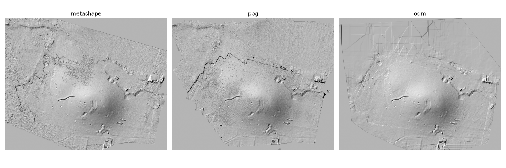
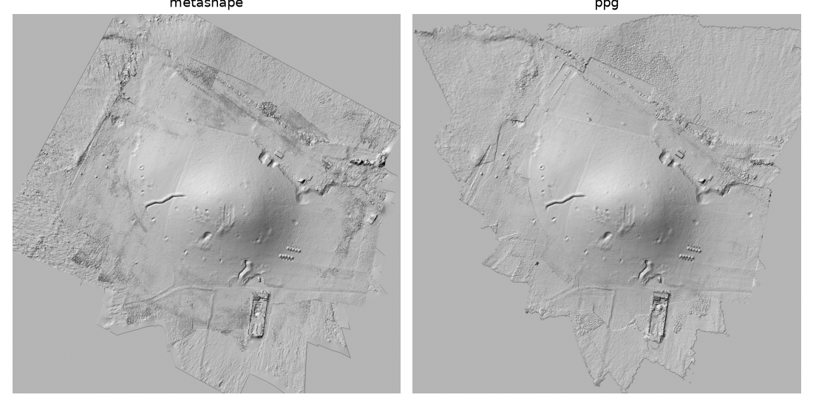
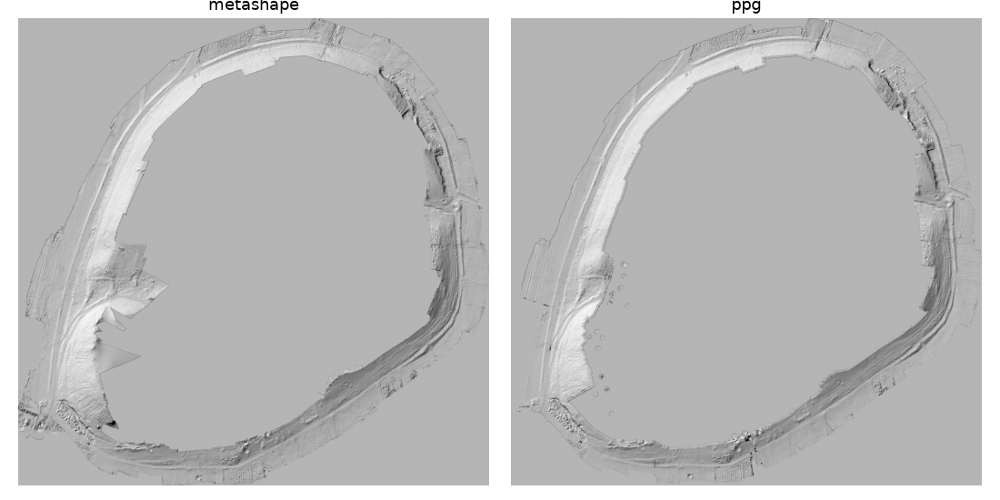
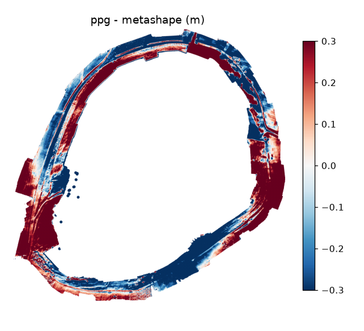

# Benchmark

pyarchinit-photogrammetry, Agisoft Metashape Pro e ODM (il motore di WebODM) sulle stesse foto di un
tell, sullo stesso computer, con le stesse risoluzioni: il tempo di ogni passo e la qualità dei
risultati.

## Come

* **Computer**: Apple M4 Pro (8 core ad alte prestazioni e 4 ad alta efficienza), 24 GB, macOS 27.
  **Metashape usa la GPU (Metal) oltre alla CPU; pyarchinit-photogrammetry e ODM usano solo la
  CPU**: pyarchinit-photogrammetry nativo, con il suo nucleo nativo, ODM in Docker (una macchina
  virtuale Linux con 11 core e 8 GB).
* **Dati**: Tell Sultan (Siria), drone DJI con fotocamera FC8482 (4032 × 2268 pixel):
  le 57 foto del [tutorial](tutorials/tell.md) (circa 110 m dal suolo, 3,6 cm per pixel) e l'intero
  rilievo di 425 foto (voli verticali a circa 40, 65 e 110 m, e foto oblique).
* **Impostazioni**: punti cercati sulle foto a metà dimensione (Metashape precisione *Media*, ppg
  *Alta*, ODM `--feature-quality high`), mappe di profondità a un quarto (Metashape *Media*, ppg
  *Media*, ODM `--pc-quality medium`), filtro moderato, DEM dalla nuvola densa, ortofoto sul DEM,
  fusione a mosaico; DEM e ortofoto di ODM alle risoluzioni scelte da Metashape. Georeferenziazione con
  il GPS del drone: su Tell Sultan non ci sono punti di controllo.
* **Qualità**: i prodotti di ogni programma vengono portati su quelli di Metashape - uno spostamento
  trovato con la correlazione di fase delle ombreggiature, poi affinato insieme a offset, inclinazione e
  scala delle quote con l'adattamento ai minimi quadrati delle superfici: ogni programma colloca in modo
  un po' diverso un rilievo noto solo dal GPS del drone - e confrontati: NMAD e 95° percentile delle
  differenze di quota, terreno coperto, nitidezza delle ortofoto dove le coprono tutti. L'errore di
  riproiezione è la RMS su tutte le osservazioni dei punti di legame, in pixel delle foto.

Gli script sono nel repository (`benchmark/`): puoi rifarlo sui tuoi dati e sul tuo computer.

!!! note "GPU e CPU"
    Sul Mac Metashape esegue i passi più pesanti - l'abbinamento delle foto e le mappe di profondità -
    sulla GPU con Metal, oltre che sulla CPU; pyarchinit-photogrammetry e ODM fanno tutto sulla CPU.
    I tempi confrontano i programmi come girano su questo computer, non gli algoritmi sullo stesso
    hardware.

## 57 foto (il tutorial)

Tempi in secondi:

| Passo | pyarchinit-photogrammetry 1.1 (CPU) | Metashape Pro 2.1.3 (GPU + CPU) | ODM 3.6.2 (CPU) |
|---|---:|---:|---:|
| Allineamento | 190 | 18 | 119 |
| Mappe di profondità e nuvola densa | 158 | 79 | 170 |
| Mesh | 32 | 32 | 51 ¹ |
| Texture | 8 ⁶ | 19 | 54 |
| DEM | 8 | 4 | 3 |
| Ortofoto | 20 | 26 | 7 |
| **Totale** | **416** | **179** | **418** ² |

Risultati:

| | pyarchinit-photogrammetry | Metashape | ODM |
|---|---:|---:|---:|
| Foto allineate | 57 / 57 | 57 / 57 | 57 / 57 |
| Punti di legame | 316.000 | 65.000 | 55.000 |
| Errore di riproiezione (RMS) | 0,97 px | 1,05 px | - |
| Nuvola densa | 3,1 M punti | 4,2 M | 6,1 M |
| DEM | 19 cm | 15 cm | 15 cm |
| DEM rispetto a quello di Metashape: NMAD / 95° percentile | 14,4 / 52 cm | - | 14,2 / 75 cm |
| Terreno coperto dal DEM ³ | 95 % | 100 % | 99 % |
| Ortofoto | 3,6 cm | 3,8 cm | 3,8 cm |
| Nitidezza dell'ortofoto ⁴ | 58,3 | 52,8 | 35,0 |
| Terreno coperto dall'ortofoto ⁵ | 64 % | 79 % | 90 % |

¹ la mesh 2,5D ha esaurito la memoria una volta ed è stata rifatta con meno processi.
² con la georeferenziazione e il rapporto.
³ celle della griglia comune con una quota, DEM di Metashape = 100 %.
⁴ varianza del laplaciano dell'immagine in grigi a 2 cm, mediana dei tasselli coperti da tutti.
⁵ quota dei tasselli dell'impronta comune; ODM riempie fino ai bordi del volo.
⁶ senza la correzione del colore delle foto, come Metashape senza la sua calibrazione dei colori (con,
come nella finestra: 27 s).

Note:

* Metashape cerca i punti e allinea sulla GPU: 18 s, contro 119 s di ODM e 190 s di ppg sulla
  CPU.
* ppg calcola le mappe di profondità di un rilievo aereo con il PatchMatch del suo nucleo nativo:
  niente gradini a forma di curve di livello e bande, che lo stereo a coppie disegnava su questo tell.
* L'ortofoto di ODM è la più morbida: è proiettata su una mesh 2,5D semplificata a 400.000 facce; il suo
  DSM riempie i vuoti con toppe a lati dritti (visibili a nord).
* La linea che attraversa il nord-ovest dell'ombreggiatura di ppg è il bordo del terreno visto da tre o
  più foto: oltre, dove il terreno lo vedono due foto, la superficie di ppg sta circa 20 cm più in alto.
  La nuvola densa di ppg tiene i punti visti da almeno tre foto, e ogni piano delle sue mappe di
  profondità deve essere visto da due foto (prima di questo benchmark quel margine era bucherellato da
  pochi punti sbagliati).
* Un blocco volato a una sola quota e collocato con il solo GPS del drone non fissa la scala delle sue
  quote: rispetto al DEM di Metashape dell'intero rilievo (425 foto, tre quote di volo), le quote dei
  rilievi a 57 foto di *entrambi* i programmi sono stirate di circa il 3 % (una scala delle quote di
  0,97 le riporta, con una cupola residua di 23 cm NMAD per Metashape e 34 cm per ppg). Il confronto
  qui sopra, fra i prodotti delle stesse 57 foto, non la vede.
* L'ortofoto di ppg è la più nitida: per ogni punto prende la foto che lo vede alla risoluzione più
  alta.

## 425 foto (l'intero rilievo)

Tempi in secondi:

| Passo | pyarchinit-photogrammetry 1.1 (CPU) | Metashape Pro 2.1.3 (GPU + CPU) | ODM 3.6.2 (CPU) |
|---|---:|---:|---:|
| Allineamento | 1.775 | 205 | 903 |
| Mappe di profondità e nuvola densa | 1.111 | 872 | ⁷ |
| Mesh | 216 | 278 | |
| Texture | 122 | 131 | |
| DEM | 71 | 16 | |
| Ortofoto | 112 | 146 | |
| **Totale** | **3.407** (57 min) | **1.648** (27 min) | non completato ⁷ |

⁷ nella sua macchina virtuale da 8 GB ODM ha esaurito la memoria mentre univa le mappe di profondità
delle 425 foto, anche a tasselli, e si è fermato senza nuvola densa.

Risultati:

| | pyarchinit-photogrammetry | Metashape |
|---|---:|---:|
| Foto allineate | 425 / 425 | 425 / 425 |
| Coppie di foto abbinate | 6.060 | - |
| Punti di legame | 1.985.000 | 556.000 |
| Errore di riproiezione (RMS) | 1,22 px | 1,34 px |
| Nuvola densa | 22,2 M punti | 15,5 M |
| Mesh | 1,48 M facce | 1,24 M |
| DEM | 7,1 cm | 8,2 cm |
| DEM rispetto a quello di Metashape: NMAD / 95° percentile | 12,0 / 39 cm | - |
| Terreno coperto dal DEM ³ | 98 % | 100 % |
| Ortofoto | 2,0 cm | 2,0 cm |
| Nitidezza dell'ortofoto ⁴ | 636 | 347 |

Note:

* L'allineamento è dove ppg resta molto indietro: 6.060 coppie di foto abbinate sulla CPU con
  40.000 punti per foto, poi tutte le camere collocate insieme; Metashape abbina sulla GPU. Dopo
  l'allineamento i due sono vicini: 1.632 s per ppg, 1.443 s per Metashape.
* La nuvola densa di ppg tiene i punti visti da almeno tre foto: ai margini dei voli è rada e lì il DEM
  è interpolato (più liscio di quello di Metashape), mentre è molto più densa dove si sovrappongono
  decine di foto (i voli bassi sopra il centro).
* Collocato ogni rilievo sull'altro, i due DEM concordano entro 12 cm (NMAD). Le differenze più ampie -
  un anello 15-25 cm più basso di Metashape intorno al centro del tell, i bordi più alti - sono una
  differenza di autocalibrazione: ppg affina due coefficienti radiali con il punto principale fisso,
  Metashape tre radiali, due tangenziali e il punto principale; collocati con il solo GPS del drone,
  nessuno dei due rilievi si può dire giusto. Le mappe di profondità non c'entrano: calcolate
  dall'allineamento di Metashape, quelle di ppg concordano con i punti di legame di Metashape entro 2 cm
  per foto. Il benchmark su Tell Tuqan, qui sotto, con i punti di controllo a terra, misura
  l'accuratezza assoluta dei due programmi.

## 997 foto con punti di controllo a terra (Tell Tuqan)

Tell Tuqan (Siria), il volo dei target: 997 foto di 8064 × 4536 pixel (48 Mpx, DJI FC8482) e 11 target
codificati misurati a terra - 7 punti di controllo, 4 di verifica, accuratezza 2 cm in orizzontale e 3 cm
in verticale - con le stesse proiezioni dei marker (misurate in Metashape dal topografo) date a entrambi i
programmi. Impostazioni come sopra, scalate alle foto da 48 Mpx: punti cercati sulle foto a un quarto
(2016 px: Metashape *Low*, ppg *Medium*), mappe di profondità a un ottavo (1008 px), filtro moderato, mesh
con numero medio di facce, texture 4096, DEM dalla nuvola densa, ortofoto sul DEM. ODM non è stato
lanciato (vedi le 425 foto).

Tempi in secondi:

| Passo | pyarchinit-photogrammetry 1.1 (CPU) | Metashape Pro 2.1.3 (GPU + CPU) |
|---|---:|---:|
| Abbinamento | 3.391 | 972 |
| Allineamento | 23.110 ⁸ | 455 |
| Ottimizzazione sui punti di controllo | 2.231 | 25 |
| Mappe di profondità e nuvola densa | 2.884 | 4.218 |
| Mesh | 244 | 2.579 |
| Texture | 3.076 | 2.621 |
| DEM | 166 | 85 |
| Ortofoto | 10.903 ⁹ | 2.401 |
| **Totale** | **46.007** (12 h 47 min) | **13.355** (3 h 43 min) |

⁸ allineamento incrementale: quello globale, usato per le 425 foto, ha piegato questo anello (vedi le note).
⁹ tre ore in cui il passo l'ha dettato il disco, non il programma (vedi le note).

Risultati:

| | pyarchinit-photogrammetry | Metashape |
|---|---:|---:|
| Foto allineate | 988 / 997 | 995 / 997 |
| Punti di legame | 4.681.000 | 1.244.000 |
| Punti di controllo: RMSE (orizzontale / verticale) | 2,7 cm (0,3 / 2,7) | 2,7 cm (2,3 / 1,6) |
| Punti di verifica: RMSE (orizzontale / verticale) | 66,3 cm (51,4 / 42,0) | 28,6 cm (13,4 / 25,2) |
| Nuvola densa | 37,6 M punti | 78,7 M punti |
| Mesh | 2,51 M facce | 4,61 M facce |
| DEM | 5,5 cm | 4,1 cm |
| DEM rispetto a quello di Metashape: NMAD / 95° percentile ¹⁰ | 50 cm / 1,36 m | - |
| Terreno coperto dal DEM ³ | 91 % | 100 % |
| Ortofoto | 8,0 mm | 5,1 mm |
| Nitidezza dell'ortofoto ⁴ | 915 | 780 |

¹⁰ confrontati così come sono, senza la registrazione usata su Tell Sultan: i due rilievi stanno sugli
stessi punti di controllo.

Note:

* Il volo dei target è un anello chiuso intorno al tell, largo circa 650 m, percorso una volta sola con
  la camera sui target e senza RTK (il GPS delle foto è preciso a 5 m in orizzontale e 10 m in
  verticale). Quello che i due programmi ricostruiscono è la fascia di terreno sotto l'anello: il tell
  al centro non è coperto, come mostrano le ombreggiature.
* L'allineamento è tutta la storia di questo rilievo. L'allineamento globale di ppg, che sulle 425 foto
  era andato bene, ha collocato tutte le foto dell'anello ma lo ha piegato: coerente in locale (i target
  riproiettati entro 1-3 pixel) ma con la scala che cambia da una parte all'altra dell'anello, e i
  target finiti a circa 90 m dalle loro coordinate. L'allineamento incrementale ha ricostruito l'anello
  giusto al prezzo di 6,4 ore, e il suo blocco restava comunque piegato di qualche metro prima dei
  punti di controllo (RMSE di 2,6 m sui target di controllo, un gruppo di 25 foto spostato di 14 m): un
  anello libero di mille foto oblique, senza strisciate che lo attraversino, deriva. Metashape usa il
  GPS delle foto dentro l'allineamento e non deriva. Aggiungere a posteriori il GPS delle foto alla
  compensazione di ppg ha portato l'errore sui punti di controllo solo da 2,6 a 1,8 m: i punti di legame
  tengono la piega.
* L'ottimizzazione sui punti di controllo ha dovuto raggiungere target lontani metri dal blocco: i target
  entrano come punti fissi a passi, su un sottoinsieme delle tracce più forti, poi tutto il blocco viene
  ritriangolato e compensato (37 min). Porta i punti di controllo a 2,7 cm, come Metashape, ma quelli di
  verifica a 66 cm contro i 29 di Metashape: tre dei quattro target di verifica restano fuori da 25 cm a
  1,3 m (il quarto 2 cm), il peggiore nel gruppo di 25 foto che resta a un metro dalle camere di
  Metashape.
* I due DEM, confrontati così come sono, differiscono di 50 cm (NMAD): non rumore, ma onde di ±0,3-1 m
  lungo l'anello nella mappa delle differenze - la piega residua del blocco di ppg - con accordo dove
  l'anello passa sui target di controllo. I dieci punti RTK misurati a terra cadono fuori dalla fascia:
  il DEM di ppg non ha una cella su nessuno di essi (da 3 a 80 m dalla più vicina), quello di Metashape
  ne raggiunge tre, due entro 0,6 m e uno a 2 m in una zona che ha interpolato attraverso un buco (le
  punte nella sua ombreggiatura).
* Dopo l'allineamento, mappe di profondità, nuvola densa, mesh, texture e DEM di ppg prendono 6.370 s
  sulla CPU contro i 9.503 s di Metashape con la GPU, e la sua ortofoto è la più nitida. Il tempo
  dell'ortofoto non è del programma: i 28 GB di foto da 48 megapixel non stanno nei 24 GB del Mac, ppg
  li rilegge a ogni tassello, e il SSD esterno su cui stanno è stato condiviso con altro lavoro per
  quasi tutte quelle tre ore (da solo, l'ultimo tratto è andato cinque volte più veloce). Una cache
  delle foto dimensionata sulla memoria invece che sui thread è la correzione da fare.
* ODM non è stato lanciato (vedi le 425 foto).

## Cosa è cambiato in pyarchinit-photogrammetry

Queste prove hanno cambiato il programma; i numeri qui sopra sono quelli della versione con le modifiche:

* allineamento di molte foto: le coppie che si sovrappongono trovate prima su foto ridotte a 1024
  pixel, le 20 più forti di ogni foto abbinate per intero, tutte le camere collocate insieme
  (allineamento globale): 57 foto 472 → 177 s, 425 foto 42 → 27 min, le stesse
  camere entro 1 cm (RMS);
* mappe di profondità dei rilievi aerei con PatchMatch, ogni piano confermato da due foto, e una fusione
  che mantiene la densità delle mappe: 57 foto da 1,1 a 3,1 M punti, niente gradini a forma di curve di
  livello;
* DEM: risoluzione dal terreno che la nuvola copre; picchi, punti spuri e le buche di pochi punti
  sbagliati tolti; i margini radi interpolati come una superficie unica invece che a puntini: 425 foto,
  dal 45 al 64 % del terreno comune, 95° percentile delle differenze da 87 a 39 cm;
* ottimizzazione sui punti di controllo lontani metri dal blocco: i target si raggiungono a passi (per
  continuazione) sulle tracce più forti, poi tutto il blocco viene ritriangolato e compensato; una
  compensazione unica da così lontano divergeva (Tell Tuqan: target di controllo da 2,6 m a 2,7 cm).
