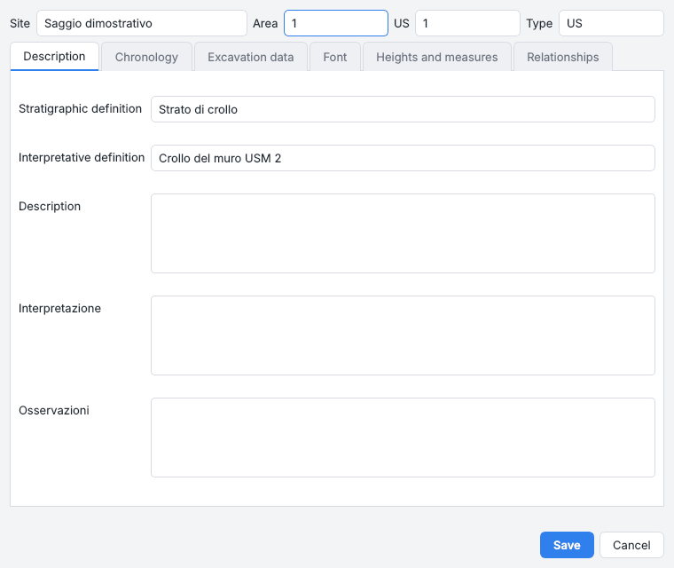
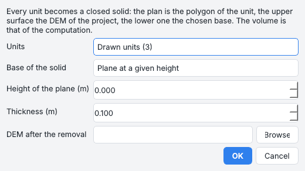
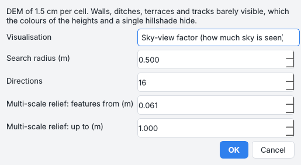
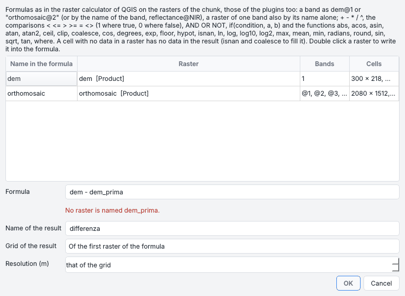

# Tools for archaeology

The tools that turn the survey into excavation records: the link with PyArchInit and QGIS, the solids of the units,
the stratigraphic proposal for the Extended Matrix, the phases of the excavation, pottery, colours, relief
visualisations, the raster calculator, the classification of the cloud and BIM.

## PyArchInit

PyArchInit stays the source of the forms and of the relationships: the program writes into its database the units,
the spot heights and the products, and reads back what is already there. More in [PyArchInit](../pyarchinit.md).

### Connecting

At start the interface connects by itself to the database configured in PyArchInit 5
(`~/pyarchinit_5/pyarchinit_DB_folder/config.cfg`; option *Connect to the PyArchInit database at start-up*).
*PyArchInit > Connect...* opens the connection window:

* the **PyArchInit configuration**;
* a **SQLite / SpatiaLite file**;
* a **PostgreSQL / PostGIS server**: host, port, database, user, password, *Test connection*.

*Use the demo database* creates `demo.sqlite` with the full PyArchInit 5 schema (three sites) inside
`~/pyarchinit_5/pyarchinit_DB_folder` when that installation exists, so QGIS can open the same file; `config.cfg`
is never touched. The [PyArchInit pane](panes.md#pyarchinit) lists sites, US and documentation.

??? example "Command line and API"
    `PyArchInit.connect(url=..., config_path=...)`, `.sites()`, `.stratigraphic_units(sito)`, `.documentation(sito)`

### The site of the project

Every unit and spot height belongs to one excavation: the site is chosen once - *PyArchInit > Project site*, the
box at the top of the PyArchInit pane, or the question asked the first time something is drawn or published - and
saved in the project. A PyArchInit database may hold several sites: the pane then lists the US and documents of the
project's site only, and the US form offers the sites of the database.

A site must have its site form before anything is published: *PyArchInit > New site...* (or *New site* in the pane
and in the publish window) creates the record; publishing to a site that does not exist creates it by itself.

??? example "Command line and API"
    `doc.meta["sito"]`, `pa.ensure_site(sito, comune=...)`, `pa.site_exists(sito)`

### Publishing

| Command | What it writes |
| --- | --- |
| *PyArchInit > Publish orthophoto / DEM / model...* | choose the site, the document name and the US to link: the rasters are copied next to PyArchInit's media folder, with thumbnails and a `documentazione_table` record |
| *Publish the drawn units and spot heights* (*Publish* in the drawing bar) | the units in `pyunitastratigrafiche`, the spot heights in `pyarchinit_quote` |
| *Save changes in PyArchInit* (*Layer* pane) | the edits of units loaded from PyArchInit, by their `gid` |
| *Publish in PyArchInit* (*Sections* pane) | the section traces in `pyarchinit_sezioni` |

??? example "Command line and API"
    `ppg pyarchinit publish scavo.ppg "Sito" "Nome" --dem --model --link-us 1:101`; `pa.publish_orthomosaic`,
    `publish_dem`, `publish_model`

### US forms

A double click on a US in the PyArchInit pane (or *US form* in the *Layer* and *US proxies* panes) opens the
PyArchInit US form (`us_table`): description, chronology, excavation data, characters, elevations and measures, and
the stratigraphic relationships as an editable table (*Copre* covers, *Taglia* cuts, *Si appoggia a* abuts...),
stored in PyArchInit's own format so that its Harris matrix reads them.

* *New US* in the pane, or *PyArchInit > New US form...*, creates a record (the site record too when missing); an
  existing site, area, US and type is refused.
* A database with a reduced `us_table` (the demo database of version 0.2, or a file made by other tools) shows a
  warning in the form with *Update the database structure* (also in the PyArchInit menu): the missing PyArchInit 5
  columns are added after a backup copy of the file, the records untouched.

??? example "Command line and API"
    `pa.missing_us_columns()`, `pa.upgrade_us_table()`, `pa.us_record`, `pa.create_us(sito, area, us, tipo, **fields)`,
    `pa.update_us(id_us, **fields)`, `parse_relationships`, `format_relationships`

## QGIS, live

*QGIS > Open in QGIS (live link)* opens the orthophoto, the DEM and the drawings in a QGIS project; *QGIS > Live
link with QGIS (both ways)* keeps them linked both ways:

* what is drawn here reaches QGIS within a second;
* what is saved in QGIS (*Save Layer Edits*, or the end of an edit session) in the layers *Unita' stratigrafiche
  (ppg)*, *Quote (ppg)* and *Sezioni (ppg)* (units, spot heights, sections) comes back here within a second:
  outlines and attributes changed, features drawn there (they get their identity, `ppg_id`), features deleted.

Each save is one entry of *Edit > Undo* and a line of the log. The units take the columns of `pyunitastratigrafiche`
(`us_s`, `area_s`, `unita_tipo_s`, `scavo_s`, `disegnatore`...); a unit from PyArchInit changed there waits for *Save
changes in PyArchInit*; the proxy of a unit whose outline changed is built again; a section whose trace moved is cut
again.

!!! note
    An outline that is not valid is made valid (or skipped), a layer in another reference system is refused, a file
    QGIS holds while saving is read a moment later. Contour lines, zones, stones, patches and the drawings of the
    plugins are computed here and stay one-way. Details in [QGIS, live](../integrations.md#qgis-live).

??? example "Command line and API"
    `io.qgis_link.LiveLink` (`write`, `external_change`, `read_changes`), `export_layers`, `build_project`

## QField in the trench

*File > Export > QField package* writes a folder with the orthophoto reduced for the tablet (Cloud Optimized GeoTIFF,
2 cm by default), the DEM shown as a hillshade and a GeoPackage with the units and spot heights of the chunk, plus a
QGIS project with relative paths, labels and the list of the US types (made with QGIS's Python when QGIS is
installed; without it QField opens the GeoPackage directly).

1. Copy it to the tablet or to QFieldCloud.
2. Draw and correct in the trench.
3. Bring the folder back: *File > Import > Edits from QField* applies to the chunk the units and spot heights added,
   changed and deleted there (every feature keeps an identity, `ppg_id`).
4. *Publish in PyArchInit* / *Save changes in PyArchInit* write them to the database.

## US proxies

*Tools > 3D proxies of the units*: each unit polygon (drawn, or from a PyArchInit site) becomes a closed solid between
the DEM of the project (top) and a **base**: a plane at a given elevation, the DEM recorded after the unit was
removed, a constant thickness or the lowest point. Its volume equals the cut/fill volume on the same cells.

The [US proxies pane](panes.md#us-proxies) lists volume, plan area and elevations; *View in 3D* shows them coloured over
the model; *Export (Extended Matrix)* writes one OBJ with an object per unit (`US12`, `USM3`) plus the coordinate
offset; *Publish in PyArchInit* registers each proxy as a 3D media linked to its US; *Heights in the US form* writes
the minimum and maximum elevations into the form.

Each proxy keeps its base with its value (the plane elevation, the thickness, the DEM after the removal) and the
identity of its unit. When the polygon of the unit changes - *Vertices*, *Reshape*, or in QGIS through the live link -
the proxy is built again by itself in the same way, and when only its number or type changes it takes the new name
(`US7`); for a proxy made by an earlier version the missing value is asked once. See also the plugin
[Blender and EMtools](../plugins/blender-em.md).

??? example "Command line and API"
    `archaeo.proxies.unit_proxy`, `proxies_for_units`, `export_extended_matrix`, `save_proxy`

## US proposal

*Tools > Propose US and relationships (Extended Matrix)...*, also in the menu of the SAM tool: the units of the chunk
without a number - those SAM found on the whole orthophoto, or drawn - get a US number, the highest units first,
after the last US of the site in PyArchInit and of the project.

* **Type and definition**: USM where most of the classified dense cloud inside is masonry (cut, floor, deposit and
  bedrock give the stratigraphic definition; vegetation, finds and excavation equipment are proposed unticked).
* **Measures**: area in plan, elevations from the DEM and the Munsell colour of the orthophoto (with the colour
  calibration) go into the description, the colour and the elevation fields of the form.
* **Relationships**, from the contacts in plan with the step of the DEM across them: the unit higher along the contact
  (by at least the step chosen, 2 cm) covers the other (*Copre*); a unit enclosed in another for three quarters of its
  outline and not higher is the fill of a cut, which is proposed with it (the fill *Riempie* the cut, the cut *Taglia*
  the unit around; a unit the cloud calls a cut cuts it directly); a layer against masonry abuts it (*Si appoggia a*),
  or covers it when higher.

The window lists units and relationships with the reason of each; number, type and definition can be corrected, and a
double click shows the unit. *Apply to the project* numbers the units and adds the cuts (the outline of their fill,
*2 - US outline*); *Apply and write into PyArchInit* also creates the US forms (with `node_uuid` and `entity_uuid`,
existing forms left as they are), writes the relationships in both directions and the polygons in
`pyunitastratigrafiche`: the Extended Matrix that PyArchInit and EMStudio build from the forms then has these nodes
and edges.

!!! info "A unit drawn with its number"
    It reaches the matrix the same way, through PyArchInit. With a PyArchInit database connected, a unit drawn here (or
    in QGIS through the live link) whose US form is not in PyArchInit is said in the log, and the proposal takes it
    too, keeping its number, with the cut it may fill. The units that already have their form take part only for the
    relationships: a new unit inside US 2 gets *Riempie* its cut and the cut *Taglia* US 2, written in the form of US 2
    as well, whose other fields are left as they are. Then export the em.json of the site again from PyArchInit
    (*Extended Matrix > Esporta sito in em.json*, as the message at the end recalls) and EMtools and EMStudio have the
    new units, paired with their proxies by their `node_uuid`.

## Excavation phases

*Tools > Excavation phases (volumes and relationships)...*: every chunk with a DEM is a survey of the excavation - a
day, the end of a US - in one frame (a common georeference, or *Align chunks*), in the order of its date (the EXIF of
the photos, or written in the window).

* The units drawn on a phase belong to it (switching chunk keeps each chunk's drawings) and were exposed then.
* The window gives the **volume** removed and added from each phase to the next, also inside every unit.
* It **proposes** that a unit exposed earlier *covers* the units it overlaps in plan exposed later; the ticked
  relationships go into the US forms of PyArchInit in both directions (never twice).
* A double click on a phase shows it; *Save CSV* writes the report.

*Coregister the DEMs of the phases before the volumes* (ticked by default with more than one phase) first moves every
phase *onto the first phase* or *onto the previous phase* over the ground that did not change, the drawn units left
out: surveys of different days are never perfectly registered, and a shift of a few centimetres is false excavation
and fill on every slope. The DEMs of the project do not change; the tab *Coregistration* gives the shift of each phase
(dx, dy, dz in cm, tilt in mm/m, NMAD on the stable ground before and after, stable cells) and *Compute again* applies
a new choice. See [DEM coregistration](processing.md#dem-coregistration).

??? example "Command line and API"
    `ppg coregister scavo.ppg --reference "Giorno 1" --chunk "Giorno 2" --exclude-polygon scavo.geojson`,
    `ppg timeline scavo.ppg --coregister-to previous` (`--no-coregister`); `chunk.coregister_dem(reference)`,
    `archaeo.coreg.coregister(reference_path, dem_path, out_path)`

## Pottery profiles

*Tools > Pottery profile from a mesh...*: choose the mesh of a vessel or a sherd (OBJ, PLY, STL), the scale, the units
and the axis (estimated from the normals of the surface, or the Z of the mesh with the rim up, as on a turntable, or
down, a sherd resting on its rim).

* The **rim diameter** comes from the circle of the lip, which also moves the axis to its centre (a sherd laid on the
  turntable away from its centre is measured right), with the arc kept (*Rim preserved*, 34% (25-50) for a third of the
  rim). Below 40 degrees of arc, or with an irregular lip, the rim is marked *uncertain*, measured around the axis, and
  not written into PyArchInit.
* The **profile** with maximum and base diameter, total or preserved height and wall thickness is drawn as SVG, DXF and
  PNG, in a window that stays open.
* *Search similar forms* ranks the forms of PyArchInit's `pottery_table` of every site by the diameters and height they
  share (the rim counts twice) and, for forms saved by this program, by the shape of the profile from the rim down
  (whatever their size).
* *Save in PyArchInit...* writes the measurements in centimetres into a new or chosen pottery form (`diametro_rim`,
  `diametro_max`, `diametro_bottom`, `diametro_height` total height, `diametro_preserved` preserved height, `percent`
  <5 / 5-25 / 25-50 / >50; form, part, shape and ware from PyArchInit's thesaurus); filled fields of an existing form
  are kept unless *Replace* is ticked. The drawing goes into the media of the form (PNG linked as CERAMICA, with SVG and
  DXF beside it and `.profile.json`, the profile for later searches).

??? example "Command line and API"
    `ppg pottery vaso.ply --out profilo.svg --scale 1 [--axis up|down] [--units mm]`,
    `ppg pyarchinit pottery-search frammento.ply`, `ppg pyarchinit pottery-save frammento.ply Sito --us 12 --part Orlo`;
    `archaeo.pottery.measure`, `rim`, `signature`, `draw`; `pa.search_pottery`, `pa.save_pottery`

## Munsell colour

*Measure area and 3D surface* (a box, a polygon or a selected unit) also gives the colour of the orthophoto inside it -
the median of its pixels without the darkest and the brightest tenth (shadows, pebbles, glare) - as Munsell notation and
nearest chip of a soil chart (`10YR 5/4`).

Photograph a ColorChecker Classic (24 patches) in the trench and use *Tools > Calibrate the colour with the colour
chart...* (a box around it on the orthophoto): the 3 x 3 correction of that survey (fitted in linear light against the
reference patches, residual reported as CIEDE2000) is kept in the chunk, and the colours of different days and cameras
become comparable. It needs colour-science (in `[gui]`, `[all]` or `[munsell]`).

## Relief visualisations

*Tools > Relief visualisations...*:

| Visualisation | What it shows |
| --- | --- |
| **Sky-view factor** | how much sky each cell sees: dark in ditches and at the foot of walls |
| **Positive and negative openness** | ridges and walls, ditches and pits |
| **Local relief** | the DEM minus its mean around: red above, blue below |
| **Multi-scale relief** (MSRM) | features from a few cells to the search diameter at once |
| **Multi-directional hillshade** | a hillshade lit from 16 directions |

The window proposes a search radius of about 20 cells; the raster is shown at once (grey stretched on the whole raster,
flat ground in the middle for the openness), it stays in the workspace and the value under the cursor is in the bar at
the bottom. On a tell the grid of the buildings, the walls and the old trenches come out of a DSM where the colours show
nothing.

??? example "Command line and API"
    `ppg relief`; `chunk.build_relief`; `archaeo.relief`

## Raster calculator

*Tools > Raster calculator...*: formulas written as in the raster calculator of QGIS on every raster of the chunk - DEM,
orthophoto and their versions, slope, aspect and relief rasters, the bands of the reflectance, the indices, the thermal
orthophoto, the satellite scenes, the GeoTIFFs of the plugins (by their folder and file, `terrain_twi`, or by the name
the plugin gives them) and earlier results.

* The table lists every raster with the name to use in the formulas, its bands and its cells; a double click writes the
  name into the formula.
* A band is written `orthomosaic@2`, `"dem@1"` or `reflectance@NIR` (by the name of the band); a raster of one band
  also by its name alone. `+ - * / ^`, the comparisons `< <= > >= = <>` (1 where true, 0 where false), `AND OR NOT`,
  `if(condition, a, b)` and the functions `sqrt`, `abs`, `min`, `max`, `mean`, `clip`, `coalesce`, `isnan`, `ln`,
  `log10`, `sin`...
* The formula is checked while it is written: the window says what it reads and on which grid, or what is wrong.
* The result is a GeoTIFF on the grid of the first raster of the formula (or of another one, at its resolution or
  another), the others resampled onto it. It is shown on a colour ramp with its value under the cursor, kept in the
  workspace under *Raster calculator* (double click to see it; right click: compute it again with another formula,
  remove it) and added to the QGIS project.

A cell where an input has no data has no data in the result. Everything about the formulas is in the
[API](../api.md#raster-calculator).

!!! example "Formulas"
    * `dem - dem_prima_dello_scavo`: what was dug away between two surveys;
    * `if(slope > 30 AND svf < 0.9, 1, 0)`: the steep cells that see little sky;
    * `coalesce(dem, dem_prima_dello_scavo)`: a DEM with its holes filled from another.

??? example "Command line and API"
    `ppg calc scavo.ppg "dem - dem_prima_dello_scavo" --name scavato`; `engine.rastercalc.calculate(chunk, formula,
    name)`, `rasters(chunk)`; plugins: `context.add_rasters`, `context.rasters`

## Classification of the cloud

*Tools > Classification of the cloud*:

* **Automatic classification** with rules: ground, vegetation, masonry and structures, noise (the ASPRS classes plus
  archaeological classes 64-71), written in the dense cloud (the LAS export keeps them).
* The 3D view colours the cloud by *Classes* (or *Elevation*, or the colours of the photos) with a legend: untick a class
  to hide it.
* The **lasso** selects points on the screen (click the vertices or drag, double click or ++enter++ to close) and gives
  them a class; a new code can be given a name (for instance 120 *Collapse*), shown in the legend. Only the points
  visible at the front are taken unless asked, and hidden classes are never taken. Points corrected by hand are
  remembered: the rules and the classifier leave them as they are.
* **Train the classifier** learns the classes from those points (or from every classified point): the geometry around
  each point at three scales, the height above the ground and the colour, with a random forest (or gradient boosting for
  a smaller file). It reports the accuracy per class and classifies the rest of the cloud. The model is kept in the
  project; *Save / Load a classifier* (`.ppgclf`) reuses it on other excavations with a similar point spacing.
  *Classify with the trained classifier* takes a minimum confidence (below it the points stay unclassified); *Forget the
  corrections by hand* clears the flags, classes unchanged.
* **Classes from the units (polygons)** gives the points inside each drawn or loaded unit (in plan) the class of that
  unit (`US 12 (area 1)`, codes from 100, kept when run again; hand corrections kept unless unticked) and shows points,
  plan area and elevations per US in a table (*Save CSV...*).

!!! tip "The classes drive the products"
    The DEM window lists the classes of the dense cloud: only *Ground* gives a terrain model (DTM). The orthophoto window
    makes chosen classes transparent where they are the visible surface; the model window meshes only the ticked
    classes; *File > Export > Point cloud* exports only some classes; the sections and the plan slices keep only the
    ticked classes. Noise (classes 7 and 18) never makes a DEM or a mesh.

??? example "Command line and API"
    `ppg classify scavo.ppg`, `ppg classify-train scavo.ppg modello.ppgclf`, `ppg classify-apply altro.ppg modello.ppgclf`,
    `ppg classify-units scavo.ppg --csv us.csv`, `ppg dem scavo.ppg --classes 2`, `ppg ortho --hide-classes 3,71`,
    `ppg mesh --classes 2,64`, `ppg section ... --classes 2`, `ppg export --cloud muri.las --classes 64`;
    `ai.classify.classify_chunk(chunk)`, `set_class(chunk, mask, code)`, `classify_by_units(chunk, units)`,
    `class_statistics`; `ai.learn.train_on_chunk(chunk)`, `classify_chunk_with_model(chunk, model)`

## BIM and IFC

*Tools > Export IFC (BIM)...*: choose the units (drawn here, the US polygons of a PyArchInit site, or the proxy solids)
and whether to include the whole survey. The export shows its progress and, at the end, a window with the elements,
their attributes (`Pset_PyArchInit_US`) and a 3D view of what was written. IFC4 in metres with `IfcMapConversion`; with
proxies the file carries quantities, materials, groups and relationships: see [BIM and IFC](../bim.md).

??? example "Command line and API"
    `ppg ifc scavo.ppg rilievo.ifc`; `bim.ifc.export_chunk_ifc(...)`, `export_proxies_ifc(...)`, `read_ifc_elements(path)`
