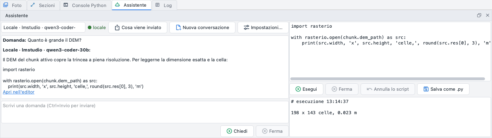

# L'assistente

Il pannello *Assistente* (in basso, accanto alla *Console Python*; *Vista > Assistente > Apri l'assistente* o
*Strumenti > Assistente > Apri l'assistente*) è una conversazione con un modello linguistico sul progetto e sul
programma, un editor di script per far girare sul progetto ciò che il modello propone - o ciò che scrivi tu - e le
azioni che il modello fa sul progetto aperto quando gli chiedi di fare qualcosa.



## Su cosa risponde

Il modello legge le domande insieme ai passi di questa guida che le riguardano, e può guardare il progetto con
strumenti che leggono soltanto: il riepilogo del progetto, l'allineamento e i suoi errori, i marker, il DEM,
l'ortofoto, la nuvola densa, il modello, i prodotti termici e multispettrali. Risponde nella lingua dell'interfaccia. Quando la risposta contiene uno script Python,
*Apri nell'editor* sotto di essa copia lo script nell'editor a destra.

### Cosa sa del progetto aperto

Ogni domanda porta un breve blocco, *Il progetto adesso*, letto dal progetto e dalla finestra appena prima che la
domanda parta: i chunk (foto, foto allineate, prodotti con le loro versioni e quella attiva, i raster del calcolatore
per nome, quante unità, quote, pietre, linee e prospetti hanno), il chunk attivo, cosa mostra la vista 2D (l'ortofoto,
il DEM, un raster del calcolatore, una versione, un prospetto), cosa mostra la vista 3D, la selezione (un poligono e la
sua area, quante foto sono selezionate) e il filtro delle foto. Solo nomi, tipi e conteggi: mai un percorso, una
coordinata o i pixel di un raster. Con questo il modello scrive script per *questo* progetto - `chunk` è il chunk attivo
che nomina, un altro chunk è `doc.chunk_by_label("...")`. Quando la vista 2D mostra un raster del tipo che chiedi
(un'ortofoto, un DEM, un prospetto...), lavora su quello senza chiedere, anche se altri chunk ne hanno uno, a meno che
tu ne nomini un altro. Fa una domanda solo quando non è mostrato niente di adatto e il prodotto c'è in più chunk o
versioni ("quale ortofoto: quella di Area nord o quella di Area sud?").

## Azioni

Quando chiedi all'assistente di *fare* qualcosa, lo fa con un'azione invece di scrivere uno script:

| Azione | Cosa fa |
| --- | --- |
| Mostra | l'ortofoto, il DEM, il modello, la nuvola, un prospetto o un raster del calcolatore (anche una versione conservata o un altro chunk) |
| Scegli le foto | per area (il poligono selezionato), per marker, per nome, tutte o nessuna; poi le filtra o le seleziona nel pannello Foto, o le attiva o disattiva |
| Pietre (SAM) | la ricerca delle pietre sull'ortofoto, su un prospetto o su un raster del calcolatore (quello mostrato se non lo nomini; con un DEM mostrato, l'ortofoto del chunk, e il risultato lo dice), pietre disegnate nel layer «Pietre» |
| Ricostruisci | il DEM, l'ortofoto, la nuvola densa, il modello, la texture, il rilievo, la normal map, il TIN o le curve di livello con i parametri che dai; il prodotto di prima resta come versione |
| Unità (SAM) | le unità che SAM trova in un'area del raster mostrato, come candidate nel layer «Unita' da SAM» |
| Esporta | un prodotto o i disegni in un file: la finestra chiede sempre dove (e prima di sovrascrivere un file); annullare la finestra vale come *No* |
| Script | uno script scritto dal modello, eseguito come lo esegue *Esegui* nell'editor |

Le stesse funzioni sono `ppg.actions` in uno script (vedi [Script](../scripting.md)).

**Quando partono** - *Vista > Assistente > Azioni*:

* **Chiedi sempre**: ogni azione compare come una scheda nella conversazione e aspetta;
* **Subito le rapide** (predefinito): mostrare sul chunk attivo, e filtrare o selezionare foto, partono subito (una
  riga nella chat dice cosa è stato fatto); pietre, ricostruzioni, unità, esportazioni, foto attivate o disattivate,
  script e mostrare un altro chunk aspettano te - mostrare un altro chunk lo rende attivo, e la sua cronologia di
  Annulla riparte da capo;
* **Esegui tutto (script ed esportazioni chiedono)**: ogni azione parte subito tranne gli script del modello e le
  esportazioni, che aspettano comunque *Esegui*; le rapide lasciano solo una riga nella chat, le altre una scheda con
  il risultato e *Annulla*. Ciò che uno script fa fuori dal progetto non si annulla.

Una scheda dice il nome dell'azione e i suoi parametri a parole, con **Esegui**, **Modifica** (i parametri in un
piccolo modulo; la scheda aspetta di nuovo *Esegui*) e **No**. Il modello riceve cosa è successo - fatto con i suoi
dati, *No*, fermata o l'errore - e deve dirlo: non dice mai di aver fatto una cosa che non è partita. **Ferma** mentre
una scheda aspetta o un'azione gira la ferma. Una scheda dice su quale chunk agisce: se prima di *Esegui* apri un
altro progetto o rendi attivo un altro chunk, l'azione si ferma ("fermata: progetto cambiato") e il modello lo sa.

**Annulla**: mostrare e filtrare o selezionare foto cambiano solo la vista: partono subito e non sono un passo di
*Modifica > Annulla*. Ogni altra azione gira come uno script, in background con la finestra utilizzabile, e tutto ciò che cambia nel
progetto è UNA voce di *Modifica > Annulla* con il suo nome ("Assistente: Pietre (SAM)"), anche quando si ferma a metà;
il pulsante **Annulla** della sua scheda è la stessa cosa, finché l'azione è l'ultimo passo. Le esportazioni e le altre
operazioni fuori dal progetto sono dette nella scheda e non si annullano. Gira un passo alla volta: un'azione chiesta
mentre gira un'altra elaborazione è rifiutata e il modello lo sa.

Alle azioni serve anche spazio nel contesto del modello: almeno 8.000 caratteri liberi oltre alle istruzioni e al
blocco del progetto. Con un contesto più piccolo (un modello locale con una finestra corta) sono spente, e la risposta
lo dice.

`ppg assistant ask` dalla riga di comando non ha la finestra: lì l'assistente legge soltanto, le azioni non sono
offerte.

## I tre tipi di modello

| Tipo | Dove gira | Cosa serve |
| --- | --- | --- |
| **Locale** | su questo computer: LM Studio, llama.cpp, Ollama, Unsloth (qualsiasi server con l'API chat-completions di OpenAI) | il server avviato con un modello caricato; il programma lo cerca sulle porte solite, o usa l'indirizzo che gli dai |
| **Claude** | da Anthropic | una chiave; modelli `claude-opus-5-5` (predefinito) o `claude-opus-5` |
| **OpenAI** | da OpenAI | una chiave; i modelli sono quelli del tuo account |

Un server locale è sempre e solo un indirizzo di questo computer (`127.0.0.1`, `::1`, `localhost`): ogni altro
indirizzo è rifiutato. Il programma non scarica mai modelli: li carichi tu nel server.
Alcuni piccoli modelli locali scrivono come JSON nella risposta le chiamate agli strumenti del progetto invece di
farle: il programma legge una chiamata così dal testo e la esegue come una vera, e *Cosa viene inviato* dice
"chiamata letta dal testo".

La casella in alto nel pannello sceglie il tipo (l'ultima voce apre le impostazioni); il pallino accanto è
**verde "locale"** quando niente esce dal computer e **arancione "esterno"** quando le domande vanno a Claude o
a OpenAI.

## Cosa esce dal computer

Con un modello locale non esce niente. Con Claude o OpenAI il testo passa prima da un filtro:

* i nomi del sito, dei luoghi e delle persone del progetto sono sostituiti da segnaposto ("Sito A",
  "Persona 1") e rimessi al loro posto nella risposta;
* si inviano solo coordinate e quote relative, il sistema di riferimento come "proiettato, in metri" o
  "geografico"; i nomi di file, chunk e progetto diventano neutri;
* foto, posizioni GPS e GNSS non si inviano mai;
* il blocco *Il progetto adesso* passa dallo stesso filtro: i nomi di chunk, raster e versioni diventano neutri,
  conteggi e tipi restano; i nomi che il modello usa in un'azione tornano quelli veri prima che parta, e ciò che
  l'azione risponde torna indietro attraverso il filtro.

Il filtro non riconosce ciò che scrivi tu: prima della prima domanda di una conversazione esterna una riga
arancione lo ricorda - **non scrivere coordinate o nomi nella domanda**. I nomi di versioni e raster che scrivi tu arrivano a un
modello esterno come li hai scritti, come già con gli strumenti delle statistiche. *Cosa viene inviato* mostra, domanda
per domanda, il testo esatto uscito dal computer, e la tabella dei nomi sostituiti dal filtro (nome vero,
inviato come).

Una domanda che non può avere risposta - il server locale fermo, troppo lento, una chiave rifiutata - finisce
con una riga rossa che dice l'indirizzo o il motivo; il pannello resta utilizzabile. Una chiamata che il modello ha già fatto nella stessa risposta non viene eseguita di nuovo (*Cosa viene inviato* dice "già chiamato"), e a un modello che ripete solo le sue chiamate viene chiesto di rispondere. I risultati degli strumenti sono tagliati a 4000 caratteri e, con un modello locale, solo gli ultimi 12 vanno interi (i più vecchi come "(risultato omesso)"), entro 80 000 caratteri per richiesta (`assistant/context_chars` nelle impostazioni). Quando il server dice che la conversazione supera il contesto del modello, i risultati più vecchi vengono lasciati fuori ancora una volta; se non basta, inizia una nuova conversazione. *Ferma* interrompe una
domanda mentre il modello scrive ancora; *Nuova conversazione* dimentica la storia. Scegliere un altro modello
(tipo, modello o indirizzo) o aprire un altro progetto comincia anch'esso una nuova conversazione: la chat si
svuota con una riga che dice perché, così la chat e *Cosa viene inviato* raccontano sempre la stessa
conversazione.

## L'editor di script

A destra: scrivi o incolla uno script (Tab = 4 spazi), poi **Esegui**. Lo script vede i nomi della console
Python (`doc`, `chunk`, `window`, `np`, `ppg`, `polygon`, `cameras`, `progress`) e gira in background come
ogni elaborazione: la finestra resta utilizzabile, la finestra di avanzamento mostra ciò che stampa e *Ferma*
lo interrompe. Ciò che stampa e l'eventuale errore sono nel riquadro sotto l'editor.

* **Annulla lo script**: tutto ciò che lo script ha cambiato nel progetto - ogni chunk, i prodotti ricostruiti
  (tornano i precedenti), i file scritti nella cartella del progetto, i chunk aggiunti o tolti - torna indietro
  in un passo, anche quando si è fermato a metà con un errore. È la stessa voce di *Modifica > Annulla*. Ciò
  che ha fatto fuori dal progetto (PyArchInit, il GeoPackage dal vivo di QGIS, le esportazioni) viene detto
  dopo l'esecuzione e non si può annullare.
* **Errore? Chiedi all'assistente**: dopo un errore, lo script e il suo traceback vanno al modello, che
  risponde con lo script corretto.
* **Salva come .py**: lo script in un file, da rieseguire con *Strumenti > Esegui script Python...*.

Uno script dell'editor parte solo quando premi *Esegui*; ciò che l'assistente esegue da solo sono le azioni qui sopra,
come permette *Vista > Assistente > Azioni*. Vedi [Script](../scripting.md) per ciò che uno script può fare.

## Impostazioni

*Strumenti > Assistente > Impostazioni dell'assistente...* (o *Impostazioni...* nel pannello):

* **Locale**: l'indirizzo del server (*Trova i server* prova le porte solite) e il modello (*Aggiorna i
  modelli* legge l'elenco dal server);
* **Claude**: il modello e la chiave;
* **OpenAI**: il modello (*Aggiorna i modelli* legge quelli del tuo account) e la chiave;
* **Prova la connessione** chiede al server o al servizio i suoi modelli;
* l'**ultima valutazione** di ogni tipo: sotto 2 il tipo è "limitato per gli script" - le sue risposte vanno
  bene da leggere, i suoi script vanno guardati con attenzione.

Le chiavi stanno solo nel portachiavi del sistema (*Salva nel portachiavi*, *Dimentica*) o si leggono dalle
variabili d'ambiente `ANTHROPIC_API_KEY` e `OPENAI_API_KEY`: mai nelle impostazioni, nel progetto o nei log.

## La valutazione

Quanto un modello lavora bene con il programma si misura su un set fisso di 8 domande e 6 compiti di script sul
progetto dimostrativo (`ppg demo CARTELLA --process`): le domande sul progetto (DEM, ortofoto, allineamento e punti di
controllo, marker) e sul programma (curve di livello, IFC, confidenza, buchi nel DEM); gli script la regione su tre
marker, la mappa delle normali, un chunk con le foto di un'area, le foto fuori da un'area disattivate, un DEM del solo
terreno, i punti del terreno esportati. Ogni script gira su una copia del progetto e viene controllato; dopo un errore
il modello ha un secondo tentativo, come con *Errore? Chiedi all'assistente*. Il punteggio è il numero di compiti di
script riusciti. Il set ha anche richieste di fare (mostrare il DEM, pietre più grandi di 10 cm, il DEM di nuovo a 2 cm,
foto disattivate per nome, le foto dell'area selezionata, l'ortofoto esportata): ognuna passa quando il modello chiama
l'azione giusta con quei parametri - le chiamate sono registrate, non parte niente. Due chunk ciascuno con un'ortofoto:
con una delle due mostrata, "trova le pietre sull'ortofoto" passa quando il modello le disegna subito; senza niente
mostrato, "disegna le pietre sull'ortofoto" passa quando chiede quale e non fa nessuna azione (`--only actions`).

```bash
ppg assistant eval CARTELLA/scavo.ppg --kind local --base-url http://127.0.0.1:8080/v1 --out locale.json --record
```

`--record` scrive il punteggio nelle impostazioni, dove *Impostazioni...* lo mostra come ultima valutazione del tipo.

| Modello | Dove | Domande | Script (punteggio) |
| --- | --- | --- | --- |
| Qwen2.5-Coder-7B-Instruct Q4_K_M | locale, llama.cpp (`llama-server --jinja`), Apple M4 Pro | 3/8 in italiano, 2/8 in inglese | 3/6 in italiano, 3/6 in inglese |
| Qwen2.5-7B-Instruct Q4_K_M | locale, lo stesso | 2/8 in italiano, 0/8 in inglese | 1/6 in italiano, 0/6 in inglese |

Le risposte di riferimento del set (`--kind reference`) superano 8/8 e 6/6: ogni controllo è raggiungibile.
Qwen2.5-Coder scrive come testo le chiamate agli strumenti del progetto (il programma le legge, vedi sopra) e fa gli
script più semplici - la regione, la mappa delle normali, il chunk di un'area - ma inventa funzioni per la
classificazione e l'esportazione. Qwen2.5-7B-Instruct fa chiamate vere ma le ripete finché il contesto è pieno, ed è più
lento: fra i due, Qwen2.5-Coder-7B è quello da caricare. Sono entrambi modelli piccoli: le loro risposte sul progetto
vanno lette con attenzione. Claude e OpenAI non sono ancora stati valutati (nessuna chiave sul computer della
valutazione).
