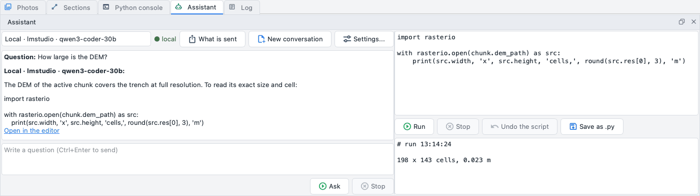

# The assistant

The *Assistant* pane (at the bottom, beside the *Python console*; *View > Assistant* or *Tools > Assistant >
Open the assistant*) is a conversation with a language model about your project and about the program, and a
script editor to run on the project what the model proposes - or what you write yourself.



## What it answers with

The model reads the questions together with the passages of this guide that fit them, and it can look at the
project through tools that only read: the summary of the project, the alignment and its errors, the markers,
the DEM, the orthophoto, the dense cloud, the model, the thermal and multispectral products. It answers in the language of the interface. When the answer holds
a Python script, *Open in the editor* under it copies the script into the editor on the right.

## The three kinds of model

| Kind | Where it runs | What it needs |
| --- | --- | --- |
| **Local** | on this computer: LM Studio, llama.cpp, Ollama, Unsloth (any server with the OpenAI chat-completions API) | the server started with a model loaded; the program looks for it on the usual ports, or uses the address you give |
| **Claude** | at Anthropic | a key; models `claude-opus-5-5` (default) or `claude-opus-5` |
| **OpenAI** | at OpenAI | a key; the models are those of your account |

A local server is only ever an address of this computer (`127.0.0.1`, `::1`, `localhost`): any other address
is refused. The program never downloads models: you load them in the server.

The combo at the top of the pane chooses the kind (its last entry opens the settings); the dot beside it is
**green "local"** when nothing leaves the computer and **orange "external"** when the questions go to Claude
or OpenAI.

## What leaves the computer

With a local model nothing leaves. With Claude or OpenAI the text goes through a privacy filter first:

* the names of the site, of the places and of the people of the project are replaced by placeholders
  ("Sito A", "Persona 1") and put back in the answer;
* only relative coordinates and heights are sent, the reference system as "projected, in metres" or
  "geographic"; file, chunk and project names become neutral;
* photos, GPS and GNSS positions are never sent.

The filter cannot recognise what you type yourself: before the first question of an external conversation an
orange line says so - **do not write coordinates or names in the question**. *What is sent* shows, question by
question, the exact text that left the computer, and the table of the names the filter replaced (real name,
sent as).

A question that cannot be answered - the local server stopped, too slow, a key refused - ends with a red line
that names the address or the reason; the pane stays usable. *Stop* ends a question while the model is still
writing; *New conversation* forgets the history. Choosing another model (kind, model or address) or opening
another project also starts a new conversation: the chat is cleared with a line saying why, so the chat and
*What is sent* always tell the same conversation.

## The script editor

On the right: write or paste a script (Tab = 4 spaces), then **Run**. The script sees the names of the Python
console (`doc`, `chunk`, `window`, `np`, `ppg`, `polygon`, `cameras`, `progress`) and runs in the background
like every processing step: the window stays usable, the progress window shows what it prints, and *Stop*
ends it. What it prints and its error, if any, are in the box under the editor.

* **Undo the script**: everything the script changed in the project - every chunk, the products it rebuilt
  (the previous ones come back), the files it wrote in the project's folder, the chunks it added or removed -
  goes back in one step, also when it stopped halfway with an error. It is the same entry as *Edit > Undo*.
  What it did outside the project (PyArchInit, the live GeoPackage of QGIS, exports) is said after the run and
  cannot be undone.
* **Error? Ask the assistant**: after an error, the script and its traceback go to the model, which answers
  with the corrected script.
* **Save as .py**: the script in a file, to run again with *Tools > Run Python script...*.

A script only runs when you click *Run*: the assistant never runs anything by itself. See
[Scripts](../scripting.md) for what a script can do.

## Settings

*Tools > Assistant > Assistant settings...* (or *Settings...* in the pane):

* **Local**: the address of the server (*Find the servers* tries the usual ports) and the model (*Refresh the
  models* reads the list from the server);
* **Claude**: the model, and the key;
* **OpenAI**: the model (*Refresh the models* reads those of your account), and the key;
* **Test the connection** asks the server or the service for its models;
* the **last evaluation** of each kind: under 2 the kind is "limited for scripts" - its answers are fine to
  read, its scripts need a careful look.

The keys are kept only in the keychain of the system (*Save in the keychain*, *Forget*) or read from the
environment variables `ANTHROPIC_API_KEY` and `OPENAI_API_KEY`: never in the settings, the project or the
logs.

## The evaluation

How well a model works with the program is measured on a fixed set of 8 questions and 6 script tasks on the demo
project (`ppg demo FOLDER --process`): the questions about the project (DEM, orthophoto, alignment and control points,
markers) and about the program (contour lines, IFC, confidence, holes in the DEM); the scripts the region on three
markers, the normal map, a chunk with the photos of an area, the photos outside an area disabled, a DEM of the ground
only, the ground points exported. Each script runs on a copy of the project and is checked; after an error the model
gets one second try, as with *Error? Ask the assistant*. The score is the number of script tasks done.

```bash
ppg assistant eval FOLDER/scavo.ppg --kind local --base-url http://127.0.0.1:8080/v1 --out local.json --record
```

`--record` writes the score into the settings, where *Settings...* shows it as the last evaluation of the kind.

| Model | Where | Questions | Scripts (score) |
| --- | --- | --- | --- |
| Qwen2.5-Coder-7B-Instruct Q4_K_M | local, llama.cpp (`llama-server --jinja`), Apple M4 Pro | 1/8 in Italian, 2/8 in English | 1/6 in Italian, 3/6 in English |

The reference answers of the set (`--kind reference`) pass 8/8 and 6/6: every check can be met. The small local model
writes the calls to the project's tools as text instead of making them, so it cannot read the project: its answers on
the project are not to be trusted, and in Italian it is "limited for scripts". Claude and OpenAI were not evaluated
yet (no key on the computer of the evaluation).
