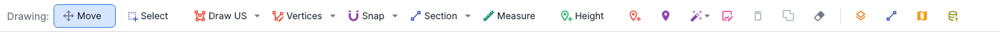
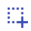
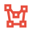
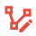
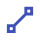
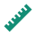
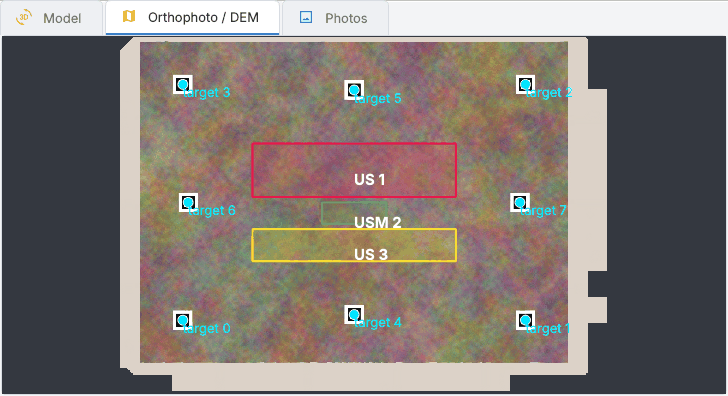
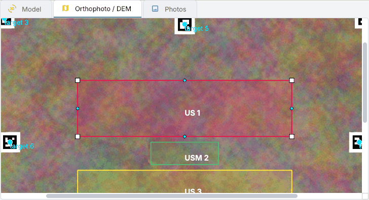
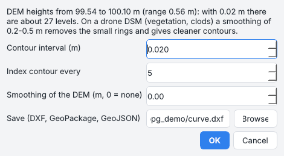
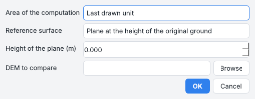

# Drawing and measures

On the orthophoto and the DEM you draw the stratigraphic units, the section traces and the spot heights, you
measure distances, areas and volumes, and SAM draws units and stones for you. What you draw is saved with the
project, reaches QGIS through the live link and goes into PyArchInit with *Publish*.

## The drawing bar

| | Tool | What it does |
| --- | --- | --- |
| { width=20 } | **Move** | pan and zoom; a click on a feature shows its attributes |
| { width=20 } | **Select** | choose features to delete, merge or crop ([below](#select-delete-merge)) |
| { width=20 } | **Draw US** | a unit by its vertices; *Freehand* in its menu ([below](#stratigraphic-units)) |
| { width=20 } | **Vertices** | move, add and remove the vertices of a unit; *Reshape* in its menu ([below](#editing-the-units)) |
| { width=20 } | **Snap** | the points on the vertices and segments of the visible layers |
| { width=20 } | **Section** | two clicks: the section of the model along the trace ([below](#sections)) |
| { width=20 } | **Measure** | distance and height difference |
| { width=20 } | **Height** | a spot height for `pyarchinit_quote` ([below](#spot-heights)) |
| { width=20 } | **Point** | a measuring point: elevation, temperature, bands and indices |
| { width=20 } | **Marker** | a marker where you click ([markers](photos-markers.md#markers)) |
| { width=20 } | **SAM** | units and stones drawn by Segment Anything ([below](#segment-anything)) |
| { width=20 } | **Patch** | the photo to use in an area of the orthophoto ([patches](processing.md#orthophoto-patches)) |
| { width=20 } | **Delete** | the selected features (++delete++) |
| { width=20 } | **Merge** | the selected units into one polygon, or contiguous lines |
| { width=20 } | **Clear drawings** | every drawing of the chunk |
| { width=20 } | **Layer** | the [Layer pane](panes.md#layer) |
| { width=20 } | **Sections** | the [Sections pane](panes.md#sections) |
| { width=20 } | **QGIS** | opens the drawings in QGIS ([QGIS, live](archaeology.md#qgis-live)) |
| { width=20 } | **Publish** | writes the drawn units and spot heights in PyArchInit |

*Tools > Drawing on the orthophoto* has the same tools and a few more that work on an area: *Measure area and 3D
surface*, *Crop*, *Edit DEM*, *Crop or export with the selected polygon*.

## Stratigraphic units

1. **Draw US**: click the vertices, double click to close. With **Freehand** (in the menu of the button, as the
   digitizing techniques of QGIS) press, trace and release; the button then shows its icon.
2. The form asks the fields of PyArchInit's `pyunitastratigrafiche`: area, US (or an existing US of the site),
   unit type (`unita_tipo_s`), stratigraphic index (`stratigraph_index_us`: 1 characterization, 2 US outline),
   type (`tipo_us_s`), draughtsman, date, original survey. The layer shows the same columns (`scavo_s`, `area_s`,
   `us_s`...).

The drawn units are saved in the project and come back when it is opened again.

**Snap** (its menu: vertices, segments, tolerance 6/12/20 px) puts the points of every drawing tool exactly on the
vertices or the edges of the visible layers, shown by a magenta square (vertex) or circle (segment): units traced
along an existing boundary share it, without gaps or overlaps.

*PyArchInit > Publish the drawn units and spot heights* writes `pyunitastratigrafiche`; *Load US polygons on the
orthophoto* shows the units already in the database.

??? example "Command line and API"
    `pa.publish_units(units, sito)`, `pa.us_polygons(sito)`, `archaeo.stratigraphy.export_units`

## Editing the units

**Vertices** (*Edit the vertices of the units*): click a unit and its vertices appear (white squares) with the
middle of each side (cyan dots).

| To... | do this |
| --- | --- |
| move a vertex | drag it |
| add a vertex | drag the middle of a side |
| remove a vertex | ++alt++ + click or right click on it, or ++delete++ on the last one touched |
| keep the outline | ++enter++, or a click on another unit |
| put it back as it was | ++esc++ |

*Snap* works while dragging.

**Reshape** (*Reshape a unit with a line*, in the menu of *Vertices*) works as *Reshape Features* in QGIS: click
the vertices of a line that crosses the outline of a unit twice, double click or ++enter++, and the outline
between the two crossings becomes the line. Drawn outside it widens the unit, drawn across it cuts away the
smaller part; the holes inside stay.

* Each edit is one entry of *Edit > Undo* and a line of the log (*Vertices of US 6: area ... m2*, *US 6
  reshaped*); an outline that would cross itself is refused.
* The proxy of the unit (*US proxies*) is built again by itself with its own base, and undoing the edit brings the
  proxy back too.
* A polygon of PyArchInit changed this way waits for *Save changes in PyArchInit*. The same happens to what is
  saved in QGIS through the live link.

??? example "Command line and API"
    `archaeo.stratigraphy.reshape_polygon(polygon, line)`; `RasterView.begin_vertex_edit`, `move_vertex`,
    `insert_vertex`, `remove_vertex`, `end_vertex_edit`

## Select, delete, merge

**Select**: click a feature, ++shift++ / ++ctrl++ + click to add or remove one, drag a box to select everything it
touches (hidden layers are skipped). The selection is outlined in cyan and, for a single feature, its attributes
appear in the *Layer* pane.

* **Delete** (or the ++delete++ key) removes units, single parts of multi-part units, section traces with their
  drawings, contour and plan-slice lines, and points.
* **Merge** joins units into one polygon (you choose whose US number, area and type to keep; hairline gaps between
  units drawn side by side are closed) or contiguous lines of the same layer.
* The right click opens the same commands; ++esc++ clears the selection.

Polygons loaded from PyArchInit change in `pyunitastratigrafiche` only with *Save changes in PyArchInit* (*Layer*
pane), which asks before deleting.

??? example "Command line and API"
    `pa.update_unit(gid, geometry=..., crs=...)`, `pa.delete_unit(gid)`

## Spot heights

**Height** (separate from SAM): a click reads the elevation on the DEM at full resolution, then the fields of
`pyarchinit_quote`: area, US, unit type, elevation (editable), unit of measure, draughtsman, date, original survey.
*Do not ask again* keeps them for the next clicks (choose the tool again to change them). The points go in the
*Spot heights* layer, are saved in the project and are written with *Publish*.

??? example "Command line and API"
    `pa.publish_quote(points, sito, crs)`, `pa.publish_elevations(chunk, sito, area, us, points)`

## Measuring points

**Point** (*Measuring point*) places a point where you click with its coordinates, the elevation of the DEM, the
temperature and its anomaly, the reflectance of every band and the indices. The points go into the layer
*Measuring points*, are saved with the project, reach QGIS with the other layers and are exported as GeoPackage,
CSV or GeoJSON (*Export the measuring points...*). See [Multispectral and thermal](multispectral.md).

## Sections

1. **Section**, then two clicks on the orthophoto: the model is cut along the trace.
2. The drawing appears in the *Sections* pane (SVG, DXF profile and 3D DXF in `sezioni/`), and the trace becomes a
   feature of the *Sections* layer.

The SVG is at 1:20, or at the most detailed standard scale (1:50, 1:100, 1:200...) at which it fits about an A0
sheet (a 174 m section across a tell: 1:200); the profile line is 0.5 mm and the DXF grid spacing suits the height
of the section (10 cm in a trench, 1-2 m on a tell).

The menu of the button, *Section options*, chooses whether to cut the model or the dense cloud and which classes to
keep (from the model, the stretches lying on points of those classes). **Plan slice** cuts the model horizontally
into its own layer, with the same choice.

??? example "Command line and API"
    `ppg section scavo.ppg x1 y1 x2 y2 --out sezione.svg`; `archaeo.sections.section(chunk, p1, p2)`,
    `sections_along(chunk, baseline, interval, half_width)`, `plan_slice(chunk, elevation)`;
    `pa.publish_section_trace`

## Measures

* **Measure**: distance and height difference between two clicks.
* **Measure area and 3D surface** (*Tools > Drawing on the orthophoto*: drag a box or click a polygon; or *Measure
  the area and the surface* on a selected polygon): the area in plan and of the surface from the DEM and the model,
  the mean slope and the heights; the outline stays in the *Measurements* layer. It also gives the **Munsell colour** of
  the orthophoto inside: the median of its pixels without the darkest and the brightest tenth (shadows, pebbles,
  glare), as Munsell notation and nearest chip of a soil chart (`10YR 5/4`); see
  [Munsell colour](archaeology.md#munsell-colour).
* On the DEM the status bar shows the **slope** and the **aspect** under the cursor and, with a DTM kept as a
  version, the height above the ground. *Tools > Slope of the DEM* and *Aspect of the DEM* make the two rasters
  (white to red; a colour wheel from the north) and show them, with the degrees under the cursor. The 3D view
  colours the dense cloud by *Height above the ground* once its ground is classified.

## Contour lines and volumes

**Contour lines** (*Tools > Contour lines...*, also in the workflow bar) draws the lines as a layer to query
(elevation, index line), which stays when you switch between DEM and orthophoto, and exports them as DXF, GeoJSON
or GeoPackage.

* The window shows the elevation range of the DEM and proposes a round interval giving at most about 50 levels (5 cm
  on a trench, 50 cm on a tell 20 m high); it asks before an interval that would give more than 300 levels.
* *Smoothing* (Gaussian, in metres) helps with drone DSMs.
* The lines keep their vertices within half a pixel, and closed rings smaller than 25 pixels (noise) are left out:
  a tell gives thousands of lines instead of 158,000, added to the view in one go.

**Cut / fill volume** (*Tools > Cut / fill volume...*): the reference is the surface before the work - a plane at
the original ground level or the DEM before the excavation. *Cut* is the volume removed (now below the reference),
*fill* the volume added; with *Minimum height of the area* the deposit above the lowest point. Partial cells along
the edge of the polygon are weighted by the share they cover. The volumes between the phases of an excavation are in
[Excavation phases](archaeology.md#excavation-phases).

??? example "Command line and API"
    `ppg contours`; `archaeo.terrain.contours`, `volume`, `hillshade`, `slope_degrees`; `pa.publish_volume`

## Segment Anything

SAM 2.1 draws the units by itself. It is installed on request (*Tools > Segment Anything 2.1 > Install / update
SAM 2.1...*) in its own environment, with the PyTorch build for the graphics card: CUDA on NVIDIA cards (picked by
the installer on Windows and Linux), Apple's GPU through MPS on the Mac (about 3.5 times faster than the CPU on an M4
Pro). The window at the end of the installation says which one is used.

**SAM** in the drawing bar works in the way chosen from its menu:

| Way | What you do |
| --- | --- |
| **Touch** | click an object: SAM looks at the part of the orthophoto on screen, so zoom in for details and out for large units |
| **Box** | drag a box around one object |
| **Area** | drag a box: every unit inside |
| **Stones** | drag a box over a wall face or a paving: every stone ([below](#stone-by-stone-drawing)) |

The mask appears dashed with the form of the unit: *Save*, *Cancel*, or *Correct* (++shift++ + click adds a part,
right click removes one, ++enter++ saves, ++esc++ discards).

* **The whole orthophoto** scans it in overlapping tiles of 1024 pixels, at a chosen resolution and thoroughness
  (normal, high, maximum: more points and crops per tile): objects cut by the tiles are joined, duplicates dropped,
  and the units do not overlap (smaller ones are cut out of larger ones). The automatic units go to the layer *Units
  from SAM* without a US number, ready for the [US proposal](archaeology.md#us-proposal).
* The menu also chooses the **model**, from *Very fast (tiny)* to *Very accurate (large)*.
* *Prompts on the photos* segments an object on a photo.

### Stone-by-stone drawing

**Stones**, on the orthophoto or on the orthophoto of an elevation: drag a box over a wall face or a paving and SAM
2.1 outlines every object in it. The stones stay (equivalent diameter between the smallest and the largest stone
asked, compact shape), the mortar and the soil go. They form the layer *Stones* of that image, kept with the project:
a box drawn again replaces the stones inside it, and wrong ones go with *Select* and ++delete++.

*Tools > Segment Anything 2.1 > Export the drawing of the stones* writes them as DXF (closed polylines on the layer
`PIETRE`), SVG at a scale or GeoJSON, in the coordinates of the image (metres along and up the wall for an
elevation).

??? example "Command line and API"
    `ai.sam.segment_orthomosaic(chunk, segmenter, points=, labels=, box=, bounds=)`,
    `auto_units(chunk, segmenter, bounds=, resolution=, thoroughness=)`, `read_orthomosaic`,
    `segment_photo_and_classify(...)`
