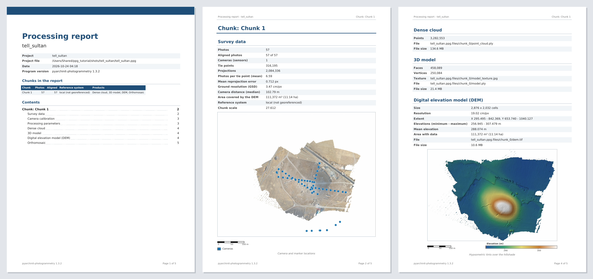
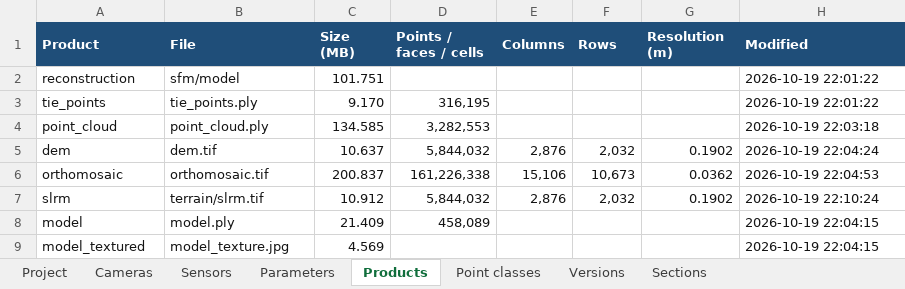

# Esportazioni e rapporti

Ciò che esce dal programma - il rapporto di elaborazione, le tabelle, i prodotti nei formati del web e degli altri
programmi, con i loro paradati - e ciò che entra dagli altri programmi.

## Rapporto PDF

**File > Esporta > Rapporto PDF...** scrive il rapporto di elaborazione da stampare o da consegnare. La finestra chiede un
titolo e una descrizione per la prima pagina, il chunk attivo o tutti i chunk attivati, e la lingua (italiano o inglese,
quella della finestra di base). Il PDF si apre quando è scritto.

È un documento A4: una prima pagina con il progetto, la data, la versione del programma, i chunk del rapporto e l'indice
con le pagine, poi ogni chunk da una pagina nuova con le sue parti - ognuna solo quando il chunk ce l'ha:

| Parte | Cosa contiene |
| --- | --- |
| **Dati del rilievo** | foto, foto allineate, sensori, punti di legame e loro proiezioni, errore medio di riproiezione, risoluzione a terra e distanza delle camere, area coperta, sistema di riferimento, e le posizioni di camere e marker sopra l'ortofoto (o il DEM) |
| **Calibrazione delle camere** | ogni sensore con il suo modello e i suoi parametri |
| **Riferimento e accuratezza** | la georeferenziazione, i punti di controllo e di check con i loro errori e i loro RMSE in X, Y, Z, XY e in totale, le barre di scala, l'errore del GPS delle foto |
| **Posizioni GNSS** | le posizioni delle foto: da dove vengono, i loro sistemi di riferimento e le loro epoche, il tipo delle loro quote; il sistema del chunk con le sue quote (sul geoide, la griglia del geoide e il suo SHA-256) e come le posizioni in ITRF2020 arrivano al suo sistema; la qualità di ogni volo; per ogni calcolo PPK la sua base - come è stata posta, la stazione permanente con la fonte e la sigma delle sue coordinate, la linea di base statica o il PPP e i suoi prodotti, le coordinate con il loro sistema e la loro epoca, l'antenna e la sua calibrazione -; i crediti dei dati usati ([GNSS](photos-markers.md#ppk-correzioni-da-una-base)) |
| **Parametri di elaborazione** | con cosa è stato fatto ogni passo (allineamento, ottimizzazione, mappe di profondità, nuvola densa, modello, texture, DEM, ortofoto) |
| **Prodotti** | nuvola densa e le sue classi di punti, modello e texture, il DEM in tinte ipsometriche sopra la sua ombreggiatura con una barra dei colori in metri, l'ortofoto - dimensioni, risoluzione, estensione, file |
| **Multispettrale** | bande e banda di riferimento, modello radiometrico e calibrazione (pannello, sensore di luce o nessuno), registrazione delle bande, pareggiamento delle foto, la riflettanza in falso colore con le statistiche di ogni banda, ogni indice sulla sua scala con la barra dei colori e le statistiche (minimo, massimo, media, P2, P98), le zone con la legenda e l'area |
| **Termico** | decodificatore (DJI Thermal SDK, FLIR, TIFF), fotogrammi, come sono stati registrati, i parametri della misura, gli scostamenti tra i fotogrammi, l'ortofoto delle temperature sulla sua scala con la barra dei colori in gradi Celsius e le statistiche, le anomalie |
| **Punti di misura** | i punti dello strumento *Punto di misura* con ogni valore letto lì |

Le figure hanno la barra di scala e la freccia del nord; le sezioni sono segnalibri del PDF. Il testo è in DejaVu Sans,
così gradi, diametri e lettere accentate si stampano. *File > Genera report HTML...* scrive lo stesso contenuto come una
pagina web.

## Tabelle Excel

**File > Esporta > Tabelle (Excel)...** scrive tutte le tabelle del chunk attivo in una cartella di lavoro, un foglio
ciascuna: progetto, camere (posizioni stimate e di riferimento, omega/phi/kappa, errori, punti di legame, precisione),
sensori e loro parametri, marker, barre di scala, parametri di elaborazione, prodotti, classi dei punti, versioni, bande
multispettrali, indici e zone, misura termica e scostamenti dei fotogrammi, punti di misura, quote, le unità disegnate,
pietre, proxy US, le sezioni del progetto. I numeri restano numeri (con i decimali che servono); la riga di intestazione è
bloccata e ha il filtro.

Ogni tabella dei pannelli e delle finestre dei risultati ha **Esporta tabella in Excel...** nel clic destro: marker, barre
di scala e camere di *Riferimenti*, gli attributi dell'elemento selezionato e - clic destro su un layer in *Layer* - gli
attributi di tutti gli elementi di quel layer, i proxy US, le fasi e i volumi dello scavo, le unità e i rapporti proposti,
le forme ceramiche simili, la calibrazione di un sensore. Le esportazioni che scrivevano un CSV di una tabella
(riferimenti, camere, punti di misura, le classi dalle unità, le fasi dello scavo) propongono anche una cartella Excel.

## Esportazioni per il web e per altri programmi

*File > Esporta* (quelle grandi lavorano in background):

| Prodotto | Formati |
| --- | --- |
| **Ortofoto** e **DEM** | GeoTIFF, oppure *COG - Cloud Optimized GeoTIFF* (JPEG o WebP con trasparenza per l'ortofoto, ZSTD per il DEM) |
| **Nuvola densa** | LAS (classi e confidenza), *COPC* (`.copc.laz`) per il web, PLY; solo alcune classi se richiesto |
| **Modello** | OBJ, PLY, *glTF binario* (`.glb`, con la texture) |
| **Modello in Cesium 3D Tiles** | una cartella con `tileset.json` da aprire in CesiumJS |
| **Modello per ArcGIS e Cesium (I3S, .slpk)** | un pacchetto di scene layer Integrated Mesh con livelli di dettaglio, ogni nodo con la sua texture: in WGS84 per ArcGIS Online, le scene globali e CesiumJS, o nel CRS proiettato del progetto per le scene locali di ArcGIS Pro; si possono scegliere le facce per nodo e la dimensione della texture di un nodo |
| **Modello leggero con normal map** | poche facce, una texture di colore e una normal map cotte dal modello completo: GLB e OBJ per il web, Sketchfab e i motori di gioco |
| **Video di sorvolo** | un MP4 di una camera che gira attorno al modello o alla nuvola: risoluzione fino al 4K, durata, giri, altezza della camera, zoom |
| **Camere** e **Riferimenti** | CSV o COLMAP; marker con coordinate ed errori |
| **Pacchetto QField** | vedi [QField in trincea](archaeology.md#qfield-in-trincea) |
| **Ritagliati** | DEM, ortofoto, modello e nuvola tagliati su un poligono o un riquadro: vedi [Ritaglio](processing.md#ritaglio) |

I plugin aggiungono a questo menu i loro formati.

### Paradati

Ogni esportazione di nuvola, modello, DEM o ortofoto ha accanto un `<file>.prov.jsonld`, e così la copia pubblicata nei
media di PyArchInit (la cui nota della documentazione riceve un riassunto in una riga: foto allineate, RMSE di controllo e
di check, risoluzione, CRS, versione). È W3C PROV in JSON-LD: il file con il suo SHA-256, il passo che l'ha fatto con le
sue impostazioni e l'ora, e i passi prima fino alle foto e alla georeferenziazione, il programma con le sue librerie e
l'operatore (il *Disegnatore* delle schede di PyArchInit) - leggibile da qualunque strumento di linked data e
dall'Extended Matrix.

## Importazioni

### Modelli 3D di altri programmi

*File > Importa > Modello 3D (OBJ, PLY, GLB)*: una mesh fatta altrove (OBJ con il suo MTL e le texture, PLY con colori e
pagine di texture come le scrivono Metashape e MeshLab, glTF/GLB, STL, OFF) diventa il modello del chunk attivo o di un
nuovo chunk, con i colori dei vertici e le texture (ogni immagine di texture una pagina).

* **Coordinate**: nel sistema del chunk (i modelli esportati da questo programma, da Metashape o da CloudCompare nello
  stesso CRS tornano al loro posto; il GLB di questo programma trova la sua origine nel file JSON accanto), oppure interne
  al chunk (il suo `model.ply` modificato in MeshLab o Blender).
* *Scala* per i file in millimetri, *Spostamento* per i file esportati attorno a un'origine spostata, *Asse verticale* Y
  per il glTF (automatico).
* Un chunk vuoto o nuovo prende le coordinate del modello (un'origine tonda sotto di esso tiene i millimetri) e il CRS
  dato. Il modello attuale resta tra le versioni; un modello che sta lontano dai dati del chunk viene segnalato.

*File > Importa > Modello e texture dal progetto Metashape (reimporta)* rilegge dal `.psx` il modello con colori,
confidenza e texture (il modello in uso viene conservato come versione).

### Scansioni laser

*File > Importa > Scansioni laser (E57, PTX)*: una o più scansioni diventano la nuvola densa di un nuovo chunk. *Flusso
di lavoro > Allinea chunk* (punti, senza scala) le porta sul chunk delle foto quando non sono nel suo CRS, *Colori dalle
foto (scansioni)* le colora con le sue foto, *Unisci chunk* le unisce; DEM, sezioni e misure lavorano su di esse come su
qualunque nuvola densa.

### Altri programmi

I progetti Metashape (`.psx`), i task di WebODM / ODM e le sessioni Photo3D si importano da *File > Importa*: vedi
[QGIS, Metashape, WebODM, Photo3D](../integrations.md). Le modifiche fatte sul tablet tornano con *File > Importa >
Modifiche da QField* ([QField](archaeology.md#qfield-in-trincea)).

??? example "Riga di comando e API"
    `ppg import-model scavo.ppg modello.obj [--new-chunk NOME] [--internal] [--scale] [--offset X,Y,Z] [--up y]
    [--crs EPSG:...]`; `chunk.import_model(path, ...)`, `io.mesh_import.import_model_chunk(doc, path)`;
    `ppg import-metashape`, `ppg import-webodm`, `ppg import-photo3d`, `ppg photo3d-job`;
    `integrations.metashape.reimport_model(chunk)`; `io.mesh_ply.read_mesh`, `write_mesh`
