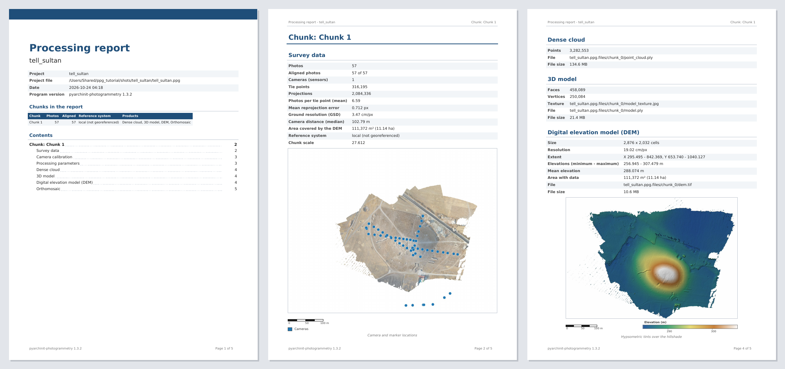
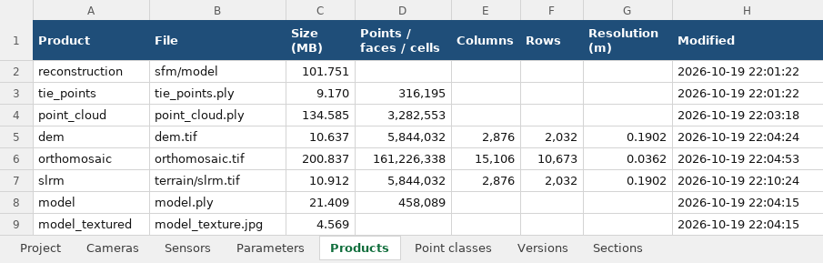

# Exports and reports

What leaves the program - the processing report, the tables, the products in the formats of the web and of other
programs, with their paradata - and what comes in from other programs.

## PDF report

**File > Export > PDF report...** writes the processing report to print or to hand over. The window asks a title and a
description for the first page, the active chunk or every enabled chunk, and the language (Italian or English, the
window's by default). The PDF opens when it is written.

It is an A4 document: a first page with the project, the date, the version of the program, the chunks of the report and
the contents with their pages, then every chunk from a new page with its parts - each only when the chunk has it:

| Part | What it holds |
| --- | --- |
| **Survey data** | photos, aligned photos, sensors, tie points and their projections, mean reprojection error, ground resolution and camera distance, area covered, reference system, and the positions of the cameras and of the markers over the orthophoto (or the DEM) |
| **Camera calibration** | every sensor with its model and its parameters |
| **Reference and accuracy** | the georeference, the control and check points with their errors and their RMSE in X, Y, Z, XY and in all, the scale bars, the error of the GPS of the photos |
| **GNSS positions** | the positions of the photos: where they come from, their reference frames and epochs, the kinds of their heights; the system of the chunk with its heights (above a geoid, the grid of the geoid and its SHA-256) and how the positions in ITRF2020 reach its frame; the quality of every flight; for every PPK run its base - how it was placed, the permanent station with the source and the sigma of its coordinates, the static baseline or the PPP and its products, the coordinates with their frame and epoch, the antenna and its calibration -; the credits of the data used ([GNSS](photos-markers.md#ppk-corrections-from-a-base)) |
| **Processing parameters** | what every step was run with (alignment, optimisation, depth maps, dense cloud, model, texture, DEM, orthophoto) |
| **Products** | dense cloud and its point classes, model and texture, the DEM in hypsometric tints over its hillshade with a colour bar in metres, the orthophoto - size, resolution, extent, files |
| **Multispectral** | bands and reference band, radiometric model and calibration (panel, sun sensor or neither), registration of the bands, balance of the photos, the reflectance in false colour with the statistics of every band, every index on its palette with its colour bar and statistics (minimum, maximum, mean, P2, P98), the zones with their legend and area |
| **Thermal** | decoder (DJI Thermal SDK, FLIR, TIFF), frames, how they were registered, the parameters of the measure, the offsets between the frames, the temperature orthophoto on its palette with its colour bar in degrees Celsius and its statistics, the anomalies |
| **Measuring points** | the points of the *Measuring point* tool with every value read there |

The figures carry their scale bar and north arrow; the sections are bookmarks of the PDF. The text is DejaVu Sans, so
degrees, diameters and accented letters print. *File > Generate HTML report...* writes the same content as one web
page.

## Excel tables

**File > Export > Tables (Excel)...** writes every table of the active chunk into one workbook, a sheet each: project,
cameras (estimated and reference positions, omega/phi/kappa, errors, tie points, precision), sensors and their
parameters, markers, scale bars, processing parameters, products, point classes, versions, multispectral bands, indices
and zones, thermal measure and the offsets of its frames, measuring points, spot heights, the units drawn, stones, US
proxies, the sections of the project. Numbers stay numbers (with the decimals that suit them); the header row is frozen
and has a filter.

Every table of the panes and of the result windows has **Export table to Excel...** in its right click: markers, scale
bars and cameras of *Reference*, the attributes of the selected feature and - right click on a layer in *Layer* - the
attributes of every feature of that layer, the US proxies, the phases and volumes of the excavation, the proposed units
and relationships, the similar pottery shapes, the calibration of a sensor. The exports that wrote a CSV of a table
(references, cameras, measuring points, the classes from the units, the phases of the excavation) offer an Excel
workbook too.

## Exports for the web and other programs

*File > Export* (the large ones run in the background):

| Product | Formats |
| --- | --- |
| **Orthophoto** and **DEM** | GeoTIFF, or *COG - Cloud Optimized GeoTIFF* (JPEG or WebP with transparency for the orthophoto, ZSTD for the DEM) |
| **Dense cloud** | LAS (classes and confidence), *COPC* (`.copc.laz`) for the web, PLY; some classes only if asked |
| **Model** | OBJ, PLY, *binary glTF* (`.glb`, with its texture) |
| **Model in Cesium 3D Tiles** | a folder with `tileset.json` to open in CesiumJS |
| **Model for ArcGIS and Cesium (I3S, .slpk)** | an Integrated Mesh scene layer package with levels of detail, every node with its own texture: in WGS84 for ArcGIS Online, global scenes and CesiumJS, or in the projected CRS of the project for the local scenes of ArcGIS Pro; faces per node and texture size of a node can be chosen |
| **Light model with a normal map** | few faces, a colour texture and a normal map baked from the full model: GLB and OBJ for the web, Sketchfab and game engines |
| **Fly-through video** | an MP4 of a camera orbiting the model or the cloud: resolution up to 4K, duration, turns, height of the camera, zoom |
| **Cameras** and **References** | CSV or COLMAP; markers with coordinates and errors |
| **QField package** | see [QField in the trench](archaeology.md#qfield-in-the-trench) |
| **Cropped** | DEM, orthophoto, model and cloud cut to a polygon or a box: see [Crop](processing.md#crop) |

The plugins add their own formats to this menu.

**OBJ with groups**: exporting the model as OBJ asks for the **groups** - none, one per source chunk of a merged model
(or per object of an imported OBJ), or one per connected piece (`part_001` the largest) - and for the **largest side
of the texture pages** in the copies beside the file. Every group is written as `o`/`g` with a `usemtl` for each page
it uses; the MTL has one material per page, in the order of the pages. On the command line: `ppg export --model m.obj
--groups source|component|none [--labels labels.npy] [--max-texture 4096]` (`--labels`: a label per face, from a `.npy`
or a text file with one label per line). Importing an OBJ reads its groups back (`g`, else `o`) and keeps them with the
model; its texture pages follow the order of the MTL.

### Web site (Publish on the web)

*File > Export > Web site (Publish on the web)...* opens the pane **Publish on the web** (also from *View > Panes*,
closable, movable and floatable as the other panes): the survey as a static web site - orthophoto, DEM with its
shaded relief, stratigraphic units, drawings and 3D model on a page any hosting publishes, what `ppg web build` writes
(see [A survey as a web site](../api.md#a-survey-as-a-web-site)). Four steps, each with its state beside its title
(*to do*, *done*, *to redo*, *running*, *failed*):

1. **Choose the contents**: the chunks (by default every chunk with something to publish, the active one alone
   when they are in different reference systems), the products (only those a ticked chunk has can be ticked), title,
   description, languages (Italian, English) and the coordinates: **Local frame** (default: shifted to the centre of
   the survey, no reference system - nothing in the folder says where the site is) or **Real coordinates**, which the
   pane flags in red: the pages then write the real position of the site. *Advanced*: the WebP quality of the
   orthophoto (85), the texture size of the model (4096 px, or the vertex colours alone), the **Largest size** of the
   site (500 MB, or *No limit*: the model and the cloud are thinned to keep to it, the Log pane says what was
   reduced), the **Points of the cloud** at most (3 million) and **One date at a time** (the chunks as surveys of
   different dates - the date of the chunk or of its photos -, shown one at a time with a selector of the dates).
   The **Point cloud** is a product to tick (not ticked by default: it weighs), **Sections and elevations** go with
   their orthophotos and drawings in a tab of their own. The folder of the site
   (by default `<project>_sito_web` beside the project file) must be new, empty or a site built before: a folder with
   other files is refused and never touched.
2. **Build**: in the background, with its progress and *Cancel*; the steps in the Log pane, the size of the site at
   the end. The site is kept with the project (its folder, relative to the project when it lies beside it, the
   choices and the time) and appears in the Workspace as **Web site**; when a product it holds is built again or
   changed (or its chunk is moved) the step and the tree say *to redo*.
3. **Preview**: a server on this computer alone (127.0.0.1, a free port) and the page in the browser; the pane shows
   the address with *Open in the browser*, *Copy address* and *Stop*. Closing the project or the window stops it.
4. **Publish**: on Cloudflare Pages (free; an R2 bucket for the data when files are above the limits of Pages) with
   your own `wrangler`, after `wrangler login` in a terminal. **Check** shows the plan - what goes where, the free
   limits met or exceeded, what becomes public - without sending anything; **Publish...** asks to confirm that the
   site becomes public (a second time, in red, for real coordinates). The address appears in the pane and in the
   Workspace with *Open in the browser* and *Copy the address*. Step by step, the limits, Cloudflare Access and the
   other hostings: [Publishing the web site](web-publish.md). The folder can still be copied as it is to any static
   hosting (*Open the folder*).

### Paradata

Every export of the cloud, the model, the DEM or the orthophoto gets a `<file>.prov.jsonld` beside it, and so does the
copy published in PyArchInit's media (whose documentation note gets a one-line summary: photos aligned, control and
check RMSE, resolution, CRS, version). It is W3C PROV in JSON-LD: the file with its SHA-256, the step that made it with
its settings and time, and the steps before it down to the photos and the georeference, the program with its libraries
and the operator (the *Disegnatore* of the PyArchInit forms) - readable by any linked data tool and by the Extended
Matrix.

## Imports

### 3D drawings

*File > Export > 3D drawings...* writes the [free drawings](drawing.md#free-drawings-2d-and-3d) of the active chunk
(all, or one layer) by the suffix of the file: **DXF** (3D polylines and points, a DXF layer per user layer, name and
attributes kept in the entities' data), **GeoPackage** with Z (tables `disegni_3d_linee`, `disegni_3d_poligoni`,
`disegni_3d_punti`, the attributes as columns and as JSON), **GeoJSON** (with the system of the chunk when it has an
EPSG code) or **CSV** of the vertices. *File > Import > 3D drawings...* reads a GeoPackage, a GeoJSON or a DXF into a
layer chosen, or the file's `layer` column, or a layer named after the file: a feature without heights - a flat CAD
drawing included - takes them from the DEM; the holes of polygons are left out and counted (a free drawing has one
outline); an import is one step of *Edit > Undo*.

The system of the file is compared with the chunk's: a GeoPackage carries its spatial reference system, a GeoJSON its
`crs` member; when they differ the drawings are reprojected, and the heights go from the ellipsoid to the chunk's
geoid (or back) when both systems say what kind of heights they have (without the geoid grid the program offers to
download it). A **GeoJSON without `crs`** whose coordinates are longitude and latitude is read as WGS 84 with heights
on the ellipsoid (RFC 7946); with projected coordinates, into a chunk with a system, it is refused: export it with its
system or import it into a local chunk. A **DXF** carries no system: it is read in the chunk's system. A file with a
system into a local chunk (or a file without a system, not WGS 84, into a chunk with one) is refused with a message.
A GeoPackage in EPSG:4326 is read as heights on the ellipsoid.

### 3D models of other programs

*File > Import > 3D model (OBJ, PLY, GLB)*: a mesh made elsewhere (OBJ with its MTL and textures, PLY with colours and
texture pages as Metashape and MeshLab write them, glTF/GLB, STL, OFF) becomes the model of the active chunk or of a new
chunk, with its vertex colours and textures (every texture image a page).

* **Coordinates**: in the system of the chunk (models exported by this program, Metashape or CloudCompare in the same
  CRS come back in place; the GLB of this program finds its origin in the JSON file beside it), or internal to the chunk
  (its own `model.ply` edited in MeshLab or Blender).
* *Scale* for files in millimetres, *Offset* for files exported around a shifted origin, *Vertical axis* Y for glTF
  (automatic).
* An empty or new chunk takes the coordinates of the model (a round origin under it keeps the millimetres) and the CRS
  given. The current model stays among the versions; a model that lies far from the data of the chunk is reported.

*File > Import > Model and texture from the Metashape project (reimport)* reads the model of the `.psx` again with its
colours, confidence and texture (the model in use is kept as a version).

### Laser scans

*File > Import > Laser scans (E57, PTX)*: one or more scans become the dense cloud of a new chunk. *Workflow > Align
chunks* (points, without scale) brings them onto the chunk of the photos when they are not in its CRS, *Colours from the
photos (scans)* colours them from its photos, *Merge chunks* merges them; DEM, sections and measures work on them as on
any dense cloud.

### Other programs

Metashape projects (`.psx`), WebODM / ODM tasks and Photo3D sessions are imported from *File > Import*: see
[QGIS, Metashape, WebODM, Photo3D](../integrations.md). The edits made on the tablet come back with *File > Import >
Edits from QField* ([QField](archaeology.md#qfield-in-the-trench)).

??? example "Command line and API"
    `ppg import-model scavo.ppg modello.obj [--new-chunk NAME] [--internal] [--scale] [--offset X,Y,Z] [--up y]
    [--crs EPSG:...]`; `chunk.import_model(path, ...)`, `io.mesh_import.import_model_chunk(doc, path)`;
    `ppg import-metashape`, `ppg import-webodm`, `ppg import-photo3d`, `ppg photo3d-job`;
    `integrations.metashape.reimport_model(chunk)`; `io.mesh_ply.read_mesh`, `write_mesh`
