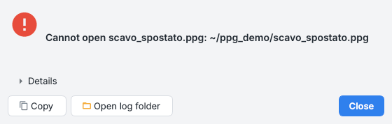

# Errori e aggiornamenti

Cosa fare quando qualcosa va storto, dove il programma scrive ciò che è successo, e come si aggiorna.

## I passi lunghi

I passi lunghi lavorano in background con una finestra di avanzamento e *Annulla*. La finestra mostra:

* la barra, il messaggio corrente, il tempo trascorso e una stima del tempo che manca (dalla velocità degli ultimi
  minuti, così un passo che rallenta la vede crescere invece di scendere);
* sotto *Dettagli*, una console con ogni messaggio del passo e la sua ora - le foto di cui si estraggono i punti chiave,
  i blocchi di coppie abbinate, le foto messe nel blocco una per una con i punti che vedono, gli aggiustamenti di tutto il
  blocco, le mappe di profondità fuse - letta dal log di COLMAP mentre lavora, come fa la console di Metashape. La console
  resta aperta o chiusa come l'hai lasciata.

## Quando un passo non riesce

Una finestra di errore mostra:

* un riassunto in una riga;
* un suggerimento per i problemi noti (SpatiaLite o PyTorch mancanti, una ricostruzione interrotta, un'installazione
  Anaconda vecchia...);
* il traceback sotto *Dettagli*;
* i pulsanti *Copia* (riassunto e traceback, pronti per una segnalazione) e *Apri cartella log*.

Lo stesso testo va nel [pannello Log](panes.md#log) e nel file di log `ppg-gui.log` (ruotato a 2 MB) nella cartella dei log
del sistema; gli arresti del codice nativo vengono scritti in `crash.log` nella stessa cartella dal faulthandler di Python.
*Aiuto > Apri cartella dei log* la apre.

## Diagnostica dell'ambiente

*Aiuto > Diagnostica ambiente...* (oppure `ppg-gui --doctor`, `ppg doctor`) elenca Python e ogni libreria con la sua
versione, i problemi noti - un altro `ppg-gui` prima nel `PATH`, l'ambiente base di Anaconda, Open3D 0.20.0, un pyvistaqt
vecchio, SpatiaLite mancante - e cosa fare. *Copia* mette il rapporto negli appunti, da allegare a una segnalazione
insieme al log.

## Aggiornamenti

Qualche secondo dopo l'avvio l'applicazione chiede a GitHub l'ultima versione, al massimo una volta al giorno: una
richiesta HTTPS all'API di GitHub che porta la versione nello User-Agent e nient'altro. *Aiuto > Controlla gli
aggiornamenti all'avvio* lo spegne, e così `PPG_NO_UPDATE_CHECK=1`.

Quando c'è una versione più nuova una finestra mostra le sue note e propone:

| Pulsante | Cosa fa |
| --- | --- |
| **Scarica e installa** (applicazione per macOS) | il dmg viene scaricato nella cartella Download, la nuova applicazione viene copiata fuori e, quando il programma si chiude (subito con *Riavvia ora*, dopo la solita richiesta di salvare il progetto), sostituisce la vecchia nella sua cartella e si apre. La copia vecchia resta finché la nuova non è al suo posto. Se la cartella non è scrivibile dall'utente, si apre l'immagine disco per trascinarla a mano in *Applicazioni* |
| **Scarica** (applicazione per Windows) | lo zip va nella cartella Download, da estrarre sopra la cartella del programma dopo averlo chiuso |
| **Copia il comando** (installazione Python) | `pip install --upgrade pyarchinit-photogrammetry` (o `git pull` in una copia dei sorgenti) |
| *Pagina della versione*, *Salta questa versione*, *Piu' tardi* | una versione saltata non viene più proposta all'avvio, ma *Aiuto > Controlla aggiornamenti...* la trova ancora |

Dalla riga di comando `ppg update` dice se c'è una versione più nuova e `ppg update --download` scarica l'installatore del
sistema.

## Note di robustezza

* Le foto tenute "solo online" da Dropbox, iCloud o OneDrive sono file segnaposto vuoti: il passo della nuvola densa le
  elenca prima di partire e propone di continuare senza (`build_depth_maps(skip_unreadable=True)`).
* Le finestre di messaggio sono quelle di Qt (non native): l'`NSAlert` nativo di macOS 26/27 fa terminare il processo con
  Qt 6.
* La ricostruzione di Poisson lavora in un processo separato (`engine/isolate.py`): un arresto del codice nativo diventa un
  errore nel log, il passo riprova a una profondità minore e alla fine costruisce un campo di altezze 2,5D.
* Open3D viene importato prima di rasterio e SciPy (`_env.load_open3d_first`), e i dati PROJ esportati da Anaconda o da
  QGIS vengono sostituiti da quelli di rasterio, anche per i thread di lavoro.
