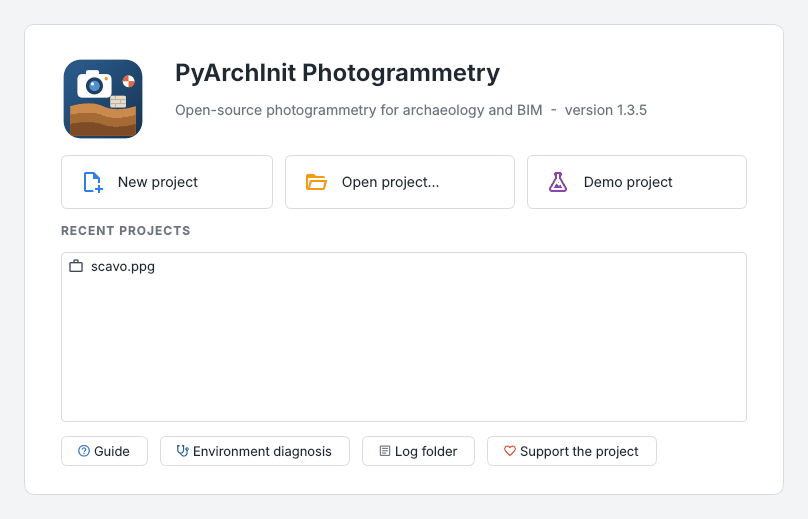
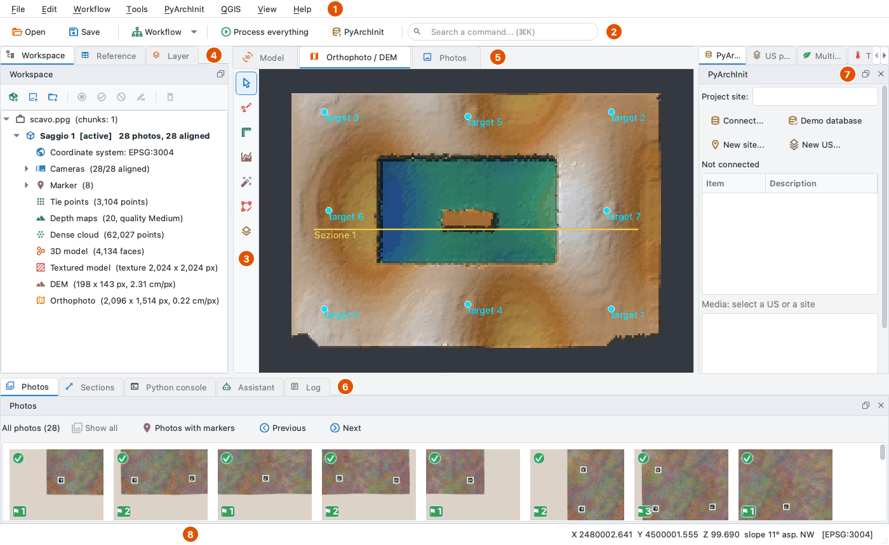
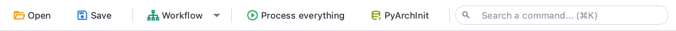
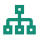
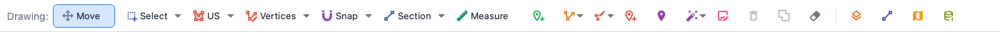
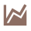
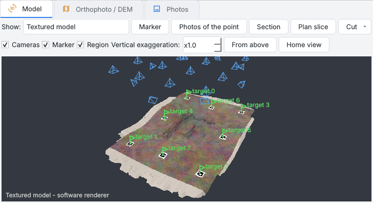
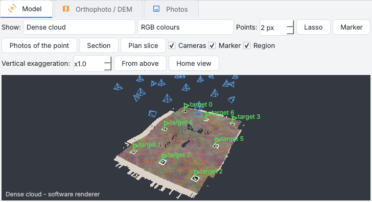
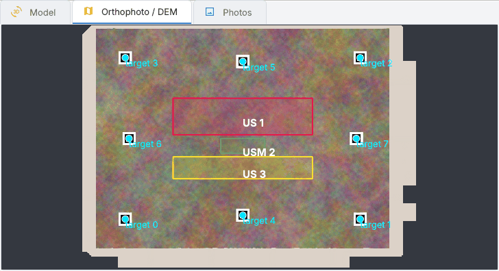
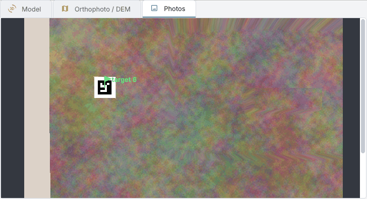

# Interfaccia

L'interfaccia fa con il mouse tutto quello che l'[API Python](../api.md) fa negli script: ogni comando chiama
le stesse funzioni, quindi ciò che si fa nella finestra si può ripetere nella console o in uno script. Questa
pagina mostra la finestra e come è organizzata; le altre pagine di questa sezione entrano in ogni parte.

<div class="grid cards" markdown>

- :material-menu: **[Menu](menus.md)** - tutti i comandi, menu per menu
- :material-dock-left: **[Pannelli](panes.md)** - area di lavoro, riferimenti, layer, foto, sezioni, log
- :material-rotate-3d-variant: **[Vista 3D e trackball](view3d.md)** - ruotare, spostare, avvicinare, il centro di rotazione, tasti
- :material-camera-marker: **[Foto e marker](photos-markers.md)** - foto, maschere, marker, barre di scala
- :material-cog-play: **[Elaborazione](processing.md)** - dall'allineamento all'ortofoto, versioni, pulizia
- :material-link-variant: **[Legami fra chunk](ties.md)** - più rilievi messi insieme con punti in comune, controllati prima di applicare
- :material-draw: **[Disegno e misure](drawing.md)** - unità, sezioni, quote, misure, SAM
- :material-shovel: **[Strumenti per l'archeologia](archaeology.md)** - PyArchInit, QGIS, proxy, matrix, fasi, ceramica
- :material-leaf: **[Multispettrale e termico](multispectral.md)** - riflettanza, indici, temperature
- :material-export: **[Esportazioni e rapporti](exports.md)** - rapporto PDF, tabelle Excel, formati web, importazioni
- :material-triangle-outline: **[TIN e linee di rottura](../tin.md)** - rete di triangoli, linee di rottura, curve, volumi
- :material-lifebuoy: **[Errori e aggiornamenti](help.md)** - log, diagnostica, aggiornamenti

</div>

## Avviare il programma

```bash
pip install "pyarchinit-photogrammetry[gui]"   # compreso in [all]
ppg-gui [progetto.ppg]                         # oppure: ppg gui, python -m pyarchinit_photogrammetry.gui
ppg-gui --doctor                               # diagnostica dell'ambiente (come ppg doctor)
ppg-gui --check                                # apre, disegna ed esce (test di avvio)
ppg-gui --run script.py [argomenti]            # uno script Python con i moduli del programma, senza finestra
```

Oppure si installa l'applicazione pronta per macOS e Windows: vedi [Pacchetti](../packaging.md).

All'avvio una schermata nei colori del logo mostra una barra di avanzamento: la percentuale e cosa si sta
caricando (NumPy e Open3D, PROJ e GDAL, COLMAP, la vista 3D, l'interfaccia). La finestra compare in circa un
secondo; il log registra quanto è durato l'avvio.

Aprire un progetto mostra la stessa scheda sopra la finestra (progetto, area di lavoro, vista 3D, ortofoto e
DEM). Le miniature delle foto arrivano dopo, in background, dalle piccole anteprime che le fotocamere
scrivono nell'EXIF: centinaia di foto da drone non bloccano la finestra, e la barra di stato le conta. Una foto
che non si legge (un file vuoto tenuto solo online da Dropbox o iCloud) ha una miniatura scura e un
suggerimento.

## La pagina iniziale



Senza progetto il centro della finestra mostra la pagina iniziale:

* **Nuovo progetto**, **Apri progetto...** e **Progetto demo** (il [progetto demo](#il-progetto-demo));
* i **progetti recenti**, un clic per aprirne uno;
* *Guida* (questo sito), *Diagnostica ambiente*, *Cartella dei log* e *Sostieni il progetto*.

*File > Pagina iniziale* la riporta.

## La finestra



| | Area | Cosa contiene |
| --- | --- | --- |
| **1** | Barra dei menu | tutti i comandi: vedi [Menu](menus.md) |
| **2** | Barra in alto | apri, salva, il menu *Flusso di lavoro* dei passi, *Elabora tutto*, PyArchInit e la ricerca dei comandi: vedi [sotto](#le-barre-degli-strumenti) |
| **3** | Barra laterale | accanto all'ortofoto e al DEM, gli strumenti che disegnano e misurano, in gruppi che aprono un pannello: vedi [sotto](#la-barra-laterale-della-vista-2d) |
| **4** | Pannelli a sinistra | *Area di lavoro*, *Riferimenti*, *Layer*: il progetto, i suoi marker, ciò che è disegnato ([Pannelli](panes.md)) |
| **5** | Viste centrali | *Modello* (3D), *Ortofoto / DEM*, *Foto*: vedi [sotto](#le-viste-centrali) |
| **6** | Pannelli in basso | *Foto* (miniature), *Sezioni*, *Console Python*, *Log* |
| **7** | Pannelli a destra | *PyArchInit*, *Proxy US*, *Multispettrale*, *Termico* e i pannelli dei plugin |
| **8** | Barra di stato | l'avanzamento di un passo con il pulsante per fermarlo; sotto il cursore coordinate, quota, pendenza e i valori dei raster |

Ogni pannello si può spostare, staccare o chiudere, e *Vista > Pannelli* lo riporta: vedi
[Spostare i pannelli](panes.md#spostare-i-pannelli). La finestra sta sullo schermo di un portatile, fino a
circa 1000 x 650 pixel: i pulsanti vanno a capo, un pannello troppo basso per il suo contenuto scorre, la barra in
alto, se non ci sta, toglie prima i testi (i suggerimenti tengono i nomi).

## Le barre degli strumenti

### La barra in alto



Una sola barra sottile sopra le viste. Mentre un passo lavora, i pulsanti di elaborazione sono disattivati.

| | Pulsante | Cosa fa |
| --- | --- | --- |
| { width=20 } | Apri | come *File > Apri...* |
| { width=20 } | Salva | come *File > Salva* |
| { width=20 } | Flusso di lavoro | un menu con i passi in ordine (sotto), ciascuno con lo stato del chunk attivo |
| { width=20 } | Elabora tutto | tutti i passi in sequenza (++ctrl+r++) |
| { width=20 } | PyArchInit | ortofoto, DEM e modello nei media di PyArchInit |
| { width=20 } | Cerca un comando | scrivi una parte del nome di un comando dei menu e premi ++enter++; ++ctrl+k++ (++cmd+k++ su macOS) porta lì il cursore |

Il menu **Flusso di lavoro** elenca i passi dalle foto ai prodotti, ciascuno con lo stato del chunk attivo al
posto dell'icona: { width=20 } fatto,
{ width=20 } ancora da fare. Un clic esegue il passo, come i comandi del
menu *Flusso di lavoro*:

| Passo | Cosa fa |
| --- | --- |
| 1. Aggiungi foto | le foto nel chunk attivo |
| 2. Marker | trova i target codificati stampati nelle foto |
| 3. Allinea | posizioni e orientamenti delle camere (SfM) |
| 4. Riferimenti | le coordinate dei marker da un CSV (fatto quando un marker ha coordinate rilevate o il chunk è allineato in un sistema di coordinate) |
| 5. Nuvola densa | depth map e nuvola densa |
| 6. Modello | la mesh 3D |
| 7. Texture | la texture del modello |
| 8. DEM | il modello digitale di elevazione |
| 9. Ortofoto | l'ortofoto (true ortho) |

*Curve di livello*, *Volume scavo / riporto* e *Pianta a quota* sono nel gruppo *Sezioni e analisi* della barra
laterale della vista 2D e nel menu *Strumenti*.

### La barra laterale della vista 2D



A sinistra dell'ortofoto e del DEM una colonna stretta tiene gli strumenti di disegno in gruppi. Un clic su un
gruppo apre il suo pannello accanto alla barra, sopra la vista, con gli strumenti come pulsanti con icona e
nome; la piccola freccia accanto a un pulsante apre il suo menu. Il pannello si chiude quando scegli uno
strumento (un'opzione come *Snap* lo lascia aperto), fai di nuovo clic sul gruppo, premi ++esc++ o fai clic sulla vista; la puntina nella sua intestazione
lo tiene aperto mentre lavori. Il gruppo dello strumento in uso è evidenziato. Un clic destro sulla barra
sceglie *Solo icone* o *Icone e testo* (i nomi dei gruppi sotto le icone).

| | Gruppo | Strumenti |
| --- | --- | --- |
| { width=20 } | Naviga | *Sposta / interroga*, *Seleziona* (*Selezione a mano libera* e *Identifica e raggruppa unità* nel suo menu) |
| { width=20 } | Disegno | *Disegna US* (*Mano libera* nel suo menu), *Vertici* (*Rimodella* nel suo menu), *Rimodella*, *Disegno libero*, *Linee di rottura* (il tipo nel suo menu), *Snap* |
| { width=20 } | Misure | *Misura distanza*, *Area e superficie 3D*, *Quota* (*Punto di misura* nel suo menu), *Marker* |
| { width=20 } | Sezioni e analisi | *Sezione* (le opzioni e il pannello *Sezioni* nel suo menu), *Curve di livello*, *Volume scavo / riporto*, *Pianta a quota* |
| { width=20 } | Automatico | *Segment Anything (SAM)* (i suoi modi e il modello nel suo menu), *Patch dell'ortofoto* |
| { width=20 } | Modifica | *Elimina selezionati*, *Unisci selezionati*, *Cancella disegni* |
| { width=20 } | Layer e uscite | *Layer* (il pannello *Sezioni* nel suo menu), *QGIS*, *Pubblica in PyArchInit* |
| { width=20 } | Plugin | dalla 1.7.4, solo con dei plugin installati: ogni plugin con le sue azioni in un menu (le stesse del menu *Plugin*) |

Ogni strumento è descritto in [Disegno e misure](drawing.md#gli-strumenti-di-disegno). *Vista > Barre > Barra di
disegno classica* mostra al posto della barra laterale la vecchia barra orizzontale con gli stessi strumenti,
sotto la barra in alto.

Un plugin può aggiungere un gruppo suo in fondo alla barra della vista 2D o della vista 3D (con la sua icona);
i plugin che non lo fanno stanno nell'ultimo gruppo, *Plugin*, così ogni plugin si raggiunge anche dalla barra. Con
la barra di disegno classica la barra laterale della vista 2D è nascosta: i plugin sono allora nel menu *Plugin* (non
un'azione che un plugin ha dato solo al suo gruppo della barra 2D).

## Le viste centrali

Le tre schede al centro mostrano lo stesso chunk in tre modi; ++f2++, ++f3++ e ++f4++ passano dall'una
all'altra (nell'area di lavoro ++f2++ invece rinomina).

=== "Modello"

    <div class="grid" markdown>

    

    

    </div>

    Punti di legame, nuvola densa, modello ombreggiato o con texture, il TIN, camere e marker. *Mostra* sceglie
    cosa; trascinare con il tasto sinistro ruota la scena con la trackball, con il destro o il centrale sposta, la
    rotella avvicina verso il cursore, un doppio clic sceglie il centro di rotazione: vedi
    [Vista 3D e trackball](view3d.md).

    Sopra la vista una riga sceglie cosa si vede e come (*Mostra*, i colori, la dimensione dei punti, *Camere*,
    *Marker*, *Regione*); gli strumenti che lavorano in 3D sono nella barra laterale alla sua sinistra, in quattro
    gruppi che aprono un pannello come nella vista 2D: *Vista* (*Dall'alto*, *Vista iniziale*, *Centra la vista sul
    punto*, *Trackball*, [*Guarda dalla foto*](view3d.md#guardare-da-una-foto), *Esagerazione verticale*),
    *Punti* (*Marker*, *Foto del punto*, *Lazo*), *Taglia e prospetti* (*Sezione*, *Pianta a quota*, *Taglia*, *Prospetto*) e *Disegna*:

    * **Marker**: clic su un punto del modello o della nuvola per mettervi un marker;
    * **Foto del punto**: le foto che vedono il punto cliccato;
    * **Sezione** (due punti del modello o della nuvola) e **Pianta a quota** (un punto: la pianta alla sua
      quota);
    * **Taglia**: il modello tagliato con un piano ([tagliare il modello](processing.md#tagliare-il-modello));
    * **Prospetto**: un'ortofoto sul piano della vista com'è ora, o sul piano di tre punti cliccati; un
      prospetto o una sezione ([prospetti](processing.md#prospetti));
    * **Esagerazione verticale** (da x0,1 a x50): le quote moltiplicate attorno al centro della scena, così si
      legge il rilievo di un terreno quasi piano. Cambia solo la vista: marker, sezioni e tagli prendono sempre
      le coordinate vere;
    * **Dall'alto** e **Vista iniziale**.

    La vista usa VTK (pyvista) quando c'è OpenGL, altrimenti un renderer software: `PPG_RENDERER=software` lo
    impone, `PPG_RENDERER=vtk` impone VTK.

=== "Ortofoto / DEM"

    

    L'ortofoto o il DEM (tinte ipsometriche sopra un'ombreggiatura) in coordinate reali, con tutti i layer
    disegnati sopra: unità, sezioni, quote, marker. Sotto il cursore la barra di stato legge i prodotti a piena
    risoluzione: X, Y, Z, pendenza ed esposizione, l'altezza dal suolo quando c'è un DTM conservato, la
    temperatura, le bande e gli indici.

    Un raster grande si apre da una copia ridotta (al massimo 6.000 pixel per lato) e, quando lo zoom si ferma
    oltre quella risoluzione, l'area visibile (con un margine) viene riletta alla risoluzione dello schermo,
    fino a quella piena, in background. Il dettaglio del DEM tiene i colori di tutto il DEM. Tell Abu
    adh-Dhuhur (44.952 px): 0,7 s per aprire, 10,8 cm/px prima del dettaglio, 1,38 cm/px dopo 0,37 s.

=== "Foto"

    

    Una foto con i suoi marker, come in Metashape: le bandierine verdi sono misurate, le blu stimate e da
    confermare, le croci rosse sono dove il rilievo mette un marker non messo in quella foto. Si trascina una
    bandierina sul punto, si fa doppio clic su una blu per confermarla; ++page-down++ e ++page-up++ (oppure `]` e
    `[`) aprono la foto successiva e la precedente dell'elenco mostrato. Vedi [Marker](photos-markers.md#marker).

## Annulla e ripeti

*Modifica > Annulla* (++ctrl+z++) e *Ripeti* (++ctrl+y++, oppure ++ctrl+shift+z++) lavorano sui disegni, i
marker, le barre di scala, le patch dell'ortofoto, la regione di ricostruzione, le modifiche ai prodotti
(classi date a mano, punti tolti con il lazo, pulizie, facce del modello, patch della texture) e ciò che
l'area di lavoro rimuove. Il menu dice cosa verrà annullato.

* Prima di modificare un prodotto i suoi file vengono copiati a parte (sul Mac un clone: istantaneo e senza
  spazio), così l'annullamento li rimette esattamente com'erano.
* Ciò che torna da QGIS con il collegamento dal vivo è una voce per ogni salvataggio fatto lì (*Da QGIS: ...*),
  e annullandolo i proxy delle unità seguono i loro poligoni.
* I passi di elaborazione (allineamento, nuvola densa...) non si annullano: si usano le
  [versioni](processing.md#versioni).
* Si annullano anche i dati che un plugin tiene nel chunk (quando il plugin dice che il progetto è cambiato), come
  "Dati dei plugin".
* *Tutti* / *Nessuno* nel pannello Layer sono un solo passo per tutti i layer che mostrano o nascondono.
* La cronologia riparte quando si apre un altro progetto; quando un altro chunk diventa attivo tiene solo le
  rimozioni (le altre modifiche appartengono al loro chunk). Le copie tenute per l'annullamento (nella cartella
  `undo` di ogni chunk) vengono cancellate quando il programma si chiude.

## Lingua e tema

L'interfaccia parla italiano, come PyArchInit, o inglese: si sceglie da *Vista > Lingua / Language*; il
cambio vale dal prossimo avvio, e *Riavvia ora* riavvia subito con il progetto aperto. Senza una scelta segue
la lingua del sistema; `PPG_LANG=it` o `PPG_LANG=en` ne impone una per una sessione.

Sono tradotti menu, finestre, pannelli, messaggi, il log e l'avanzamento dei calcoli. Ciò che è dato resta
in italiano: i valori che PyArchInit rilegge (tipi di US, rapporti), i nomi dei layer e delle versioni dei
prodotti, i disegni e i loro file.

*Vista > Tema* passa dal tema chiaro a quello scuro (viene ricordato).

## Il progetto demo

**File > Crea e apri progetto demo** (oppure `ppg demo <cartella> --process`) scrive:

* un **saggio** sintetico di 4 x 3 m con un tratto di muro, 28 foto e 8 target ArUco in coordinate
  EPSG:3004;
* una **ciotola** e un **frammento** come mesh, e i target da stampare;
* un **database PyArchInit** con lo schema completo di PyArchInit 5 e il sito *Saggio dimostrativo* (US 1-3,
  poligoni, quote, una traccia di sezione, ceramica e reperti), più una villa romana e una necropoli con
  decine di unità;

poi apre il progetto e collega il database. Le schermate di questa guida vengono da lì.

Il **demo della ceramica** (`ceramica/ceramica.ppg`, 32 foto della ciotola su un tappetino per turntable con 12
target ArUco in un sistema locale in metri) mostra il lavoro ravvicinato: *Elabora tutto* senza DEM e ortofoto,
poi *Strumenti > Profilo ceramico da mesh* sul modello esportato; con `--process` il demo contiene già
`ceramica/profilo.svg` (orlo atteso 16 cm, altezza 12 cm, parete 6 mm). La finestra del demo fa scegliere quale
progetto aprire alla fine.

## Console e script

Tutto ciò che fa l'interfaccia si fa anche nel pannello *Console Python* (`doc`, `chunk`, `app`, `ppg`, `np`,
`window`) e negli script (`ppg run script.py --project scavo.ppg`, *Strumenti > Esegui script Python...*
oppure *Esegui file .py...* della console, vedi [Console Python](panes.md#console-python)). Vedi l'[API Python](../api.md) e [PyArchInit](../pyarchinit.md).
