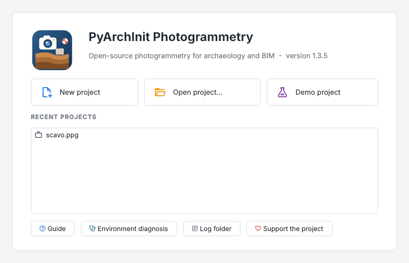
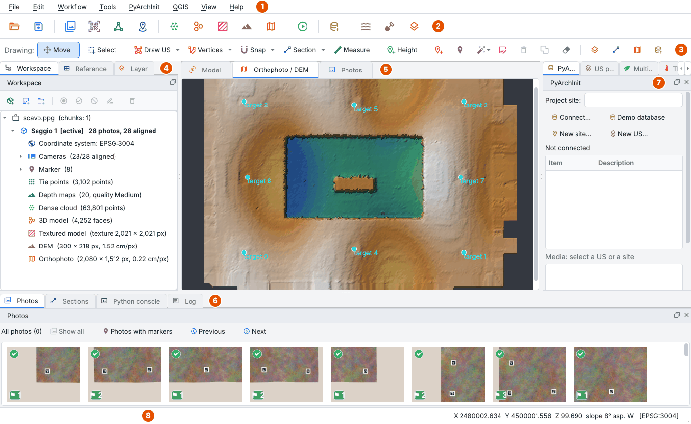
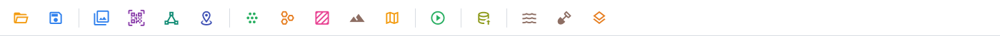
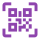
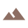
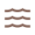
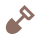
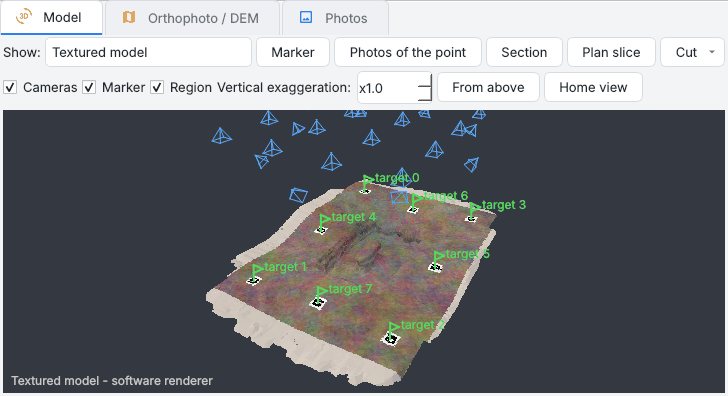
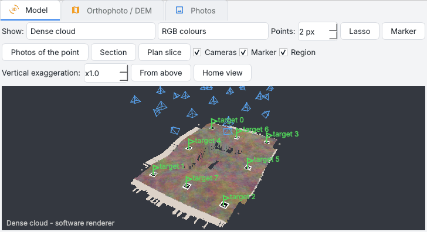

# Desktop interface

The desktop interface does with the mouse everything the [Python API](../api.md) does in scripts: every
command calls the same functions, so anything done in the window can be repeated in the console or in a
script. This page shows the window and how it is organised; the other pages of this section go into each
part.

<div class="grid cards" markdown>

- :material-menu: **[Menus](menus.md)** - every command, menu by menu
- :material-dock-left: **[Panes](panes.md)** - workspace, references, layers, photos, sections, log
- :material-camera-marker: **[Photos and markers](photos-markers.md)** - photos, masks, markers, scale bars
- :material-cog-play: **[Processing](processing.md)** - from the alignment to the orthophoto, versions, cleaning
- :material-draw: **[Drawing and measures](drawing.md)** - units, sections, spot heights, measures, SAM
- :material-shovel: **[Tools for archaeology](archaeology.md)** - PyArchInit, QGIS, proxies, matrix, phases, pottery
- :material-leaf: **[Multispectral and thermal](multispectral.md)** - reflectance, indices, temperatures
- :material-export: **[Exports and reports](exports.md)** - PDF report, Excel tables, web formats, imports
- :material-lifebuoy: **[Errors and updates](help.md)** - log, diagnosis, updates

</div>

## Starting the program

```bash
pip install "pyarchinit-photogrammetry[gui]"   # included in [all]
ppg-gui [project.ppg]                          # or: ppg gui, python -m pyarchinit_photogrammetry.gui
ppg-gui --doctor                               # environment diagnosis (same as ppg doctor)
ppg-gui --check                                # opens, renders and exits (smoke test)
ppg-gui --run script.py [arguments]            # a Python script with the program's modules, no window
```

Or install the packaged application for macOS and Windows: see [Packaging](../packaging.md).

At start a splash in the colours of the logo shows a progress bar: the percentage and what is loading (NumPy
and Open3D, PROJ and GDAL, COLMAP, the 3D view, the interface). The window appears in about a second; the log
records how long the start took.

Opening a project shows the same card over the window (project, workspace, 3D view, orthophoto and DEM). The
thumbnails of the photos come afterwards, in the background, from the small previews the cameras store in
the EXIF: hundreds of drone photos do not freeze the window, and the status bar counts them. A photo that
cannot be read (an empty file kept online only by Dropbox or iCloud) gets a dark thumbnail and a tooltip.

## The start page



Without a project the centre of the window shows the start page:

* **New project**, **Open project...** and **Demo project** (the [demo](#the-demo-project));
* the **recent projects**, a click to open one;
* *Guide* (this site), *Environment diagnosis*, *Log folder* and *Support the project*.

*File > Start page* brings it back.

## The window



| | Area | What it holds |
| --- | --- | --- |
| **1** | Menu bar | every command: see [Menus](menus.md) |
| **2** | Workflow bar | the steps from the photos to the products, in order: see [below](#the-toolbars) |
| **3** | Drawing bar | the tools that draw and measure on the orthophoto and the DEM: see [Drawing and measures](drawing.md) |
| **4** | Panes on the left | *Workspace*, *Reference*, *Layer*: the project, its markers, what is drawn ([Panes](panes.md)) |
| **5** | Central views | *Model* (3D), *Orthophoto / DEM*, *Photos*: see [below](#the-central-views) |
| **6** | Panes at the bottom | *Photos* (thumbnails), *Sections*, *Python console*, *Log* |
| **7** | Panes on the right | *PyArchInit*, *US proxies*, *Multispectral*, *Thermal* and the panes of the plugins |
| **8** | Status bar | the progress of a step with its stop button; under the cursor coordinates, elevation, slope and the values of the rasters |

Every pane can be moved, floated or closed, and *View > Panes* brings it back: see
[Moving the panes](panes.md#moving-the-panes). The window fits a laptop screen, down to about 1000 x 650
pixels: buttons wrap onto more lines, a pane too short for its content scrolls, a toolbar that does not fit
drops its texts first (the tooltips keep the names).

## The toolbars

### The workflow bar



The buttons follow the order of the work, from left to right. While a step runs, the processing buttons are
disabled.

| | Button | What it does |
| --- | --- | --- |
| { width=20 } | Open a project | as *File > Open...* |
| { width=20 } | Save the project | as *File > Save* |
| { width=20 } | Add photos to the chunk | photos into the active chunk |
| { width=20 } | Detect the coded targets | finds the printed targets in the photos |
| { width=20 } | Align the photos (SfM) | positions and orientations of the cameras |
| { width=20 } | Import the coordinates of the markers | the control points from a CSV |
| { width=20 } | Depth maps and dense cloud | the dense cloud |
| { width=20 } | Mesh 3D | the model |
| { width=20 } | Model texture | the texture of the model |
| { width=20 } | Digital elevation model | the DEM |
| { width=20 } | Orthophoto (true ortho) | the orthophoto |
| { width=20 } | All the steps in sequence | *Process everything* (++ctrl+r++) |
| { width=20 } | Publish in PyArchInit | orthophoto, DEM and model in the media of PyArchInit |
| { width=20 } | Contour lines | the contours of the DEM |
| { width=20 } | Cut / fill volume | the volume removed and added |
| { width=20 } | Plan slice | a plan of the model at a height |

### The drawing bar


Always visible under the workflow: the drawing modes (*Move*, *Select*, *Draw US* with *Freehand* in its
menu, *Vertices* with *Reshape* in its menu, *Snap*, *Section*, *Measure*, *Height*, *Measuring point*,
*Marker*, *SAM*), *Patch*, *Delete*, *Merge*, *Clear drawings*, and shortcuts to the *Layer* and *Sections*
panes, to QGIS and to *Publish*. Each tool is described in [Drawing and measures](drawing.md#the-drawing-bar).

## The central views

The three tabs in the centre show the same chunk in three ways; ++f2++, ++f3++ and ++f4++ switch between
them (in the workspace ++f2++ renames instead).

=== "Model"

    <div class="grid" markdown>

    

    

    </div>

    Tie points, dense cloud, shaded or textured model, cameras and markers. *Show* chooses what; left drag
    orbits, right or middle drag pans, the wheel zooms.

    The bar above the view has the tools that work in 3D:

    * **Marker**: click a point of the model or the cloud to add a marker there;
    * **Photos of the point**: the photos that see the point clicked;
    * **Section** (two points of the model or the cloud) and **Plan slice** (a point: the plan at its
      height);
    * **Cut**: the model cut with a plane ([cutting the model](processing.md#cutting-the-model));
    * **Vertical exaggeration** (x0.1 to x50): the heights multiplied around the centre of the scene, so that
      the relief of almost flat ground can be read. Only the view changes: markers, sections and cuts still
      take the true coordinates;
    * **From above** and **Home view**.

    The view uses VTK (pyvista) when OpenGL is available, otherwise a software renderer: `PPG_RENDERER=software`
    forces it, `PPG_RENDERER=vtk` forces VTK.

=== "Orthophoto / DEM"

    

    The orthophoto or the DEM (hypsometric tints over a hillshade) in world coordinates, with every layer drawn
    over them: units, sections, spot heights, markers. Under the cursor the status bar reads the products at
    full resolution: X, Y, Z, the slope and the aspect, the height above the ground when a DTM is kept, the
    temperature, the bands and the indices.

    A large raster opens from a reduced copy (at most 6,000 pixels a side) and, when the zoom stops beyond
    that resolution, the visible area (with a margin) is read again at the resolution of the screen, up to
    the full one, in the background. The detail of the DEM keeps the colours of the whole DEM. Tell Abu
    adh-Dhuhur (44,952 px): 0.7 s to open, 10.8 cm/px before the detail, 1.38 cm/px after 0.37 s.

=== "Photos"

    

    One photo with its markers, as in Metashape: green flags are measured, blue flags are estimated and to be
    confirmed, red crosses are where the survey puts a marker not placed in that photo. Drag a flag onto the
    point, double click a blue flag to confirm it; ++page-down++ and ++page-up++ (or `]` and `[`) open the next
    and the previous photo of the list shown. See [Markers](photos-markers.md#markers).

## Undo and redo

*Edit > Undo* (++ctrl+z++) and *Redo* (++ctrl+y++, or ++ctrl+shift+z++) work on the drawings, the markers,
the scale bars, the patches of the orthophoto, the reconstruction region, the edits of the products in place
(classes given by hand, points deleted with the lasso, cleanings, faces of the model, texture patches) and
what the workspace removes. The menu names what will be undone.

* Before a product is edited in place its files are copied aside (on macOS a clone: instant and without
  space), so undo puts them back exactly.
* What comes back from QGIS through the live link is one entry per save made there (*From QGIS: ...*), and
  the proxies of the units follow their polygons when it is undone.
* Processing steps (alignment, dense cloud...) are not undone: use the [versions](processing.md#versions).
* The history starts again when another project is opened; when another chunk becomes the active one it
  keeps only the removals (the other edits belong to their chunk).

## Language and theme

The interface speaks Italian, like PyArchInit, or English: *View > Lingua / Language* chooses; the change
takes effect at the next start, and *Restart now* restarts at once with the open project. Without a choice
it follows the language of the system; `PPG_LANG=en` or `PPG_LANG=it` forces one for a session.

Menus, dialogs, panes, messages, the log and the progress of the engine are translated, and numbers are
written the English way. What is data keeps its Italian words: the values PyArchInit reads back (US types,
relationships), the names of the layers and of the versions of the products, the drawings and their files.

*View > Theme* switches between the light and the dark theme (remembered).

## The demo project

**File > Create and open demo project** (or `ppg demo <folder> --process`) writes:

* a synthetic **trench** of 4 x 3 m with a wall stub, 28 photos and 8 ArUco targets at EPSG:3004
  coordinates;
* a **bowl** and a **sherd** as meshes, and printable targets;
* a **PyArchInit database** with the full PyArchInit 5 schema and the site *Saggio dimostrativo* (US 1-3,
  polygons, spot heights, a section trace, pottery and finds), plus a Roman villa and a necropolis with tens
  of units;

then opens the project and connects the database. The screenshots of this guide come from it.

The **pottery demo** (`ceramica/ceramica.ppg`, 32 photos of the bowl on a turntable mat with 12 ArUco
targets in a local metric frame) shows the close-range workflow: *Process everything* without DEM and
orthophoto, then *Tools > Pottery profile from a mesh* on the exported model; with `--process` the demo
already contains `ceramica/profilo.svg` (expected rim 16 cm, height 12 cm, wall 6 mm). The demo window lets
you choose which project to open at the end.

## Console and scripts

Everything the interface does is also available in the *Python console* pane (`doc`, `chunk`, `app`, `ppg`,
`np`, `window`) and in scripts (`ppg run script.py --project scavo.ppg`, or *Tools > Run Python script...*).
See the [Python API](../api.md) and [PyArchInit](../pyarchinit.md).
