# Menu

Tutti i comandi del programma sono nei menu in alto; le [barre degli strumenti](index.md#le-barre-degli-strumenti)
e i [pannelli](panes.md) ripetono quelli che si usano più spesso. Questa pagina descrive i menu uno per uno,
nell'ordine in cui compaiono.

| Menu | A cosa serve |
| --- | --- |
| [File](#file) | progetti, esportazioni e importazioni, rapporti |
| [Modifica](#modifica) | annulla e ripeti |
| [Flusso di lavoro](#flusso-di-lavoro) | dalle foto ai prodotti, un passo dopo l'altro |
| [Strumenti](#strumenti) | disegno, misure, archeologia, multispettrale, termico, satellite, plugin |
| [PyArchInit](#pyarchinit) | il database dello scavo |
| [QGIS](#qgis) | il collegamento dal vivo con QGIS |
| [Vista](#vista) | pannelli, viste, tema e lingua |
| [Aiuto](#aiuto) | guida, diagnostica, aggiornamenti |
| [Plugin](#plugin) | i comandi dei plugin installati |

!!! tip "Scorciatoie sul Mac"
    Le scorciatoie sono scritte con ++ctrl++: sul Mac si usa ++cmd++ (++cmd+s++ salva, ++cmd+z++ annulla).
    I comandi con i puntini (*Apri...*) aprono prima una finestra con le scelte; gli altri agiscono subito.

## File

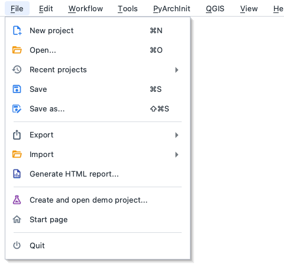

| Voce | A cosa serve |
| --- | --- |
| **Nuovo progetto** ++ctrl+n++ | un progetto vuoto con un chunk |
| **Apri...** ++ctrl+o++ | apre un progetto `.ppg` |
| **Progetti recenti** | gli ultimi progetti aperti |
| **Salva** ++ctrl+s++ · **Salva con nome...** ++ctrl+shift+s++ | salva il progetto; dopo ogni passo di elaborazione il programma lo salva da solo, una volta che ha un file |
| **Esporta** | i prodotti in altri formati: [vedi sotto](#file-esporta) |
| **Importa** | progetti e dati di altri programmi: [vedi sotto](#file-importa) |
| **Genera report HTML...** | il rapporto di elaborazione come pagina web (lo stesso contenuto del [rapporto PDF](exports.md#rapporto-pdf)) |
| **Crea e apri progetto demo...** | uno scavo sintetico con foto, target e un database PyArchInit, per provare il programma ([Demo](index.md#il-progetto-demo)) |
| **Pagina iniziale** | torna alla [pagina iniziale](index.md#la-pagina-iniziale) |
| **Esci** | chiude il programma (chiede di salvare se serve) |

### File > Esporta

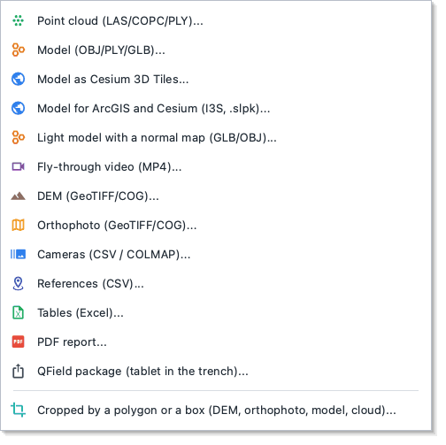

| Voce | Cosa scrive |
| --- | --- |
| **Nuvola di punti (LAS/COPC/PLY)...** | la nuvola densa; il LAS tiene classi e confidenza, il COPC (`.copc.laz`) si apre nel web; si possono esportare solo alcune classi |
| **Modello (OBJ/PLY/GLB)...** | il modello con colori e texture |
| **Modello in Cesium 3D Tiles...** | una cartella con `tileset.json` da aprire in CesiumJS |
| **Modello per ArcGIS e Cesium (I3S, .slpk)...** | un pacchetto I3S con livelli di dettaglio, per ArcGIS Pro e Online, CesiumJS e deck.gl |
| **Modello leggero con normal map (GLB/OBJ)...** | poche facce con una texture di colore e una normal map: per il web, Sketchfab e i motori di gioco |
| **Video di sorvolo (MP4)...** | una camera che gira attorno al modello o alla nuvola, fino al 4K |
| **DEM (GeoTIFF/COG)...** · **Ortofoto (GeoTIFF/COG)...** | i raster, anche come Cloud Optimized GeoTIFF per il web |
| **Camere (CSV / COLMAP)...** · **Riferimenti (CSV)...** | posizioni e orientamenti delle camere, marker con coordinate ed errori |
| **Tabelle (Excel)...** | tutte le tabelle del chunk in un file Excel, un foglio ciascuna ([dettagli](exports.md#tabelle-excel)) |
| **Rapporto PDF...** | il rapporto di elaborazione da stampare o consegnare ([dettagli](exports.md#rapporto-pdf)) |
| **Pacchetto QField (tablet in trincea)...** | ortofoto, DEM, unità e quote per disegnare sul tablet ([QField](archaeology.md#qfield-in-trincea)) |
| **Ritagliati con un poligono o un riquadro...** | DEM, ortofoto, modello e nuvola tagliati su un'area ([Ritaglio](processing.md#ritaglio)) |

!!! note
    Ogni esportazione di nuvola, modello, DEM e ortofoto scrive accanto al file un `<file>.prov.jsonld`
    con la sua storia (i [paradati](exports.md#paradati)). Le esportazioni grandi lavorano in background:
    la barra in basso mostra l'avanzamento.

### File > Importa

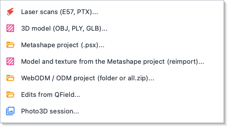

| Voce | Cosa legge |
| --- | --- |
| **Scansioni laser (E57, PTX)...** | una o più scansioni come nuvola densa di un nuovo chunk |
| **Modello 3D (OBJ, PLY, GLB)...** | una mesh fatta con un altro programma come modello di un chunk; quello di prima resta tra le versioni |
| **Progetto Metashape (.psx)...** | camere, marker, barre di scala e prodotti di Metashape ([integrazioni](../integrations.md)) |
| **Modello e texture dal progetto Metashape (reimporta)...** | rilegge dal `.psx` il modello con colori, confidenza e texture |
| **Progetto WebODM / ODM (cartella o all.zip)...** | camere, GCP e prodotti di WebODM |
| **Modifiche da QField...** | le unità e le quote disegnate o corrette sul tablet tornano nel chunk |
| **Sessione Photo3D...** | una sessione dell'app Photo3D |

## Modifica

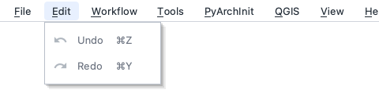

| Voce | A cosa serve |
| --- | --- |
| **Annulla** ++ctrl+z++ | annulla l'ultima modifica; il menu dice quale |
| **Ripeti** ++ctrl+y++ | la rifà |

Si annullano i disegni (unità, quote, sezioni), i marker e le loro misure, le barre di scala, le patch
dell'ortofoto, la regione di ricostruzione, le modifiche ai prodotti (classi date a mano, punti tolti con il
lazo, pulizie, facce del modello) e le rimozioni dall'area di lavoro. Ogni salvataggio fatto in QGIS con il
collegamento dal vivo è una voce sola.

!!! warning "Cosa non si annulla"
    I passi di elaborazione (allineamento, nuvola densa, modello...) non si annullano: per tornare indietro si
    usano le [versioni](processing.md#versioni) dei prodotti. La cronologia riparte quando si apre un altro
    progetto.

## Flusso di lavoro

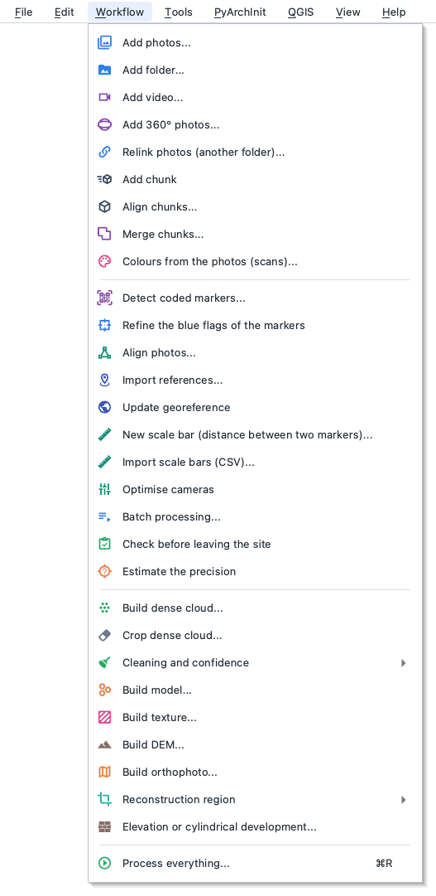

I comandi sono in ordine di lavoro: prima le foto, poi l'allineamento e i riferimenti, infine i prodotti.
La guida passo passo è nel [tutorial](../tutorials/tell.md); i dettagli di ogni passo in
[Elaborazione](processing.md).

**Foto e chunk**

| Voce | A cosa serve |
| --- | --- |
| **Aggiungi foto...** · **Aggiungi cartella...** | le foto nel chunk attivo; le riprese multispettrali sono riconosciute da sole |
| **Aggiungi video...** | i fotogrammi più nitidi di un video, con il GPS se c'è il file `.SRT` di un drone DJI |
| **Aggiungi foto 360°...** | ogni foto sferica diventa le sei facce di un cubo, allineate insieme |
| **Ricollega foto (altra cartella)...** | ritrova le foto con lo stesso nome in un'altra cartella (spostata, su un altro disco, «solo online» su Dropbox) |
| **Aggiungi chunk** | un chunk vuoto |
| **Allinea chunk...** | porta altri chunk nel sistema di uno di riferimento: marker con lo stesso nome, foto in comune o nuvole sovrapposte |
| **Unisci chunk...** | un nuovo chunk con foto, marker, punti, nuvole e modelli di chunk già allineati |
| **Colori dalle foto (scansioni)...** | colora una scansione laser con le foto allineate di un altro chunk |

**Allineamento e riferimenti**

| Voce | A cosa serve |
| --- | --- |
| **Rileva marker codificati...** | trova i target stampati nelle foto |
| **Affina le bandierine blu dei marker** | cerca nelle foto il punto esatto delle posizioni stimate dei marker ([marker](photos-markers.md#posizionamento-guidato)) |
| **Allinea foto...** | calcola posizioni e orientamenti delle camere (la finestra di *Allinea foto* di Metashape) |
| **Importa riferimenti...** · **Aggiorna georeferenziazione** | le coordinate dei punti di controllo, poi il rilievo nel loro sistema |
| **Nuova barra di scala...** · **Importa barre di scala (CSV)...** | distanze note tra due marker ([barre di scala](photos-markers.md#barre-di-scala)) |
| **Ottimizza camere** | ricalcola il blocco con i punti di controllo e le barre |
| **Elaborazione batch...** | una lista di passi su più chunk, con ripresa se si interrompe ([batch](processing.md#elaborazione-batch)) |
| **Controllo prima di lasciare il sito** | subito dopo l'allineamento: aree viste da poche foto, foto sfocate, marker in poche foto |
| **Stima la precisione** | la precisione di camere, marker, punti di legame e DEM |

**Prodotti**

| Voce | A cosa serve |
| --- | --- |
| **Costruisci nuvola densa...** | mappe di profondità e nuvola densa |
| **Ritaglia nuvola densa...** | per quota o con un cilindro attorno all'asse del turntable (toglie tappetino e target) |
| **Pulizia e confidenza** | [vedi sotto](#flusso-di-lavoro-pulizia-e-confidenza) |
| **Costruisci modello...** · **Costruisci texture...** | la mesh e la sua texture |
| **Costruisci DEM...** · **Costruisci ortofoto...** | i raster in pianta |
| **Regione di ricostruzione** | [vedi sotto](#flusso-di-lavoro-regione-di-ricostruzione) |
| **Prospetto o sviluppo cilindrico...** | ortofoto e rilievo di un muro, o una sezione, su un piano (una traccia di sezione, marker con gli assi scelti), o di un pozzo e una torre su un cilindro ([prospetti](processing.md#prospetti)) |
| **Elabora tutto...** ++ctrl+r++ | tutti i passi in fila con le scelte predefinite |

!!! info "Foto che non si leggono"
    I passi che leggono le foto (mappe di profondità, texture, ortofoto, *Elabora tutto*) elencano prima le
    foto che non si aprono, per esempio i file vuoti tenuti solo online da Dropbox, iCloud o OneDrive, e
    propongono *Ricollega a un'altra cartella*, *Continua senza queste foto* o *Annulla*.

### Flusso di lavoro > Pulizia e confidenza

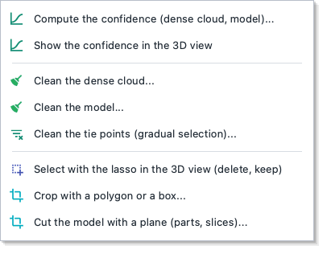

| Voce | A cosa serve |
| --- | --- |
| **Calcola la confidenza...** · **Mostra la confidenza nella vista 3D** | quante mappe di profondità confermano ogni punto della nuvola e ogni vertice del modello |
| **Pulisci la nuvola densa...** | punti isolati, poco confermati, di una classe o di un colore |
| **Pulisci il modello...** | pezzi staccati, triangoli stirati, buchi, levigatura, riduzione delle facce |
| **Pulisci i punti di legame (selezione graduale)...** | soglie su errore, numero di foto e incertezza, poi l'ottimizzazione |
| **Seleziona con il lazo nella vista 3D** | punti e facce da togliere o da tenere |
| **Ritaglia con un poligono o un riquadro...** | i prodotti tagliati su un'area |
| **Taglia il modello con un piano (parti, fette)...** | un piano orizzontale, verticale, per tre punti o inclinato |

Ogni pulizia può conservare prima una copia del prodotto tra le versioni. I dettagli sono in
[Elaborazione](processing.md#confidenza-e-pulizia).

### Flusso di lavoro > Regione di ricostruzione

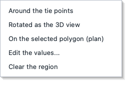

Un riquadro (giallo nella vista 3D) che limita mappe di profondità, nuvola densa, modello, DEM e ortofoto:
la trincea e non il campo attorno, il vaso e non il tavolo.

| Voce | Il riquadro |
| --- | --- |
| **Attorno ai punti di legame** | attorno a tutto il rilievo |
| **Ruotata come la vista 3D** | girato come la vista |
| **Sul poligono selezionato (pianta)** | sul poligono scelto in pianta |
| **Modifica i valori...** | centro, dimensioni e rotazione scritti a mano |
| **Togli la regione** | di nuovo tutto ciò che vedono le foto |

## Strumenti

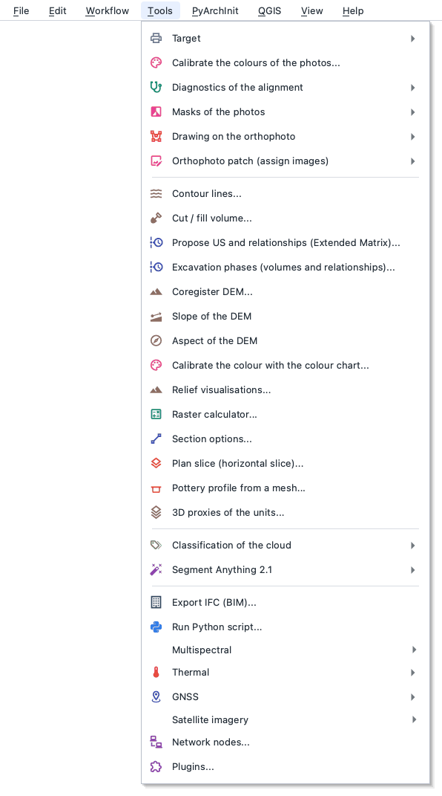

Gli strumenti che lavorano sui prodotti: il disegno e le misure, le analisi per l'archeologia, le riprese
multispettrali, termiche e satellitari, i plugin.

| Voce | A cosa serve |
| --- | --- |
| **Target** | fogli di target, tappetini per turntable e barre di scala da stampare ([vedi sotto](#strumenti-target)) |
| **Calibra i colori delle foto...** | esposizione di ogni foto e vignettatura degli obiettivi, corrette in ortofoto e texture |
| **Diagnostica dell'allineamento** | perché un allineamento non va: [vedi sotto](#strumenti-diagnostica-dellallineamento) |
| **Maschere delle foto** | le parti delle foto da non usare: [vedi sotto](#strumenti-maschere-delle-foto) |
| **Disegno su ortofoto** | gli strumenti della barra *Disegno*: [vedi sotto](#strumenti-disegno-su-ortofoto) |
| **Patch dell'ortofoto (assegna immagini)** | quale foto usare in un'area dell'ortofoto: [vedi sotto](#strumenti-patch-dellortofoto) |
| **Curve di livello...** | le curve dal DEM, come layer da interrogare ed esportare |
| **Volume scavo / riporto...** | il volume tolto e aggiunto rispetto a un piano o a un DEM di prima |
| **Proponi US e rapporti (Extended Matrix)...** | numero, tipo e rapporti stratigrafici per le unità senza numero ([proposta US](archaeology.md#proposta-di-us-e-rapporti)) |
| **Fasi dello scavo (volumi e rapporti)...** | un rilievo per fase: volumi tra le fasi e rapporti suggeriti ([fasi](archaeology.md#fasi-dello-scavo)) |
| **Coregistra DEM...** | sposta il DEM sul DEM di un altro rilievo dove il terreno non è cambiato ([coregistrazione](processing.md#coregistrazione-dei-dem)) |
| **Pendenza del DEM** · **Esposizione del DEM** | i raster della pendenza e dell'esposizione, con i gradi sotto il cursore |
| **Calibra il colore con la tabella colori...** | una ColorChecker fotografata nello scavo rende confrontabili i colori Munsell |
| **Visualizzazioni del rilievo...** | sky-view factor, openness, rilievo locale e multiscala, ombreggiature ([rilievo](archaeology.md#visualizzazioni-del-rilievo)) |
| **Calcolatore raster...** | formule sui raster del progetto, anche quelli dei plugin, come in QGIS ([calcolatore](archaeology.md#calcolatore-raster)) |
| **Opzioni delle sezioni...** · **Pianta a quota (slice orizzontale)...** | da cosa tagliare le sezioni (modello o nuvola, classi); una pianta a una quota |
| **Profilo ceramico da mesh...** | diametri, altezza e profilo di un vaso o di un frammento ([ceramica](archaeology.md#profili-ceramici)) |
| **Proxy 3D delle US...** | i solidi delle unità per l'Extended Matrix e il BIM ([proxy](archaeology.md#proxy-3d-delle-us)) |
| **Classificazione della nuvola** | terreno, vegetazione, murature...: [vedi sotto](#strumenti-classificazione-della-nuvola) |
| **Segment Anything 2.1** | unità e pietre disegnate da SAM 2.1: [vedi sotto](#strumenti-segment-anything-21) |
| **Esporta IFC (BIM)...** | le unità o i loro proxy in un file IFC ([BIM e IFC](../bim.md)) |
| **Esegui script Python...** | uno script con i moduli del programma ([API](../api.md)) |
| **Multispettrale** · **Termico** | le riprese multispettrali e termiche: [vedi sotto](#strumenti-multispettrale) |
| **Immagini satellitari** | scene satellitari sul DEM del rilievo: [vedi sotto](#strumenti-immagini-satellitari) |
| **Nodi di rete...** | altri computer che lavorano allo stesso progetto ([nodi](processing.md#nodi-di-rete)) |
| **Plugin...** | installa, attiva e disattiva i plugin ([plugin](../plugins.md)) |

### Strumenti > Target

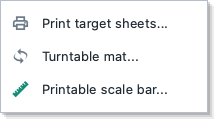

| Voce | Cosa stampa |
| --- | --- |
| **Stampa fogli di target...** | fogli di target codificati da mettere nello scavo |
| **Tappetino per turntable...** | un tappetino con un anello di target e il CSV delle loro coordinate |
| **Barra di scala stampabile...** | due target a distanza nota e un righello di 10 cm per controllare la stampa al 100 % |

### Strumenti > Diagnostica dell'allineamento

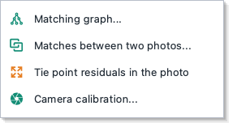

| Voce | Cosa mostra |
| --- | --- |
| **Grafo delle corrispondenze...** | quali foto si collegano a quali: gruppi separati e foto isolate in rosso |
| **Corrispondenze tra due foto...** | le due foto selezionate nel pannello *Foto*, con i punti che le legano |
| **Residui dei punti di legame nella foto** | dove ogni punto è stato misurato e dove lo rimette il modello (frecce ingrandite 20 volte) |
| **Calibrazione della camera...** | i parametri dei sensori, la calibrazione fissa e il grafico della distorsione |

### Strumenti > Maschere delle foto

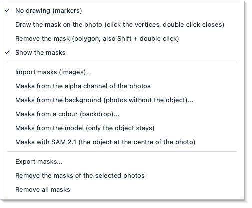

Le parti mascherate (in rosso sulla foto) non si usano per allineare, nelle mappe di profondità,
nell'ortofoto e nella texture.

| Voce | A cosa serve |
| --- | --- |
| **Nessun disegno (marker)** | la foto torna a servire per i marker |
| **Disegna la maschera sulla foto** | clic sui vertici, doppio clic o ++enter++ chiude, ++esc++ annulla |
| **Togli la maschera** | restituisce un'area (anche ++shift++ + doppio clic) |
| **Mostra le maschere** | mostra o nasconde il rosso |
| **Importa maschere (immagini)...** · **Maschere dal canale alfa delle foto** | maschere fatte con un altro programma |
| **Maschere dallo sfondo...** · **Maschere da un colore (fondale)...** | dalle foto senza l'oggetto, o dal colore del fondale |
| **Maschere dal modello** · **Maschere con SAM 2.1** | resta solo l'oggetto: dal modello o con SAM 2.1 (l'oggetto al centro della foto) |
| **Esporta maschere...** · **Rimuovi...** | salva le maschere, o le toglie dalle foto selezionate o da tutte |

### Strumenti > Disegno su ortofoto

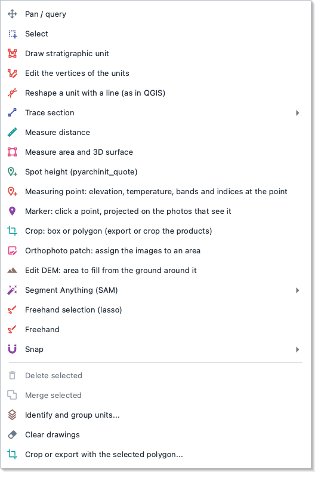

Sono gli strumenti della barra *Disegno*, descritti con le loro finestre in [Disegno e misure](drawing.md).

| Voce | A cosa serve |
| --- | --- |
| **Sposta / interroga** · **Seleziona** | muoversi sull'ortofoto e leggere gli attributi; scegliere gli elementi da eliminare o unire |
| **Disegna unita' stratigrafica** · **Mano libera** | un poligono per vertici, o tracciato tenendo premuto il mouse |
| **Modifica i vertici delle unita'** · **Rimodella un'unita' con una linea** | correggere un contorno, come in QGIS |
| **Traccia sezione** | due clic: il disegno della sezione in SVG e DXF |
| **Misura distanza** · **Misura area e superficie 3D** | distanze e dislivelli; aree in pianta e sulla superficie, con il colore Munsell |
| **Quota puntuale** · **Punto di misura** | una quota per PyArchInit; un punto con quota, temperatura, bande e indici |
| **Marker** | un marker dove si fa clic, proiettato sulle foto che lo vedono |
| **Ritaglio** · **Patch dell'ortofoto** · **Modifica DEM** | lavorare su un'area: tagliare, scegliere le foto, riempire il DEM dal terreno attorno |
| **Segment Anything (SAM)** | le unità disegnate da SAM: tocco, riquadro, area, pietre |
| **Snap** | aggancia i punti ai vertici e ai segmenti dei layer visibili |
| **Elimina selezionati** · **Unisci selezionati** · **Cancella disegni** | togliere o unire elementi |
| **Ritaglia o esporta con il poligono selezionato...** | il ritaglio dei prodotti su un'unità |

### Strumenti > Patch dell'ortofoto

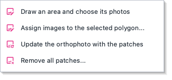

| Voce | A cosa serve |
| --- | --- |
| **Disegna un'area e scegli le sue foto** | un'area, poi la foto da usare lì (con l'anteprima) |
| **Assegna immagini al poligono selezionato...** | lo stesso su un'unità già disegnata |
| **Aggiorna l'ortofoto con le patch** | applica le patch non ancora applicate |
| **Rimuovi tutte le patch...** | l'ortofoto torna come era |

Come si sceglie la foto giusta è spiegato in [Elaborazione](processing.md#patch-dellortofoto).

### Strumenti > Classificazione della nuvola

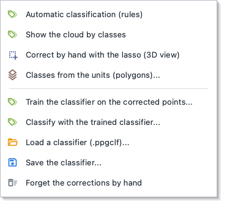

| Voce | A cosa serve |
| --- | --- |
| **Classificazione automatica (regole)** | terreno, vegetazione, murature, rumore e le classi archeologiche |
| **Mostra la nuvola per classi** | la nuvola colorata per classe, con la legenda |
| **Correggi a mano con il lazo (vista 3D)** | dare una classe ai punti scelti |
| **Classi dalle US (poligoni)...** | i punti dentro ogni unità prendono la sua classe |
| **Addestra il classificatore...** · **Classifica con il classificatore...** | impara dai punti corretti e classifica il resto |
| **Carica...** · **Salva il classificatore...** | riusare un classificatore (`.ppgclf`) su altri scavi |
| **Dimentica le correzioni a mano** | le classi restano, ma tornano modificabili dalle regole |

Le classi guidano i prodotti: DTM dal solo terreno, ortofoto senza attrezzi e persone, mesh di sole
murature ([classificazione](archaeology.md#classificazione-della-nuvola)).

### Strumenti > Segment Anything 2.1

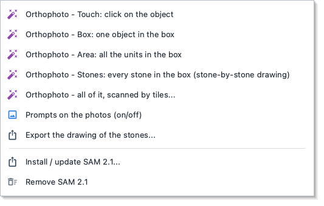

| Voce | A cosa serve |
| --- | --- |
| **Ortofoto - Tocco** · **Riquadro** · **Area** | un'unità con un clic, un oggetto nel riquadro, tutte le unità nel riquadro |
| **Ortofoto - Pietre** | ogni pietra nel riquadro: il disegno pietra per pietra di un muro |
| **Ortofoto - tutta, scansione a tasselli...** | tutte le unità dell'ortofoto, nel layer *Unita' da SAM* |
| **Prompt sulle foto (attiva/disattiva)** | segmentare un oggetto su una foto |
| **Esporta il disegno delle pietre...** | le pietre come DXF, SVG in scala o GeoJSON |
| **Installa / aggiorna SAM 2.1...** · **Rimuovi SAM 2.1** | SAM si installa a richiesta, nel suo ambiente |

### Strumenti > Multispettrale

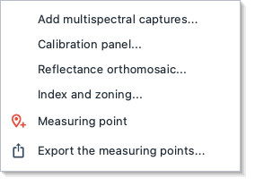

Gli stessi passi del pannello *Multispettrale* ([Multispettrale e termico](multispectral.md)).

| Voce | A cosa serve |
| --- | --- |
| **Aggiungi riprese multispettrali...** | una cartella con un file per banda di ogni scatto (MicaSense, DJI, Sequoia) |
| **Pannello di calibrazione...** | la ripresa del pannello e la sua riflettanza: le bande diventano riflettanza |
| **Ortofoto di riflettanza...** | una banda per banda sulla geometria dell'ortofoto |
| **Indice e zonizzazione...** | NDVI, NDRE e gli altri indici; le zone come poligoni in un GeoPackage |
| **Punto di misura** · **Esporta i punti di misura...** | i valori in un punto, e il loro elenco |

### Strumenti > Termico

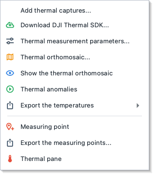

| Voce | A cosa serve |
| --- | --- |
| **Aggiungi riprese termiche...** | i fotogrammi termici e, se ci sono, le foto visibili dello stesso volo |
| **Scarica il DJI Thermal SDK...** | il programma di DJI che legge le R-JPEG, dopo averne accettato la licenza |
| **Parametri di misura della termica...** | emissività, temperatura riflessa e ambiente, umidità, distanza |
| **Ortofoto termica...** · **Mostra l'ortofoto termica** | l'ortofoto in gradi Celsius |
| **Anomalie termiche** | la temperatura meno quella dei dintorni: muri e fossati sepolti |
| **Esporta le temperature** | GeoTIFF in gradi o in centikelvin, CSV, JPEG radiometrici FLIR |
| **Punto di misura** · **Esporta i punti di misura...** · **Pannello Termico** | i valori in un punto; il pannello con tutti i passi |

### Strumenti > Immagini satellitari

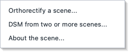

| Voce | A cosa serve |
| --- | --- |
| **Ortorettifica una scena...** | una scena con i suoi RPC sul DEM del rilievo, come versione dell'ortofoto |
| **DSM da due o più scene...** | la superficie da scene prese da direzioni diverse, come versione del DEM |
| **Informazioni sulla scena...** | dimensioni, bande, risoluzione a terra e impronta |

## PyArchInit

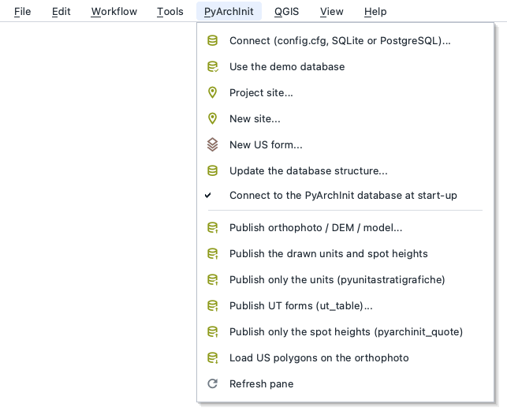

Il collegamento con il database dello scavo; le schede e le relazioni restano in PyArchInit
([PyArchInit](../pyarchinit.md), [strumenti per l'archeologia](archaeology.md#pyarchinit)).

| Voce | A cosa serve |
| --- | --- |
| **Connetti (config.cfg, SQLite o PostgreSQL)...** | il database configurato in PyArchInit, un file SQLite o un server PostgreSQL |
| **Usa il database demo** | un database di prova con tre siti |
| **Sito del progetto...** | lo scavo a cui appartengono unità e quote del progetto |
| **Nuovo sito...** · **Nuova scheda US...** | crea la scheda del sito o di una US |
| **Aggiorna struttura del database...** | aggiunge le colonne mancanti di PyArchInit 5, dopo una copia di sicurezza |
| **Connetti all'avvio al database di PyArchInit** | si collega da solo all'apertura |
| **Pubblica ortofoto / DEM / modello...** | i prodotti nei media di PyArchInit, legati alle US |
| **Pubblica unita' e quote disegnate** · **solo le unita'** · **solo le quote** | scrive `pyunitastratigrafiche` e `pyarchinit_quote` |
| **Carica poligoni US sull'ortofoto** | mostra le unità già nel database |
| **Aggiorna pannello** | rilegge siti, US e documentazione |

## QGIS

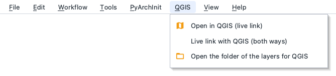

| Voce | A cosa serve |
| --- | --- |
| **Apri in QGIS (collegamento dal vivo)** | un progetto QGIS con ortofoto, DEM e disegni |
| **Collegamento dal vivo con QGIS (nei due sensi)** | ciò che disegni qui arriva in QGIS; ciò che salvi in QGIS torna qui entro un secondo |
| **Apri la cartella dei layer per QGIS** | la cartella del GeoPackage condiviso |

Come funziona il collegamento nei due sensi è spiegato in [QGIS dal vivo](../integrations.md#qgis-dal-vivo).

## Vista

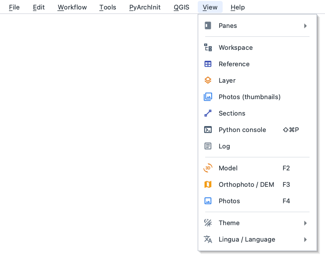

| Voce | A cosa serve |
| --- | --- |
| **Pannelli** | ogni pannello aperto o chiuso: [vedi sotto](#vista-pannelli) |
| **Area di lavoro** ... **Log** | porta davanti un pannello (la console anche con ++ctrl+shift+p++) |
| **Modello** ++f2++ · **Ortofoto / DEM** ++f3++ · **Foto** ++f4++ | le tre viste centrali (nell'area di lavoro ++f2++ rinomina) |
| **Tema** | chiaro o scuro, ricordato |
| **Lingua / Language** | italiano o inglese, al prossimo avvio (*Riavvia ora* riapre subito il progetto) |

### Vista > Pannelli

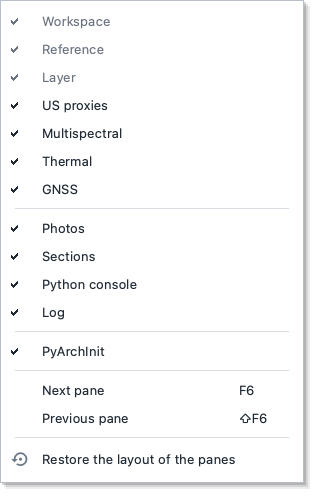

| Voce | A cosa serve |
| --- | --- |
| un pannello con la spunta | aperto; senza spunta è chiuso. *Area di lavoro*, *Riferimenti* e *Layer* ci sono sempre |
| **Pannello successivo** ++f6++ · **precedente** ++shift+f6++ | passa tra i pannelli dello stesso gruppo |
| **Ripristina la disposizione dei pannelli** | ogni pannello al suo posto iniziale, tutti aperti |

Spostare, staccare e riattaccare i pannelli è spiegato in [Pannelli](panes.md#spostare-i-pannelli).

## Aiuto

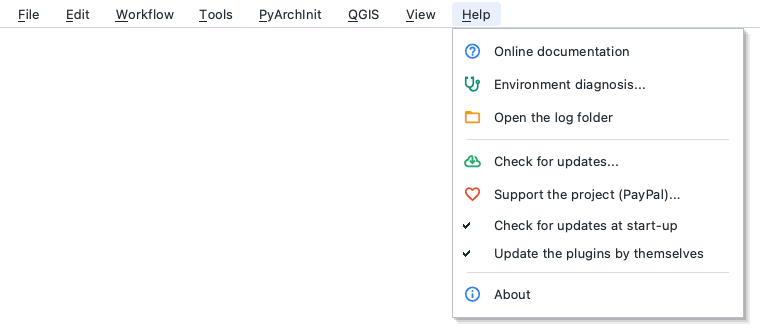

| Voce | A cosa serve |
| --- | --- |
| **Documentazione online** | questa guida |
| **Diagnostica ambiente...** | Python, le librerie e i problemi noti, con cosa fare; *Copia* per una segnalazione |
| **Apri cartella dei log** | i file di log da allegare a una segnalazione |
| **Controlla aggiornamenti...** · **all'avvio** | una nuova versione, e se cercarla all'avvio ([aggiornamenti](help.md#aggiornamenti)) |
| **Aggiorna i plugin da soli** | se i plugin installati dal programma scaricano le versioni più nuove, messe a posto al prossimo avvio ([aggiornamenti dei plugin](../plugins.md#aggiornamenti)) |
| **Sostieni il progetto (PayPal)...** | una donazione |
| **Informazioni** | versione, librerie e licenza |

## Plugin

Il menu *Plugin* compare tra *Vista* e *Aiuto* quando c'è almeno un plugin attivo: ogni plugin vi mette i
suoi comandi, raggruppati sotto il suo nome. I formati che un plugin sa scrivere vanno invece in
*File > Esporta*. Si installano da *Strumenti > Plugin...* ([plugin](../plugins.md),
[guide ai plugin](../plugins/guides.md)).
