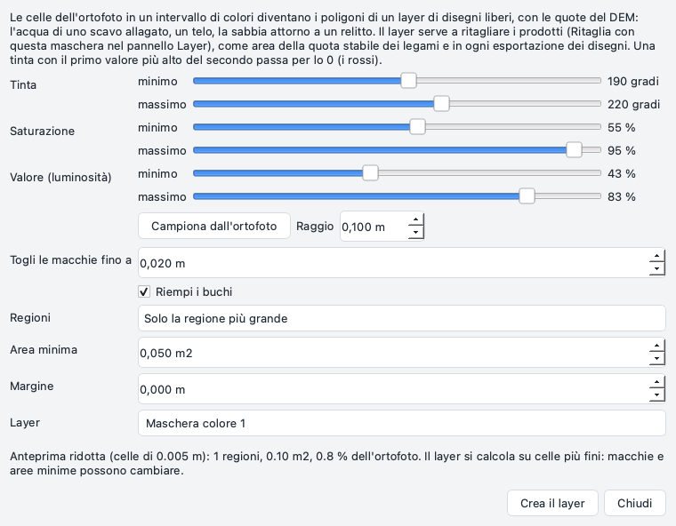
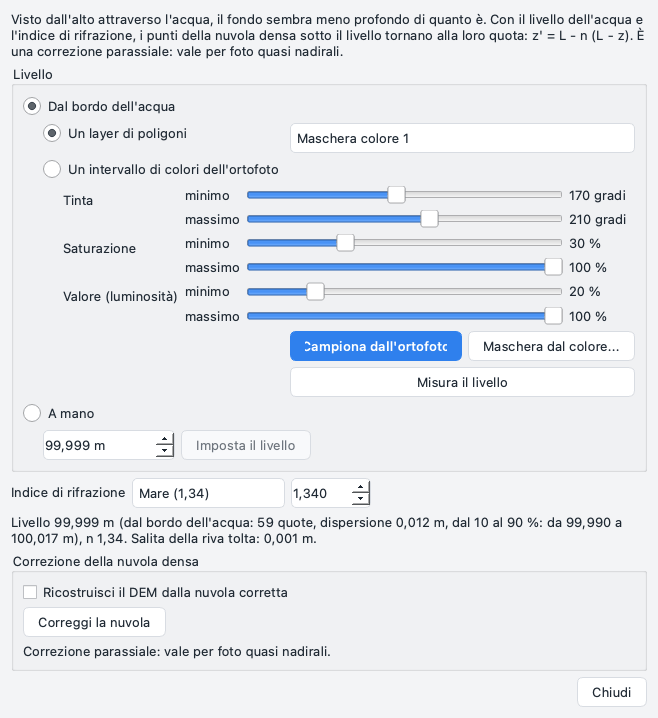
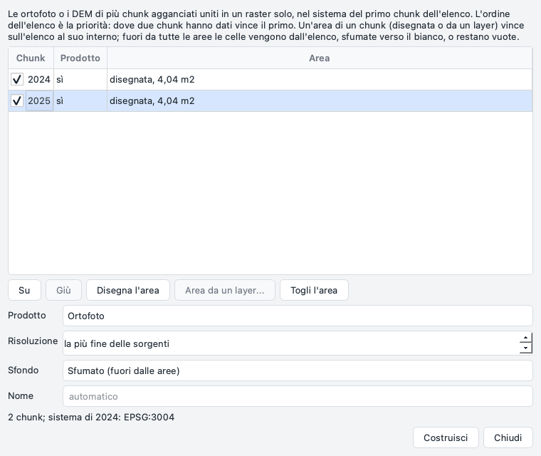
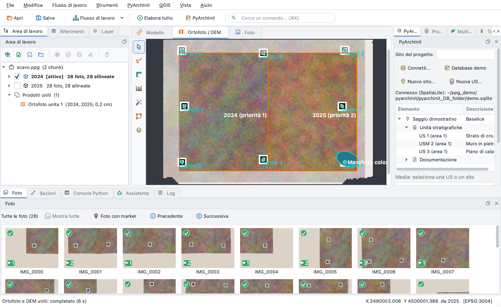

# Più rilievi: maschere, acqua, prodotti uniti

Applicazione **1.7.7**. Tre strumenti per un sito rilevato più volte, o in parte sott'acqua: una **maschera da un
colore** dell'ortofoto (l'acqua di uno scavo allagato, un telo, la sabbia attorno a un relitto), il **livello
dell'acqua** con la **correzione della rifrazione** della nuvola densa sotto di esso, e l'**ortofoto e il DEM uniti** di
più chunk agganciati ([legami fra chunk](ties.md)). Sono tutti e tre nel menu *Strumenti*, lavorano in background e si
annullano con *Modifica > Annulla*.

## Maschera dal colore

*Strumenti > Maschera dal colore...* trasforma le celle dell'ortofoto del chunk attivo comprese in un intervallo di
colori nei poligoni di un layer di [disegni liberi](drawing.md), con le quote del DEM.



* **Tinta** in gradi (0-360), **saturazione** e **valore** (luminosità) in %: un minimo e un massimo ciascuno. Una
  tinta con il minimo più alto del massimo passa per lo 0: da 350 a 10 sono i rossi.
* **Campiona dall'ortofoto**: un clic sulla vista 2D imposta i tre intervalli attorno al colore di un piccolo cerchio
  lì (*Raggio*). Parti da qui, poi allarga o stringi gli intervalli.
* La pulizia: **Togli le macchie fino a** (le macchie più piccole se ne vanno), **Riempi i buchi**, **Regioni** (*Solo
  la regione più grande*, o *Tutte le regioni* di almeno l'**Area minima**), **Margine** (metri aggiunti attorno ai
  poligoni; negativo: tolti).
* **Layer**: il layer dei disegni liberi (di solito *Maschera colore N*). Una maschera dal colore già in quel layer
  viene sostituita; i poligoni disegnati a mano restano.

L'**anteprima** si calcola subito su una copia ridotta dell'ortofoto (circa 1000 pixel di lato) e si disegna sulla
vista; *Crea il layer* calcola la maschera su una copia più fine (al massimo 4000 pixel di lato) in background, quindi
macchie e aree minime possono cambiare un poco. Creare il layer è un passo di *Modifica > Annulla*. Un poligono della
maschera ha un solo contorno: i suoi buchi restano fuori e il log li conta.

A cosa serve il layer:

* a **ritagliare i prodotti**: tasto destro sul layer nel [pannello Layer](panes.md#layer), *Ritaglia con questa
  maschera...* (*Ritaglia con i poligoni di questo layer...* per un layer disegnato a mano) apre il ritaglio di DEM,
  ortofoto, nuvola e modello con l'unione dei suoi poligoni;
* come **area** (o come parte da **lasciare fuori**) di una [quota stabile](ties.md#quota-da-una-superficie-stabile);
* come acqua del **livello dell'acqua** (sotto);
* in ogni esportazione dei disegni liberi (DXF, GeoPackage, GeoJSON, CSV, QGIS).

L'ortofoto deve essere aggiornata: una costruita prima che una soluzione dei legami spostasse il chunk viene rifiutata
(ricostruiscila).

## Livello dell'acqua e rifrazione

Vista dall'alto attraverso l'acqua ferma, il fondo sembra meno profondo di quanto è: le foto vedono ogni punto del
fondo più in alto, per la rifrazione sulla superficie. Con il **livello** dell'acqua L e il suo **indice di
rifrazione** n, i punti della nuvola densa sotto il livello tornano alla loro quota: z' = L - n (L - z).

*Strumenti > Livello dell'acqua e rifrazione...* (o un doppio clic su *Acqua: livello ...* sotto il chunk nell'Area di
lavoro) lavora sul chunk attivo, che deve avere un DEM o una nuvola densa.



**Il livello**, in uno di questi modi:

* **Dal bordo dell'acqua**: l'acqua è *Un layer di poligoni* (una maschera dal colore, un poligono disegnato attorno)
  o *Un intervallo di colori dell'ortofoto* (con *Campiona dall'ortofoto*; *Maschera dal colore...* apre la finestra
  della maschera per farne un layer con la sua pulizia). *Misura il livello* segue il contorno dell'acqua e legge il DEM
  dal lato della terra, a 2 e a 4 celle dal bordo, così la salita della riva viene tolta; la mediana di queste quote è
  il livello. La finestra dice quante quote, la loro dispersione (NMAD), l'intervallo dal 10 al 90 % e la salita della
  riva tolta, e disegna le quote usate sulla vista (layer *Bordo dell'acqua*, finché la finestra è aperta).
* **A mano**: una quota scritta in metri, *Imposta il livello*.

**Indice di rifrazione**: *Mare (1,34)*, *Acqua dolce (1,33)* o *Altro* (da 1 a 2). Si conserva con il livello.

Impostare il livello, cambiare n e misurare di nuovo sono ognuno un passo di *Modifica > Annulla*. Il livello resta nel
progetto e segue il chunk quando una soluzione dei legami lo sposta.

**Correggi la nuvola** scrive una nuova **versione** della nuvola densa con i punti sotto il livello corretti (quelli
sopra restano com'erano, bit per bit); la nuvola di prima resta fra le versioni, e renderla di nuovo attiva toglie la
correzione. *Ricostruisci il DEM dalla nuvola corretta* costruisce anche una nuova versione del DEM, con la cella di
quello esistente. Una nuvola già corretta non si corregge due volte.

Anche il [plugin Relitto](../plugins/shipwreck.md#lacqua) può correggere le quote delle sue sezioni sotto un livello. Con un
modello costruito dalla nuvola corretta lascia spenta quella correzione, altrimenti il fondo viene corretto due volte e
finisce sotto la sua profondità vera (dalla versione 0.5.0 il plugin chiede prima, quando la nuvola attiva del chunk è
una versione corretta).

!!! warning "Limiti"
    * La correzione è **parassiale**: vale per foto quasi verticali. Le foto oblique attraverso l'acqua richiedono una
      correzione raggio per raggio, che questa non è.
    * L'acqua deve essere ferma e la sua superficie piana: onde, corrente, un fondo torbido rovinano la nuvola prima di
      ogni correzione.
    * Il livello si legge sul DEM: un DEM grossolano o rumoroso sulla riva dà un livello buono quanto lui. La
      dispersione e l'intervallo dal 10 al 90 % dicono quanto fidarsene.
    * La nuvola viene letta tutta in memoria: una nuvola molto grande chiede tanta memoria quanto occupa sul disco.

### Più livelli, piani della riva, il fattore dai punti di controllo

Un rilievo di più anni o di più bacini non ha un solo livello e un solo indice.

* **Un livello e un fattore per chunk** (un chunk per anno): ogni chunk tiene il suo livello e il suo *fattore
  efficace* n. `ppg water table` li imposta per più chunk insieme da un CSV, per chunk o per data del rilievo (la data
  della fase, come nella [sequenza nel tempo](archaeology.md)): colonne `chunk` o `date`, `level`, `n` (`;` con la
  virgola decimale).
* **Bacini** dentro un chunk: ogni bacino ha il suo livello, il suo fattore e i suoi poligoni (un poligono WKT o un
  layer di disegni liberi); il bacino senza poligono prende i punti che nessun altro bacino prende, i punti fuori da
  ogni bacino restano come sono. Un livello può essere un piano adattato a **punti presi sulla riva** (tre o più:
  la superficie dell'acqua vista un poco inclinata perché il sistema è inclinato); il comando dice l'inclinazione e lo
  scarto dell'adattamento.
* **Il fattore efficace dai punti di controllo**: punti di quota vera nota sott'acqua (una stadia, il GNSS sul fondo)
  la cui quota apparente si legge sul DEM o sulla nuvola densa prima della correzione, oppure marker con il riferimento
  sott'acqua e la posizione triangolata attraverso l'acqua. I minimi quadrati su L - z_vera = n (L - z_apparente)
  danno n, con lo scarto di ogni punto; `--fit-level` stima anche il livello (almeno tre punti). `--apply` salva il
  fattore sul chunk, o sul bacino di `--basin`.

Senza bacini non cambia nulla: un livello e un n, come prima. Bacini e fattori si spostano con il chunk come il
livello. Sono nella riga di comando e nell'API Python; la finestra sopra imposta ancora un livello per chunk.

## Modello unito

I **modelli** di più chunk - i blocchi di un relitto rilevati in anni diversi, le parti di un edificio - diventano
**un solo modello con texture** di un nuovo chunk: *Flusso di lavoro > Unisci i modelli in uno...* o
`ppg merge-models`.

* I chunk devono essere nello stesso sistema (allineati o georeferenziati); il primo dà il sistema del nuovo chunk. I
  chunk di partenza non cambiano.
* **Pagine della texture**: tenute come sono, oppure *riunite* in pagine di lato massimo (8192 px se non detto); una
  pagina che non ci sta viene ridotta. Le coordinate di texture sono frazioni della pagina: una pagina ridotta non
  chiede altro.
* **Colori** (a scelta): ogni modello prende i colori del primo dove le superfici si sovrappongono - guadagno e
  scostamento per canale RGB, oppure *trasferimento Lab* (media e dispersione di ogni canale in CIE Lab). Un modello che
  si sovrappone solo a un altro già accordato segue la catena; uno che non si sovrappone a nessuno resta com'è e lo
  dicono gli avvisi.
* **Facce sovrapposte** (a scelta): dove due modelli coprono la stessa superficie, le facce del modello che viene dopo
  nella lista si tolgono entro una distanza (automatica: due volte il lato medio), solo se guardano dalla stessa parte.
* **Le aperture restano aperte**: niente viene cucito tra i modelli né chiuso dopo la rimozione.
* Il chunk di partenza di ogni faccia resta con il modello (il suo gruppo): un OBJ esportato può avere un gruppo per
  chunk.

Il nuovo chunk è un chunk come gli altri: DEM dal modello, ortofoto dalla sua texture (sotto), prospetti, misure ed
esportazioni funzionano su di esso.

## Ortofoto di un chunk senza foto

Un modello importato con texture o un modello unito non hanno foto allineate: *Flusso di lavoro > Costruisci
ortofoto...* fa allora l'ortofoto **dalla texture del modello** (e lo dice). Ogni cella manda un raggio verticale al
modello e prende la texture dove lo incontra; dove la texture è più fine della cella si fa la media di più raggi. La
cella è, se non detta, la dimensione di un texel. Il prodotto è l'ortofoto del chunk come le altre (GeoTIFF RGBA nel
CRS del chunk, versioni, esportazioni, misure). Anche i *prospetti* su un chunk così si colorano dalla texture.
`ppg ortho --texture` la chiede anche su un chunk con le foto (`--photos` il contrario).

L'ortofoto è fatta e scritta a tasselli (BigTIFF quando serve): la sua dimensione è limitata dal disco, non dalla
memoria né dai 32.767 pixel di lato che fermano il `remap` di OpenCV.

## Ortofoto e DEM uniti

Più chunk dello stesso sito - campagne di anni diversi, parti di un edificio, una parte asciutta e una allagata - una
volta agganciati in un sistema solo possono dare un'ortofoto o un DEM unico. *Strumenti > Ortofoto e DEM uniti...*:



* l'**elenco** dei chunk: spunta quelli da unire (si possono spuntare solo i chunk che hanno il prodotto). L'ordine è la
  **priorità** (*Su*, *Giù*): dove due chunk hanno dati vince il primo. Il **sistema** del prodotto unito è quello del
  primo chunk; un chunk in un sistema locale con uno in un sistema del mondo viene rifiutato, come per i legami, e così
  una coppia di sistemi che solo una trasformazione approssimata di PROJ unirebbe (ITRF2020 con un altro sistema,
  ETRF2014/2020 con ETRF2000): porta il chunk nel sistema del primo, o mettilo primo. I legami e le quote stabili
  accettano una coppia così, con una nota nel log, perché spostano pochi punti per la strada del programma
  ([Legami](ties.md)); qui ogni pixel sarebbe spostato dall'approssimazione di PROJ, da centimetri a un metro, senza
  che niente lo mostri;
* un'**area** per un chunk (facoltativa): seleziona la sua riga, poi *Disegna l'area* (un poligono sulla vista 2D) o
  *Area da un layer...* (i poligoni di uno dei suoi layer di disegni liberi: una maschera dal colore, un disegno).
  Dentro la sua area il chunk vince sull'elenco; dove le aree si sovrappongono vince la prima nell'ordine dell'elenco.
  *Togli l'area* la toglie. Un'area tiene il sistema in cui è stata disegnata (quello della vista 2D) o presa (quello
  del suo chunk): se metti primo un chunk in un altro sistema del mondo, alla costruzione l'area viene portata nel suo
  sistema ("riproiettata" nella sua riga); un sistema locale e uno del mondo non si uniscono, e la costruzione viene
  rifiutata finché non ridisegni l'area o cambi l'ordine;
* **Prodotto** (*Ortofoto* o *DEM*), **Risoluzione** (di solito la più fine delle sorgenti), **Sfondo** con delle aree:
  *Sfumato* (fuori da tutte le aree le celle vengono dall'elenco, schiarite a metà verso il bianco nell'ortofoto; il DEM
  tiene le quote) o *Nessuno* (solo le aree: il resto rimane vuoto), **Nome** (di solito *Ortofoto unita N* / *DEM unito
  N*).

*Costruisci* lavora in background, a blocchi di 2048 celle: raster di qualsiasi dimensione si uniscono con poca
memoria. Ogni raster sorgente viene messo dove il suo chunk è **adesso**: uno costruito prima dell'ultima soluzione dei
legami viene spostato con il suo chunk, in pianta e in quota, come lo mostra la vista 2D (il log lo nomina; una
sorgente inclinata di più di mezzo grado viene collocata solo in pianta: ricostruiscila).

Il prodotto unito va nel nodo **Prodotti uniti** in fondo all'Area di lavoro e si vede nella vista 2D con le sue aree
(layer *aree*). Sotto il cursore la barra di stato dice **da quale chunk viene ogni cella** ("da 2025").



* Un doppio clic lo mostra di nuovo; il tasto destro ha *Mostra*, *Apri la cartella* e *Rimuovi*.
* Un prodotto unito i cui chunk si sono spostati (una nuova soluzione dei legami), i cui raster sorgente sono stati
  ricostruiti o i cui chunk hanno lasciato il progetto è segnato **da rifare**, in rosso: costruiscilo di nuovo.
* Costruirlo è un passo di *Modifica > Annulla*: l'annullamento mette da parte la sua cartella (come fa una
  [rimozione](panes.md#rimuovere)), il ripristino la rimette. Anche *Rimuovi* si annulla allo stesso modo. Quando il
  progetto si chiude, i file seguono il progetto come è stato salvato l'ultima volta.
* Se lo mostri mentre il chunk attivo è in un altro sistema, la barra di stato lo dice: i disegni del chunk non ci
  cadono sopra.
* Su un'ortofoto unita la barra di stato non dà quote: il DEM del chunk attivo può non coprirla. Su un DEM unito solo
  la barra di stato mostra le quote unite. Gli strumenti di disegno e di misura prendono sempre le quote dal DEM del
  chunk attivo, anche su un DEM unito: disegna e misura sui prodotti di un chunk.

I file stanno in `<progetto>.ppg.files/mosaics/<id>/`: `mosaic.tif` (RGBA per l'ortofoto, float32 con NaN per il DEM),
`sources.tif` (il chunk di ogni cella: 0 nessuno, 1 il primo dell'elenco...), `areas.gpkg` (layer `aree`, attributi
`chunk` e `priority`) e `mosaic.json`. I percorsi delle sorgenti sono relativi al progetto: un progetto spostato o
rinominato resta com'era.

## Riga di comando

```bash
ppg mask colour scavo.ppg 2025 --sample 2480003.2,4500000.6 [--radius 0.1] [--opening 0.05] [--layer Acqua]
ppg mask colour scavo.ppg 2025 --hue 190,230 --sat 30,100 --val 20,100 [--all] [--min-area 0.05] [--margin 0.1]
ppg water level scavo.ppg 2025 --layer Acqua [--sea | --fresh | --n 1.335]   # dal bordo dell'acqua
ppg water level scavo.ppg 2025 --set 0.80                                     # a mano
ppg water correct scavo.ppg 2025 [--dem]                                      # una nuova versione della nuvola densa
ppg water show scavo.ppg 2025
ppg water basin scavo.ppg 2025 --name Est --shore X,Y,Z;X,Y,Z;X,Y,Z --polygon "POLYGON ((...))" --n 1.33
ppg water basin scavo.ppg 2025 --name Resto --level 0.78 --n 1.34          # senza poligono: dappertutto altrove
ppg water basin scavo.ppg 2025 --clear                                      # di nuovo un solo livello
ppg water factor scavo.ppg 2025 --points controlli.csv [--source dem|cloud] [--markers T1,T2] [--fit-level] [--apply]
ppg water table scavo.ppg livelli.csv                                       # chunk o data, livello, n
ppg merge-models scavo.ppg 2024 2025 2026 [--colour gain|lab] [--remove-overlaps --priority 2026,2025,2024]
    [--overlap-distance 0.02] [--pages keep|repack] [--page-size 8192] [--max-page 8192] [--label "Modello unito"]
ppg ortho scavo.ppg --chunk "Modello unito" [--resolution 0.005] [--texture] [--supersample 2]
ppg mosaic build scavo.ppg --chunks 2024,2025 [--dem] [--areas aree.gpkg] [--resolution 0.01] [--background none]
ppg mosaic list scavo.ppg [--json]
ppg mosaic remove scavo.ppg m1a2b3c4d
```

`--areas` prende un GeoPackage di poligoni con l'attributo `chunk` (nome o chiave) e, facoltativo, `priority`.
`ppg mosaic remove` cancella subito i file (la finestra li mette da parte per *Annulla*). Tutte le opzioni sono
nell'[API Python](../api.md#piu-rilievi-maschere-acqua-prodotti-uniti).
