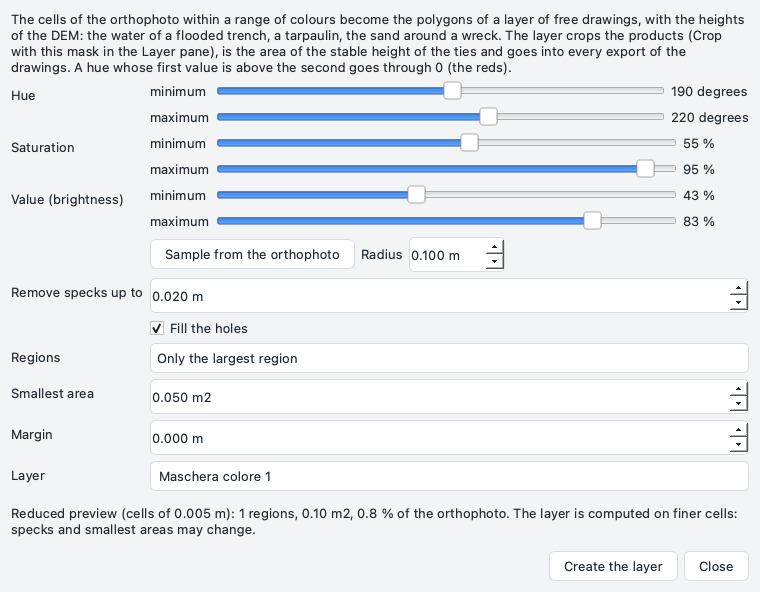
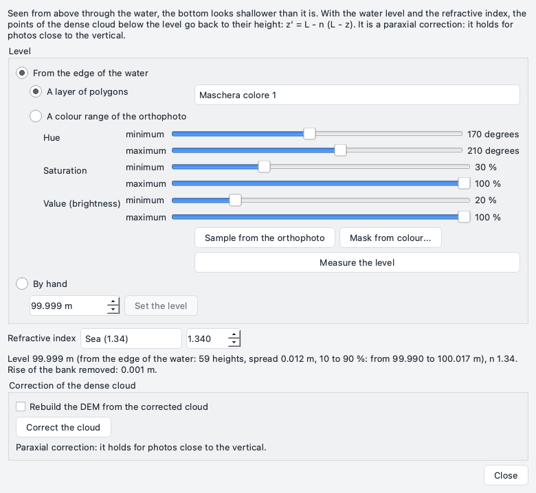
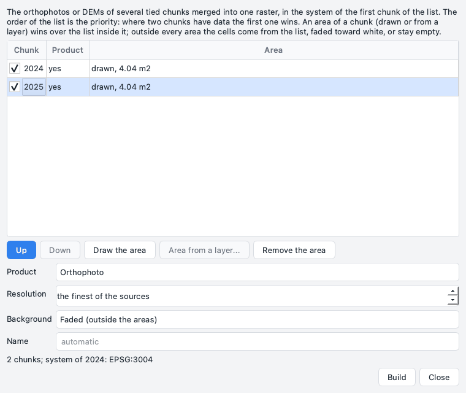
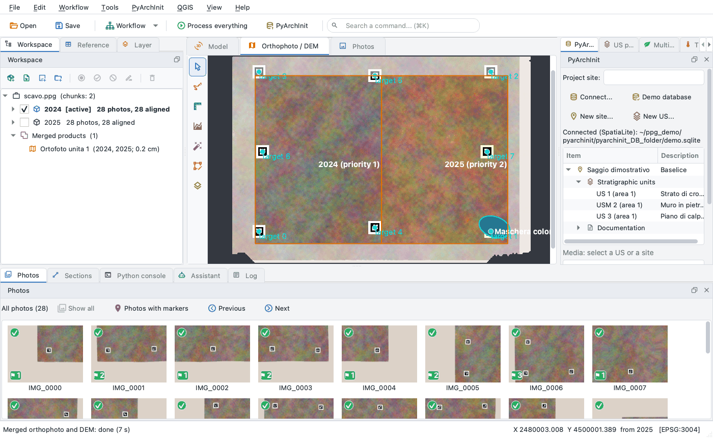

# Several surveys: masks, water, merged products

Application **1.7.7**. Three tools for a site surveyed more than once, or partly under water: a **mask from a colour**
of the orthophoto (the water of a flooded trench, a tarpaulin, the sand around a wreck), the **water level** with the
**refraction correction** of the dense cloud below it, and the **merged orthophoto and DEM** of several chunks tied
together ([ties between chunks](ties.md)). All three are in the *Tools* menu, run in the background and are undone
with *Edit > Undo*.

## Mask from a colour

*Tools > Mask from colour...* turns the cells of the orthophoto of the active chunk within a range of colours into
the polygons of a layer of [free drawings](drawing.md), with their heights from the DEM.



* **Hue** in degrees (0-360), **saturation** and **value** (brightness) in %: a low and a high end each. A hue whose
  low end is above its high end goes through 0: 350 to 10 are the reds.
* **Sample from the orthophoto**: a click on the 2D view sets the three ranges around the colour of a small disc there
  (*Radius*). Start from it, then widen or narrow the ranges.
* The cleaning: **Remove specks up to** (spots smaller than this go), **Fill the holes**, **Regions** (*Only the
  largest region*, or *All the regions* of at least the **Smallest area**), **Margin** (metres added around the
  polygons; negative: taken away).
* **Layer**: the layer of free drawings (default *Maschera colore N*). A colour mask already in that layer is
  replaced; polygons drawn by hand in it stay.

The **preview** is computed at once on a reduced copy of the orthophoto (about 1000 pixels a side) and drawn on the
view; *Create the layer* computes the mask on a finer copy (at most 4000 pixels a side) in the background, so specks
and the smallest areas may change a little. Creating the layer is one step of *Edit > Undo*. A polygon of the mask has
one outline: its holes are left out and counted in the log.

What the layer is for:

* **cropping the products**: right click on the layer in the [Layer pane](panes.md#layer), *Crop with this mask...*
  (*Crop with the polygons of this layer...* for a layer drawn by hand) opens the crop of DEM, orthophoto, cloud and
  model with the union of its polygons;
* the **area** (or what to **leave out**) of a [stable height](ties.md#stable-height);
* the water of the **water level** (below);
* every export of the free drawings (DXF, GeoPackage, GeoJSON, CSV, QGIS).

The orthophoto must be up to date: one built before the chunk was moved by a tie solve is refused (build it again).

## Water level and refraction

Seen from above through still water, the bottom looks shallower than it is: the photos see each point of the bottom
higher, by the refraction at the surface. With the **level** of the water L and its **refractive index** n, the points
of the dense cloud below the level go back to their height: z' = L - n (L - z).

*Tools > Water level and refraction...* (or a double click on *Water: level ...* under the chunk in the Workspace)
works on the active chunk, which needs a DEM or a dense cloud.



**The level**, one of:

* **From the edge of the water**: the water is *A layer of polygons* (a colour mask, a polygon drawn around it) or
  *A colour range of the orthophoto* (with *Sample from the orthophoto*; *Mask from colour...* opens the mask window to
  make a layer with its cleaning). *Measure the level* follows the outline of the water and reads the DEM on the land
  side, 2 and 4 cells from the edge, so the slope of the bank is taken away; the median of these heights is the level.
  The window says how many heights, their spread (NMAD), the 10-90 % range and the rise of the bank removed, and draws
  the heights used on the view (layer *Bordo dell'acqua*, while the window is open).
* **By hand**: a height typed in metres, *Set the level*.

**Refractive index**: *Sea (1.34)*, *Fresh water (1.33)* or *Other* (1 to 2). It is stored with the level.

Setting the level, changing n and measuring again are each one step of *Edit > Undo*. The level is kept in the project
and moves with the chunk when a tie solve moves it.

**Correct the cloud** writes a new **version** of the dense cloud with the points below the level corrected (those
above it stay as they were, bit for bit); the cloud of before stays among the versions, and making it active again
undoes the correction. *Rebuild the DEM from the corrected cloud* also builds a new version of the DEM, at the cell of
the existing one. A cloud already corrected is not corrected twice.

!!! warning "Limits"
    * The correction is **paraxial**: it holds for photos close to the vertical. Oblique photos through the water need
      a correction per ray, which this is not.
    * The water must be still and its surface flat: waves, a current, a turbid bottom spoil the cloud before any
      correction.
    * The level is read on the DEM: a DEM coarse or noisy on the bank gives a level as good as it is. The spread and
      the 10-90 % range say how much to trust it.
    * The cloud is read whole in memory: a very large cloud needs as much memory as it takes on disk.

## Merged orthophoto and DEM

Several chunks of the same site - campaigns of different years, pieces of a building, a dry part and a flooded one -
once tied in one system can give one orthophoto or one DEM. *Tools > Merged orthophoto and DEM...*:



* the **list** of the chunks: tick those to merge (only the chunks with the product can be ticked). The order is the
  **priority** (*Up*, *Down*): where two chunks have data, the first one wins. The **system** of the merged product is
  that of the first chunk; a chunk in a local frame with one in a system of the world is refused, as for the ties, and
  so is a pair of systems that only an approximate transformation of PROJ would join (move the chunk into the system
  of the first, or make it first);
* an **area** for a chunk (optional): select its row, then *Draw the area* (a polygon on the 2D view) or *Area from a
  layer...* (the polygons of one of its layers of free drawings: a colour mask, a drawing). Inside its area the chunk
  wins over the list; where areas overlap, the first area in the order of the list wins. *Remove the area* takes it
  away. An area keeps the system it was drawn in (that of the 2D view) or taken in (that of its chunk): when another
  chunk, in another system of the world, is put first, the area is carried into its system at the build ("reprojected"
  in its row); a local frame with a system of the world cannot be joined, and the build is refused until the area is
  drawn again or the order changed;
* **Product** (*Orthophoto* or *DEM*), **Resolution** (default the finest of the sources), **Background** with areas:
  *Faded* (outside every area the cells come from the list, blended halfway toward white in the orthophoto; the DEM
  keeps its heights) or *None* (only the areas: the rest stays empty), **Name** (default *Ortofoto unita N* /
  *DEM unito N*).

*Build* runs in the background, in blocks of 2048 cells: rasters of any size merge in little memory. Each source
raster is placed where its chunk is **now**: one built before the last tie solve is moved with its chunk, in plan and
in height, as the 2D view shows it (the log names it; a source tilted by more than half a degree is placed in plan
only - build it again).

The merged product goes into the node **Merged products** at the bottom of the Workspace and is shown in the 2D view
with its areas (layer *aree*). Under the cursor, the status bar says **which chunk each cell comes from** ("from
2025").



* A double click on it shows it again; the right click has *Show*, *Open the folder* and *Remove*.
* A merged product whose chunks moved (a new tie solve), whose source rasters were built again or whose chunks left
  the project is marked **to merge again**, in red: build it again.
* Building it is one step of *Edit > Undo*: the undo puts its folder aside (as a [removal](panes.md#removing) does),
  the redo brings it back. *Remove* is undone the same way. When the project is closed, the files follow the project
  as last saved.
* Shown while the active chunk is in another system, the status bar says so: the drawings of the chunk do not fall on
  it.
* Over a merged orthophoto the status bar gives no height: the DEM of the active chunk may not cover it. Over a merged
  DEM only the status bar shows the merged heights. Drawing and measuring tools always take their heights from the
  active chunk's DEM, also over a merged DEM: draw and measure on the products of a chunk.

The files are in `<project>.ppg.files/mosaics/<id>/`: `mosaic.tif` (RGBA for the orthophoto, float32 with NaN for the
DEM), `sources.tif` (the chunk of each cell: 0 none, 1 the first of the list...), `areas.gpkg` (layer `aree`, attributes
`chunk` and `priority`) and `mosaic.json`. The paths of the sources are kept relative to the project: a project moved
or renamed stays as it was.

## Command line

```bash
ppg mask colour scavo.ppg 2025 --sample 2480003.2,4500000.6 [--radius 0.1] [--opening 0.05] [--layer Acqua]
ppg mask colour scavo.ppg 2025 --hue 190,230 --sat 30,100 --val 20,100 [--all] [--min-area 0.05] [--margin 0.1]
ppg water level scavo.ppg 2025 --layer Acqua [--sea | --fresh | --n 1.335]   # from the edge of the water
ppg water level scavo.ppg 2025 --set 0.80                                     # by hand
ppg water correct scavo.ppg 2025 [--dem]                                      # a new version of the dense cloud
ppg water show scavo.ppg 2025
ppg mosaic build scavo.ppg --chunks 2024,2025 [--dem] [--areas aree.gpkg] [--resolution 0.01] [--background none]
ppg mosaic list scavo.ppg [--json]
ppg mosaic remove scavo.ppg m1a2b3c4d
```

`--areas` takes a GeoPackage of polygons with the attribute `chunk` (label or key) and, optionally, `priority`.
`ppg mosaic remove` deletes the files at once (the window puts them aside for *Undo*). All the options are in the
[Python API](../api.md#several-surveys-masks-water-merged-products).
