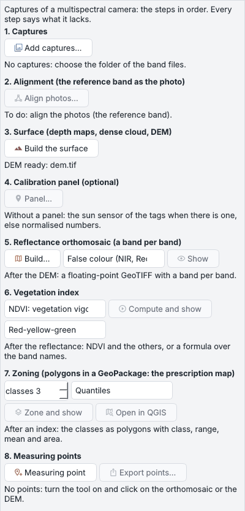
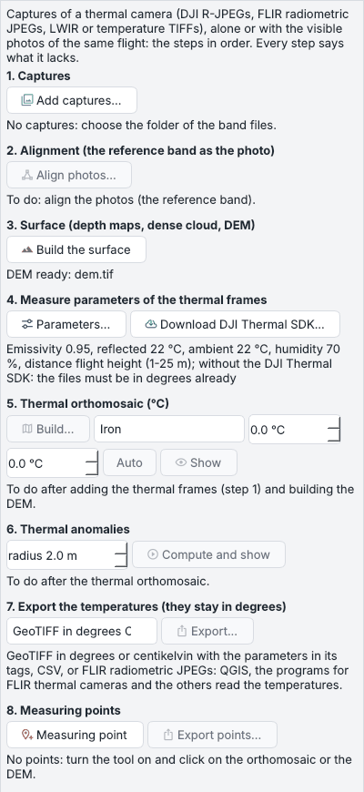

# Multispettrale e termico

Le riprese di una camera multispettrale o termica hanno pannelli propri, *Multispettrale* e *Termico* (schede a
destra), che seguono i passi in ordine; ogni passo dice cosa gli manca. *Strumenti > Multispettrale* e *Strumenti >
Termico* hanno gli stessi comandi.

## Multispettrale

### Le riprese

I file di una camera multispettrale (MicaSense, DJI, Sequoia) vengono riconosciuti quando si aggiungono le foto
(*Foto* o *Aggiungi cartella*): la finestra propone di aggiungerli come riprese e apre questo pannello, così le bande
non vengono allineate come se fossero viste diverse. *Aggiungi riprese...* prende una cartella con un file per banda di
ogni scatto: la banda di riferimento viene allineata, le altre le si sovrappongono.

Un volo diviso in più cartelle (i rullini di una camera, `100MEDIA` e `101MEDIA`, la cui numerazione ricomincia) si
aggiunge cartella dopo cartella, o come cartella madre in una volta: i nomi che si ripetono prendono la loro cartella
come prefisso, i file già nel chunk restano fuori.

### I passi

| Passo | Cosa fa |
| --- | --- |
| **1. Riprese** | *Aggiungi riprese...* |
| **2. Allineamento** | la banda di riferimento allineata come le foto |
| **3. Superficie** | mappe di profondità, nuvola densa e DEM in un passo, con le scelte predefinite |
| **4. Pannello di calibrazione** (facoltativo) | la ripresa del pannello, il suo riquadro e la sua riflettanza; con una camera MicaSense il pannello che ha trovato e le riflettanze del suo codice QR, dai tag. *Il sensore di luce (DLS) segue la luce durante il volo*, attivo di base quando le riprese lo hanno: il pannello dà il livello, il DLS le variazioni di luce. Lo stato del passo dice quale metodo è in uso |
| **5. Ortofoto di riflettanza** | una banda a virgola mobile per banda sul DEM; *Mostra* in falso colore NIR-Rosso-Verde, in colore reale, o una banda da sola in scala di grigi (NIR, red edge...) |
| **6. Indice** | NDVI, NDRE, GNDVI, SAVI, NDWI, OSAVI, CIRE, Thermal, o una formula propria sui nomi delle bande, calcolato e mostrato sulla scala di colori scelta accanto (rosso-giallo-verde, scala di grigi, viridis o turbo; la scelta ricolora l'indice mostrato e viene ricordata) |
| **7. Zonizzazione** | le classi e il metodo, poi i poligoni in un GeoPackage (la mappa di prescrizione), mostrati per classe con i poligoni come layer |
| **8. Punti di misura** | lo strumento *Punto di misura* ed *Esporta punti...* |

I **metodi di zonizzazione**:

* **quantili**: lo stesso numero di celle per classe;
* **intervalli uguali**;
* **interruzioni naturali (Jenks)**: le soglie che rendono le classi il più omogenee possibile - la scelta quando
  l'indice ha popolazioni distinte, come suolo nudo, erba e una traccia nel grano;
* **k-means**: lo stesso scopo per approssimazioni successive.

L'ortofoto di riflettanza **pareggia le foto** di base (*Pareggia la luminosità tra le foto*): un guadagno per foto e
banda, trovato dove le foto si sovrappongono, toglie le strisce tra le strisciate volate in direzioni opposte (la
geometria del sole e della vista) tenendo il livello medio; togli la spunta per la riflettanza grezza.

I prodotti compaiono nell'area di lavoro sotto *Multispettrale* (l'ortofoto di riflettanza, ogni indice, ogni
zonizzazione) e si aprono da lì; *Apri in QGIS* fa il progetto QGIS con la riflettanza in falso colore, gli indici con la
loro scala, le zone come raster e come poligoni, oltre all'ortofoto, al DEM e ai disegni. I dettagli sono nell'
[API](../api.md#camere-multispettrali), *Camere multispettrali*.

## Termico

### Le riprese

*Aggiungi riprese...* nella scheda *Termico* prende i fotogrammi radiometrici - R-JPEG DJI, JPEG radiometrici FLIR,
TIFF in gradi o kelvin, TIFF di interi di altre camere (WIRIS...), che diventano gradi con la scala e l'offset impostati
in *Parametri...* - e, se ci sono, le foto visibili dello stesso volo.

### I passi

Dopo le riprese, l'allineamento e la superficie vengono i passi delle temperature:

| Passo | Cosa fa |
| --- | --- |
| **Parametri di misura** (*Parametri...*) | emissività, temperatura riflessa e ambiente, umidità, distanza; i valori di fabbrica delle camere DJI di base |
| **Ortofoto termica** (*Costruisci...*) | l'ortofoto in gradi Celsius, mostrata su una scala - iron, inferno, arcobaleno, grigi - tra due temperature che scegli, come il calcolatore raster di Metashape restringe la scala termica; *Auto* torna al 2°-98° percentile |
| **Anomalie termiche** | la temperatura meno quella dei dintorni entro un raggio: muri e fossati sepolti cambiano il suolo sopra di loro |
| **Esportazione** | tenendo i gradi: GeoTIFF float32 in gradi Celsius, GeoTIFF a 16 bit in centikelvin, CSV, o un JPEG radiometrico FLIR con il suo world file - un solo file, o tasselli oltre gli 8,4 milioni di pixel: il programma chiede allora un solo file con celle più grandi o tasselli a piena risoluzione - che i programmi per le camere FLIR aprono come termogrammi |

!!! note "Il DJI Thermal SDK"
    Le R-JPEG DJI si decodificano con il Thermal SDK gratuito di DJI, che non viene distribuito con il programma.
    *Scarica il DJI Thermal SDK...* nel passo dei parametri (e in *Strumenti > Termico*) mostra le condizioni di DJI e,
    una volta accettate, lo scarica da DJI nella cartella `dji_tsdk` dei dati del programma, controllato con l'archivio
    pubblicato da DJI. Sul Mac lavora in Docker, quindi Docker Desktop deve essere avviato.

## Valori sotto il cursore e punti di misura

Sotto il mouse la barra di stato legge i prodotti a piena risoluzione: sull'ortofoto termica la quota, la temperatura e
la sua anomalia (`Z 158.231  T 18.34 °C  ΔT +0.42 °C`), sulla riflettanza ogni banda, su un indice il suo valore,
sull'ortofoto e sul DEM anche la temperatura quando c'è.

Lo strumento **Punto di misura** (nella barra Disegno, in entrambe le schede e nei menu) mette un punto dove fai clic
con le sue coordinate, la quota del DEM, la temperatura e la sua anomalia, la riflettanza di ogni banda e gli indici. I
punti vanno nel layer *Punti di misura*, si salvano con il progetto, arrivano in QGIS con gli altri layer e si esportano
come GeoPackage, CSV o GeoJSON (*Esporta i punti di misura...*).

## Immagini satellitari

*Strumenti > Immagini satellitari* mette le scene satellitari sul rilievo:

| Comando | Cosa fa |
| --- | --- |
| **Ortorettifica una scena...** | una scena con i suoi RPC sul DEM del rilievo, conservata come versione dell'ortofoto |
| **DSM da due o più scene...** | la superficie da due scene prese da due direzioni, o da tre e più: gli RPC corretti fra loro con i punti di legame, le coppie scelte per angolo e data, le loro superfici fuse; conservata come versione del DEM |
| **Informazioni sulla scena...** | dimensioni, bande, risoluzione a terra, impronta |

I dettagli sono nell'[API](../api.md#immagini-satellitari), *Immagini satellitari*; il
[plugin Sentinel-2](../plugins/sentinel2.md) porta le scene dell'archivio Copernicus.
