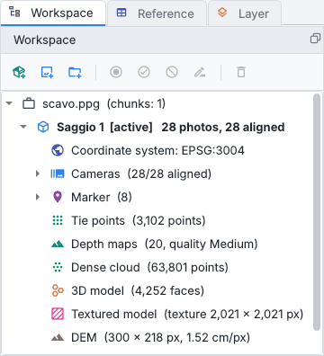
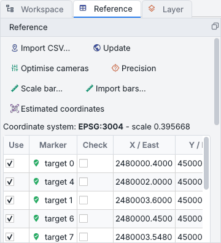
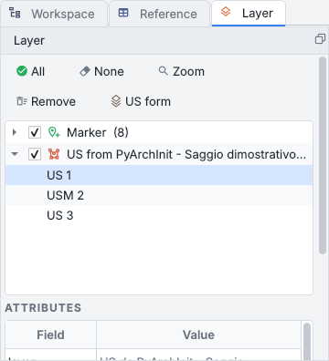
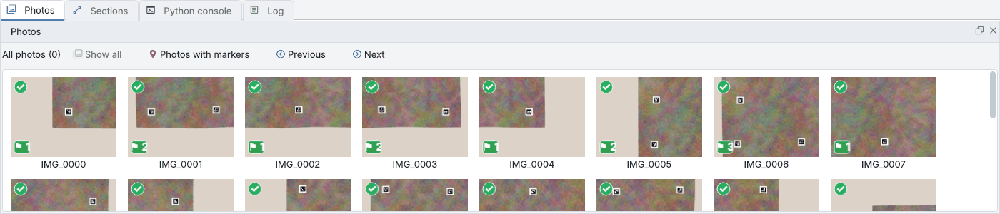
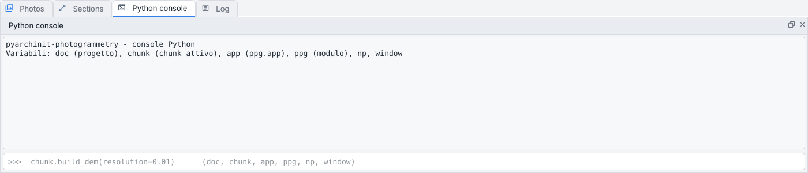
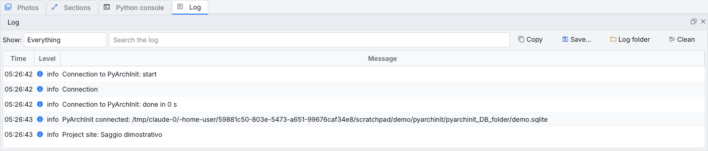
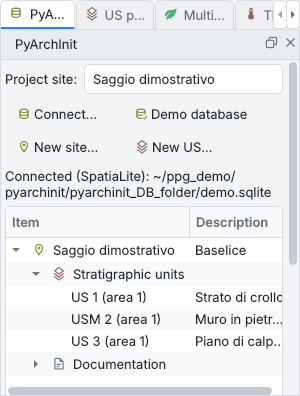
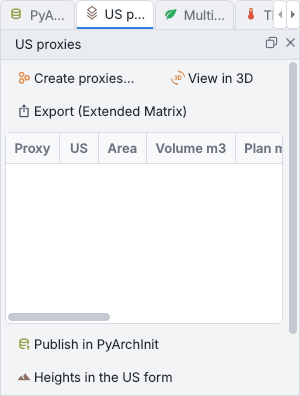

# Panes

Around the central views the window has its panes, each a dock of its own as in Metashape. At the first
start they are in three groups:

| Where | Panes |
| --- | --- |
| left | [Workspace](#workspace), [Reference](#reference), [Layer](#layer) - always there |
| right | [PyArchInit](#pyarchinit), [US proxies](#us-proxies), [Multispectral and Thermal](multispectral.md), the panes of the plugins |
| bottom | [Photos](#photos), [Sections](#sections), [Python console](#python-console), [Log](#log) |

The tabs of a group are on top, each with the icon of its pane; the title bar under them names the pane in
front.

## Moving the panes

| To... | do this |
| --- | --- |
| **move** a pane | drag it by its tab (or the whole group by its title bar) to another side of the window, onto another pane - they become tabs of one group - or beside it, which splits the side |
| **float** it | the first button of the title bar, or a double click on it: the pane becomes a window of its own (on a second screen, for instance); a double click on its title, or dragging it back onto the window, docks it again |
| **close** it | the second button of the title bar. *Workspace*, *Reference* and *Layer* are always there: they move and float, but they have no close button |
| **open it again** | *View > Panes* lists every pane with a tick; ticking a closed pane brings it back where it was, in front |
| **go from pane to pane** | click the tabs, or *View > Panes > Next pane* (++f6++) and *Previous pane* (++shift+f6++): they go round the panes grouped with the one holding the keyboard focus |
| **start again** | *View > Panes > Restore the layout of the panes*: every pane back in its first place, all of them open |

The program also brings back by itself the pane it shows you - *Reference*, *Layer*, *Sections*, *Photos*,
*Multispectral* when photos with bands are added, the *Python console* with ++ctrl+shift+p++ - closed or
floating as it may be.

The layout is saved when the window closes and comes back at the next start, the panes of the plugins
included. The layout of a version before 1.3.4, when the panes were the tabs of two docks, is not applied: the
first start of 1.3.4 shows the default layout.

## Workspace

{ align=right width=330 }

The project as Metashape's Workspace shows it: the project, its chunks and, under each chunk:

* its coordinate system (double click to change it);
* *Cameras* (aligned / all; green camera aligned, red not aligned), *Markers*, *Scale bars*;
* *Tie points*, *Depth maps* (how many, with which quality), *Dense cloud*, *3D model* and its texture;
* *DEM* and *Orthophoto* with their sizes and resolution, the relief rasters, the coverage of the photos and
  the precision of the DEM;
* the elevations, the products of the multispectral and thermal captures, the results of the raster
  calculator and the products of the plugins.

The **active chunk** - the one the tools work on - is in bold with *[active]*; a disabled chunk and a disabled
photo are grey.

A click selects (++ctrl++ + click and ++shift++ + click select several items); a double click or ++enter++
makes a chunk the active one, and opens a photo, a product or a version after making its chunk the active one.

**The bar above the tree** has icons only (their tooltips name them; on a narrow pane the » at its end holds the
buttons that do not fit):

| Button | What it does |
| --- | --- |
| *Add chunk* | an empty chunk with the name you give it, which becomes the active one |
| *Add photos...*, *Add folder...* | photos, or a folder of photos, into the active chunk |
| *Make active* | the chunk selected becomes the active one (a double click does the same) |
| *Enable*, *Disable* | a disabled chunk stays in the project, out of the batch steps and of the chunks *Align chunks* and *Merge chunks* propose; a disabled photo stays out of the next alignment and builds |
| *Rename...* | the chunk or the version selected (++f2++) |
| *Remove* | what is selected (++delete++ or ++backspace++): see below |

**The right click** has the commands of each item:

| On... | Commands |
| --- | --- |
| a chunk | *Make active*, *Rename...*, *Enable* or *Disable*, *Remove chunk* |
| the dense cloud, the model, the DEM, the orthophoto | *Show*, *Keep a copy as a version*, *Rename this version...*, *Remove* |
| a kept version | *Show*, *Make active*, *Difference with the active DEM*, *Export...*, *Rename...*, *Remove* |
| a photo | *Open*, *Enable* or *Disable*, *Remove the photo* |
| a marker | *Filter the photos of ...*, *Remove the marker* |
| *Cameras*, *Markers*, *Scale bars* | the removal of all they hold |
| several items | *Enable*, *Disable*, *Remove N items* |
| the project | *Add chunk* |

The commands work on chunks that are not the active one too: removing, renaming, enabling and disabling act
on the chunk of the item and leave the active chunk as it is, while showing an item and the commands of its
versions make its chunk the active one first.

### Removing

Everything the tree lists can be removed, the coordinate system apart: whole chunks (the last one too: the
project gets an empty chunk), the products, the depth maps (often most of the space a chunk takes), the relief
rasters, the multispectral and thermal products, kept versions, elevations, photos (their files are never
touched; the next alignment leaves them out), markers (with the scale bars that end at them) and scale bars.

* The tie points take the alignment with them (the photos are no longer aligned; dense cloud, model, DEM and
  orthophoto stay), the model takes its texture.
* The kept versions of a product stay when the product is removed: remove them one by one with the right
  click.
* A question first says what goes and what happens to the files; *Cancel* there changes nothing.

!!! tip "Removing is undone"
    *Edit > Undo* puts back what was removed as it was - a chunk in its place and active again if it was, the
    files where they were - and *Redo* takes it away again. The files are moved aside inside the files folder
    of the project (`<project>.ppg.files/.removed/`: same disk, instant), never deleted at once. A file
    outside the chunk's own folder (a DEM exported by Metashape that an imported project points to) is never
    moved or deleted: it only leaves the project. When the project is closed, or another one is opened, the
    files follow the project as last saved: what it no longer lists is deleted, what it still lists goes back
    in its place. After a crash, the next opening of the project does the same.

## Reference

{ align=right width=330 }

The markers and the cameras with their coordinates, as Metashape's Reference pane:

* the markers with *Use* and *Check*, coordinates and accuracy (double click to change them), the errors in
  metres and in pixels; the camera positions;
* the scale bars below the markers ([scale bars](photos-markers.md#scale-bars));
* the RMSE of the control and check points and of the bars.

The tooltip of a marker tells how it is placed: triangulated from N photos, on the surface from one photo,
or added on the model or the orthophoto.

| Button | What it does |
| --- | --- |
| *Import CSV...* | the coordinates of the markers |
| *Update* | the georeference from the control points |
| *Optimise cameras* | with 3 or more control points they take part in the bundle adjustment and bend the block; check points stay out; the errors before and after go to the log |
| *Precision* | the precision of cameras, markers and tie points ([precision](processing.md#precision)) |
| *Scale bar...*, *Import bars...* | a known distance between two markers, or a list of them from a CSV |
| *Estimated coordinates* | as Metashape's *View Estimated*: the X, Y, Z columns show the estimated coordinates instead of the reference ones (on by itself when no marker has reference coordinates) |

The right click on the markers filters the photos on them, refines their blue flags, merges them (a coded
target and the GCP placed by hand on it), moves one again in the 3D view, creates a scale bar between two of
them, and deletes them. Every table has *Export table to Excel...* in its right click.

## Layer

{ align=right width=330 }

Everything drawn on the orthophoto and the DEM is a layer: stratigraphic units, the US polygons loaded from
PyArchInit, section traces, contour lines, plan slices, spot heights, markers, measuring points, measures,
stones, patches.

* Tick to show or hide a layer, double click to zoom (a layer or a single feature), *Remove* takes it away;
  *All* and *None* tick every layer.
* In *Pan / query* mode a click on a feature shows its attributes (US, area, m2, elevation of a contour...)
  here and in the status bar.
* **Editing the attributes**: double click a value under *Attributes* to change it (US, area, type, label,
  any free field; computed fields such as m2 and length are read-only).
* **Labels** (application **1.5.2**): select a layer, then use **Labels > Show labels** to show or hide
  its text on the map while keeping the geometries visible. **Show all** and **Hide all** in this menu
  control the labels of every layer; the *All* and *None* buttons still control the layers themselves.
* To change a label, select a feature and choose **Labels > Edit label...**, or edit its `etichetta`
  attribute. A custom map label does not change the unit's US or UT number. Label text and visibility
  are saved in the project for each chunk and restored when you reopen it.
* **Label style** (application **1.5.4**): **Labels > Label style...** sets the font, the size, bold and
  italic, the colour (or the colour of the layer) and a halo around the letters - a dark outline that keeps
  them readable on any orthophoto - for the labels of the layer selected; **Labels > Style of all
  labels...** does it for every layer, and *Restore Defaults* puts the default back. The style is saved with
  the chunk, taken by the features added later, and undone with *Modifica > Annulla*.
* *Unit form* opens the PyArchInit form of the unit selected.

!!! note "Units of PyArchInit"
    Units loaded from PyArchInit keep their `gid`: *Save changes in PyArchInit* (it appears under the list
    when there is something to save) writes the changes back to `pyunitastratigrafiche`. Drawn units and spot
    heights are written with *Publish*; written features keep their `gid`, so nothing is written twice.

## Photos

The thumbnails of the photos, with a badge for aligned or not aligned and, at the bottom, the markers on each
photo (green: measured, blue: to confirm; the tooltip lists them). A double click opens the photo in the
central *Photos* view.

The bar above shows the **filter** in use - *Photos of point 1*, *Photos with markers*, the photos of a point
or of an area - with *Show all* and *Previous* / *Next*. The filters come from:

* the right click on markers in *Reference* (*Filter the photos of ...*);
* the right click on the orthophoto in *Pan* mode (*Filter the photos that see this point*, *Add a marker
  here*);
* the selection menu of a polygon (*Filter the photos framing this area*);
* *Photos of the point* in the 3D view;
* a new marker, which filters the photos on itself.

The right click on the thumbnails also measures the **image quality** (the sharpness of every photo compared
with the sharpest ones; *blurred* under 0.5), disables the blurred photos, enables or disables the selected
ones, sets their masks and their lens model (see [Photos and markers](photos-markers.md)).

## Sections

The sections of the project: the list, the preview of the SVG drawing (fitted to the pane, with lines and
labels thickened so that a drawing metres long on paper stays readable), and the buttons:

| Button | What it does |
| --- | --- |
| *Zoom to the trace* | the trace on the orthophoto |
| *Open folder* | the DXF profile and the 3D DXF in `sezioni/` |
| *Elevation* | the orthophoto of the wall on the plane of the trace ([elevations](processing.md#elevations)) |
| *Publish in PyArchInit* | the trace in `pyarchinit_sezioni` |
| *Delete* | the section and its drawings |

The sections are saved in `sezioni/sezioni.json` next to the project and come back when it is opened again.
How to draw them is in [Drawing and measures](drawing.md#sections).

## Python console

A Python console with the project at hand: `doc` (the project), `chunk` (the active chunk), `app`, `ppg` (the
library), `np` and `window`. What it changes shows in the window. ++ctrl+shift+p++ brings it to the front.

## Log

Time, level and message of everything that happened. *Show* filters (all, warnings and errors, errors),
the search box finds a word, and the buttons *Copy*, *Save...*, *Log folder* and *Clear*. The traceback of an
error is in the tooltip of its row and in the saved file. See [Errors and updates](help.md).

## PyArchInit

{ align=right width=280 }

The database of the excavation:

* **Project site**: the excavation the units and spot heights of the project belong to;
* *Connect...*, *Demo database*, *New site...*, *New US...*;
* the tree of the sites with their stratigraphic units and documentation: a double click on a US opens its
  PyArchInit form;
* the **media** of the US (or the site) selected, from PyArchInit's `media_to_entity_table`: a double click
  opens the file (the original, else its resized copy) with the program of the system.

What can be done with PyArchInit is in [Tools for archaeology](archaeology.md#pyarchinit).

## US proxies

{ align=right width=280 }

The 3D solids of the units (*Tools > 3D proxies of the units...*), with volume, plan area and elevations:

* *Create proxies...*, *View in 3D* (coloured over the model);
* *Export (Extended Matrix)*: one OBJ with an object per unit (`US12`, `USM3`) and the coordinate offset;
* *Publish in PyArchInit* (a 3D media linked to each US), *Heights in the US form*, *US form*, *Delete*.

How the solids are made and how they follow their units is in
[Tools for archaeology](archaeology.md#us-proxies).

