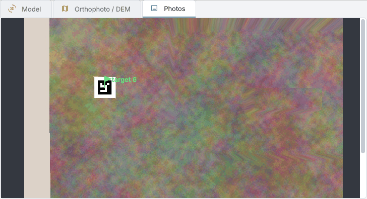

# Photos and markers

Everything that goes into the alignment: the photos and their masks, the markers measured in them, the scale
bars between markers.

## Adding photos

| Command | What it adds |
| --- | --- |
| *Workflow > Add photos...* / *Add folder...* | photos into the active chunk; a flight split over several folders (the rolls of a camera, `100MEDIA` and `101MEDIA`, whose numbering starts again) is added folder after folder or as the parent folder in one go: names that repeat take their folder as a prefix, files already in the chunk are left out |
| *Workflow > Add video...* | frames chosen when the view has moved by a share of its width (the sharpest around that moment) or one every few seconds, written in a folder beside the video; with the `.SRT` of a DJI drone beside the video every frame gets its GPS position |
| *Workflow > Add 360° photos...* | every equirectangular photo becomes the six faces of a cube (the faces to keep - *Down* often shows only the tripod - their width in degrees and size), written in `facce_360` beside the photos; in the alignment the faces of one photo stay together as a rig |
| *Workflow > Relink photos (another folder)...* | the photos with the same names in another folder and its subfolders: a copy on an external disk of a Dropbox folder kept online only, a moved folder |

The files of a **multispectral camera** are recognised when you add photos: the window offers to add them as
captures and opens the *Multispectral* pane, so the bands are not aligned as if they were different views
(see [Multispectral and thermal](multispectral.md)).

A **fisheye lens** is recognised from the EXIF; otherwise *Lens model...* (right click in the *Photos* pane)
sets it for the sensors of the selected photos: normal, fisheye, strong distortion, none. The tooltip of a
face of a 360° photo names its photo.

!!! tip "Image quality"
    Right click in the *Photos* pane: *Image quality* gives the sharpness of every photo compared with the
    sharpest ones (in the tooltip; *blurred* under 0.5), and *Disable the blurred photos* leaves them out of
    the next alignment.

## GNSS positions of the photos

Every photo has a position, where it comes from and how good it is. The *GNSS* pane (*Tools > GNSS > GNSS pane*,
on the right with *Multispectral* and *Thermal*) shows them and holds the commands that give photos a better
position than the GPS of their EXIF.

| Source | What it gives |
| --- | --- |
| The photos themselves | The GPS of the EXIF, with an accuracy of 5, 5, 10 m (no RTK data). The photos of a DJI drone with RTK also carry its state in the XMP (`RtkFlag`: 50 fix, 34 float, 16 single, 0 none) and its standard deviations, read when the photos are added; those of a multispectral camera take them from their bands |
| *Tools > GNSS > DJI MRK file...* | The `Timestamp.MRK` the drone writes on its card: the position of every shot, of the camera and not of the antenna (the lever arm of the shot is applied), with its ellipsoidal height, its RTK state and its standard deviations |
| *Tools > GNSS > PPK corrections...* (*Compute PPK...* in the pane) | The position of every shot of the `Timestamp.MRK` computed again from the RINEX of the drone and of a base: see [PPK](#ppk-corrections-from-a-base) below |
| *Tools > GNSS > Positions file...* | A text file with a line per photo, for a drone built by hand or positions computed by another program (a PPK solution, a total station): name, x, y, height and, when there are any, `sx`, `sy`, `sz` (standard deviations) or `accuracy`, `status`, `yaw`, `pitch`, `roll`; a header names the columns in any order (`name`, `lon`/`lat`/`ellh`, `easting`/`northing`, `std`, `q`...); comma, semicolon, tab or spaces |

**The MRK is paired with the photos by the shot number in their names** (`DJI_0001.JPG` is line 1 of the file),
so a photo deleted from the card never moves the positions of the others; by order only when the MRK has as many
lines as the folder has photos, otherwise nothing is done and the window says why. Every pair is then checked
against the time the camera wrote in the photo (its local time, a time zone away from the UTC of the MRK): a photo
taken more than 3 seconds away from its shot keeps the position it had, so the photos of another flight copied
into the same folder, with the same shot numbers, are left alone; when the times agree on no time zone, or most
photos are not at the time of their shots, nothing is done. When the photos of another flight fit a time zone too
and are as many as half of the photos of the MRK or more, the times cannot say which flight the MRK is of (its
own flight may have lost photos): nothing is done and the window asks to keep each flight in a folder of its own.
The shots that found no photo are listed in the log.
The photos are those of the folder of the MRK; when the MRK was copied somewhere else the window asks for the folder (`--photos` on the
command line). **The positions file** is asked its coordinate system (`EPSG:4979` is longitude, latitude and
ellipsoidal height, as in the MRK; a projected system such as `EPSG:32633`; `LOCAL`) and the kind of height
(*ellipsoidal*, as the GNSS gives it, or *EXIF*, above the sea level); a row is paired with its photo by the file
name, with or without the extension (`100MEDIA/DJI_0001` when the same name is in two folders). Applying
positions replaces the ones the photos had, and doing it twice changes nothing.

**The accuracy** of a position is twice its declared standard deviations (the ones of an RTK solution are
optimistic), never below the floor of its state: 1 cm for a fix, 20 cm for a float, 1 m for a single position.
Without RTK data it stays 5, 5, 10 m. In a positions file `accuracy` is taken as it is; a line with no accuracy
and no deviations gets 5, 5, 10 cm, raised to the floor of its `status` when it has one. Two steps weigh every
photo by its accuracy, so a block of fixes and a few singles is not treated as one of equals: *Align photos...*
holds the block to the positions during the incremental alignment (the option *GPS positions of the photos in the
alignment*, on when the photos have positions; the global method does not use them, and the automatic choice
goes back to the incremental one when the global block misses them), and *Optimise cameras* with the engine
*Own* when *GNSS positions of the photos (own engine)* is *used with their accuracy* or *used, with a bias per
flight*. The default engine of *Optimise cameras*, COLMAP, ignores the camera positions, and that option is *not
used* until you choose it.

**The table** has a row per flight (a pause of more than 20 minutes starts another; the photos with no date are
the *no date* row): the photos with a fix, a float, a single position, with a position and no RTK data, with no
position at all, and those whose reference is switched off; the median accuracy per axis; the kinds of height of
the positions (*ellipsoidal* from the GNSS and the MRK, *EXIF*, *unknown* for positions read from another
program); and, once the chunk is aligned and georeferenced, how far the cameras ended from their positions (root
mean square per axis and the largest distance). A flight whose offsets are far larger than its accuracy has a
bias (a base on a wrong point) or positions that do not belong to it. When the positions in use, accurate in
height (under a metre), have heights of different kinds - the ellipsoidal ones of an MRK and those of the EXIF of
other photos, which can be tens of metres apart - the pane says so under the positions (and `ppg gnss status`
prints a warning): check them before using them together.

**Only the fix positions** switches off the references of the photos whose position is not an RTK fix: they stay
in the chunk and are aligned, but no longer pull the cameras. A position with no RTK state (the GPS of the EXIF, a
positions file with no `status` column) counts as not fix. The photos switched off are remembered: unticking
switches back on exactly those, one you had switched off by hand stays off, and positions applied again keep the
choice.

From the command line:

```bash
ppg gnss status survey.ppg                                    # the table, per flight
ppg gnss mrk survey.ppg /card/DCIM/100MEDIA/Timestamp.MRK     # --photos FOLDER if the photos are elsewhere
ppg gnss positions survey.ppg cameras.csv --crs EPSG:4979     # --height ellipsoidal|exif
```

All three take `--chunk` and say what they did; `mrk` and `positions` save the project, and stop with an error,
changing nothing, when the file cannot be used.

### PPK: corrections from a base

**What it gives.** A drone without an RTK link (or one that lost it) places its photos to a few metres. With PPK
(post-processed kinematic) RTKLIB computes again where the drone's antenna was, epoch by epoch, from the drone's own
satellite observations and from those of a base that recorded at the same time; every photo then takes the
position of the camera at its shot, as with an MRK, with the status (fix, float, single) and the accuracy of the
solution. With fixes the photos are placed to the centimetre, and a survey needs few or no ground control points.

**The files.**

| File | Where it comes from |
| --- | --- |
| The drone's RINEX and its `Timestamp.MRK` | The folder of the flight on the drone's card: a DJI drone writes `<flight>_Rinex.obs` beside `<flight>_Timestamp.MRK` (often with `<flight>_PPKNAV.nav`); another receiver its observation file (`.obs`, `.##o`) |
| The base's RINEX | Your own base (any receiver that records RINEX) on a mark whose position you know, or the file of a permanent station (a regional network, EUREF, IGS) that you download for the hours of the flight. The base must record during the whole flight, the nearer the better: beyond 20-30 km a fix gets hard. Listing and downloading the stations near a survey is coming in a later version |
| Navigation files | The broadcast ephemerides: `.nav`, `.##n`, `.##g`, `.##p` or the RINEX 3 `*_MN.rnx` - the drone's, the base's or the daily file of a station |

Compressed RINEX: a gzip file (`.gz`) is read as it is; a Hatanaka file (`.crx`, `.##d`) must be decompressed with
CRX2RNX first, for now.

**The steps.** *Compute PPK...* in the pane (*Tools > GNSS > PPK corrections...*) asks for the `Timestamp.MRK`, then
opens a dialog:

- *Timestamp.MRK*: its shots and the hours they were taken, and how many fall outside the drone's observations
  (their photos will keep the position they have);
- *Observations of the drone*: found by itself beside the MRK (the `*_Rinex.obs` of a DJI drone, of the flight of the
  MRK when the folder holds several; else the only `*.obs` or `*.##o` file there), with the hours it covers;
- *Observations of the base*: with what its header says - the mark, the receiver, the antenna, the hours of its
  observations, the position in the header and the antenna height;
- *Navigation files*: those beside the drone's observations, then those beside the base's; *Remove* takes one away,
  *Add...* adds another;
- *Position of the base*: from the file of the base or typed (below).

*OK* checks, before anything runs, what can be checked and says in the dialog what is missing or wrong: the files
(observations that are observations, navigation files still there), their times (the drone and the base with hours
in common, the shots of the MRK within the drone's observations), no file in the work folder of the PPK, the
position of the base. The files are read once, after a pause in typing their names; the dialog is as tall as what it
says, and on a short screen its form scrolls. When the MRK was copied away from the photos the window asks for their
folder, as for an MRK. RTKLIB runs in the background (in the folder of the chunk, `gnss/ppk`, where its options and
its `.pos` solution stay); the photos are paired with the shots as for an MRK.

**The position of the base** decides where the whole survey ends up: every PPK position is relative to it.

- *Typed*: the surveyed position of the mark the base stands on - latitude and longitude in degrees, height above
  the ellipsoid in metres (not above the sea level), in the reference frame you want for the survey. This is the way
  to an accurate absolute position. Typed more than 1 km away from the position of the base's header, or more than
  30 m higher or lower, it gives a warning (in the dialog, in the log and in `ppg gnss ppk`): latitude and longitude
  swapped or without their sign, a height above the sea level.
- *From the file of the base*: the position written in its RINEX header. For a permanent station it is usually its
  published position; for your own base it is often the position the receiver found by itself, which **can be
  metres off, and the whole survey moves with it**. The program says so in the dialog, in a message and in the log
  after the computation, in the pane and in `ppg gnss ppk`: type the surveyed position and compute again.

**The antenna height.** The position of the base, typed or from the header, is that of the mark on the ground: the
program adds the antenna height written in the base's RINEX header (`ANTENNA: DELTA H/E/N`), as RINEX means it, and
the dialog says how much ("the program adds the antenna height of the file of the base, 1.800 m"). When the header
gives no antenna height, or zero, the position must be that of the antenna itself.

**The result.** A photo takes the antenna of the solution at the time of its shot (an epoch, or the straight line
between two epochs at most a second apart) plus the lever arm of its shot in the MRK; its status comes from RTKLIB's
quality (fix, float - also dgps - or single) and its accuracy is twice the standard deviations of the solution,
with the floors of its status. A photo shot where the solution has no position (a gap of more than a second,
before it starts, after it ends) keeps the position it had: nothing is guessed across a gap, and such photos and
shots are listed in the log. *Only the fix positions* is decided again. The step of the pane then says how many
photos have a PPK position and of which status, and the base each was computed against, with the warning when its
position is the one of its header.

RTKLIB (RTKLIB-EX 2.5.1, BSD licence) is inside the native core 0.5 or later, which the applications include; without
it the program says what to install. `PPG_RNX2RTKP` can name the `rnx2rtkp` program of RTKLIB-EX 2.5 instead.

```bash
ppg gnss ppk survey.ppg --mrk /card/FLIGHT_Timestamp.MRK --rover /card/FLIGHT_Rinex.obs --base base.obs
#   --nav FILE (repeat it; default: those beside the drone's observations, else beside the base's)
#   --base-position LAT,LON,H (degrees, degrees, metres above the ellipsoid, a point for the decimals;
#                              default: the position of the base's RINEX header, with its warning)
#   --photos FOLDER, --chunk NAME
```

It prints the photos per status, the base used and its antenna height, the warnings (always the one of a base at
the position of its header, and the one of a typed position far from it), the photos and shots left without a PPK
position; it saves the project, and stops with an error, changing nothing, when the files cannot be used (a file
named that is not there stops it before anything is read).

## Masks

The masked parts of a photo (red on it) are not used to align, in the depth maps, in the orthophoto or in
the texture. *Tools > Masks of the photos*:

* **draw** a mask on the photo shown: click the vertices, double click or ++enter++ closes, ++esc++ drops;
  *Remove the mask* or ++shift++ + double click gives the area back; *Show the masks* hides the red;
* **import** them from images, or from the alpha channel of the photos;
* **make** them from photos of the background without the object, from the colour of a backdrop, from the model
  (only the object stays) or with SAM 2.1 (the object at the centre of each photo);
* **export** them, or remove them (from the selected photos or all of them).

*Align photos* can also leave out the points that do not move between photos: the turntable with a fixed
camera.

## Markers



The markers are the targets and the points measured in the photos; *Workflow > Detect coded markers...* finds
the printed coded targets by itself.

**A marker measured in one photo only** lies where its ray meets the surface (the dense cloud, else the tie
points: a local plane fitted around the ray, about 20 pixels wide). So it has coordinates at once, shows on the
model and on the orthophoto and can end a scale bar; measured in a second photo it is triangulated. On the
synthetic trench, one-photo markers are within 0.6 mm of the surveyed targets.

**Markers without a photo**, as Metashape's *Add Marker*:

* *Marker* in the 3D view: the view freezes; click a point of the model or the cloud (the nearest point shown
  under the cursor, refined along the line of sight on the full dense cloud);
* *Marker* in the drawing bar: click the orthophoto or the DEM (the height from the DEM at full resolution,
  else from the cloud along the vertical).

The new marker (`point 1`, `point 2`...) is projected on the photos that see it, not hidden by the surface: blue
flags, to drag in a photo to pin it. The markers are drawn on the orthophoto as the *Marker* layer.

### Guided placement

As in Metashape, a marker placed on one photo (or in 3D) gets **blue flags** on the other photos that see it (at
most 60, those where it falls nearest the centre first), and the *Photos* pane is filtered on it.

1. Open a photo with a double click: it is centred on the marker at full resolution.
2. Drag the blue flag onto the point, or double click it when it is right: it turns green.
3. ++page-down++ opens the next photo.

Every confirmation places the marker again (two green flags: triangulated) and moves the blue flags of the
other photos to where it is now. Blue flags are estimates, not measurements: they never move a marker that has
a green one, nor enter the camera optimisation.

*Refine the blue flags* (right click in *Reference*, for the selected markers or all of them, or *Workflow >
Refine the blue flags of the markers*) looks for the point of every blue flag in its photo by image
correlation, on the surface around the marker: the flags found become measurements (automatic, as detected
targets), the others stay blue to confirm by hand.

In *Reference* the right click also **merges** the selected markers (a coded target and the GCP placed by hand
on it) or **deletes** them, and *Move in the 3D view* places a marker again by a click on the model or the cloud
(for markers placed in 3D or on the orthophoto; those measured in the photos are moved in the photos).

## Scale bars

A scale bar is the known distance between two markers, as in Metashape.

1. In *Reference* select two markers (++ctrl++ or ++shift++ + click) and choose *Create scale bar between A and
   B...* from the right click, or press *Scale bar...* (the selected markers come first in the dialog).
2. The dialog asks for the distance in metres (between the centres of the targets), its accuracy (it weighs the
   bar when there are several), whether it is a check bar, and whether to update the scale at once.

| Kind of bar | What it does |
| --- | --- |
| **Control bar** | scales the chunk: the scale is the least-squares solution of *scale x length in the model = distance*, each bar weighted by `1 / accuracy²` (of two bars measured equally well, the longer one counts more). Without control points the chunk is scaled in local coordinates (CRS `LOCAL`): an object, a find, a wall, a trench |
| **Check bar** (*Check* ticked) | does not scale: its error tells how good the scale is |

!!! note "The distance of a bar is in 3D"
    With a height difference it is more than the distance in plan measured on the orthophoto.

**Georeferenced chunks**: a new bar is proposed as a check (it measures the scale without changing it). A
control bar on a chunk georeferenced elsewhere (an imported project) with no reference to fit it again scales it
about the bar, in its CRS; when the scale changes, the log says that the DEM and the orthophoto are still in the
old one and are to be built again.

**Photos with GPS**: when their positions cover less than ten times their accuracy (a phone or a drone over an
object or a trench) they are left out and the bars scale the chunk in local coordinates. Over a larger area (a
flight over a site), or with three or more control points, the photo positions, the control points and the bars
are fitted together, each weighted by `1 / accuracy²`: positions and points place and turn the survey, the scale
comes from all of them.

**The table of the bars**, under the markers in *Reference*, has a row per bar: *Use* (untick to leave it out),
name, markers, *Distance* and *Accur.* (double click to change them: the error follows at once), *Check*, the
distance measured on the model (*Estimated*) and the error, in red when it exceeds three times the accuracy (at
least 5 mm). The right click deletes the bars. The summary shows *Bars RMSE* (control) and *Check bars RMSE*, and
how the chunk was placed: scale from the bars, local coordinates, or scale from references and bars together.

The 3D view draws the bars between their markers, control bars in cyan and check bars dashed in orange, with
their length and error; the workspace lists them under the chunk.

### Importing and printing bars

* *Import bars...* (or *Workflow > Import scale bars (CSV)*): a text file with
  `marker_a, marker_b, distance[, accuracy[, check]]` per line, separated by commas, semicolons, tabs or spaces;
  markers by name (`target 12`) or target code (`12`); a header line is skipped and pairs whose markers are not
  in the chunk are listed in the log.
* *Tools > Target > Printable scale bar...*: one page per bar with two coded targets at a known distance (the
  last codes of the dictionary, 48-49 for `aruco_4x4_50`, so they never clash with target sheets and turntable
  mats), a 10 cm ruler to check that it was printed at 100 %, and the CSV of the bars next to the PDF. Glue the
  page on something rigid, photograph it with the object, detect the markers and import the CSV.
* Projects imported from Metashape bring their scale bars (distance, accuracy, check bars); WebODM tasks bring
  the camera poses and their GCPs as markers, so bars can be drawn between them.

### Bars in the optimisation

*Optimise cameras* uses the bars too, as Metashape does: with two control bars or more, or with control points,
the markers at the ends of the bars are fixed where the bars get their lengths (each moved as little as its
precision in the photos allows, `MARKER_PIXEL_ACCURACY` 0.5 px) and the block bends towards them as far as the
tie points allow; a single bar only gives the scale. The log reports the bar errors before and after.

??? info "With the engine *Own*"
    The bars are distances between their markers inside the adjustment itself, and the control points are
    pulled to their coordinates by their accuracy instead of being fixed. The GNSS positions of the photos can
    take part (with a bias per flight estimated with the block: an RTK base on a wrong point, an antenna offset)
    and so can the rolling shutter of drones (a velocity of every photo while its sensor is read). Over flat
    ground with nadir photos only, a vertical bias trades off with the focal length: GCPs or oblique photos are
    needed. The log reports the bias of every flight and the median velocity.
