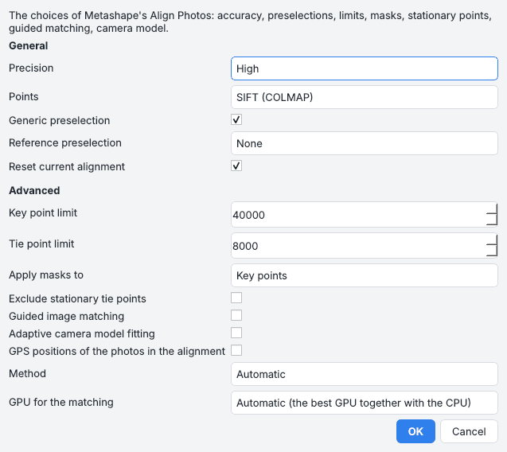
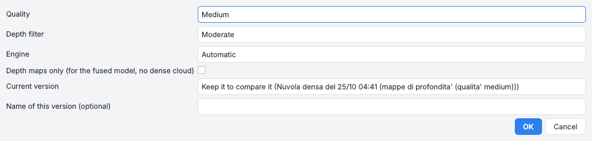
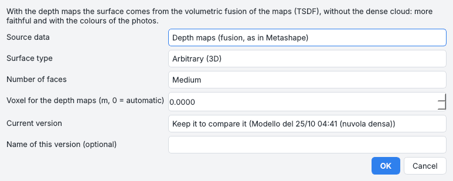
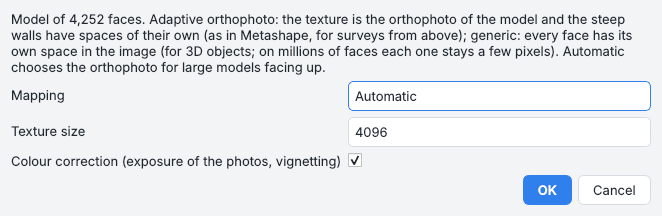
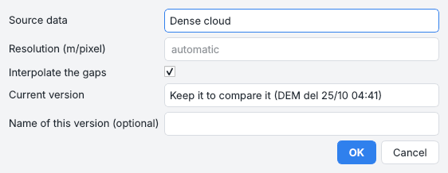
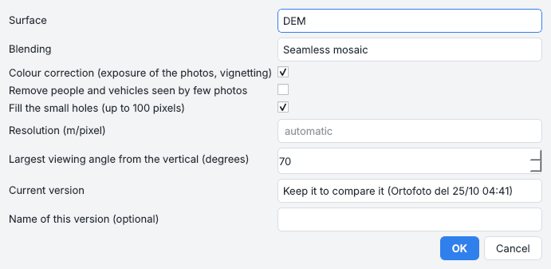
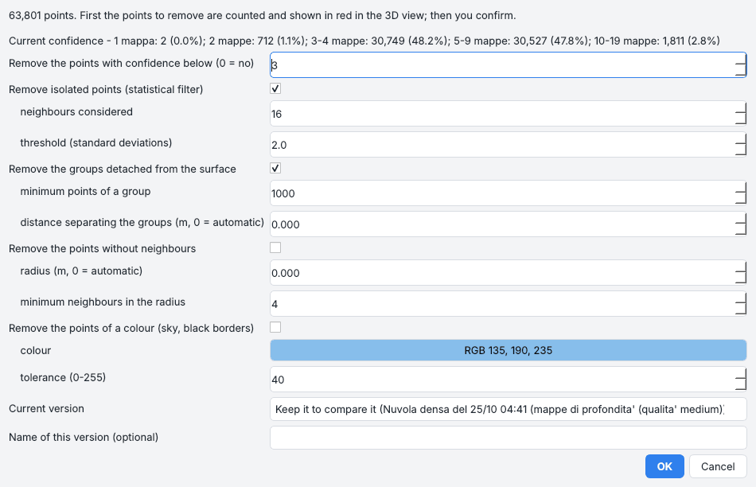
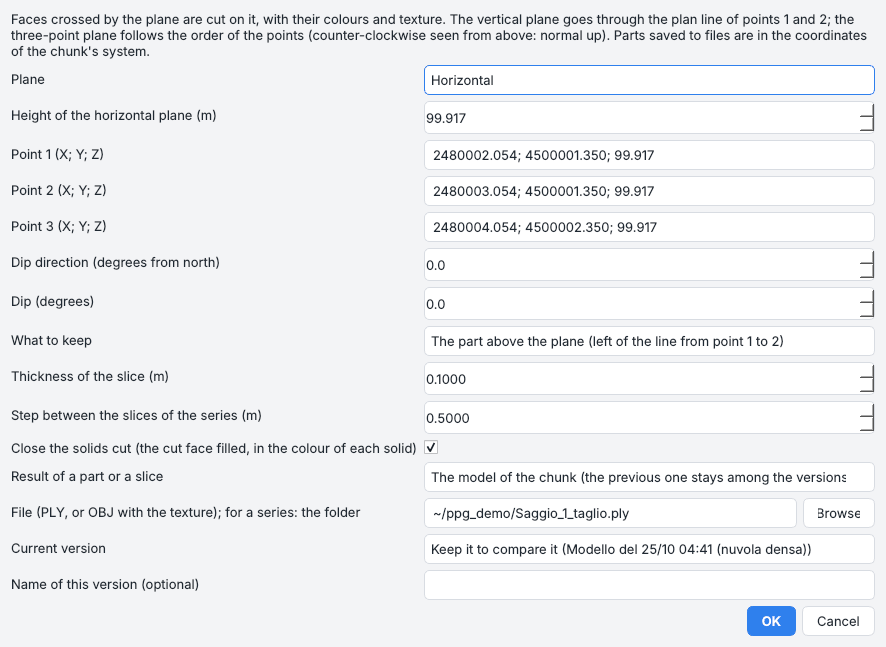
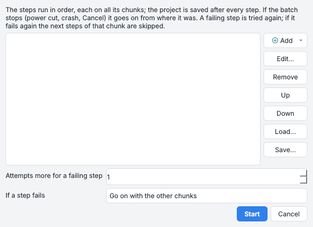
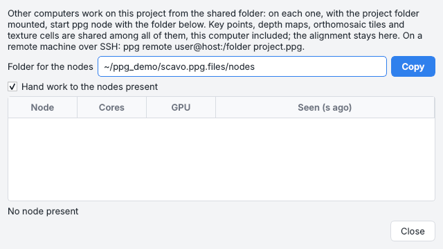

# Elaborazione

Dalle foto allineate alla nuvola densa, al modello, al DEM e all'ortofoto: i comandi del menu *Flusso di
lavoro* nel loro ordine, poi ciò che si può fare dopo con i prodotti. Un esempio completo con foto vere è il
[tutorial](../tutorials/tell.md).

!!! note "Salvataggio e foto che non si leggono"
    Il progetto viene salvato dopo ogni passo, una volta che ha un file. I passi che leggono le foto (mappe di
    profondità, texture, ortofoto, *Elabora tutto*) elencano prima le foto che non si leggono - file vuoti
    tenuti solo online da Dropbox, iCloud o OneDrive - e propongono *Ricollega a un'altra cartella...*,
    *Continua senza queste foto* o *Annulla*.

## Allineare le foto

*Flusso di lavoro > Allinea foto...* è la finestra di *Allinea foto* di Metashape:

| Scelta | Cosa vuol dire |
| --- | --- |
| **Precisione** | la dimensione a cui si leggono le foto: più alta è più lenta e trova più punti |
| **Preselezione generica** | le coppie che si sovrappongono si trovano prima su foto ridotte (fino a 40 foto si provano comunque tutte le coppie) |
| **Preselezione di riferimento** | le coppie scelte dal GPS delle foto, da un allineamento precedente o dall'ordine di scatto |
| **Punti** | *SIFT*, oppure punti appresi abbinati da LightGlue (*DISK* o *ALIKED*) per le foto termiche e le superfici povere di dettagli; se mancano PyTorch e kornia il programma propone di installarli |
| **Azzera l'allineamento attuale** | oppure tienilo: le foto aggiunte dopo vi entrano |

Sotto *Avanzate*:

* i limiti dei punti chiave e dei punti di legame;
* le maschere applicate ai punti chiave o ai punti di legame; *Escludi i punti di legame fermi* (un turntable con
  la camera fissa);
* l'abbinamento guidato, l'adattamento adattivo del modello della camera;
* il GPS delle foto che tiene il blocco mentre cresce una foto alla volta;
* il **metodo**: *Automatico* allinea tutte le camere insieme (globale) da 40 foto di un rilievo da drone (GPS
  sparso sul sito), una foto alla volta sotto questo numero e per oggetti e scene ravvicinate;
* la **GPU** per l'abbinamento: la migliore insieme alla CPU, spenta, o un adattatore scelto. La scelta viene
  ricordata e vale anche per le mappe di profondità PatchMatch.

Poi *Importa riferimenti...* e *Aggiorna georeferenziazione* collocano il rilievo sui punti di controllo, e
*Ottimizza camere* ricalcola il blocco con loro e con le [barre di scala](photos-markers.md#barre-di-scala).

### Diagnostica dell'allineamento

*Strumenti > Diagnostica dell'allineamento* dice perché un allineamento non va:

| Strumento | Cosa mostra |
| --- | --- |
| **Grafo delle corrispondenze** | le foto dove sono state scattate (le altre in un anello); linee tra le foto abbinate, più spesse e più verdi con più corrispondenze, rosse sotto 30; gruppi separati e foto isolate elencati; un doppio clic su una linea apre la coppia |
| **Corrispondenze tra due foto** | le due selezionate in *Foto* (o clic destro su di esse): corrispondenze verificate in verde, candidate scartate in rosso, punti di legame in blu |
| **Residui dei punti di legame** | nella vista Foto, dove ogni punto di legame è stato misurato e dove lo rimette il modello: verde sotto 1 px, arancio sotto 3, rosso oltre; frecce 20 volte più lunghe (anche dal clic destro su una foto allineata) |
| **Calibrazione della camera** | i parametri di ogni sensore, modificabili come valori di partenza, il modello, *Calibrazione fissa* (allineamento e ottimizzazione non la cambiano) e un grafico della distorsione (frecce sul fotogramma e lo spostamento radiale verso l'angolo) |

### Controllo prima di lasciare il sito

*Flusso di lavoro > Controllo prima di lasciare il sito*, subito dopo l'allineamento, mentre il saggio è ancora
aperto:

* la **mappa di quante foto inquadrano ogni punto**: rosso scuro nessuna, rosso una, arancio due, giallo tre o
  quattro, verde di più; il numero di foto sotto il cursore; *Copertura delle foto* nell'area di lavoro;
* un **riepilogo**: quota e area viste da meno di tre foto, foto non allineate o sfocate, marker in nessuna foto,
  in una o due soltanto.

### Precisione

*Precisione* in *Riferimenti*, oppure *Flusso di lavoro > Stima la precisione*: la deviazione standard di ogni
posizione di camera, marker e punto di legame dalla covarianza del bundle adjustment, rispetto ai punti di
controllo e alla loro accuratezza (o al GPS delle foto).

* Una colonna *Precisione X/Y/Z (mm)* per marker e camere, la mediana dei punti di legame sotto le tabelle, la
  precisione della camera nel suggerimento di una foto.
* Con un DEM, la mappa della sua precisione verticale si apre nella vista raster (verde piccola, rossa grande,
  sigma Z sotto il cursore; *Precisione del DEM* nell'area di lavoro).
* Una quota presa dopo tiene la sua precisione (anche in `rilievo_originale` per PyArchInit e nell'IFC). Un nuovo
  allineamento o una nuova georeferenziazione tolgono la precisione vecchia.

## I prodotti

### Nuvola densa

*Flusso di lavoro > Costruisci nuvola densa...*: qualità, filtro di profondità e motore; *Solo le mappe di
profondità* fa solo le mappe (per il modello fuso, senza nuvola densa). *Ritaglia nuvola densa...* tiene un
intervallo di quote e/o un cilindro attorno all'asse del turntable: toglie il tappetino e i target prima di fare
la mesh di un oggetto.

### Modello

*Flusso di lavoro > Costruisci modello...*:

* **Dati sorgente**: le *mappe di profondità* (la superficie dalla loro fusione volumetrica, TSDF, come in
  Metashape: più fedele e con i colori delle foto, senza la nuvola densa) o la *nuvola densa*, di cui si possono
  usare solo le classi spuntate;
* **Tipo di superficie**: *arbitraria* (3D) o *campo di altezze* (2,5D, per il terreno);
* **Numero di facce**, e il voxel della fusione delle mappe di profondità (0 = automatico).

La ricostruzione di Poisson lavora in un processo separato: se il codice nativo si blocca, il passo riprova a una
profondità minore e alla fine costruisce un campo di altezze 2,5D.

### Texture

*Flusso di lavoro > Costruisci texture...*:

* **Correzione colore**: esposizione delle foto e vignettatura, misurate la prima volta;
* **Mappatura**: *ortofoto adattiva* (terreno dall'alto: la texture è l'ortofoto del modello, fatta dal motore
  dell'ortofoto a tasselli; le pareti ripide e le sezioni hanno celle proprie in una fascia sotto, come in
  Metashape); *generica* (ogni faccia la sua cella: oggetti e modelli piccoli); *automatica* sceglie l'ortofoto
  per i modelli grandi rivolti verso l'alto;
* **Dimensione texture** 16384 o 32768 divide la texture in 4 o 16 pagine da 8192 pixel (tasselli della pianta,
  o gruppi di facce vicine), come fa Metashape: ogni pagina resta leggibile dalle schede grafiche e dai
  visualizzatori.

La texture è un'immagine (o una per pagina) accanto a `model.ply`, che porta le coordinate di texture di ogni
faccia; la vista *Modello con texture* mostra tutto il modello.

??? example "Riga di comando e API"
    `chunk.build_texture(size, mapping="auto")`; `integrations.metashape.reimport_model(chunk)`;
    `io.mesh_ply.read_mesh`, `write_mesh`

### DEM

*Flusso di lavoro > Costruisci DEM...*: i dati sorgente, la risoluzione (automatica di base) e *Interpola i
vuoti*. Quando la nuvola densa è classificata la finestra elenca le sue classi con i loro punti: spuntare solo
*Terreno* dà un modello del terreno (DTM), con i vuoti sotto ciò che resta fuori interpolati; curve di livello e
volumi poi lo usano. Il rumore (classi 7 e 18) non fa mai un DEM né una mesh.

### Ortofoto

*Flusso di lavoro > Costruisci ortofoto...*:

| Scelta | Cosa fa |
| --- | --- |
| **Superficie** | il DEM, il modello o la nuvola densa su cui si proiettano le foto |
| **Fusione** | *Mosaico senza cuciture* (di base: i dettagli di ogni cella dalla sua foto migliore, le differenze di luce sfumate lungo le cuciture), *Nessuna (una foto per cella)* o *Media delle foto* |
| **Correzione colore** | esposizione di ogni foto e vignettatura di ogni obiettivo, misurate la prima volta su punti visti da più foto, o prima con *Strumenti > Calibra i colori delle foto* |
| **Togli persone e mezzi visti da poche foto** | dove tre o più foto vedono una cella, la migliore che va d'accordo con le altre |
| **Riempi i piccoli buchi** | fino a 100 pixel che nessuna foto vede, dai loro bordi; i buchi più grandi restano trasparenti |
| **Classi nascoste** | con una nuvola classificata, le classi scelte rese trasparenti dove sono la superficie visibile (attrezzi, persone, vegetazione) |

Ogni cella sceglie tra tutte le foto che la inquadrano, così nessuna cucitura segue i tasselli. Sul saggio
sintetico con metà delle foto più scure del 30 % e ogni foto vignettata, il mosaico corretto differisce da quello
delle foto intatte di 0,3 livelli nelle basse frequenze (25 senza correzione).

### Elabora tutto

*Flusso di lavoro > Elabora tutto...* (++ctrl+r++) fa tutti i passi in fila con le scelte predefinite; con un file
di progetto scrive anche il rapporto HTML.

## Versioni

Le finestre di *Nuvola densa*, *Modello*, *DEM* e *Ortofoto* chiedono, quando il prodotto c'è già, se **conservare
la versione attuale** (per confrontarla) o sovrascriverla, e il nome di quella nuova; una costruzione fallita
rimette quella conservata.

* L'area di lavoro mostra il nome della versione attiva accanto a ogni prodotto ed elenca sotto quelle
  conservate.
* Un doppio clic mostra una versione conservata senza renderla attiva (i raster nella vista ortofoto, nuvole e
  modelli nella vista 3D con la scritta *Versione: ... (non attiva)*; scegliere una vista nell'elenco torna ai
  prodotti attivi).
* Clic destro su una versione conservata: *Rendi attiva* (quella che usano tutti gli strumenti; l'attiva prende
  il suo posto tra le conservate), *Differenza con il DEM attivo* (attivo meno conservato, rosso dove l'attivo è
  più alto, blu dove è più basso, dZ sotto il cursore; un avviso quando i due DEM hanno risoluzioni diverse),
  *Esporta*, *Rinomina*, *Elimina*.
* Clic destro su un prodotto: *Conserva una copia come versione* (per esempio prima di riclassificare la nuvola),
  *Rinomina*.

Le versioni conservate stanno in `versions/` dentro la cartella del chunk.

??? example "Riga di comando e API"
    `core.versions.keep_active`, `activate`, `versions`, `version_file`, `dem_difference`, `rename`, `delete`

## Confidenza e pulizia

**Confidenza** (*Flusso di lavoro > Pulizia e confidenza > Calcola la confidenza*): per la nuvola densa e/o i
vertici del modello, il numero di mappe di profondità che confermano ogni punto (entro l'1 % della sua distanza
dalla camera, la tolleranza della fusione; mezzo spigolo per un vertice); la nuvola fusa ce l'ha già. La vista 3D
(*Colori > Confidenza*, anche per il modello) colora gli intervalli 0 (grigio: nessuna mappa, per esempio un buco
che la mesh ha chiuso), 1 (rosso), 2, 3-4, 5-9, 10-19, 20 o più (blu); togliere la spunta a una riga della legenda
nasconde quei punti o quelle facce, un'anteprima di una pulizia. Servono le mappe di profondità del chunk.

| Pulizia | Cosa toglie |
| --- | --- |
| **Pulisci la nuvola densa** | punti sotto una confidenza, punti isolati (filtro statistico: vicini, deviazioni standard), punti senza vicini entro un raggio, gruppi staccati più piccoli di un numero di punti, classi, un colore (con una tolleranza); i punti trovati vengono contati e mostrati in rosso nella vista 3D, poi tolti quando confermi |
| **Pulisci il modello** | pezzi staccati sotto una parte del più grande, facce con bassa confidenza dei vertici, triangoli stirati, topologia, buchi chiusi fino a un raggio, levigatura di Taubin (bordi fissi), riduzione delle facce; colori e confidenza restano, la texture va rifatta |
| **Pulisci i punti di legame (selezione graduale)** | soglie su errore di riproiezione, numero di foto, incertezza della ricostruzione e accuratezza della proiezione con i conteggi dal vivo, poi l'ottimizzazione delle camere (per i modelli scritti da pose importate conta solo l'incertezza) |
| **Lazo** | elimina o tiene i punti e le facce scelti sullo schermo |

Ogni pulizia può prima conservare la versione attuale.

??? example "Riga di comando e API"
    `ppg confidence scavo.ppg --model`, `ppg clean-cloud`, `ppg clean-model`, `ppg clean-tie-points`;
    `chunk.compute_confidence("point_cloud" or "model")`, `engine.confidence.depth_map_support`;
    `chunk.clean_point_cloud(...)`, `clean_model(...)`, `clean_tie_points(...)`, `engine.cleaning.point_filters`,
    `face_filters`, `delete_points`, `delete_faces`

## Ritaglio

*Ritaglio* in *Strumenti > Disegno su ortofoto* (o *File > Esporta > Ritagliati...*, *Pulizia e confidenza >
Ritaglia*):
trascina un riquadro o fai clic su un poligono (doppio clic per chiudere) sull'ortofoto o sul DEM; oppure
seleziona un poligono (un'unità) e *Ritaglia o esporta con il poligono selezionato*. Poi scegli i prodotti:

* **esportati** ritagliati in una cartella: DEM e ortofoto senza dati o trasparenti fuori dal poligono, modello
  PLY con colori, confidenza e coordinate in doppia precisione oppure OBJ con la texture, nuvola LAS con classi e
  confidenza, il poligono come GeoJSON;
* oppure **ritagliati nel progetto**, con gli originali conservati come versioni.

Modello e nuvola si possono anche limitare in quota.

??? example "Riga di comando e API"
    `ppg crop scavo.ppg --polygon "x1,y1 x2,y2 x3,y3" --out ritagli` (oppure `--bbox`, `--wkt`, `--geojson`,
    `--in-project`); `chunk.export_dem(path, region=)`, `export_orthomosaic`, `export_model`, `export_point_cloud`,
    `crop_dem`, `crop_orthomosaic`, `crop_model`, `crop_point_cloud(region=)`

## Tagliare il modello

*Taglia* nella vista 3D, oppure *Flusso di lavoro > Pulizia e confidenza > Taglia il modello con un piano*. Il
piano:

* **orizzontale** (un clic alla quota), **verticale** (due clic: il piano per la loro linea in pianta), **per tre
  punti cliccati**, **inclinato** (direzione e inclinazione);
* lungo una sezione del pannello *Sezioni*, o per i marker selezionati.

Tieni la parte sopra o sotto (sopra = a sinistra della linea dal punto 1 al punto 2 per un piano verticale), o una
fetta di uno spessore, come modello del chunk (il precedente tra le versioni) o come file; oppure salva le due
parti, o una serie di fette parallele ogni tanto, come PLY (o OBJ con la texture) in coordinate reali.

Le facce attraversate dal piano vengono tagliate su di esso, con colori, confidenza e coordinate di texture
interpolati. *Chiudi i solidi tagliati* riempie la faccia tagliata di ogni solido chiuso nel suo colore (le unità
del plugin di geoarcheologia, i proxy US, un vaso: il suo vuoto resta vuoto); le superfici aperte restano aperte.
I solidi importati affiancati (un modello di unità stratigrafiche) restano solidi separati.

??? example "Riga di comando e API"
    `ppg cut-model scavo.ppg --horizontal 101.5 --keep below` (oppure `--vertical X1,Y1,X2,Y2`, `--points ...`,
    `--plane X,Y,Z,NX,NY,NZ`, `--dip X,Y,Z,IMMERSIONE,INCLINAZIONE`; `--keep above/below/slab/both/series`,
    `--thickness`, `--step`, `--out`); `chunk.cut_model(point, normal, keep=...)`, `engine.mesh_cut.clip`, `slab`,
    `series`, `horizontal`, `vertical`, `through_points`, `dipping`

## Regione di ricostruzione

*Flusso di lavoro > Regione di ricostruzione*: un riquadro (giallo nella vista 3D; *Regione* lo mostra o lo
nasconde) attorno ai punti di legame, girato come la vista 3D, sul poligono selezionato della pianta, o con
centro, dimensioni e rotazione scritti a mano. Mappe di profondità, nuvola densa e modello costruiti dopo restano
dentro di esso - il saggio e non il campo attorno, il vaso e non il tavolo - e così DEM e ortofoto. *Togli la
regione* torna a tutto ciò che vedono le foto.

## Prospetti

*Flusso di lavoro > Prospetto o sviluppo cilindrico...*, oppure *Prospetto* nel pannello *Sezioni*:

* l'ortofoto e il rilievo di un muro sul **piano verticale di una traccia di sezione** (visto da dove sono le foto,
  o dal lato scelto), o sul **piano di tre o più marker selezionati**;
* lo **sviluppo di un pozzo o di una torre** sul cilindro di un poligono selezionato (visto da dentro o da fuori).

*Profondità davanti / dietro* tengono solo la superficie vicina al piano: un ponteggio o una sezione davanti al
muro non lo nascondono. I prospetti sono elencati nell'area di lavoro (*Prospetti*): un doppio clic mostra
l'ortofoto nella vista raster con il rilievo come Z sotto il cursore (distanza dal piano verso chi guarda:
rigonfiamenti e strapiombi di un muro); il clic destro esporta ortofoto, rilievo e piano, o li elimina.

## Modificare il DEM

*Modifica DEM* in *Strumenti > Disegno su ortofoto* (trascina un riquadro o fai clic su un poligono), oppure
*Modifica il DEM in quest'area* nel menu di un poligono selezionato: le quote dentro l'area tornano dal terreno appena fuori - il
piano che lo adatta, un'interpolazione lineare, IDW o una quota costante - e le linee selezionate possono fare da
linee di discontinuità (il bordo di un muro o di un gradino tiene le sue quote). Alberi, tende, mezzi, cumuli di
terra o buchi della ricostruzione lasciano segni in curve di livello e volumi; il DEM com'era resta tra le versioni
(confrontalo, rendilo di nuovo attivo).

## Coregistrazione dei DEM

*Strumenti > Coregistra DEM...*: il DEM del chunk attivo viene spostato su un riferimento - il DEM di un altro
chunk o una versione conservata di un DEM qualunque - dove il terreno non è cambiato: spostamento orizzontale
(Nuth e Kääb), verticale e, se spuntato, inclinazione.

* Le celle cambiate (lo scavo, i cumuli di terra) vengono trovate e lasciate fuori da sole; con dei poligoni
  selezionati la finestra può anche escluderli (*Escludili*: le aree scavate) o usare solo il terreno dentro di
  essi (*Solo dentro*).
* I due DEM possono stare a metri di distanza, come due rilievi georeferenziati con GPS diversi: prima si
  confrontano le pendenze dei due a ogni spostamento per trovare all'incirca dove sta il secondo, poi
  l'adattamento lo affina; lo spostamento trovato così viene tenuto solo se lì va d'accordo molto più terreno in
  pendenza.
* Lavora in background; il log dà dx, dy, dz in cm, l'inclinazione e la NMAD sul terreno stabile prima e dopo. Il
  DEM spostato diventa quello attivo, e il DEM com'era resta tra le versioni (*Differenza con il DEM attivo*
  mostra cosa si è spostato).

!!! warning "Quando non può funzionare"
    Su un terreno che si ripete (arature, filari di viti) o uguale lungo una direzione (un lungo fossato, solchi)
    molti spostamenti vanno bene e la ricerca sopra non si usa. Dove la vegetazione è cambiata tra i rilievi,
    coregistra i DTM (la finestra del DEM con solo *Terreno* spuntato). Su un terreno piano, o dove le pendenze
    guardano tutte da una parte, lo spostamento orizzontale non si può misurare: il log lo dice e lo spostamento
    verticale lo assorbe. Quando i DEM non sono lo stesso terreno, il log dice che lo spostamento non si è
    assestato e viene tenuto lo stato più vicino - di solito il DEM com'è.

Le [fasi dello scavo](archaeology.md#fasi-dello-scavo) coregistrano così i loro DEM prima di calcolare i volumi.

## Patch dell'ortofoto

L'ortofoto prende ogni cella dalla foto migliore; una patch sceglie la foto a mano in un'area (la chioma di un
albero sopra un muro, una persona nel saggio, un'ombra).

1. *Patch* nella barra Disegno (o *Strumenti > Patch dell'ortofoto*): trascina un riquadro o fai clic sui vertici
   di un poligono e doppio clic; oppure seleziona un poligono (un'unità) e scegli *Assegna immagini a quest'area*
   dal suo menu.
2. La finestra mostra l'area com'è ora e, per la foto scelta nell'elenco, l'area come verrebbe. L'elenco ha le foto
   che inquadrano l'area, le migliori prima (quota inquadrata x vicinanza, verticalità e centralità), con la quota
   inquadrata, l'angolo dalla verticale, il pixel a terra, la parte dell'area che l'ortofoto ne prende ora, e nel
   suggerimento quanto ne nasconde il modello (chiome, muri).
3. Scegli una o più foto (++shift++ / ++ctrl++), *Usa solo* o *Escludi*, *Sul DEM* (una true ortho) o *Sul suolo
   attorno all'area* (quote lungo il poligono interpolate all'interno: alberi, mezzi e persone vengono come nella
   foto, e i buchi del DEM si riempiono), e a scelta la texture del modello nell'area.
4. *Applica* salva la patch e ridisegna solo le sue celle, poi le panoramiche di quella finestra; la vista resta
   dov'era.

Le patch sono un layer, *Patch ortofoto*: selezionane una e premi ++delete++ (o *Elimina selezionati*) e
l'ortofoto viene ridisegnata lì senza di essa. Una costruzione successiva dell'ortofoto applica di nuovo ogni
patch; *Aggiorna l'ortofoto con le patch* applica quelle non ancora applicate (dopo un aggiornamento interrotto).
Un'ortofoto di un altro programma (esportata da Metashape) viene copiata nella cartella del chunk alla prima
patch, e i suoi pixel tornano dove una patch viene tolta.

**Patch della texture**: nella vista 3D il lazo sul modello propone *Correggi la texture di queste facce (assegna
le immagini)*: le foto che vedono quelle facce, ognuna con la parte della foto dove si trovano; ogni faccia prende
la migliore delle foto scelte che la vede.

## Elaborazione batch

*Flusso di lavoro > Elaborazione batch...*: un elenco di passi - allineamento, prodotti, esportazioni, la
precisione e il controllo sul campo - ognuno su tutti i chunk o su quelli scelti, con i suoi parametri (*Aggiungi*
per gruppo, *Modifica* o doppio clic, *Su* / *Giù*, *Carica* / *Salva* come JSON), i tentativi per un passo che
fallisce e cosa fare allora.

Il progetto viene salvato dopo ogni passo; se il batch si ferma (mancanza di corrente, arresto improvviso,
*Annulla*) la volta dopo propone di ripartire da dove si era fermato. I passi falliti sono elencati nel log.

## Nodi di rete

*Strumenti > Nodi di rete...*: altri computer che lavorano a questo progetto dalla cartella condivisa del
progetto.

* La finestra dà la cartella da passare a `ppg node` su ognuno, ed elenca i nodi presenti con i loro core e GPU.
* L'interruttore affida loro i punti chiave, le mappe di profondità PatchMatch, i tasselli dell'ortofoto e le celle
  della texture; l'allineamento resta su questo computer. Viene ricordato e applicato al programma in esecuzione
  come `PPG_NODES`.
* `ppg remote` lavora con una macchina via SSH. I dettagli nell'[API](../api.md#altri-computer), *Altri computer*.
