# Elaborazione

Dalle foto allineate alla nuvola densa, al modello, al DEM e all'ortofoto: i comandi del menu *Flusso di
lavoro* nel loro ordine, poi ciò che si può fare dopo con i prodotti. Un esempio completo con foto vere è il
[tutorial](../tutorials/tell.md).

!!! note "Salvataggio e foto che non si leggono"
    Il progetto viene salvato dopo ogni passo, una volta che ha un file. I passi che leggono le foto (mappe di
    profondità, texture, ortofoto, *Elabora tutto*) elencano prima le foto che non si leggono - file vuoti
    tenuti solo online da Dropbox, iCloud o OneDrive - e propongono *Ricollega a un'altra cartella...*,
    *Continua senza queste foto* o *Annulla*.

## Allineare le foto

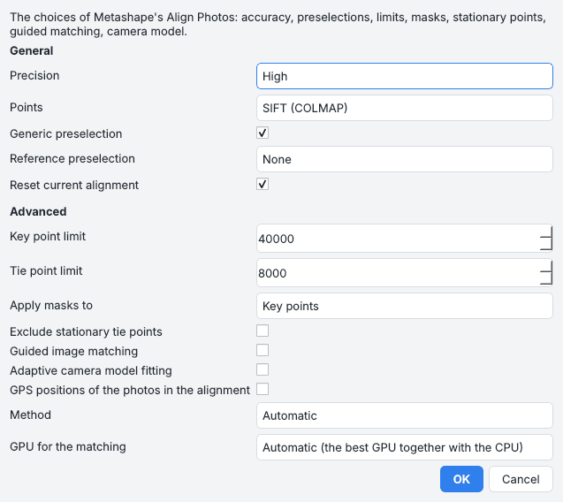

*Flusso di lavoro > Allinea foto...* è la finestra di *Allinea foto* di Metashape:

| Scelta | Cosa vuol dire |
| --- | --- |
| **Precisione** | la dimensione a cui si leggono le foto: più alta è più lenta e trova più punti |
| **Preselezione generica** | le coppie che si sovrappongono si trovano prima su foto ridotte (fino a 40 foto si provano comunque tutte le coppie) |
| **Preselezione di riferimento** | le coppie scelte dal GPS delle foto, da un allineamento precedente o dall'ordine di scatto |
| **Punti** | *SIFT*, oppure punti appresi abbinati da LightGlue (*DISK* o *ALIKED*) per le foto termiche e le superfici povere di dettagli; se mancano PyTorch e kornia il programma propone di installarli |
| **Azzera l'allineamento attuale** | oppure tienilo: le foto aggiunte dopo vi entrano |

Sotto *Avanzate*:

* i limiti dei punti chiave e dei punti di legame;
* le maschere applicate ai punti chiave o ai punti di legame; *Escludi i punti di legame fermi* (un turntable con
  la camera fissa);
* l'abbinamento guidato, l'adattamento adattivo del modello della camera;
* il GPS delle foto che tiene il blocco mentre cresce una foto alla volta;
* il **metodo**: *Automatico* allinea tutte le camere insieme (globale) da 40 foto di un rilievo da drone (GPS
  sparso sul sito), una foto alla volta sotto questo numero e per oggetti e scene ravvicinate;
* la **GPU** per l'abbinamento: la migliore insieme alla CPU, spenta, o un adattatore scelto. La scelta viene
  ricordata e vale anche per le mappe di profondità PatchMatch.

Poi *Importa riferimenti...* e *Aggiorna georeferenziazione* collocano il rilievo sui punti di controllo, e
*Ottimizza camere* ricalcola il blocco con loro e con le [barre di scala](photos-markers.md#barre-di-scala).

### Ottimizzare le camere

*Flusso di lavoro > Ottimizza camere* compensa insieme pose, calibrazione e punti di legame. Che cosa tiene il
blocco:

* **3 o più punti di controllo**, o 2 o più barre di scala di controllo: fissati alle loro coordinate, il blocco si
  piega per passarci; i check point e le barre di check misurano il risultato;
* altrimenti **le posizioni GNSS delle foto**, quando sono accurate - un fix o un float RTK o PPK, 0,5 m o meglio
  (*Posizioni GNSS delle foto*: *automatico*): ogni foto pesa secondo la sua accuratezza, e la focale trovata
  dall'allineamento resta quella, perché da una sola quota, guardando in basso, le posizioni non distinguono la
  focale dalla distanza dal suolo. La finestra dice quante foto tengono il blocco e con quale stato RTK
  (*Posizioni GNSS usate come vincolo: 82 foto, fix*).

Senza né gli uni né le altre, un blocco nadirale su terreno piatto può piegarsi a cupola mentre l'errore di
riproiezione resta lo stesso: la distorsione radiale lo compensa nelle foto (82 riprese RTK fix di un P4
Multispectral finivano a metri dalle loro posizioni). **Una rete di sicurezza** controlla ogni ottimizzazione:
quando le camere finiscono più lontane dalle loro posizioni GNSS accurate di tre volte lo scarto che avevano, e di
30 cm più di quello, l'ottimizzazione viene annullata e si rimette l'allineamento di prima (anche quando si ferma
per un errore o viene annullata a mano). O piegava il blocco, o le posizioni di una parte del blocco non
concordano con i punti di controllo - un volo spostato di una quantità sua, quote miste fra MRK ed EXIF (uno
spostamento uguale per tutte le posizioni, come una base su un punto sbagliato o un altro sistema di quote, lo
prende la georeferenziazione e non annulla nulla): per tenere un'ottimizzazione così, togli la spunta alle camere
in *Riferimenti* (clic destro: *Non usare i riferimenti di tutte le camere*) e ripetila. *non usate* lascia fuori le posizioni (l'ottimizzazione delle versioni precedenti, sempre sotto la
rete). Il motore *Proprio* in *automatico* tiene il blocco allo stesso modo, focale compresa; *usate con la loro
accuratezza* e *usate, con un bias per volo* rifiniscono la focale (con un bias per volo la rete giudica ogni
posizione meno il bias del suo volo). Dalla riga di comando: `ppg optimize progetto.ppg --gnss auto|off`
(`plain` e `bias` con `--engine ppg`); l'uscita dice quante foto hanno tenuto il blocco e se la focale è rimasta
quella dell'allineamento.

### Diagnostica dell'allineamento

*Strumenti > Diagnostica dell'allineamento* dice perché un allineamento non va:

| Strumento | Cosa mostra |
| --- | --- |
| **Grafo delle corrispondenze** | le foto dove sono state scattate (le altre in un anello); linee tra le foto abbinate, più spesse e più verdi con più corrispondenze, rosse sotto 30; gruppi separati e foto isolate elencati; un doppio clic su una linea apre la coppia |
| **Corrispondenze tra due foto** | le due selezionate in *Foto* (o clic destro su di esse): corrispondenze verificate in verde, candidate scartate in rosso, punti di legame in blu |
| **Residui dei punti di legame** | nella vista Foto, dove ogni punto di legame è stato misurato e dove lo rimette il modello: verde sotto 1 px, arancio sotto 3, rosso oltre; frecce 20 volte più lunghe (anche dal clic destro su una foto allineata) |
| **Calibrazione della camera** | i parametri di ogni sensore, modificabili come valori di partenza, il modello, *Calibrazione fissa* (allineamento e ottimizzazione non la cambiano) e un grafico della distorsione (frecce sul fotogramma e lo spostamento radiale verso l'angolo) |

### Controllo prima di lasciare il sito

*Flusso di lavoro > Controllo prima di lasciare il sito*, subito dopo l'allineamento, mentre il saggio è ancora
aperto:

* la **mappa di quante foto inquadrano ogni punto**: rosso scuro nessuna, rosso una, arancio due, giallo tre o
  quattro, verde di più; il numero di foto sotto il cursore; *Copertura delle foto* nell'area di lavoro;
* un **riepilogo**: quota e area viste da meno di tre foto, foto non allineate o sfocate, marker in nessuna foto,
  in una o due soltanto.

### Precisione

*Precisione* in *Riferimenti*, oppure *Flusso di lavoro > Stima la precisione*: la deviazione standard di ogni
posizione di camera, marker e punto di legame dalla covarianza del bundle adjustment, rispetto ai punti di
controllo e alla loro accuratezza (o al GPS delle foto).

* Una colonna *Precisione X/Y/Z (mm)* per marker e camere, la mediana dei punti di legame sotto le tabelle, la
  precisione della camera nel suggerimento di una foto.
* Con un DEM, la mappa della sua precisione verticale si apre nella vista raster (verde piccola, rossa grande,
  sigma Z sotto il cursore; *Precisione del DEM* nell'area di lavoro).
* Una quota presa dopo tiene la sua precisione (anche in `rilievo_originale` per PyArchInit e nell'IFC). Un nuovo
  allineamento o una nuova georeferenziazione tolgono la precisione vecchia.

## I prodotti

### Nuvola densa

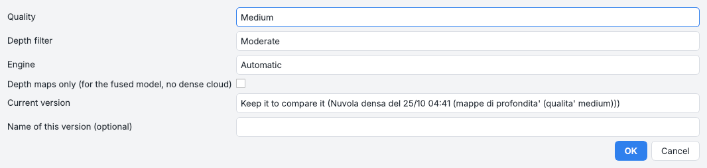

*Flusso di lavoro > Costruisci nuvola densa...*: qualità, filtro di profondità e motore; *Solo le mappe di
profondità* fa solo le mappe (per il modello fuso, senza nuvola densa). *Ritaglia nuvola densa...* tiene un
intervallo di quote e/o un cilindro attorno all'asse del turntable: toglie il tappetino e i target prima di fare
la mesh di un oggetto.

### Modello

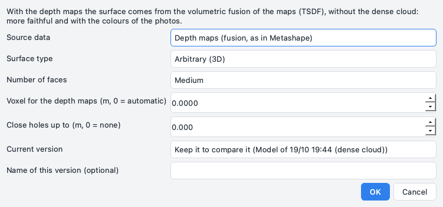

*Flusso di lavoro > Costruisci modello...*:

* **Dati sorgente**: le *mappe di profondità* (la superficie dalla loro fusione volumetrica, TSDF, come in
  Metashape: più fedele e con i colori delle foto, senza la nuvola densa) o la *nuvola densa*, di cui si possono
  usare solo le classi spuntate;
* **Tipo di superficie**: *arbitraria* (3D) o *campo di altezze* (2,5D, per il terreno);
* **Numero di facce**, e il voxel della fusione delle mappe di profondità (0 = automatico);
* **Chiudi i buchi fino a** (metri, 0 = nessuno): per il campo di altezze, chiude i buchi con un vuoto tra i
  punti misurati fino a questa misura. La parte chiusa è interpolata, non misurata: il log dice quanti buchi
  sono stati chiusi e quanti metri quadrati in pianta sono. Quello che è fuori dal contorno del rilievo non si
  chiude mai.

Il campo di altezze segue la densità dei punti posto per posto: dove la nuvola è più rada le facce sono più
grandi, senza buchi, e restano aperte solo le aree senza punti ([Campo di altezze](../api.md#campo-di-altezze)).

La ricostruzione di Poisson lavora in un processo separato: se il codice nativo si blocca, il passo riprova a una
profondità minore e alla fine costruisce un campo di altezze 2,5D.

### Texture

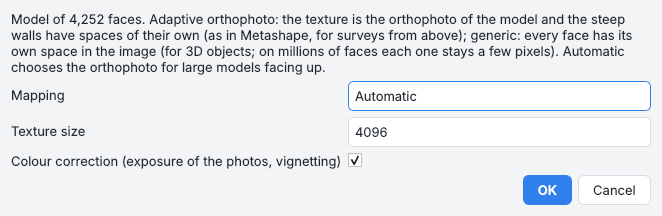

*Flusso di lavoro > Costruisci texture...*:

* **Correzione colore**: esposizione delle foto e vignettatura, misurate la prima volta;
* **Mappatura**: *ortofoto adattiva* (terreno dall'alto: la texture è l'ortofoto del modello, fatta dal motore
  dell'ortofoto a tasselli; le pareti ripide e le sezioni hanno celle proprie in una fascia sotto, come in
  Metashape); *generica* (ogni faccia la sua cella: oggetti e modelli piccoli); *automatica* sceglie l'ortofoto
  per i modelli grandi rivolti verso l'alto;
* **Dimensione texture** 16384 o 32768 divide la texture in 4 o 16 pagine da 8192 pixel (tasselli della pianta,
  o gruppi di facce vicine), come fa Metashape: ogni pagina resta leggibile dalle schede grafiche e dai
  visualizzatori.

La texture è un'immagine (o una per pagina) accanto a `model.ply`, che porta le coordinate di texture di ogni
faccia; la vista *Modello con texture* mostra tutto il modello.

??? example "Riga di comando e API"
    `chunk.build_texture(size, mapping="auto")`; `integrations.metashape.reimport_model(chunk)`;
    `io.mesh_ply.read_mesh`, `write_mesh`

### DEM

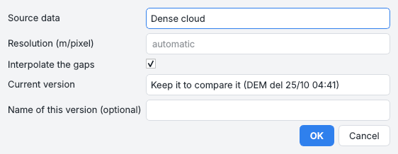

*Flusso di lavoro > Costruisci DEM...*: i dati sorgente, la risoluzione (automatica di base) e *Interpola i
vuoti*. Quando la nuvola densa è classificata la finestra elenca le sue classi con i loro punti: spuntare solo
*Terreno* dà un modello del terreno (DTM), con i vuoti sotto ciò che resta fuori interpolati; curve di livello e
volumi poi lo usano. Il rumore (classi 7 e 18) non fa mai un DEM né una mesh.

### Ortofoto

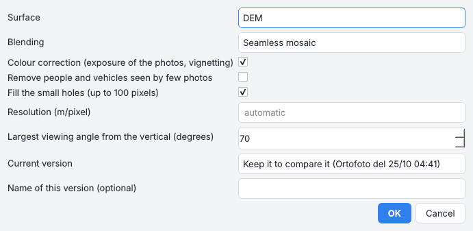

*Flusso di lavoro > Costruisci ortofoto...*:

| Scelta | Cosa fa |
| --- | --- |
| **Superficie** | il DEM, il modello o la nuvola densa su cui si proiettano le foto |
| **Fusione** | *Mosaico senza cuciture* (di base: i dettagli di ogni cella dalla sua foto migliore, le differenze di luce sfumate lungo le cuciture), *Nessuna (una foto per cella)* o *Media delle foto* |
| **Correzione colore** | esposizione di ogni foto e vignettatura di ogni obiettivo, misurate la prima volta su punti visti da più foto, o prima con *Strumenti > Calibra i colori delle foto* |
| **Togli persone e mezzi visti da poche foto** | dove tre o più foto vedono una cella, la migliore che va d'accordo con le altre |
| **Riempi i piccoli buchi** | fino a 100 pixel che nessuna foto vede, dai loro bordi; i buchi più grandi restano trasparenti |
| **Classi nascoste** | con una nuvola classificata, le classi scelte rese trasparenti dove sono la superficie visibile (attrezzi, persone, vegetazione) |

Ogni cella sceglie tra tutte le foto che la inquadrano, così nessuna cucitura segue i tasselli. Sul saggio
sintetico con metà delle foto più scure del 30 % e ogni foto vignettata, il mosaico corretto differisce da quello
delle foto intatte di 0,3 livelli nelle basse frequenze (25 senza correzione).

### Elabora tutto

*Flusso di lavoro > Elabora tutto...* (++ctrl+r++) fa tutti i passi in fila con le scelte predefinite; con un file
di progetto scrive anche il rapporto HTML. Con la superficie a *campo di altezze*, **Chiudi i buchi fino a**
(metri, 0 = nessuno) chiude i buchi del modello come in [*Costruisci modello*](#modello): la parte chiusa è
interpolata, non misurata, e il log dice quanta è.

## Versioni

Le finestre di *Nuvola densa*, *Modello*, *DEM* e *Ortofoto* chiedono, quando il prodotto c'è già, se **conservare
la versione attuale** (per confrontarla) o sovrascriverla, e il nome di quella nuova; una costruzione fallita
rimette quella conservata.

* L'area di lavoro mostra il nome della versione attiva accanto a ogni prodotto ed elenca sotto quelle
  conservate.
* Un doppio clic mostra una versione conservata senza renderla attiva (i raster nella vista ortofoto, nuvole e
  modelli nella vista 3D con la scritta *Versione: ... (non attiva)*; scegliere una vista nell'elenco torna ai
  prodotti attivi).
* Clic destro su una versione conservata: *Rendi attiva* (quella che usano tutti gli strumenti; l'attiva prende
  il suo posto tra le conservate), *Differenza con il DEM attivo* (attivo meno conservato, rosso dove l'attivo è
  più alto, blu dove è più basso, dZ sotto il cursore; un avviso quando i due DEM hanno risoluzioni diverse),
  *Esporta*, *Rinomina*, *Elimina*.
* Clic destro su un prodotto: *Conserva una copia come versione* (per esempio prima di riclassificare la nuvola),
  *Rinomina*.

Le versioni conservate stanno in `versions/` dentro la cartella del chunk.

??? example "Riga di comando e API"
    `core.versions.keep_active`, `activate`, `versions`, `version_file`, `dem_difference`, `rename`, `delete`

## Confidenza e pulizia

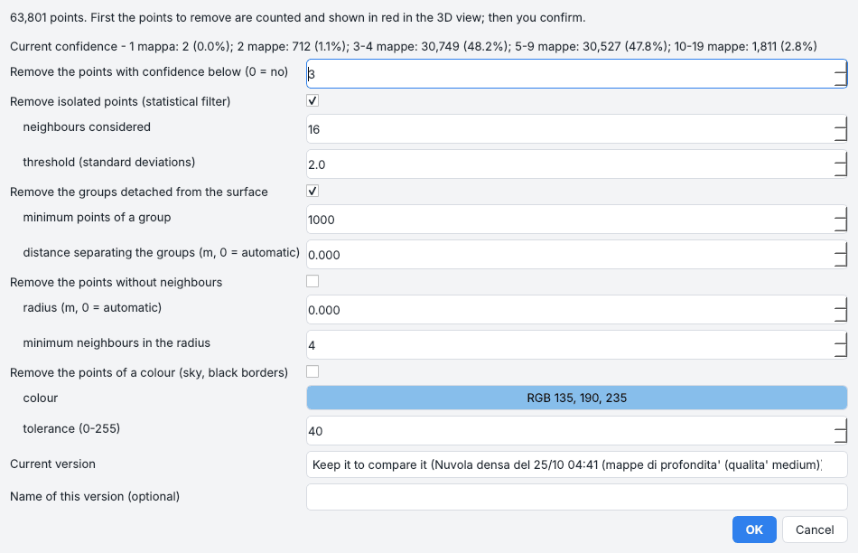

**Confidenza** (*Flusso di lavoro > Pulizia e confidenza > Calcola la confidenza*): per la nuvola densa e/o i
vertici del modello, il numero di mappe di profondità che confermano ogni punto (entro l'1 % della sua distanza
dalla camera, la tolleranza della fusione; mezzo spigolo per un vertice); la nuvola fusa ce l'ha già. La vista 3D
(*Colori > Confidenza*, anche per il modello) colora gli intervalli 0 (grigio: nessuna mappa, per esempio un buco
che la mesh ha chiuso), 1 (rosso), 2, 3-4, 5-9, 10-19, 20 o più (blu); togliere la spunta a una riga della legenda
nasconde quei punti o quelle facce, un'anteprima di una pulizia. Servono le mappe di profondità del chunk.

| Pulizia | Cosa toglie |
| --- | --- |
| **Pulisci la nuvola densa** | punti sotto una confidenza, punti isolati (filtro statistico: vicini, deviazioni standard), punti senza vicini entro un raggio, gruppi staccati più piccoli di un numero di punti, classi, un colore (con una tolleranza); i punti trovati vengono contati e mostrati in rosso nella vista 3D, poi tolti quando confermi |
| **Pulisci il modello** | pezzi staccati sotto una parte del più grande, facce con bassa confidenza dei vertici, triangoli stirati, topologia, buchi chiusi fino a un raggio, levigatura di Taubin (bordi fissi), riduzione delle facce; colori e confidenza restano, la texture va rifatta |
| **Pulisci i punti di legame (selezione graduale)** | soglie su errore di riproiezione, numero di foto, incertezza della ricostruzione e accuratezza della proiezione con i conteggi dal vivo, poi l'ottimizzazione delle camere (per i modelli scritti da pose importate conta solo l'incertezza) |
| **Lazo** | elimina o tiene i punti e le facce scelti sullo schermo |

Ogni pulizia può prima conservare la versione attuale.

??? example "Riga di comando e API"
    `ppg confidence scavo.ppg --model`, `ppg clean-cloud`, `ppg clean-model`, `ppg clean-tie-points`;
    `chunk.compute_confidence("point_cloud" or "model")`, `engine.confidence.depth_map_support`;
    `chunk.clean_point_cloud(...)`, `clean_model(...)`, `clean_tie_points(...)`, `engine.cleaning.point_filters`,
    `face_filters`, `delete_points`, `delete_faces`

## Ritaglio

*Ritaglio* in *Strumenti > Disegno su ortofoto* (o *File > Esporta > Ritagliati...*, *Pulizia e confidenza >
Ritaglia*):
trascina un riquadro o fai clic su un poligono (doppio clic per chiudere) sull'ortofoto o sul DEM; oppure
seleziona un poligono (un'unità) e *Ritaglia o esporta con il poligono selezionato*. Poi scegli i prodotti:

* **esportati** ritagliati in una cartella: DEM e ortofoto senza dati o trasparenti fuori dal poligono, modello
  PLY con colori, confidenza e coordinate in doppia precisione oppure OBJ con la texture, nuvola LAS con classi e
  confidenza, il poligono come GeoJSON;
* oppure **ritagliati nel progetto**, con gli originali conservati come versioni.

Modello e nuvola si possono anche limitare in quota.

??? example "Riga di comando e API"
    `ppg crop scavo.ppg --polygon "x1,y1 x2,y2 x3,y3" --out ritagli` (oppure `--bbox`, `--wkt`, `--geojson`,
    `--in-project`); `chunk.export_dem(path, region=)`, `export_orthomosaic`, `export_model`, `export_point_cloud`,
    `crop_dem`, `crop_orthomosaic`, `crop_model`, `crop_point_cloud(region=)`

## Tagliare il modello

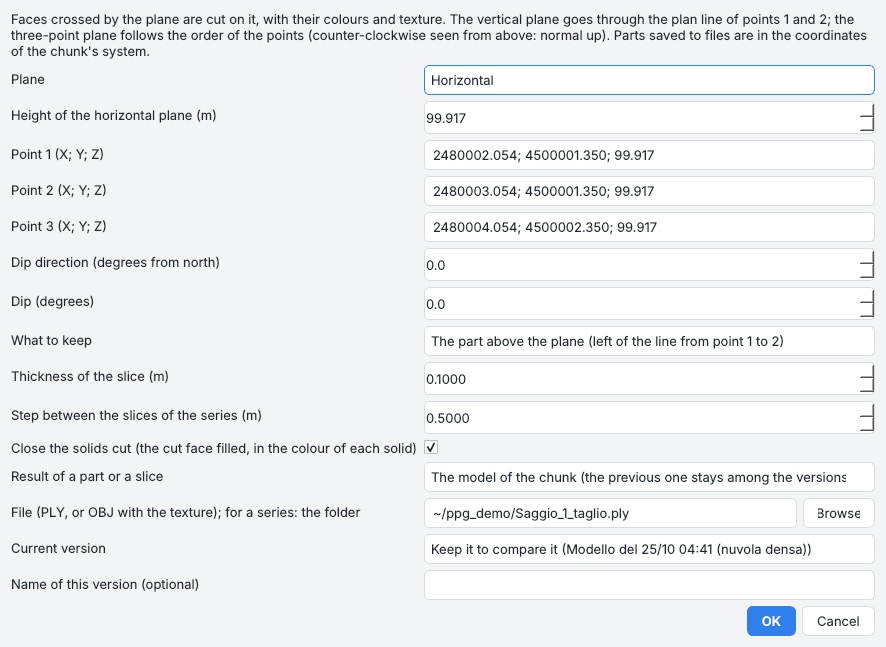

*Taglia* nella vista 3D, oppure *Flusso di lavoro > Pulizia e confidenza > Taglia il modello con un piano*. Il
piano:

* **orizzontale** (un clic alla quota), **verticale** (due clic: il piano per la loro linea in pianta), **per tre
  punti cliccati**, **inclinato** (direzione e inclinazione);
* lungo una sezione del pannello *Sezioni*, o per i marker selezionati.

Tieni la parte sopra o sotto (sopra = a sinistra della linea dal punto 1 al punto 2 per un piano verticale), o una
fetta di uno spessore, come modello del chunk (il precedente tra le versioni) o come file; oppure salva le due
parti, o una serie di fette parallele ogni tanto, come PLY (o OBJ con la texture) in coordinate reali.

Le facce attraversate dal piano vengono tagliate su di esso, con colori, confidenza e coordinate di texture
interpolati. *Chiudi i solidi tagliati* riempie la faccia tagliata di ogni solido chiuso nel suo colore (le unità
del plugin di geoarcheologia, i proxy US, un vaso: il suo vuoto resta vuoto); le superfici aperte restano aperte.
I solidi importati affiancati (un modello di unità stratigrafiche) restano solidi separati.

??? example "Riga di comando e API"
    `ppg cut-model scavo.ppg --horizontal 101.5 --keep below` (oppure `--vertical X1,Y1,X2,Y2`, `--points ...`,
    `--plane X,Y,Z,NX,NY,NZ`, `--dip X,Y,Z,IMMERSIONE,INCLINAZIONE`; `--keep above/below/slab/both/series`,
    `--thickness`, `--step`, `--out`); `chunk.cut_model(point, normal, keep=...)`, `engine.mesh_cut.clip`, `slab`,
    `series`, `horizontal`, `vertical`, `through_points`, `dipping`

## Regione di ricostruzione

*Flusso di lavoro > Regione di ricostruzione*: un riquadro (giallo nella vista 3D; *Regione* lo mostra o lo
nasconde) attorno ai punti di legame, girato come la vista 3D, sul poligono selezionato della pianta, o con
centro, dimensioni e rotazione scritti a mano. Mappe di profondità, nuvola densa e modello costruiti dopo restano
dentro di esso - il saggio e non il campo attorno, il vaso e non il tavolo - e così DEM e ortofoto. *Togli la
regione* torna a tutto ciò che vedono le foto.

## Orientare un sistema locale

Un rilievo senza coordinate - niente punti di controllo, niente GPS utilizzabile - esce dall'allineamento in un
sistema tutto suo: il saggio inclinato di qualche grado, un oggetto coricato su un fianco, l'origine da qualche
parte nel mezzo. *Flusso di lavoro > Orienta il sistema locale...* mette quel sistema dove deve stare: un'origine,
un asse x e un piano orizzontale scelti sul rilievo stesso. Il chunk resta LOCALE; nulla viene ricalcolato dalle
foto.

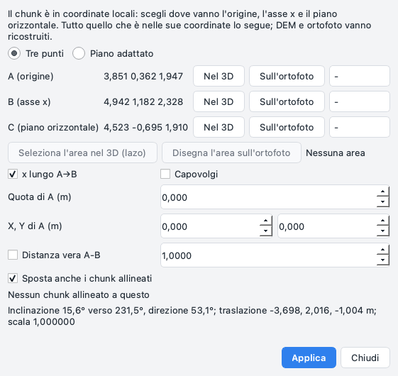

**Tre punti.** **A** è l'origine, **B** dà la direzione dell'asse x (*x lungo A→B*; senza la spunta l'asse x
tiene la direzione di adesso), **C** è un terzo punto del piano orizzontale (senza C il piano resta com'è e
cambiano solo la rotazione attorno alla verticale e l'origine). Ogni punto viene da:

* **Nel 3D**: un clic sul modello o sulla nuvola della vista 3D;
* **Sull'ortofoto**: un clic sul raster mostrato, con la quota letta dal DEM («Nessun DEM in quel punto» se manca);
* l'**elenco dei marker**: un marker già collocato, nella sua posizione.

**Piano adattato.** Il piano orizzontale adattato a un'area: *Seleziona l'area nel 3D (lazo)* o *Disegna l'area
sull'ortofoto*. La finestra dice quanti punti ha preso e quanto stanno lontani dal piano (NMAD); A e B, se ci sono
entrambi, danno comunque l'origine e l'asse x. Un pavimento, un mosaico, la cresta di un muro.

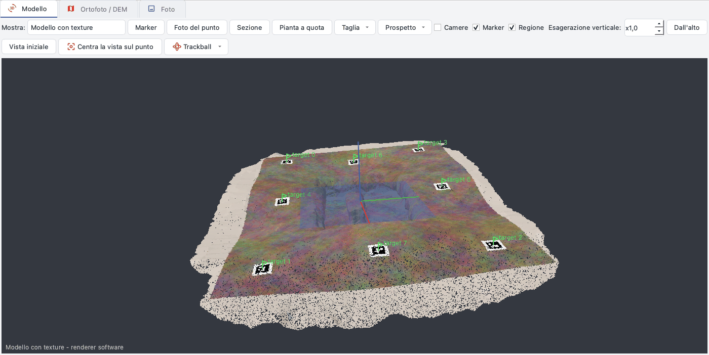

Mentre si scelgono i punti, la vista 3D mostra i nuovi assi (x rosso, y verde, z blu, il piano orizzontale come
un quadrato blu) e la finestra scrive l'inclinazione, la sua direzione, la rotazione e la traslazione. *Capovolgi*
rovescia l'asse z - la finestra lo suggerisce quando z guarderebbe dalla parte opposta alle foto -; *Quota di A* e
*X, Y di A* danno le coordinate dell'origine. **Distanza vera A-B** scala il rilievo perché A-B misuri quanto
misurato sul campo: diventa una barra di scala di controllo «Orientamento A-B» sui marker di orientamento (spenta
quando le barre di scala di controllo danno già la scala).

**Cosa segue il chunk.** *Applica* sposta tutto ciò che è nelle coordinate del chunk: disegni della pianta e quote,
linee di rottura, disegni liberi, pietre, sezioni e prospetti (con i loro disegni), patch dell'ortofoto, la regione
di ricostruzione, i proxy US, i riferimenti dei marker e, con *Sposta anche i chunk allineati*, i chunk allineati a
questo. Camere, punti di legame, nuvola densa e modello non vengono toccati: seguono da soli.

**Cosa resta dov'era.** Le geometrie già mandate fuori - unità e quote scritte in PyArchInit, un progetto QField, i
file esportati - tengono le coordinate di prima: la finestra del risultato le elenca, per mandarle di nuovo.

**I marker di orientamento.** Tre marker, *Orientamento A*, *B* e *C*, compaiono nel pannello *Riferimenti* con le
nuove coordinate. Lasciali lì: un nuovo allineamento, *Aggiorna georeferenziazione* o *Elabora tutto* (che allinea
di nuovo, ed è sicuro) rimettono il sistema attraverso di loro. Cancellarli riporta, al prossimo allineamento, il
sistema dell'allineamento. Un marker visto in meno di due foto viene segnalato come debole: dopo un nuovo
allineamento non si può ritrovare.

**Le coordinate di campo sostituiscono l'orientamento a mano.** Quando più tardi arriva il sistema dello scavo - tre
o più marker di controllo con le coordinate della stazione totale o del GNSS, oppure, in un sistema scelto per il
chunk, tre o più posizioni delle foto - sono questi a collocare il rilievo e i marker di orientamento si fanno da
parte: non entrano in *Aggiorna georeferenziazione*, il pannello *Riferimenti* li mostra in grigio come
"orientamento, non usato" senza errore (le loro coordinate sono nel sistema orientato a mano), e un nuovo
orientamento a mano viene rifiutato finché i punti di controllo ci sono. Un sistema scelto senza nient'altro che
collochi il rilievo (A messo su X, Y e quota note) lascia ai marker di orientamento il compito di collocarlo.

**Un blocco di foto con il GPS.** Anche quando le foto hanno posizioni GPS (in un sistema vero, come quelle
dell'EXIF), dopo un orientamento a mano il prossimo allineamento tiene l'orientamento a mano: sono i marker di
orientamento a collocare il chunk, che resta LOCALE, e il GPS delle foto non viene usato per collocarlo finché ci sono.
Il GPS torna a collocare il rilievo quando togli i marker di orientamento (il prossimo allineamento mette il chunk nel
sistema del GPS), quando scegli per il chunk un sistema vero, o quando misuri tre o più altri punti di controllo.

**Prodotti da rifare.** DEM, ortofoto e i raster fatti da essi (precisione, copertura, rilievi, pendenza,
esposizione, TIN) sono griglie nella pianta di prima: risultano *da rifare*. La vista raster lo dice in una fascia
gialla sopra l'immagine, e gli strumenti di disegno rifiutano di disegnarci sopra. *Flusso di lavoro > Ricostruisci
i prodotti da rifare* (proposto anche dalla finestra del risultato) li rifà in ordine con i parametri che avevano,
tenendo i disegni; ciò che non può rifare (raster calcolati, multispettrali, termici e satellitari, versioni
conservate) viene elencato da rifare a mano. I prospetti senza scala restano validi: si spostano con il chunk.
La ricostruzione è un solo passo di *Modifica > Annulla* (tutti i prodotti tornano insieme come erano). Il DEM e
l'ortofoto di prima restano fra le versioni solo se nel menu *Flusso di lavoro* è spuntato *Ricostruendo, conserva DEM
e ortofoto attivi come versioni* (spento per impostazione predefinita: sono nel sistema di prima, non si confrontano pixel per pixel con
quelli rifatti, e su un rilievo grande occupano GB).

**Rifiuti.** La finestra non si apre, e dice perché, quando l'orientamento lo dà qualcos'altro: un chunk in un
sistema di coordinate (lo danno i punti di controllo), tre marker di controllo con coordinate (cambia quelle), un
chunk allineato a un altro (orienta il chunk di riferimento: gli altri lo seguono). La distanza vera viene
rifiutata quando le barre di scala di controllo danno già la scala. Le posizioni GPS delle foto vengono sostituite
dai marker di orientamento (il risultato dice quante).

**Annulla.** L'intero orientamento è un solo passo di *Modifica > Annulla*.

??? example "Riga di comando e API"
    `ppg orient scavo.ppg --points "0.12,0.40,1.95;1.80,0.52,2.21;0.30,1.75,1.88" --dry-run` stampa inclinazione,
    rotazione, traslazione e ciò che si sposterebbe, senza salvare; `--markers "1,2,3"`, `--plane-from area.wkt`,
    `--quota`, `--origin X,Y`, `--distance L`, `--flip`, `--x-kept`, `--no-aligned`, `--chunk`. Un plugin chiama
    `context.orient(points=[a, b, c], distance=2.0)`.

## Prospetti

*Flusso di lavoro > Prospetto o sviluppo cilindrico...*, *Prospetto* nel pannello *Sezioni*, oppure il pulsante
**Prospetto** della vista 3D. Ortofoto e rilievo del modello vengono costruiti su un piano, o su un cilindro, che
viene da:

* il **piano verticale di una traccia di sezione**, visto da dove sono le foto o dal lato scelto;
* il **piano di tre o più marker selezionati**, con gli assi scelti come in Metashape: l'asse orizzontale va da un
  marker verso un altro (u = 0 sul primo), quello verticale è perpendicolare e verso l'alto, oppure va fra altri
  due marker. Muri, ma anche superfici inclinate o orizzontali: un pavimento a mosaico, una volta, un muro che
  pende. Il piano guarda sempre verso le foto: quando il primo marker sta a destra per chi guarda, u cresce
  nell'altro verso;
* la **vista 3D com'è ora** (*Prospetto > Ortofoto da questa vista*): il piano perpendicolare alla linea di vista,
  l'alto dello schermo in alto, la destra a destra; quello che si vede nella vista, o tutto il modello;
* **tre punti cliccati** nella vista 3D (*Prospetto > Piano per tre punti*): l'asse orizzontale dal primo al
  secondo;
* il **cilindro di un poligono selezionato**: lo sviluppo di un pozzo o di una torre, visto da dentro o da fuori.

**L'asse di uno sviluppo cilindrico.** Il dialogo di un cilindro chiede l'*Asse*:

* **Verticale** (il predefinito): v è la quota, come in una sezione. Una torre che pende, o i cui corsi non sono
  in piano, viene con la cresta e i corsi a onde: la quota è giusta, l'immagine non è diritta.
* **Della regione** (proposto solo quando il chunk ha una regione): l'asse Z della regione, come Metashape sviluppa
  un cilindro lungo la sua regione.
* **Dalla cresta della torre**: la normale al piano che passa per la sommità del muro tutto intorno (il punto più
  alto del modello ogni 5 gradi, un piano adattato due volte lasciando fuori i punti lontani). Una cresta che non è
  un piano - un lato crollato - viene rifiutata con il suo scarto: in quel caso si usa l'asse della regione o due
  punti. Un solo tratto caduto viene lasciato fuori e non inclina l'asse.
* **Due punti nella vista 3D**: dopo il dialogo si cliccano due punti di una stessa linea diritta della struttura
  che corre lungo il suo asse e non è a scarpa (una colonna, un fusto, uno spigolo verticale), prima quello in basso.
  Un clic cade sulla faccia del muro: due clic su una torre a scarpa danno la scarpa, non l'asse - per una torre a
  scarpa si usa la cresta o la regione. La finestra avvisa quando la linea dei due punti non è parallela alla torre: il
  muro guardato lungo la linea, il suo centro al piede e in cima a più di 30 cm l'uno dall'altro, o più di 1 grado
  di scarto.

Qualunque sia il metodo, l'asse passa per il centro della torre: trovata la direzione, il muro viene guardato lungo
l'asse e lì si adatta un cerchio, così un poligono disegnato al piede di una torre che pende non sposta l'asse dal
centro più in alto.

Con un asse inclinato **v è la distanza lungo l'asse**, non la quota, e i corsi e la cresta vengono diritti.
**v = 0** è dove l'asse attraversa la quota media della cresta (*Dalla cresta della torre*), il punto medio dei due
punti (*Due punti*) o la quota media del modello (*Della regione*). Prima
di costruire, la finestra dice l'inclinazione e la direzione ("asse inclinato di 6,6° verso NE", la direzione verso
cui pende la sommità); se non è l'asse della torre si annulla lì. L'inclinazione resta con il prospetto (il suo
suggerimento nell'area di lavoro).

**Scala sulla parete.** Di norma u è l'arco sul cilindro di riferimento (il cerchio adattato al poligono): dove il
muro sta fuori dal cerchio lo sviluppo è più corto del muro, dove sta dentro è più lungo. Con *Scala sulla parete*
u è la lunghezza misurata lungo il muro (una torre ovale, un pozzo irregolare): un primo passaggio misura dove sta
il muro tutto intorno (la mediana di ogni grado, così un pluviale o un albero davanti non conta), poi lo sviluppo
viene costruito su quella lunghezza.

<figure markdown="span">
  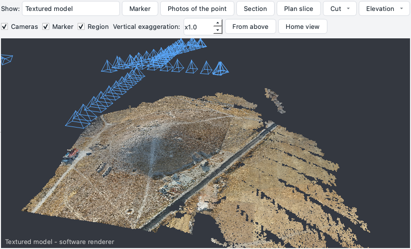
  <figcaption>La vista 3D che guarda un tell da sud: <em>Prospetto > Ortofoto da questa vista</em> prende questo piano.</figcaption>
</figure>

<figure markdown="span">
  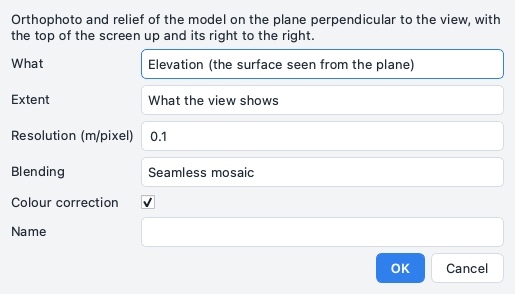
  <figcaption>Il dialogo: prospetto o sezione, quello che si vede nella vista o tutto il modello.</figcaption>
</figure>

<figure markdown="span">
  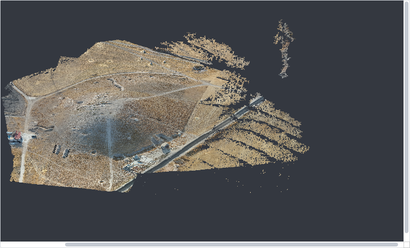
  <figcaption>Il risultato: un'ortofoto del modello come lo guardava la vista, in metri del suo piano (Tell Sultan, sistema di riferimento locale).</figcaption>
</figure>

**Prospetto o sezione.** Un prospetto mostra la superficie vista dal piano; *Profondità davanti / dietro* tengono
solo la superficie vicina al piano, così un ponteggio o una sezione davanti al muro non lo nascondono. Una
**sezione** toglie tutto quello che sta davanti al piano e mostra quello che c'è dietro; la linea dove il piano
taglia il modello - il **profilo** - è disegnata in rosso sull'ortofoto ed esportata con lei come DXF.

<figure markdown="span">
  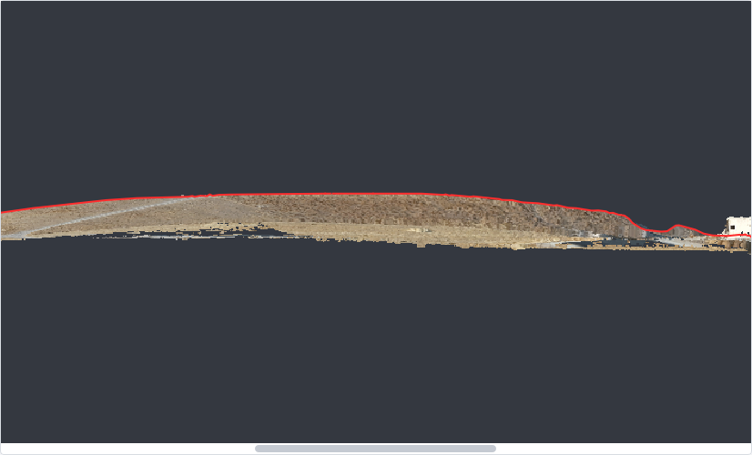
  <figcaption>Una sezione ovest-est attraverso il tell, vista da sud: il profilo del taglio in rosso, quello che sta dietro al piano a colori; v è la quota.</figcaption>
</figure>

**Coordinate.** L'ortofoto è in metri del piano: u lungo il piano, v verso l'alto. Quando v è verticale (entro un
grado: una traccia di sezione, un muro con i marker in piano, una vista in piano) **v è la quota**, così il
prospetto si legge con le sue quote vere. I marker che stanno sul piano vi sono disegnati con il loro nome.

I prospetti sono elencati nell'area di lavoro (*Prospetti*): un doppio clic mostra l'ortofoto nella vista raster
con il rilievo come Z sotto il cursore (distanza dal piano verso chi guarda: rigonfiamenti e strapiombi di un
muro); il clic destro esporta ortofoto, rilievo, piano e profilo, o li elimina. Le misure su un prospetto sono
nei suoi metri. Dalla riga di comando:

```bash
ppg elevation scavo.ppg --markers M1,M2,M3 [--vertical M4,M5] [--section]
ppg elevation scavo.ppg --trace X1,Y1,X2,Y2 [--side X,Y] --section --back 2
ppg elevation scavo.ppg --facing NX,NY,NZ --centre X,Y,Z [--up 0,0,1]
ppg elevation scavo.ppg --circle X1,Y1,X2,Y2,X3,Y3 --outside [--axis vertical|region|crest|points]
    [--axis-points X,Y,Z,X,Y,Z] [--scale cylinder|wall]
ppg elevation scavo.ppg --like ID [--like-chunk CHUNK] [--same-frame] [--chunk CHUNK] [--name NOME]
```

`--like` costruisce sul sistema e sulla griglia di un prospetto già fatto (il suo id o nome; di `--like-chunk`, se no
dello stesso chunk): lo stesso piano o cilindro - uno sviluppo in scala sulla parete tiene la sua lunghezza lungo il
muro, non una misurata di nuovo -, risoluzione, limiti, profondità (`--front`/`--back` vengono da lì), tipo e
impostazioni del mosaico (correzione del colore attiva o no come lì); non le sue patch né i suoi disegni. Nessun'altra
opzione della superficie va con lui. Un'altra campagna sullo stesso muro, in un altro chunk nello stesso sistema di
riferimento, sta allora sugli stessi pixel e i due si confrontano cella per cella. Due chunk in un sistema LOCAL hanno
mondi propri: `--same-frame` dice che stanno nello stesso sistema (allineati, uniti, orientati sugli stessi marker),
senza il comando rifiuta. Senza `--name` il prospetto nuovo prende il nome di partenza reso distinto ("Torre (2)").

### Disegni sui prospetti e sulle sezioni

Ciò che si disegna mentre è mostrato un prospetto o una sezione - unità (US, USM), quote, punti di misura, pietre, linee -
appartiene a quel prospetto, nei suoi metri (u, v), e non compare mai sulla pianta; ciò che si disegna
sull'ortofoto non compare mai su un prospetto. Aprendo la pianta o un altro prospetto i disegni di quello lasciato
restano con lui e tornano con lui, anche quando il progetto viene riaperto. *Modifica > Annulla* riporta indietro
una modifica sul prospetto in cui è stata fatta.

* Una **quota** cliccata su un prospetto prende la quota della superficie in quel punto (la Z del punto del
  modello, letta attraverso il rilievo) e la sua posizione in pianta; sul prospetto mostra quella quota. Un **punto
  di misura** legge i prodotti del chunk in quello stesso punto della superficie, e un **marker** vi viene messo.
* Gli strumenti che lavorano sulla pianta - traccia di sezione, ritaglio, misura area, modifica del DEM, foto
  di un'area, regione, tavola dei colori - sono rifiutati mentre è mostrato un prospetto, con un messaggio nella
  barra di stato: apri l'ortofoto o il DEM.
* Le **pietre** trovate con SAM su un prospetto sono sue (ogni prospetto ha il suo layer *Pietre*). Le pietre
  disegnate sui prospetti dalle versioni precedenti alla 1.7.0 erano condivise da tutti: all'apertura del progetto
  vengono lasciate fuori.
* **Esporta** (clic destro sul prospetto) scrive, oltre a ortofoto, rilievo, piano e profilo, i suoi disegni:
  `<nome>_disegni.dxf` nei metri del prospetto (layer US, USM, QUOTE, PIETRE, PUNTI e PROFILO per una sezione),
  `<nome>_disegni.svg` in scala sopra l'ortofoto, `<nome>_disegni.png`, e due GeoPackage: `<nome>_disegni.gpkg`, il
  prospetto **sviluppato** - i disegni in (u, v), senza sistema di riferimento, con la tabella `frame` (il piano) e
  una colonna `geom_world` -, che QGIS e RustGIS caricano sopra `<nome>_ortofoto.tif` come una pianta della
  facciata; e `<nome>_disegni_mondo.gpkg`, i disegni **in 3D sul rilievo** (PolygonZ, PointZ, LineStringZ nel
  sistema di riferimento del chunk), che QGIS 3D e RustGIS collocano dove sono.
* **QGIS > Apri il prospetto in QGIS** (con un prospetto mostrato) apre un progetto QGIS del prospetto sviluppato:
  la sua ortofoto e i suoi disegni, nei suoi metri.
* **Salva in PyArchInit** con un prospetto mostrato scrive le schede US delle sue unità (create o aggiornate, solo
  i campi: un disegno su un prospetto non ha geometria in pianta, e il messaggio lo dice), le quote in
  `pyarchinit_quote` nella loro posizione in pianta, e registra i suoi disegni (DXF e SVG) come media del sito,
  "Prospetto" o "Sezione" in `documentazione_table`, collegati a quelle US: sempre gli stessi media, i loro file e
  le miniature riscritti a ogni salvataggio e le US aggiunte nel frattempo collegate.
* Il **collegamento dal vivo** con QGIS o RustGIS porta, oltre ai disegni della pianta, quelli di ogni prospetto con
  disegni, in 3D sul rilievo (tabelle `prospetto_<id>_unita`, `_quote`, `_punti`, `_pietre`, `_profilo`; in RustGIS
  nel gruppo "<chunk> - prospetti"), in un solo senso: ciò che si modifica lì in quei layer non torna. Un prospetto
  fatto dopo aver creato il progetto QGIS non c'è finché il progetto non viene creato di nuovo (*QGIS > Apri in
  QGIS*). Il pacchetto **QField** porta solo la pianta.
* I disegni della pianta restano caricati qualunque cosa sia mostrata: le funzioni che lavorano sulla pianta
  (proxy, volumi, classi, IFC, proposta di US, PyArchInit, fasi, rapporto) usano sempre i disegni della pianta.

### Patch sui prospetti

Lo strumento *Patch* funziona anche su un prospetto o una sezione, come sull'ortofoto (vedi
[Patch dell'ortofoto](#patch-dellortofoto)): l'area si disegna sul prospetto, nei suoi metri (u, v), e la finestra
propone le foto che la inquadrano lì, le migliori prima. Cambia questo: la superficie è il rilievo del prospetto,
quindi non c'è *Sul suolo attorno all'area* né la texture del modello; una patch appartiene al suo prospetto
(conservata nella sua voce, elencata nel layer *Patch ortofoto* finché è mostrato) e non tocca mai la pianta né un
altro prospetto. *Applica* ridisegna solo le celle della patch; *Elimina* sulla patch la toglie e le celle tornano
com'erano; *Modifica > Annulla* copre entrambe. Casi tipici: una foto con la parete bruciata dal sole, esclusa su una
fascia; una buona foto assegnata dove la mesh è sbagliata e la foto migliore per quelle celle è quella sbagliata.
Le patch restano a quel prospetto: un nuovo prospetto costruito sulla stessa parete parte senza (a differenza
dell'ortofoto, le cui costruzioni successive applicano di nuovo le sue patch).
Dalla riga di comando: `ppg patch scavo.ppg --elevation "Parete sud" --suggest --bbox ...`.

## Modificare il DEM

*Modifica DEM* in *Strumenti > Disegno su ortofoto* (trascina un riquadro o fai clic su un poligono), oppure
*Modifica il DEM in quest'area* nel menu di un poligono selezionato: le quote dentro l'area tornano dal terreno appena fuori - il
piano che lo adatta, un'interpolazione lineare, IDW o una quota costante - e le linee selezionate possono fare da
linee di discontinuità (il bordo di un muro o di un gradino tiene le sue quote). Alberi, tende, mezzi, cumuli di
terra o buchi della ricostruzione lasciano segni in curve di livello e volumi; il DEM com'era resta tra le versioni
(confrontalo, rendilo di nuovo attivo).

## Coregistrazione dei DEM

*Strumenti > Coregistra DEM...*: il DEM del chunk attivo viene spostato su un riferimento - il DEM di un altro
chunk o una versione conservata di un DEM qualunque - dove il terreno non è cambiato: spostamento orizzontale
(Nuth e Kääb), verticale e, se spuntato, inclinazione.

* Le celle cambiate (lo scavo, i cumuli di terra) vengono trovate e lasciate fuori da sole; con dei poligoni
  selezionati la finestra può anche escluderli (*Escludili*: le aree scavate) o usare solo il terreno dentro di
  essi (*Solo dentro*).
* I due DEM possono stare a metri di distanza, come due rilievi georeferenziati con GPS diversi: prima si
  confrontano le pendenze dei due a ogni spostamento per trovare all'incirca dove sta il secondo, poi
  l'adattamento lo affina; lo spostamento trovato così viene tenuto solo se lì va d'accordo molto più terreno in
  pendenza.
* Lavora in background; il log dà dx, dy, dz in cm, l'inclinazione e la NMAD sul terreno stabile prima e dopo. Il
  DEM spostato diventa quello attivo, e il DEM com'era resta tra le versioni (*Differenza con il DEM attivo*
  mostra cosa si è spostato).

!!! warning "Quando non può funzionare"
    Su un terreno che si ripete (arature, filari di viti) o uguale lungo una direzione (un lungo fossato, solchi)
    molti spostamenti vanno bene e la ricerca sopra non si usa. Dove la vegetazione è cambiata tra i rilievi,
    coregistra i DTM (la finestra del DEM con solo *Terreno* spuntato). Su un terreno piano, o dove le pendenze
    guardano tutte da una parte, lo spostamento orizzontale non si può misurare: il log lo dice e lo spostamento
    verticale lo assorbe. Quando i DEM non sono lo stesso terreno, il log dice che lo spostamento non si è
    assestato e viene tenuto lo stato più vicino - di solito il DEM com'è.

Le [fasi dello scavo](archaeology.md#fasi-dello-scavo) coregistrano così i loro DEM prima di calcolare i volumi.

## Patch dell'ortofoto

L'ortofoto prende ogni cella dalla foto migliore; una patch sceglie la foto a mano in un'area (la chioma di un
albero sopra un muro, una persona nel saggio, un'ombra).

1. *Patch* nella barra laterale (gruppo *Automatico*) (o *Strumenti > Patch dell'ortofoto*): trascina un riquadro o fai clic sui vertici
   di un poligono e doppio clic; oppure seleziona un poligono (un'unità) e scegli *Assegna immagini a quest'area*
   dal suo menu.
2. La finestra mostra l'area com'è ora e, per la foto scelta nell'elenco, l'area come verrebbe. L'elenco ha le foto
   che inquadrano l'area, le migliori prima (quota inquadrata x vicinanza, verticalità e centralità), con la quota
   inquadrata, l'angolo dalla verticale, il pixel a terra, la parte dell'area che l'ortofoto ne prende ora, e nel
   suggerimento quanto ne nasconde il modello (chiome, muri).
3. Scegli una o più foto (++shift++ / ++ctrl++), *Usa solo* o *Escludi*, *Sul DEM* (una true ortho) o *Sul suolo
   attorno all'area* (quote lungo il poligono interpolate all'interno: alberi, mezzi e persone vengono come nella
   foto, e i buchi del DEM si riempiono), e a scelta la texture del modello nell'area.
4. *Applica* salva la patch e ridisegna solo le sue celle, poi le panoramiche di quella finestra; la vista resta
   dov'era.

Le patch sono un layer, *Patch ortofoto*: selezionane una e premi ++delete++ (o *Elimina selezionati*) e
l'ortofoto viene ridisegnata lì senza di essa. Una costruzione successiva dell'ortofoto applica di nuovo ogni
patch; *Aggiorna con le patch* applica quelle non ancora applicate (dopo un aggiornamento interrotto).
Un'ortofoto di un altro programma (esportata da Metashape) viene copiata nella cartella del chunk alla prima
patch, e i suoi pixel tornano dove una patch viene tolta.

**Patch della texture**: nella vista 3D il lazo sul modello propone *Correggi la texture di queste facce (assegna
le immagini)*: le foto che vedono quelle facce, ognuna con la parte della foto dove si trovano; ogni faccia prende
la migliore delle foto scelte che la vede.

## Elaborazione batch

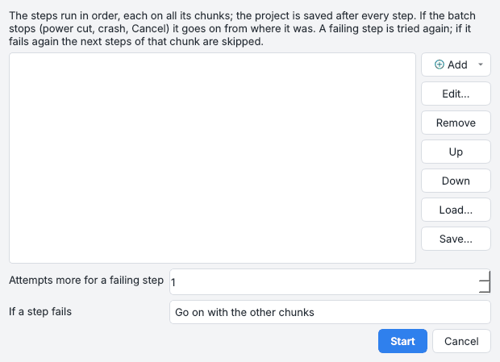

*Flusso di lavoro > Elaborazione batch...*: un elenco di passi - allineamento, prodotti, esportazioni, la
precisione e il controllo sul campo - ognuno su tutti i chunk o su quelli scelti, con i suoi parametri (*Aggiungi*
per gruppo, *Modifica* o doppio clic, *Su* / *Giù*, *Carica* / *Salva* come JSON), i tentativi per un passo che
fallisce e cosa fare allora.

Il passo *Modello 3D* ha lo stesso **Chiudi i buchi fino a** (metri, 0 = nessuno) di
[*Costruisci modello*](#modello): chiude i buchi solo nel *campo di altezze*, e il log dice quanti buchi sono
stati chiusi e quanti metri quadrati in pianta sono interpolati, non misurati. Un file di batch salvato prima che
il campo esistesse si legge con 0: non si chiude niente.

Il progetto viene salvato dopo ogni passo; se il batch si ferma (mancanza di corrente, arresto improvviso,
*Annulla*) la volta dopo propone di ripartire da dove si era fermato. I passi falliti sono elencati nel log.

## Nodi di rete

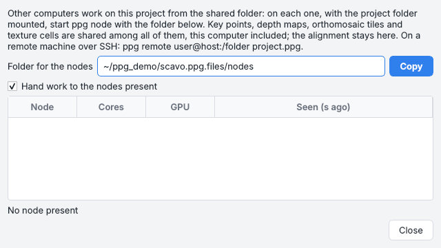

*Strumenti > Nodi di rete...*: altri computer che lavorano a questo progetto dalla cartella condivisa del
progetto.

* La finestra dà la cartella da passare a `ppg node` su ognuno, ed elenca i nodi presenti con i loro core e GPU.
* L'interruttore affida loro i punti chiave, le mappe di profondità PatchMatch, i tasselli dell'ortofoto e le celle
  della texture; l'allineamento resta su questo computer. Viene ricordato e applicato al programma in esecuzione
  come `PPG_NODES`.
* `ppg remote` lavora con una macchina via SSH. I dettagli nell'[API](../api.md#altri-computer), *Altri computer*.
