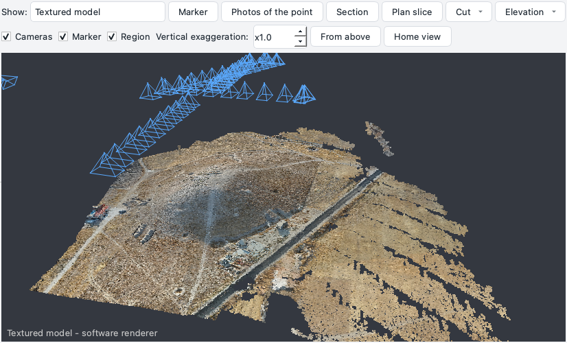
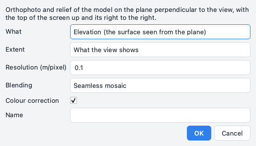
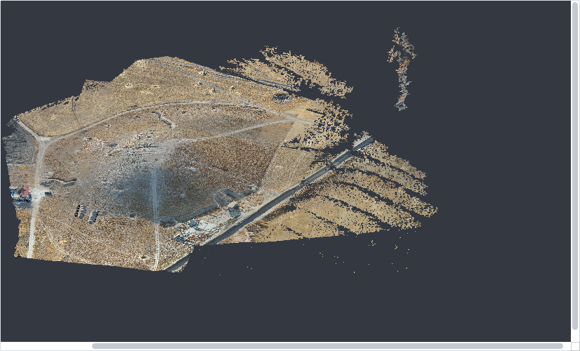
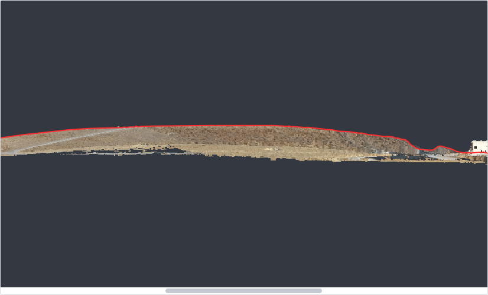

# Processing

From the aligned photos to the dense cloud, the model, the DEM and the orthophoto: the commands of the
*Workflow* menu in their order, then what can be done with the products afterwards. A complete example with
real photos is the [tutorial](../tutorials/tell.md).

!!! note "Saving and photos that cannot be read"
    The project is saved after each step once it has a file. The steps that read the photos (depth maps,
    texture, orthophoto, *Process everything*) first list the photos that cannot be read - empty files kept
    online only by Dropbox, iCloud or OneDrive - and offer *Relink to another folder...*, *Go on without these
    photos* or *Cancel*.

## Aligning the photos


*Workflow > Align photos...* is the window of Metashape's *Align Photos*:

| Choice | What it means |
| --- | --- |
| **Precision** | the size at which the photos are read: higher is slower and finds more points |
| **Generic preselection** | the pairs that overlap are found first on reduced photos (up to 40 photos every pair is tried anyway) |
| **Reference preselection** | the pairs chosen by the GPS of the photos, a previous alignment or the capture order |
| **Points** | *SIFT*, or learned points matched by LightGlue (*DISK* or *ALIKED*) for thermal photos and surfaces with little detail; the program offers to install PyTorch and kornia when they are missing |
| **Reset the current alignment** | or keep it: the photos added since join it |

Under *Advanced*:

* the limits of key points and tie points;
* the masks applied to the key points or to the tie points; *Exclude stationary tie points* (a turntable with a
  fixed camera);
* guided matching, adaptive camera model fitting;
* the GPS of the photos holding the block while it grows one photo at a time;
* the **method**: *Automatic* aligns all the cameras at once (global) from 40 photos of a drone survey (GPS
  spread over the site), one photo at a time below that and for objects and close-range scenes;
* the **GPU** for the matching: the best one together with the CPU, off, or a chosen adapter. The choice is
  remembered and serves the PatchMatch depth maps too.

Then *Import references...* and *Update georeference* place the survey on the control points, and *Optimise
cameras* adjusts the block again with them and with the [scale bars](photos-markers.md#scale-bars).

### Optimising the cameras

*Workflow > Optimise cameras* adjusts poses, calibration and tie points together. What holds the block:

* **3 or more control points**, or 2 or more control scale bars: fixed at their coordinates, the block bends to
  pass through them; check points and check bars measure the result;
* otherwise **the GNSS positions of the photos**, when they are accurate - an RTK or PPK fix or float, 0.5 m or
  better (*GNSS positions of the photos*: *automatic*): every photo weighs by its accuracy, and the focal length
  found by the alignment is kept, because from a single height, looking down, the positions cannot tell the focal
  length from the distance to the ground. The window says how many photos hold the block and with which RTK state
  (*GNSS positions used as a constraint: 82 photos, fix*).

Held by neither, a nadir block over flat ground can bend into a dome while the reprojection error stays the same:
the radial distortion makes up for it in the photos (82 RTK-fix captures of a P4 Multispectral ended metres from
their positions). **A safety net** watches every optimisation: when the cameras end farther from their accurate
GNSS positions than three times the offset they had, and 30 cm more than it, the optimisation is undone and the
alignment before it put back (also when it stops with an error or is cancelled). Either it bent the block, or the
positions of part of the block disagree with the control points - one flight off by its own amount, a mix of MRK
and EXIF heights (a shift common to every position, as a base on a wrong point or another height system, is
taken up by the georeference and undoes nothing): to keep such an optimisation, untick the cameras in *Reference*
(right click: *Do not use the references of all the cameras*) and run it again. *not used* leaves the positions out (the optimisation of earlier versions, still watched by the
net). The engine *Own* on *automatic* holds the block the same way, focal length included; *used with their
accuracy* and *used, with a bias per flight* refine the focal length (with a bias per flight the net judges each
position less the bias of its flight). From the command line: `ppg optimize project.ppg --gnss auto|off`
(`plain` and `bias` with `--engine ppg`); the output says how many photos held the block and whether the focal
length was kept.

### Diagnostics of the alignment

*Tools > Diagnostics of the alignment* tells why an alignment fails:

| Tool | What it shows |
| --- | --- |
| **Matching graph** | the photos where they were taken (the others in a ring); lines between matched photos, thicker and greener with more matches, red under 30; separate groups and isolated photos listed; a double click on a line opens the pair |
| **Matches between two photos** | the two selected in *Photos* (or right click on them): verified matches green, rejected candidates red, tie points blue |
| **Tie point residuals** | in the photo view, where every tie point was measured and where the model puts it: green under 1 px, orange under 3, red more; arrows 20 times longer (also from the right click on an aligned photo) |
| **Camera calibration** | the parameters of every sensor, editable as starting values, the model, *Fixed calibration* (alignment and optimisation do not change it) and a plot of the distortion (arrows over the frame and the radial shift towards the corner) |

### Check before leaving the site

*Workflow > Check before leaving the site*, right after the alignment, while the trench is still open:

* the **map of how many photos frame every point**: dark red none, red one, orange two, yellow three or four,
  green more; the photo count under the cursor; *Coverage of the photos* in the workspace;
* a **summary**: share and area seen by fewer than three photos, photos not aligned or blurred, markers in no
  photo, in one or two only.

### Precision

*Precision* in *Reference*, or *Workflow > Estimate the precision*: the standard deviation of every camera
position, marker and tie point from the covariance of the bundle adjustment, relative to the control points and
their accuracy (or to the GPS of the photos).

* A column *Precision X/Y/Z (mm)* for markers and cameras, the median of the tie points under the tables, the
  precision of the camera in the tooltip of a photo.
* With a DEM, the map of its vertical precision opens in the raster view (green small, red large, sigma Z
  under the cursor; *Precision of the DEM* in the workspace).
* A spot height taken afterwards keeps its precision (also in `rilievo_originale` for PyArchInit and in the
  IFC). A new alignment or georeference drops the old precision.

## The products

### Dense cloud


*Workflow > Build dense cloud...*: quality, depth filter and engine; *Depth maps only* makes the maps alone
(for the fused model, without a dense cloud). *Crop dense cloud...* keeps a height range and/or a cylinder
around the turntable axis: it takes away the mat and the targets before meshing an object.

### Model


*Workflow > Build model...*:

* **Source data**: the *depth maps* (the surface from their volumetric fusion, TSDF, as Metashape does: more
  faithful and with the colours of the photos, without the dense cloud) or the *dense cloud*, of which only the
  ticked classes can be meshed;
* **Surface type**: *arbitrary* (3D) or *height field* (2.5D, for terrain);
* **Number of faces**, and the voxel of the fusion of the depth maps (0 = automatic).

Poisson reconstruction runs in a child process: if the native code crashes, the step retries at a shallower depth
and finally builds a 2.5D height field.

### Texture


*Workflow > Build texture...*:

* **Colour correction**: exposure of the photos and vignetting, measured the first time;
* **Mapping**: *adaptive orthophoto* (terrain from the air: the texture is the orthophoto of the model, made by the
  tiled orthophoto engine; steep walls and sections get their own cells in a band below, as in Metashape);
  *generic* (each face its own cell: objects and small models); *automatic* chooses the orthophoto for large
  models facing up;
* **Texture size** 16384 or 32768 splits the texture into 4 or 16 pages of 8192 pixels (tiles of the plan, or
  groups of nearby faces), as Metashape does: every page stays readable by graphics cards and viewers.

The texture is an image (or a page each) beside `model.ply`, which carries the texture coordinates of each
face; the view *Textured model* shows the whole model.

??? example "Command line and API"
    `chunk.build_texture(size, mapping="auto")`; `integrations.metashape.reimport_model(chunk)`;
    `io.mesh_ply.read_mesh`, `write_mesh`

### DEM


*Workflow > Build DEM...*: the source data, the resolution (automatic by default) and *Interpolate the gaps*.
When the dense cloud is classified the window lists its classes with their points: ticking only *Ground* gives a
terrain model (DTM), with the gaps under what is left out interpolated; contours and volumes then use it. Noise
(classes 7 and 18) never makes a DEM or a mesh.

### Orthophoto


*Workflow > Build orthophoto...*:

| Choice | What it does |
| --- | --- |
| **Surface** | the DEM, the model or the dense cloud the photos are projected on |
| **Blending** | *Seamless mosaic* (default: the details of each cell from its best photo, the differences of light faded along the seams), *None (one photo per cell)* or *Average of the photos* |
| **Colour correction** | exposure of each photo and vignetting of each lens, measured the first time on points seen by several photos, or before with *Tools > Calibrate the colours of the photos* |
| **Remove people and vehicles seen by few photos** | where three or more photos see a cell, the best one that agrees with the others |
| **Fill small holes** | up to 100 pixels no photo sees, from their edges; larger holes stay transparent |
| **Hidden classes** | with a classified cloud, chosen classes made transparent where they are the visible surface (tools, people, vegetation) |

Every cell picks among all the photos that frame it, so no seam follows the tiles. On the synthetic trench with
half of the photos 30 % darker and every photo vignetted, the corrected mosaic differs from the one of the
untouched photos by 0.3 levels in the low frequencies (25 without correction).

### Process everything

*Workflow > Process everything...* (++ctrl+r++) runs every step in a row with the default choices; with a
project file it also writes the HTML report.

## Versions

The windows of *Dense cloud*, *Model*, *DEM* and *Orthophoto* ask, when the product exists, whether to **keep
the current version** (to compare it) or overwrite it, and the name of the new one; a failed build puts the kept
one back.

* The workspace shows the name of the active version next to each product and lists the kept ones under it.
* A double click shows a kept version without making it active (rasters in the orthophoto view, clouds and
  models in the 3D view with a *Version: ... (not active)* label; choosing a view in the list goes back to the
  active products).
* Right click on a kept version: *Make active* (the one every tool uses; the active one takes its place among the
  kept ones), *Difference with the active DEM* (active minus kept, red where the active one is higher, blue where
  lower, dZ under the cursor; a warning when the two DEMs have different resolutions), *Export*, *Rename*,
  *Delete*.
* Right click on a product: *Keep a copy as a version* (for instance before classifying the cloud again),
  *Rename*.

Kept versions live in `versions/` inside the chunk folder.

??? example "Command line and API"
    `core.versions.keep_active`, `activate`, `versions`, `version_file`, `dem_difference`, `rename`, `delete`

## Confidence and cleaning


**Confidence** (*Workflow > Cleaning and confidence > Compute the confidence*): for the dense cloud and/or the
vertices of the model, the number of depth maps that confirm each point (within 1 % of its distance from the
camera, the tolerance of the fusion; half an edge for a vertex); the fused cloud already has it. The 3D view
(*Colours > Confidence*, also for the model) colours the ranges 0 (grey: no map, such as a hole the mesh closed),
1 (red), 2, 3-4, 5-9, 10-19, 20 or more (blue); unticking a row of the legend hides those points or faces, a
preview of a cleaning. It needs the depth maps of the chunk.

| Cleaning | What it removes |
| --- | --- |
| **Clean the dense cloud** | points below a confidence, isolated points (statistical filter: neighbours, standard deviations), points without neighbours within a radius, detached groups smaller than a number of points, classes, a colour (with a tolerance); the points found are counted and shown in red in the 3D view, then removed when confirmed |
| **Clean the model** | detached pieces below a share of the largest one, faces with a low vertex confidence, stretched triangles, topology, holes closed up to a radius, Taubin smoothing (borders fixed), decimation; colours and confidence kept, the texture to build again |
| **Clean the tie points (gradual selection)** | thresholds on reprojection error, number of photos, reconstruction uncertainty and projection accuracy with live counts, then the camera optimisation (for models written from imported poses only the uncertainty matters) |
| **Lasso** | deletes or keeps the points and faces chosen on the screen |

Every cleaning can keep the current version first.

??? example "Command line and API"
    `ppg confidence scavo.ppg --model`, `ppg clean-cloud`, `ppg clean-model`, `ppg clean-tie-points`;
    `chunk.compute_confidence("point_cloud" or "model")`, `engine.confidence.depth_map_support`;
    `chunk.clean_point_cloud(...)`, `clean_model(...)`, `clean_tie_points(...)`, `engine.cleaning.point_filters`,
    `face_filters`, `delete_points`, `delete_faces`

## Crop

*Crop* in *Tools > Drawing on the orthophoto* (or *File > Export > Cropped...*, *Cleaning and confidence > Crop*): drag a box or
click a polygon (double click to close) on the orthophoto or the DEM; or select a polygon (a unit) and *Crop or
export with the selected polygon*. Then choose the products:

* **exported** cut to a folder: DEM and orthophoto with no data or transparent outside the polygon, model PLY
  with colours, confidence and double-precision coordinates or OBJ with the texture, cloud LAS with classes and
  confidence, the polygon as GeoJSON;
* or **cut in the project**, with the originals kept as versions.

Model and cloud can also be limited in height.

??? example "Command line and API"
    `ppg crop scavo.ppg --polygon "x1,y1 x2,y2 x3,y3" --out ritagli` (or `--bbox`, `--wkt`, `--geojson`, `--in-project`);
    `chunk.export_dem(path, region=)`, `export_orthomosaic`, `export_model`, `export_point_cloud`, `crop_dem`,
    `crop_orthomosaic`, `crop_model`, `crop_point_cloud(region=)`

## Cutting the model


*Cut* in the 3D view, or *Workflow > Cleaning and confidence > Cut the model with a plane*. The plane:

* **horizontal** (a click at the height), **vertical** (two clicks: the plane through their line in plan),
  **through three clicked points**, **dipping** (dip direction and dip);
* along a section of the *Sections* pane, or through the selected markers.

Keep the part above or below (above = left of the line from point 1 to point 2 for a vertical plane), or a slice
of a thickness, as the model of the chunk (the previous one among the versions) or as a file; or save both
parts, or a series of parallel slices every given step, as PLY (or OBJ with the texture) in world coordinates.

Faces crossed by the plane are cut on it, with colours, confidence and texture coordinates interpolated. *Close
the cut solids* fills the cut face of every closed solid in its own colour (the units of the geoarchaeology
plugin, US proxies, a vessel: its hollow stays hollow); open surfaces stay open. Solids imported side by side (a
model of stratigraphic units) stay separate solids.

??? example "Command line and API"
    `ppg cut-model scavo.ppg --horizontal 101.5 --keep below` (or `--vertical X1,Y1,X2,Y2`, `--points ...`,
    `--plane X,Y,Z,NX,NY,NZ`, `--dip X,Y,Z,DIPDIR,DIP`; `--keep above/below/slab/both/series`, `--thickness`, `--step`,
    `--out`); `chunk.cut_model(point, normal, keep=...)`, `engine.mesh_cut.clip`, `slab`, `series`, `horizontal`,
    `vertical`, `through_points`, `dipping`

## Reconstruction region

*Workflow > Reconstruction region*: a box (yellow in the 3D view; *Region* shows or hides it) around the tie
points, turned to face the 3D view, over the selected polygon of the plan, or with typed centre, size and
rotation. Depth maps, dense cloud and model built afterwards stay inside it - the trench and not the field
around it, the pot and not the table - and so do DEM and orthophoto. *Clear the region* goes back to everything
the photos see.

## Elevations

*Workflow > Elevation or cylindrical development...*, *Elevation* in the *Sections* pane, or the **Elevation** button
of the 3D view. The orthophoto and the relief of the model are built on a plane, or on a cylinder, that comes from:

* the **vertical plane of a section trace**, seen from where the photos are or from the side chosen;
* the **plane of three or more selected markers**, with the axes chosen as in Metashape: the horizontal axis runs
  from one marker towards another (u = 0 on the first), the vertical one is perpendicular to it and upwards, or
  runs between two more markers. Walls, and also sloping or horizontal surfaces: a mosaic floor, a vault, a
  leaning wall. The plane always faces the photos: when the first marker is on the right as the viewer sees it,
  u grows the other way;
* the **3D view as it looks now** (*Elevation > Orthophoto from this view*): the plane perpendicular to the line
  of sight, the top of the screen up, the right to the right; what the view shows, or the whole model;
* **three points clicked** in the 3D view (*Elevation > Plane through three points*): the horizontal axis from
  the first to the second;
* the **cylinder of a selected polygon**: the development of a well or a tower, seen from inside or from outside.

<figure markdown="span">
  
  <figcaption>The 3D view looking at a tell from the south: <em>Elevation > Orthophoto from this view</em> takes this plane.</figcaption>
</figure>

<figure markdown="span">
  
  <figcaption>The dialog: elevation or section, what the view shows or the whole model.</figcaption>
</figure>

<figure markdown="span">
  
  <figcaption>The result: an orthophoto of the model as the view looked at it, in metres of its plane (Tell Sultan, local reference system).</figcaption>
</figure>

**Elevation or section.** An elevation shows the surface seen from the plane; *Depth in front / behind* keep only
the surface near the plane, so scaffolding or a section in front of the wall does not hide it. A **section** takes
away everything in front of the plane and shows what lies behind it; the line where the plane cuts the model - the
**profile** - is drawn in red on the orthophoto and exported with it as a DXF.

<figure markdown="span">
  
  <figcaption>A section west-east across the tell, seen from the south: the profile of the cut in red, what lies behind the plane coloured; v is the height.</figcaption>
</figure>

**Coordinates.** The orthophoto is in metres of the plane: u along it, v upwards. When v is vertical (within a
degree: a section trace, a wall with level markers, a level view) **v is the height**, so the elevation is read
with its true heights. The markers that lie on the plane are drawn on it with their labels.

The elevations are listed in the workspace (*Elevations*): a double click shows the orthophoto in the raster view
with the relief as Z under the cursor (distance from the plane towards the viewer: bulges and leans of a wall);
the right click exports orthophoto, relief, plane and profile, or deletes them. Measures on an elevation are in
its metres; the units drawn on the raster view belong to the plan, so draw them on the orthomosaic. From the
command line:

```bash
ppg elevation scavo.ppg --markers M1,M2,M3 [--vertical M4,M5] [--section]
ppg elevation scavo.ppg --trace X1,Y1,X2,Y2 [--side X,Y] --section --back 2
ppg elevation scavo.ppg --facing NX,NY,NZ --centre X,Y,Z [--up 0,0,1]
```

## Editing the DEM

*Edit DEM* in *Tools > Drawing on the orthophoto* (drag a box or click a polygon), or *Edit the DEM in this area*
in the menu of a selected polygon: the heights inside the area come again from the ground just outside it - the plane that fits
it, a linear interpolation, IDW or a constant height - and the selected lines can be breaklines (the edge of a
wall or of a step keeps its heights). Trees, tents, vehicles, spoil heaps or holes of the reconstruction leave
contour lines and volumes; the DEM as it was stays among the versions (compare it, make it active again).

## DEM coregistration

*Tools > Coregister DEM...*: the DEM of the active chunk is moved onto a reference - the DEM of another chunk or a
kept version of any DEM - where the ground did not change: horizontal shift (Nuth and Kääb), vertical shift and,
if ticked, tilt.

* The cells that changed (the excavation, spoil heaps) are found and left out by themselves; with polygons
  selected the window can also leave them out (*Leave them out*: the areas dug) or use only the ground inside them
  (*Only inside*).
* The two DEMs may be metres apart, like two surveys georeferenced with different GPS: the slopes of the two are
  first compared at every shift to find roughly where the second one lies, then the fit refines it; the shift
  found this way is kept only if much more of the sloped ground agrees there.
* It runs in the background; the log gives dx, dy, dz in cm, the tilt and the NMAD on the stable ground before
  and after. The moved DEM becomes the active one, and the DEM as it was stays among the versions (*Difference
  with the active DEM* shows what moved).

!!! warning "When it cannot work"
    On ground that repeats itself (ploughing, rows of vines) or is the same along one direction (a long ditch,
    furrows) many shifts match and the search above is not used. Where the vegetation changed between the
    surveys, coregister DTMs (the DEM window with only *Ground* ticked). On flat ground, or where the slopes all
    face one way, the horizontal shift cannot be measured: the log says so and the vertical shift takes it in.
    When the DEMs are not the same ground, the log says that the shift did not settle and the closest state is
    kept - usually the DEM as it is.

The [excavation phases](archaeology.md#excavation-phases) coregister their DEMs this way before computing the
volumes.

## Orthophoto patches

The orthophoto takes every cell from the best photo; a patch chooses the photo by hand in an area (a tree crown
over a wall, a person in the trench, a shadow).

1. *Patch* in the drawing bar (or *Tools > Orthophoto patch*): drag a box or click the vertices of a polygon and
   double click; or select a polygon (a unit) and choose *Assign images to this area* from its menu.
2. The window shows the area now and, for the photo chosen in the list, the area as it would come out. The list
   has the photos that frame the area, best first (framed share x closeness, verticality and centrality), with
   the share framed, the angle from the vertical, the ground pixel, the share of the area the orthophoto takes
   from it now, and in the tooltip how much of it the model hides (tree crowns, walls).
3. Choose one or more photos (++shift++ / ++ctrl++), *Use only* or *Exclude*, *On the DEM* (a true orthophoto)
   or *On the ground around the area* (heights along the polygon interpolated inside: trees, vehicles and people
   come out as in the photo, and holes of the DEM are filled), and optionally the texture of the model in the
   area.
4. *Apply* saves the patch and redraws only its cells, then the overviews of that window; the view stays where it
   was.

The patches are a layer, *Orthophoto patches*: select one and press ++delete++ (or *Delete selected*) and the
orthophoto is redrawn there without it. A later build of the orthophoto applies every patch again; *Update the
orthophoto with the patches* applies the ones not applied yet (after an interrupted update). An orthophoto of
another program (exported by Metashape) is copied into the chunk folder at the first patch, and its pixels come
back where a patch is removed.

**Texture patches**: in the 3D view, the lasso on the model offers *Correct the texture of these faces (assign the
images)*: the photos that see those faces, each with the part of the photo where they are; every face takes the
best of the chosen photos that sees it.

## Batch processing


*Workflow > Batch processing...*: a list of steps - alignment, products, exports, the precision and the field
check - each on all chunks or on the chosen ones, with its parameters (*Add* by group, *Edit* or double click,
*Up* / *Down*, *Load* / *Save* as JSON), the attempts for a step that fails and what to do then.

The project is saved after every step; if the batch stops (power cut, crash, *Cancel*) the next time it offers to
go on from where it stopped. Failed steps are listed in the log.

## Network nodes


*Tools > Network nodes...*: other computers working on this project from the shared project folder.

* The window gives the folder to pass to `ppg node` on each of them, and lists the nodes present with their cores
  and GPUs.
* The switch hands them the key points, the PatchMatch depth maps, the tiles of the orthophoto and the cells of the
  texture; the alignment stays on this computer. It is remembered and applied to the running program as
  `PPG_NODES`.
* `ppg remote` works with a machine over SSH. Details in the [API](../api.md#other-computers), *Other computers*.
