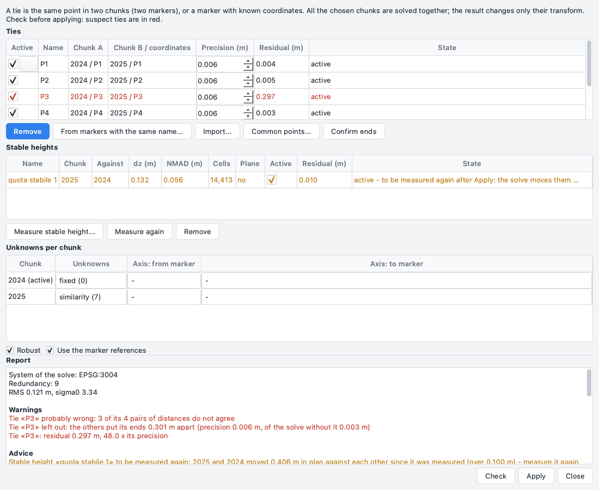
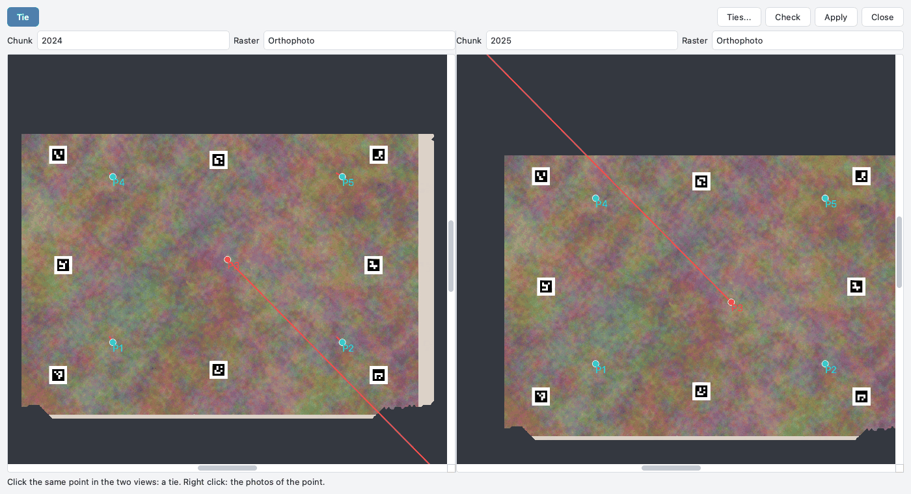

# Legami fra chunk

Applicazione **1.7.6**. Più rilievi dello stesso sito - campagne di scavo di anni diversi, un edificio rilevato a
pezzi, voli di giorni diversi - spesso non hanno niente che *Allinea chunk* possa usare: nessun marker con lo stesso
nome, nessuna foto in comune, superfici cambiate da un rilievo all'altro. I **legami** li mettono insieme con punti
scelti da te: lo stesso punto in due chunk, o un punto di un chunk con coordinate note. Poi tutti i chunk vengono
stimati insieme, e un rapporto mostra i legami sbagliati **prima** di applicare qualsiasi cosa.

*Allinea chunk* resta com'è (marker, foto, nuvole); i legami sono una seconda strada, per quando quelle non funzionano.

## Che cos'è un legame

Un legame è **lo stesso punto in due chunk**: l'angolo di un muro, una pietra, la testa di un picchetto, visti in
tutti e due i rilievi. Ogni estremo è un **marker** del suo chunk, creato da solo e chiamato "legame N" (o con il nome
che dai). Così tutto quello che fa un marker lo fa anche l'estremo di un legame: si misura sulle foto, si triangola,
si mette sulla superficie, si affina. Gli estremi tengono la loro posizione nelle coordinate interne del loro chunk: un
legame sopravvive a ogni nuova trasformazione dei suoi chunk (*Allinea chunk*, una stima, l'orientamento di un sistema
locale).

Un nuovo **allineamento delle foto** di un chunk è un'altra cosa: mette il chunk in un nuovo sistema interno. Gli
estremi misurati sulle foto vengono triangolati di nuovo e restano giusti. Gli estremi messi senza foto - cliccati su
un raster, scritti dalla riga di comando, letti da una tabella - tengono i loro vecchi numeri interni, che nel nuovo
sistema sono da un'altra parte, tutti spostati allo stesso modo: nessun controllo della stima potrebbe vederlo. Così,
dopo un nuovo allineamento, quegli estremi sono **da rimisurare**: il legame resta nell'elenco, in arancione, con il
motivo in *Stato*, ed è escluso dalla stima (lo dice anche il registro della finestra). Trascina di nuovo l'estremo sul
suo punto in *Punti in comune*, misuralo sulle foto o - solo se hai controllato che è ancora giusto - seleziona il
legame e premi **Conferma estremi** (`ppg ties confirm` dalla riga di comando).

Un legame può anche unire un punto di un chunk a **coordinate note** (un punto GNSS, un caposaldo): quell'estremo è
un marker con le coordinate come riferimento.

Ogni legame ha una **precisione** (metri), che ne dà il peso nella stima (1 / precisione²). Per impostazione
predefinita:

| L'estremo è stato | Precisione |
| --- | --- |
| misurato su due o più foto | l'errore di riproiezione del marker convertito in metri, almeno 1 cm |
| misurato su una sola foto | due celle del DEM (il punto sta sulla superficie) |
| cliccato su un'ortofoto o un DEM | due pixel del raster |
| letto da una tabella | il valore della tabella (predefinito 5 cm) |

I due estremi si combinano. La precisione di ogni legame si può cambiare a mano.

## Fare i legami

Ci sono quattro modi:

* **Punti in comune** (*Flusso di lavoro > Punti in comune...*): due chunk affiancati, un clic in ognuno (vedi
  [sotto](#punti-in-comune));
* **Da marker omonimi**: nella finestra dei legami, due chunk; un legame per ogni nome di marker presente in tutti e
  due;
* **Importa...**: una tabella (CSV) con un legame per riga:
  `chunk_a,x_a,y_a,z_a,chunk_b,x_b,y_b,z_b[,precisione][,nome]`, ogni punto nelle coordinate del mondo del suo chunk;
  `chunk_b` vuoto vuol dire che il secondo punto sono coordinate note; una z vuota si legge dal DEM del chunk;
* la **riga di comando**: `ppg ties add`, `ppg ties known` (vedi [la riga di comando](#riga-di-comando)).

## La finestra dei legami

*Flusso di lavoro > Aggancia chunk con legami...* apre la finestra dei legami. Non è modale: può restare aperta mentre
lavori nella finestra principale e in *Punti in comune*.



**Legami.** Una riga per legame: *Attivo*, nome, i due estremi (`chunk / marker`, o le coordinate note),
*Precisione (m)* (modificabile), *Residuo (m)* dell'ultimo controllo e *Stato*. Un legame con un estremo che non c'è
più (un marker tolto, un chunk tolto, un riferimento cancellato) è grigio e non si può spuntare; *Stato* dice perché.
Un legame non attivo resta nell'elenco: spuntalo di nuovo per usarlo. Un legame con un estremo da rimisurare dopo un
nuovo allineamento è arancione (vedi [sopra](#che-cose-un-legame)): *Conferma estremi* conferma gli estremi dei legami
selezionati (se nessuno è selezionato, di tutti). *Rimuovi* cancella i legami selezionati e i marker che avevano
creato. La finestra segue i chunk aggiunti, tolti o rinominati nell'area di lavoro.

**I legami e i cambiamenti dei chunk.** Togliere un chunk lascia i suoi legami nell'elenco, grigi (*chunk tolto*):
rimuovili a mano. *Unisci chunk* crea un chunk nuovo: i legami puntano ancora ai chunk di partenza e si rompono quando
questi vengono tolti - rifalli sul chunk unito. *Aggiungi progetti* copia i chunk di un altro progetto con i loro
marker, ma non i suoi legami. Un progetto con legami salvato da una versione precedente (1.7.5 o prima) tiene i suoi
legami: vengono riconosciuti di nuovo dalla chiave e dal nome dei loro marker.

**Incognite per chunk.** Per ogni chunk, che cosa la stima può cambiare:

| Incognite | Parametri | Quando |
| --- | --- | --- |
| **similitudine** | 7: rotazione, spostamento, scala | un rilievo con un sistema e una scala propri; almeno 3 legami ben distribuiti |
| **rigido** | 6: rotazione e spostamento | la scala è giusta (barre di scala, punti di controllo) |
| **in pianta** | 4: rotazione attorno alla verticale, spostamento in x, y e z | inclinazione e scala sono già giuste (GPS o GNSS del drone); funziona con 2 legami |
| **solo spostamento** | 3 | è sbagliata solo la posizione |
| **solo quota** | 1 | è sbagliata solo la quota |
| **fisso** | 0 | questo chunk dà il sistema |
| *non nella stima* | | il chunk resta fuori |

La finestra propone: il chunk attivo **fisso**; *in pianta* per un chunk georeferenziato dai suoi riferimenti o con
2-3 legami; *similitudine* per gli altri; un chunk senza legami fuori dalla stima. **In pianta** ruota attorno alla
verticale del mondo (l'asse z del sistema di coordinate, o del sistema locale); inclinazione e scala del chunk restano
come sono.

La stima ha bisogno di un sistema: almeno un chunk **fisso**, o coordinate note. Senza, viene rifiutata con un
messaggio. Anche la *similitudine* con 2 soli legami è rifiutata (le equazioni non bastano): scegli *in pianta*.

**Opzioni.** *Robusto* usa i pesi di Huber: un legame sbagliato pesa meno, e gli altri non vengono tirati verso di
lui. *Usa i riferimenti dei marker* fa contare come punti noti i marker di controllo dei chunk (con coordinate).

**Asse dritto** (facoltativo). Per due o più chunk, due marker di ogni chunk che stanno su una stessa linea dritta -
l'asse di un muro, di uno scafo, di una strada. Dopo la stima il rapporto dà l'angolo fra le direzioni nei diversi
chunk; oltre 2 gradi è un avviso. Un legame sbagliato che fa ruotare un chunk si vede qui anche quando le distanze non
lo vedono.

## Controllare prima di applicare

**Controlla** stima insieme tutti i chunk scelti e scrive il rapporto. Non cambia niente.

Il rapporto dà:

* il **sistema della stima** e i **gradi di libertà in avanzo** (equazioni meno incognite). Con avanzo 0 non c'è
  **nessun controllo**: un legame sbagliato non si vede, e il rapporto lo dice in rosso;
* lo **scarto quadratico medio** e **sigma0** (come stanno i residui rispetto alle precisioni: circa 1 quando le
  precisioni sono giuste);
* gli **Avvisi** in rosso:
    * **distanze fra i legami**: per ogni coppia di legami fra gli stessi due chunk, la distanza fra i due punti in un
      rilievo e nell'altro. Non dipende dalla stima. Una coppia che differisce più di 3 volte la sua precisione
      combinata non torna; il legame presente in più coppie che non tornano è indicato come **probabilmente
      sbagliato**;
    * **togli un legame per volta**: ogni legame viene tolto a turno e gli altri ne collocano gli estremi; quando
      finiscono lontani (più di 3 volte la sua precisione), il legame è indicato;
    * **residui grandi**: un legame con un residuo oltre 3 volte la sua precisione;
    * **movimenti non plausibili**: un chunk georeferenziato da GPS o GNSS ruotato di più di 5 gradi, o scalato fuori
      da 0,98-1,02. Un chunk in un sistema locale non ha limiti;
    * l'**asse dritto** piegato di più di 2 gradi;
* i **Consigli** in arancione: con quale precisione ogni chunk è posizionato ai suoi bordi, e perché quando è
  scarsa (legami quasi su una linea o tutti da una parte, legami che non tornano fra loro, o un chunk appeso a un
  altro posizionato male). Sono suggerimenti, non errori;
* per ogni chunk: rotazione, spostamento e scala rispetto a prima, e la sua precisione;
* i **residui** di ogni legame, in pianta e in quota, con il risultato se viene tolto;
* gli **Esclusi**, in grigio: i legami non usati e perché (non attivo, un estremo senza posizione, un chunk non nella
  stima...).

Anche le righe dei legami sospetti diventano rosse nella tabella. Qualsiasi cambiamento dopo il controllo - un legame
spento, una precisione, le incognite, un'opzione - annulla il controllo: premi di nuovo **Controlla**.

## Applicare

**Applica** usa l'ultimo controllo. Viene rifiutato, con un messaggio, quando i legami, i marker o i chunk sono
cambiati dopo il controllo (di nuovo *Controlla*). Con avanzo 0 una domanda a parte chiede la conferma: *Applica senza
controllo* o *Non applicare* (la scelta predefinita).

La stima cambia **solo la trasformazione** dei chunk (e il loro sistema di coordinate, quello della stima), come fa
*Allinea chunk*. Foto, nuvole e modello seguono da soli. **DEM, ortofoto** e gli altri raster sono griglie nel sistema
di prima: il messaggio dopo *Applica* li elenca, e *Flusso di lavoro > Ricostruisci i prodotti da rifare* li rifà. Il
rapporto dell'ultima stima resta nel progetto.

Tutta l'applicazione è **un passo** di *Modifica > Annulla*: trasformazioni, sistemi di coordinate e legami tornano
come erano. Anche ogni modifica dei legami - importa, da marker omonimi, rimuovi, attivo, precisione, un legame fatto
in *Punti in comune* - è un passo di *Annulla*, con i marker dei suoi estremi.

## Punti in comune

*Flusso di lavoro > Punti in comune...* (o *Punti in comune...* nella finestra dei legami) mostra **due chunk
affiancati**, ognuno con la sua ortofoto, il suo DEM o un rilievo (SLRM e gli altri già fatti). Le due viste sono
**collegate**: ingrandisci e sposta in una, l'altra segue, sullo stesso punto del mondo dove lo mettono adesso le
trasformazioni, con gli stessi metri per pixel. Il cursore di una vista si vede come una croce rossa nell'altra.



**Un legame in due clic.** Con *Legame* premuto (lo è all'apertura): un clic su un punto in una vista, poi un clic
sullo stesso punto nell'altra. Dopo il primo clic l'altra vista salta dove le trasformazioni mettono quel punto, e
l'estremo è disegnato come "legame a metà". La quota di ogni estremo si legge dal DEM del suo chunk (senza un valore
del DEM lì: niente legame). *Esc*, o *Annulla il legame a metà* nel menu del tasto destro, toglie il legame a metà. Un
secondo clic nello stesso chunk sposta lì il primo estremo.

**I legami nelle viste.** I legami sono disegnati come punti (azzurri; gialli se selezionati; rossi se sospetti;
grigi se non attivi). Dopo *Controlla* ognuno ha il suo residuo come una linea rossa, 20 volte più lunga del vero. Un
clic su un legame lo seleziona (anche la sua riga nella finestra dei legami); trascinare un estremo lo sposta, con la
quota dal DEM. Un estremo misurato sulle foto non si trascina: spostane le bandierine sulle foto. *Controlla* e
*Applica* fanno quello che fanno nella finestra dei legami.

**Estremi sulle foto.** Dove l'ortofoto è morbida (sott'acqua, in ombra) o un punto si vede solo di lato, misura
l'estremo su una foto originale:

1. tasto destro in una vista di *Punti in comune*: **Foto del punto** - quel chunk diventa il chunk attivo e il
   pannello *Foto* elenca le sue foto che vedono il punto;
2. apri una foto; tasto destro sul punto esatto: **Estremo del legame su questa foto**.

Con un legame a metà nell'altro chunk questo fa il legame; senza, il punto della foto è il primo estremo. Con un
legame selezionato, il menu propone anche di misurarne l'estremo **anche su questa foto** (*Estremo di «P3» anche su
questa foto*). Mentre *Punti in comune* è aperta, il menu del tasto destro di una foto allineata nel pannello *Foto* ha
anch'esso *Estremo del legame su questa foto*: apre la foto dove le trasformazioni mettono il legame a metà (una croce
rossa); poi tasto destro sul punto esatto. Un estremo su due o più foto viene triangolato; su una sola foto viene
messo sulla superficie (nuvola o punti di legame).

**Due sistemi diversi.** Un chunk in un sistema locale accanto a un chunk in un sistema del mondo non si può
collegare: le viste sono sovrapposte (centro su centro), e una nota arancione lo dice. I legami si possono fare lo
stesso.

## Riga di comando

```bash
ppg ties add scavo.ppg 2024 1.20,3.40 2025 1.18,3.52      # un legame; senza z: dal DEM di ogni chunk
ppg ties known scavo.ppg 2025 5.0,2.0,1.1 100.0,200.0,10.5 # un punto con coordinate note
ppg ties from-markers scavo.ppg 2024 2025                   # marker con lo stesso nome
ppg ties import scavo.ppg legami.csv
ppg ties list scavo.ppg [--json]
ppg ties confirm scavo.ppg [LEGAME ...]                     # estremi ancora giusti dopo un nuovo allineamento
ppg ties check scavo.ppg --unknowns 2024=fixed,2025=plan [--robust] [--no-references]
ppg ties solve scavo.ppg --unknowns 2024=fixed,2025=plan [--yes]
```

`check` stampa lo stesso rapporto della finestra, senza l'asse dritto (in inglese), e non cambia niente. `solve` chiede prima di applicare (o `--yes`);
con avanzo 0 fa una domanda a parte, e `--yes` richiede anche `--accept-no-check`. Le coordinate negative si scrivono
come sono, o dopo `--`. Tutte le opzioni sono nell'[API Python](../api.md#allineare-e-unire-i-chunk).
