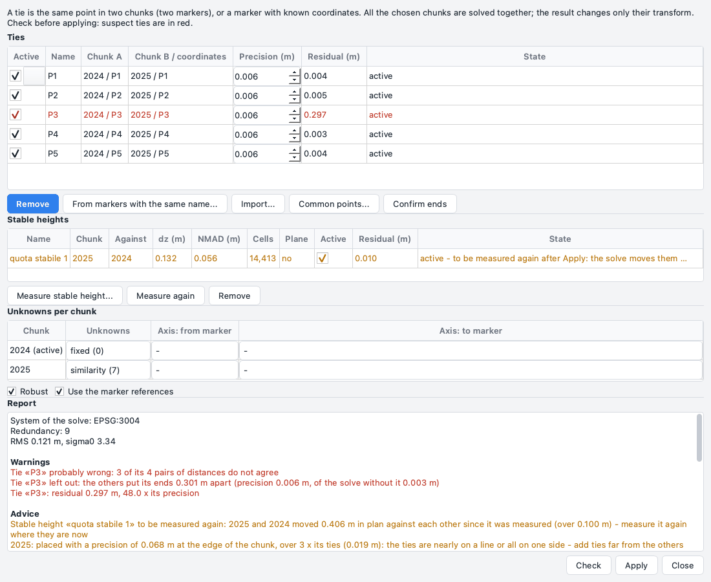
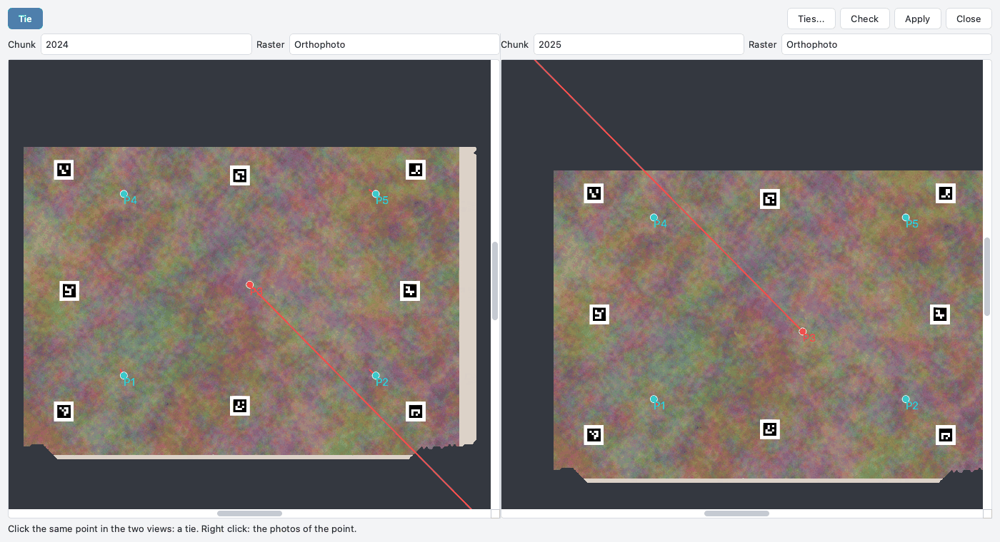
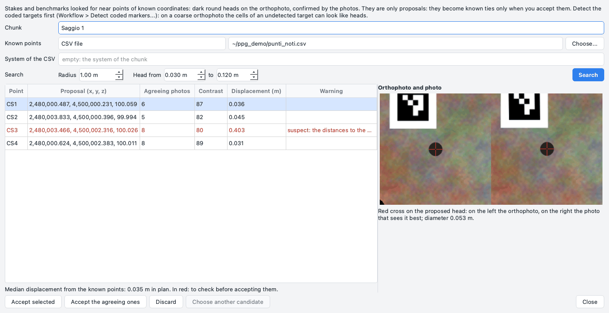

# Ties between chunks

Application **1.7.6**. Several surveys of one site - excavation campaigns of different years, a building surveyed in
pieces, flights of different days - often have nothing that *Align chunks* can use: no markers with the same name,
no photos in common, surfaces that changed between one survey and the next. **Ties** put them together with points
you choose yourself: the same point in two chunks, or a point of a chunk with known coordinates. All the chunks are
then solved together, and a report shows the wrong ties **before** anything is applied.

*Align chunks* stays as it is (markers, photos, clouds); ties are a second way, for when those do not work.

## What a tie is

A tie is **the same point in two chunks**: a corner of a wall, a stone, the head of a stake, seen in both surveys.
Each end is a **marker** of its chunk, made by itself and named "legame N" (or the name you give). So everything a
marker can do, the end of a tie does too: it can be measured on the photos, triangulated, placed on the surface,
refined. The ends keep their position in the internal coordinates of their chunk: a tie survives every new
transform of its chunks (*Align chunks*, a solve, the orientation of a local frame).

A new **alignment of the photos** of a chunk is different: it puts the chunk in a new internal frame. The ends
measured on photos are triangulated again and stay right. The ends placed without photos - clicked on a raster,
typed on the command line, read from a table - keep their old internal numbers, which in the new frame are somewhere
else, all moved the same way: no check of the solve could see it. So after a new alignment those ends are **to be
measured again**: the tie stays in the list, in orange, with the reason in *State*, and is left out of the solve
(the log of the window says it too). Drag the end to its point again in *Common points*, measure it on photos, or -
only if you checked that it is still right - select the tie and press **Confirm ends**
(`ppg ties confirm` on the command line). Adding photos to an alignment (*Align photos* without *Reset current
alignment*) counts as a new alignment too: COLMAP continues from the old block but scales and moves it again (on the
test trench the old cameras moved by a similarity of scale 0.90), so the ends without photos are to be measured
again in the same way.

A tie can also join a point of a chunk to **known coordinates** (a GNSS point, a benchmark): that end is a marker
with the coordinates as its reference.

Every tie has a **precision** (metres), which gives its weight in the solve (1 / precision²). By default:

| The end was | Precision |
| --- | --- |
| measured on two or more photos | the reprojection error of the marker turned into metres, at least 1 cm |
| measured on one photo only | two cells of the DEM (the point lies on the surface) |
| clicked on an orthophoto or a DEM | two pixels of the raster |
| read from a table | the value of the table (default 5 cm) |

The two ends are combined. You can change the precision of each tie by hand.

## Making ties

There are four ways:

* **Common points** (*Workflow > Common points...*): two chunks side by side, a click in each (see
  [below](#common-points));
* **From markers with the same name**: in the ties window, two chunks; a tie for every marker label found in both;
* **Import...**: a table (CSV) with one tie per row:
  `chunk_a,x_a,y_a,z_a,chunk_b,x_b,y_b,z_b[,precision][,name]`, each point in the world coordinates of its chunk; an
  empty `chunk_b` means the second point is known coordinates; an empty z is read from the DEM of the chunk;
* the **command line**: `ppg ties add`, `ppg ties known` (see [the command line](#command-line)).

Two more kinds of record join chunks without picking points by hand: a **stable height** (the height of one chunk on
another where the ground did not change, [below](#stable-height)) and the **stakes and benchmarks** found by
themselves near points of known coordinates ([below](#benchmarks-and-stakes)).

## The ties window

*Workflow > Tie chunks together...* opens the window of the ties. It is not modal: you can keep it open while you work
in the main window and in *Common points*.



**Ties.** One row per tie: *Active*, name, the two ends (`chunk / marker`, or the known coordinates), *Precision (m)*
(editable), *Residual (m)* of the last check and *State*. A tie with an end that is gone (a marker removed, a
chunk removed, a reference cleared) is grey and cannot be ticked; *State* says why. When the end comes back (*Edit >
Undo* of the removal) the tie is whole again, active or not as it was. An inactive tie stays in the
list: tick it again to use it. A tie with an end to be measured again after a new alignment is orange (see
[above](#what-a-tie-is)): *Confirm ends* confirms the ends of the selected ties (none selected: of all of them).
*Remove* deletes the selected ties and the markers they made. The window follows the chunks added, removed or renamed
in the workspace.

**Ties and changes of the chunks.** Removing a chunk leaves its ties in the list, grey (*chunk removed*): remove them
by hand. *Merge chunks* makes a new chunk: the ties still point to the source chunks, and are broken once those are
removed - make them again on the merged chunk. *Append projects* copies the chunks of another project with their
markers and the ties between the chunks you take; a tie to a chunk you leave out is not copied (the summary names
it). A project with ties saved by an older version (1.7.5 or before) keeps its ties: they are
recognised again by the key and the label of their markers.

**Stable heights.** Under the ties, the table of the stable heights with *Measure stable height...*, *Measure again*
and *Remove* (see [stable height](#stable-height)).

**Unknowns per chunk.** For each chunk, what the solve may change:

| Unknowns | Parameters | When |
| --- | --- | --- |
| **similarity** | 7: rotation, shift, scale | a survey with its own frame and scale; at least 3 ties well spread |
| **rigid** | 6: rotation and shift | the scale is right (scale bars, control points) |
| **in plan** | 4: turn about the vertical, shift in x, y and z | tilt and scale are already right (GPS or GNSS of the drone); works with 2 ties |
| **shift only** | 3 | only the position is wrong |
| **height only** | 1 | only the height is wrong |
| **fixed** | 0 | this chunk gives the frame |
| *not in the solve* | | the chunk is left out |

The window proposes: the active chunk **fixed**; *in plan* for a chunk georeferenced by its own references or with 2-3
ties; *similarity* for the others; a chunk without ties out of the solve. **In plan** turns about the vertical of the
world (the z axis of the coordinate system, or of the local frame); tilt and scale of the chunk stay as they are.

The solve needs a frame: at least one chunk **fixed**, or known coordinates. Without them it is refused with a
message. *Similarity* with only 2 ties is refused too (not enough equations): choose *in plan*.

**Options.** *Robust* uses Huber weights: a wrong tie weighs less, and the others are not pulled towards it.
*Use the marker references* counts the control markers of the chunks (with coordinates) as known points.

**Straight axis** (optional). For two or more chunks, two markers of each chunk that lie on one straight line - the
axis of a wall, of a hull, of a road. After the solve the report gives the angle between the directions in the
different chunks; more than 2 degrees is a warning. A wrong tie that turns a chunk shows up here even when the
distances do not see it.

## Check before applying

**Check** solves all the chosen chunks together and writes the report. Nothing is changed.

The report gives:

* the **system of the solve** and the **redundancy** (equations minus unknowns). With redundancy 0 there is **no
  check at all**: a wrong tie cannot be seen, and the report says it in red;
* the **RMS** and **sigma0** (how the residuals compare with the precisions: about 1 when the precisions are right);
* **Warnings** in red:
    * **distances between ties**: for each pair of ties between the same two chunks, the distance between the two
      points in one survey and in the other. It does not depend on the solve. A pair that differs by more than 3
      times its combined precision does not agree; the tie found in most of the pairs that do not agree is named as
      **probably wrong**;
    * **leave one out**: each tie is taken away in turn and the others place its ends; when they end up far apart
      (more than 3 times its precision combined with how precisely the others alone place them - a chunk held by a
      few ties close together is placed loosely far from them), the tie is named. So a small error on a very precise
      tie (below about 4-5 times the combined precision) may not be named here when its chunk has the **rigid**
      unknowns; the **similarity** unknowns name it, and so may the distances between ties and the residuals;
    * **large residuals**: a tie with a residual over 3 times its precision;
    * **implausible movements**: a chunk georeferenced by GPS or GNSS turned by more than 5 degrees, or scaled
      outside 0.98-1.02. A chunk in a local frame has no limit;
    * the **straight axis** bent by more than 2 degrees;
* **Advice** in orange: how precisely each chunk is placed at its edges, and why when it is poor (the ties nearly on
  a line or all on one side, ties that do not agree, or a chunk that hangs on another one placed badly). These are
  hints, not errors;
* for each chunk: rotation, shift and scale from before, and its precision;
* the **residuals** of every tie, in plan and in height, with the result of leaving it out;
* **Left out**, in grey: the ties not used and why (inactive, an end without a position, a chunk not in the solve...).

The rows of the suspect ties turn red in the table too. Any change after the check - a tie switched off, a precision,
the unknowns, an option - cancels the check: press **Check** again.

## Applying

**Apply** uses the last check. It is refused, with a message, when the ties, the markers or the chunks changed after
the check (*Check* again). With redundancy 0 a separate question asks for a confirmation: *Apply without a check* or
*Do not apply* (the default).

The solve changes **only the transform** of the chunks (and their coordinate system, to the one of the solve), as
*Align chunks* does. The photos, the clouds and the model follow by themselves. **DEM, orthophoto** and the other
rasters are grids in the old frame: the message after *Apply* lists them, and *Workflow > Rebuild the stale
products* makes them again. The report of the last solve is kept in the project.

The whole apply is **one step** of *Edit > Undo*: transforms, coordinate systems and ties come back as they were.
Every edit of the ties - import, from markers, remove, active, precision, a tie made in *Common points* - is also one
step of *Undo*, with the markers of its ends.

## Common points

*Workflow > Common points...* (or *Common points...* in the ties window) shows **two chunks side by side**, each with
its orthophoto, DEM or a relief (SLRM and the others already made). The two views are **linked**: zoom and pan in one,
the other follows, on the same point of the world as the transforms put it now, at the same metres per pixel. The
cursor of one view is shown as a red cross in the other.



**A tie in two clicks.** With *Tie* pressed (it is by default): a click on a point in one view, then a click on the
same point in the other. After the first click the other view jumps to where the transforms put that point, and the
end is drawn as a "half tie". The height of each end is read from the DEM of its chunk (no DEM value there: no tie).
*Esc*, or *Cancel the half tie* in the right-click menu, drops the half tie. A second click in the same chunk moves the
first end there.

**Ties in the views.** The ties are drawn as points (cyan; selected yellow; suspect red; inactive grey). After a
*Check* each has its residual as a red line, 20 times longer than it is. A click on a tie selects it (and its row in
the ties window); dragging an end moves it, its height from the DEM. An end measured on photos cannot be dragged:
move its flags on the photos. *Check* and *Apply* do what they do in the ties window.

**Ends on the photos.** Where the orthophoto is soft (under water, in shadow) or a point is seen only from the side,
measure the end on an original photo:

1. right click in a view of *Common points*: **Photos of the point** - that chunk becomes the active one and the
   *Photos* pane lists its photos that see the point;
2. open a photo; right click on the exact point: **End of the tie on this photo**.

With a half tie in the other chunk this makes the tie; without one, the photo point is the first end. With a tie
selected, the menu also offers to measure its end **on this photo too** (*End of «P3» on this photo too*). While
*Common points* is open, the right-click menu of an aligned photo in the *Photos* pane has *End of the tie on this
photo* too: it opens the photo on where the transforms put the half tie (a red cross); then right click on the exact
point. An end on two or more photos is
triangulated; on one photo it is placed on the surface (cloud or tie points).

**Two different systems.** A chunk in a local frame next to a chunk in a system of the world cannot be linked: the
views are superimposed (middle on middle), and an orange note says so. Ties can still be made.

## Stable height

Two surveys of the same site often agree in plan - the GPS of a drone puts them within a few centimetres - and not in
height: tens of centimetres, sometimes metres. Where the ground did not change between them (the sand or the field
around an excavation, a road, a pavement) their DEMs must be at the same height. A **stable height** measures how
much higher one chunk is than another there, and gives the solve that height only.

*Workflow > Measure stable height...* (or *Measure stable height...* under the table *Stable heights* of the ties
window) asks:

* the **chunk** (B) and the chunk it is measured **against** (A): both need a DEM;
* the **area**: *Automatic* (gentle slopes and cells that agree, over the whole overlap) or a polygon layer of the
  free drawings - draw the ground you know did not change, or use a colour mask of it;
* what to **leave out** (optional): a layer of polygons over the pits, the spoil heaps, the vegetation;
* **plane**: a plane (height and tilt, three anchors) instead of a single offset. Use it when the two surveys may be
  tilted against each other (a drone with GPS only) and the stable ground spreads over the site.

The two DEMs are read as they are placed now: no shift in plan is measured or made. A DEM built before a solve moved
its chunk is moved with the chunk, as the 2D view shows it. A chunk in a local frame and one in a system of the world
are refused, as for the ties.

The measure runs in the background and adds a row to the table **Stable heights**: name ("quota stabile N"), the two
chunks, *dz* (how much higher B is than A), the NMAD of the differences on the stable ground, the stable cells,
*Plane*, *Active*, the *Residual* of the last check and *State*. Its **precision** is the NMAD divided by the square
root of the cells, with at most 100 cells counted (neighbouring cells are not independent: a large sand surface must
not outweigh every tie), and at least 5 mm; each anchor of a plane counts √3 times that. Measuring, measuring again,
removing and switching a stable height on or off are each one step of *Edit > Undo*.

**In the solve.** A stable height joins the chunks in z only: the check and the solve use the active ones between
chunks of the solve, and their residuals are in the report (section *Stable heights*). A chunk held only by stable
heights is proposed as **height only**. They are never in the distances between ties or in *leave one out*: they have
no partner points.

**Measuring again.** A stable height was measured where the chunks stood in plan at that moment. When a solve moves
them against each other in plan by more than 2 cells of A's DEM (and at least 10 cm), the row turns orange and *State*
says by how much: after a check, "to be measured again after Apply"; after *Apply*, "to be measured again". So the
usual order is: tie the chunks in plan first (ties, *Apply*), then press **Measure again**: the selected heights (none
selected: those in orange) are measured again where the chunks are now, with the same chunks, areas and kind, and
keep their name and state.

## Benchmarks and stakes

Benchmarks, GNSS points and the stakes of the excavation grid are often in the photos: a dark round head on the
ground, with known coordinates in the table of the surveyor. *Find stakes...* looks for them near those coordinates
and proposes each one as a **known tie** - a point of the chunk with known coordinates. Nothing is added until you
accept it.



Open it with **Find stakes...** in the [*Reference*](panes.md#reference) pane or from *Workflow > Find stakes...*. It
is not modal.

**First detect the coded targets** (*Workflow > Detect coded markers...*). Their footprint is left out of the search,
but on a coarse orthophoto (about 1 cm a pixel or coarser) the black cells of a target that was not detected are as
small as a head and can be proposed.

**Known points**, from one of:

* a **CSV file**: `name,x,y[,z][,precision]`, separated by commas, semicolons, tabs or spaces, a header line allowed
  (a decimal comma works when the separator is not a comma). The coordinates are in the system of the chunk, or in the
  one written in *System of the CSV* (an EPSG code). Without z the height comes from the DEM; without precision 5 cm;
* the **known ties of the project**;
* the **markers with coordinates** of a chunk (its control points, for instance from another survey).

Then choose the **chunk** (it needs an orthophoto), the **radius** around each point (default 3 m) and the **head
diameter** (default 3 to 12 cm), and press **Search**. In the background, near every point:

1. on the orthophoto: dark spots at least 25 grey levels darker than their surroundings, round (circularity at least
   0.6), solid and of the head size; long roots, large patches and the cells of coded targets are left out;
2. on the photos: each candidate is looked for in the photos that see it (at most 12). When at least **3 photos
   agree** (within 2 pixels, or a quarter of the head) the point is triangulated from them, with the precision of the
   photos; otherwise it is proposed as **orthophoto only**, with the precision of 2 pixels of the orthophoto. Missing
   or unreadable photos (0-byte placeholders of an "online only" folder) leave a proposal orthophoto only, never an error;
3. at most 5 candidates per point, the photo-confirmed ones first, then by darkness, roundness and distance.

**The table.** One row per known point: the proposal (x, y, z), the *Agreeing photos* (or *orthophoto only*), the
*Contrast*, the *Displacement* from the known point and a *Warning*: *no head found*, *outside the orthophoto*, *no
aligned photos*, *unreadable photos*, the other candidates. The proposals are checked against each other before any
is accepted, as the ties are: the **distances** between every two found heads must agree with those between their
known points (a point that disagrees with most of the others is **suspect**), and the **displacement** of each must
agree with the median of all (a whole survey shifted shows as the median, written under the table; a wrong point -
a typing error, another stake - as a point **displaced unlike the others**). These rows are in red: check them before
accepting.

On the right, the **picture** of the selected proposal: the orthophoto around it and the photo that sees it best, a
red cross on the proposed head. Look at it before accepting.

| Button | What it does |
| --- | --- |
| *Accept selected* | the selected proposals become known ties |
| *Accept the agreeing ones* | the proposals confirmed by the photos and not in red |
| *Discard* | takes the selected proposals out of the list; the project does not change |
| *Choose another candidate* | the selected proposal moves to the next head found near its point (when there is one) |

**Accepting** makes, for each proposal, a known tie named as the point: a marker of the chunk on the head, with the
known coordinates as its reference (a point without z takes the height of the head) and the precision of the head and
of the point combined. The photos that agreed become measurements of the marker (pinned flags), and the new markers
alone are triangulated: the other markers of the chunk stay where they are. The whole acceptance is **one step** of
*Edit > Undo*. The accepted proposals leave the list; the ties appear in the ties window, to be checked and applied as
any other.

A proposal belongs to the alignment it was found in: after a new alignment of the photos of the chunk, accepting it
is refused - search again. The window says so under the table, and also when the chunk was moved by a solve after
the search (accepting is still right then, but the coordinates, displacements and red rows are those of before) or
removed.

## Command line

```bash
ppg ties add scavo.ppg 2024 1.20,3.40 2025 1.18,3.52      # a tie; no z: from the DEM of each chunk
ppg ties known scavo.ppg 2025 5.0,2.0,1.1 100.0,200.0,10.5 # a point with known coordinates
ppg ties from-markers scavo.ppg 2024 2025                   # markers with the same name
ppg ties import scavo.ppg ties.csv
ppg ties list scavo.ppg [--json]
ppg ties confirm scavo.ppg [TIE ...]                        # ends still right after a new alignment
ppg ties height scavo.ppg 2025 2024 [--layer Sabbia | --area stabile.gpkg] [--exclude Scavo] [--plane]
ppg ties heights scavo.ppg [--json]                         # the stable heights
ppg ties remeasure scavo.ppg "quota stabile 1"              # measured again where the chunks are now
ppg ties check scavo.ppg --unknowns 2024=fixed,2025=plan [--robust] [--no-references]
ppg ties solve scavo.ppg --unknowns 2024=fixed,2025=plan [--yes]
ppg stakes find scavo.ppg 2025 capisaldi.csv [--crs EPSG:3004] [--radius 3] [--head 0.03,0.12] [--out prop.json]
ppg stakes accept scavo.ppg 2025 prop.json --ids CS1,CS4 [--yes]   # or --agreeing: those confirmed by the photos
```

`ppg ties height` measures how much higher CHUNK is than REFERENCE on the stable ground (a polygon layer of the free
drawings with `--layer`, a GeoPackage, GeoJSON or DXF file with `--area`; neither: found by itself) and keeps it as a
stable height; `check` and `solve` use the active ones. `ppg stakes find` takes as known points a CSV file, `ties` (the
known ties of the project) or the name of a chunk (its markers with coordinates); it prints one line per point and the
check (median displacement, suspects, points displaced unlike the others), and writes the proposals to a JSON file with
a picture `<point>.png` for each beside it. The project does not change. `ppg stakes accept` prints what it would do
and changes nothing without `--yes`.

`check` prints the same report as the window, without the straight axis (in English), and changes nothing. `solve` asks before applying (or `--yes`); with
redundancy 0 it asks a question of its own, and `--yes` needs `--accept-no-check` too. Negative coordinates are
written as they are, or after `--`. All the options are in the [Python API](../api.md#align-and-merge-chunks).
