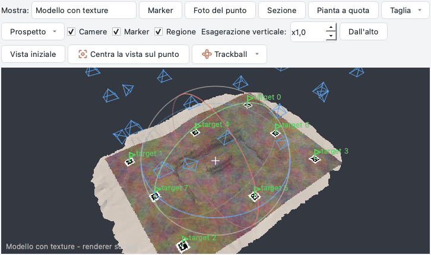
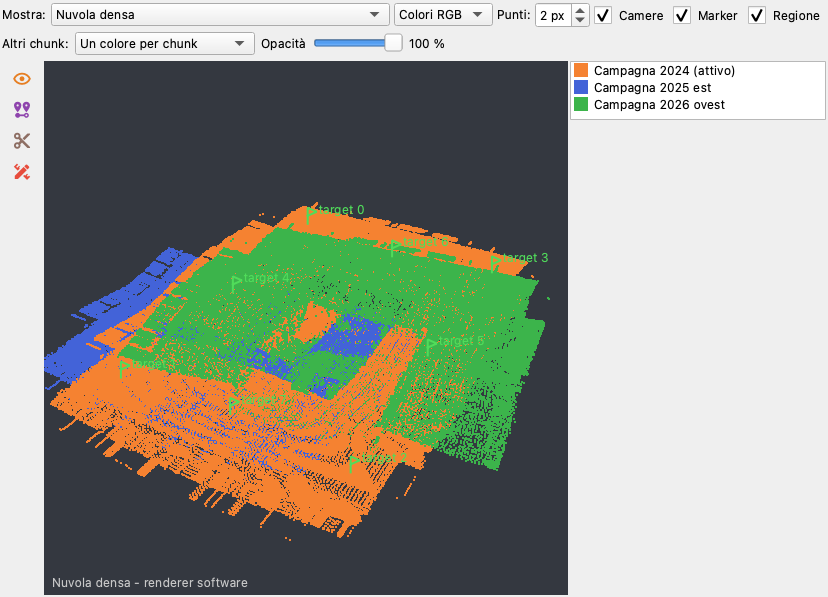
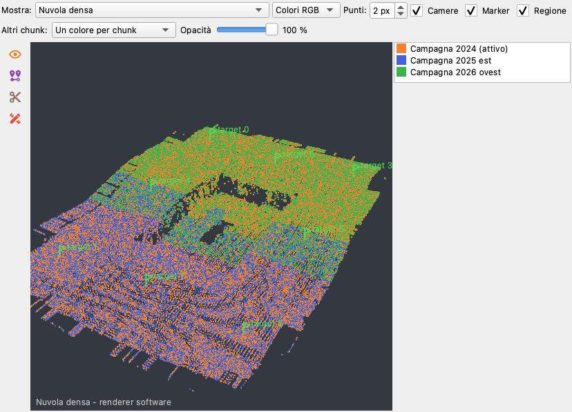
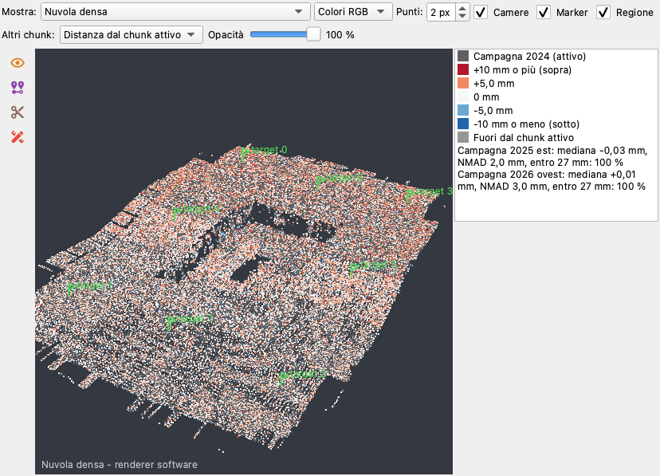
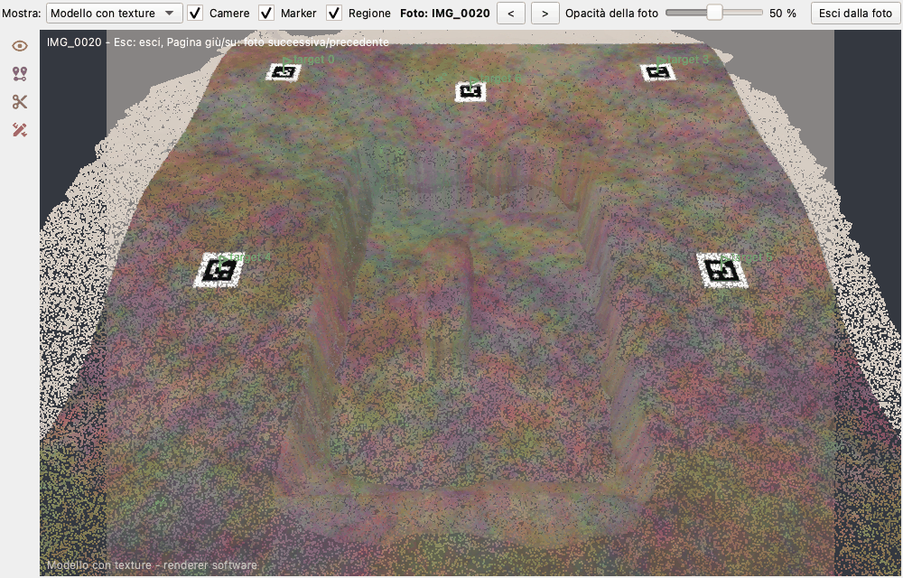

# Vista 3D e trackball

La scheda *Modello* mostra il chunk in 3D: punti di legame, nuvola densa, modello ombreggiato o con texture, il TIN,
camere, marker e regione di ricostruzione (*Mostra* sceglie cosa). Gli strumenti della sua barra laterale - marker, foto del
punto, sezione, pianta a quota, taglio, prospetto, esagerazione verticale - sono descritti in
[Le viste centrali](index.md#le-viste-centrali); questa pagina spiega come muoversi nella scena.

## La trackball

Come in Metashape, intorno al centro di rotazione (il *pivot*, una piccola croce) è disegnata una **sfera con tre
anelli**:

| Dove inizia il trascinamento | Cosa fa |
| --- | --- |
| dentro la sfera | ruota la scena liberamente, come se si facesse rotolare la sfera sotto la mano |
| su un anello (si illumina sotto il mouse) | ruota la scena solo intorno all'asse di quell'anello: il rosso intorno alla x della scena, il verde intorno alla y, il blu (orizzontale) intorno alla verticale |
| fuori dalla sfera | gira la scena intorno alla linea di vista |

* **Spostare**: trascinamento con il tasto destro o centrale, oppure Maiusc + trascinamento con il sinistro. La
  sfera resta ferma sullo schermo: è la scena a scorrerle sotto.
* **Avvicinare**: la rotella avvicina **verso il cursore** - il punto sotto il mouse si avvicina e resta sotto il
  mouse. **Maiusc + rotella** si muove dritto lungo la linea di vista, senza spostare il centro di rotazione.
* **Centro di rotazione**: un **doppio clic** sul modello o sulla nuvola mette il pivot sulla superficie in quel
  punto (come si piazza un marker); la vista non salta. **Centra la vista sul punto** (gruppo *Vista* della colonna) porta poi il
  pivot al centro della vista, alla stessa distanza.
* *Vista iniziale* mostra di nuovo tutta la scena, *Dall'alto* guarda dritto verso il basso.

## Proiezione ortografica

**Proiezione ortografica** (gruppo *Vista* della colonna, *Vista > Proiezione ortografica*, tasto ++o++) disegna la
scena con linee di vista parallele al posto della prospettiva: le linee parallele restano parallele e una cosa ha la
stessa dimensione sullo schermo ovunque sia, vicina o lontana. È la proiezione di piante e prospetti: con
*Dall'alto*, ++f++ e ++l++ la vista è una vera pianta, vista di fronte o di lato, senza la fuga della prospettiva
(in questa proiezione *Dall'alto* guarda esattamente verso il basso).

* Il cambio non fa saltare la vista: quello che sta alla distanza del centro di rotazione mantiene la sua dimensione.
* La **rotella** cambia la scala della vista (non c'è una distanza da accorciare) e continua a zoomare verso il punto
  sotto il mouse; lo spostamento, la trackball, il doppio clic per il centro di rotazione, i marker, le misure, le
  sezioni, il lazo e i disegni funzionano come in prospettiva, ciascuno sulla linea di vista del suo pixel.
* La scelta è ricordata tra le sessioni, e le immagini prese dalla vista (schermate) sono nella
  proiezione mostrata.
* [Guardare da una foto](#guardare-da-una-foto) è sempre in prospettiva, quella della camera; la proiezione scelta
  torna all'uscita dalla foto. Anche il video di sorvolo è in prospettiva.

## Quando si vede la trackball

Il pulsante **Trackball** della barra, o *Vista > Trackball*, ha tre modi, ricordati tra una sessione e l'altra:

* **Quando il mouse è sulla vista** (predefinito): compare appena il mouse si muove sulla vista e sfuma un secondo e
  mezzo dopo che il mouse si è fermato;
* **Sempre**;
* **Mai**: la scena ruota allo stesso modo, solo la sfera non è disegnata.

La sfera non finisce mai in un'immagine presa dalla vista (schermate, lazo, scelta dei punti).

## Punti e assi dell'orientamento

Mentre *Flusso di lavoro > Orienta il sistema locale...* è aperta, i suoi pulsanti **Nel 3D** aspettano un clic sul
modello o sulla nuvola (il punto A, B o C; Esc rinuncia) e *Seleziona l'area nel 3D (lazo)* prende i punti di
un'area per il piano adattato. I nuovi assi sono disegnati nella vista come saranno - x rosso, y verde, z blu, il
piano orizzontale come un quadrato blu trasparente - e seguono ogni cambio dei punti; spariscono quando la finestra
si chiude ([orientare un sistema locale](processing.md#orientare-un-sistema-locale)).

## Disegni liberi

*Disegna* nella barra laterale della vista disegna linee, poligoni e punti sul modello (*Linea 3D*, *Poligono 3D*, *Punto
3D*): la vista resta viva fra un clic e l'altro - un clic è un vertice, trascinare fa ancora ruotare la scena, un
doppio clic finisce il disegno invece di spostare il centro di rotazione. *Seleziona e modifica* sceglie un disegno e
mostra i suoi vertici da trascinare o togliere; *Drappeggia sul modello* aggiunge vertici sulla superficie ogni 20
pixel. I disegni dei layer visibili si vedono nei loro colori, quello scelto più spesso. Vedi
[disegni liberi](drawing.md#disegni-liberi-2d-e-3d).

## Più chunk insieme

Applicazione **1.7.5**. Con più di un chunk nel progetto, ogni chunk dell'*Area di lavoro* ha una casella: **spuntala per
mostrare quel chunk nella vista 3D insieme a quello attivo** (il chunk attivo si vede sempre). I chunk sono disegnati
dove stanno nel mondo - ognuno con la sua trasformazione, convertito nel sistema di coordinate del chunk attivo quando
entrambi sono sistemi del mondo - così **prima di *Allinea chunk*** vedi dove si trovano e se si sovrappongono, e **dopo**
se combaciano. Un chunk in un sistema locale accanto a uno in un sistema del mondo non si può collocare: viene
**sovrapposto** - il suo centro sul centro del chunk attivo, per vederli all'incirca uno accanto all'altro - e la legenda
dice «sistema locale: sovrapposto, non collocato»; non viene misurato.

Ciò che si disegna segue *Mostra*: con la nuvola densa o i punti di legame, una copia diradata dei punti di ogni chunk (mai
la nuvola intera); con il modello, l'anteprima del suo modello (un chunk che non ce l'ha mostra i suoi punti). *Vista
iniziale* li inquadra tutti.

La riga **Altri chunk** sopra la vista (compare appena si spunta un chunk) sceglie i colori e l'opacità degli altri chunk:

| Colori | Cosa mostrano |
| --- | --- |
| **Un colore per chunk** | ogni chunk - anche quello attivo - nel suo colore, con il nome nella legenda a destra: dove sono le superfici di due campagne, quale sta sopra |
| **Colori veri** | i colori delle foto; il chunk attivo tiene i colori scelti per lui (classi, quota...) |
| **Distanza dal chunk attivo** | il chunk attivo in grigio, gli altri colorati secondo la distanza di ogni punto dalla sua superficie: bianco sopra di essa, rosso più in alto, blu più in basso, saturi oltre la fine della scala (arrotondata a 1, 2 o 5 mm, cm o m dal 95° percentile); grigi i punti che non hanno il chunk attivo né sopra né sotto |

Con *Distanza dal chunk attivo* la legenda dà, per ogni chunk, la distanza **mediana**, la **NMAD** (la dispersione, come
una deviazione standard che ignora i valori anomali) e la quota dei suoi punti **entro** tre spaziature dei punti del chunk
attivo: dopo un buon allineamento la mediana è di pochi millimetri e quasi tutti i punti sono entro. La distanza si misura
lungo la normale della superficie dove il chunk attivo sta sopra o sotto il punto, altrimenti dal punto più vicino: una
parte oltre il bordo del chunk attivo non è mai «a 0». «Sopra» e «sotto» seguono la verticale del mondo: si leggono su
piani di calpestio e superfici poco inclinate, non sulle pareti. I punti di ogni chunk sono una copia diradata (al massimo
200 000 per il riferimento), quindi la soglia - tre spaziature di quella copia - è più larga della spaziatura di una
nuvola molto densa: `ppg chunk-distances --threshold` la imposta.

**Opacità** sbiadisce gli altri chunk (anche con il renderer software): con i colori veri al 50 % due rilievi della stessa
trincea si leggono uno attraverso l'altro. Le spunte, i colori e l'opacità si salvano nel progetto; sono scelte della
vista, non passi di *Modifica > Annulla*. Mentre si vede una versione conservata, si disegna solo il chunk attivo.

*Flusso di lavoro > Allinea chunk...* ora finisce con lo stesso controllo: per ogni chunk allineato, la quota dei suoi
punti entro la soglia e la sua distanza mediana dal riferimento ([riga di comando](../api.md#allineare-e-unire-i-chunk):
`ppg align-chunks ... --check`, `ppg chunk-distances`). I DEM e le ortofoto dei chunk si confrontano nella vista 2D:
vedi il [pannello Layer](panes.md#layer). Quando marker, foto e nuvole non bastano ad allineare i chunk, legali con
punti scelti da te: [legami fra chunk](ties.md).

## Guardare da una foto

Applicazione **1.7.5**. Come *Look Through* di Metashape, la vista 3D può **mettersi al posto di una foto allineata**: la
vista va dove è stata scattata la foto, guarda dove guardava la fotocamera con il suo campo visivo (la focale calibrata
del sensore) e la foto si disegna **sopra il modello**, raddrizzata con il modello dell'obiettivo del sensore (anche i
fisheye) così che coincida con il modello, la nuvola o i punti di legame - quello che sceglie *Mostra*. La foto raddrizzata
tiene la focale del sensore: con un fisheye molto ampio i bordi esterni della foto (lontani dal centro) restano tagliati. Dove foto e
modello non coincidono, lì il modello è sbagliato (o la foto mostra qualcosa che non c'è più). La foto riempie la vista
in una direzione ed è centrata nell'altra: bande ai lati o sopra e sotto quando le forme sono diverse.

Da dove si parte:

- il pannello **Foto**: tasto destro su una foto allineata, *Guarda dalla foto nella vista 3D*;
- la **vista della foto**: tasto destro, *Guarda dalla foto nella vista 3D*;
- il pulsante **Guarda dalla foto** nel gruppo *Vista* della colonna di strumenti della vista 3D: *Foto più adatta alla
  vista* sceglie la foto allineata con direzione e posizione più vicine alla vista di adesso (l'angolo fra le
  direzioni, più 30 gradi per ogni dimensione della scena fra le posizioni) e porta lì la vista; *Foto successiva* e
  *Foto precedente* scorrono tutte le foto allineate del chunk (non solo quelle che mostra il pannello *Foto*)
  nell'ordine in cui sono state scattate: per ora EXIF, poi le foto senza ora per nome.

Mentre si guarda da una foto, una riga sopra la vista ne dà il nome, **<** e **>** (foto precedente e successiva),
l'**opacità della foto** (0 %: solo il modello, 100 %: solo la foto; 50 % la prima volta, poi l'ultimo valore usato) ed
*Esci dalla foto*; un nome lungo si accorcia, intero nel suggerimento, e su una vista stretta la riga va a capo.
++page-down++ o ++right++ aprono la foto successiva, ++page-up++ o ++left++ la precedente, ++esc++ esce (++page-down++,
++page-up++ ed ++esc++ anche con il cursore o un pulsante della riga in uso; ++esc++ prima chiude un pannello
aperto della colonna di strumenti, poi termina un disegno o la selezione libera, poi esce dalla foto). **Qualsiasi movimento della vista esce dalla foto** - ruotare, spostare, avvicinare, ++home++, ++t++: la foto
sparisce e la vista resta dov'era, libera di muoversi (++home++ e ++t++ ridanno il campo visivo solito). Scegliere
un'altra vista in *Mostra* tiene la foto. La foto si disegna sotto camere, marker e disegni liberi (con il motore
software; con VTK la foto è uno strato sopra la scena: sotto il 100 % si vedono attraverso, al 100 % restano
nascosti). L'esagerazione verticale torna a
x1 per la foto: la foto coincide solo con le quote vere.

La foto si legge e si raddrizza in sottofondo, al massimo 1600 pixel sul lato lungo; le ultime sei restano pronte, così
andare avanti e indietro fra le foto è immediato.

## Tasti

Con la vista 3D attiva:

| Tasto | Cosa fa |
| --- | --- |
| ++left++ ++right++ | ruota di 15 gradi intorno alla verticale |
| ++up++ ++down++ | ruota di 15 gradi intorno all'asse orizzontale dello schermo |
| ++shift++ + frecce | sposta di un decimo della vista |
| ++plus++ ++minus++ | avvicina e allontana |
| ++home++ | vista iniziale |
| ++t++ | dall'alto |
| ++f++ | di fronte (guardando verso +y) |
| ++l++ | da sinistra (guardando verso +x) |
| ++o++ | proiezione ortografica sì e no |
| ++page-down++ ++page-up++ | guardando da una foto: la foto successiva e la precedente (anche ++right++ ++left++) |
| ++esc++ | esce dalla foto |

La stessa trackball funziona con i due motori di disegno, VTK (OpenGL) e quello software (`PPG_RENDERER=software`).

??? example "API"
    `window.model_view.pivot()` (il centro di rotazione, coordinate mondo del chunk),
    `window.model_view.set_pivot(point, recentre=False)`, `window.model_view.set_trackball_mode("auto" | "always" |
    "never")`; `window.model_view.look_through(camera)`, `look_best()`, `look_step(1 | -1)`, `leave_look()`,
    `look_camera` (la foto da cui si guarda, None: la vista libera); negli script lanciati dalla console o
    dall'[assistente](assistant.md) la finestra è `window`.
