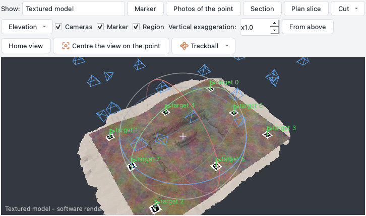
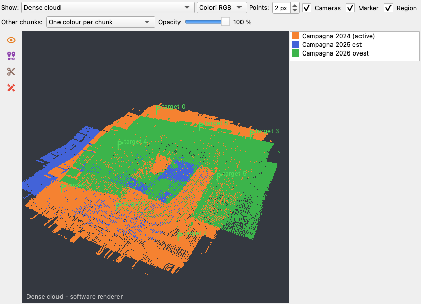
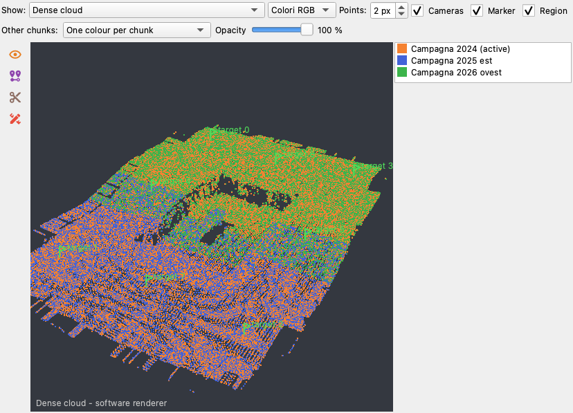
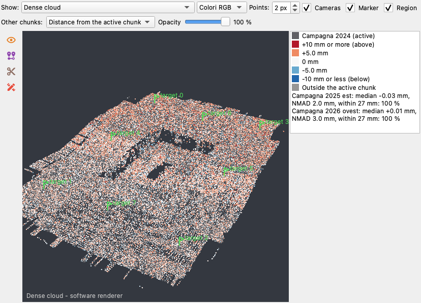

# 3D view and trackball

The *Model* tab shows the chunk in 3D: tie points, dense cloud, shaded or textured model, the TIN, cameras, markers
and the reconstruction region (*Show* chooses what). The tools of its rail - marker, photos of the point, section,
plan slice, cut, elevation, vertical exaggeration - are described in [The central views](index.md#the-central-views);
this page is about moving around the scene.

## The trackball

As in Metashape, a **sphere with three rings** is drawn around the centre of rotation (the *pivot*, a small cross):

| Where the drag starts | What it does |
| --- | --- |
| inside the sphere | turns the scene freely, as if rolling the sphere under the hand |
| on a ring (it lights up under the mouse) | turns the scene about that ring's axis only: the red ring about the scene's x, the green one about its y, the blue (horizontal) one about the vertical |
| outside the sphere | rolls the scene about the line of sight |

* **Pan**: right or middle drag, or Shift + left drag. The sphere keeps its place on the screen: the scene slides
  under it.
* **Zoom**: the wheel zooms **toward the cursor** - the point under the mouse comes closer and stays under it.
  **Shift + wheel** moves straight along the line of sight, without moving the centre of rotation.
* **Centre of rotation**: a **double click** on the model or the cloud puts the pivot on the surface there (as a
  marker is placed); the view does not jump. **Centre the view on the point** (group *Vista* of the rail) then brings the pivot to
  the middle of the view, at the same distance.
* *Home view* shows the whole scene again, *From above* looks straight down.

## When the trackball is shown

The **Trackball** button of the bar, or *View > Trackball*, has three modes, remembered between sessions:

* **When the mouse is over the view** (default): it appears as soon as the mouse moves over the view and fades
  away a second and a half after the mouse stops;
* **Always**;
* **Never**: the scene still turns the same way, only the sphere is not drawn.

The sphere is never in a picture taken from the view (screenshots, lasso, picks of points).

## Points and axes of the orientation

While *Workflow > Orient the local system...* is open, its **In 3D** buttons wait for a click on the model or the
cloud (the point A, B or C; Esc gives up) and *Select the area in 3D (lasso)* takes the points of an area for the
fitted plane. The new axes are drawn in the view as they would be - x red, y green, z blue, the horizontal plane
as a translucent blue square - and follow every change of the points; they go when the window closes
([orienting a local system](processing.md#orienting-a-local-system)).

## Free drawings

*Draw* in the tool rail of the view draws lines, polygons and points on the model (*3D line*, *3D polygon*, *3D point*):
the view stays live between the clicks - a click is a vertex, a drag still turns the scene, a double click ends the
drawing instead of moving the centre of rotation. *Select and edit* chooses a drawing and shows its vertices to drag
or delete; *Drape on the model* adds vertices on the surface every 20 pixels. The drawings of the visible layers are
drawn in their colours, the selected one thicker. See [free drawings](drawing.md#free-drawings-2d-and-3d).

## Several chunks together

Application **1.7.5**. With more than one chunk in the project, every chunk of the *Workspace* has a box:
**tick it to show that chunk in the 3D view together with the active one** (the active chunk is always shown). The
chunks are drawn where they are in the world - each through its own transform, converted into the coordinate system of
the active chunk when both are systems of the world - so you can see **before *Align chunks*** where they lie and
whether they overlap, and **after it** whether they match. A chunk in a local frame next to a chunk in a system of the
world cannot be placed: it is **superimposed** - its middle on the middle of the active chunk, to see the two roughly
side by side - and the legend says "local frame: superimposed, not placed"; it is not measured.

What is drawn follows *Show*: with the dense cloud or the tie points, a thinned copy of the points of each chunk (never
the whole cloud); with the model, the preview of its model (a chunk without one shows its points). *Home view* frames
all of them.

The row **Other chunks** above the view (it appears as soon as a chunk is ticked) chooses the colours and the opacity of
the other chunks:

| Colours | What they show |
| --- | --- |
| **One colour per chunk** | each chunk - the active one too - in its own colour, named in the legend on the right: where the surfaces of two campaigns are, which one lies above |
| **True colours** | the colours of the photos; the active chunk keeps the colours chosen for it (classes, height...) |
| **Distance from the active chunk** | the active chunk grey, the others coloured by the distance of each point from its surface: white on it, red above, blue below, saturated beyond the end of the scale (rounded to 1, 2 or 5 mm, cm or m from the 95th percentile); grey the points with nothing of the active chunk over or under them |

With *Distance from the active chunk* the legend gives, for each chunk, the **median** distance, the **NMAD** (the
spread, as a standard deviation that ignores the outliers) and the share of its points **within** three spacings of the
points of the active chunk: after a good alignment the median is a few millimetres and most points are within. The
distance is measured along the normal of the surface where the active chunk is over or under the point, else to the
nearest point: a part beyond the edge of the active chunk is never "at 0". "Above" and "below" follow the vertical of
the world: they read on floors and gently sloping surfaces, not on walls. The points of each chunk are a thinned copy
(at most 200 000 for the reference), so the threshold - three spacings of that copy - is wider than the spacing of a
very dense cloud: `ppg chunk-distances --threshold` sets it.

**Opacity** fades the other chunks (also in the software renderer): with true colours at 50 % two surveys of the same
trench read one through the other. The ticks, the colours and the opacity are saved in the project; they are choices of
the view, not steps of *Edit > Undo*. While a kept version is shown, only the active chunk is drawn.

*Workflow > Align chunks...* now ends with the same check: for each chunk aligned, the share of its points within the
threshold and its median distance from the reference ([command line](../api.md#align-and-merge-chunks):
`ppg align-chunks ... --check`, `ppg chunk-distances`). The DEMs and orthophotos of the chunks can be compared in the 2D
view: see the [Layer pane](panes.md#layer).

## Keys

With the 3D view focused:

| Key | What it does |
| --- | --- |
| ++left++ ++right++ | turn 15 degrees about the vertical |
| ++up++ ++down++ | turn 15 degrees about the horizontal axis of the screen |
| ++shift++ + arrows | pan by a tenth of the view |
| ++plus++ ++minus++ | zoom in and out |
| ++home++ | home view |
| ++t++ | from above |
| ++f++ | from the front (looking towards +y) |
| ++l++ | from the left (looking towards +x) |

The same trackball works with both renderers, VTK (OpenGL) and the software one (`PPG_RENDERER=software`).

??? example "API"
    `window.model_view.pivot()` (the centre of rotation, world coordinates of the chunk),
    `window.model_view.set_pivot(point, recentre=False)`, `window.model_view.set_trackball_mode("auto" | "always" |
    "never")`; in scripts run from the console or the [assistant](assistant.md) the window is `window`.
