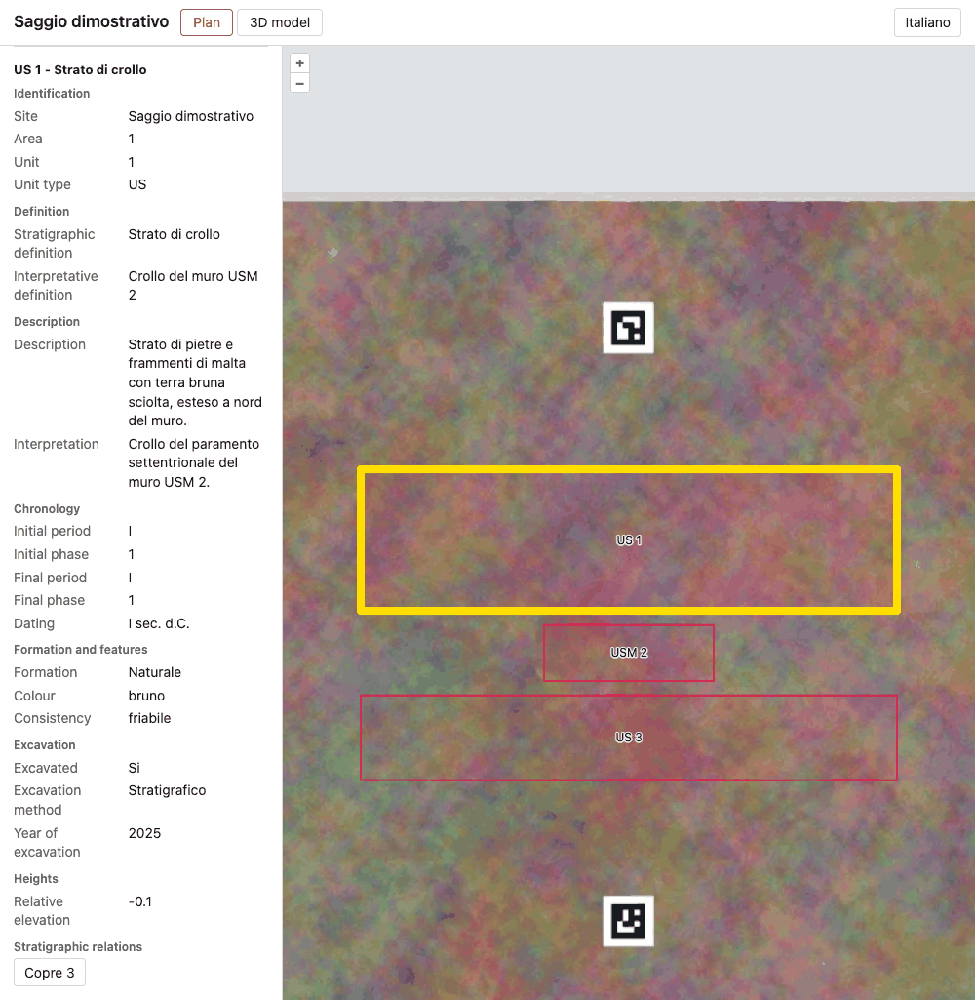
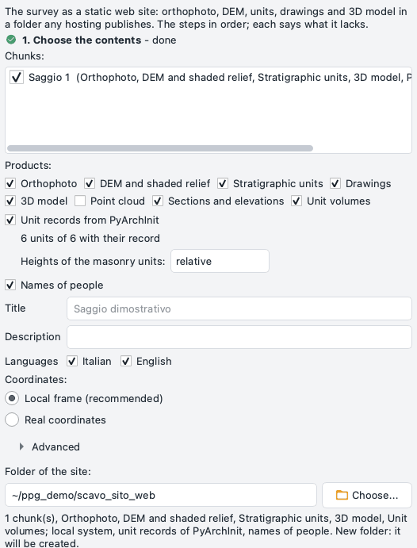
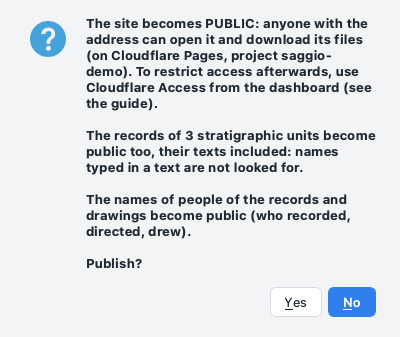
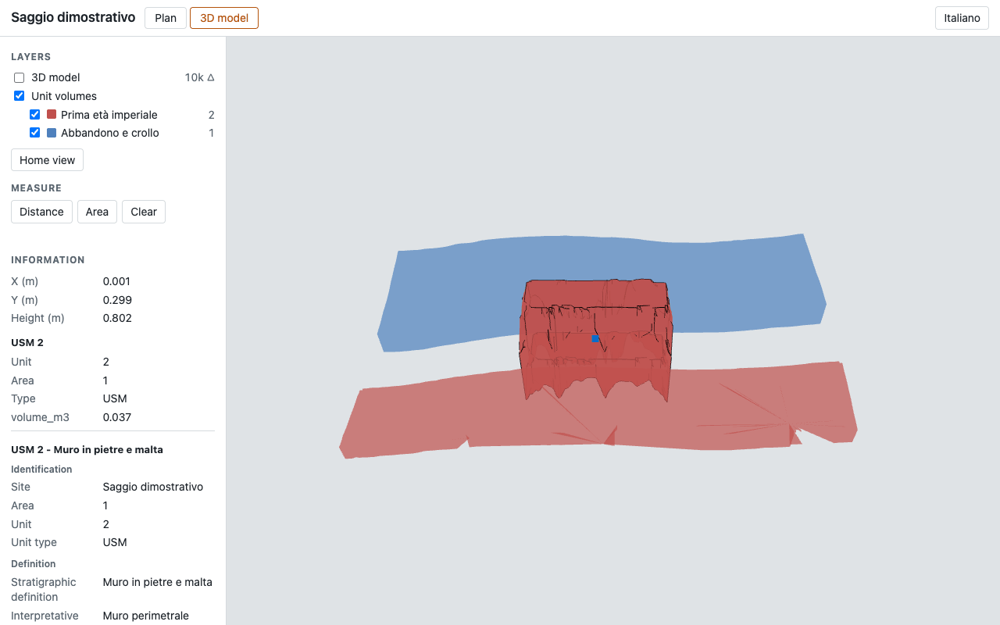

# Pubblicare il sito web di un rilievo

Il pannello **Pubblica sul web** costruisce il sito di un rilievo come cartella (vedi
[Esportazioni e rapporti](exports.it.md#sito-web-pubblica-sul-web)). Il passo 4, **Pubblica**, mette quella cartella su
**Cloudflare**, gratis, con il tuo account Cloudflare; la cartella può anche andare a mano su qualsiasi altro hosting
statico (in fondo a questa pagina).

Il programma non chiede, non legge e non conserva mai password, token o chiavi: esegue **wrangler**, il programma a
riga di comando di Cloudflare, che installi tu e con cui fai tu l'accesso. Legge solo quello che wrangler risponde, e
quello che ne mostra o ne conserva è ripulito da tutto ciò che somiglia a un token, a un identificativo di account o a
un indirizzo e-mail. Il progetto conserva solo l'indirizzo del sito, il nome del progetto Cloudflare e del bucket, e la
data.

## Che cosa è gratuito (letto sulla documentazione di Cloudflare il 14 novembre 2026)

| Servizio | Piano gratuito | Fonte |
|---|---|---|
| **Pages**: file per sito | 20.000 (100.000 nei piani a pagamento) | [Limiti di Pages](https://developers.cloudflare.com/pages/platform/limits/) |
| **Pages**: dimensione di un file | 25 MiB | stessa pagina |
| **Pages**: richieste e traffico di un sito statico | gratuiti e illimitati | [Prezzi di Pages](https://developers.cloudflare.com/pages/functions/pricing/) |
| **Pages**: progetti per account | 100 | Limiti di Pages |
| **Pages**: richieste per intervalli (range) | risponde con il file intero (`200`), non a pezzi | [Serving Pages](https://developers.cloudflare.com/pages/configuration/serving-pages/) |
| **R2**: spazio | 10 GB-mese al mese (Standard storage) | [Prezzi di R2](https://developers.cloudflare.com/r2/pricing/) |
| **R2**: scritture (Classe A: invio, elenco, regola CORS) | 1 milione al mese | stessa pagina |
| **R2**: letture (Classe B: scaricamento, head) | 10 milioni al mese | stessa pagina |
| **R2**: traffico in uscita (egress) | gratuito | stessa pagina |
| **R2**: un invio con wrangler | fino a 315 MB | [Caricare oggetti](https://developers.cloudflare.com/r2/objects/upload-objects/) |
| **R2**: indirizzo pubblico `r2.dev` | limitato, solo "for development purposes"; niente cache né Access | [Bucket pubblici](https://developers.cloudflare.com/r2/buckets/public-buckets/) |

R2 va attivato una volta sull'account ("R2 subscription", un checkout nella dashboard); le pagine di R2 non dicono se
viene chiesto un metodo di pagamento quando l'uso resta nella quota gratuita: aspettati che la dashboard lo chieda.
I Workers static assets hanno gli stessi limiti di Pages (20.000 file, 25 MiB per file); Pages non è deprecato e
`wrangler pages deploy` pubblica una cartella senza file di configurazione, per questo il programma usa Pages.

**Dove vanno i file.** Con **Automatico** (predefinito) tutto il sito va su Pages quando ogni file sta entro 25 MiB e i
file sono al massimo 20.000 - di solito è così per uno scavo normale con la dimensione predefinita di 500 MB.
Altrimenti la pagina (`index.html`, `site.json`, `app/`) va su Pages e la cartella `data/` (ortofoto, DEM, modello,
nuvola) in un **bucket R2**, che serve i file a pezzi: il visualizzatore legge i raster grandi un pezzo alla volta. Su
Pages da solo il visualizzatore prende ogni raster intero (fino a 50 MB per file, il suo limite): funziona, si apre solo
più lentamente.

## La prima volta, passo per passo

1. **Un account Cloudflare**: iscriviti gratis su <https://dash.cloudflare.com/sign-up>.
2. **Node.js**: installalo da <https://nodejs.org> (la versione LTS).
3. **wrangler**: in un terminale (*Terminale* su macOS, *PowerShell* su Windows):

        npm install -g wrangler

   Il programma non lo installa mai da solo. Cerca `wrangler` nel PATH e nelle cartelle solite di Node (Homebrew,
   `~/.npm-global/bin`, nvm, Volta), poi `npx --no wrangler` (che non scarica mai nulla).
4. **Fai l'accesso**, una volta. Dalla 1.10.1 il modo più semplice è il programma stesso: premi **Controlla** nel
   passo 4 e, quando dice che wrangler non ha l'accesso, premi **Accedi a Cloudflare** (qui sotto). Oppure nello
   stesso terminale:

        wrangler login

   Quando wrangler non è installato ma `npx` lo trova (sta solo nella cache di npx), `wrangler` da solo risponde
   *command not found*: scrivi invece `npx wrangler login`. Il pannello e `ppg web publish cloudflare` scrivono il
   comando come lo puoi digitare, da quello che hanno trovato. Il browser si apre su Cloudflare: autorizza wrangler.
   Le credenziali restano a wrangler; il programma non le vede.
5. Nel programma: costruisci il sito (passi 1-2 del pannello), poi nel passo 4 scrivi il nome del **Progetto Pages**
   (lettere minuscole, cifre, trattini; il sito sarà su `https://<nome>.pages.dev`; Cloudflare aggiunge un suffisso se
   il nome è già preso, e il pannello mostra l'indirizzo che assegna).
6. Premi **Controlla**: il pannello trova wrangler, guarda se hai fatto l'accesso (`wrangler whoami`) e mostra il
   **piano**: quanti file e MB vanno su Pages e su R2, ogni limite gratuito con *entro* o *oltre*, che cosa diventa
   pubblico, gli avvisi (in arancione) e ciò che impedisce la pubblicazione (in rosso). Non invia nulla.
7. Premi **Pubblica...**: un messaggio dice che il sito diventa **pubblico** - chiunque abbia l'indirizzo può aprirlo e
   scaricarne i file - e chiede conferma. Un sito costruito con le **Coordinate vere** chiede una seconda volta, in
   rosso: dice a chiunque dove si trova il sito. Senza entrambe le risposte non parte nulla.
8. La pubblicazione va in background con *Annulla*; i comandi di wrangler e le sue risposte vanno nel pannello Log. Alla
   fine il pannello e l'Area di lavoro (**Sito web**) mostrano l'indirizzo, con **Apri nel browser** e **Copia
   l'indirizzo**; l'indirizzo resta con il progetto. L'indirizzo si legge nelle risposte di wrangler, non si
   indovina mai: quando non lo dicono, il pannello lo segnala, le risposte vanno intere (ripulite) nel pannello Log -
   mandacele - e scrivi tu l'indirizzo (dalla dashboard, *Workers & Pages*, o da `wrangler pages project list`) nel
   campo sotto.

Pubblicare di nuovo invia solo ciò che è cambiato: Pages salta i file che ha già, e il programma ricorda i file inviati
a R2 (`.ppg-publish.json` nella cartella del sito, mai pubblicato), così invia solo quelli nuovi o cambiati e cancella
quelli che non sono più nel sito. Quando il sito viene costruito di nuovo dopo una pubblicazione, il passo 4 dice *da
rifare*.

**Accedi a Cloudflare** (dalla 1.10.1). Quando il controllo dice che wrangler non ha l'accesso, il passo 4 mostra
questo pulsante: il programma avvia il tuo `wrangler login` (lo stesso comando di un terminale), wrangler apre il
browser, accedi lì, e quando wrangler finisce il programma controlla di nuovo da solo (l'accesso e il piano). Intanto
il passo dice *completa nel browser*; **Annulla** ferma wrangler, e dopo 10 minuti senza risposta si ferma da solo.
Nulla di ciò che wrangler scrive - l'indirizzo di accesso, l'account - viene tenuto, scritto nel pannello Log o
mostrato: solo se è riuscito. Il programma non legge mai i file di wrangler.

**Un terminale dal programma** (dalla 1.10.1): *Strumenti > Apri un terminale* apre il terminale del sistema nella
cartella del progetto con `ppg`, `npx` e `wrangler` raggiungibili ([Strumenti](menus.md#strumenti)).

**Avviato dall'applicazione** (Finder, menu Start) wrangler non ha una cartella sua in cui lavorare: dalla 1.10.1 il
programma gli dà una cartella di cache tua nella cartella temporanea (`WRANGLER_CACHE_DIR`, se non ne hai impostata
una), così comandi come `pages project list` non finiscono più con *Missing file or directory: /.wrangler/cache*.
Quando un comando fallisce, il messaggio parte dalla riga `[ERROR]` di wrangler.

**"Not logged in" subito dopo un accesso riuscito**: una cartella `~/.wrangler` con solo `cache` o `logs` è stata
creata avviando wrangler con la cartella home come cartella di lavoro, e ora wrangler la prende per la sua
configurazione e non ci trova l'accesso. Cancella quella cartella e premi di nuovo **Controlla**: l'accesso resta
altrove. Dalla 1.10.1 il pannello e i messaggi d'errore indicano la cartella quando la trovano (guardano solo se
esiste).

## Quando i dati vanno su R2

Il pannello chiede il nome di un **bucket** (3-63 lettere minuscole, cifre, trattini). Usa un bucket solo per questo
sito: il programma scrive la sua regola CORS (GET e HEAD con l'intestazione `Range` dall'indirizzo della pagina),
sostituendo ogni altra. Crea il bucket se non c'è, invia ogni file dei dati con il suo tipo e una cache di un'ora, e
attiva l'indirizzo pubblico **r2.dev** del bucket, che la copia pubblicata di `site.json` usa (la cartella sul tuo disco
resta com'è stata costruita). Tutto ciò che è in quel bucket diventa pubblico.

L'indirizzo r2.dev serve per le prove: per un sito che resta in linea collega un **dominio** al bucket nella dashboard
(*R2 > il bucket > Settings > Custom Domains*; il dominio dev'essere su Cloudflare) e scrivi il suo indirizzo `https://`
in **Indirizzo dei dati**: allora il programma non tocca r2.dev.

## Schede e volumi delle US

Dalla 2.1.0 un sito può portare le **schede delle unità stratigrafiche** tenute in PyArchInit e i **volumi delle
unità** fatti dal programma (o modellati in Blender e riportati dal plugin blender-em).

**Che cosa trova il visitatore.** Un clic su un'unità - il suo poligono sulla pianta, il suo contorno su un
prospetto, il suo volume nella vista 3D - apre la sua scheda nel pannello laterale: il titolo (`US 12 - Strato`),
poi i campi per gruppo come li raggruppa la scheda US di PyArchInit (identificazione, definizione, localizzazione,
descrizione, cronologia, formazione e caratteri, scavo, misure, quote, muratura) e i rapporti stratigrafici. I campi
vuoti non si vedono; i nomi dei campi sono nelle lingue della pagina, i valori come sono scritti nel database. Ogni
rapporto verso un'unità che il sito contiene è un pulsante: seleziona quell'unità (sulla pianta i suoi poligoni
evidenziati e inquadrati, nella vista 3D il suo volume segnato) e apre la sua scheda; un rapporto verso un'unità che
il sito non ha resta testo. Un'unità senza scheda dice *Nessuna scheda per questa unità.* La vista 3D ha il livello
**Volumi delle US**: un solido trasparente per ogni unità, quello selezionato più opaco e con i suoi spigoli, e una
legenda; un clic su un volume dà la stessa scheda, anche quando il volume sta dietro il modello. Mentre si misura
(*Distanza*, *Area*) un clic prende la superficie più vicina, il modello o un volume, così un volume sotto il terreno
non cambia la misura. Un chunk con i volumi e senza modello ha una vista 3D con i soli volumi.

**Le due caselle** nel passo 1 del pannello, sotto i prodotti:

- **Schede US da PyArchInit** (spenta in partenza) si può spuntare quando PyArchInit è collegato (menu *PyArchInit*);
  fino ad allora lo dice il suo suggerimento. Spuntata, il pannello scrive accanto quante unità dei chunk spuntati
  hanno la scheda (*12 unità su 15 con la scheda*), contate come le abbinerà la costruzione e seguendo i prodotti
  spuntati; il suo suggerimento elenca le unità senza scheda con il motivo (*senza numero*, *senza sito*, *nessuna
  scheda con questo numero*, *più schede possibili*) e quelle la cui scheda è stata trovata ignorando il tipo o
  l'area. Un database che non si legge è segnalato in rosso accanto alla casella (*PyArchInit non leggibile*,
  l'errore nel suggerimento).
- **Nomi delle persone** (spenta in partenza): vedi [Nomi delle persone](#nomi-delle-persone).

{ width=420 }

**Che cosa diventa pubblico** con le schede: la scheda di ogni unità del sito che corrisponde a una sola riga di
`us_table` - le colonne che descrivono l'unità (identificazione, definizioni, localizzazione, testi, cronologia,
formazione, scavo, misure, quote, rapporti, la scheda della muratura), 101 in tutto, con i testi come sono scritti
(descrizioni, interpretazioni, osservazioni). Mai pubblicate: le colonne di sistema e amministrative, gli account di
chi ha scritto una scheda, i numeri di catalogo e gli elenchi di documenti e luoghi che fuori dal database non
significano niente (27 colonne), e ogni colonna che un PyArchInit più nuovo aggiunge e il programma non conosce. Le
tre colonne con i nomi delle persone (`schedatore`, `direttore_us`, `responsabile_us`) solo con la casella **Nomi
delle persone**. Nessuna fotografia di un'unità va nel sito. Il passo 4 elenca le schede tra quello che diventa
pubblico (**Controlla**, e `--dry-run` dalla riga di comando), e **Pubblica...** lo dice nella sua conferma:
*diventano pubbliche anche le schede di 12 unità stratigrafiche, testi compresi: i nomi scritti dentro un testo non
vengono cercati*. Un nome scritto dentro una descrizione, un'interpretazione o una nota viene pubblicato com'è
scritto, con la casella **Nomi delle persone** spuntata o no: leggi i testi prima di pubblicare, oppure lascia
spenta la casella delle schede.

{ width=360 }

**Come un'unità trova la sua scheda.** Il sito di un'unità è il `sito` del suo poligono, altrimenti il sito del
progetto; un'unità senza sito o senza numero non ha scheda, e le unità di un altro sito non vengono mai lette. Tra le
righe di quel sito con lo stesso numero (confrontato come testo, senza spazi ai lati): quelle con la stessa area e lo
stesso tipo; se non ce ne sono, quelle con la stessa area qualunque sia il tipo (un poligono è `US` finché qualcuno
non ne imposta il tipo); un poligono senza area, gli stessi due passi su tutte le aree. Un passo dà la scheda solo
quando resta una riga sola: con più righe l'unità non ne ha - mai un'ipotesi. Un volume prende la scheda del poligono
del suo chunk con lo stesso tipo e numero (e area, quando l'hanno entrambi), altrimenti viene abbinato nello stesso
modo con il sito del progetto. I rapporti vengono da `rapporti` della scheda.

**Una fotografia del momento.** Le schede sono quelle del momento in cui si costruisce il sito: il sito pubblicato è
fatto di file e non parla mai con il database. Una scheda cambiata in PyArchInit arriva nel sito quando il sito
viene costruito e pubblicato di nuovo.

**Quote in un sistema locale.** Nel sistema locale (quello predefinito) il sito non dice dove sta il rilievo, e le
quote del suo DEM sono abbassate di un numero intero di metri. Le quote assolute di una scheda (`quota_abs`,
`quota_max_abs`, `quota_min_abs`) sono abbassate della stessa quantità, così concordano con quello che il visitatore
legge sul DEM; quando niente nel sito fissa quella quantità (nessun DEM, modello, nuvola, volume o quota disegnata)
restano fuori, perché pubblicarle direbbe le quote vere. Le quote relative (`quota_relativa`, `quota_max_rel`,
`quota_min_rel`) vanno come sono scritte. Una quota scritta con la virgola (`245,30`) viene letta; un testo con
dentro altro (`245,30 m s.l.m.`) resta fuori in un sistema locale. Con le **Coordinate vere** ogni quota va com'è
scritta.

**Quote delle USM.** La scheda di PyArchInit non dice se `quota_min_usm` e `quota_max_usm` sono assolute o relative:
dipende da come sono state prese, quindi il programma lo chiede a chi pubblica. La scelta **Quote delle USM** sotto
la casella delle schede: *non pubblicare* (quella predefinita: né una quota vera pubblicata né una relativa resa
sbagliata senza una tua parola), *relative* (pubblicate come sono scritte, come `quota_relativa`) o *assolute*
(abbassate come `quota_abs`, lasciate fuori quando niente fissa la quantità). Con le **Coordinate vere** la scelta
non si vede: le due quote vanno come sono scritte, che è giusto in entrambi i casi. Le due caselle e la scelta
restano con le altre impostazioni del pannello, nel progetto.

**I volumi** sono il prodotto **Volumi delle US** (`proxies`), spuntato in partenza per un chunk che li ha: tutti i
volumi del chunk (`chunk.meta["proxies"]`). Un volume del programma ha quattro facce per ogni cella del DEM; per il
sito ognuno viene sfoltito a circa 20.000 facce, un chunk a circa 600.000, tenendo ogni solido chiuso e il suo
spessore (uno strato di tre centimetri non collassa), e `proxies.glb` resta sotto i 25 MiB di un file di Pages. Un
volume il cui file manca o non si legge, o che non si riesce a sfoltire, resta fuori ed è detto nelle note della
costruzione. In un sistema locale i volumi entrano nella catena che fissa la base delle quote (dopo il DEM, il
modello e la nuvola), così un chunk con i soli volumi non pubblica le loro quote vere. Nessun percorso di file, nessun
id interno e non il `sito` scritto con un volume vanno nel sito. Colori: quelli del programma, a meno che un plugin
raggruppi le unità (per esempio le epoche del plugin blender-em, [plugin](../plugins.it.md#nel-sito-web-di-un-rilievo)):
allora la legenda ha un interruttore per ogni gruppo, e i volumi che non sono in nessun gruppo stanno in un ultimo
gruppo *Senza gruppo*.

**Senza PyArchInit.** Quando la casella è spuntata ma PyArchInit non è collegato, o il suo database non si legge al
momento della costruzione, il pannello costruisce il sito senza le schede e lo dice nel pannello Log (*Sito senza le
schede US: ...*); la costruzione non si ferma. La riga di comando invece si ferma: `ppg web build --pyarchinit`
termina con il codice 1 e non costruisce niente quando il database non si legge (sotto).

## Nomi delle persone

Dalla 2.0.0 il sito non pubblica gli attributi in cui PyArchInit tiene il nome di una persona:

- `schedatore`, `direttore_us`, `responsabile_us`, `disegnatore`: chi ha schedato un'unità, chi ha diretto, chi era
  responsabile, chi ha disegnato;
- `responsabile`, `responsabile_scheda`, `compilatore`, `nome_compilatore`: chi è responsabile di un'unità
  topografica o di una scheda, chi l'ha compilata;
- `team_members`, la squadra di un'unità topografica, e `draa`, l'autore di un disegno nelle schede dei materiali.

Né quelli in cui tiene l'account di chi ha scritto una scheda: `last_modified_by`, `created_by`, `updated_by`,
`editing_by`. Restano fuori da tutto quello che il sito pubblica - unità, quote, disegni (un layer importato tra i
disegni porta le sue colonne), sezioni e prospetti, le schede delle unità, quello che aggiungono i plugin (i loro
layer, tabelle e legende). Nel progetto e in PyArchInit non cambia niente: i nomi restano lì.

**La casella Nomi delle persone** (dalla 2.1.0, passo 1 del pannello, spenta in partenza; `ppg web build --people`,
`export_site(people=True)`): spuntata, i nomi vanno nel sito - gli attributi qui sopra dovunque il sito li
pubblicherebbe, e nelle schede delle unità il gruppo *Persone* con `schedatore`, `direttore_us` e `responsabile_us`.
Gli account di chi ha scritto una scheda non vengono mai pubblicati, spuntata o no. Un sito costruito con i nomi lo
dice in `site.json` (`"people": true`), il passo 4 li elenca tra quello che diventa pubblico e **Pubblica...** lo
dice nella sua conferma (*diventano pubblici i nomi delle persone delle schede e dei disegni*). Se il sito viene
costruito di nuovo tra **Controlla** e **Pubblica...** con più schede o con i nomi, la pubblicazione si ferma e
chiede un nuovo controllo. La casella decide solo gli attributi nominati qui: un nome scritto dentro un testo non
viene cercato, con la casella spuntata o no (sotto).

Un attributo si riconosce dal nome, maiuscole o minuscole e qualunque cosa ci sia tra le lettere (`Disegnatore`,
`Direttore US`, `direttore-us`, `nomeCompilatore`), anche come uno shapefile taglia un nome lungo: ai primi dieci
caratteri (`responsabi`, `nomeCompil`) o a otto e un numero (`responsa_1`, `lastModi_1`). Quello che contiene resta
fuori per intero; così una colonna il cui nome tagliato è quello di uno di questi campi, anche se conteneva altro
(`last_modified`, una data, tagliato in `last_modif`). Quello che il programma non fa:

- un nome che dice di più è un altro attributo e viene pubblicato (`disegnatore2`, `us_disegnatore`), e così una
  colonna che non è nell'elenco (`autore`, `rilevatore`), e così un nome che uno shapefile ha tagliato in una parola
  a sé (`Direttore US` tagliato in `Direttore`): togli quella colonna dal layer prima di importarlo, oppure lascia i
  disegni fuori dai prodotti del sito (passo 1);
- non cerca i nomi nei testi: un nome scritto altrove - nel titolo o nella descrizione del sito, in un'etichetta,
  in una nota, nel nome di un layer o di un disegno - viene pubblicato com'è scritto.

I siti costruiti con le versioni dalla 1.9.0 alla 1.10.2 contengono quegli attributi insieme agli altri: il pannello
di un clic e i file sotto `data/` mostrano, per esempio, chi ha disegnato un'unità (la 1.9.0 costruiva il sito, da
mettere online a mano; dalla 1.10.0 lo pubblica il programma). Per togliere i nomi da un sito già online:

1. Costruisci di nuovo il sito (passo 2) e pubblicalo di nuovo (passo 4) con la 2.0.0 o successiva: l'indirizzo
   principale e i dati danno allora i file nuovi (i dati entro l'ora della loro cache).
2. Cancella le versioni pubblicate prima (i *deployment*). Cloudflare Pages le conserva, ognuna a un indirizzo suo
   (`<hash>.<nome>.pages.dev`, quello che wrangler stampa): pubblicare di nuovo cambia quello che mostra
   `<nome>.pages.dev` e le lascia dove sono, quindi la copia pubblicata prima si apre ancora al suo indirizzo.
   `npx wrangler pages deployment list --project-name <nome>` le elenca e
   `npx wrangler pages deployment delete <id> --project-name <nome>` ne cancella una (comandi di Cloudflare, letti
   sulla sua documentazione il 15 novembre 2026).

Oppure usa **Rimuovi dal web...** ([Cancellare il sito](#cancellare-il-sito)), che cancella il progetto con tutte le
sue versioni pubblicate, e pubblica di nuovo.

Un sito messo online in un altro modo - la sua cartella copiata su un server, un repository dietro GitHub Pages - si
sostituisce lì con la cartella costruita di nuovo. Dove l'hosting conserva quello che era pubblicato prima, i nomi
restano lì: un repository Git, per esempio, tiene i file precedenti di `data/` nella sua storia finché la storia non
viene riscritta o il repository rifatto.

## Limitare chi può aprire il sito: Cloudflare Access

Il programma pubblica un sito pubblico. Per farlo aprire solo ad alcune persone, imposta **Cloudflare Access** (Zero
Trust) nella dashboard, dopo la pubblicazione:

1. *Workers & Pages* > il progetto > *Settings* > **Enable access policy**: protegge gli indirizzi di anteprima.
2. Per proteggere anche l'indirizzo principale `<nome>.pages.dev`: *Manage* sulla regola appena creata, poi in *Access >
   Applications* apri l'applicazione, *Configure*, e in *Public hostname* cancella l'`*` dal campo *Subdomain* (i passi
   di Cloudflare: [Known issues di Pages](https://developers.cloudflare.com/pages/platform/known-issues/)).
3. Scrivi chi può entrare (per esempio un elenco di indirizzi e-mail, che ricevono un codice per e-mail).

I dati in R2 dietro l'indirizzo r2.dev non si possono proteggere con Access: con un sito riservato usa un dominio per il
bucket e proteggi anche quello con Access, oppure tieni tutto il sito su Pages.

## Cancellare il sito

Dalla 1.10.2 il passo 4 ha **Rimuovi dal web...**, che compare quando la cartella del sito registra una pubblicazione
(il file `.ppg-publish.json` che il programma scrive lì). Il programma cancella solo quello che ha pubblicato lui da
quella cartella:

- il progetto Cloudflare Pages, con tutte le sue versioni pubblicate: l'indirizzo del sito smette di funzionare;
- l'indirizzo pubblico r2.dev del bucket, solo se l'ha acceso il programma;
- i file che ha inviato al bucket R2, uno per uno; gli altri file del bucket non si toccano mai;
- il bucket stesso solo se spunti **Elimina anche il bucket**, attivo solo quando il bucket l'ha creato il programma,
  e solo dopo che tutti i file inviati sono stati cancellati (un bucket con altri file non si cancella).

Un dominio tuo collegato al bucket non si tocca mai, e la cartella del sito sul computer resta. La finestra elenca
cosa si cancella, dice che non si può annullare e attiva il pulsante solo dopo che hai scritto il nome del progetto.
La rimozione va come la pubblicazione: i passi nel log, **Annulla** la ferma. Segue l'ordine dell'elenco: per primo
il progetto Pages, così l'indirizzo del sito smette di rispondere prima della rimozione, più lenta, dei dati. Se la
annulli o un passo non riesce, premi di nuovo **Rimuovi dal web...**: riprende da quello che resta. Quando tutto è
andato, la registrazione nella cartella si cancella e il progetto dimentica l'indirizzo.

wrangler guarda solo nell'account Cloudflare a cui è collegato. Un progetto o un bucket che lì non trova conta come
rimosso, e il programma lo dice: una finestra nell'applicazione, una riga `note:` dalla riga di comando, con il suo
nome e l'indirizzo registrato dalla pubblicazione. Se il sito o i suoi dati rispondono ancora a quell'indirizzo, sono
in un altro account: cancellali dalla dashboard di quell'account (*Workers & Pages*, *R2*).

Pubblicare di nuovo la cartella dopo una rimozione rimasta a metà ricrea quello che era stato rimosso: la rimozione
successiva riparte dall'inizio.

I siti pubblicati prima della 1.10.2 non annotavano se il bucket o il suo indirizzo r2.dev li aveva creati o accesi il
programma: per quelli restano entrambi come sono (la finestra lo dice); spegnili dalla dashboard se vuoi.

A mano, dalla dashboard: *Workers & Pages* > il progetto > *Settings* > **Delete project**; *R2* > il bucket >
cancella gli oggetti, poi il bucket, oppure spegni il suo indirizzo pubblico in *Settings*.

## Dalla riga di comando

    ppg web login cloudflare                                             # il tuo wrangler login (dalla 1.10.1)
    ppg web publish cloudflare CARTELLA_SITO --project NOME --dry-run      # il piano, nulla eseguito né inviato
    ppg web publish cloudflare CARTELLA_SITO --project NOME --yes-public
    ppg web publish cloudflare CARTELLA_SITO --project NOME --bucket NOME-dati --yes-public
    ppg web publish cloudflare CARTELLA_SITO --project NOME --yes-public --yes-true-coordinates   # sito con --frame crs
    ppg web unpublish cloudflare CARTELLA_SITO [--delete-bucket] [--yes]   # lo cancella da Cloudflare (dalla 1.10.2)

`ppg web login cloudflare` non fa nulla quando wrangler ha già l'accesso; altrimenti avvia `wrangler login` (`--timeout`
secondi, 600 se non indicato; Ctrl+C lo ferma) e scrive solo se è riuscito.
`--yes-public` è obbligatorio; un sito costruito con le coordinate vere chiede anche `--yes-true-coordinates`. Altre
opzioni: `--data auto|pages|r2`, `--data-url https://...` (un dominio del bucket), `--origin https://...` (un altro
indirizzo della pagina autorizzato a leggere il bucket), `--record PROGETTO.ppg` (conserva l'indirizzo nel progetto).

I comandi di wrangler che il programma esegue, in ordine: `whoami --json`; `pages project list --json` e, per un
progetto nuovo, `pages project create NOME --production-branch main`; con R2: `r2 bucket info BUCKET` (e `r2 bucket
create BUCKET` se manca), `r2 object put BUCKET/CHIAVE --file FILE --content-type TIPO --cache-control "public,
max-age=3600" --remote` per ogni file nuovo o cambiato, `r2 object delete BUCKET/CHIAVE --remote` per ogni file che non
c'è più, `r2 bucket dev-url enable BUCKET -y` e `r2 bucket dev-url get BUCKET` (senza un dominio), `r2 bucket cors set
BUCKET --file REGOLA.json -y`; per ultimo `pages deploy CARTELLA --project-name NOME --branch main --commit-dirty=true`.

`ppg web unpublish cloudflare` scrive cosa cancellerà e, senza `--yes`, chiede di scrivere il nome del progetto;
`--delete-bucket` cancella anche il bucket (solo se l'ha creato il programma); `--record PROGETTO.ppg` fa dimenticare
l'indirizzo al progetto quando tutto è andato. Esce con codice 1 se qualcosa non è stato cancellato: avvialo di nuovo
per continuare. I comandi di wrangler, in ordine: `pages project delete NOME --yes`, `r2 bucket dev-url disable
BUCKET -y` (se l'indirizzo l'ha acceso il programma), `r2 object delete BUCKET/CHIAVE --remote` per ogni file inviato
dal programma, per ultimo `r2 bucket delete BUCKET` (se chiesto e permesso). Un progetto o un bucket che wrangler non
trova nel suo account è scritto come `not found in this Cloudflare account (it counts as removed)`, con una riga
`note:` che indica l'indirizzo da controllare.

Il sito stesso si costruisce con `ppg web build` ([Il rilievo come sito web](../api.it.md#il-rilievo-come-sito-web)).
Dalla 2.1.0, con le schede delle unità e i nomi delle persone:

    ppg web build PROGETTO.ppg CARTELLA_SITO --pyarchinit                         # le schede, database di config.cfg
    ppg web build PROGETTO.ppg CARTELLA_SITO --pyarchinit --url DATABASE          # un percorso SQLite o un URL SQLAlchemy
    ppg web build PROGETTO.ppg CARTELLA_SITO --pyarchinit --usm-heights relative  # none (predefinito), relative, absolute
    ppg web build PROGETTO.ppg CARTELLA_SITO --people                             # anche i nomi delle persone

`--pyarchinit` legge le righe di `us_table` dei siti delle unità (il database del `config.cfg` di PyArchInit, o
`--url`), scrive `records: N of M units` e, per ogni unità senza scheda, il suo chunk e il motivo (`no number`, `no
site`, `no row`, `several rows`). Quando il database non si legge scrive `PyArchInit cannot be read: ...` e termina
con il codice 1, senza costruire niente - a differenza del pannello, che costruisce il sito senza le schede e lo dice
nel pannello Log. `--usm-heights` è la scelta delle quote delle USM ([sopra](#schede-e-volumi-delle-us)); con
`--frame crs` le due quote vanno come sono scritte, qualunque cosa dica; `--people` funziona con o senza
`--pyarchinit` (anche i nomi dei disegni). `--product proxies` sono i volumi delle US, tra i prodotti presi in
partenza.

## Altri hosting

- **Qualsiasi hosting statico** (un server dell'università, Netlify, un bucket S3...): copia la cartella del sito così
  com'è. L'host dovrebbe rispondere alle richieste per intervalli (`Accept-Ranges: bytes`) per i raster grandi; senza,
  il visualizzatore prende ogni file intero fino a 50 MB.
- **GitHub Pages**: il sito pubblicato può essere al massimo di 1 GB, con un limite morbido di 100 GB di traffico al
  mese e di 10 build all'ora ([limiti di GitHub Pages](https://docs.github.com/en/pages/getting-started-with-github-pages/github-pages-limits));
  Git rifiuta i file sopra 100 MB. Va bene per rilievi piccoli: metti la cartella in un repository e attiva Pages.
- **Tailscale** per un'anteprima riservata ai colleghi: avvia `ppg web serve CARTELLA_SITO` e, in un altro terminale,
  `tailscale serve 8765` (lo vedono solo i computer della tua tailnet) - oppure `tailscale funnel 8765` per aprirlo a
  internet per un po'.
