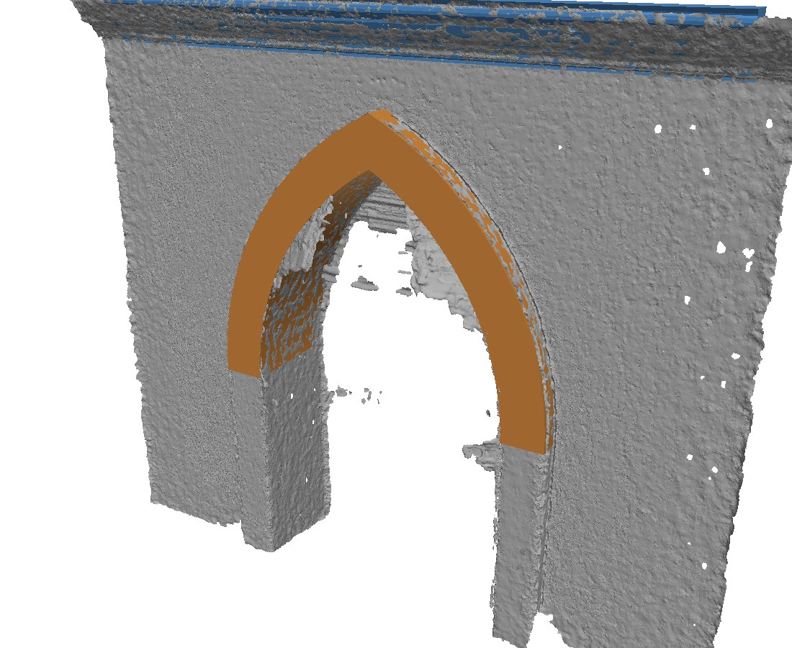
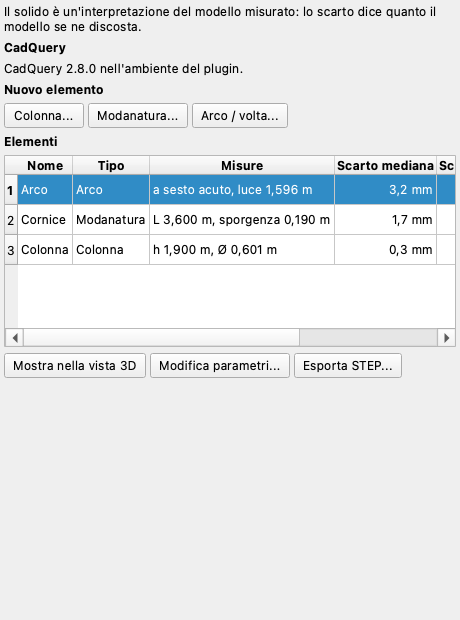
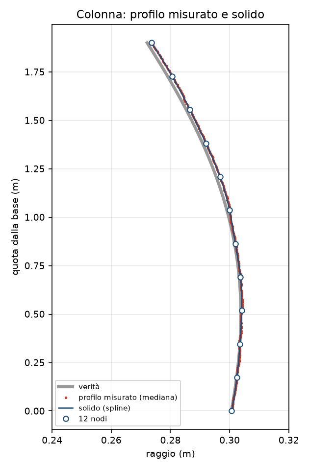
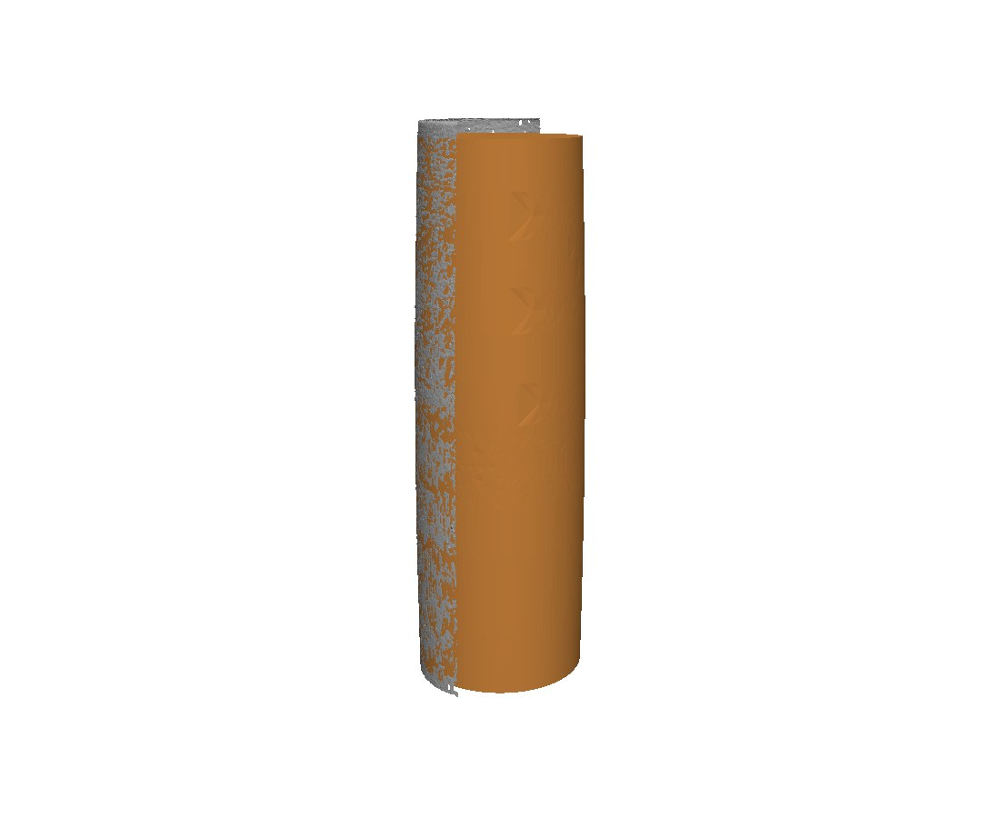
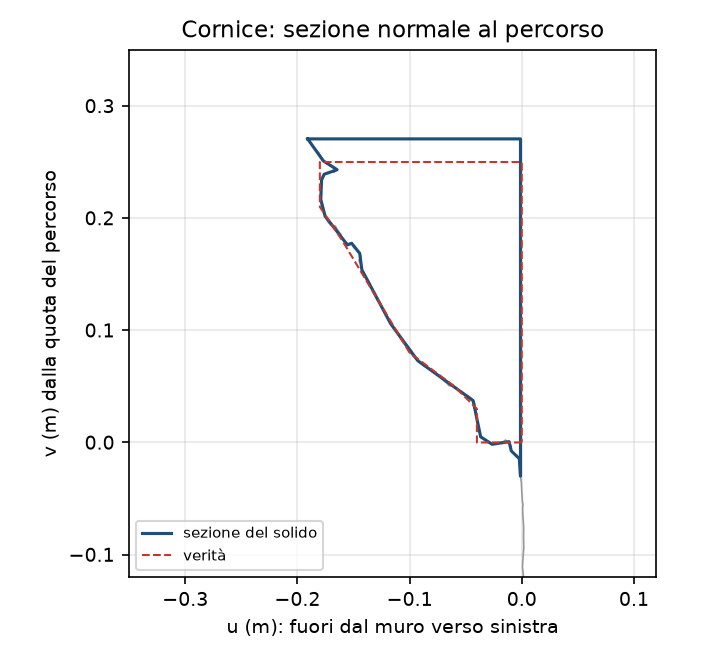
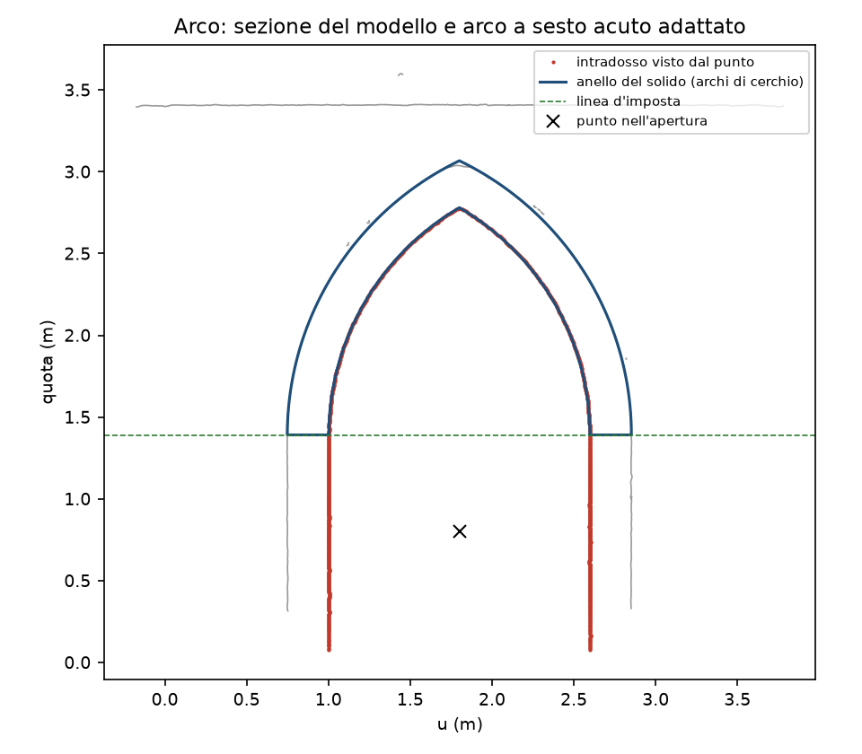

# Elementi architettonici

Il plugin *Elementi architettonici* ricava elementi parametrici dal modello fotogrammetrico: una colonna per
rivoluzione, una modanatura o una cornice portata lungo un percorso, un arco o una volta a botte da una sezione. Ognuno
è un solido con i suoi parametri (raggio, altezza, luce, freccia, spessore) scritto come STEP e come solido IFC
parametrico accanto alla mesh, per un modello HBIM; ognuno tiene il profilo misurato sul modello e dice sempre
**quanto il modello si discosta dal solido**, perché nessuno scambi l'ideale per il reale.

Questa pagina descrive la versione 0.1.0 del plugin, che richiede pyarchinit-photogrammetry 1.3.4 o successivo. Il
README e il codice sono nel [repository dei plugin](https://github.com/enzococca/pyarchinit-photogrammetry-plugins/tree/main/plugins/architecture).

<figure markdown="span">
  
  <figcaption>Il modello di un muro sintetico fatto dal programma con 40 foto (grigio) e i due solidi adattati su di
  esso: la ghiera a sesto acuto (arancio) e la cornice in cima (blu).</figcaption>
</figure>

!!! note "Gli esempi di questa pagina"
    Figure e numeri vengono da due **scene sintetiche** fatte per questa guida: una colonna con entasi e un muro con un
    arco a sesto acuto e una cornice, con texture, fotografati dal renderer del programma, poi allineati, densificati e
    trasformati in mesh dal programma come si farebbe con foto vere. La verità è nota, così la guida può dire quanto il
    plugin le si è avvicinato. Lo script è `proof/make_proof.py` nella cartella del plugin.

## In breve

1. Installa CadQuery una volta dal pannello *Elementi architettonici* (a destra).
2. **Colonna...**: disegna in pianta la zona della colonna, dai le due quote e il numero di nodi.
3. **Modanatura...**: traccia il percorso sulla pianta, su un prospetto o una sezione, o prendi due marker; dai la
   finestra intorno al percorso in cui si taglia la sezione.
4. **Arco / volta...**: scegli una sezione del progetto e clicca dentro l'apertura, o traccia in pianta un piano
   verticale.
5. Leggi lo **scarto** nella tabella, mostra il solido nella vista 3D, modifica i parametri, esporta STEP, IFC o DXF.

<figure markdown="span">
  
  <figcaption>Il pannello con i tre elementi degli esempi: le misure e lo scarto di ciascuno.</figcaption>
</figure>

## Cosa serve

Un chunk con un **modello** in metri: un sistema di coordinate proiettato, o un sistema locale con una scala
(riferimenti, una barra di scala, un modello importato in metri). Un sistema locale senza scala è rifiutato: i numeri
non sarebbero metri. Gli elementi si misurano sul modello, mai sulla nuvola densa; un'ortofoto o un DEM servono solo per
disegnare in pianta, e un prospetto o una sezione del progetto (*Strumenti > Prospetti e sezioni*) per disegnare in
alzato.

## CadQuery e il suo ambiente

I solidi li fanno [CadQuery](https://cadquery.readthedocs.io) e OpenCascade, in un processo a parte: il programma non li
carica mai. *Installa CadQuery* nel pannello (o `ppg plugin architecture install`) crea con `uv` un ambiente nella
cartella del plugin: Python 3.12, CadQuery, OpenCascade (OCP) e il VTK a cui OpenCascade è collegato, senza le parti che
CadQuery usa solo per disegnare e per il suo risolutore di assiemi (casadi, numba, scipy, matplotlib, trame). Occupa
**circa 900 MB** e richiede alcuni minuti; **la prima elaborazione dopo l'installazione richiede circa un minuto**,
mentre Python prepara i moduli di CadQuery. Un Python che ha già CadQuery (`pip install cadquery`) si usa così com'è.

OpenCascade ha versioni per macOS (Apple Silicon e Intel), Linux (x86-64 e aarch64) e Windows x64. Non ce n'è per
**Windows ARM**: lì il pannello dice che gli elementi non sono disponibili.

## La colonna

*Colonna...* chiede una zona disegnata in pianta; il dialogo propone la quota più bassa e la più alta del modello al suo
interno. La parte del modello dentro la zona e fra le due quote è la colonna, o una sua parte.

* **L'asse.** Due partenze: l'asse trovato dalle normali della superficie (come la ceramica del programma trova l'asse
  di un vaso: in qualunque direzione, va bene anche un fusto caduto) e la verticale per il centro della parte. Ognuna
  si affina sui cerchi adattati a fette perpendicolari; vince quella con le fette più rotonde. I cerchi lasciano fuori
  quello che non sta su di loro: le pinne di pixel volanti che una mesh fotogrammetrica fa crescere lungo un contorno,
  una scheggiatura della pietra.
* **Il profilo misurato.** Il modello si taglia con 36 semipiani per l'asse; a ogni quota (un passo dalla risoluzione
  della mesh) il raggio è il più denso fra quelli trovati lì, e se ne tiene la dispersione. Letti e sommità (dove il
  taglio corre in piano) restano fuori.
* **Il solido.** Una spline per K nodi (12 di base) equidistanti dalla base alla cima, con i raggi adattati ai minimi
  quadrati al profilo misurato; oppure, con *Come misurato*, il profilo misurato stesso. Il profilo ruota di 360 gradi.
  L'**entasi** è il raggio più grande oltre la corda fra il raggio della base e quello della cima.
* **Più parti.** Base, fusto e capitello sono elementi separati: *Stesso asse di* dà a una parte l'asse di una colonna
  già fatta.

*Modifica parametri...* cambia il raggio di ogni nodo, il numero dei nodi o la scelta *Come misurato*: il profilo
misurato e l'asse restano come sono, cambia solo il solido, e lo scarto si misura di nuovo.

<figure markdown="span">
  
  <figcaption>La colonna degli esempi: il profilo vero (grigio), i raggi misurati sul modello del programma (rosso),
  i 12 nodi e la spline del solido (blu).</figcaption>
</figure>

<figure markdown="span">
  
  <figcaption>Il modello della colonna (grigio, tolto a destra) e il suo solido (arancio).</figcaption>
</figure>

## La modanatura

Una cornice, una modanatura, una cornice marcapiano: una sezione portata lungo un percorso.

* **Il percorso**: tracciato sulla pianta (la sua quota è quella che dai, di base la sommità del modello al primo
  punto); tracciato su un **prospetto o una sezione** del progetto, mostrato apposta nella vista 2D (ogni punto torna
  nel mondo attraverso il sistema del prospetto, alla profondità del suo rilievo o, dove il rilievo non ha valore, della
  superficie del modello più vicina a chi guarda: un percorso così tiene le sue quote, anche una cornice inclinata);
  oppure dritto **fra due marker**.
* **La sezione**: il modello tagliato dal piano normale al percorso in una stazione (di base il centro del primo
  tratto), tenuto in una **finestra** intorno al punto del percorso (sotto, sopra, sporgenza massima), la linea più
  vicina al percorso, chiusa contro il muro da una linea di fondo *Profondità nel muro* dietro di essa, semplificata
  (Douglas-Peucker, in metri). Sporge verso le foto, o dal lato che scegli.
* **Il solido**: la sezione portata lungo il percorso con gli **angoli a quartabuono**, come gira l'angolo una cornice
  scolpita; un'estrusione se il percorso è dritto.

*Modifica parametri...* cambia la semplificazione e la profondità nel muro, dal taglio conservato nell'elemento.

<figure markdown="span">
  
  <figcaption>La cornice degli esempi: la sezione del solido (blu) contro quella vera (rosso). La sommità è più alta
  perché lo è il modello del programma: la cima del muro si vedeva solo di scorcio.</figcaption>
</figure>

## L'arco e la volta

* **Il piano**: una sezione del progetto (un prospetto di tipo *sezione*), o un piano verticale tracciato ora con due
  punti in pianta. Il modello si taglia con esso.
* **Il punto nell'apertura**: cliccato sulla sezione mostrata nella vista 2D, o scritto come (u, v); il dialogo propone
  il centro dell'apertura più ampia che trova. Dal punto il plugin si guarda intorno: quello che vede per primo è
  l'**intradosso** con gli stipiti, dove ogni raggio esce dalla ghiera è l'**estradosso**.
* **L'adattamento**, ai minimi quadrati sull'intradosso: un cerchio (**a tutto sesto**, quando il centro sta sulla linea
  d'imposta, o **ribassato**), un arco **a sesto acuto** (due cerchi centrati sulla linea d'imposta che si incontrano in
  chiave), un'**ellisse** con gli assi orizzontale e verticale, o **come misurato**. Gli stipiti sotto la linea d'imposta
  fanno parte dell'adattamento, come linee verticali. Con *il migliore (scarto)* vince il tipo più semplice entro il 25 %
  dello scarto migliore: un cerchio prima di un arco acuto, prima di un'ellisse.
* **Spessore**: la distanza mediana dell'estradosso dall'intradosso, o dato. **Profondità**: l'estensione del modello
  dietro la ghiera lungo la normale del piano, o data. *Volta a botte* scrive lo stesso solido come volta.

La ghiera sopra la linea d'imposta si scrive con archi veri (tre punti ciascuno) in STEP e IFC.

<figure markdown="span">
  
  <figcaption>La ghiera degli esempi sul suo piano: il taglio del modello (grigio), l'intradosso visto dal punto
  (rosso), la ghiera dell'arco a sesto acuto adattato (blu).</figcaption>
</figure>

## Come si legge lo scarto

Ogni elemento porta il suo **scarto**: la distanza dei punti del modello dal solido, come **mediana**, **90° percentile**
e **massimo**, con il numero dei punti. Una mediana di pochi millimetri dice che il solido segue il modello; un massimo
grande indica quello che il solido non ha (una scheggiatura, una grappa, un rappezzo più tardo). I punti sono quelli
della zona dell'elemento: per una colonna la parte scelta, per un arco la ghiera e la profondità, per una modanatura il
riquadro del solido senza quello che sta dietro la sua linea di fondo (il muro), di cui si dà il numero.

Lo scarto confronta il solido con il **modello**, non con il monumento: un modello dista già di qualche millimetro
dalla superficie vera, e il solido lo eredita.

## Parametri

| Elemento | Parametro | Significato |
|---|---|---|
| Colonna | quota minima e massima | la parte del modello fra le due |
| | nodi | 12; da 2 a 60 |
| | come misurato | il profilo misurato al posto della spline |
| | stesso asse di | l'asse di una colonna già fatta |
| Modanatura | quota | di un percorso tracciato sulla pianta |
| | sezione a | metri dall'inizio del percorso |
| | finestra sotto, sopra, sporgenza massima | intorno al punto del percorso, in metri |
| | sporge verso | le foto, a sinistra o a destra del percorso |
| | profondità nel muro | della linea di fondo, 0,1 m |
| | semplificazione | tolleranza di Douglas-Peucker, 2 mm |
| Arco | punto nell'apertura | cliccato o (u, v) |
| | tipo | il migliore, a tutto sesto, ribassato, a sesto acuto, ellittico, come misurato |
| | spessore, profondità | 0 = misurati |
| | volta a botte | lo stesso solido come volta |

## File e formati

Tutto di un elemento sta in `<dati del chunk>/architecture/<id>/`: `solid/solid.step` (AP214), `solid/solid.stl`
(tassellato a 0,5 mm), `model.ply` (quello che mostra la vista 3D) ed `element.json` con tutto: origine, parametri,
profilo misurato, geometria, scarto, solido, file. Il modello, la trasformazione e i prodotti del chunk non cambiano
mai.

Le coordinate di STEP, STL e IFC sono quelle del sistema del chunk meno un'**origine** tonda (una per chunk, in
`element.json`): tutti gli elementi di un chunk combaciano fra loro e con la mesh, con numeri piccoli. *Esporta
STEP...* copia i file; *DXF...* scrive il profilo o la sezione in scala 1:1 in metri, sui layer SOLIDO, MISURATO, ASSE
e IMPOSTA.

### IFC

*Esporta IFC...* (anche *File > Esporta > Elementi architettonici (IFC)*) scrive IFC4 come l'esportazione IFC del
programma: progetto, sito, metri, `IfcMapConversion` e `IfcProjectedCRS` sull'origine del chunk; la mesh del rilievo
accanto agli elementi a richiesta (`IfcGeographicElement`). I solidi sono **parametrici**:

| Elemento | Classe IFC | Solido |
|---|---|---|
| Colonna | `IfcColumn` (COLUMN) | `IfcRevolvedAreaSolid` della mezza sezione (`IfcArbitraryClosedProfileDef`) |
| Modanatura dritta | `IfcMember` (USERDEFINED, "Moulding") | `IfcExtrudedAreaSolid` |
| Modanatura lungo un percorso | `IfcMember` (USERDEFINED, "Moulding") | `IfcFixedReferenceSweptAreaSolid` su un `IfcIndexedPolyCurve` |
| Arco, volta | `IfcBuildingElementProxy` ("Arch", "Vault") | `IfcExtrudedAreaSolid` di linee e `IfcArcIndex` |

`Pset_PyArchInit_Element`: `Kind`, `Method`, `Name`, ogni parametro come `P_<nome>` (metri, gradi), `Fit_median_m`,
`Fit_p90_m`, `Fit_max_m`, `Fit_points`, `Source`, `Representation` e una nota che il solido è un'interpretazione del
modello misurato; `Qto_PyArchInit_Element` con volume e superficie. Un IFC riletto da IfcOpenShell dà il volume del
solido di CadQuery entro l'1 % (provato, anche con le cornici inclinate).

## Riga di comando

```bash
ppg plugin architecture install
ppg plugin architecture column PROGETTO.ppg --polygon "POLYGON((x y, ...))" --zmin 0.05 --zmax 1.95 --knots 12
ppg plugin architecture moulding PROGETTO.ppg --path "LINESTRING(x y, x y)" --height 3.35 --station 1 \
    --window -0.4,-0.03,0.02,0.3 --out-side -1
ppg plugin architecture moulding PROGETTO.ppg --elevation "Prospetto sud" --path "LINESTRING(u v, u v)"
ppg plugin architecture arch PROGETTO.ppg --section "Sezione A" --pick 1.8,0.8 --type auto
ppg plugin architecture list PROGETTO.ppg
ppg plugin architecture export PROGETTO.ppg --out elementi.ifc --mesh
ppg plugin architecture export PROGETTO.ppg --out arco.dxf --ids Arco
```

## Gli esempi, contro la verità

Il programma ha fatto i modelli con 64 foto della colonna e 40 del muro. «Modello contro verità» è la distanza del
modello del programma dalla superficie vera nella zona: l'errore della fotogrammetria, che il solido eredita.

| Colonna (2 m, raggio 0,30 m) | plugin | verità |
|---|---|---|
| inclinazione dell'asse | 0,0005° | 0° |
| distanza dell'asse da quello vero | 0,1 mm | 0 |
| raggio alla base / in cima | 300,7 / 273,6 mm | 300,6 / 272,1 mm |
| entasi | 14,1 mm | 14,1 mm |
| nodi: scarto massimo / mediano | 1,6 / 0,7 mm | |
| volume | 0,5246 m³ | 0,5220 m³ (+0,49 %) |
| scarto (mediana / p90) | 0,3 / 0,7 mm | |
| modello contro verità (mediana / p90) | 0,8 / 1,7 mm | |

| Ghiera a sesto acuto (luce 1,6 m, spessore 0,25 m) | plugin | verità |
|---|---|---|
| tipo | a sesto acuto | a sesto acuto |
| luce | 1596,0 mm | 1600,0 mm |
| freccia | 1389,4 mm | 1385,6 mm |
| raggio | 1608,6 mm | 1600,0 mm |
| linea d'imposta | 1391,1 mm | 1400,0 mm |
| spessore della ghiera | 253,6 mm | 250,0 mm |
| scarto (mediana / p90) | 3,2 / 11,1 mm | |
| modello contro verità (mediana / p90) | 2,2 / 8,2 mm | |

| Cornice (sporgenza 0,18 m) | plugin | verità |
|---|---|---|
| sporgenza | 190,9 mm | 180,0 mm |
| area della sezione davanti al muro | 329,9 cm² | 299,0 cm² (+10,3 %) |
| scarto (mediana / p90) | 1,7 / 5,1 mm | |
| modello contro verità (mediana / p90 / max) | 2,0 / 5,6 / 20,4 mm | |

La sezione della cornice segue il modello: la sporgenza e l'area in più vengono dalla sommità del muro e della cornice,
che il programma ha ricostruito fino a 2 cm più in alto (la vedono solo di scorcio le foto più alte), non dal plugin.

## Limiti

* **Solo angoli a quartabuono.** Una modanatura gira l'angolo come una scolpita; gli angoli arrotondati non ci sono
  (l'IFC descriverebbe un altro solido).
* **Modanature inclinate.** Un percorso in pendenza o che gira è percorso da CadQuery con il suo sistema e scritto
  nell'IFC come una sezione portata con il riferimento verso l'alto: i due coincidono in volume ed estensione
  (provato), ma la sezione di una cornice molto inclinata è quella normale al percorso, non una verticale.
* **L'ambiente** occupa circa 900 MB, e la prima elaborazione dopo l'installazione richiede circa un minuto.
* **Windows ARM**: non disponibile (OpenCascade non ha una versione).
* Non trova gli elementi da solo, non modella l'intaglio di un capitello, né volte a crociera o a cupola, né muri e
  aperture, e non modifica nulla nella vista 3D. Il solido vale quanto il modello su cui è adattato: lo scarto dice quanto
  distano.

## Licenze

Il plugin è GPL-2.0-or-later. Nel suo ambiente: CadQuery e OCP (Apache-2.0), OpenCascade (LGPL-2.1 con eccezione), VTK
(BSD-3-Clause), ezdxf (MIT), nlopt (MIT e LGPL), numpy (BSD).
