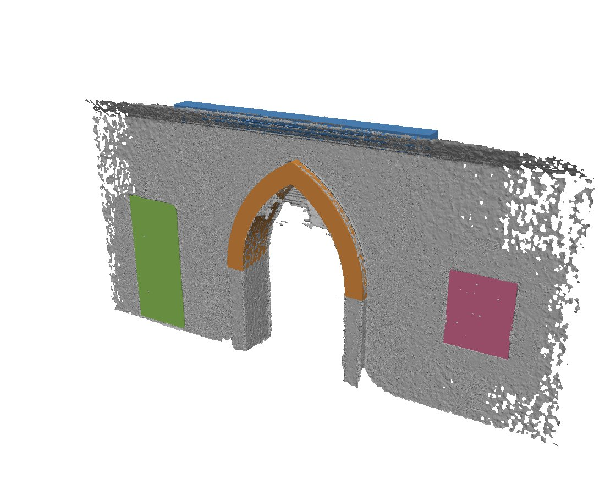
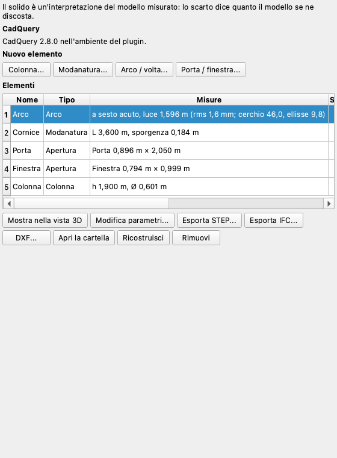
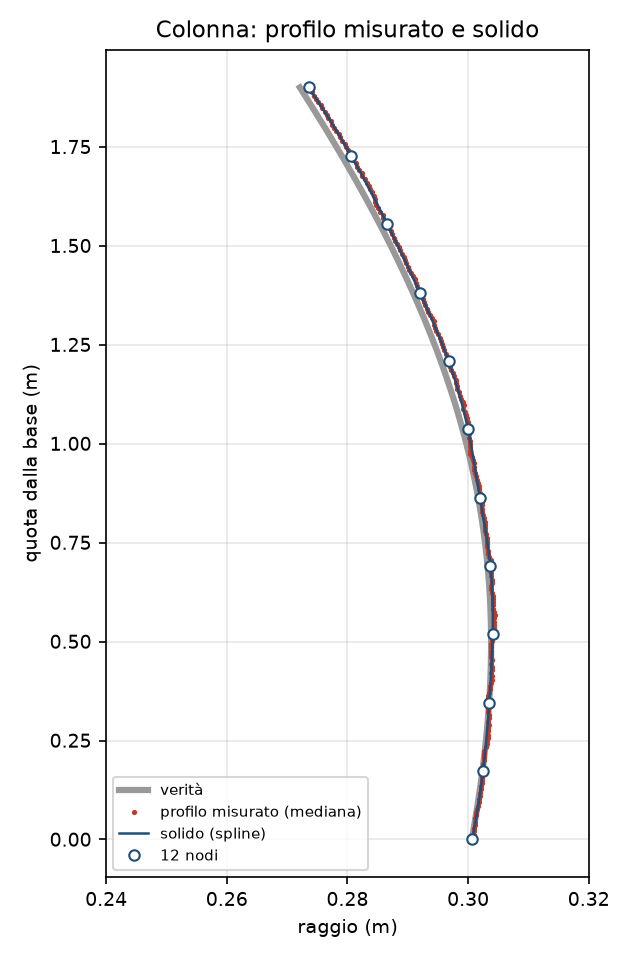
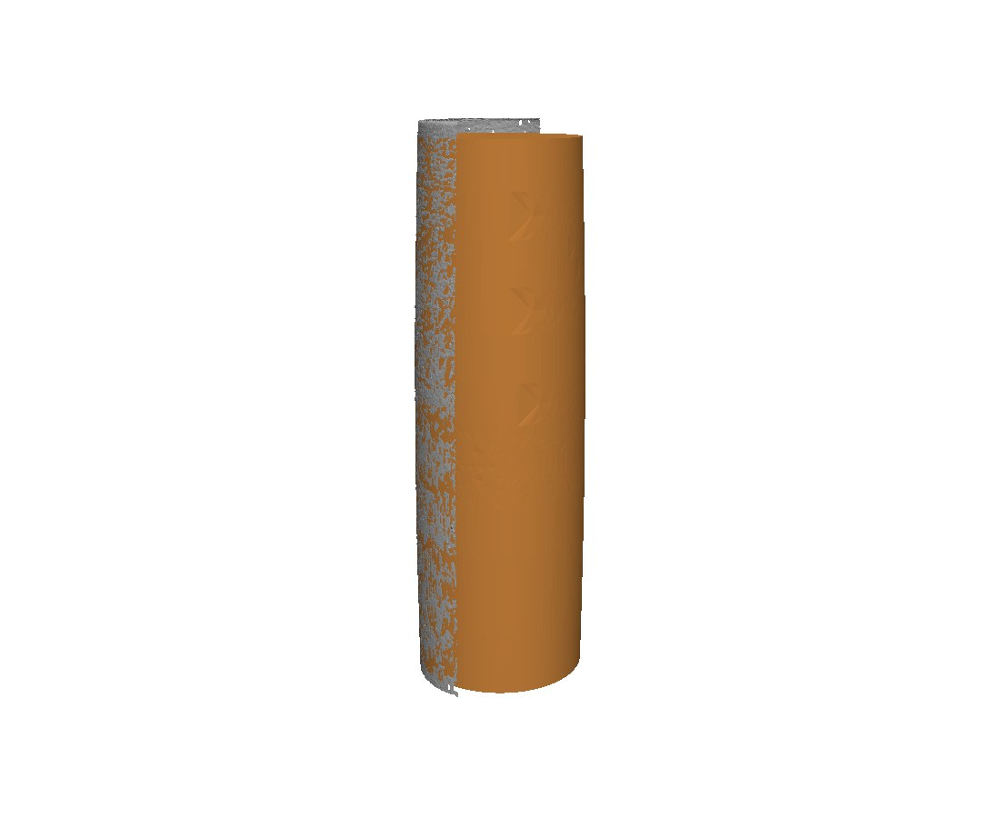
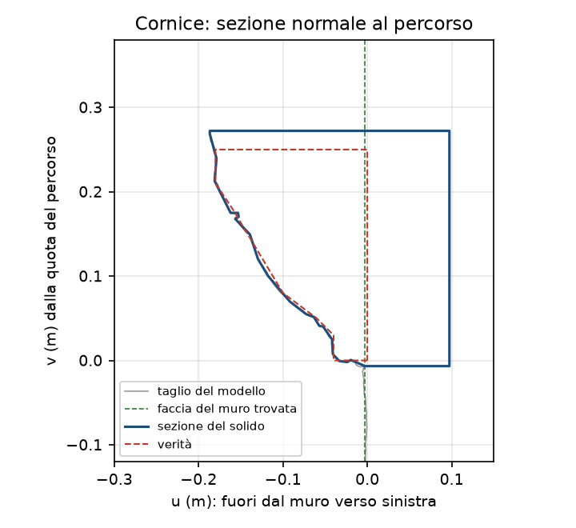
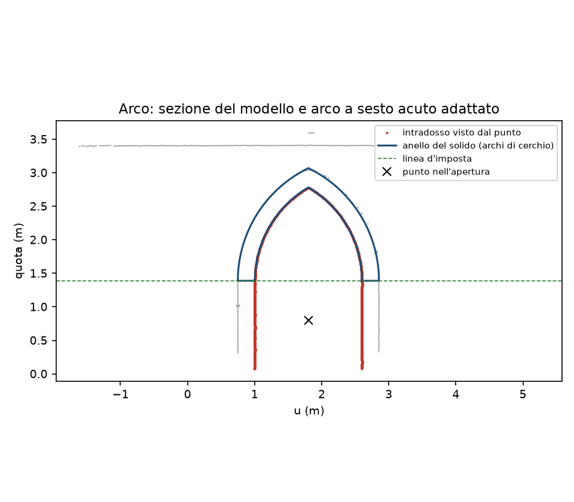
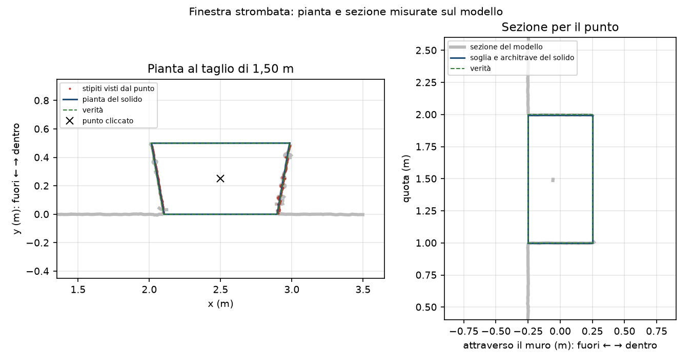

# Architectural elements

The *Architectural elements* plugin makes parametric elements from the photogrammetric model: a column by revolution, a
moulding or a cornice swept along a path, an arch or a barrel vault from a section, the void of a door or a window
through a wall. Each one is a solid with parameters (radius, height, span, rise, thickness, width, sill, lintel) written as STEP and as a parametric IFC solid beside the mesh, for an HBIM
model; each one keeps the profile measured on the model and always says **how far the model is from the solid**, so
that nobody takes the ideal for the real.

This page describes version 0.2.0 of the plugin, which needs pyarchinit-photogrammetry 1.3.4 or later. The README and the
code are in the [plugin repository](https://github.com/enzococca/pyarchinit-photogrammetry-plugins/tree/main/plugins/architecture).

<figure markdown="span">
  
  <figcaption>The model of a synthetic wall made by the program from 76 photos (grey) and the four solids fitted on it:
  the pointed archivolt (orange), the cornice along the top (blue), the void of the door (green) and that of the
  splayed window (pink).</figcaption>
</figure>

!!! note "The examples of this page"
    The figures and the numbers come from two **synthetic scenes** made for this guide: a column with entasis and a wall
    with a pointed arch, a cornice, a door and a splayed window, textured, photographed by the program's renderer, then aligned, densified and
    meshed by the program as real photos would be. The truth is known, so the guide can say how close the plugin came
    to it. The script is `proof/make_proof.py` in the plugin's folder.

## In short

1. Install CadQuery once from the pane *Elementi architettonici* / *Architectural elements* (on the right).
2. **Column...**: draw the region of the column in plan, give the two heights and the number of knots.
3. **Moulding...**: trace the path on the plan, on an elevation or a section, or take two markers; give the window
   around the path where the section is cut.
4. **Arch / vault...**: choose a section of the project and click inside the opening, or trace a vertical plane in plan.
5. **Door / window...**: click inside the opening on the plan; give the wall's thickness when only one face of the wall
   was photographed, or choose the arch that closes it.
6. Read the **fit** in the table, show the solid in the 3D view, edit the parameters, export STEP, IFC or DXF.

Regions and paths in plan are always drawn on the chunk's own orthophoto (or DEM): the plugin shows it again before
asking, even when the view was showing an elevation.

<figure markdown="span">
  
  <figcaption>The pane with the elements of the examples: the measures and the fit of each.</figcaption>
</figure>

## What you need

A chunk with a **model** in metres: a projected coordinate system, or a local frame with a scale (references, a scale
bar, a model imported in metres). A local frame without a scale is refused: the numbers would not be metres. The
elements are measured on the model, never on the dense cloud; an orthophoto or a DEM is only needed to draw on in plan,
and an elevation or a section of the project (*Tools > Elevations and sections*) to draw on in elevation.

## CadQuery and its environment

The solids are made by [CadQuery](https://cadquery.readthedocs.io) and OpenCascade, in a process of their own: the
program never loads them. *Install CadQuery* in the pane (or `ppg plugin architecture install`) makes an environment
with `uv` in the plugin's folder: Python 3.12, CadQuery, OpenCascade (OCP) and the VTK that OpenCascade is linked
against, without the parts CadQuery uses only for drawing and its assembly solver (casadi, numba, scipy, matplotlib,
trame). It takes **about 900 MB** and a few minutes; **the first run after the installation takes about a minute**,
while Python prepares CadQuery's modules. A Python that already has CadQuery (`pip install cadquery`) is used as it is.

OpenCascade has builds for macOS (Apple Silicon and Intel), Linux (x86-64 and aarch64) and Windows x64. There is none
for **Windows on ARM**: there the pane says that the elements are not available.

## The column

*Column...* asks for a region drawn in plan; the dialog proposes the lowest and the highest height of the model inside
it. The part of the model inside the region and between the heights is the column, or a part of it.

* **The axis.** Two starts: the axis found from the normals of the surface (as the pottery of the program finds the axis
  of a vessel: any direction, a fallen shaft works) and the vertical through the middle of the part. Each is refined on
  circles fitted to slices across it; the one whose slices are rounder wins. The circles leave out what is not on them:
  the fins of flying pixels that a photogrammetric mesh grows along a silhouette, a chip of the stone.
* **The measured profile.** The model is cut by 36 half-planes through the axis; for each height (a step from the
  resolution of the mesh) the radius is the densest of the radii found there, and its spread is kept. Beds and tops
  (where the cut runs flat) are left out.
* **The solid.** A spline through K knots (12 by default) evenly spaced from the base to the top, their radii fitted by
  least squares to the measured profile; or, with *As measured*, the measured profile itself. The profile is revolved
  360 degrees. The **entasis** is the largest radius over the chord from the base radius to the top radius.
* **Several parts.** Base, shaft and capital are separate elements: *Same axis as* gives a part the axis of a column
  already made.

*Edit parameters...* changes the radius of each knot, the number of knots or the choice *As measured*: the measured
profile and the axis stay as they are, only the solid changes, and the fit is measured again. An edit that fails or is
cancelled changes nothing: the element keeps its numbers and its files.

The plugin warns (in the table, the summary and the IFC) when the profile has a **step**, a base or an abacus inside the
region: make base, shaft and capital as separate elements. For a **shaft lying down** which end is the base is
arbitrary: the radius at the base and at the top may be the other way round.

<figure markdown="span">
  
  <figcaption>The column of the examples: the true profile (grey), the radii measured on the program's model (red),
  the 12 knots and the spline of the solid (blue).</figcaption>
</figure>

<figure markdown="span">
  
  <figcaption>The model of the column (grey, cut away on the right) and its solid (orange).</figcaption>
</figure>

## The moulding

A cornice, a moulding, a string course: a section carried along a path.

* **The path**: traced on the plan (its height is the one you give, by default the top of the model at its first point);
  traced on an **elevation or a section** of the project, shown in the 2D view for the purpose (each point goes back to
  the world through the elevation's frame, at the depth of its relief or, where the relief has no value, of the model's
  surface nearest the viewer: such a path keeps its heights, a raking cornice too); or straight **between two markers**.
* **The section**: the model cut by the plane normal to the path at a station (by default the middle of the first
  segment). On the line of the cut nearest the path's point the plugin finds the **wall face**: the deepest of
  the vertical stretches (3 cm or more) the line comes from or goes to, preferring one seen both below and above the
  moulding (a cornice's own fascia or fillet is not the wall; a parapet behind it is seen above only). With no such
  stretch the deepest point of the line stands for it and the element says so ("no wall face in the stretch: projection
  from the deepest point"). The plugin keeps only the stretch that **stands out of it** by more than the mesh's resolution, the one at the
  path's point: the moulding's own height, not the wall above and below. That stretch is closed by a back line *Depth
  into the wall* behind the face and simplified (Douglas-Peucker, in metres). The **projection** is measured from the
  wall face. By default the window is found from the cut (the moulding's extent and 10 cm around it, kept in the
  element); a window given in the dialog or with `--window` limits the search. It projects towards the photos, or the
  side you choose. A free-standing member (a cut that closes on itself) is kept whole and reported by its width and height,
  with no projection. The **section area** given is the moulding's in front of the wall face; the solid's section adds
  the slab behind it (`section_area_with_slab`).
* **The solid**: the section swept along the path with **mitred corners**, as a carved cornice turns a corner; an
  extrusion when the path is straight.

*Edit parameters...* changes the simplification and the depth into the wall, from the line of the cut kept in the
element.

<figure markdown="span">
  
  <figcaption>The cornice of the examples: the cut of the model (grey), the wall face found (green), the section of
  the solid (blue, closed 10 cm into the wall) against the true one (red). The top is higher because the program's
  model is: the top of the wall was seen only obliquely.</figcaption>
</figure>

## The arch and the vault

* **The plane**: a section of the project (an elevation of kind *section*), or a vertical plane traced now with two
  points in plan. The model is cut by it.
* **The point in the opening**: clicked on the section shown in the 2D view, or typed as (u, v); the dialog proposes
  the middle of the largest opening it finds. From the point the plugin looks around: what it sees first is the
  **intrados** and the jambs, where each ray leaves the ring is the **extrados**.
* **The fit**, by least squares on the intrados: a circle (**semicircular**, when the centre is on the springing line,
  or **segmental**), a **pointed** arch (two circles centred on the springing line, meeting at the apex), an
  axis-aligned **ellipse**, or **as measured**. The jambs below the springing line are part of the fit, as vertical
  lines. With *the best (fit)* the simplest type within 25 % of the best RMS wins: a circle before a pointed arch
  before an ellipse.
* **Thickness**: the median distance of the extrados from the intrados, accepted only when the far crossings agree
  (their spread under 20 % of the median, the median under half the span); otherwise the plugin asks for it, with the
  reason. An arch whose ring is **flush with the wall** around it shows no extrados in a section: the far crossings are
  the wall's sides and top, and the thickness must be given. **Depth**: the extent of the model behind the ring along
  the plane's normal, or given. *Barrel vault* writes the same solid as a vault.
* A **type asked for is enforced**: semicircular puts the centre on the springing line, segmental below it. The table,
  the summary and the IFC give the RMS of the type chosen and of the others tried, e.g. "pointed (rms 1.3 mm; circle
  45.8, ellipse 9.9)".

A semicircular, segmental or pointed ring is written with true arcs (three points each) in STEP and IFC. An elliptical
or as-measured ring is a polyline of 96 points, and the extrados of an elliptical ring is the ellipse with both
semi-axes grown by the thickness (not a curve at a constant distance).

<figure markdown="span">
  
  <figcaption>The archivolt of the examples on its plane: the cut of the model (grey), the intrados seen from the point
  (red), the ring of the fitted pointed arch (blue).</figcaption>
</figure>

## Doors and windows

*Door / window...* (in the pane and in the *Plugins* menu) asks for a click **inside the opening on the plan**, between
the two reveals, on the chunk's orthophoto or DEM. The solid is the **void**, to be subtracted from the wall.

* **The height of the cut.** By default the plugin cuts the model horizontally at many heights and keeps those at which
  the point is in a passage through the wall (the rays from it leave the wall on both sides, and between them meet a
  reveal on the left and one on the right): the cut is in the middle of them. A height can be given instead.
* **The plan.** On the cut, the two **reveals** are what the point sees on its left and on its right, each fitted by a
  line (a splayed reveal stays splayed); the **wall faces** are the parts of the cut that turn away from the reveals at
  their ends, one line through both sides. When only one face of the wall is on the model (a facade photographed from
  the street) the plugin asks for the **wall thickness**: the other face is placed that far behind the one on the side
  of the photos. A thickness given always takes the place of the measured one.
* **Sill and lintel.** From the vertical section across the wall through the point: the first line met downwards
  (the sill, the threshold or the floor) and upwards (the lintel), as the median of rays across the middle of the
  wall's thickness. Either can be given.
* **The top.** *Flat lintel*, or **an arch** already made (its section must be vertical and cross the wall over the
  opening): the plan is extruded up to the arch's springing line and the void under its intrados (true arcs for a
  semicircular, segmental or pointed arch) is added above it, across the whole thickness: one solid. The plugin warns
  when the arch's span is not the opening's width.
* **Kind.** *Opening only*, *door* or *window*: in the IFC the void is an `IfcOpeningElement`, and a door or a window is
  written beside it as `IfcDoor` or `IfcWindow` with the same solid.

The element reports the **width** at the outer face and at the inner face and, from two more cuts, near the sill and
near the lintel (the plugin warns when the jambs are not upright); the **height**, the **sill** and the **lintel** as
world heights and above the ground of the chunk's DEM in front of the threshold (when there is a DEM); the **depth**
of the reveals (the wall's thickness, measured or given); the **splay** of each reveal in degrees, positive when the
reveal opens out towards the inner face (an embrasure); the area of the void on the outer face.

*Edit parameters...* changes the sill, the lintel (not with an arched top: that comes from the arch), the width at the
outer face (both reveals moved by half the difference, their splay kept) and the wall thickness: what was measured stays
as it is, only the solid changes.

<figure markdown="span">
  
  <figcaption>The splayed window of the examples. Left: the horizontal cut of the model at half the opening's height
  (grey), the reveals seen from the clicked point (red), the plan of the solid (blue) and the truth (green, dashed);
  only the outer face of the wall was photographed, the thickness was given. Right: the vertical section through the
  point, the sill and the lintel of the solid against the truth.</figcaption>
</figure>

## Reading the fit

Every element carries its **fit**: the distance of the model's points from the solid, as the **median**, the **90th
percentile** and the **maximum**, with the number of points. A median of a few millimetres says that the solid follows
the model; a large maximum points at what the solid does not have (a chip, a cramp, a later patch). The points are those
of the region of the element: for a column the part chosen; for an arch the points within three mesh edges of the
intrados or the extrados, not those on its two plane faces (which a ring flush with a wall shares with the wall), whose
count is given; for a moulding the box of the solid without the points on the wall face or behind it (they lie on the
solid by construction and would make the fit look better), whose count is given; for an opening the points of the
reveals, the sill and the lintel (and the arch's intrados), between the two wall faces and not on them, whose count is
given.

The fit compares the solid with the **model**, not with the monument: a model is itself a few millimetres from the real
surface, and the solid inherits that.

## Parameters

| Element | Parameter | Meaning |
|---|---|---|
| Column | lowest and highest height | the part of the model between them |
| | knots | 12; 2 to 60 |
| | as measured | the measured profile instead of the spline |
| | same axis as | the axis of a column already made |
| Moulding | height | of a path traced on the plan |
| | section at | metres from the start of the path |
| | window below, above, largest projection | 0 = found from the cut (the moulding's extent and 10 cm); else the search is limited to it |
| | projects towards | the photos, left or right of the path |
| | depth into the wall | of the back line, 0.1 m |
| | simplification | Douglas-Peucker tolerance, 2 mm |
| Arch | point in the opening | clicked or (u, v) |
| | type | the best, semicircular, segmental, pointed, elliptical, as measured |
| | thickness, depth | 0 = measured |
| | barrel vault | the same solid as a vault |
| Door / window | kind | opening only, door, window |
| | height of the cut | 0 = the middle of the opening |
| | top | flat lintel, or an arch of the chunk |
| | wall thickness | 0 = measured (needed when only one face is on the model) |
| | sill, lintel, width (edit) | world heights; the width at the outer face, symmetric |

## Files and formats

Everything of an element is in `<chunk data>/architecture/<id>/`: `solid/solid.step` (AP214, in metres),
`solid/solid.stl` (tessellated at 0.5 mm; STL has no unit, its numbers are metres), `model.ply` (what the 3D view shows) and `element.json` with everything: source, parameters,
measured profile, geometry, fit, solid, files. The chunk's model, transform and products are never changed.

The coordinates of the STEP, STL and IFC are those of the chunk's system minus a round **origin** (kept per chunk, in
`element.json`): all the elements of a chunk line up with each other and with the mesh, with small numbers. *Export
STEP...* copies the files, each with a `<name>.origin.json` beside it (the origin, the system, the units, the
placement: world = STEP coordinates + origin); *DXF...* writes the profile or the section at 1:1 in metres, on the layers SOLIDO,
MISURATO, ASSE and IMPOSTA; for an opening, the plan (from the middle of the outer face: the reveals measured beside
the ideal ones, the wall faces on FACCE) and, beside it, the elevation from outside with the sill (SOGLIA) and the
lintel (ARCHITRAVE).

### IFC

*Export IFC...* (also *File > Export > Architectural elements (IFC)*) writes IFC4 as the program's IFC export does:
project, site, metres, `IfcMapConversion` and `IfcProjectedCRS` on the chunk's origin; the survey mesh beside the
elements on request (`IfcGeographicElement`). The solids are **parametric**:

| Element | IFC class | Solid |
|---|---|---|
| Column | `IfcColumn` (COLUMN) | `IfcRevolvedAreaSolid` of the half-section (`IfcArbitraryClosedProfileDef`) |
| Moulding, straight | `IfcMember` (USERDEFINED, "Moulding") | `IfcExtrudedAreaSolid` |
| Moulding, along a path | `IfcMember` (USERDEFINED, "Moulding") | `IfcFixedReferenceSweptAreaSolid` on an `IfcIndexedPolyCurve` |
| Arch, vault | `IfcBuildingElementProxy` ("Arch", "Vault") | `IfcExtrudedAreaSolid` of lines and `IfcArcIndex` |
| Opening | `IfcOpeningElement` (OPENING) | `IfcExtrudedAreaSolid` of the plan (`IfcArbitraryClosedProfileDef`) from the sill up; with an arch, a second one of the void under the intrados |
| Door, window | `IfcDoor` (DOOR), `IfcWindow` (WINDOW) beside the opening | the same solid; `OverallWidth`, `OverallHeight` |

`Pset_PyArchInit_Element`: `Kind`, `Method`, `Name`, every parameter as `P_<name>` (metres, degrees), `Fit_median_m`,
`Fit_p90_m`, `Fit_max_m`, `Fit_points`, `Fit_candidates` (arches), `Warnings`, `Source`, `Representation`,
`Frames` (which values are world coordinates and which are in the section plane; arches also carry `P_world_apex`
and the world springing points, mouldings the world ends of the path) and a note that the solid is an interpretation of
the measured model (openings also `P_sill`, `P_lintel`, `P_reveal_depth`, `P_splay_left`, `P_splay_right`);
`Qto_PyArchInit_Element` with the volume and the area. The opening is not related to a wall: the program has no wall
element. An IFC read back by IfcOpenShell gives the
volume of CadQuery's solid within 1 % (tested, raking mouldings included).

### When the chunk's system changes

The origin, the chunk's transform and its system are kept with the elements. When the chunk is georeferenced or moved
to another system afterwards (references, *GNSS > System and heights*), the elements are in the old frame: the plugin
refuses to export, show or edit them until **Rebuild** (in the pane, or `ppg plugin architecture rebuild`) makes them
again in place (same ids: a part made on the same axis as a column still is), carrying their regions, paths, planes and
points into the new frame and measuring them again on the model. Parameters edited by hand (knot radii, type, thickness,
depth, simplification; an opening's sill, lintel, width and wall thickness) are carried too, and the element says "parameters edited by hand kept".

## Command line

```bash
ppg plugin architecture install
ppg plugin architecture column PROJECT.ppg --polygon "POLYGON((x y, ...))" --zmin 0.05 --zmax 1.95 --knots 12
ppg plugin architecture moulding PROJECT.ppg --path "LINESTRING(x y, x y)" --height 3.35 --station 1 \
    --window -0.4,-0.03,0.02,0.3 --out-side -1
ppg plugin architecture moulding PROJECT.ppg --elevation "South elevation" --path "LINESTRING(u v, u v)"
ppg plugin architecture arch PROJECT.ppg --section "Section A" --pick 1.8,0.8 --type auto
ppg plugin architecture arch PROJECT.ppg --points x1,y1,x2,y2 --pick 1.8,0.8 --thickness 0.25
ppg plugin architecture opening PROJECT.ppg --at x,y --kind window --thickness 0.5 [--height H] [--top Arco] \
    [--sill S] [--lintel L]
ppg plugin architecture rebuild PROJECT.ppg
ppg plugin architecture list PROJECT.ppg
ppg plugin architecture export PROJECT.ppg --out elements.ifc --mesh
ppg plugin architecture export PROJECT.ppg --out arch.dxf --ids Arco
```

## The examples, against the truth

The program made the models from 64 photos of the column and 76 of the wall. "Model against truth" is the distance of
the program's model from the true surface in the region: the error of the photogrammetry, which the solid inherits.

| Column (2 m, radius 0.30 m) | plugin | truth |
|---|---|---|
| tilt of the axis | 0.0005° | 0° |
| distance of the axis from the true one | 0.1 mm | 0 |
| radius at the base / at the top | 300.7 / 273.6 mm | 300.6 / 272.1 mm |
| entasis | 14.1 mm | 14.1 mm |
| knots: largest / median error | 1.6 / 0.7 mm | |
| volume | 0.5246 m³ | 0.5220 m³ (+0.49 %) |
| fit (median / p90) | 0.3 / 0.7 mm | |
| model against truth (median / p90) | 0.8 / 1.7 mm | |

| Pointed archivolt (span 1.6 m, ring 0.25 m) | plugin | truth |
|---|---|---|
| type | pointed | pointed |
| span | 1596.2 mm | 1600.0 mm |
| rise | 1393.0 mm | 1385.6 mm |
| radius | 1614.8 mm | 1600.0 mm |
| springing line | 1388.2 mm | 1400.0 mm |
| thickness of the ring | 254.0 mm | 250.0 mm |
| fit on the curved faces (median / p90) | 1.8 / 9.2 mm | |
| points on the two plane faces, left out | 8645 | |
| model against truth (median / p90) | 1.9 / 7.6 mm | |

| Cornice (projection 0.18 m, height 0.25 m), dialog defaults | plugin | truth |
|---|---|---|
| projection from the wall face | 184.1 mm | 180.0 mm |
| height of the cornice | 278.9 mm | 250.0 mm |
| area of the section in front of the wall | 338.7 cm² | 299.0 cm² (+13.3 %) |
| fit (median / p90) | 1.8 / 5.3 mm | |
| points on the wall face or behind it, left out | 1599 | |
| model against truth (median / p90 / max) | 3.2 / 6.6 / 22.0 mm | |

The cornice's section follows the model: its extra projection, height and area come from the top of the wall and the
cornice, which the program reconstructed up to 2 cm higher (it is seen only obliquely by the highest photos), not from
the plugin. With the dialog's defaults the window was found from the cut and the section is the cornice alone.

In the same wall, left of the arch, a **door** (0.9 m, square reveals, a threshold 5 cm high) and, right of it, a
**window splayed 10 degrees** on each side (0.8 m at the outer face, wider inside). Only the outer face of the wall was
photographed: without a thickness the plugin asked for it, and 0.5 m was given. The point was clicked in plan in the
middle of each opening; the height of the cut was found by the plugin.

| Door (cut at 1.072 m) | plugin | truth |
|---|---|---|
| width at the outer face | 896.1 mm | 900.0 mm |
| width at the inner face | 895.5 mm | 900.0 mm |
| width near the sill / near the lintel | 895.6 / 899.4 mm | 900.0 mm |
| splay left / right | 0.48° / -0.55° | 0° |
| sill | 49.0 mm | 50.0 mm |
| lintel | 2098.9 mm | 2100.0 mm |
| volume of the void | 0.9181 m³ | 0.9225 m³ (-0.47 %) |
| fit (median / p90) | 1.6 / 5.3 mm | |
| points on the wall faces, left out | 8148 | |
| model against truth (median / p90) | 2.0 / 6.1 mm | |

| Window (cut at 1.500 m) | plugin | truth |
|---|---|---|
| width at the outer face | 794.0 mm | 800.0 mm |
| width at the inner face | 969.5 mm | 976.3 mm |
| width near the sill / near the lintel | 799.7 / 795.4 mm | 800.0 mm |
| splay left / right | 9.91° / 9.99° | 10° |
| sill | 998.7 mm | 1000.0 mm |
| lintel | 1997.3 mm | 2000.0 mm |
| volume of the void | 0.4403 m³ | 0.4441 m³ (-0.86 %) |
| fit (median / p90) | 2.0 / 11.2 mm | |
| points on the wall faces, left out | 9317 | |
| model against truth (median / p90) | 2.9 / 11.2 mm | |

The window's reveals are seen at a grazing angle through an opening 0.8 m wide: at the height of the cut the program's
model itself is about 4 mm narrower than the truth (3.3 mm on the left reveal, 1.0 mm on the right), and the solid
follows the model. Near the sill, where the model is closer, the width is within 0.3 mm.

## Limits

* **Mitred corners only.** A moulding turns a corner as a carved one does; rounded corners are not offered (the IFC
  would describe another solid).
* **Raking mouldings.** A sloped or turning path is swept by CadQuery with its own frame and written in the IFC as a
  sweep with the reference up: the two agree in volume and extent (tested), but the section of a steep raking cornice
  is the section normal to the path, not a vertical one.
* **The environment** is about 900 MB, and the first run after its installation takes about a minute.
* **Windows on ARM**: not available (no OpenCascade build).
* **Openings**: the plan is the same at every height (a prism from the sill up); jambs that lean are reported (the
  widths near the sill and the lintel), not modelled. An opening is not related to a wall in the IFC.
* It does not detect elements by itself, does not model the carving of a capital, nor cross or domical vaults, nor
  walls, and edits nothing in the 3D view. The solid is as good as the model it is fitted on: the fit says
  how far apart they are.

## Licences

The plugin is GPL-2.0-or-later. In its environment: CadQuery and OCP (Apache-2.0), OpenCascade (LGPL-2.1 with an
exception), VTK (BSD-3-Clause), ezdxf (MIT), nlopt (MIT and LGPL), numpy (BSD).
