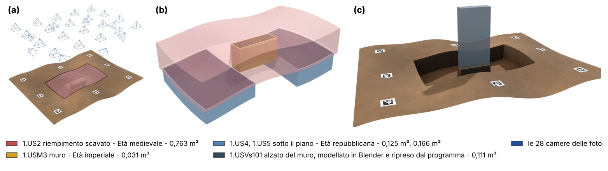
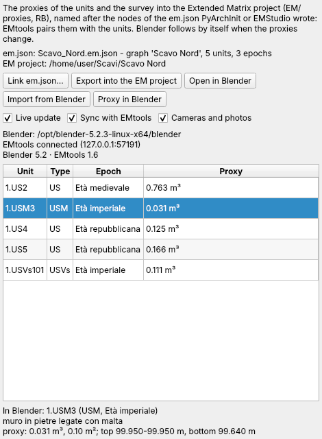
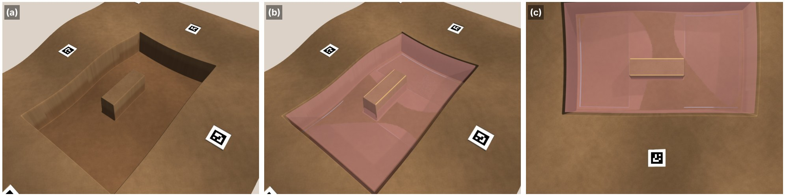

# Blender ed EMtools

Il plugin *Blender ed EMtools* porta i proxy 3D delle unità stratigrafiche, il rilievo fotogrammetrico e
le camere allineate con le loro foto in [Blender](https://www.blender.org) e nell'Extended Matrix di
[EMtools](https://github.com/zalmoxes-laran/EM-blender-tools), l'add-on di Blender dell'Extended
Matrix (E. Demetrescu, CNR-ISPC), e li tiene aggiornati mentre il lavoro va avanti, come il
collegamento con QGIS tiene aggiornati i disegni in QGIS. Ciò che si modella in Blender torna nel
programma come proxy della sua unità, con il suo volume. La matrice resta dove viene scritta: l'em.json
del sito, esportato da PyArchInit o scritto da EMStudio ed EMtools. Il plugin lo legge, dà a ogni proxy
il nome della sua unità nella matrice (il nome con cui EMtools abbina un proxy) e scrive i file dove un
progetto EM li tiene.

Questa pagina descrive la versione 0.1.2 del plugin, che richiede pyarchinit-photogrammetry 1.3.4 o
successiva. README e codice sorgente sono nel
[repository dei plugin](https://github.com/enzococca/pyarchinit-photogrammetry-plugins/tree/main/plugins/blender-em).

<figure markdown="span">
  
  <figcaption>Il progetto EM scritto dal plugin, in Blender. (a) Il rilievo della trincea con i proxy
  delle unità e le 28 camere allineate. (b) I proxy colorati secondo l'epoca della loro unità
  nell'em.json: il riempimento scavato (US 2, in trasparenza), il muro (USM 3), i due strati sotto il
  piano (US 4, US 5). (c) L'alzato del muro com'era (USVs 101, un'unità virtuale), modellato in Blender
  sul moncone del muro, mandato al programma e ripreso come proxy della sua unità, con il suo volume. I
  volumi sono quelli calcolati dal programma. Uno scavo sintetico, reso in Blender 5.2
  (Cycles).</figcaption>
</figure>

!!! note "L'esempio di questa pagina"
    Le figure vengono dallo scavo **sintetico** dei test del programma: una superficie con texture e
    target, una trincea profonda 0,35 m con dentro il moncone di un muro, 28 foto rese con una
    distorsione radiale e allineate, e un em.json scritto come lo scrive PyArchInit, con unità ed epoche
    inventate. Mostrano che cosa fa il plugin e non dicono nulla di un sito reale. Le scene sono state
    importate in Blender dallo script dal vivo del plugin; le figure sono state fatte con l'interfaccia
    italiana.

!!! note "Extended Matrix, EMtools, em.json"
    L'[Extended Matrix](https://www.extendedmatrix.org) è il grafo della stratigrafia di un sito: unità,
    rapporti, epoche, fonti e ricostruzioni. Il suo file di lavoro è l'**em.json** (da s3dgraphy 1.6):
    un file con uno o più grafi, letto da EMStudio, EMtools 1.6 ed Heriverse. Il GraphML (yEd) resta la
    via d'ingresso per le matrici disegnate a mano. In Blender un *proxy* è il solido di un'unità, un
    oggetto con il nome del suo nodo: EMtools lo colora per epoca, lo mostra e lo nasconde con la
    matrice e lo esporta per il web.

## In breve

1. Costruisci i proxy delle unità: *Strumenti > Proxy 3D delle US...* (le US disegnate, o quelle di un
   sito PyArchInit, tra il DEM e una base).
2. In PyArchInit (QGIS) esporta la matrice del sito: *Extended Matrix → Esporta progetto EM per
   EMStudio…* scrive `<sito>.em.json` nella cartella `EM` di un progetto EM, l'albero in cui il plugin
   scrive (*Extended Matrix → Esporta sito in em.json…* scrive il file da solo).
3. Nel programma, *Plugin > Blender ed EMtools > Collega l'em.json del sito...*: il pannello elenca le
   unità della matrice e il proxy abbinato a ciascuna.
4. *Apri in Blender (aggiornato dal vivo)*: i proxy vanno in `EM/proxies`, il rilievo in `RB`, e
   Blender si apre con loro; con EMtools 1.6 l'em.json è caricato e i proxy sono abbinati alle unità.
   Spunta prima *Camere e foto* per avere anche le camere allineate, ciascuna con la sua foto.
5. Continua a lavorare nel programma (ricostruisci un proxy, togline un altro, ricostruisci il
   modello): Blender segue entro un paio di secondi.
6. In Blender avvia la sincronizzazione di EMtools (*Sync*) e spunta *Sincronizza con EMtools* nel
   pannello: un proxy scelto in Blender seleziona la sua unità nel pannello, un'unità scelta nel
   pannello seleziona e inquadra il suo proxy in Blender.
7. Modella in Blender ciò che il programma non può costruire dai DEM (una ricostruzione, un'unità che
   non c'è più) e rimandalo con *Invia al programma* (il pannello *PPG* in Blender): entra nel chunk
   come proxy della sua unità, con volume, area e quote.

## Che cosa fa

| Passo | Che cosa dà | Utile per |
|---|---|---|
| Collega l'em.json | le unità della matrice con la loro epoca, e il proxy del chunk abbinato a ciascuna; i proxy che la matrice non ha, e quelli ambigui, detti | controllare che ogni proxy abbia la sua unità prima di andare in Blender |
| Esporta nel progetto EM | `EM/proxies/<unità>.glb` per ogni proxy, con il nome del suo nodo; `RB/<chunk>/<chunk>.glb` il rilievo con i suoi colori o la texture; `ppg_scene.json` | EMtools, Heriverse, qualsiasi visualizzatore glTF; un progetto EM che tiene la sua geometria anche fuori da Blender |
| Apri in Blender | Blender sul progetto EM con lo script dal vivo del plugin; l'em.json caricato in EMtools 1.6 | modellare la ricostruzione (le unità virtuali) sui proxy reali e sul rilievo; render; il flusso di lavoro EM |
| Camere e foto | le camere allineate come camere di Blender, ciascuna con dietro la sua foto raddrizzata | modellare dove le foto lo mostrano; controllare un proxy sulla foto; render dal punto di vista di una foto |
| Aggiornamento dal vivo | ogni proxy ricostruito, ogni modello cambiato riscritti, e ricaricati da Blender | lavorare nei due programmi insieme senza esportare a mano |
| Sincronizza con EMtools | la selezione condivisa con EMtools 1.6 | leggere la scheda di un'unità scelta in 3D; trovare in 3D l'unità della matrice |
| Proxy in Blender | EMtools crea il proxy di un'unità che non ne ha, un parallelepipedo legato al suo nodo, dove l'unità è disegnata | cominciare il modello di un'unità che non ha proxy nel programma |
| Importa da Blender | gli oggetti mandati da Blender, nel chunk come proxy delle loro unità, con volume, area e quote | le misure di ciò che si è modellato in Blender, nelle tabelle, nelle sezioni del programma e in PyArchInit |

Che cosa resta altrove: la matrice si modifica in EMStudio, in EMtools o nelle schede di PyArchInit; le
ricostruzioni si modellano in Blender; i proxy delle unità scavate li costruisce il programma
(*Strumenti > Proxy 3D delle US...*), come solidi tra due superfici con il loro volume.

## Che cosa serve prima { #before }

* **Il plugin**, installato dal programma: vedi [Guide ai plugin](guides.md#install).
* **I proxy delle unità nel chunk**, fatti con *Strumenti > Proxy 3D delle US...* (vedi
  [Interfaccia](../gui.md)), e/o **un modello**. Senza nessuno dei due non c'è niente da mandare.
* **L'em.json del sito**, consigliato. Lo scrive PyArchInit (*Extended Matrix → Esporta sito in em.json…*, s3dgraphy 1.6), come
  EMStudio ed EMtools 1.6. Senza, i proxy tengono i nomi del programma (`US12`, `USM3`) ed EMtools li
  abbina solo se la sua matrice usa quei nomi.
* **Blender** 4.2 o successivo (provato con la 5.2), cercato dove è installato o scelto con *Scegli il
  programma Blender...* (o con la variabile `PPG_BLENDER`).
* **EMtools** in Blender, facoltativo. Con la **1.6** l'em.json è caricato da solo e la
  sincronizzazione dal vivo funziona; con la **1.5** (solo GraphML) i file, le camere, lo script dal
  vivo e il ritorno da Blender funzionano lo stesso, e la matrice si carica in EMtools a mano.
* **Un database PyArchInit collegato** nel programma, facoltativo: dà a ogni proxy il `node_uuid` della
  sua scheda US, l'id che PyArchInit dà all'unità nell'em.json, così l'abbinamento non dipende dai
  nomi.
* **Per le camere**, le camere allineate del chunk con le loro foto dove il progetto dice che sono.

## I dati { #data }

### L'em.json { #emjson }

Il plugin legge l'em.json, non lo scrive mai. Del file usa:

* le **unità** (i nodi stratigrafici: US, USVs, USVn, SF, VSF, USD, TSU, serie...): il loro id, il nome
  (PyArchInit scrive `area.tipoNUMERO`, `1.US12`) e US, area e tipo della scheda che PyArchInit
  conserva con loro;
* la loro **epoca** (la prima), il cui colore diventa il colore del proxy;
* lo **spostamento** del progetto (il suo nodo di georeferenziazione), quando c'è.

Un file con più grafi (PyArchInit ne scrive uno per saggio, se richiesto) è letto tutto; lo scaffale
degli asset e il corpus della documentazione sono lasciati fuori. È letto anche un file nella forma di
prima del contenitore (un grafo solo).

### L'abbinamento dei proxy con le unità { #pairing }

Ogni proxy del chunk è abbinato a una sola unità, in quest'ordine:

1. con il **`node_uuid` della sua scheda US**, quando un database PyArchInit è collegato: l'id
   dell'unità nell'em.json di PyArchInit;
2. con la **scheda**: lo stesso numero di US e lo stesso tipo (`USM` non è `US`), e la stessa area
   quando entrambi ne hanno una;
3. con il **nome**: `US12`, `1.US12`, o un nome di nodo che finisce con `.US12`.

Un'unità va a un solo proxy. Due unità possibili per un proxy non sono una scommessa: il pannello
elenca i candidati, e il proxy tiene il nome del programma finché l'area del proxy o delle schede non
dice quale. I proxy senza unità sono scritti con il nome del programma e segnati *non nella matrice*.

### Il progetto EM { #project }

```
<progetto>/EM/<sito>.em.json         la matrice (di PyArchInit, di EMStudio)
<progetto>/EM/proxies/<unità>.glb    un proxy per unità, con il nome del suo nodo
<progetto>/RB/<chunk>/<chunk>.glb    il rilievo (reality-based)
<progetto>/RB/<chunk>/foto/          le foto raddrizzate per le camere in Blender
<progetto>/ppg_scene.json            il manifest che lo script dal vivo segue
<progetto>/ppg_inbox/                ciò che Blender rimanda, finché il programma non lo prende
```

È l'albero standard di un progetto EM (s3dgraphy, EMtools 1.6). Quando l'em.json sta nella cartella
`EM` di un progetto, i file vanno in quel progetto; un em.json altrove li ha accanto a sé (`proxies/`,
`RB/`), come fa EMtools. Senza em.json il plugin chiede una volta la cartella del progetto e la
conserva con il chunk.

**Coordinate.** glTF ha la Y in alto; Blender lo riporta con la Z in alto all'importazione. Le
coordinate sono **spostate di un numero intero di metri**, perché un float32 tiene un quarto di metro a
quattromila chilometri: dello spostamento dell'em.json quando c'è, altrimenti dell'angolo più basso di
ciò che si scrive, arrotondato per difetto (per esempio `300000, 4500000, 99`). Una volta scelto, lo
spostamento resta per il progetto, così un aggiornamento non sposta mai ciò che Blender mostra; la scena
lo conserva (`ppg_shift`, e i `BL_x_shift`... che EMtools legge, quando non sono ancora impostati). Ciò
che torna da Blender è riportato nelle coordinate del chunk.

**File di altri programmi.** Un file è riscritto solo quando cambia ciò da cui viene (il proxy, il
modello, lo spostamento, il nome, il colore dell'epoca), e **mai sopra un file che un altro programma
ha scritto o cambiato** nello stesso posto: EMtools scrive in `EM/proxies` anche i proxy modellati in
Blender. Un file così resta com'è e il resoconto lo dice. Il file di un proxy tolto dal chunk è
cancellato solo se è ancora quello scritto dal plugin.

## Passo per passo nel programma { #program }

Il pannello *Blender ed EMtools* (*Plugin > Blender ed EMtools > Pannello Blender ed EMtools*, a destra)
mostra l'em.json collegato, il progetto EM, Blender e lo stato della sincronizzazione, i pulsanti, i tre
interruttori (*Aggiornamento dal vivo*, *Sincronizza con EMtools*, *Camere e foto*) e la tabella delle
unità: unità, tipo, epoca, proxy (il suo volume). La voce *Progetto EM (Blender)* sotto il chunk
nell'area di lavoro apre il pannello e ha le stesse azioni nel suo menu.

<figure markdown="span">
  
  <figcaption>Il pannello con l'em.json del sito collegato (5 unità, 3 epoche), l'aggiornamento dal vivo,
  la sincronizzazione e le camere accesi. Il muro, scelto in Blender, è selezionato nella tabella; sotto,
  la sua descrizione nella matrice e le misure del suo proxy. USVs 101 ha il proxy modellato in Blender.
  Qui la sincronizzazione parla con un host di prova che usa il protocollo di EMtools
  1.6.</figcaption>
</figure>

### 1. Collega l'em.json { #link }

*Collega em.json...*: il `.em.json` del sito. Il pannello elenca le unità della matrice con il proxy
abbinato a ciascuna, poi i proxy che la matrice non ha; un messaggio li nomina. Il collegamento è
conservato con il chunk (anche relativo al progetto, così un progetto spostato insieme al suo progetto
EM lo ritrova), e l'em.json è riletto ogni volta che cambia: esportato di nuovo da PyArchInit, salvato
da EMStudio.

### 2. Esporta nel progetto EM { #export }

*Esporta nel progetto EM* scrive i proxy e il rilievo e riporta ciò che ha scritto, ciò che era
invariato, ciò che ha lasciato com'era (file di un altro programma), i proxy non nella matrice, le foto
raddrizzate e lo spostamento. Il rilievo è il modello attivo del chunk, con la sua texture quando ce
l'ha.

### 3. Apri in Blender { #blender }

*Apri in Blender (aggiornato dal vivo)* esporta, poi avvia Blender sul progetto: il `.blend` più recente
nella cartella del progetto quando c'è, altrimenti una scena nuova (salvala lì, e si aprirà la volta
dopo). In Blender:

* i proxy sono nella collezione **PPG Proxy**, il rilievo in **PPG Rilievo**, le camere in **PPG
  Camere**; ogni oggetto conserva unità, area, tipo, epoca, id del nodo e volume come proprietà
  personalizzate (*Proprietà oggetto > Proprietà personalizzate*);
* la scheda **PPG** della barra laterale della vista 3D (tasto N) mostra il progetto, la revisione del
  manifest, *Dal vivo: sì/no*, il pulsante per ricaricare, *Invia al programma*, *Carica l'em.json in
  EMtools* e gli oggetti cambiati in Blender;
* con EMtools 1.6, in una scena nuova, l'em.json è caricato in EMtools da solo; i proxy sono abbinati
  alle unità per nome.

**Ciò che cambi in Blender non è mai sovrascritto.** Un oggetto i cui vertici non sono più quelli
importati dal plugin (un proxy modellato a mano) è *staccato*: la nuova versione del programma non lo
sostituisce, e il pannello lo elenca. Il materiale dato da EMtools (il colore dell'epoca) resta quando
la mesh di un proxy è sostituita.

### 4. Aggiornamento dal vivo { #live }

*Aggiornamento dal vivo* (acceso anche da *Apri in Blender*): ogni due secondi il programma guarda i
proxy, il modello e l'em.json del chunk attivo; quando qualcosa è cambiato riscrive il progetto EM in
background (senza finestra di avanzamento, e non mentre gira un'elaborazione) e Blender, che legge il
manifest ogni secondo, ricarica ciò che è cambiato. Un proxy ricostruito sostituisce la mesh del suo
oggetto, un proxy tolto scompare, il rilievo di un modello ricostruito sostituisce quello vecchio. Ciò
che Blender ha rimandato entra nel chunk nello stesso momento (vedi [sotto](#take)).

### 5. Sincronizza con EMtools { #sync }

EMtools 1.6 *ospita* la sincronizzazione dal vivo dell'Extended Matrix, quella che usa EMStudio: in
Blender avviala dal pannello di EMtools (*Sync*). Poi spunta **Sincronizza con EMtools** nel pannello.
Il programma si collega a Blender (`127.0.0.1`, porta 8788; un'altra porta con l'impostazione `port` del
plugin), dice quale matrice ha aperto (EMtools avverte quando i due non sono sullo stesso studio) e
chiede il grafo di EMtools: senza un em.json collegato, il pannello e i nomi dei proxy seguono quel
grafo.

* **Un proxy scelto in Blender** seleziona la sua unità nella tabella del pannello, con tipo, epoca e le
  misure del suo proxy (volume, area, quote) sotto la tabella.
* **Un'unità scelta nel pannello** seleziona e inquadra il suo proxy in Blender. EMtools deve accettare
  la selezione (il suo default: *Accept: everything* o *selection*).

Il programma manda la selezione e, quando glielo chiedi con *Proxy in Blender* (sotto), il comando di
EMtools che crea un proxy; non manda mai modifiche al grafo, che sono di EMtools e di EMStudio. Quando
Blender si chiude e si riapre, il programma si ricollega da solo.

### 6. Camere e foto { #cameras }

Con **Camere e foto** spuntato, la prossima esportazione (e *Apri in Blender*) scrive anche le camere
allineate del chunk:

* ogni **foto raddrizzata** con la calibrazione del suo sensore (ogni modello di camera del programma,
  anche i fisheye) e rimpicciolita, 2048 pixel sul lato lungo, in `RB/<chunk>/foto/`; la camera di
  Blender non ha distorsione dell'obiettivo, quindi la foto deve perderla prima;
* ogni **camera** in Blender, nella collezione *PPG Camere*: la sua posa nelle coordinate del progetto,
  la sua lunghezza focale e il suo punto principale sul fotogramma della foto, e la foto raddrizzata
  come immagine di sfondo. La dimensione del render è impostata sul fotogramma delle foto, una volta
  (una dimensione impostata a mano dopo resta).

Guarda attraverso una camera in Blender (selezionala, *Vista > Camere > Imposta oggetto attivo come
camera*, Ctrl Tastierino 0): il rilievo e i proxy stanno sulla foto, e una ricostruzione si modella dove
la foto la mostra. Una foto è riscritta solo quando cambiano la foto, la sua calibrazione o la
dimensione; togliendo la spunta, le camere e le loro foto vanno via alla prossima esportazione. Le foto
che il progetto non trova sono nominate nel resoconto, e le loro camere lasciate fuori.

<figure markdown="span">
  
  <figcaption>(a) Una foto della trincea come è stata scattata, con la distorsione del suo obiettivo.
  (b) La stessa foto raddrizzata dal plugin, dietro la sua camera in Blender: i proxy visti attraverso la
  camera stanno dove la foto mostra le unità, il riempimento scavato (rosa) sulla trincea vuota, il muro
  sul suo moncone. (c) Un'altra camera, una foto quasi verticale. Il rilievo nasconde ciò che sta sotto
  terra, come nella foto. Foto sintetiche, rese in Blender 5.2.</figcaption>
</figure>

### 7. Da Blender di nuovo nel programma { #take }

Ciò che si modella in Blender torna nel chunk come proxy della sua unità:

1. In Blender modella il solido dell'unità (una ricostruzione, un'unità virtuale USVs o USVn, un'unità
   scavata e mai rilevata) e dai all'oggetto il nome della sua unità (`1.USVs101`, `USVs101`), oppure
   parti da un oggetto con il suo nodo (un proxy del programma, o uno creato da EMtools, sotto).
2. Selezionalo e fai **Invia al programma** nel pannello *PPG*; senza selezione sono mandati gli oggetti
   cambiati in Blender. Ognuno va in `ppg_inbox` accanto al manifest, come glTF, con l'id del suo nodo.
3. Nel programma, **Importa da Blender** (il pannello, o *Plugin > Blender ed EMtools > Importa i proxy
   da Blender*); con *Aggiornamento dal vivo* acceso avviene da solo entro due secondi.

Ogni oggetto diventa un proxy del chunk, come li fa *Strumenti > Proxy 3D delle US...*: un PLY nelle
coordinate del chunk, accanto agli altri, con

* l'**unità**: dall'id del suo nodo, altrimenti dal nome (anche con il codice del grafo che EMtools gli
  mette davanti, `SCAVO.1.US12`);
* il **volume**, quando il solido è chiuso: i buchi piccoli sono chiusi prima; una mesh aperta (una
  superficie, un foglio) non ha volume, e il resoconto lo dice;
* l'**area in pianta** e le **quote** del tetto e del fondo (le facce rivolte in su e in giù).

Un proxy del chunk con lo stesso nome è sostituito: il proxy costruito dai DEM lascia il posto a quello
modellato. Il pannello dei proxy della finestra, la tabella di questo pannello e il progetto EM seguono;
l'oggetto resta in Blender, ora come proxy del programma. Un proxy già pubblicato in PyArchInit è
nominato nel resoconto, *da ripubblicare in PyArchInit*: la sua geometria è cambiata.

### 8. Proxy in Blender { #emtools-proxy }

Per un'unità della matrice di cui il programma non ha il proxy, EMtools può cominciarne uno. Con la
sincronizzazione accesa, scegli le unità nella tabella e fai **Proxy in Blender**: il programma manda a
EMtools il suo comando `create_proxy_for_unit`, ed EMtools crea, per ciascuna, un parallelepipedo legato
al nodo dell'unità. Quando l'unità è disegnata nel chunk, il parallelepipedo è grande quanto l'unità
disegnata, nel suo mezzo, con il tetto sul DEM; altrimenti EMtools lo mette sul cursore 3D. Modellalo,
poi rimandalo con *Invia al programma*.

Il pulsante è attivo mentre la sincronizzazione è collegata, a meno che EMtools non dica di rifiutare i
comandi: in Blender spunta **Accept commands from EMStudio** nel pannello di sincronizzazione di EMtools
(è spento per default). Un'unità che ha già un proxy in Blender è detta, e lasciata com'è.

## Tempo reale: come funziona { #realtime }

Il collegamento con Blender funziona come il [collegamento con QGIS](../integrations.md#qgis-dal-vivo):
file che l'altro programma rilegge, più un canale per ciò che deve essere immediato.

| | Collegamento con QGIS | Blender ed EMtools |
|---|---|---|
| Che cosa viaggia | i disegni, in un GeoPackage | i proxy, il rilievo e le camere, in file glTF e foto del progetto EM |
| Chi guarda | QGIS ridisegna i layer ogni secondo | lo script del plugin in Blender legge il manifest ogni secondo |
| Quando il programma scrive | a ogni modifica dei disegni | quando cambiano proxy, modello o em.json (al massimo ogni due secondi) |
| Che cosa torna | i disegni fatti in QGIS | gli oggetti mandati con *Invia al programma*, presi come proxy con il loro volume |
| Canale immediato | - | il WebSocket di EMtools 1.6: la selezione, nei due sensi; il comando che crea un proxy |
| Ciò che l'altro lato cambia | - | conservato: oggetti staccati, materiali di EMtools, file scritti da EMtools |

## Dalla riga di comando { #cli }

```bash
# le unità dell'em.json e i proxy abbinati
ppg plugin blender-em status scavo.ppg --emjson Scavo/EM/Scavo.em.json

# il progetto EM dell'em.json (EM/proxies, RB, ppg_scene.json)
ppg plugin blender-em export scavo.ppg --emjson Scavo/EM/Scavo.em.json

# con le camere e le loro foto raddrizzate, 3000 pixel sul lato lungo
ppg plugin blender-em export scavo.ppg --cameras --photo-side 3000

# senza em.json, in una cartella; solo i proxy
ppg plugin blender-em export scavo.ppg --out Scavo --no-survey

# esporta e apri Blender (l'em.json collegato al chunk quando non è indicato)
ppg plugin blender-em open scavo.ppg --blender /Applications/Blender.app/Contents/MacOS/Blender

# i proxy mandati da Blender nel chunk, e il progetto salvato
ppg plugin blender-em take scavo.ppg

# i Blender trovati
ppg plugin blender-em blender
```

`--chunk ETICHETTA` lavora su un chunk diverso da quello attivo. Senza `--cameras`, un'esportazione
conserva le camere che il progetto EM ha già. Lo script che gira in Blender si può anche avviare a mano:
`blender --python blender_live.py -- ppg_scene.json` (il file è nella cartella del plugin), o dal
pannello in Blender, *Scegli il manifest...*.

## Leggere i risultati { #reading }

* **Non nella matrice.** Un proxy senza unità tiene il nome del programma: o l'unità manca
  dall'em.json (esporta di nuovo l'em.json da PyArchInit dopo averne creato la scheda), o numero, tipo
  o area sono diversi.
* **Più unità possibili.** Lo stesso numero di US in due aree, e un proxy senza area: dai l'area
  all'unità disegnata (o costruisci i proxy dal sito PyArchInit), o collega il database per il
  `node_uuid`.
* **Lasciati com'erano.** Un file con lo stesso nome scritto da EMtools: cancellalo nel progetto EM se il
  proxy del programma deve sostituirlo.
* **Staccati in Blender.** Il proxy è stato modellato in Blender: la versione del programma non è
  applicata. Per riaverla, cancella l'oggetto in Blender e fai *Aggiorna ora* nel pannello PPG: l'oggetto
  è importato di nuovo. Per avere invece nel programma quello modellato, mandalo con *Invia al
  programma*.
* **Non chiusi, senza volume.** Un oggetto mandato da Blender con buchi che il programma non sa
  chiudere, o una superficie: entra con area e quote, e volume 0. Chiudilo in Blender (*Mesh > Pulisci >
  Riempi buchi*, o un solido modellato chiuso) e mandalo di nuovo.
* **Da ripubblicare in PyArchInit.** Un proxy pubblicato in PyArchInit è stato sostituito da quello di
  Blender: pubblicalo di nuovo perché i media della scheda US mostrino la nuova geometria.
* **Foto non trovate.** Il progetto non trova quelle foto dove dice che sono: le loro camere sono
  lasciate fuori.

### Limiti { #limits }

* **Ciò che torna è il solido**: un proxy con le sue misure. Materiali, texture, modificatori non
  applicati e i rapporti della matrice restano in Blender e nel progetto di EMtools; la matrice si
  modifica in EMStudio, EMtools o PyArchInit.
* **Un chunk**: quello attivo, con i suoi proxy, il suo modello e le sue camere.
* **Il rilievo in un solo file**: un modello grande fa un glTF grande; decimalo prima (il plugin *Mesh
  (MeshLab)*) quando Blender deve restare leggero.
* **Le foto delle camere** sono copie, raddrizzate e più piccole (2048 pixel per default, `--photo-side`
  dalla riga di comando): gli originali restano dove sono.
* **La sincronizzazione richiede EMtools 1.6** (una versione di sviluppo a ottobre 2026); EMtools 1.5
  legge GraphML e non ha né la sincronizzazione né i comandi: lì la matrice si carica a mano. *Proxy in
  Blender* richiede anche che EMtools accetti i comandi.
* **I proxy in coordinate cartografiche costruiti con il programma fino alla 1.3.4** sono stati salvati
  in precisione singola: con milioni di metri nella coordinata nord, i loro vertici stanno su una
  griglia da un quarto a mezzo metro, in Blender come nel programma. Ricostruiscili con una versione
  successiva (che li salva in doppia precisione, come questo plugin salva ciò che torna da Blender).

## File scritti { #files }

* `EM/proxies/<unità>.glb` (o `proxies/` accanto all'em.json): un glTF binario per proxy, un nodo e una
  mesh con il nome dell'unità, un materiale nel colore della sua epoca; nei suoi extras unità, area,
  tipo, id del nodo, volume, sistema di riferimento e spostamento.
* `RB/<chunk>/<chunk>.glb`: il rilievo, con i suoi colori o la sua texture.
* `RB/<chunk>/foto/<foto>.jpg`: le foto delle camere, raddrizzate (con *Camere e foto*).
* `ppg_scene.json` nella cartella del progetto: il manifest (revisione, sistema di riferimento,
  spostamento, em.json, gli oggetti con i loro file, le loro sorgenti e i loro checksum, le camere con
  posa e calibrazione), letto dallo script in Blender.
* `ppg_inbox/<oggetto>.glb` e `.json`: ciò che Blender ha mandato, finché il programma non lo prende
  (poi cancellato).
* Nel chunk, `proxies/<unità>.ply` per ogni proxy preso da Blender, in doppia precisione, e la sua voce
  tra i proxy (base *blender*, il nome dell'oggetto in Blender).
* Il progetto conserva con il chunk l'em.json collegato e la cartella del progetto EM.
* Le impostazioni del plugin (Blender, aggiornamento dal vivo, sincronizzazione, camere, porta) nella
  sua cartella del programma (vedi [Plugin](../plugins.md)).
