# Geoarcheologia

Il plugin *Geoarcheologia* trasforma i log dei sondaggi - trivellate manuali, carotaggi meccanici,
saggi, colonne misurate sulla parete di una sezione di scavo - nella stratigrafia sotto il rilievo
fotogrammetrico: la colonna di ogni sondaggio, la superficie dove comincia ogni unità, lo spessore e il
volume di ogni unità, sezioni lungo qualsiasi linea e un modello 3D con un solido per unità. Tutto sta sul
DEM e sull'ortofoto del progetto, nel suo sistema di riferimento.

Questa pagina descrive la versione 0.2.0 del plugin, che richiede pyarchinit-photogrammetry 1.3.3 o
successiva. Il README e il codice sono nel
[repository dei plugin](https://github.com/enzococca/pyarchinit-photogrammetry-plugins/tree/main/plugins/geoarchaeology).

<figure markdown="span">
  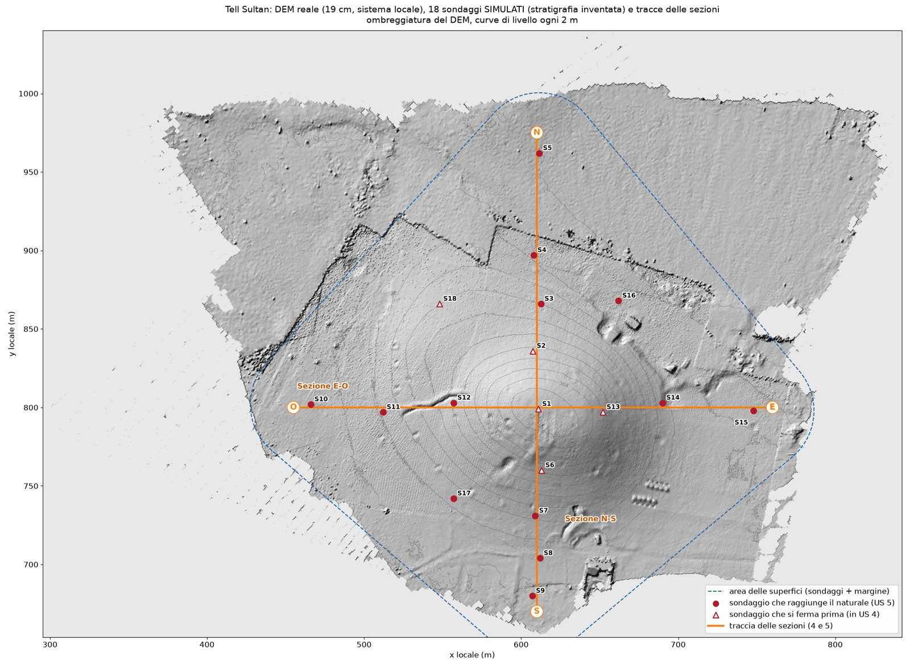
  <figcaption>Sondaggi simulati (stratigrafia inventata) sul DEM reale di Tell Sultan, in un sistema di
  riferimento locale. Cerchi: sondaggi che raggiungono il naturale; triangoli: sondaggi che si fermano
  prima. La linea tratteggiata delimita le superfici, le linee arancioni sono le tracce di due
  sezioni.</figcaption>
</figure>

!!! note "L'esempio di questa pagina"
    Figure e numeri vengono da una dimostrazione con 18 sondaggi **simulati**: una stratigrafia inventata
    di humus (US 1), crollo e colluvio (US 2), depositi dell'età del Ferro (US 3) e del Bronzo (US 4)
    sopra un naturale sterile (US 5), messa sul DEM reale di Tell Sultan - il sito del
    [tutorial](../tutorials/tell.md) - spostato in un sistema di riferimento locale. Mostrano che cosa fa
    il plugin e non dicono nulla del sito. I [file di esempio](#example-files) contengono gli stessi dati.

## In breve

1. Rileva il sito e costruisci il DEM (e l'ortofoto) in un chunk con un sistema di riferimento
   proiettato, in metri.
2. Misura la posizione di ogni sondaggio nello stesso sistema di riferimento; descrivi ogni log
   intervallo per intervallo.
3. Scrivi una tabella CSV dei collari e una degli intervalli, oppure una tabella sola.
4. Nel pannello *Geoarcheologia*: *Importa sondaggi...*, controlla l'*Ordine delle unità...*, poi
   *Superfici...*.
5. Guarda le superfici sopra l'ortofoto, disegna sezioni e colonne stratigrafiche, costruisci il modello
   3D e guardalo nella vista 3D.
6. Esporta in GeoPackage, GeoTIFF, DXF, PLY/OBJ e CSV, oppure apri tutto in QGIS.
7. Per fosse, fossati e riempimenti, o per un contatto visto in pochi sondaggi, costruisci il [modello implicito](#implicit).

## Che cosa fa

| Prodotto | Che cos'è | A che cosa serve |
|---|---|---|
| Colonne stratigrafiche | il log di un sondaggio con le sue descrizioni, oppure un pannello di più sondaggi affiancati su un asse comune delle quote, con i tetti della stessa unità collegati | documentare e correlare i log |
| Superfici di contatto | il tetto di ogni unità fra i sondaggi - il suo contatto con l'unità sopra - interpolato per kriging, con la sua incertezza | dove comincia il naturale sotto un tell, un piano sepolto, la base dell'humus |
| Spessori e volumi | lo spessore di ogni unità (isopache) e il suo volume | quanto sono profondi i depositi, volumi da scavare, crescita di un tell |
| Sezioni | il terreno, i contatti e le unità lungo una linea, con i sondaggi vicini riportati, in scala | tavole per la relazione, verifica di una correlazione |
| Modello 3D | un solido chiuso per unità, con il suo volume | QGIS 3D, Blender, MeshLab, didattica |
| Modello implicito | su richiesta, con LoopStructural: tagli e riempimenti, sottosquadri, contatti rari, giaciture | una fossa o un fossato e il volume del riempimento, come intervallo |

Serve ogni volta che pochi fori devono raccontare che cosa c'è sotto una superficie rilevata: una
campagna di carotaggi su un tell, una griglia di trivellate in un campo prima dello scavo, le sezioni di
trincee separate da collegare. Il plugin disegna quello che dicono i log e riempie lo spazio fra di essi
con la regolarità che i dati permettono. La correlazione dei log - quale strato di un sondaggio è lo
stesso di quale strato di un altro - resta il lavoro dell'archeologo: si scrive nei codici delle unità.

## Che cosa serve prima { #before }

* **Il plugin**, installato dal programma: vedi [Guide ai plugin](guides.md#install).
* **Un progetto con un chunk elaborato fino al DEM** (*Flusso di lavoro > Costruisci DEM...*), meglio
  anche con l'ortofoto (*Flusso di lavoro > Costruisci ortofoto...*). Il plugin prende il terreno dal DEM:
  il tetto della prima unità, la quota dei collari che non ce l'hanno, la superficie a cui vengono
  appese le profondità. Usa il DEM che il chunk mostra, la sua versione attiva: se dentro ci sono alberi o edifici,
  classifica la nuvola densa (*Strumenti > Classificazione della nuvola*), costruisci un DEM dalla sola
  classe *Terreno* e rendi attiva quella versione (tasto destro sulla versione nell'*Area di lavoro*,
  *Rendi attiva (la usano gli altri strumenti)*). Senza DEM il plugin funziona lo stesso - il terreno
  viene interpolato fra le quote dei collari, che allora dovrebbero averla tutti - ma senza DEM né
  ortofoto non c'è dove tracciare una sezione: si possono fare solo sezioni per i sondaggi.
* **Un sistema di riferimento proiettato, in metri**, per il chunk - per esempio il fuso UTM del sito - e
  i sondaggi **misurati nello stesso sistema**. Il plugin mette ogni sondaggio dove dicono la sua x e la
  sua y, sulla griglia del DEM, e misura distanze, aree e volumi nell'unità delle coordinate: sondaggi
  misurati in un altro sistema (latitudine e longitudine, un altro fuso, la griglia locale dello scavo)
  finiscono altrove o da nessuna parte. Convertili prima, per esempio in QGIS. Va bene anche un sistema
  locale, se rilievo e sondaggi stanno tutti e due lì, come nella dimostrazione; allora però i GeoTIFF e i
  layer non hanno un sistema di riferimento, e QGIS li mostra in un progetto senza.
* **I log** dei sondaggi in tabelle CSV: la sezione che segue.

## I dati

### Due tabelle, oppure una

Il plugin legge file CSV: tabelle di solo testo, che ogni foglio di calcolo sa scrivere. Due modi:

* **due tabelle**: i *collari*, una riga per sondaggio (dove si trova), e gli *intervalli*, una riga per
  ogni intervallo di un log (che cosa ha trovato), legate dal codice del sondaggio;
* **una tabella sola**: una riga per intervallo, con la posizione del sondaggio sulla stessa riga -
  almeno sulla prima riga di ogni sondaggio.

Le colonne possono stare in qualsiasi ordine, con nomi italiani o inglesi, scritti come sul campo:

* maiuscole, accenti, spazi e punteggiatura non contano: `Profondità (m)`, `profondita_m` e
  `PROFONDITA` sono la stessa colonna;
* un'unità di misura dopo il nome converte i valori: `Da (cm)`, `Prof. (m)`, `quota_mm`;
* le parole intorno a un nome che non lo cambiano vengono saltate: `Sigla sondaggio`, `N. sondaggio`,
  `Codice US`, `N. US`, `US n.` (il sondaggio, l'unità), `Quota s.l.m.`, `Elevation (m a.s.l.)` (la
  quota), `Quota sondaggio`, `Descrizione US` (un campo del sondaggio, dell'unità).

Le colonne che il plugin non conosce restano fuori e vengono nominate alla fine dell'importazione
(*colonne non usate: 'Data', 'Operatore'*), così nella tabella puoi tenere colonne tue (data, operatore,
campioni). Quando due colonne potrebbero contenere la stessa cosa vince il nome più chiaro - `sondaggio`
su `id`, `descrizione` su `note` - e, fra nomi ugualmente chiari, quello più a sinistra. Alcuni nomi
indovinano soltanto il loro campo: `codice`, `sigla` e `nome` (il sondaggio, oppure l'unità quando il
sondaggio ha una colonna sua), `h` (la quota), `e` o `n` da soli (le coordinate). Vengono letti quando non
c'è niente di più chiaro, e l'importazione lo dice: *colonna 'codice' presa come unità*.

### La tabella dei collari { #collars }

Il collare è la testa del sondaggio: dove si trova e a che quota comincia.

| Nome: italiano<br>inglese | Obbligatoria | Unità | Esempio | Note |
|---|---|---|---|---|
| **sondaggio**<br>**hole_id** | sì | | `S1` | il codice del sondaggio, lo stesso nella tabella degli intervalli |
| **x**<br>**x**, **easting** | sì | m | `611,00` | nel sistema di riferimento del chunk |
| **y**<br>**y**, **northing** | sì | m | `799,00` | nel sistema di riferimento del chunk |
| **quota**<br>**elevation**, **z** | no | m | `307,130` | il terreno al sondaggio, dove comincia il log; vuota: letta dal DEM |
| **profondita**<br>**depth** | no | m | `12,00` | la profondità raggiunta; vuota: la base dell'ultimo intervallo |
| **tipo**<br>**kind** | no | | `core` | testo libero, per esempio `auger`, `core`, `trench`, `test_pit`; compare con i sondaggi, non entra nei calcoli |

### La tabella degli intervalli { #intervals }

| Nome: italiano<br>inglese | Obbligatoria | Unità | Esempio | Note |
|---|---|---|---|---|
| **sondaggio**<br>**hole_id** | sì | | `S1` | come nella tabella dei collari |
| **da**<br>**from** | sì, oppure `quota_tetto` | m | `0,34` | profondità del tetto dell'intervallo dalla bocca |
| **a**<br>**to** | sì, oppure `quota_letto` | m | `1,31` | profondità della sua base |
| **quota_tetto**<br>**top_z** | al posto di `da` | m | `306,790` | quota del tetto dell'intervallo |
| **quota_letto**<br>**base_z** | al posto di `a` | m | `305,820` | quota della sua base |
| **us**<br>**unit** | sì | | `US 2` | l'unità: un numero di US o un'unità litologica |
| **descrizione**<br>**description** | no | | `crollo e colluvio` | testo libero |
| **colore**<br>**colour** | no | | `7.5YR 6/4` | Munsell, `#rrggbb`, `r,g,b` o un nome di colore inglese |
| **litologia**<br>**lithology** | no | | `argilla` | la litologia principale; aiuta a scegliere il retino dei disegni |

Una tabella sola ha le colonne di tutte e due: una riga per intervallo, con `sondaggio`, `x` e `y` (e
`quota`, `profondita`, `tipo`) almeno sulla prima riga di ogni sondaggio; le righe che seguono, dello
stesso sondaggio, possono lasciarle vuote.

??? info "Tutti i nomi di colonna che il plugin riconosce"
    I nomi sono scritti qui senza maiuscole, accenti e punteggiatura, con `_` fra le parole. Sotto *meno
    sicuri* ci sono i nomi che vengono letti solo quando non ce n'è uno più chiaro.

    | Campo | Nomi | Meno sicuri |
    |---|---|---|
    | sondaggio | `sondaggio`, `sondaggi`, `id_sondaggio`, `nome_sondaggio`, `carota`, `carotaggio`, `trincea`, `saggio`, `pozzetto`, `trivellata`, `foro`, `hole`, `hole_id`, `holeid`, `bhid`, `bh`, `borehole`, `borehole_id`, `boring`, `core`, `core_id`, `trench`, `test_pit`, `pit`, `location_id`, `log_id` | `id`; da indovinare: `codice`, `code`, `sigla`, `nome`, `name`, `punto`, `point`, `station`, `location` |
    | x | `x`, `est`, `x_coord`, `coord_x`, `xcoord`, `coordinata_x`, `x_utm`, `utm_e`, `utm_x`, `east`, `easting` | `e` (da indovinare senza `n`) |
    | y | `y`, `nord`, `y_coord`, `coord_y`, `ycoord`, `coordinata_y`, `y_utm`, `utm_n`, `utm_y`, `north`, `northing` | `n` (da indovinare senza `e`) |
    | quota del collare | `quota`, `z`, `quota_bocca`, `quota_testa`, `quota_piano`, `quota_pc`, `quota_p_c`, `quota_piano_campagna`, `quota_terreno`, `quota_suolo`, `elevation`, `elev`, `collar_z`, `z_collar`, `collar_elevation`, `rl`, `collar_rl`, `altitude`, `alt`, `ground_level`, `ground_elevation`, `surface_elevation` | da indovinare: `h`, `height` |
    | profondità raggiunta | `profondita`, `profondita_totale`, `profondita_raggiunta`, `profondita_max`, `profondita_foro`, `prof`, `prof_max`, `prof_totale`, `prof_raggiunta`, `fondo_foro`, `depth`, `total_depth`, `max_depth`, `final_depth`, `hole_depth`, `eoh`, `td` | |
    | tipo | `tipo`, `tipologia`, `metodo`, `strumento`, `tecnica`, `kind`, `type`, `method`, `tool` | |
    | tetto dell'intervallo (profondità) | `da`, `dal`, `prof_da`, `profondita_da`, `da_prof`, `inizio`, `profondita_tetto`, `prof_tetto`, `from`, `depth_from`, `from_depth`, `top_depth`, `start` | `tetto`, `top` (sotto) |
    | base dell'intervallo (profondità) | `a`, `al`, `prof_a`, `profondita_a`, `a_prof`, `fine`, `profondita_letto`, `prof_letto`, `profondita_base`, `prof_base`, `to`, `depth_to`, `to_depth`, `bottom_depth`, `end` | `letto`, `base`, `bottom` (sotto) |
    | tetto dell'intervallo (quota) | `quota_tetto`, `tetto_quota`, `quota_da`, `da_quota`, `quota_sup`, `quota_superiore`, `z_tetto`, `q_tetto`, `top_z`, `z_top`, `z_from`, `from_z`, `top_elevation`, `top_rl`, `rl_top`, `rl_from` | `tetto`, `top` (sotto) |
    | base dell'intervallo (quota) | `quota_letto`, `letto_quota`, `quota_base`, `base_quota`, `quota_a`, `a_quota`, `quota_inf`, `quota_inferiore`, `quota_fondo`, `z_letto`, `q_letto`, `base_z`, `bottom_z`, `z_base`, `z_bottom`, `z_to`, `to_z`, `bottom_elevation`, `base_elevation`, `bottom_rl`, `base_rl`, `rl_bottom`, `rl_to` | `letto`, `base`, `bottom` (sotto) |
    | unità | `us`, `usm`, `us_usm`, `unita`, `unita_stratigrafica`, `unita_litologica`, `codice_unita`, `strato`, `orizzonte`, `su`, `unit`, `unit_code`, `unit_id`, `us_code`, `context`, `layer`, `stratum`, `horizon`, `facies`, `formation`, `litho_unit` | `livello`; da indovinare: `codice`, `code`, `sigla` |
    | descrizione | `descrizione`, `desc`, `descr`, `description` | `note`, `osservazioni`, `commento`, `commenti`, `notes`, `remarks`, `comment`, `comments` |
    | colore | `colore`, `colore_munsell`, `munsell`, `colour`, `color`, `munsell_colour`, `munsell_color`, `colour_munsell`, `color_munsell` | |
    | litologia | `litologia`, `lito`, `materiale`, `tessitura`, `granulometria`, `lithology`, `lith`, `material`, `texture` | |

    Intorno a questi nomi:

    * **un'unità di misura** in fondo - `m`, `mt`, `metro`, `metri`, `metre`, `metres`, `meter`,
      `meters`, `cm`, `mm` - converte i valori in metri, in qualsiasi colonna di numeri: `Da (cm)`,
      `quota_cm`, `profondita_mm`;
    * **da dove si misura una quota**, in fondo, viene saltato: `s.l.m.`, `slm`, `m s.l.m.`, `a.s.l.`,
      `asl`, `m a.s.l.`, `amsl`, `msl`, `assoluta`, `assoluto`, `ass`, `abs`, `absolute`
      (`Quota s.l.m. (m)` è `quota`, `Elevation (m a.s.l.)` è `elevation`);
    * **le parole che non cambiano il sondaggio o l'unità**, prima o dopo, vengono saltate: `n`, `nr`,
      `no`, `num`, `numero`, `number`, `cod`, `codice`, `code`, `sigla`, `id`, `nome`, `name`
      (`Sigla sondaggio`, `N. sondaggio`, `Codice US`, `US n.`, `Context No.`);
    * **il sondaggio o l'unità a cui appartiene un campo**, dopo il campo, viene saltato: `sondaggio`,
      `sondaggi`, `foro`, `carota`, `carotaggio`, `hole`, `borehole`, `us`, `unita`, `strato`, `layer`,
      `unit`, `intervallo`, `interval` (`Quota sondaggio`, `Descrizione US`, `Tipo sondaggio`).

    `tetto` e `letto`, `top`, `bottom` e `base` da soli possono essere profondità o quote. Il plugin
    decide dalle altre colonne - accanto a `da` e `a` sono quote, accanto a `quota_tetto` e `quota_letto`
    sono profondità, e con una sola di queste lo dice l'altro estremo dell'intervallo -, altrimenti dai
    valori: le quote diminuiscono verso il basso, le profondità aumentano. L'importazione dice come li ha
    letti: *'tetto', 'letto' lette come quote (la base è sotto il tetto in 2 righe su 2)*.

### Profondità { #depths }

* Le profondità sono in metri dalla bocca del sondaggio - il terreno in cima al foro - e crescono verso
  il basso: un intervallo da `0,34` a `1,31` comincia 34 cm sotto la superficie ed è spesso 97 cm.
* Ogni log comincia da `0`: il primo intervallo parte dalla bocca. Il tetto della prima unità è allora il
  terreno stesso, il DEM.
* Gli intervalli si susseguono: il valore di `a` di un intervallo è il `da` del successivo. Differenze
  sotto i 5 mm contano come arrotondamenti.
* Le profondità in centimetri o millimetri vogliono un nome di colonna che lo dica: `Da (cm)`, `da_cm`,
  `profondita_mm`. Lo stesso vale per quote e coordinate.
* `profondita`, la profondità raggiunta, può restare vuota. Se è più profonda della base dell'ultimo
  intervallo, il plugin considera che il foro fosse ancora nell'ultima unità fin laggiù: le unità sotto
  sono più profonde.

### Quote { #elevations }

* `quota` è la quota del terreno al sondaggio, in metri, nello stesso sistema di quote del DEM. Se la
  lasci vuota il plugin la legge dal DEM in quel punto; nella scheda *Sondaggi* del pannello quelle quote
  hanno un `*`.
* Dove la dai, il plugin la confronta con il DEM e scrive il risultato alla fine dell'importazione:
  *Quota dei collari meno DEM: mediana -0,008 m, massimo +0,071 m (S17)*. Qualche centimetro è normale.
  Una mediana lontana da zero vuol dire che quote e DEM stanno in sistemi di quote diversi - per esempio
  quote ellissoidiche di un ricevitore GNSS e un DEM sul geoide - oppure che il rilievo è spostato in
  quota: riportali allo stesso sistema, oppure lascia la colonna vuota. Un solo valore grande indica un
  errore di battitura o un sondaggio nel posto sbagliato.
* I contatti di un sondaggio stanno alla sua quota meno la loro profondità.

### Intervalli per quote { #by-elevation }

I log rilevati con quote assolute (con un livello o una stazione totale) usano `quota_tetto` e
`quota_letto` al posto di `da` e `a`. Il plugin le trasforma in profondità dalla bocca, quindi il collare
deve avere una quota - nella tabella, oppure dal DEM; senza, l'intervallo resta fuori con un avviso. Dai
al collare la quota del tetto del suo primo intervallo. Una tabella può mescolare i due modi: una riga con
`da` e `a` usa quelli, una riga senza usa le quote.

`tetto` e `letto` da soli, come `top`, `bottom` e `base`, possono essere l'una o l'altra cosa: il plugin
decide dalle altre colonne o dai valori - le quote diminuiscono verso il basso, le profondità aumentano - e
lo dice alla fine dell'importazione (*'tetto', 'letto' lette come quote (la base è sotto il tetto in 2
righe su 2)*). `quota_tetto` e `quota_letto` non lasciano dubbi.

### Unità { #units }

La colonna `us` dice a quale unità appartiene ogni intervallo. È il cuore dei dati: i sondaggi vengono
collegati fra loro solo attraverso questi codici.

* Va bene qualsiasi codice: un numero di US (`US 12`, `12`), un'unità litologica o stratigrafica (`A`,
  `B`, `Unità 3`).
* I codici vengono confrontati in una sola forma: `US 3`, `US3`, `us 3`, `US 03`, `US n. 3` e `SU 3`
  sono un'unità sola, mostrata come è scritta più spesso, e l'importazione elenca le grafie lette come
  una (*unità scritte in modi diversi, lette come una sola: US 3 (US3, us 3)*). Un numero da solo (`3`)
  è l'unità dell'unico tipo che ha quel numero (`US 3`); quando due tipi lo condividono (`US 4` e
  `USM 4`) resta un'unità a parte e l'importazione lo dice (*unità '4': potrebbe essere US 4 o USM 4,
  tenuta a parte*): scrivi il tipo. Gli altri codici vengono confrontati senza maiuscole, spazi e
  punteggiatura: `Sabbia gialla` e `sabbia-gialla` sono un'unità sola. La colonna di un singolo
  sondaggio mostra ogni codice come lo scrive il suo log.
* Un codice è un'unità, in un punto della sequenza. Due strati dello stesso tipo a profondità diverse -
  due livelli di cenere - vogliono due codici.
* Più intervalli di seguito possono appartenere alla stessa unità, con descrizioni diverse; un'unità non
  ricompare più in basso nello stesso log.
* Le unità vengono nello stesso ordine in tutti i log. Il plugin ricava l'ordine dai log - un'unità sopra
  un'altra in un sondaggio sta sopra di essa - e dove i log non sono d'accordo vince la maggioranza e il
  disaccordo viene segnalato. L'ordine si può anche scrivere a mano ([passo 2](#order)).
* Un'unità assente da un sondaggio semplicemente non si scrive: un log che passa da `US 2` direttamente a
  `US 4` dice che lì US 3 manca.
* Se i codici sono i numeri delle US disegnate nel chunk con lo strumento *Disegna US*, il modello 3D
  ritaglia ogni unità sui suoi poligoni: `US 12`, `12` e `US12` corrispondono a una US 12 disegnata,
  `USM 3` solo a una USM 3.

Il plugin costruisce una pila: ogni unità sta sopra la successiva dappertutto, con spessore zero dove
manca. Unità affiancate - un muro accanto al suo riempimento, una fossa che taglia gli strati - non
vengono rappresentate come tali: al massimo diventano unità che mancano in alcuni log.

### Descrizioni, colori e litologia { #colours }

* `descrizione` è testo libero. La descrizione più frequente di un'unità le dà il nome nelle legende di
  sezioni e pannelli; ogni intervallo tiene la sua nella colonna di un singolo sondaggio.
* `colore`: una notazione Munsell (`10YR 4/3`, `7.5YR 6/4`, `2.5Y 5/2` oppure `2,5Y 5/2`, `N 5/`), anche
  dentro un testo più lungo (`10YR 4/3 bruno scuro`); `#rrggbb`; tre numeri da 0 a 255 (`160,82,45`
  oppure `160 82 45`); oppure il colore a parole, in italiano o in inglese (`bruno rossastro`,
  `grigio scuro`, `giallo chiaro`, `light yellowish brown`, `dark grey`), che dà un tono di terra
  approssimato. Un'unità viene disegnata nel colore scritto più spesso per lei (il primo che si riesce a
  leggere); un colore che non si legge viene nominato alla fine dell'importazione (*colore 'xyzzy' non
  riconosciuto (riga 3): non usato*), e un'unità senza un colore leggibile ne prende uno da una
  tavolozza di toni di terra. Le notazioni Munsell vengono convertite dalla libreria colour-science, che
  c'è nell'applicazione desktop e nelle installazioni `[gui]` e `[all]`; senza, l'importazione lo dice e
  le unità prendono il colore delle parole scritte accanto alla notazione, oppure uno della tavolozza.
* `litologia` è facoltativa: sceglie il retino dell'unità nelle colonne e nelle sezioni; quando non
  nomina una litologia, decide la descrizione.

| Retino | Nomi | Aggettivi, quando non c'è un nome |
|---|---|---|
| linee orizzontali (argilla) | `argilla`, `argille`, `clay` | `argilloso` (`-a`, `-i`, `-e`), `clayey` |
| linee e punti (limo) | `limo`, `limi`, `silt` | `limoso`..., `silty` |
| punti (sabbia) | `sabbia`, `sabbie`, `sand` | `sabbioso`..., `sandy` |
| cerchietti (ghiaia) | `ghiaia`, `ghiaie`, `ghiaietto`, `ghiaino`, `ciottolo`, `ciottoli`, `gravel`, `pebble`, `cobble` | `ghiaioso`..., `ciottoloso`..., `gravelly`, `pebbly` |
| stelle (pietre, crollo, laterizi) | `pietra`, `pietre`, `pietrame`, `pietrisco`, `sasso`, `sassi`, `crollo`, `crolli`, `maceria`, `macerie`, `laterizio`, `laterizi`, `mattone`, `mattoni`, `tegola`, `tegole`, `coppo`, `coppi`, `stone`, `rubble`, `brick`, `tile`, `collapse`, `debris` | `pietroso`..., `stony` |
| griglia (mattone crudo) | `mattone crudo`, `mattoni crudi`, `mattone di fango`, `mattoni di fango`, `terra cruda`, `mudbrick`, `mud brick`, `adobe` | |
| croci (cenere, carboni) | `cenere`, `ceneri`, `carbone`, `carboni`, `carbonella`, `ash`, `charcoal` | `cineritico`..., `carbonioso`..., `ashy` |
| linee verticali (torba) | `torba`, `torbe`, `peat` | `torboso`..., `peaty` |
| linee oblique (organico) | `humus`, `topsoil`, `terreno vegetale`, `terra vegetale`, `suolo vegetale` | `organico`..., `humico`..., `organic` |

Contano le parole intere, non pezzi di parole; maiuscole e accenti no, e vengono lette anche le forme
plurali inglesi (`clays`, `stones`, `bricks`, `ashes`...). Decide la colonna della litologia quando
nomina una litologia, altrimenti la descrizione. Dentro un testo decide il nome: in italiano il primo
(`ghiaia sabbiosa` è ghiaia, `limo argilloso` limo, `crollo di mattoni crudi` pietre), in inglese
l'ultimo di un composto (`sandy gravel` è ghiaia, `silty clay` argilla, `mudbrick collapse` pietre); un
aggettivo conta solo quando non c'è un nome (`argilloso`: argilla). Un testo che non nomina litologie
non dà retino: `concrezioni carbonatiche` non ne ha, `argilla con concrezioni carbonatiche` è argilla.
Nelle sezioni e nelle legende un'unità prende il retino della sua litologia e della sua descrizione più
frequenti; nelle colonne ogni intervallo prende il suo.

### Vuoti e perdite di carota { #gaps }

* Non scrivere una riga per un tratto non recuperato: lascia il vuoto fra due intervalli.
* Un vuoto dentro una sola unità (la stessa unità sopra e sotto) non ha contatto: il plugin lo segnala -
  *vuoto fra 8,9 e 9,1 m dentro US 4 (nessun contatto)* - e la colonna lo mostra in bianco.
* Un vuoto fra due unità diverse mette il loro contatto a metà del vuoto: *vuoto fra 2 e 2,5 m (contatto a
  metà)*. Se sai dov'è il contatto, chiudi il vuoto.
* Non fare un'unità della carota persa (`perdita`, `lacuna`): diventerebbe un'unità della sequenza.

### Sondaggi che si fermano prima { #early }

Un sondaggio che si ferma prima del naturale - in depositi duri, su una pietra, alla falda - si registra
fino a dove è arrivato, con la profondità raggiunta. Non dice nulla delle unità sotto, se non che sono più
profonde del suo fondo: dove una superficie interpolata dagli altri sondaggi passerebbe sopra quel fondo,
il plugin la tiene sotto, e il rapporto conta i *fondi di sondaggi usati come vincolo*. Nei disegni il
fondo di ogni sondaggio è segnato da un trattino.

### File di esempio { #example-files }

| File | Formato | Che cosa mostra |
|---|---|---|
| [sondaggi_collari.csv](geoarchaeology/sondaggi_collari.csv) | collari; nomi italiani, punto e virgola, virgola decimale | 18 sondaggi, 5 senza quota (letta dal DEM) |
| [sondaggi_intervalli.csv](geoarchaeology/sondaggi_intervalli.csv) | intervalli; stesso formato | 117 intervalli con i colori Munsell, una perdita di carota in S1 fra 8,90 e 9,10 m, sondaggi che si fermano prima del naturale, unità che mancano in alcuni log |
| [boreholes_single_table.csv](geoarchaeology/boreholes_single_table.csv) | tabella sola; nomi inglesi, virgole, punto decimale | quattro degli stessi sondaggi con tipo e litologia, la posizione sulla prima riga di ogni sondaggio, S9 senza quota |
| [intervalli_per_quota.csv](geoarchaeology/intervalli_per_quota.csv) | tabella sola, intervalli per quote (`quota_tetto`, `quota_letto`) | S4 e S9 scritti con le quote assolute |

Sono i dati simulati della dimostrazione, nel suo sistema di riferimento locale: usali come modelli e
sostituisci codici, coordinate e log con i tuoi (le loro coordinate non cadono sul tuo rilievo). Le prime
righe delle due tabelle:

```text
sondaggio;x;y;quota;profondita
S1;611,00;799,00;307,130;12,00
S2;607,50;836,00;298,617;12,00
S3;612,50;866,00;;7,90
```

```text
sondaggio;da;a;us;descrizione;colore
S1;0,00;0,34;US 1;terreno vegetale (humus);10YR 3/2
S1;0,34;1,31;US 2;crollo e colluvio di mattoni;7.5YR 6/4
S1;1,31;2,43;US 3;argilla limosa grigia, carboni;10YR 5/2
```

della tabella sola in inglese (S9 non ha quota: viene letta dal DEM):

```text
hole_id,kind,easting,northing,elevation,depth,from,to,unit,description,colour,lithology
S9,auger,607.00,680.00,,3.00,0.00,0.35,US 1,topsoil (humus),10YR 3/2,organic
S9,,,,,,0.35,1.85,US 5,sterile yellowish-brown clay,10YR 6/6,clay
S9,,,,,,1.85,3.00,US 5,"silty clay with carbonate concretions, sterile",10YR 7/4,clay
```

e della tabella per quote:

```text
sondaggio;x;y;quota;quota_tetto;quota_letto;us;descrizione;colore
S9;607,00;680,00;285,553;285,553;285,203;US 1;terreno vegetale (humus);10YR 3/2
S9;607,00;680,00;285,553;285,203;283,703;US 5;argilla bruno-gialla sterile;10YR 6/6
```

### Preparare le tabelle con un foglio di calcolo { #spreadsheet }

Va bene qualsiasi foglio di calcolo: un foglio per tabella, i nomi delle colonne nella prima riga, poi una
riga per sondaggio (collari) o per intervallo, e nient'altro sul foglio: niente titoli, celle unite o
totali.

* **Formatta** le colonne dei codici (`sondaggio`, `us`) come *Testo* prima di scrivere, così codici come
  `1-2` o `01` non diventano date o numeri. Le colonne dei numeri possono tenere il loro formato: decimali
  e separatori delle migliaia vengono letti nel contesto del file (sotto).
* **LibreOffice Calc**: *File > Salva con nome...*, tipo di file *Testo CSV (.csv)*, spunta *Modifica
  impostazioni filtro*, poi insieme di caratteri *Unicode (UTF-8)* e separatore di campo `;`. I decimali
  vengono scritti come li mostrano le celle (con la virgola, con le impostazioni italiane): il plugin li
  legge in tutti e due i modi.
* **Excel**: *File > Salva con nome*, tipo *CSV UTF-8* (o *CSV*). A seconda delle impostazioni del
  sistema, Excel separa i campi con virgole o con punti e virgola e mette fra virgolette le celle che
  contengono il separatore: il plugin li legge tutti e due.

Il plugin trova da solo il separatore (virgola, punto e virgola, tabulazione o barra verticale; gli spazi
se non c'è nessuno di questi), legge file in UTF-8 o nella codifica Windows di Excel, e salta le righe vuote
e quelle che cominciano con `#`, comode per le note in cima a una tabella.

* **I numeri** si leggono con il punto o con la virgola decimale, con o senza separatori delle migliaia
  (`4.500.810,5`, `4,500,810.5`, `4 500 810`, `4'500'810`), ognuno nel contesto del suo file: `1.234` è
  1234 in un file i cui numeri hanno la virgola decimale, 1,234 altrimenti.
* Celle vuote, `-`, `na`, `n/a`, `n.d.`, `nd`, `null` e `?` vogliono dire nessun valore; qualsiasi altro
  testo in una colonna di numeri viene nominato con la sua riga (*S2: x 'cinquecento' non è un numero
  (riga 3)*).
* Un testo fra virgolette può contenere il separatore (`"argilla limosa, carboni"`): i fogli di calcolo
  mettono le virgolette da soli. Una riga scritta a mano senza virgolette - una descrizione con dentro il
  separatore, una virgola decimale in un file separato da virgole - ha più campi dell'intestazione: il
  plugin la ricompone quando lo si può fare in un modo solo e nomina le righe (*virgola decimale in un
  file separato da virgole: 1 riga ricomposta (riga 2)*); altrimenti lascia fuori la riga, con il suo
  numero.

### Sul campo { #field }

* Decidi i codici delle unità il primo giorno, come un breve elenco con la descrizione di ciascuna, e usa
  gli stessi codici in tutti i log: correlare i sondaggi vuol dire dare lo stesso codice alla stessa unità.
* Una riga per intervallo: da, a, unità, descrizione, colore. Misura le profondità dal terreno in cima al
  sondaggio, sempre allo stesso modo.
* Comincia ogni log da 0, annota la profondità raggiunta, lascia la carota persa come un vuoto.
* Misura la posizione di ogni sondaggio con il ricevitore GNSS o la stazione totale, nel sistema di
  riferimento del rilievo fotogrammetrico, e scrivi il sistema sulla scheda. Prendi la quota nello stesso
  sistema di quote del DEM, oppure lasciala al DEM.
* Scrivi i colori Munsell come notazioni (`2.5Y 5/2`, oppure `2,5Y 5/2`) e la litologia principale con il
  suo nome (`argilla`, `limo sabbioso`, `ghiaia`...): il nome sceglie il retino.
* Dai ai sondaggi codici brevi e unici (`S1`, `S2`... oppure `T1`, `T2`...); un sondaggio rifatto accanto
  a uno fallito prende un codice nuovo.
* Una sezione di scavo diventa uno o più log: una colonna ogni uno o due metri lungo la parete, con il
  collare in cima alla parete, tipo `trench`.

### Errori frequenti e avvisi { #mistakes }

Alla fine dell'importazione il plugin elenca quello che ha indovinato, ricomposto, lasciato fuori o
trovato strano: i primi 15 avvisi nella finestra, tutti dalla riga di comando. I numeri di riga sono
quelli del file come li mostra un editor di testo, contando anche le righe vuote e le note.

| Che cosa è successo | Che cosa fa o dice il plugin | Che cosa fare |
|---|---|---|
| nessuna colonna per il sondaggio, o un nome che non conosce | *manca la colonna del sondaggio (id, sondaggio, hole...)*: non si importa nulla | chiamala `sondaggio` |
| una tabella senza x e y e senza da e a | *né coordinate (x, y) né intervalli (da, a / from, to)*: non si importa nulla | controlla i nomi delle colonne |
| nessun collare con le coordinate | *Nessun sondaggio con le coordinate nei file letti* | aggiungi la tabella dei collari, o x e y |
| una colonna con un nome che non conosce (`Strato archeologico`, `Quota relativa`) | *colonna non usata: 'Strato archeologico'*; senza l'unità ogni intervallo è anche *senza unità (riga 2): lasciato fuori*, senza la quota le quote vengono lette dal DEM | rinominala (`us`, `quota`...), oppure lasciala se è una colonna tua |
| un nome che indovina soltanto il suo campo (`codice`, `sigla`, `h`) | letto, e detto: *colonna 'codice' presa come unità* | niente se è giusto, altrimenti rinominala |
| quote scritte in `tetto`/`letto` o `top`/`bottom` | lette come quote, e detto: *'tetto', 'letto' lette come quote (la base è sotto il tetto in 2 righe su 2)* | niente; `quota_tetto` e `quota_letto` non lasciano dubbi |
| virgola decimale in un file separato da virgole, senza virgolette (scritto a mano) | la riga viene ricomposta quando lo si può fare in un modo solo (*virgola decimale in un file separato da virgole: 1 riga ricomposta (riga 2)*), altrimenti resta fuori (*riga 3: 7 campi invece di 5 e più di un modo di ricomporli: lasciata fuori ...*) | separa le colonne con il punto e virgola, o usa il punto decimale |
| il separatore dentro un testo senza virgolette (`humus; radici` in una tabella separata da punti e virgola), o fra i tre numeri di un colore (`139;90;43`) | ricomposta quando lo si può fare in un modo solo: *il separatore dentro un campo senza virgolette: 2 righe ricomposte (righe 2, 3)*; altrimenti lasciata fuori, con la sua riga | metti il testo fra virgolette, o scrivi `139,90,43` |
| testo in una colonna di numeri (`cinquecento`) | *S2: x 'cinquecento' non è un numero (riga 3)*; un collare senza la sua x o la sua y resta fuori con i suoi intervalli | scrivi il numero |
| una riga senza il codice del sondaggio | *riga 3 senza il codice del sondaggio: lasciata fuori* | scrivi il codice |
| un collare senza x e y | *S2 senza x e y: lasciato fuori*, e i suoi intervalli sono *senza la posizione del sondaggio* | aggiungi la posizione |
| la stessa unità scritta in modi diversi (`US 1`, `US1`, `us 1`) | letta come un'unità sola, e detto: *unità scritte in modi diversi, lette come una sola: US 1 (US1, us 1)* | niente, se sono la stessa unità |
| un numero da solo condiviso da due tipi di unità (`4` accanto a `US 4` e `USM 4`) | *unità '4': potrebbe essere US 4 o USM 4, tenuta a parte* | scrivi il tipo |
| lo stesso codice per due strati diversi, o un log con le unità in un altro ordine | *US 2 sopra US 3 in 2 sondaggi, sotto in 1* nell'ordine; *S7: US 2 sotto US 3, contro l'ordine delle unità* con le superfici | controlla i log, dai codici diversi a strati diversi |
| quote in un altro sistema di quote | *Quota dei collari meno DEM* con una mediana di metri | riportale al sistema del DEM, o lasciale vuote |
| coordinate in un altro sistema, o x e y scambiate | i sondaggi cadono fuori dal DEM: *Senza quota (né nel file né dal DEM)* se la tabella non ce l'ha, e nella vista non sono dove dovrebbero | converti le coordinate |
| un log che non comincia da 0 | nessun messaggio: il tetto della prima unità viene interpolato invece di essere il DEM | comincia da 0 |
| una riga senza `a` (o senza `da`) | *S1: riga 5 senza 'a': lasciata fuori* | completala |
| la base sopra il tetto | *intervallo 2-1,8 m con la base sopra il tetto (riga 6): lasciato fuori* | correggi le profondità |
| due intervalli sovrapposti | *intervalli sovrapposti a 0,9 m: il secondo parte dalla base del primo*, oppure *intervallo ... dentro il precedente: lasciato fuori* | correggi le profondità |
| un vuoto fra due intervalli | *vuoto fra 2 e 2,5 m (contatto a metà)*, oppure *vuoto ... dentro US 2 (nessun contatto)* | niente, se è una perdita di carota |
| un intervallo senza unità | *intervallo 2-2,1 m senza unità (riga 9): lasciato fuori* | scrivi l'unità |
| la profondità raggiunta minore dell'ultima base | *profondità 1,5 m minore della base dell'ultimo intervallo (2 m)*: si tiene la base | correggila |
| intervalli di un sondaggio che manca nei collari | *X9: intervalli senza la posizione del sondaggio: lasciati fuori* | aggiungi il sondaggio ai collari, con lo stesso codice |
| un sondaggio con due posizioni diverse | *B ha due posizioni (riga 4): tenuta la prima* | una posizione per sondaggio |
| intervalli per quote, il collare senza quota e fuori dal DEM | *intervallo in quote (riga 2) senza la quota del sondaggio: lasciato fuori* | dai la quota al collare |
| un colore che non sa leggere | *colore 'xyzzy' non riconosciuto (riga 3): non usato*: l'unità prende un altro colore scritto per lei, oppure uno della tavolozza | una notazione Munsell, `#rrggbb`, `r,g,b` o parole |
| notazioni Munsell senza la libreria colour-science | *colori Munsell non convertiti: manca la libreria colour-science (le unità prendono i colori della tavolozza)* | usa l'applicazione desktop, oppure installa il programma con `[gui]` o `[all]` |

## Passo per passo nel programma { #program }

### Il pannello

Una volta installato il plugin e riavviato il programma, il pannello *Geoarcheologia* si apre a destra nella finestra, fra le schede di *PyArchInit*; si sposta, si stacca o si chiude come gli altri pannelli e si riapre da *Vista > Pannelli*, oppure con
*Plugin > Geoarcheologia > Geoarcheologia...*. Il menu *Plugin > Geoarcheologia* ha anche i passi
principali: *Importa sondaggi...*, *Superfici di contatto (kriging)...*, *Sezione geoarcheologica...*,
*Colonne stratigrafiche...*, *Modello 3D delle unità...*, *Nascondi la sovrapposizione*.

<figure markdown="span">
  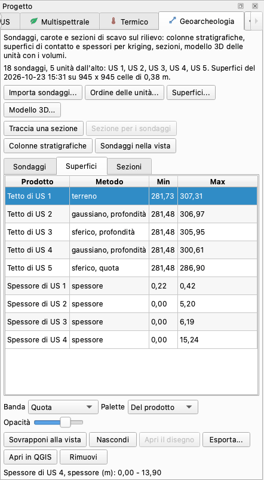
  <figcaption>Il pannello dopo le superfici della dimostrazione: la scheda <em>Superfici</em> con il metodo e i
  valori di ogni prodotto; in fondo, i valori della sovrapposizione mostrata (lo spessore di US 4).
  Sondaggi simulati.</figcaption>
</figure>

Dall'alto: una breve descrizione; lo stato del chunk (sondaggi, unità dall'alto, quando sono state
costruite le superfici e su quale griglia, oppure *I sondaggi o l'ordine sono cambiati: ricostruiscile.*);
i pulsanti dei passi; tre schede, *Sondaggi*, *Superfici* e *Sezioni*; i comandi della sovrapposizione
(*Banda*, *Palette*, *Opacità*); *Sovrapponi alla vista*, *Nascondi*, *Apri il disegno*, *Esporta...*,
*Apri in QGIS* e *Rimuovi*; in fondo, i valori ai due estremi dei colori mostrati. I passi più lunghi
lavorano in background con la barra di avanzamento, e il progetto viene salvato quando finiscono.

### 1. Importare i sondaggi { #import }

*Importa sondaggi...*

| Campo | Che cosa fa |
|---|---|
| *Collari, o tabella unica* | la tabella dei collari, o la tabella sola |
| *Intervalli (se in un file a parte)* | la tabella degli intervalli; vuoto con una tabella sola |
| *Tipo* | *dalla tabella*, oppure un solo tipo per tutti i sondaggi di questi file: trivella manuale, carotaggio, sezione di scavo, saggio, altro |
| *Sostituisci i sondaggi del chunk (altrimenti si aggiungono)* | spuntato: i sondaggi importati prima vengono dimenticati; non spuntato: quelli con lo stesso codice vengono sostituiti e gli altri tenuti |

Alla fine una finestra riassume l'importazione; con i file di esempio (righe spezzate qui):

```text
18 sondaggi letti (18 nel chunk), 117 intervalli; unità dall'alto:
  US 1, US 2, US 3, US 4, US 5
5 quote prese dal DEM
Quota dei collari meno DEM: mediana -0,008 m, massimo +0,071 m (S17)
Avvisi (1):
- S1: vuoto fra 8,9 e 9,1 m dentro US 4 (nessun contatto)
```

La scheda *Sondaggi* elenca codice, quota (`*`: letta dal DEM), profondità e unità di ogni sondaggio.
*Sondaggi nella vista* li disegna sull'ortofoto o sul DEM come un layer di punti rossi,
*Geoarcheologia: sondaggi*, ridisegnato ogni volta che la vista mostra un altro raster: con lo strumento
*Sposta*, un clic su un punto ne mostra codice, quota, profondità e unità. Le tabelle lette vengono copiate
nel progetto. Tabelle nuove rendono superate le superfici: ricostruiscile.

### 2. L'ordine delle unità { #order }

*Ordine delle unità...* mostra le unità dall'alto in basso, come risultano dai log, e i disaccordi fra i
sondaggi, se ce ne sono (*US 2 sopra US 3 in 2 sondaggi, sotto in 1*). Per cambiare l'ordine scrivi i
codici dall'alto in basso separati da virgole, in qualsiasi grafia; i codici non scritti vanno dopo,
nell'ordine dei log. Un ordine dato a mano resta finché i sondaggi non portano unità nuove. Dopo,
ricostruisci le superfici e il modello.

### 3. Superfici di contatto { #surfaces }

*Superfici...* interpola fra i sondaggi il tetto di ogni unità: la superficie dove comincia.

| Campo | Predefinito | Che cosa fa |
|---|---|---|
| *Modello del variogramma* | *scelto dai dati* | sferico, esponenziale o gaussiano: come crescono con la distanza le differenze di un contatto. Scelto dai dati: il modello più stabile fra quelli con l'errore leave-one-out entro il 5 % del migliore |
| *Andamento* | *scelto dai dati* | *nessuno* (kriging ordinario) o *piano inclinato* (kriging universale, per un contatto che pende attraverso il sito); il piano si prova con sei sondaggi o più, non tutti allineati |
| *Interpola* | per contatto | le quote di tutti i contatti, le profondità di tutti i contatti dal terreno, oppure ogni contatto a modo suo (sotto) |
| *Per unità* | | il modo di alcune unità, per esempio `US 2=profondità, US 5=quota`, i codici in qualsiasi grafia; vanno bene anche `depth` ed `elevation` |
| *Cella* | quella del DEM | il lato delle celle delle superfici, in metri; su un'area grande la cella del DEM viene raddoppiata, triplicata... per restare entro un milione di celle; senza DEM, un valore tondo che dà circa 300 celle attraverso l'area |
| *Pepita* | stimata | la varianza di un contatto fra due sondaggi vicinissimi, in m²: errori di misura e variazioni a breve distanza |
| *Margine attorno ai sondaggi* | la loro distanza tipica | fin dove le superfici vanno oltre i sondaggi esterni; di norma la distanza mediana fra un sondaggio e il più vicino |
| *Sondaggi minimi per il kriging* | 5 | con meno sondaggi che attraversano un contatto, l'inverso della distanza (IDW) al posto del kriging |

**Per quota o per profondità.** Un contatto con una forma sua - il naturale sotto un tell, un piano
sepolto, un canale - viene interpolato dalle sue quote. Un contatto che segue il terreno - la base
dell'humus, strati drappeggiati su un rilievo - viene interpolato dalle sue profondità e appeso al DEM,
così fra i sondaggi continua a seguire il terreno. *Per contatto* sceglie da solo: per profondità quando
le profondità del contatto variano da un sondaggio all'altro meno della metà delle sue quote (tutte e due
misurate attorno a un piano), per quota altrimenti, e per quota quando lo attraversano meno di tre
sondaggi. Se ogni log comincia da 0, il tetto della prima unità è il DEM stesso.

**Poi:**

* un sondaggio che si ferma sopra un contatto tiene il contatto sotto il proprio fondo;
* dove due contatti si incrociano cede quello con la varianza di kriging maggiore, il meno sicuro, e
  nessun contatto sale sopra il terreno;
* un'unità che manca in alcuni log manca anche intorno a loro: i sondaggi votano la sua presenza, i più
  vicini contano di più, e dove vincono quelli senza l'unità e i suoi due contatti non mostrano uno
  spessore vero (più del doppio della loro incertezza), il tetto e la base dell'unità diventano una sola
  superficie; fra i sondaggi non compaiono per caso unità sottili;
* le superfici coprono l'area dei sondaggi più il margine, e fuori non hanno valori.

Alla fine una finestra dice, contatto per contatto, come è stato costruito. Nella dimostrazione (righe
spezzate qui):

```text
945 x 945 celle di 0,38 m
Tetto di US 1: il terreno
Tetto di US 2: kriging gaussiano, errore leave-one-out 0,026 m, per
  profondità (segue il terreno: profondità variabili per 0,03 m, quote per
  6,22 m); corretta dalla pila su 9.736 m² (abbassata fino a 0,01 m, alzata
  fino a 0,02 m)
Tetto di US 3: kriging sferico, errore leave-one-out 0,943 m (il modello
  gaussiano dava 0,908 m: meno del 5 % di differenza), per profondità (...)
Tetto di US 5: kriging sferico, errore leave-one-out 0,274 m (...), per
  quota (ha una forma sua: profondità variabili per 2,84 m, quote per
  0,22 m); corretta dalla pila su 39.412 m² (abbassata fino a 3,44 m,
  alzata fino a 1,60 m)
Spessore di US 2: media 1,08 m, massimo 5,20 m, 78.462 m³ (+ 2.787 m³ dove
  manca il DEM); assente su 4.956 m² (sondaggi senza: S9, S10)
2.580 m² senza DEM: lì il terreno è la superficie dei collari, i volumi
  sono a parte
```

[Leggere i risultati](#reading) spiega questi numeri. La scheda *Superfici* elenca *Tetto di ...* per ogni
unità e *Spessore di ...* per ogni unità tranne l'ultima, con il metodo (il modello, `+ piano`, per quota o
per profondità) e i valori minimo e massimo; il suggerimento di una riga ne ripete il rapporto.

### 4. Le superfici sulla vista { #overlay }

Scegli una riga della scheda *Superfici*, poi:

* *Banda*, solo per i tetti: *Quota*, *Varianza di kriging* (l'incertezza, m²) o *Correzione della pila*
  (quanto è stato spostato il contatto, m);
* *Palette*: quella del prodotto (ipsometrica per le quote, calore per le varianze, divergente per le
  correzioni, una rampa di marroni per gli spessori) o un'altra (grigi, terra...);
* *Opacità*.

*Sovrapponi alla vista*, o un doppio clic sulla riga, la mette sopra l'ortofoto o il DEM; la riga in fondo
al pannello dice che cosa si vede e i valori ai due estremi dei colori (il 2° e il 98° percentile).
Spessori e varianze partono da zero. Le correzioni sono centrate sullo zero: le celle dove un contatto è
stato abbassato sono rosse, quelle dove è stato alzato blu, quelle dove è rimasto bianche. *Nascondi* toglie
la sovrapposizione; se ne vede una alla volta.

### 5. Sezioni { #sections }

* *Traccia una sezione*: clicca i vertici della traccia sull'ortofoto o sul DEM - due o più - e finiscila
  con un doppio clic o con Invio (il disegno del programma, prestato al plugin); Backspace toglie l'ultimo
  vertice, Esc o un altro strumento della barra *Disegno* annulla. Lo strumento linea del programma
  continua a disegnare le sezioni del programma.
* *Sezione per i sondaggi*: seleziona due o più sondaggi nella scheda *Sondaggi* (con Ctrl, o Cmd sul Mac);
  la traccia li unisce nell'ordine in cui li hai scelti (un intervallo di righe scelto con Maiusc viene
  nell'ordine della tabella).

| Campo | Che cosa fa |
|---|---|
| *Nome* | il titolo del disegno e il nome dei suoi file; una sezione con lo stesso nome viene sostituita |
| *Sondaggi entro* | a quale distanza dalla traccia un sondaggio viene riportato, in metri; vuoto: metà della distanza tipica fra i sondaggi |
| *Scala 1:* | vuota: come per le sezioni del programma, la scala normalizzata più dettagliata (1:20, 1:50, 1:100...) che sta in un foglio A0 circa |
| *Esagerazione verticale* | vuota: scelta perché il disegno non sia una striscia sottile (1, 2, 5, 10, 20, 50 o 100) |

Il disegno ha il terreno (nero), il tetto di ogni unità (grigio), le unità campite con il loro colore e
retino - l'ultima fino al fondo del disegno -, i sondaggi vicini alla traccia come colonne con il codice e
la distanza dalla traccia (positiva a sinistra guardando lungo la traccia), la legenda delle unità. I file
sono un SVG e un PNG; un DXF in coordinate di sezione (distanza lungo la traccia e quota vera, in metri,
senza esagerazione; layer `GEO_TERRENO`, `GEO_CONTATTI`, `GEO_UNITA_<unità>`, `GEO_SONDAGGI`,
`GEO_TESTI`, `GEO_GRIGLIA`); un CSV del profilo (distanza, x, y, terreno, tetto di ogni unità). *Apri il
disegno*, o un doppio clic nella scheda *Sezioni*, apre il PNG; le tracce vengono disegnate sulla vista come
layer *Geoarcheologia: sezioni*, di nuovo su ogni raster che la vista mostra. Una sezione è un disegno fatto
in quel momento: dopo aver ricostruito le superfici, rifallo.

<figure markdown="span">
  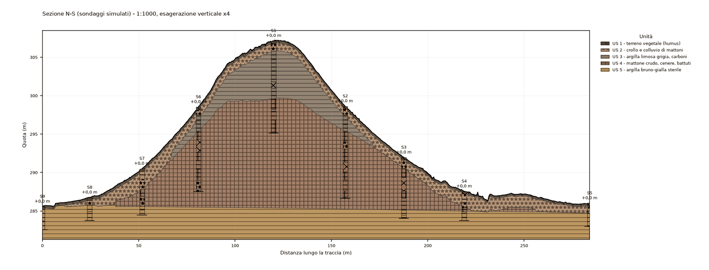
  <figcaption>Una sezione del plugin attraverso nove sondaggi, 1:1000 con esagerazione verticale x4:
  terreno dal DEM, contatti per kriging, i sondaggi entro 15 m con la distanza dalla traccia. Sondaggi
  simulati sul DEM reale di Tell Sultan.</figcaption>
</figure>

### 6. Colonne stratigrafiche { #columns }

*Colonne stratigrafiche*: spunta i sondaggi; quelli selezionati nella tabella vengono per primi,
nell'ordine in cui li hai scelti.

* Un sondaggio: la sua colonna con le profondità, le quote quando il collare ne ha una, la descrizione e
  il colore di ogni intervallo.
* Più sondaggi: un pannello di colonne affiancate, con i tetti della stessa unità uniti da tratteggi.

*Asse verticale*: le quote se tutti i sondaggi le hanno (predefinito), le quote, oppure le profondità.
*Scala 1:*: vuota per stare in un foglio A4 (da 1:10 a 1:1000). Il plugin scrive un SVG e un PNG e apre il
PNG. Ogni pannello ha i suoi file, con il nome dei suoi sondaggi (`colonne_S5-S4-S3-S2-S1.svg`, `.png`),
così un pannello nuovo sostituisce solo quello degli stessi sondaggi; dalla riga di comando si può scrivere
in un file a scelta.

<figure markdown="span">
  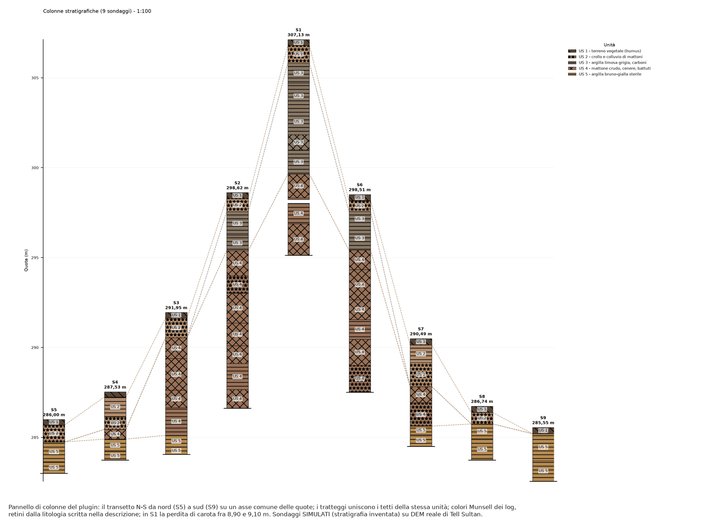
  <figcaption>Il transetto nord-sud come pannello di colonne: colori Munsell dei log, retini dalle
  descrizioni, tratteggi che uniscono i tetti della stessa unità, la perdita di carota di S1 lasciata in
  bianco. Sondaggi simulati.</figcaption>
</figure>

### 7. Modello 3D delle unità { #model }

*Modello 3D...*, disponibile quando ci sono le superfici.

| Campo | Che cosa fa |
|---|---|
| *Cella* | vuota: automatica, la griglia delle superfici resa più grossolana fino a 60.000 celle |
| *Ritaglia le unità sulle US disegnate con lo stesso numero* | un'unità il cui codice corrisponde a US disegnate nel chunk viene ritagliata sui loro poligoni |
| *Anche l'ultima unità, fino al fondo* | l'ultima unità non ha niente sotto: il suo solido scende fino a un fondo |
| *Quota del fondo* | vuota: il fondo più basso dei sondaggi, tenuto sotto il tetto più basso dell'ultima unità di un margine pari al 5 % dell'altezza coperta dai sondaggi (almeno 10 cm), perché il solido non abbia buchi |
| *Nella vista 3D, unità separate in verticale di* | vuoto: come stanno; una distanza in metri alza ogni unità di tanto sopra quella sotto, così le unità che hanno i contatti in comune si distinguono nella vista (i file del modello non si spostano) |

Alla fine le unità compaiono nella vista 3D del programma - la scheda *Modello* dell'area centrale -
ognuna nel suo colore, con il titolo *Unità geoarcheologiche (5 unità)*; per tornare ai prodotti del
chunk scegli un'altra vista nell'elenco *Mostra* della vista 3D. *Mostra nella vista 3D*, nel pannello,
riporta le unità nella vista; *Apri la cartella* apre la cartella del modello nel Finder o in Esplora
file. Una finestra elenca i volumi. I file sono un PLY per unità (coordinate vere in doppia precisione,
il colore dell'unità), un OBJ con un oggetto e un materiale per unità (`unita.obj`, `unita.mtl`) e
`volumi.csv`; aprili in MeshLab, Blender, CloudCompare o QGIS 3D. Il volume dell'ultima unità dipende
dal fondo scelto: non è il volume di un deposito.

*Apri come modello di un nuovo chunk* (anche in *Plugin > Geoarcheologia*) mette le unità in un nuovo chunk
del progetto, *Unità geoarcheologiche - <chunk>*, come suo modello, nel sistema di riferimento del chunk dei
sondaggi (il programma importa `unita.obj`, rimettendo lo spostamento scritto nella sua intestazione). Il
nuovo chunk diventa quello attivo e il suo modello compare nella vista 3D, dove il pulsante *Taglia* -
oppure *Flusso di lavoro > Pulizia e confidenza > Taglia il modello con un piano* - lo taglia in
orizzontale, in verticale lungo una sezione o per tre punti: ogni unità, un solido chiuso, viene chiusa sul
taglio nel suo colore, così le facce del taglio mostrano la stratigrafia. Il progetto risulta modificato:
salvalo per tenere il nuovo chunk. Per tornare ai sondaggi rendi di nuovo attivo il loro chunk nell'area di
lavoro: il pannello segue il chunk attivo.

<figure markdown="span">
  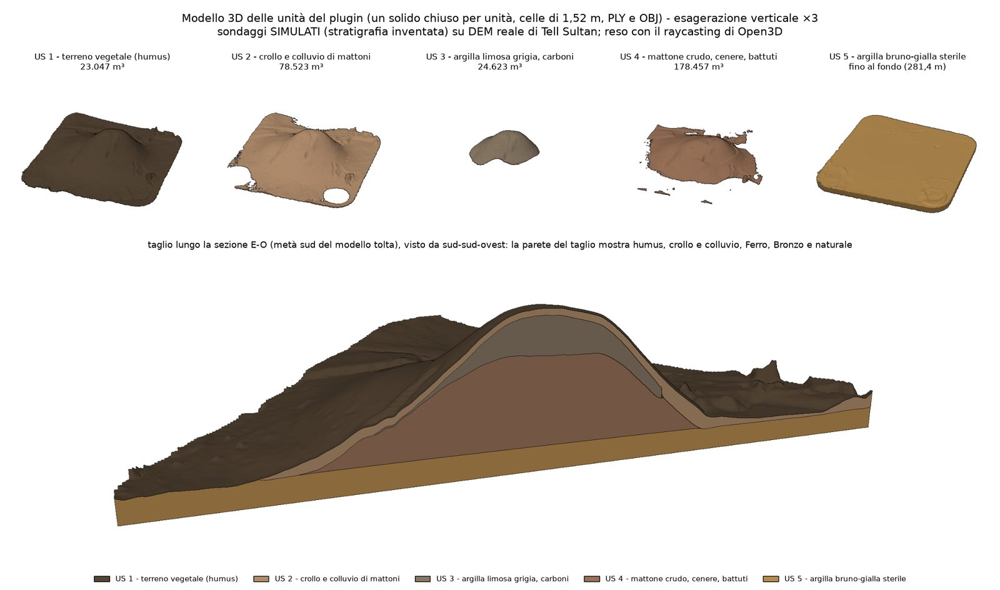
  <figcaption>Il modello 3D: un solido chiuso per unità con il suo volume, e un taglio lungo la sezione
  est-ovest. Sondaggi simulati sul DEM reale di Tell Sultan.</figcaption>
</figure>

### 8. Esportare, QGIS, togliere { #export }

* *Esporta...*: nella scheda *Superfici*, con una riga selezionata, quella superficie o quello spessore in
  GeoTIFF; altrimenti tutto in un GeoPackage - sondaggi (punti), intervalli (tabella), tracce delle
  sezioni (linee) - con accanto un GeoTIFF per ogni superficie e spessore e il CSV dei volumi. Lo stesso
  GeoPackage si ottiene da *File > Esporta > Sondaggi e superfici geoarcheologiche (GeoPackage)...*.
* *Apri in QGIS*: il progetto QGIS del programma ([QGIS](../integrations.md)) con le superfici - nascoste
  all'inizio, le quote in grigi e gli spessori in una rampa calda - e i layer dei sondaggi e delle
  sezioni; anche per un chunk in un sistema locale, in un progetto senza sistema di riferimento.
* *Rimuovi*: nella scheda *Superfici* tutte le superfici e gli spessori (formano una pila sola); nella
  scheda *Sezioni* la sezione selezionata e i suoi disegni; nella scheda *Sondaggi* i sondaggi selezionati.

## Il modello implicito { #implicit }

Le superfici dei passi precedenti sono una quota per punto, z(x, y), fra i sondaggi. Così non si può disegnare quello che si scava:
una fossa che taglia gli strati e poi viene riempita, un fossato con un fianco sottosquadro, un contatto visto in tre sondaggi che
dovrebbe prendere la forma degli strati intorno, una giacitura misurata su una sezione. Il modello implicito descrive il terreno come
campi scalari in 3D con [LoopStructural](https://github.com/Loop3D/LoopStructural), e queste cose ci stanno. Si costruisce su
richiesta, accanto al kriging, che resta il metodo predefinito. È una novità della versione 0.2.0.

!!! warning "Un'interpretazione dei dati, non una misura"
    Lontano dai sondaggi il modello dice quello che i dati fanno supporre. Il pannello e le figure lo dicono, e un numero
    del modello va riportato come numero di un modello.

### Quando usarlo, e quando il kriging { #implicit-when }

| I tuoi dati | Usa |
|---|---|
| Strati visti nella maggior parte dei sondaggi, uno sull'altro | **kriging**: buono come l'implicito o migliore, in pochi secondi |
| Una fossa, un fossato, una trincea di spoliazione, con i riempimenti | **implicito** |
| Un contatto visto in pochi sondaggi, che deve prendere la forma dagli strati intorno | **implicito**, e guarda il volume di quell'unità (più avanti) |
| Una giacitura misurata su una sezione, contatti visti su una parete | **implicito**: il kriging non sa usarli |
| Il volume di un deposito semplice da riportare | **kriging** |

Dopo ogni costruzione gli errori leave-one-out dei due metodi sono mostrati affiancati. Questi vengono dalla dimostrazione qui sotto: 21
sondaggi su Tell Sultan, 18 senza la fossa. Il kriging lascia fuori un sondaggio alla volta e conta i sondaggi dove l'unità manca;
il modello implicito lascia fuori 12 gruppi di sondaggi e conta quelli che vedono il contatto.

| Contatto | Sondaggi che lo vedono | Senza fossa: kriging / implicito | Con la fossa: kriging / implicito |
|---|---:|---:|---:|
| US 2, segue il terreno | 16 | **0,03** / 0,10 m | **0,03** / 0,09 m |
| US 3, raro | 5 | 0,94 / **0,31** m | 0,87 / **0,31** m |
| US 4 | 12 | **1,33** / 1,61 m | **1,28** / 1,62 m |
| US 5, naturale | 13 | **0,27** / 0,31 m | 0,35 / **0,31** m |

Sugli strati semplici il kriging resta migliore; il modello implicito vince sul contatto raro. Con la fossa il kriging peggiora sul
naturale perché tre sondaggi lo trovano più in basso e non sa perché. Il prezzo del modello implicito su un'unità rara è più avanti, in
[Volumi](#implicit-volumes).

### Installazione { #implicit-install }

LoopStructural non viene con il plugin. *Installa LoopStructural* nella scheda *Implicito* (o
`ppg plugin geoarchaeology implicit-install`) lo mette in un ambiente separato, circa 300 MB, nella cartella dei dati del plugin. Serve internet
una volta e ci vogliono pochi minuti; `uv` viene scaricato se manca. Il programma non carica mai LoopStructural: ogni modello gira in un
processo separato, e un errore o un annullamento lasciano il modello attuale com'è. Se LoopStructural è già installato nel Python del
programma, il plugin usa quello; `PPG_GEOARCH_LOOP_ENV` mette l'ambiente altrove.

### I passi { #implicit-steps }

1. Importa i sondaggi e costruisci le superfici come sempre: il modello ne prende la griglia e le serie.
2. Nel programma, disegna la US del taglio (o del riempimento) con il suo numero. Fallo prima: il contorno conta più di
   qualsiasi altra cosa.
3. Nella scheda *Implicito*, *Segna un riempimento...*: il riempimento, come nei log; il taglio, il suo numero di US o un nome; la forma del
   fondo. Ripeti per ogni riempimento del taglio.
4. *Contatti e giaciture da file...*, se li hai.
5. *Costruisci...*: 2 minuti sulla dimostrazione, con 12 gruppi per il leave-one-out. Metti i gruppi a 0 per le prove.
6. Il modello diventa il modello del chunk, con le superfici elencate come *Tetto di US n (implicito)* nella scheda *Superfici*. Un
   *Modello 3D...* dal kriging fatto dopo lo sostituisce; le superfici implicite restano. Le sezioni usano le superfici implicite quando il
   modello attivo è quello implicito.

<figure markdown="span">
  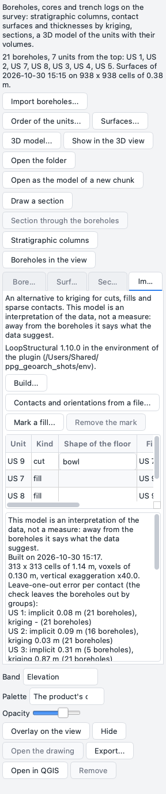
  <figcaption>La scheda <em>Implicito</em>: dove gira LoopStructural, i pulsanti, i tagli con la forma del fondo, il testo
  dell'ultima costruzione.</figcaption>
</figure>

| Campo di *Costruisci...* | Che cosa fa |
|---|---|
| *Cella* | vuota: quella delle superfici, resa più grande se servono più di 120.000 celle; può essere più piccola di quella delle superfici |
| *Gruppi di sondaggi per la verifica leave-one-out* | al massimo 12; 0 per nessuna |
| *Per unità* | `US 2=profondità, US 5=quota`; vuoto: come le superfici |
| *Nella vista 3D, unità separate in verticale di* | come nel modello 3D |

### Le serie { #implicit-series }

Una *serie* è un campo scalare. Come per i [modi](#surfaces) del kriging, i contatti che seguono il terreno stanno insieme in una serie in
profondità sotto il DEM, e ogni contatto per quota è una serie a sé. Nella dimostrazione: da US 1 a US 4 in profondità, il naturale US 5
per quota. *Per unità* lo cambia.

### Tagli e riempimenti { #implicit-cuts }

Un taglio non ha materiale: nei log si vede il riempimento. Il taglio quindi non è uno strato né un campo: è un documento di scavo.

* **La pianta** è la US disegnata per il taglio, o per i riempimenti. Senza disegno viene stimata, le celle più vicine ai sondaggi dentro che
  a quelli fuori, con un avviso; nella dimostrazione ha dato 38-68 m³ per un riempimento di 76 m³.
* **Il fondo** è `terreno - s(x, y) P(t)`: `t` la distanza dal bordo divisa per la mezza larghezza locale, `P` la forma scelta, `s` le
  profondità misurate divise per P e distribuite sulla pianta. Passa per ogni base misurata. Fra i sondaggi è un'ipotesi.
* **I riempimenti** hanno i tetti come profondità sotto il terreno, distribuite dai sondaggi che li hanno visti: seguono il terreno salvo
  che i sondaggi dicano altro. Un riempimento più profondo resta sotto quello sopra. Uno strato può coprire la fossa, come l'humus
  nella dimostrazione.
* **Un sottosquadro** (una fossa a campana, un fossato con un fianco aggettante) ha bisogno di misure sulla parete: righe di tipo `wall` nel file
  dei contatti. Solo un taglio così usa un campo di LoopStructural, e pochi punti lo cancellano: è stata provata solo una fossa a campana
  con punti di parete tutto intorno.

<figure markdown="span">
  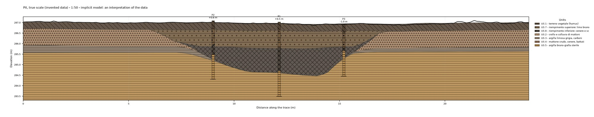
  <figcaption>Sezione della fossa inventata in scala vera: taglia US 2 e arriva nel naturale, con i due riempimenti sotto l'humus e i
  sondaggi P1, P2, P3 proiettati sulla linea. Il fondo passa per ogni loro base.</figcaption>
</figure>

### Il volume di un taglio è un intervallo { #implicit-range }

Pochi sondaggi non dicono la forma di un fondo. Per questo il plugin calcola il riempimento per tutte e tre le forme, e la riga del taglio in
`volumi.csv`, nel pannello e nel testo dà l'intervallo; la forma scelta dà solo il valore in mezzo e il solido. **L'intervallo è del
riempimento**: dal fondo al tetto del riempimento più recente, senza quello che lo copre. Il taglio vuoto, dal terreno, è nel registro come `cut_range`.

| Fossa inventata | Fondo piatto | A conca (scelta) | A V | Vero |
|---|---:|---:|---:|---:|
| Riempimento | 103,7 m³ | **98,3 m³** | 80,7 m³ | 76,4 m³ |
| Taglio, dal terreno | 130,0 m³ | 124,2 m³ | 106,9 m³ | 103,8 m³ |

Il volume vero qui si conosce perché la fossa è inventata, con un fondo fra la V e la conca del plugin. Sta il 5 % *sotto* l'intervallo, e la conca è
il 29 % di troppo: tre sondaggi quasi in fila dicono poco. L'intervallo dice quanto conta la forma; non contiene sempre il vero.
Lo restringono più sondaggi attraverso la fossa, con almeno uno vicino al centro.

### Che cosa vuol dire il volume di un riempimento { #implicit-fill }

È lo spazio fra il fondo ipotizzato e il tetto del riempimento, dentro la pianta disegnata, nelle celle della griglia. Qui la pianta ha 58 celle da
1,14 m, 75,5 m² contro 76,2 m² disegnati. Non è una quantità misurata di materiale: va dato come intervallo, con il numero dei sondaggi. Un
fondo misurato solo accanto al bordo non dice nulla del centro (`floor_unmeasured`), e allora il volume è un'ipotesi, qualunque sia l'intervallo.

<figure markdown="span">
  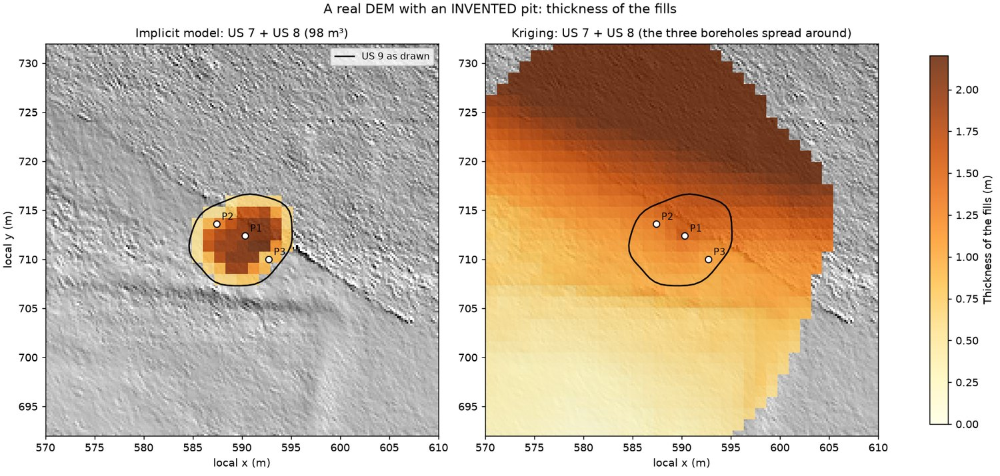
  <figcaption>Lo spessore dei riempimenti. A sinistra il modello implicito resta dentro il contorno disegnato. A destra il kriging prende i tre
  sondaggi per uno strato e lo stende su 1.800 m² con 2.004 m³, venti volte troppo.</figcaption>
</figure>

### I volumi, e il prezzo di un'unità rara { #implicit-volumes }

`volumi.csv` ha il volume del kriging accanto a quello implicito, ma **non coprono la stessa area**: il kriging si ferma al margine intorno ai
sondaggi, il modello implicito copre ogni cella con il DEM sulla sua griglia. Confrontali solo dopo averli ritagliati sulla stessa area. Contati
sulle stesse celle nella dimostrazione:

| Unità | Kriging | Implicito |
|---|---:|---:|
| US 1 | 22.950 m³ | 21.784 m³ |
| US 2 | 75.621 m³ | 45.638 m³ |
| US 3, rara | 25.341 m³ | 67.986 m³ |
| US 4 | 181.697 m³ | 167.194 m³ |
| US 5, fino alla base | 280.739 m³ | 268.113 m³ |

US 3 è il punto debole. Vista in 5 sondaggi su 21, si allarga su 46.800 m² contro 9.650, perché un campo tiene uno spessore anche dove l'unità
manca: i sondaggi che non la vedono non la tolgono, come fanno nel kriging. Il suo errore leave-one-out è quindi il migliore e il suo volume non
è affidabile: **l'errore di un contatto dice dov'è il contatto dove esiste, non fin dove arriva l'unità**. US 2 + US 3 insieme fanno 113.600
contro 101.000 m³. Per limitare un'unità, disegnane la US e leggi accanto il volume del kriging.

<figure markdown="span">
  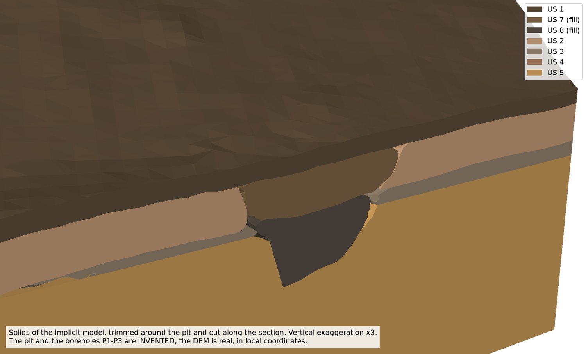
  <figcaption>I solidi attorno alla fossa inventata, ritagliati e tagliati lungo la sezione, ogni unità chiusa sul taglio. Esagerazione verticale x3.</figcaption>
</figure>

### Altri dati { #implicit-data }

*Contatti e giaciture da file...* legge tabelle CSV come si leggono i log: virgola, punto e virgola o tabulazione, punto o virgola
decimale, nomi in italiano o in inglese. Un file nuovo di un tipo sostituisce il vecchio.

**Contatti**: un punto dove comincia un'unità, visto su una sezione o in superficie.

```text
unita;x;y;quota;tipo
US 3;588,20;741,50;286,15;
US 9;591,00;713,00;285,10;parete
```

Il tipo è vuoto, oppure `wall` (`parete`, `muro`, `side`) per un punto della parete di un taglio. Un contatto di un taglio è un punto del suo fondo.

**Giaciture**: un'inclinazione misurata.

```text
unita;x;y;z;inclinazione;immersione
US 5;560,00;700,00;285,50;4,0;220
```

Inclinazione in gradi dall'orizzontale (`dip`, `inclinazione`, `angolo`, `pendenza`), immersione in gradi da nord in senso orario
(`dip_direction`, `immersione`, `azimut`). Una giacitura contro quello che dicono i sondaggi cede a loro, o viene lasciata fuori con un avviso; su un
riempimento, o su un taglio senza pareti, non serve e viene lasciata fuori.

**Le quote** del programma con il numero di una US sono contatti di quell'unità, senza file.

Un contatto non viene rispettato esattamente: il campo è liscio, e su contatti e quote si appoggia. In una prova due punti 0,8 m sotto un contatto visto da 16 sondaggi
lo hanno spostato solo di una frazione. Per cambiare la forma di un contatto servono più punti, o una giacitura.

### Gli avvisi, e che cosa fare { #implicit-warnings }

| Il testo dice | Vuol dire | Che cosa fare |
|---|---|---|
| *nessuno ha disegnato il contorno* | la pianta è stimata, il volume può essere sopra o sotto | disegna la US del taglio |
| *tutti i sondaggi sono vicino al bordo* (`floor_unmeasured`) | la profondità del fondo non è stata misurata | un sondaggio vicino al centro; fino ad allora il volume è un'ipotesi |
| *misure del fondo vicino al bordo non vengono raggiunte* | una misura profonda sul bordo scaverebbe troppo al centro | controlla quel sondaggio e il contorno |
| *una misura del fondo ... è fuori dal contorno* | vale come se fosse sul bordo | controlla la posizione del sondaggio, o il disegno |
| *il contorno è largo solo ... m* | la cella è troppo grande per quella forma | costruisci con la cella indicata |
| *il contorno disegnato misura ..., sulla griglia ne restano ...* | esce dalla griglia, o la cella è grande | una cella più piccola, o superfici con un margine più grande |
| *i sondaggi ... finiscono dentro il riempimento* | il fondo è più in basso e il volume sottostimato | approfondisci un sondaggio, o dillo |
| *riempimento ... senza tetto misurato* | non si sa fin dove arriva | un sondaggio che lo attraversa, un contatto |
| *Voxel di ... m invece di ...* | al massimo 200 livelli; le unità sottili sono rese male | un `--floor` più vicino alla superficie, un intervallo di quote minore |
| *il contatto esce dall'intervallo di quote* | in una parte della griglia non ha tetto | nulla, se quella parte è lontana da ciò che ti interessa |
| *nessun sondaggio ha questo contatto insieme agli altri* | la sua distanza da loro è stimata | un sondaggio che lo veda con gli altri |
| *i sondaggi non fanno un piano* | di traverso alla fila il contatto è in piano | un sondaggio fuori fila, o una giacitura |
| *sondaggi hanno due unità nell'ordine opposto alla colonna* | l'ordine o i log sono sbagliati | *Ordine delle unità...*, i log |
| *la giacitura ... contraddice il contatto* | avrebbe rovesciato il modello; lasciata fuori | controlla la direzione |

### Limiti { #implicit-limits }

* **Le strozzature non vengono segnalate.** Una strozzatura sotto il 5 % della pianta non dà avviso (1,2 m in un fossato di 6 m con celle da 1 m): guarda la pianta.
* **Un contatto non viene rispettato esattamente**, come sopra: un campo liscio ci si appoggia.
* **Un bordo stimato è grossolano**, nei due sensi: +125 % e -54 % nelle prove.
* **Un fondo misurato solo al bordo** (`floor_unmeasured`) non è una misura del centro: un sondaggio sul bordo di una conca ha dato meno di un terzo del volume.
* **Un'unità rara si allarga**, come sopra.
* **La forma del fondo è ipotizzata.** Un fondo piatto viene arrotondato nel primo quarto della mezza larghezza: una parete davvero verticale sta fuori dall'intervallo.
* **La griglia**: al massimo 120.000 celle e 200 livelli di base. Una fossa deve essere larga almeno diverse celle; qui 9 celle, voxel da 0,13 m.
* **Non fatto**: faglie, pieghe, intrusioni, modifica a mano del modello, insiemi di modelli.

## Dalla riga di comando { #cli }

Gli stessi passi con `ppg plugin geoarchaeology COSA PROGETTO ...`. Ogni comando lavora sul chunk attivo
(`--chunk ETICHETTA` per un altro) e salva il progetto.

```bash
ppg plugin geoarchaeology help
ppg plugin geoarchaeology import scavo.ppg sondaggi_collari.csv sondaggi_intervalli.csv
ppg plugin geoarchaeology import scavo.ppg campagna2.csv
ppg plugin geoarchaeology import scavo.ppg tutti.csv --replace --kind core
ppg plugin geoarchaeology list scavo.ppg
ppg plugin geoarchaeology order scavo.ppg "US 1,US 2,US 3,US 4,US 5"
ppg plugin geoarchaeology surfaces scavo.ppg
ppg plugin geoarchaeology surfaces scavo.ppg --mode "auto,US 2=profondità,US 5=quota" --min-points 6
ppg plugin geoarchaeology section scavo.ppg --through S9,S8,S7,S6,S1,S2,S3,S4,S5 --name "Sezione N-S"
ppg plugin geoarchaeology section scavo.ppg --coords "455,800;760,800" --distance 15 --scale 1000 --exaggeration 4
ppg plugin geoarchaeology logs scavo.ppg S1
ppg plugin geoarchaeology logs scavo.ppg S5 S4 S3 S2 S1 --out colonne_ns.pdf
ppg plugin geoarchaeology model scavo.ppg --offset 600,800,0
ppg plugin geoarchaeology model-chunk scavo.ppg --label "Unità da tagliare"
ppg cut-model scavo.ppg --chunk "Unità da tagliare" --vertical 455,800,760,800 --keep both --out taglio.ply
ppg plugin geoarchaeology implicit-install
ppg plugin geoarchaeology implicit-data scavo.ppg --contacts contatti.csv --orientations giaciture.csv
ppg plugin geoarchaeology implicit scavo.ppg --fill "US 7=US 9" --fill "US 8=US 9" --cut "US 9=bowl"
ppg plugin geoarchaeology export scavo.ppg geoarcheologia.gpkg
ppg plugin geoarchaeology export scavo.ppg naturale.tif --id top_4_US_5
ppg plugin geoarchaeology remove scavo.ppg surfaces
```

| Comando | Opzioni |
|---|---|
| `help` | tutti i comandi con le loro opzioni |
| `import PROGETTO FILE...` | una o più tabelle (collari, intervalli, tabelle sole, in qualsiasi ordine); i sondaggi si aggiungono a quelli del chunk, sostituendo quelli con lo stesso codice; `--replace` dimentica quelli che c'erano; `--kind` auger, core, trench, test_pit o other per tutti |
| `list PROGETTO` | sondaggi, unità, superfici, sezioni, modello; `--json`: tutto il registro, con ogni modello di variogramma provato e il suo errore |
| `order PROGETTO UNITÀ` | i codici dall'alto in basso, separati da virgole, in qualsiasi grafia (`us3` è `US 3`) |
| `surfaces PROGETTO` | `--model` auto, spherical, exponential, gaussian; `--trend` auto, none, linear; `--mode` auto, elevation o depth (anche quota, profondità), e le unità nominate (`"auto,US 2=profondità"`); `--cell` m; `--nugget` m²; `--buffer` m, il margine; `--min-points` (5); `--order` le unità dall'alto in basso |
| `section PROGETTO` | `--coords "x1,y1;x2,y2;..."`, una traccia di due o più punti nel sistema di riferimento del chunk (`--coords=...` se il primo numero è negativo), oppure `--through S1,S4,S7`, in quell'ordine; `--name`; `--distance` m; `--scale` (la N di 1:N); `--exaggeration` |
| `logs PROGETTO [CODICI...]` | i sondaggi (tutti se non se ne dà nessuno); `--out` un file `.svg`, `.png` o `.pdf`, altrimenti `logs/<sondaggio>` per un sondaggio e `logs/colonne_<sondaggi>` per un pannello; `--vertical` auto, elevation, depth; `--scale` |
| `model PROGETTO` | `--cell` m; `--no-clip`; `--floor` quota; `--no-last` lascia fuori l'ultima unità; `--offset X,Y,Z` sottratto alle coordinate dell'OBJ (scritto nella sua intestazione e in `unita.obj.offset.txt`); `--explode` m, le unità separate in verticale in `unita_vista.ply`, il file della vista 3D |
| `model-chunk PROGETTO` | le unità del modello come modello di un nuovo chunk del progetto, nel sistema di riferimento del chunk (rimesso lo spostamento dell'OBJ); `--label` l'etichetta del nuovo chunk (predefinita *Unità geoarcheologiche - <chunk>*, nella lingua dell'interfaccia, numerata se già presa); il chunk attivo resta lo stesso. `ppg cut-model PROGETTO --chunk ETICHETTA ...` lo taglia, ogni unità chiusa sul taglio nel suo colore |
| `implicit PROGETTO` | il modello implicito; `--cut UNITÀ=FORMA` (flat, bowl, v), `--fill RIEMPIMENTO=TAGLIO`, entrambi ripetibili; `--cell` m; `--folds` (12 al massimo; 0 nessuno); `--series "US 2=depth,US 5=elevation"`; `--floor` quota; `--explode` m |
| `implicit-data PROGETTO` | `--contacts` e `--orientations`, file CSV |
| `implicit-status [PROGETTO]` | dove gira LoopStructural; con un progetto, l'ultimo modello implicito |
| `implicit-install` | LoopStructural in un ambiente del plugin; `--force` anche se questo Python ce l'ha, o di nuovo |
| `export PROGETTO OUT` | un GeoPackage con accanto i GeoTIFF e i volumi; con `--id` (un id mostrato da `list`, come `top_4_US_5` o `thickness_US_2`) una superficie in GeoTIFF |
| `remove PROGETTO [COSA]` | `all` (predefinito) o `boreholes`: tutto quello del plugin nel chunk; `surfaces`, `sections`, `model`, `implicit`; il codice di un sondaggio o il nome di una sezione |

Le coordinate grandi (UTM) perdono precisione in alcuni programmi 3D: `--offset` con numeri tondi vicini
al sito tiene piccole quelle dell'OBJ; i PLY conservano le coordinate vere.

## Leggere i risultati { #reading }

### Le superfici

Ogni *Tetto di US n* è la superficie dove comincia l'unità n - il suo contatto con l'unità sopra - come
quota in metri sull'area dei sondaggi. Il tetto della prima unità è il terreno; l'ultima unità ha un tetto
ma non una base.

<figure markdown="span">
  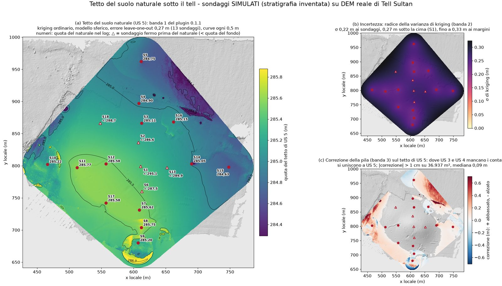
  <figcaption>Il tetto del naturale (US 5): (a) la banda 1, la quota; (b) la radice della banda 2,
  l'incertezza di kriging, minima ai sondaggi; (c) la banda 3, la correzione fatta dalla pila. Sondaggi
  simulati sul DEM reale di Tell Sultan.</figcaption>
</figure>

### Varianza di kriging (banda 2)

La varianza di kriging dice quanto è incerta la superficie in ogni punto, in m²; la sua radice è una
deviazione standard in metri (0,09 m² sono ±0,30 m). È minima ai sondaggi e cresce fra di essi e oltre.
Dipende da dove sono i sondaggi e dal variogramma, non dai valori trovati: dice dove servirebbero altri
sondaggi, non se i log sono giusti. I contatti interpolati con l'inverso della distanza (pochi sondaggi) e
il tetto della prima unità (il DEM) non ce l'hanno.

### Errore leave-one-out

Per ogni contatto fatto per kriging, ogni sondaggio viene tolto a turno e il contatto nel suo punto viene
stimato dagli altri; il rapporto dà la radice della media dei quadrati di queste differenze (`list --json`
anche la media e la massima). È l'errore da aspettarsi sulla superficie fra sondaggi vicini. Nella
dimostrazione: 0,03 m per la base dell'humus, che segue il terreno; 0,27 m per il tetto del naturale, una
superficie dolce; 0,9 e 1,3 m per i tetti dei depositi del Ferro e del Bronzo dentro il tell, con sondaggi
a 30-60 m l'uno dall'altro.

Il rapporto nomina il modello usato e, quando un altro aveva un errore appena minore, lo dice: *(il
modello gaussiano dava 0,908 m: meno del 5 % di differenza)*. I modelli entro il 5 % del migliore
valgono quanto lui, e si usa il più stabile (sferico, poi esponenziale, senza piano inclinato prima che
con, gaussiano per ultimo): con pochi sondaggi il modello gaussiano, che spesso vince gare così strette,
esagera fra i sondaggi. La cartella *surfaces* ha anche una figura per ogni contatto fatto per kriging
(`variogram_<id>.png`): la semivarianza delle coppie di sondaggi rispetto alla loro distanza, e il
modello adattato. Con una dozzina di sondaggi ha pochi punti e il modello è un'indicazione di massima:
giudica la superficie dal suo errore leave-one-out.

### Correzioni della pila (banda 3)

Interpolati uno per uno, due contatti possono incrociarsi o salire sopra il terreno. La pila li rimette
in ordine: dove due contatti si incrociano si incontrano dove sta quello meglio conosciuto, e nessuno
sale sopra il DEM. La banda 3 tiene la correzione fatta in ogni cella (positiva: abbassata, in rosso
sulla vista; negativa: alzata, in blu), il rapporto l'area e gli spostamenti più grandi (*corretta dalla
pila su 39.412 m² (abbassata fino a 3,44 m, alzata fino a 1,60 m)*). Correzioni di qualche centimetro
sono normali. Correzioni di metri su aree grandi vogliono dire che i sondaggi sono troppo distanti per
la velocità con cui cambiano le unità, oppure che codici o ordine non sono coerenti: guarda la banda 3 e
traccia una sezione in quella zona.

### Unità assenti

*assente su 4.956 m² (sondaggi senza: S9, S10)*: l'area dove l'unità manca - tetto e base sono una sola
superficie - e i sondaggi che non ce l'hanno. Lì il suo spessore è zero.

### Spessori e volumi

Ogni *Spessore di US n* è il tetto dell'unità n meno il tetto dell'unità sotto, zero dove n manca. Il suo
volume è sommato sulle celle con il DEM; dove il DEM ha buchi il terreno è la superficie interpolata fra i
collari, e il volume lì viene dato a parte (*+ 2.787 m³ dove manca il DEM*). L'ultima unità non ha
spessore. Il modello 3D dà gli stessi volumi sulla sua griglia più grossolana (entro lo 0,1 % nella
dimostrazione).

<figure markdown="span">
  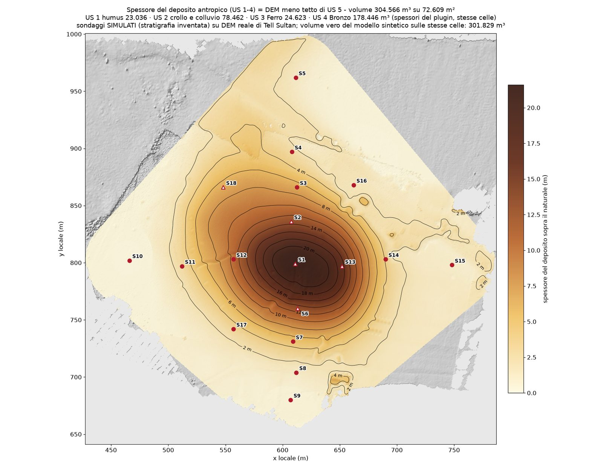
  <figcaption>Lo spessore del deposito sopra il naturale (DEM meno il tetto di US 5), con i volumi delle
  unità calcolati dal plugin. Sondaggi simulati sul DEM reale di Tell Sultan.</figcaption>
</figure>

### Quanto fidarsi

* Tutto dipende da quanto sono distanti i sondaggi rispetto alla velocità con cui cambiano le unità. Un
  contatto che segue il terreno, o che cambia lentamente, è ben conosciuto anche con sondaggi radi; i tetti
  di depositi che vanno e vengono dentro un tell no.
* Prendi l'errore leave-one-out come l'errore da aspettarsi fra i sondaggi, la varianza di kriging per
  vedere dove cresce, la banda 3 per vedere dove i log non sono d'accordo.
* Nella dimostrazione la stratigrafia vera è nota, perché è inventata: il volume di tutto il deposito è
  venuto entro l'1 % di quello vero, i volumi delle singole unità entro il 15 % circa (in parte
  compensandosi), e il 95 % del tetto del naturale entro 0,28 m.
* Il volume di un deposito intero è più affidabile di quelli delle sue unità, e tutti e due più della quota
  di un contatto in un singolo punto.

### Limiti

* **Bordi netti.** Dove un'unità viene tolta perché i sondaggi vicini non ce l'hanno, finisce con un bordo
  verticale a metà strada fra un sondaggio che la ha e uno che non la ha: un'unità che si assottiglia piano
  piano non viene ricostruita.
* **Un sondaggio isolato senza un'unità** la toglie tutto intorno, fino al bordo delle superfici, anche
  dove forse c'è ancora: nessun altro sondaggio dice il contrario.
* **Sondaggi radi.** Con sondaggi a 30-60 m l'uno dall'altro, i tetti delle unità dentro il tell della
  dimostrazione erano sbagliati di 1-2 m (il 95 % degli errori).
* **Una pila di strati.** Unità affiancate, fosse e muri non vengono rappresentati come tali: per fosse e fossati c'è il [modello implicito](#implicit).
* **Niente estrapolazione.** Le superfici si fermano al margine attorno ai sondaggi.
* **Pochi sondaggi.** Sotto i cinque sondaggi (o il numero scelto) un contatto viene interpolato con
  l'inverso della distanza, senza incertezza.

## File scritti { #files }

Tutto va nella cartella del chunk, accanto al file del progetto:
`<progetto>.ppg.files/chunk_<n>/geoarchaeology/`. I dati del plugin restano nel progetto stesso e si
aprono con lui.

* `sources/`: le tabelle CSV importate, così come erano.
* `sondaggi.gpkg`: un GeoPackage tenuto aggiornato, con tre tabelle: `sondaggi` (punti: codice, x, y,
  quota e da dove viene, quota del DEM, profondità, quota del fondo, tipo, unità, numero di intervalli,
  tabella di origine), `intervalli` (senza geometria: sondaggio, da, a, quote del tetto e della base,
  unità come mostrata e come scritta nel log - `unita`, `unita_scritta` -, descrizione, colore,
  litologia) e `sezioni` (linee: nome, lunghezza, distanza, scala, sondaggi, disegno).
* `surfaces/top_<k>_<unità>.tif`: il tetto di ogni unità, un GeoTIFF float32 con tre bande: 1 la quota
  (m), 2 la varianza di kriging (m²), 3 la correzione della pila (m, positiva dove è stato abbassato,
  negativa dove è stato alzato); nessun valore fuori dall'area dei sondaggi.
* `surfaces/thickness_<unità>.tif`: lo spessore di ogni unità tranne l'ultima (m).
* `surfaces/variogram_<id>.png`: il variogramma di ogni contatto fatto per kriging.
* `sections/<nome>.svg`, `.png`, `.dxf`, `.csv`: ogni sezione - disegno, DXF in coordinate di sezione,
  profilo.
* `logs/<sondaggio>.svg`, `.png`: la colonna di un sondaggio; `logs/colonne_<sondaggi>.svg`, `.png`:
  ogni pannello, con il nome dei suoi sondaggi. Gli SVG (e un PDF chiesto dalla riga di comando)
  richiedono i backend vettoriali di matplotlib: dove mancano, come nell'applicazione desktop fino alla
  1.3.0, sezioni e colonne vengono scritte solo in PNG, e il plugin lo dice (*SVG non disponibile in
  questa installazione: scritto solo il PNG*).
* `model/<unità>.ply`, `model/unita.obj` con `unita.mtl`, `model/volumi.csv`: i solidi e i loro volumi;
  `volumi.csv` ha unità, descrizione, volume, area, spessore medio e massimo, tetto e base minimi e
  massimi, celle, ritagliata, fino al fondo, volume e area dove manca il DEM.
* `implicit/top_<k>_<unità>.tif`: le superfici del modello implicito, float32, banda 1 la quota (m), banda 2 la varianza jackknife (m²), banda 3 implicito meno kriging (m); `implicit/data/` i file di contatti e giaciture. `model/` è allora quello del modello implicito, e `volumi.csv` ha anche `method`, `kriging_m3`, `range_min`, `range_max`.
* `model/unita_vista.ply`: tutte le unità in un PLY solo per la vista 3D del programma, nel sistema
  interno del chunk (per un modello grande il programma ne scrive accanto una copia più leggera,
  `model_preview.ply`).

Il GeoPackage esportato con *Esporta...* (o `export`) ha le stesse tre tabelle, con accanto
`<nome>_<id>.tif` per ogni superficie e spessore e `<nome>_volumi.csv`.
