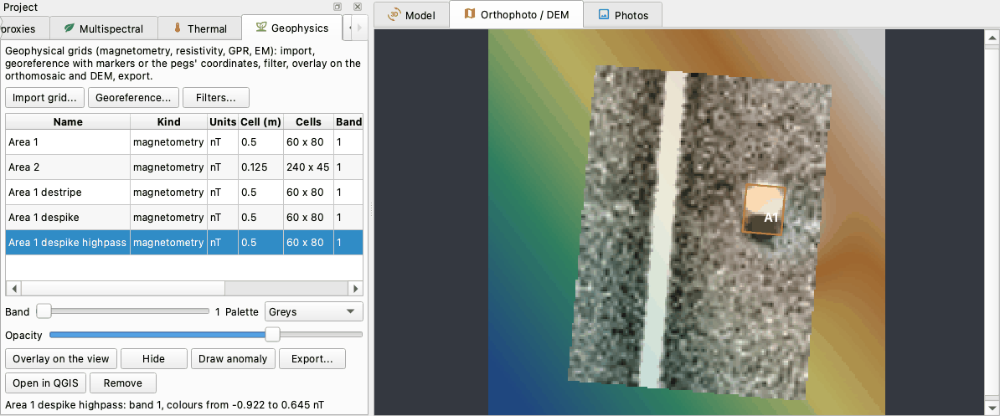
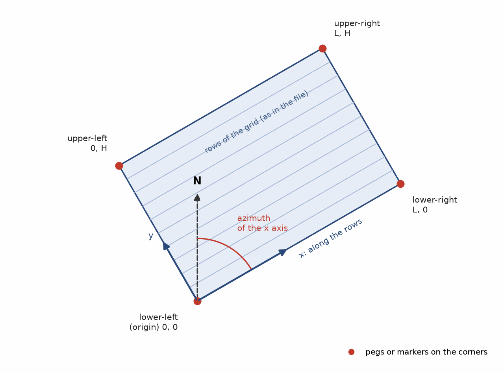
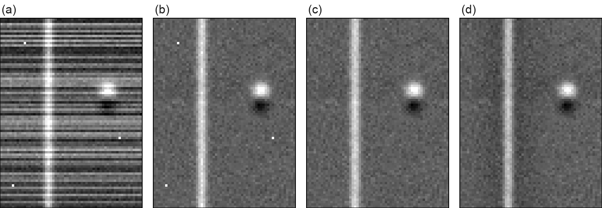
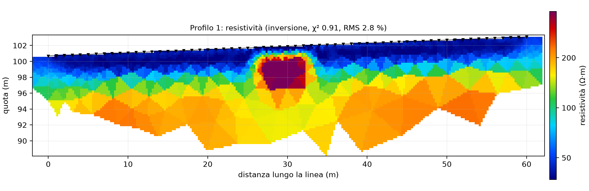
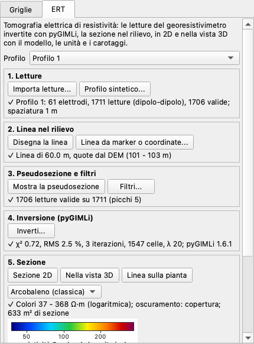
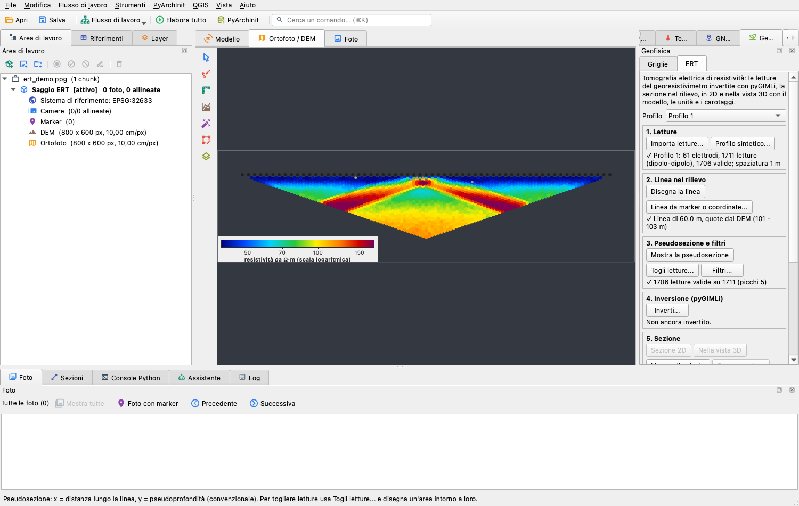
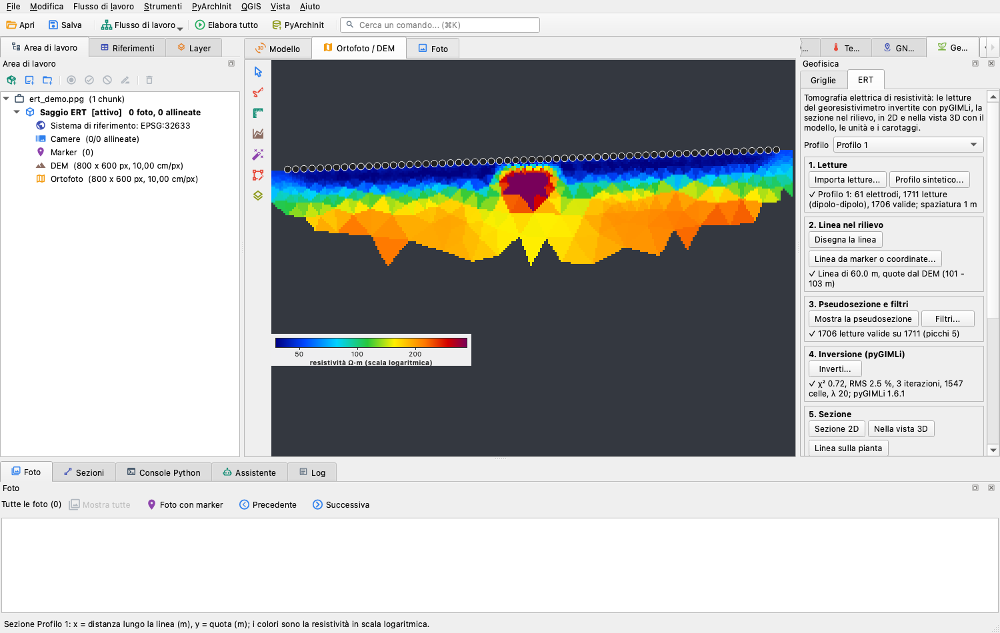
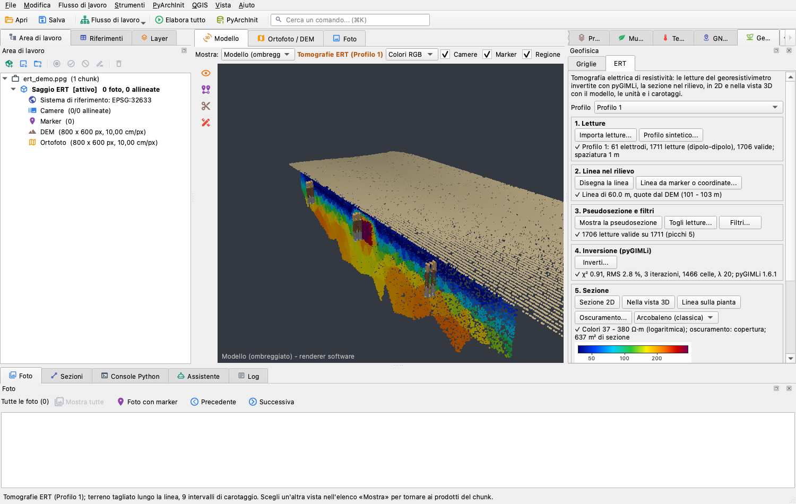

# Geofisica

Il plugin *Geofisica* porta le griglie di una prospezione geofisica - magnetometria, resistività, le
slice in tempo o in profondità di un GPR, prospezioni elettromagnetiche e di suscettività - nel
progetto fotogrammetrico dello stesso terreno. Legge le griglie esportate dal programma di
elaborazione, le posa sul rilievo con i picchetti della griglia di prospezione, applica i filtri soliti
(despike, destripe, passa-alto...), le sovrappone all'ortofoto o al DEM con la trasparenza che scegli,
ti fa disegnare le anomalie che vi leggi e le esporta per un GIS. Anomalia e scavo, mappa magnetica e ortofoto finiscono nello stesso posto e
nello stesso sistema di riferimento.

Questa pagina descrive la versione 0.2.0 del plugin, che richiede pyarchinit-photogrammetry 1.3.4 o
successiva. La
versione 0.2.0 aggiunge la [tomografia di resistività elettrica](#ert): le letture di un
georesistivimetro, invertite con pyGIMLi, diventano una sezione di resistività posata sul rilievo. Il README e il codice sono nel
[repository dei plugin](https://github.com/enzococca/pyarchinit-photogrammetry-plugins/tree/main/plugins/geophysics).

<figure markdown="span">
  
  <figcaption>Il pannello con le griglie di una prospezione magnetometrica - la griglia grezza, le sue
  copie filtrate e una seconda area letta da una tabella XYZ - e l'ultima filtrata sovrapposta al DEM
  della vista, in grigi al 75 % di opacità: un'anomalia lineare positiva e un dipolo, contornato come
  anomalia A1. Dati sintetici: la griglia dei test del plugin sopra un DEM inventato.</figcaption>
</figure>

!!! note "Gli esempi di questa pagina"
    Le griglie, il DEM e le figure di questa pagina sono sintetici: la prospezione magnetometrica con
    cui il plugin viene provato (un muro, una fossa, strisce fra le traverse e tre picchi di ferro),
    posta in un fuso UTM con coordinate inventate.

## In breve

1. Esporta ogni griglia dal tuo programma di elaborazione come numeri - Surfer GRD, XYZ o GeoTIFF -
   non come immagine.
2. Nel pannello *Geofisica*: *Importa griglia...*, con il tipo di prospezione e le unità.
3. *Georeferenzia...*: con i marker posati sui picchetti degli angoli nell'ortofoto, con origine e
   azimut della griglia, oppure con le coordinate dei picchetti misurate sul campo.
4. *Filtri...*: destripe, despike, passa-alto, ognuno in una copia.
5. *Sovrapponi alla vista* sopra l'ortofoto o il DEM, con banda, palette e opacità.
6. *Disegna anomalia*: i poligoni di ciò che leggi sulla griglia, con una nota.
7. *Esporta...* in GeoTIFF o Surfer GRD, *File > Esporta* in GeoPackage, oppure *Apri in QGIS*.

Per il profilo di un georesistivimetro, invece di una griglia: la [scheda ERT](#ert) - importa le letture, posa la linea,
filtra, inverti, guarda la sezione in 2D e in 3D, esporta.

## Che cosa fa

| Passo | Che cosa dà | A che cosa serve |
|---|---|---|
| Importazione | ogni griglia come GeoTIFF di valori in virgola mobile dentro il progetto, una banda per slice di un GPR | tenere la geofisica con il rilievo e lo scavo a cui appartiene |
| Georeferenziazione | la griglia posata nel sistema di riferimento del chunk, ruotata e spostata, con il residuo dei picchetti | portare sulla carta una prospezione fatta con fettucce e picchetti, in metri locali |
| Filtri | despike, destripe, clip, passa-basso, passa-alto, riempimento, ricampionamento, in copie, ognuno registrato | pulire una griglia grezza: picchi di ferro, strisce di un magnetometro portato avanti e indietro, il fondo geologico |
| Sovrapposizione | la griglia sopra l'ortofoto o il DEM, con banda, palette e opacità | leggere le anomalie insieme a muri, trincee, confini dei campi e rilievo |
| Anomalie | poligoni disegnati sulla vista, ognuno con la griglia, la banda e una nota, conservati nel progetto | l'interpretazione, accanto al rilievo e allo scavo |
| Esportazioni | GeoTIFF e Surfer GRD di una griglia, un GeoPackage con i contorni delle griglie e le anomalie, le griglie nel progetto QGIS del programma | l'archivio, il GIS, la relazione |
| Tomografia di resistività elettrica | le letture di un georesistivimetro invertite in una sezione di resistività sotto una linea posata sul rilievo, vista in 2D e nella vista 3D con le unità e i carotaggi, esportata | una linea di elettrodi attraverso una trincea, un tumulo o un campo, letta insieme allo scavo |

Per le griglie non è un programma di elaborazione: non riduce i dati grezzi registrati dallo strumento, non unisce le
griglie di una prospezione in un mosaico e non interpreta: le anomalie le disegni tu. Elabora la prospezione nel suo programma,
esporta le griglie, poi usa il plugin per metterle sul terreno. La tomografia è l'unica eccezione: inverte da sé le letture di un
georesistivimetro, con [pyGIMLi](https://www.pygimli.org), perché una sezione di resistività prima dell'inversione non esiste.

## Che cosa serve prima { #before }

* **Il plugin**, installato dal programma: vedi [Guide ai plugin](guides.md#install). Non serve
  nient'altro.
* **Un progetto il cui chunk ha un sistema di riferimento proiettato, in metri** - per esempio il fuso
  UTM del sito. Una griglia in metri locali si può importare in qualsiasi progetto, ma si può
  georeferenziare solo in un chunk con un sistema di riferimento: in un progetto locale il plugin
  rifiuta.
* **Un'ortofoto o un DEM** del chunk su cui vedere le griglie; senza, una griglia georeferenziata viene
  mostrata da sola, in un riquadro della sua misura.
* **Le griglie** come file: la sezione che segue.
* Per la georeferenziazione, una di queste: i **picchetti degli angoli** visibili nell'ortofoto (un
  target o un segno dipinto su ognuno), le **coordinate dei picchetti** misurate con il GNSS o la
  stazione totale nel sistema di riferimento del chunk, oppure **origine e azimut** della griglia.

## I dati { #data }

### Formati { #formats }

| Formato | File | Che cosa legge il plugin |
|---|---|---|
| Griglia Surfer | `.grd` | ASCII (`DSAA`), binario di Surfer 6 (`DSBB`) e di Surfer 7 (`DSRB`); il valore di vuoto di Surfer è assenza di valore; celle più lunghe su un lato diventano quadrate sul lato più corto |
| Tabella XYZ | `.xyz`, `.csv`, `.txt`, `.dat` | una lettura per riga, x, y e valore nelle prime tre colonne; i valori fittizi non sono letture |
| Raster | `.tif`, `.tiff`, `.asc`, `.img` e ogni formato raster che GDAL legge | tutte le sue bande; il suo valore di nodata è assenza di valore; il suo sistema di riferimento se ce l'ha |
| Cartella di slice | una cartella di `.tif`, `.tiff`, `.png`, `.jpg`, `.asc` o `.grd` | le slice di un GPR: una banda per file, nell'ordine naturale dei nomi |

Esporta numeri, non immagini: un PNG o un JPEG fatti per una relazione contengono livelli di grigio o
colori, non nT o ohm metro; un'immagine a colori diventa tre bande - rosso, verde e blu - e in una
cartella di slice se ne legge solo il canale rosso.

### Tabelle XYZ { #xyz }

Le esportazioni di Geoplot, TerraSurveyor, del programma di Bartington e della maggior parte degli
altri si leggono così come sono:

```text
x y nT
0.0625 0.2500 0.412
0.1875 0.2500 0.367
0.3125 0.2500 -0.051
```

* x, y e il valore sono le prime tre colonne; le altre vengono ignorate. Le righe che non sono numeri -
  un'intestazione, un commento - vengono saltate.
* Le colonne possono essere separate da spazi, tabulazioni, virgole o punti e virgola. Le **virgole
  decimali** vengono lette quando le colonne sono separate da punti e virgola, tabulazioni o spazi
  (`0,125;0,250;3,7` oppure `0,125 0,250 3,7`); con le virgole fra le colonne, i decimali vanno scritti con
  il punto.
* I **valori fittizi** non sono letture: 2047.5 (il valore fittizio di Geoplot di Geoscan), -9999, 32767,
  -32768 e il vuoto di Surfer (1.70141e38). *Valore fittizio per XYZ* nella finestra di importazione
  (`--dummy` dalla riga di comando) aggiunge quello che scrive il tuo programma. L'importazione dice
  quanti ne ha tolti.
* **La cella.** Il plugin trova la distanza fra le letture lungo x e lungo y. Quando sono uguali, quella è
  la cella e ogni cella ha una lettura. Quando le letture lungo le traverse sono più fitte delle traverse
  - ogni 12,5 cm su linee distanti 50 cm - la cella è la distanza più fine e le righe fra due traverse
  vengono riempite per interpolazione lineare fra le due traverse accanto: mai oltre la prima e l'ultima
  traversa, mai attraverso una lettura mancante (lì le celle restano vuote). La finestra di importazione e
  la riga sotto la tabella del pannello lo dicono (*righe interpolate fra traverse a 0.5 m (letture ogni
  0.125 m)*).
* *Cella per XYZ* dà invece una cella tua, di solito la distanza fra le traverse (0,5 m): le letture che
  cadono in una cella vengono mediate, una traversa per riga di celle.
* **Le celle sono centrate sulle letture**: la griglia comincia mezza distanza prima della prima lettura.
  Con letture ogni 0,125 m da 0,0625 m e una cella di 0,5 m, la griglia comincia a 0 e ogni cella contiene
  quattro letture: traverse lunghe 30 m danno 60 celle, e gli angoli della griglia sono i picchetti.
* Con la cella fine e l'interpolazione, la griglia va dalla prima all'ultima traversa: di traverso alle
  traverse è più corta della prospezione della distanza fra le traverse meno una cella (29,625 m per 30 m
  di traverse distanti 0,5 m, celle di 0,125 m), quindi i suoi angoli non sono i picchetti. Posa una
  griglia così con coppie digitate misurate dal suo angolo in basso a sinistra, oppure importala con la
  distanza fra le traverse come cella quando gli angoli devono essere i picchetti.

### Dove sta la griglia { #coordinates }

Una griglia il cui file non ha un sistema di riferimento - una griglia Surfer, una tabella XYZ,
un'immagine - è in metri locali: il plugin mette l'**angolo in basso a sinistra in 0, 0**, con la x che
cresce lungo le righe della griglia come stanno nel file (verso destra) e la y verso l'alto, e ne
conserva le dimensioni. Le coordinate scritte nel file non vengono usate: gli angoli della griglia sono
0, 0 / L, 0 / L, H / 0, H, dove L e H sono larghezza e altezza in metri (la finestra di
georeferenziazione le mostra). Gli angoli sono i bordi esterni delle celle, mezza cella oltre la prima e
l'ultima lettura, cioè dove stanno di solito i picchetti di una griglia di prospezione.

Un raster con un sistema di riferimento - un GeoTIFF esportato già georeferenziato - lo tiene e non va
georeferenziato; deve stare nello **stesso sistema di riferimento del chunk**, perché il plugin non
riproietta (riproiettalo prima in QGIS). Un'immagine senza world file ha 1 m per pixel: posala con i
marker o con le coppie digitate e la scala libera.

### Tipi e unità { #kinds }

Il tipo scelto all'importazione decide le unità, se non ne dai, e come la griglia viene mostrata:

| Tipo | Unità | Palette nella vista | Limiti dei colori | Scala di colori in QGIS |
|---|---|---|---|---|
| *Magnetometria* | nT | grigi | mediana ± 2,5 deviazioni standard robuste | blu-rosso |
| *Resistività* | ohm m | terra | 2° e 98° percentile | grigi |
| *GPR* | - | grigi | mediana ± 2,5 deviazioni standard robuste | grigi |
| *Elettromagnetico* | mS/m | terra | mediana ± 2,5 deviazioni standard robuste | blu-rosso |
| *Suscettività* | SI | calore | 2° e 98° percentile | grigi |
| *Altro* | - | grigi | 2° e 98° percentile | grigi |

La deviazione standard robusta è 1,4826 volte la deviazione mediana assoluta dalla mediana: qualche
picco di ferro non allarga i colori.

### Slice GPR { #slices }

Una cartella di slice diventa una griglia con una banda per file, ogni banda con il nome del suo file
come etichetta (`slice_045cm.tif` dà l'etichetta `slice_045cm`).

* I file vengono presi nell'ordine naturale dei nomi, con i numeri contati come numeri: `slice_2`
  prima di `slice_10`.
* Tutte le slice vengono portate alla misura della prima; dai loro la stessa griglia.
* Di ogni file si legge la prima banda: esporta le slice come valori, o come livelli di grigio.
* Come tipo scegli *GPR*.

### Sul campo { #field }

* Misura i picchetti degli angoli della griglia di prospezione con il GNSS o la stazione totale, nel
  sistema di riferimento del rilievo fotogrammetrico, e annota quale angolo è quale.
* Oppure rendili visibili dall'alto: un target, una croce dipinta o una piastra su ogni picchetto
  d'angolo, dentro l'area del volo del drone.
* Annota quale angolo è l'origine della prospezione e la direzione della prima traversa: il plugin
  prende l'angolo in basso a sinistra della griglia esportata come 0, 0 e le righe come asse x.
* Esporta ogni area della prospezione come una griglia a sé, in metri, con le celle della prospezione.

### Errori frequenti e avvisi { #mistakes }

| Che cosa è successo | Che cosa fa o dice il plugin | Che cosa fare |
|---|---|---|
| virgole decimali con le virgole anche fra le colonne di una tabella XYZ | le virgole spezzano i numeri: una griglia con valori senza senso | punti e virgola, tabulazioni o spazi fra le colonne |
| un valore fittizio diverso dai soliti | letto come una lettura: macchie bianche o nere | *Valore fittizio per XYZ*, oppure togli quelle righe |
| un'immagine a colori di una slice | se ne legge il canale rosso | esporta i valori, o i grigi |
| un'immagine senza world file | 1 m per pixel | marker o coppie digitate, *Scala fissa 1* non spuntata |
| un GeoTIFF in un altro sistema di riferimento | la griglia finisce nel posto sbagliato | riproiettalo nel sistema del chunk |
| georeferenziazione in un chunk senza sistema di riferimento | *Il chunk non è georeferenziato: la griglia resterebbe in metri locali.* | georeferenzia prima il rilievo |
| *Sovrapponi alla vista* con una griglia locale | *La griglia è in metri locali: georeferenziala prima.* | *Georeferenzia...* |
| *Sovrapponi alla vista* con una griglia lontana dal raster mostrato | *La griglia sta fuori dal raster mostrato nella vista...* | controlla la posa, o mostra un altro raster |
| un marker sull'angolo sbagliato, o angoli scambiati | un residuo di metri | controlla quale marker sta su quale angolo e posa di nuovo la griglia |
| virgole decimali nelle coppie digitate | i numeri vengono spezzati | punti decimali |

## Passo per passo nel programma { #program }

### Il pannello

Una volta installato il plugin e riavviato il programma, il pannello *Geofisica* si apre a destra nella finestra, fra le schede di *PyArchInit*; si sposta, si stacca o si chiude come gli altri pannelli e si riapre da *Vista > Pannelli*, oppure con *Plugin > Geofisica > Griglie geofisiche...*. Il menu *Plugin > Geofisica* ha anche *Importa
griglia geofisica...*, *Sovrapponi la griglia alla vista*, *Nascondi la griglia* e *Disegna un'anomalia*.

Dall'alto: una breve descrizione; *Importa griglia...*, *Georeferenzia...*, *Filtri...*; la tabella
delle griglie del chunk; *Banda* (per le slice di un GPR, con l'etichetta della slice), *Palette*,
*Opacità*; *Sovrapponi alla vista*, *Nascondi*, *Disegna anomalia*, *Esporta...*, *Apri in QGIS*,
*Rimuovi*; in fondo, una riga sulla griglia selezionata (dimensioni, cella, posizione, mediana, filtri e
come è stata letta una tabella XYZ), oppure che cosa è mostrato e i valori ai due estremi dei colori.

La tabella ha una riga per griglia: *Nome*, *Tipo*, *Unità*, *Cella (m)*, *Celle* (colonne x righe),
*Bande*, *Posizione* (*locale*, oppure il sistema di riferimento una volta posata) e *Filtri* (quelli
applicati, in ordine). I pulsanti lavorano sulla riga selezionata.

### 1. Importare una griglia { #import }

*Importa griglia...*

| Campo | Che cosa fa |
|---|---|
| *File (GRD, XYZ, CSV, GeoTIFF, raster)* | il file della griglia |
| *Oppure una cartella di slice GPR* | una cartella con un file per slice, al posto del file |
| *Nome (vuoto = nome del file)* | il nome nella tabella e nelle esportazioni; le copie filtrate vi aggiungono il nome del filtro |
| *Tipo* | *Magnetometria*, *Resistività*, *GPR*, *Elettromagnetico*, *Suscettività*, *Altro* |
| *Unità (vuote = quelle del tipo)* | nT, ohm m, mS/m, SI... |
| *Cella per XYZ (m, vuota = dai dati)* | solo per le tabelle XYZ: la cella della griglia; vuota, la distanza fra le letture, con le righe fra le traverse interpolate ([Tabelle XYZ](#xyz)) |
| *Valore fittizio per XYZ (vuoto = i soliti)* | solo per le tabelle XYZ: un valore che il tuo programma scrive per una lettura mancante, oltre a 2047.5, -9999, 32767, -32768 e al vuoto di Surfer |

La griglia viene copiata nel progetto come GeoTIFF; una finestra la riassume - *Griglia Area 1: 60 x 80
celle di 0.5 m, 1 banda/e, valori -3.51 .. 59.8 nT; in metri locali: georeferenziala*, con come è stata
letta una tabella XYZ (interpolazione, valori fittizi tolti, virgole decimali). Minimo e massimo
sono il primo controllo: un valore di migliaia in una prospezione magnetometrica è un valore fittizio o
un picco.

### 2. Georeferenziare { #georef }

*Georeferenzia...* posa sul rilievo la griglia selezionata. Serve un chunk con un sistema di
riferimento.

<figure markdown="span">
  
  <figcaption>La griglia nel plugin: l'angolo in basso a sinistra in 0, 0, la x lungo le righe della
  griglia come stanno nel file, la y verso l'alto; L e H larghezza e altezza. L'azimut dell'asse x si
  conta in senso orario dal nord: 90 quando le righe vanno verso est.</figcaption>
</figure>

| Campo | Che cosa fa |
|---|---|
| *Metodo* | *Angoli della griglia = marker*, *Origine e azimut* oppure *Coppie di coordinate digitate* |
| *Marker dell'angolo in basso a sinistra (origine)*, *... in basso a destra*, *... in alto a destra*, *... in alto a sinistra* | i marker del chunk sugli angoli: almeno due, meglio tre o quattro; *(nessuno)* per gli altri |
| *Scala fissa 1 (griglia in metri)* | spuntata: la griglia tiene le sue dimensioni, viene solo ruotata e spostata; non spuntata: vengono adattate anche le dimensioni (un'immagine, una griglia con la cella sbagliata) |
| *Origine E (m)*, *Origine N (m)* | l'angolo in basso a sinistra nel sistema di riferimento del chunk |
| *Azimut dell'asse x (gradi dal nord)* | la direzione delle righe, in senso orario dal nord come su una bussola: 90 est, 0 nord |
| *Coppie: 'x_locale y_locale E N' per riga* | un punto per riga: i suoi metri locali nella griglia e le sue coordinate nel sistema di riferimento del chunk |

La finestra dice quanto è grande la griglia (*La griglia è in metri locali con l'origine nell'angolo in
basso a sinistra (30 x 40 m)*); i campi dei metodi non scelti vengono ignorati.

* **Angoli della griglia = marker.** Mostra l'ortofoto, prendi lo strumento *Marker* della barra
  laterale (gruppo *Misure*) e fai clic su ogni picchetto d'angolo: i marker si chiamano *point 1*, *point 2*...
  (rinominali nel pannello *Riferimenti* se vuoi). Nella finestra scegli il marker di ogni angolo. Un
  marker con coordinate digitate nel pannello *Riferimenti* dà quelle coordinate, gli altri la posizione
  stimata dal rilievo.
* **Origine e azimut.** L'angolo in basso a sinistra e la direzione delle righe: basta quando la
  griglia è stata tracciata con la bussola o lungo una linea nota.
* **Coppie digitate.** Il modo migliore quando i picchetti sono stati misurati: una riga per picchetto,
  i metri locali del picchetto nella griglia e le sue coordinate, per esempio
  `0 0 500100.00 4500800.00`, `30 0 500129.89 4500802.61` e `0 40 500096.53 4500839.86`. I metri
  locali si misurano dall'angolo in basso a sinistra della griglia come la vede il plugin, non nelle
  coordinate del file originale. Spazi, virgole o punti e virgola separano i numeri; decimali con il
  punto.

Con i marker o le coppie il plugin trova la rotazione e lo spostamento (e la scala, se libera) che
portano i punti locali più vicini alle loro coordinate, ai minimi quadrati. La finestra dà il risultato
- con le tre coppie sopra, *Griglia Area 1 posata: rotazione 4.98 gradi, scala 1.0000, residuo 0.005 m*.
La rotazione si conta in senso antiorario da est (un azimut di 90 è una rotazione di 0); il residuo è
lo scarto quadratico medio fra i punti e dove li mette la griglia posata: qualche centimetro è normale,
decimetri o metri vogliono dire un picchetto nel posto sbagliato o due angoli scambiati. Salva il
progetto (*File > Salva*) per tenere la posizione.

Una griglia si può posare di nuovo in ogni momento, con uno qualsiasi dei tre metodi: il plugin parte
ogni volta dai metri locali della griglia, così la nuova posa sostituisce la vecchia (una griglia posata
con la scala libera riprende prima anche le sue dimensioni).

Georeferenzia una griglia prima di filtrarla: le copie filtrate tengono la posizione della griglia da
cui vengono, mentre le copie di una griglia locale restano locali e vanno posate una per una.

### 3. Filtri { #filters }

*Filtri...* applica un filtro a tutte le bande della griglia selezionata.

| Campo | Predefinito | Che cosa fa |
|---|---|---|
| *Filtro* | *Destripe* | il filtro, dalla tabella qui sotto |
| *Despike: lato della finestra (celle)* | 3 | |
| *Despike: soglia (volte il rumore)* | 4 | |
| *Destripe: traverse lungo* | *le righe (x)* | *le righe (x)* o *le colonne (y)*: la direzione in cui è stato portato lo strumento |
| *Destripe: statistica* | *mediana* | *mediana* o *media* di ogni traversa |
| *Clip: percentile basso*, *Clip: percentile alto* | 1, 99 | |
| *Passa-basso: sigma (celle)* | 1 | la larghezza del lisciamento gaussiano |
| *Passa-alto: sigma (celle)* | 10 | la larghezza del lisciamento gaussiano che viene tolto (5 m su celle di 0,5 m) |
| *Riempi: distanza massima (celle)* | 3 | |
| *Ricampiona: cella (m)* | quella della griglia | |
| *In una copia (la griglia originale resta)* | spuntato | il risultato è una nuova griglia, chiamata con il nome del filtro dopo quello della griglia; non spuntato, cambia la griglia stessa |

Contano solo i campi del filtro scelto.

| Filtro | Che cosa fa |
|---|---|
| *Despike (spike sostituiti dalla mediana locale)* | una lettura più lontana dalla mediana della sua finestra della soglia moltiplicata per il rumore della griglia (1,4826 volte la distanza mediana delle letture dalle loro mediane locali) viene sostituita da quella mediana: ferro, una lettura presa mentre lo strumento urtava qualcosa |
| *Destripe (media/mediana di ogni traversa a zero)* | la mediana (o la media) di ogni riga - o colonna - viene sottratta, così tutte le traverse hanno lo stesso zero: le strisce di un magnetometro portato avanti e indietro, di un resistivimetro che deriva |
| *Clip ai percentili* | i valori sotto il percentile basso e sopra quello alto vengono portati a quei valori |
| *Passa-basso (gaussiano)* | un lisciamento gaussiano che salta le celle vuote: meno rumore, bordi più morbidi |
| *Passa-alto (residuo dal gaussiano)* | la griglia meno il suo lisciamento gaussiano: se ne va il fondo geologico ampio, restano le anomalie più piccole di qualche sigma |
| *Riempi i vuoti* | le celle vuote prendono un valore dalle letture entro la distanza, pesate con la distanza |
| *Ricampiona* | celle di un'altra misura sulla stessa area: medie se più grandi, bilineare se più piccole |

<figure markdown="span">
  
  <figcaption>(a) La griglia grezza: un'anomalia lineare positiva, un dipolo, strisce fra le traverse e
  tre picchi di ferro. (b) Destripe sulle righe. (c) Despike, 3 celle, soglia 4. (d) Passa-alto, sigma 8
  celle (4 m). La stessa scala di grigi da -3 a +5 nT per i quattro riquadri. Dati
  sintetici.</figcaption>
</figure>

Una sequenza abituale per la magnetometria è destripe, poi despike, poi - quando la geologia è forte -
un passa-alto, ognuno in una copia così i passi restano nella tabella. Sui dati con strisce forti fai
prima il destripe: altrimenti la finestra del despike mescola letture di traverse vicine. Ogni filtro
viene registrato nella griglia (la colonna *Filtri*, le esportazioni); i filtri girano in background e
alla fine il progetto viene salvato.

### 4. Sulla vista { #overlay }

Seleziona una griglia e premi *Sovrapponi alla vista* (o *Plugin > Geofisica > Sovrapponi la griglia
alla vista*). La griglia va sopra ciò che mostra la vista *Ortofoto / DEM*; quando non mostra nulla, prima
viene mostrata l'ortofoto (o il DEM) del chunk, e quando il chunk non ha né l'una né l'altro, la griglia da
sola in un riquadro della sua misura:

* *Banda*: la slice di un GPR, con la sua etichetta accanto al cursore;
* *Palette*: *Grigi*, *Grigi invertiti*, *Divergente (blu-rosso)*, *Terra*, *Calore*; segue il tipo
  della griglia selezionata fino al primo *Sovrapponi alla vista*, poi resta come la imposti;
* *Opacità*: cambia subito la griglia mostrata; banda e palette valgono dal successivo *Sovrapponi alla
  vista*.

La riga in fondo dice che cosa è mostrato e i valori ai due estremi dei colori, nelle unità della
griglia (*Area 1 despike highpass: banda 1, colori da -0.941 a 0.657 nT*). Si mostra una griglia alla
volta; *Nascondi* la toglie. Quando la vista mostra un altro raster (l'ortofoto al posto del DEM, un
rilievo), la griglia vi viene sovrapposta di nuovo con la stessa banda, palette e opacità, fino a
*Nascondi*; disegnare nella vista, o cancellare un disegno, la lascia dov'è.

### 5. Anomalie { #anomalies }

*Disegna anomalia* (o *Plugin > Geofisica > Disegna un'anomalia*) disegna sulla vista ciò che leggi sulla
griglia selezionata:

1. Seleziona la griglia e, se vuoi, sovrapponila con la banda che stai leggendo (una vista vuota mostra
   prima la griglia).
2. Premi *Disegna anomalia* e trascina un riquadro sulla vista, oppure fai clic sui vertici del poligono;
   Backspace toglie l'ultimo vertice, il tasto destro ricomincia il poligono. Il disegno è quello del
   programma, prestato al plugin.
3. Doppio clic, oppure Invio, per chiuderlo; Esc annulla, e così la scelta di un altro strumento della
   barra laterale della vista 2D.
4. Una finestra chiede un'*Etichetta* (A1, A2... in automatico) e una *Nota*, l'interpretazione (*muro*,
   *fossa*, *fornace?*).

L'anomalia tiene il nome della griglia, la banda mostrata (l'etichetta della slice di un GPR) e la sua
area. Va nel progetto (salvalo con *File > Salva*) e nel layer *Anomalie geofisiche* della vista, in
arancione: con lo strumento *Sposta* un clic ne mostra gli attributi, con lo strumento *Seleziona* e Canc
esce dalla vista e dal progetto. Il layer torna ogni volta che la vista mostra un altro raster; toglierlo
dalla vista nel pannello *Layer* lascia le anomalie nel progetto. Lo strumento poligono del programma
disegna unità stratigrafiche, non anomalie.

*File > Esporta > Griglie e anomalie geofisiche (GeoPackage)...* scrive le anomalie nella tabella
`anomalie`. Con il collegamento dal vivo del programma con QGIS compaiono anche fra i disegni del
programma, nella tabella *Poligoni (ppg)* (dal programma 1.3.1; prima, nella tabella delle unità), con
*Anomalie geofisiche* nella colonna `layer`.

### 6. Esportare, QGIS, togliere { #export }

* *Esporta...*: la griglia selezionata come GeoTIFF (tutte le bande, nella sua posizione, rotazione
  compresa) o come Surfer GRD (la banda mostrata nel pannello). Una griglia Surfer non ha rotazione: una
  griglia ruotata viene ricampionata su una griglia con il nord in alto e la stessa cella che la
  contiene, vuota fuori dalla griglia, e la finestra lo dice; il GeoTIFF tiene la griglia com'è.
* *File > Esporta > Griglie e anomalie geofisiche (GeoPackage)...*: un GeoPackage con i contorni delle
  griglie georeferenziate (tabella `griglie`: nome, tipo, unità, cella, righe, colonne, bande, filtri,
  file), un GeoTIFF di ciascuna accanto e le anomalie disegnate (tabella `anomalie`: etichetta, griglia,
  banda, nota, area in m²). Le altre tabelle di un GeoPackage esistente restano.
* *Apri in QGIS*: il progetto QGIS del programma ([QGIS](../integrations.md)) con le griglie
  georeferenziate, nascoste all'inizio, magnetometria ed EM in blu-rosso, le altre in grigi.
* *Rimuovi*: dopo una conferma, la griglia lascia il progetto e il suo file viene cancellato; le
  anomalie disegnate su di essa restano.

## Dalla riga di comando { #cli }

Gli stessi passi con `ppg plugin geophysics COSA PROGETTO ...`. Ogni comando lavora sul chunk attivo
(`--chunk NOME` per un altro) e salva il progetto. Una griglia si indica con il nome o con l'id.

```bash
ppg plugin geophysics --help
ppg plugin geophysics import scavo.ppg area1.grd --kind magnetometry --name "Area 1"
ppg plugin geophysics import scavo.ppg area2.xyz --kind magnetometry --name "Area 2" --cell 0.5
ppg plugin geophysics import scavo.ppg area3.csv --kind resistivity --name "Area 3" --dummy -1
ppg plugin geophysics import scavo.ppg slice_gpr --kind gpr --name "GPR 2026"
ppg plugin geophysics list scavo.ppg
ppg plugin geophysics georef scavo.ppg "Area 1" --origin 500100.0,4500800.0 --azimuth 95
ppg plugin geophysics georef scavo.ppg "Area 2" --pairs "0 0 500200 4500800; 30 0 500229.9 4500802.6; 0 20 500198.3 4500819.9"
ppg plugin geophysics filter scavo.ppg "Area 1" destripe --copy
ppg plugin geophysics filter scavo.ppg "Area 1 destripe" despike size=3 k=4
ppg plugin geophysics filter scavo.ppg "Area 1 destripe" highpass sigma=8 --copy
ppg plugin geophysics filter scavo.ppg "Area 1" clip low=-20 high=20 absolute=1 --copy
ppg plugin geophysics export scavo.ppg "Area 1 destripe highpass" area1.tif
ppg plugin geophysics export scavo.ppg "GPR 2026" slice_3.grd --band 2
```

| Comando | Opzioni |
|---|---|
| `import PROGETTO FILE` | un file o una cartella di slice; `--kind` magnetometry, resistivity, gpr, em, susceptibility, other (magnetometry); `--name`; `--units`; per XYZ, `--cell` m e `--dummy` (ripetibile) |
| `list PROGETTO` | una riga per griglia: nome, tipo, unità, dimensioni, cella, bande, posizione, mediana, filtri, come è stata letta una tabella XYZ; il numero di anomalie disegnate - nella lingua del programma |
| `georef PROGETTO GRIGLIA` | `--origin E,N` con `--azimuth` (90), oppure `--pairs "lx ly E N; lx ly E N; ..."`, con `--free-scale` per adattare anche le dimensioni |
| `filter PROGETTO GRIGLIA FILTRO [k=v ...]` | `FILTRO`: `despike` (`size`, `k`), `destripe` (`axis=rows` o `cols`, `stat=median` o `mean`), `clip` (`low`, `high`, `absolute=1` per dare valori invece di percentili), `lowpass` (`sigma`, 1), `highpass` (`sigma`, 10), `fill` (`distance`), `resample` (`cell`); `--copy` in una nuova griglia |
| `export PROGETTO GRIGLIA USCITA` | `.tif`: tutte le bande; `.grd`: una banda, `--band` contata da 0, una griglia ruotata ricampionata con il nord in alto |

I valori predefiniti sono quelli della finestra: passa-basso sigma 1 cella, passa-alto sigma 10 celle. Ogni
comando stampa che cosa ha fatto: la griglia importata (con come è stata letta una tabella XYZ), la nuova
posizione con il residuo, i filtri e le statistiche del risultato.

## Leggere i risultati { #reading }

### Colori e valori { #reading-colours }

La griglia viene colorata fra due valori, scritti in fondo al pannello nelle unità della griglia: per
magnetometria, EM e GPR la mediana più e meno 2,5 deviazioni standard robuste, per gli altri tipi il 2°
e il 98° percentile. Ciò che sta oltre viene disegnato con il colore dell'estremo: il nucleo di un
dipolo forte è bianco e nero pieno. In *Grigi* i valori alti sono bianchi; *Grigi invertiti* dà la
convenzione opposta di alcuni programmi di elaborazione.

* Dopo il *Destripe* ogni traversa ha la mediana a zero, e così la griglia; dopo un *Passa-alto* la sua
  media è zero. I valori allora sono differenze da ciò che sta intorno, non valori del campo.
* Il passa-alto lascia bande più scure ai lati di un'anomalia positiva forte, come nel riquadro (d)
  della figura: sono il filtro, non il terreno. Un sigma di qualche volta la larghezza delle anomalie
  cercate le conserva intere.
* *Ricampiona* e *Passa-basso* lisciano: misura l'intensità di un'anomalia sulla griglia grezza o dopo
  il destripe.

### Controllare la posa { #reading-placement }

Sovrapponi la griglia con un po' di trasparenza e cerca ciò che si vede in tutte e due: un confine di
campo, un sentiero, una trincea, un muro nell'ortofoto che anche la geofisica vede. Uno spostamento di
qualche decimetro in una direzione indica un picchetto o un marker nel posto sbagliato, una rotazione
l'angolo sbagliato; il residuo della georeferenziazione dice quanto i picchetti sono d'accordo fra
loro, non se sono i picchetti giusti.

### Limiti { #limits }

* **Nessuna riproiezione.** Una griglia con un sistema di riferimento deve stare in quello del chunk.
* **Righe intere.** Il *Destripe* sottrae la mediana di ogni riga della griglia importata: in un mosaico
  di più griglie di prospezione una riga le attraversa tutte. Le griglie percorse separatamente è meglio
  passarle al destripe nel programma di elaborazione, o importarle una per una.
* **Due dimensioni.** Le slice di un GPR sono bande di una griglia, viste una alla volta; non si
  costruisce un volume.
* **Nessuna interpretazione.** Il plugin disegna la griglia dove deve stare: le anomalie le leggono
  l'archeologo e il geofisico, e le disegnano con *Disegna anomalia* o in QGIS.

## Tomografia di resistività elettrica (ERT) { #ert }

Un profilo ERT è una linea di elettrodi nel terreno, 24, 48, 64 o più, a una certa spaziatura, e un
georesistivimetro che inietta corrente fra due di essi e legge la tensione fra altri due, centinaia o
migliaia di volte. Quello che registra è la resistività *apparente* di ogni lettura: un numero che mescola
il terreno fra gli elettrodi e sotto di essi. L'**inversione** cerca la distribuzione di resistività nel
terreno che spiega tutte le letture; il suo risultato è la **sezione di resistività**, un'immagine
verticale sotto la linea - terreno conduttivo (argilla, riporto umido, un fossato) in blu, terreno
resistivo (pietra, un muro, un vuoto, sabbia asciutta) in rosso e viola.

Il plugin prende le letture come lo strumento le ha esportate, posa la linea sul rilievo, ti lascia guardare
i dati e togliere le letture cattive, inverte con pyGIMLi e mette la sezione al suo posto: in una vista
propria, con la legenda in ohm metro, e nella vista 3D sotto la linea, con il modello, le unità
stratigrafiche e i carotaggi del [plugin Geoarcheologia](geoarchaeology.md).

<figure markdown="span">
  
  <figcaption>La figura esportata per un profilo sintetico di 61 elettrodi a 1 m l'uno dall'altro su un
  terreno che sale del 4 %: uno strato superficiale conduttivo (blu), uno strato resistivo sotto di esso
  (arancione), un blocco resistivo sepolto nel mezzo (viola), gli elettrodi come triangoli in superficie, i
  colori in scala logaritmica. Le parti che le letture non risolvono restano bianche.</figcaption>
</figure>

!!! note "Gli esempi di questa sezione"
    Il profilo è sintetico: pyGIMLi calcola le letture di un modello (un terreno di 40 ohm m sopra 150 ohm m
    da 3 m, con un blocco di 1500 ohm m fra 1 e 3 m di profondità, nel mezzo di 61 elettrodi), aggiunge il
    2 % di rumore e il plugin le inverte come farebbe con quelle di uno strumento. Il blocco ritorna dov'è,
    un po' sfumato: è quello che fa un'inversione.

### La scheda ERT { #ert-pane }

La scheda *ERT* del pannello *Geofisica* elenca in ordine i passi di un profilo, ognuno con i suoi pulsanti e,
sotto, il suo stato: *Letture*, *Linea nel rilievo*, *Pseudosezione e filtri*, *Inversione (pyGIMLi)*,
*Sezione* ed *Esportazioni*. L'elenco in alto sceglie il profilo, quando il chunk ne ha più di uno. Un passo che
non si può ancora fare - una sezione prima dell'inversione, la linea sulla pianta prima di posarla - ha i
pulsanti grigi. L'inversione si può fare anche prima di posare la linea: con le quote del file, o piatta. Il menu *Plugin > Geofisica* ha le stesse azioni come voci, fra cui *Tomografia elettrica:
importa letture...* e *Installa pyGIMLi...*.

<figure markdown="span">
  
  <figcaption>La scheda ERT dopo un'inversione: ogni passo con il suo stato - 61 elettrodi e 1711 letture,
  una linea di 60 m con le quote dal DEM, 1706 letture valide, χ² 0,72 e RMS 2,5 % - e i colori della
  sezione con l'oscuramento in vigore.</figcaption>
</figure>

### Che cosa serve { #ert-before }

* Il plugin, come per le griglie, e un progetto con un chunk. La linea si posa in un **sistema di riferimento
  proiettato in metri** (quello del chunk); funziona anche un chunk con un sistema locale, con le sue
  coordinate locali.
* Le **letture** del georesistivimetro come file (sezione seguente) e, se le hai, le coordinate degli
  elettrodi.
* Un'**ortofoto o un DEM** del chunk su cui disegnare la linea e da cui prendere le quote degli elettrodi (la
  topografia entra nell'inversione). Senza, la linea si digita o si prende da due marker e il terreno è piatto,
  oppure le quote le dà il file.
* **pyGIMLi**, che il plugin installa per te in un ambiente a parte la prima volta che inverti
  ([più avanti](#ert-install)). Non fa parte del programma e non serve per importare, posare e filtrare.

### Le letture { #ert-formats }

*Importa letture...* prende un file; il formato si riconosce dal contenuto.

| Formato | Che cos'è | Note |
|---|---|---|
| CSV, TXT (tabella con intestazione) | una lettura per riga: `a, b, m, n` e la resistività apparente `rhoa`, oppure la resistenza `r`, oppure la tensione `u` con la corrente `i`; l'errore `err` se lo strumento lo dà | i nomi delle colonne si riconoscono in molte grafie (`rho`, `appres`, `C1 C2 P1 P2`...); virgola, punto e virgola, tabulazione o spazi fra le colonne, punto o virgola decimale |
| Esportazione Syscal | le colonne `Spa.1`-`Spa.4`, `Rho`, `Dev` (l'errore in %), `Vp` (mV), `In` (mA) si leggono così come sono | l'esportazione in testo del programma dello strumento |
| formato unificato di pyGIMLi (`.ohm`, `.dat`, `.shm`) | elettrodi e letture in un solo file, con la topografia degli elettrodi se c'è | il formato che scrivono pyGIMLi, BERT e il plugin stesso (*Esporta...*). Un profilo 2D di pyGIMLi (`# x y z` con y la quota e z = 0) dà distanze e quote; le colonne di soli zeri che pyGIMLi scrive per i valori che non ha si ignorano; le unità dopo la barra (`u/mV`, `i/mA`, `err/%`, `rho/Ohmm`) si convertono |
| RES2DINV, ABEM, altri file degli strumenti | li legge pyGIMLi, nel suo ambiente | serve pyGIMLi installato; il plugin lo propone |
| tabella degli elettrodi (facoltativa, un secondo file) | `x, z` (distanza lungo la linea e quota), oppure `x, y, z` nelle coordinate del chunk | la linea passa allora per gli elettrodi |

Due cose si decidono all'importazione e la finestra le chiede:

* **Numeri o posizioni.** In `a, b, m, n` un elettrodo può essere il suo numero (1, 2, 3...) o la sua
  posizione in metri. Il plugin indovina: numeri interi da 1, consecutivi, sono numeri; posizioni ogni 2 m
  (2, 4, 6...) e le colonne `Spa.1`-`Spa.4` di Syscal sono posizioni. *Colonne a, b, m, n* te lo lascia dire.
  Con i numeri, *Distanza fra gli elettrodi numerati* dà i metri fra due elettrodi (vuoto = 1; si può cambiare
  anche dopo, quando si posa la linea).
* **L'elettrodo remoto.** Nei dispositivi polo-dipolo e polo-polo un elettrodo sta "all'infinito": in `b` o `n`
  una cella vuota, un numero negativo o - con gli elettrodi numerati - lo 0.
* **Nome.** Il nome del profilo nel progetto; vuoto è il nome del file.

Le letture si tengono come sono: il plugin le legge nel progetto e lavora su quella copia. Il numero di
elettrodi, di letture e il dispositivo (dipolo-dipolo, Wenner, Wenner-Schlumberger, polo-dipolo, o misto)
si dicono nel pannello, con le note della lettura: per esempio le colonne indovinate o le letture senza
valore.

*Profilo sintetico...* produce le letture di un terreno che descrivi - due strati e un blocco, un
dispositivo, una pendenza, un rumore - con la modellazione diretta di pyGIMLi, per provare i passi o per
vedere che cosa può risolvere una linea prima della giornata sul campo. Serve pyGIMLi.

### Posare la linea sul rilievo { #ert-place }

Il profilo vive prima nel suo riferimento: x è la distanza lungo la linea, y la quota. *Linea nel rilievo*
lo mette sul terreno, in uno di tre modi.

* **Disegna la linea**: con l'ortofoto o il DEM nella vista 2D, clic sul primo elettrodo e sull'ultimo (o su
  più punti per una linea spezzata), doppio clic o Invio per finire, Esc per annullare. La linea va dal
  primo elettrodo verso l'ultimo.
* **Linea da marker o coordinate...**: *due marker* (il marker del primo elettrodo e quello dell'ultimo),
  oppure *coordinate digitate*: `X Y` di due punti o più, uno per riga o separati da `;`. Fra X e Y uno spazio
  (allora la virgola decimale va bene: `500010,5 4500050,2`) oppure una virgola (allora il punto decimale:
  `500010.5,4500050.2`); un punto che si può leggere in due modi viene rifiutato.
* **Le coordinate degli elettrodi** nel file importato, se il file le ha in X, Y: nella stessa finestra,
  *Linea da* > *coordinate degli elettrodi nel file*. Valgono solo se sono nel sistema del chunk: se cadono
  lontano dal DEM o dall'ortofoto (un sistema locale dello strumento, per esempio) il plugin lo dice e non posa
  niente - disegna la linea o usa i marker.

Poi, nella stessa finestra:

* **Primo elettrodo a**: dov'è il primo elettrodo, in metri dal primo punto della linea (0 quando la linea
  parte dal primo elettrodo).
* **Distanza fra gli elettrodi**: in metri.
* **Distanza misurata**: *lungo il terreno* (il cavo steso sul pendio: sul campo la spaziatura si misura così;
  in pianta gli elettrodi risultano più vicini, del 2 % su un pendio del 20 %) o *in pianta*. Il predefinito è
  *in pianta* per un file con le quote (x e z, come li scrivono pyGIMLi e BERT: x è orizzontale), *lungo il
  terreno* per gli elettrodi numerati e le posizioni del cavo. Con le quote piatte non cambia nulla.
* **Quote degli elettrodi**: *dal DEM del chunk* (campionato sotto ogni elettrodo: il predefinito quando il
  chunk ha un DEM), *dal file* (le quote del file degli elettrodi, più la quota sotto) o *piatte* alla quota
  sotto. Le quote sono la topografia che l'inversione segue: su un pendio o un tumulo usa il DEM o il file.

Il pannello dice la lunghezza della linea e l'intervallo delle quote. *Linea sulla pianta* disegna ogni linea
posata e i suoi elettrodi sull'ortofoto o sul DEM, in un layer, con il suo nome e i numeri del primo e
dell'ultimo elettrodo.

### La pseudosezione e i filtri { #ert-filter }

*Mostra la pseudosezione* mostra le letture, un punto ciascuna, nella vista 2D: la posizione orizzontale è il
punto medio dei quattro elettrodi della lettura, quella verticale una **pseudoprofondità** convenzionale
(0,17 volte l'estensione degli elettrodi), il colore è la resistività apparente in scala logaritmica. Sono i
dati misurati, non il terreno: ma si vedono a colpo d'occhio le letture cattive - punti isolati di un colore
molto diverso - e l'impostazione generale del rilievo.

Per togliere una lettura selezionala con lo strumento *Seleziona* del programma e premi *Canc*: diventa
grigia e resta fuori dall'inversione. *Filtri...* ne toglie molte insieme. Ogni regola è spenta se lasciata
vuota.

| Filtro | Che cosa toglie |
|---|---|
| Resistività apparente minima / massima | le letture sotto o sopra il valore, in ohm m |
| Errore massimo della lettura (%) | le letture il cui errore (la deviazione che lo strumento registra) è sopra il valore, solo se il file lo ha |
| Errore reciproco massimo (%) | le letture che differiscono dalla loro reciproca - la stessa lettura con gli elettrodi di corrente e di potenziale scambiati - di più del valore; solo per le letture che ne hanno una |
| Picchi: scarto dai vicini | le letture lontane dai vicini nella pseudosezione, in deviazioni robuste dell'insieme: 8 è un inizio usuale, meno ne toglie di più |
| Rimetti le letture tolte a mano | annulla le cancellazioni fatte con lo strumento *Seleziona* |

Le resistività apparenti nulle o negative sono sempre tolte. Il pannello tiene il conto - *1706 letture
valide su 1711 (picchi 5)* - e ogni rimozione è registrata, quindi niente va perso: cambia una regola e le
letture tornano.

<figure markdown="span">
  
  <figcaption>La pseudosezione del profilo sintetico dopo il filtro dei picchi: cinque letture rese sbagliate
  apposta sono grigie, le altre colorate secondo la loro resistività apparente; gli elettrodi nella riga in
  alto. Il blocco resistivo si vede come una banda verticale di rosso sotto il mezzo della linea.</figcaption>
</figure>

### L'inversione { #ert-invert }

*Inverti...* chiede i parametri del gestore ERT di pyGIMLi; i valori predefiniti vanno bene per la maggior
parte dei profili e l'inversione di un profilo tipico di 48-64 elettrodi richiede da secondi a uno o due
minuti. Una finestra segue i passi.

| Parametro | Che cos'è |
|---|---|
| Lambda | la lisciatura del risultato: più alto è più liscio e si adatta meno ai dati; 20 è il predefinito. Abbassalo per contrasti netti, alzalo per dati rumorosi |
| Peso verticale | sotto 1 favorisce strati orizzontali, sopra 1 strutture verticali (1 = uguali) |
| Modello a blocchi | un vincolo L1: confini netti e blocchi di resistività uniforme, invece di un cambiamento graduale; buono per un muro o un fossato in un terreno omogeneo |
| Dati robusti | le letture anomale pesano meno |
| Iterazioni massime | 20 per impostazione predefinita |
| Errore relativo (%) | l'errore supposto per ogni lettura, 3 % per impostazione predefinita |
| Errore assoluto della tensione (µV) | un errore che non dipende dalla grandezza del segnale: conta per le letture di piccola tensione, quelle profonde; vuoto = nessuno. Senza la tensione nel file pyGIMLi la ricava dalla resistenza con una corrente di 100 mA |
| Usa gli errori del file | lettura per lettura: dove il file ha un errore più grande di quello relativo, si usa quello; dove non ne ha, vale quello relativo |
| Profondità del modello | fin dove arriva la maglia dei parametri; vuoto = automatica dalla lettura più lunga |
| Nodi fra due elettrodi | la finezza orizzontale della maglia (una frazione della distanza, 0,33 per impostazione predefinita) |
| Area massima di una cella | l'area massima di un triangolo della maglia, in m²; vuoto = automatica |

La maglia è una maglia di triangoli che segue la topografia degli elettrodi, e i fattori geometrici sono
calcolati su di essa. Il pannello dice poi l'adattamento: il **χ²** (circa 1 vuol dire che il modello spiega
le letture quanto l'errore supposto; molto sotto 1 che l'errore è stato sovrastimato, molto sopra 1
sottostimato o che il modello è troppo liscio), l'**RMS** dello scarto in %, le iterazioni e le celle.

!!! warning "Un buon adattamento non è una sezione vera"
    Un χ² vicino a 1 dice che il modello spiega i dati, non che il modello sia il terreno: con un lambda più
    grande, un'altra maglia o un vincolo a blocchi la sezione cambia e l'adattamento resta buono. Confronta i
    parametri quando interpreti un confine e tieni a distanza le parti più profonde e più esterne, che le
    letture risolvono meno.

#### Le parti che le letture non risolvono { #ert-doi }

Un'inversione riempie tutta la maglia, comprese le parti di cui le letture non sanno niente, ai lati e in
fondo. Il plugin le **oscura** perché la sezione non mostri terreno che non è stato misurato. Due modi, scelti
nel parametro *Profondità d'indagine*:

* **Copertura** (il predefinito): la sensibilità cumulata delle letture per ogni cella. Le celle la cui copertura è
  sotto di più di *Copertura: oscura sotto* ordini di grandezza (2,5 per impostazione predefinita) quella delle
  celle meglio coperte sono oscurate.
* **Indice DOI di Oldenburg e Li**: due inversioni in più degli stessi dati, verso un modello di riferimento dieci
  volte più basso e dieci volte più alto; dove i tre risultati sono in disaccordo il terreno non è risolto. Le
  celle il cui indice è sopra *Indice DOI: oscura sopra* (0,4 per impostazione predefinita; l'indice va da 0,
  risolto, a 1) sono oscurate. Richiede tre volte il tempo; è la risposta migliore quando la profondità della
  sezione conta per te.

Il pannello dice quale oscuramento vale e l'area di sezione rimasta (*633 m² di sezione*). Le soglie si
cambiano dopo l'inversione con il pulsante *Oscuramento...* del passo *Sezione*: la sezione si ridisegna dalla
stessa inversione, che non si rifà (si sceglie anche *nessuno*, tutta la maglia). L'indice DOI c'è solo se
l'inversione l'ha calcolato.

### La sezione { #ert-section }

Il passo *Sezione* ha quattro pulsanti e una palette.

* **Sezione 2D**: la sezione si apre nella vista 2D in un riferimento proprio: x è la distanza lungo la linea, y
  la quota, quindi la topografia degli elettrodi si vede in cima alla sezione. I colori sono la resistività in
  scala **logaritmica** fra il 2° e il 98° percentile dei valori della sezione, con la legenda in ohm metro, e
  gli elettrodi come cerchi.
* **Nella vista 3D**: la sezione come immagine verticale appesa sotto la linea, nella vista 3D, nelle
  coordinate del chunk. Il terreno del modello o il DEM è tagliato via da una parte della linea, per vedere la
  sezione come in una parete di trincea. I proxy delle US del programma (*Proxy US*) si disegnano nei loro
  colori; se il plugin Geoarcheologia ha nel chunk un modello 3D delle unità, si disegnano anche quelle, e i
  suoi carotaggi sono disegnati come prismi sottili al loro posto, con il colore dell'intervallo o della sua
  unità. La scena si prepara in background; l'anteprima del modello del programma non si tocca. La barra di stato elenca ciò che si vede; scegli un'altra vista nell'elenco *Mostra* della
  vista 3D per tornare ai prodotti del chunk. Tutti i profili invertiti del chunk si mostrano insieme.
* **Linea sulla pianta**: la linea e gli elettrodi sull'ortofoto o sul DEM.
* **Oscuramento...**: le soglie della parte non risolta, [sopra](#ert-doi), senza rifare l'inversione.
* **Palette**: *Arcobaleno (classica)* (blu conduttivo, rosso e viola resistivo, la rampa solita delle sezioni di
  resistività), *Viridis*, *Terra* e *Grigi*. La stessa palette va alla vista 2D, alla vista 3D e alla figura
  esportata.

!!! warning "Non disegnare sulla sezione con gli strumenti del programma"
    La sezione e la pseudosezione stanno nella vista 2D in un riferimento proprio (distanza lungo la linea,
    quota). Una linea, un poligono o una quota disegnati lì con gli strumenti del programma finiscono fra i
    disegni della pianta, con quei numeri come coordinate: lontano dal rilievo. Per segnare un'anomalia su una
    sezione esporta la figura o il GeoTIFF e lavora in un programma di disegno o in QGIS.

<figure markdown="span">
  
  <figcaption>La sezione nella vista 2D, con la scheda ERT del pannello a destra: i passi con il loro stato e
  l'adattamento sotto *Inversione*. Lo strato conduttivo, lo strato resistivo e il blocco sono dove li abbiamo
  messi nel modello.</figcaption>
</figure>

<figure markdown="span">
  
  <figcaption>La stessa sezione nella vista 3D, appesa sotto la linea con il terreno tagliato da una parte, e tre
  carotaggi disegnati come prismi lungo la linea. Il terreno di questo modello è il DEM di esempio del
  progetto.</figcaption>
</figure>

### Esportazioni { #ert-export }

*Esporta...* scrive i file del profilo selezionato in una cartella, oppure quello che chiedi con la sua
estensione. I nomi dei file portano il nome del profilo e una parola italiana per ciò che sono (`sezione`,
`celle`, `linea`, `letture`, `paradati`, `pseudosezione`), in ogni lingua del programma.

| File | Che cos'è |
|---|---|
| `<nome>_sezione.tif` + `<nome>_sezione.frame.json` | la sezione come GeoTIFF float32 in ohm m, nel riferimento della sezione (u = distanza lungo la linea, v = quota; pixel di 0,25 m nell'esempio), senza sistema di coordinate e senza valore (NaN) dove oscurata; il file del riferimento dà la linea, il suo sistema di coordinate e come u e v tornano nel rilievo |
| `<nome>_celle.csv` | le celle della maglia: la posizione nel riferimento della sezione e nel mondo, la resistività, il suo log10, la copertura e se la cella è oscurata |
| `<nome>_sezione.xyz` | i pixel della sezione con le loro coordinate del mondo (x, y, z) e la resistività |
| `<nome>_sezione.png`, `.svg`, `.pdf` | la figura della sezione con i suoi assi e la barra dei colori, come nella figura qui sopra |
| `<nome>_pseudosezione.png` | la figura della pseudosezione, con le letture tolte segnate |
| `<nome>_linea.gpkg` | la linea (tabella `profili_ert`, con l'adattamento) e gli elettrodi (tabella `elettrodi_ert`, con le loro quote) come GeoPackage, nel sistema del chunk |
| `<nome>_paradati.json` | i parametri dell'inversione, l'adattamento, i filtri, la posa e le versioni di pyGIMLi, pgcore e del plugin, perché la sezione si possa riprodurre |
| `<nome>_letture.ohm` | le letture tenute dopo i filtri, nel formato unificato |

Il GeoPackage lo legge QGIS; l'XYZ e il CSV qualsiasi programma di grafici o di curve di livello.

### Dalla riga di comando { #ert-cli }

Gli stessi passi con `ppg plugin geophysics ert COSA PROGETTO ...`. Ogni comando lavora sul chunk attivo
(`--chunk ETICHETTA` per un altro) e salva il progetto. Un profilo si indica con il suo nome o con il suo id.

```bash
ppg plugin geophysics ert install
ppg plugin geophysics ert import scavo.ppg linea1.csv --name "Linea 1" --spacing 1
ppg plugin geophysics ert place scavo.ppg "Linea 1" --markers E1,E48 --heights dem
ppg plugin geophysics ert place scavo.ppg "Linea 2" --line "500010 4500050; 500070 4500050" --heights dem
ppg plugin geophysics ert filter scavo.ppg "Linea 1" --spikes 8 --max-error 5
ppg plugin geophysics ert invert scavo.ppg "Linea 1" --lam 20 --doi oldenburg
ppg plugin geophysics ert export scavo.ppg "Linea 1" esportazioni/linea1
ppg plugin geophysics ert export scavo.ppg "Linea 1" linea1_pseudo.png --pseudosection
```

| Comando | Opzioni |
|---|---|
| `install` | crea l'ambiente con pyGIMLi (`--force` lo rifà); `status` dice dov'è pyGIMLi e se funziona |
| `import PROGETTO FILE` | `--name`; `--spacing` (metri fra elettrodi numerati, 1); `--electrodes FILE`; `--numbers` o `--positions` per le colonne a, b, m, n (altrimenti indovinate) |
| `simulate PROGETTO NOME` | `--electrodes` (48), `--spacing` (1), `--scheme` (`dd`, `wa`, `slm`, `pd`), `--model` in JSON (`{"background": 50, "layers": [[3, 200]], "blocks": [[x0, x1, prof0, prof1, rho]]}`), `--slope`, `--noise` (0,02) |
| `list PROGETTO` | una riga per profilo: elettrodi, letture, valide, dispositivo, posa, adattamento |
| `place PROGETTO PROFILO` | `--markers INIZIO,FINE`, oppure `--line "X1 Y1; X2 Y2; ..."`, oppure niente per le coordinate degli elettrodi nel file; `--first`; `--spacing`; `--along ground|plan` (lungo il terreno o in pianta; predefinito come nella finestra); `--heights` `auto`, `dem`, `file`, `flat`; `--z0` |
| `filter PROGETTO PROFILO` | `--min`, `--max`, `--max-error`, `--reciprocal`, `--spikes`; `--remove 12,40`, `--restore 12` (letture contate da 1); `--clear` |
| `invert PROGETTO PROFILO` | `--lam` (20), `--error` % (3), `--abs-u` volt, `--robust`, `--blocky`, `--z-weight` (1), `--max-iter` (20), `--depth`, `--dx` (0,33), `--max-cell`, `--doi coverage|oldenburg`, `--blank coverage|doi|none`, `--drop` (2,5), `--doi-max` (0,4), `--palette`, `--timeout` (minuti prima di fermare un'inversione che non finisce, 240; 0 = nessun limite) |
| `export PROGETTO PROFILO OUT` | una cartella: tutti i file sopra; un nome di file: uno, dall'estensione (`tif`, `csv`, `xyz`, `png`, `svg`, `pdf`, `gpkg`, `json`, `ohm`); `--pseudosection` per la figura delle letture |
| `scene PROGETTO` | scrive la PLY della vista 3D (sezioni, terreno tagliato da `--side left|right|all`, `--terrain auto|model|dem|none`) |
| `remove PROGETTO PROFILO` | toglie il profilo e i suoi file (dalla riga di comando non c'è *Annulla*) |

### Installare pyGIMLi { #ert-install }

pyGIMLi (Apache-2.0) è una libreria scientifica con un nucleo compilato proprio. Non gira mai dentro il
programma: il plugin la tiene in un ambiente a parte e fa girare lì, in un **processo di lavoro**, ogni
lettura di un file dello strumento, ogni inversione e ogni profilo sintetico, che rimanda indietro i numeri.
Per questo il programma, che usa altre librerie con i loro runtime, non ne può essere disturbato, e per questo
può usarla anche l'applicazione impacchettata, che non ha pip.

* *Installa pyGIMLi...* (nella scheda ERT, oppure in *Plugin > Geofisica*, oppure `ppg plugin geophysics ert
  install`): il plugin dice prima che cosa scaricherà - un ambiente di circa **80 MB** con pyGIMLi 1.6 da
  PyPI, fatto con `uv`, più circa 60 MB per il suo Python se `uv` non lo ha già - e lo installa in
  `<dati del plugin>/ert-env`. Si fa una volta per
  tutti i progetti. Se pyGIMLi è già installato nel Python del programma, si usa quello.
* `PPG_GEOPHYSICS_ENV` mette l'ambiente in un'altra cartella, per esempio su un disco più grande.
* *Installa di nuovo pyGIMLi...* lo rifà; è la cosa da provare se l'inversione si lamenta della libreria.
* pyGIMLi scrive la sua configurazione e la sua cache mentre gira: il processo di lavoro ha una cartella
  personale propria (`<dati del plugin>/ert-home`), quindi nella tua non va niente.

pyGIMLi 1.6 ha pacchetti già compilati per:

| Sistema | pyGIMLi |
|---|---|
| Windows, 64 bit Intel/AMD | sì |
| Linux, x86_64 | sì |
| macOS 26 o successivo, Apple Silicon e Intel | sì |
| Windows su ARM, Linux su ARM | **no** |

Su un sistema senza pacchetto il pulsante *Installa pyGIMLi...* lo spiega e la tomografia **non è
disponibile**: il resto del plugin - le griglie e le letture, la linea, la pseudosezione e i suoi filtri, le
esportazioni di ciò che non è invertito - funziona come prima, e un'inversione fatta altrove non va persa: le
letture si possono esportare come `.ohm` (*Esporta...*) e invertire in un altro computer con pyGIMLi, ma una
sezione non si può ancora importare di ritorno.

### Che cosa dice una sezione, e che cosa no { #ert-limits }

* **La risoluzione cala con la profondità.** Più il terreno è profondo, meno letture lo vedono e più la
  sezione è sfumata: un muro largo un metro può essere netto in superficie e una macchia a 5 m. L'area
  oscurata è la risposta del plugin a dove le letture finiscono, ma non una misura di quanto sia ben risolta
  la parte che resta.
* **Il dispositivo decide che cosa si vede.** Il dipolo-dipolo mostra bene le strutture verticali e debolmente
  le letture superficiali; il Wenner mostra gli strati orizzontali; il Wenner-Schlumberger sta in mezzo. Prova
  un profilo sintetico con il tuo dispositivo e la tua spaziatura: la spaziatura è il limite orizzontale del
  dettaglio.
* **La resistività non è un materiale.** Sabbia asciutta, un vuoto e un muro di pietra sono tutti resistivi,
  un'argilla bagnata e un fossato pieno d'acqua sono entrambi conduttivi: la sezione dice dove la resistività
  cambia, i carotaggi e lo scavo dicono che cosa cambia.
* **Due dimensioni.** Si suppone che il terreno non cambi ad angolo retto con la linea: un elemento fuori
  linea distorce la sezione. L'inversione tridimensionale (una griglia di elettrodi), il time-lapse (la stessa
  linea in giorni diversi), la polarizzazione indotta e l'inversione congiunta con GPR o magnetometria **non**
  sono in questa versione.
* **La topografia c'è, la buca no.** La maglia segue le quote degli elettrodi; una trincea o una buca fra gli
  elettrodi nella maglia non c'è.

## File scritti { #files }

Tutto va nella cartella del chunk, accanto al file del progetto:
`<progetto>.ppg.files/chunk_<n>/geophysics/`. L'elenco delle griglie - nome, tipo, unità, cella,
posizione, slice, file di origine, filtri, come è stata letta una tabella XYZ - e le anomalie disegnate
stanno nel progetto stesso.

* `<id>.tif`: ogni griglia, float32 senza valore dove non ci sono letture, una banda per slice
  (l'etichetta della slice come descrizione della banda), con il suo sistema di riferimento una volta
  georeferenziata; l'id è fatto con data e ora dell'importazione (`g20261023163609...`).
* I GeoTIFF e i GRD esportati con *Esporta...* o `export`, dove scegli.
* Il GeoPackage di *File > Esporta*, con accanto `<nome>_<griglia>.tif` per ogni griglia
  georeferenziata.
* Per la tomografia, sempre nella cartella del chunk: `geophysics/ert/<id>/` con le letture di ogni profilo
  come lette (`profile.npz`, scritto una volta all'importazione) e, dopo l'inversione, il risultato di pyGIMLi
  (`inversion-<data>.npz`: la maglia e la resistività delle sue celle), il GeoTIFF della sezione e quello
  mostrato nella vista 2D (`section-<data>.tif`, `section_view-<data>.tif`, nuovi a ogni disegno), e la PLY
  della vista 3D (`geophysics/ert/vista_3d.ply`). L'elenco dei profili - nome, dispositivo, linea con gli
  elettrodi posati, filtri, parametri, adattamento e i nomi dei file in uso - sta nel progetto stesso.
  *Modifica > Annulla* riporta indietro anche la posa, un'inversione, un oscuramento o un profilo rimosso: i
  file di prima restano, e quelli di un profilo rimosso aspettano in `geophysics/ert/.removed/`, finché il
  progetto non si riapre; allora i file che il progetto salvato non usa si cancellano. L'ambiente di pyGIMLi non è nel progetto: è nella cartella dati del
  plugin.
