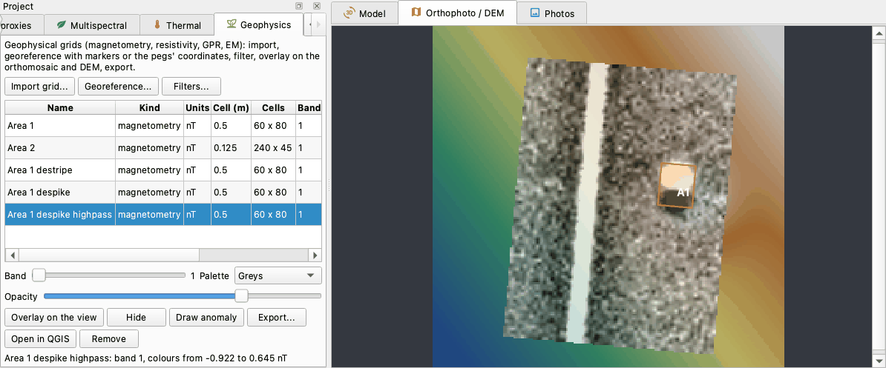
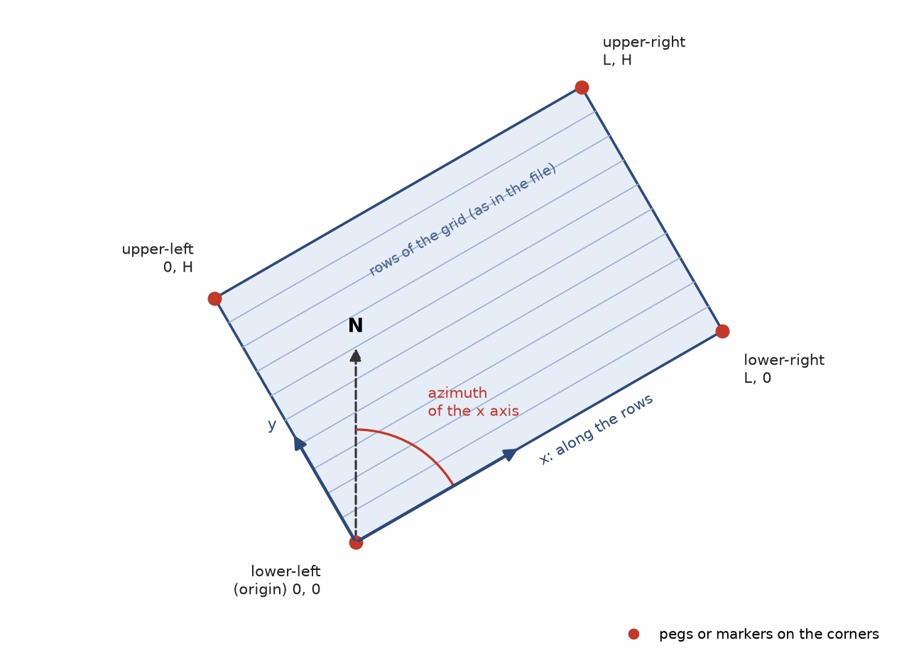
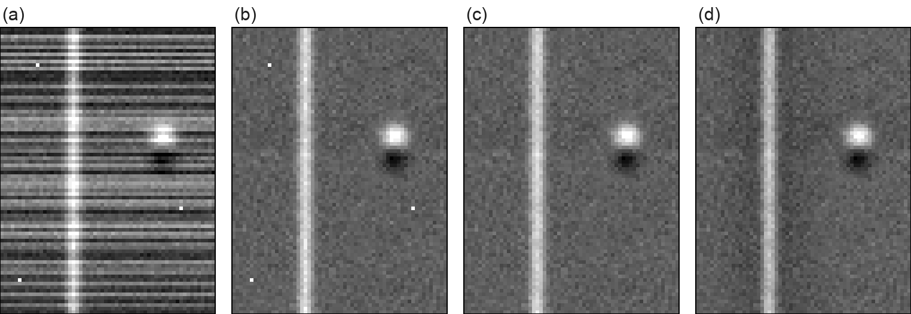

# Geophysics

The *Geophysics* plugin brings the grids of a geophysical survey - magnetometry, resistivity, the
time or depth slices of a GPR survey, electromagnetic and susceptibility surveys - into the
photogrammetric project of the same ground. It reads the grids exported by the processing software,
places them on the survey with the pegs of the survey grid, applies the usual filters (despike,
destripe, high-pass...), lays them over the orthophoto or the DEM with the transparency you choose,
lets you draw the anomalies you read on them, and exports them for a GIS. Anomaly and excavation,
magnetic map and orthophoto end up in the same place and the same reference system.

This page describes version 0.1.2 of the plugin, which needs pyarchinit-photogrammetry 1.3.3 or later.
Its README and source code are in the
[plugin repository](https://github.com/enzococca/pyarchinit-photogrammetry-plugins/tree/main/plugins/geophysics).

<figure markdown="span">
  
  <figcaption>The pane with the grids of a magnetometry survey - the raw grid, its filtered copies and a
  second area read from an XYZ table - and the last filtered one laid over the DEM of the view, in greys
  at 75 % opacity: a linear positive anomaly and a dipole, outlined as the anomaly A1. Synthetic data:
  the grid of the plugin's tests over an invented DEM.</figcaption>
</figure>

!!! note "The examples on this page"
    The grids, the DEM and the figures of this page are synthetic: the magnetometry survey the plugin is
    tested with (a wall, a pit, stripes between the traverses and three iron spikes), placed in a UTM
    zone with invented coordinates.

## In short

1. Export each grid from your processing software as numbers - Surfer GRD, XYZ or GeoTIFF - not as a
   picture.
2. In the *Geophysics* pane: *Import grid...*, with the kind of survey and the units.
3. *Georeference...*: with markers placed on the corner pegs in the orthophoto, with the origin and
   the azimuth of the grid, or with the coordinates of the pegs measured in the field.
4. *Filters...*: destripe, despike, high-pass, each into a copy.
5. *Overlay on the view* over the orthophoto or the DEM, with band, palette and opacity.
6. *Draw anomaly*: the polygons of what you read on the grid, with a note.
7. *Export...* as GeoTIFF or Surfer GRD, *File > Export* as GeoPackage, or *Open in QGIS*.

## What it does

| Step | What it gives | Useful for |
|---|---|---|
| Import | every grid as a GeoTIFF of floating-point values inside the project, one band per slice of a GPR survey | keeping the geophysics with the survey and the excavation it belongs to |
| Georeferencing | the grid placed in the reference system of the chunk, turned and moved, with the residual of the pegs | a survey made with tapes and pegs, in local metres, onto the map |
| Filters | despike, destripe, clip, low-pass, high-pass, fill, resample, into copies, each one recorded | cleaning a raw grid: spikes of iron, stripes of a magnetometer walked up and down, the geological background |
| Overlay | the grid over the orthophoto or the DEM, with its band, palette and opacity | reading anomalies against walls, trenches, field boundaries and the relief |
| Anomalies | polygons drawn on the view, each with the grid, the band and a note, kept in the project | the interpretation, next to the survey and the excavation |
| Exports | GeoTIFF and Surfer GRD of a grid, a GeoPackage with the outlines of the grids and the anomalies, the grids in the QGIS project of the program | the archive, the GIS, the report |

It is not a processing program: it does not reduce raw data logged by an instrument, does not join the
grids of a survey into a composite and does not interpret: the anomalies are drawn by you. Process the survey in its own software,
export the grids, then use the plugin to put them on the ground.

## What you need first { #before }

* **The plugin**, installed from the program: see [Plugin guides](guides.md#install). It needs nothing
  else.
* **A project whose chunk has a projected reference system, in metres** - for example the UTM zone of
  the site. A grid in local metres can be imported into any project, but it can be georeferenced only
  in a chunk with a reference system: in a local project the plugin refuses.
* **An orthophoto or a DEM** of the chunk, to see the grids on; without them a georeferenced grid is
  shown alone, on a frame of its own size.
* **The grids** as files: the next section.
* For georeferencing, one of: the **pegs of the corners** visible in the orthophoto (a target or a
  painted mark on each), the **coordinates of the pegs** measured with a GNSS receiver or a total
  station in the reference system of the chunk, or the **origin and the azimuth** of the grid.

## The data { #data }

### Formats { #formats }

| Format | Files | What the plugin reads |
|---|---|---|
| Surfer grid | `.grd` | ASCII (`DSAA`), binary of Surfer 6 (`DSBB`) and of Surfer 7 (`DSRB`); Surfer's blank value is no value; cells longer on one side are made square on the shorter side |
| XYZ table | `.xyz`, `.csv`, `.txt`, `.dat` | one reading per line, x, y and value in the first three columns; dummy values are no readings |
| Raster | `.tif`, `.tiff`, `.asc`, `.img` and every raster format GDAL reads | all its bands; its no-data value is no value; its reference system when it has one |
| Folder of slices | a folder of `.tif`, `.tiff`, `.png`, `.jpg`, `.asc` or `.grd` | the slices of a GPR survey: one band per file, in the natural order of the names |

Export numbers, not pictures: a PNG or a JPEG made for a report holds grey levels or colours, not nT or
ohm metres; a colour image becomes three bands - red, green and blue - and in a folder of slices only
its red channel is read.

### XYZ tables { #xyz }

The exports of Geoplot, TerraSurveyor, Bartington's software and most others can be read as they are:

```text
x y nT
0.0625 0.2500 0.412
0.1875 0.2500 0.367
0.3125 0.2500 -0.051
```

* x, y and the value are the first three columns; further columns are ignored. Lines that are not
  numbers - a header, a comment - are skipped.
* The columns may be separated by spaces, tabs, commas or semicolons. **Decimal commas** are read when
  the columns are separated by semicolons, tabs or spaces (`0,125;0,250;3,7` or `0,125 0,250 3,7`); with
  commas between the columns, the decimals must be written with a point.
* **Dummy values** are no readings: 2047.5 (the dummy of Geoscan's Geoplot), -9999, 32767, -32768 and
  Surfer's blank (1.70141e38). *Dummy value for XYZ* in the import window (`--dummy` on the command line)
  adds the one your software writes. The import says how many it left out.
* **The cell.** The plugin finds the spacing of the readings along x and along y. When the two are
  equal, that is the cell, and each cell holds a reading. When the readings along the traverses are
  closer than the traverses - every 12.5 cm on lines 50 cm apart - the cell is the finer spacing and the
  rows between two traverses are filled by linear interpolation between the two traverses beside them:
  never beyond the first and the last traverse, never across a missing reading (the cells there stay
  empty). The import window and the line under the table of the pane say so (*rows interpolated between
  traverses 0.5 m apart (readings every 0.125 m)*).
* *Cell for XYZ* gives a cell of your own instead, typically the spacing of the traverses (0.5 m): the
  readings that fall in a cell are averaged, a traverse per row of cells.
* **The cells are centred on the readings**: the grid starts half a spacing before the first reading.
  With readings every 0.125 m from 0.0625 m and a cell of 0.5 m, the grid starts at 0 and each cell holds
  four readings: traverses 30 m long give 60 cells, and the corners of the grid are the pegs.
* With the finer cell and the interpolation, the grid goes from the first traverse to the last one:
  across the traverses it is shorter than the survey by the spacing of the traverses less one cell
  (29.625 m for 30 m of traverses 0.5 m apart, cells of 0.125 m), so its corners are not the pegs. Place
  such a grid with typed pairs measured from its lower-left corner, or import it with the spacing of the
  traverses as the cell when the corners must be the pegs.

### Where the grid is { #coordinates }

A grid whose file has no reference system - a Surfer grid, an XYZ table, an image - is in local metres:
the plugin puts the **lower-left corner at 0, 0**, with x growing along the rows of the grid as they are
in the file (to the right) and y upwards, and keeps its size. The coordinates written in the file are
not used: the corners of the grid are 0, 0 / L, 0 / L, H / 0, H, where L and H are its width and height
in metres (the georeferencing window shows them). The corners are the outer edges of the cells, half a
cell beyond the first and the last readings, which is where the pegs of a survey grid usually are.

A raster with a reference system - a GeoTIFF exported already georeferenced - keeps it and needs no
georeferencing; it must be in the **same reference system as the chunk**, because the plugin does not
reproject (reproject it in QGIS first). An image without a world file has 1 m per pixel: place it with
markers or typed pairs and the scale free.

### Kinds and units { #kinds }

The kind chosen at the import sets the units, when you give none, and how the grid is shown:

| Kind | Units | Palette in the view | Colour limits | Ramp in QGIS |
|---|---|---|---|---|
| *Magnetometry* | nT | greys | median ± 2.5 robust standard deviations | blue-red |
| *Resistivity* | ohm m | earth | 2nd and 98th percentile | greys |
| *GPR* | - | greys | median ± 2.5 robust standard deviations | greys |
| *Electromagnetic* | mS/m | earth | median ± 2.5 robust standard deviations | blue-red |
| *Susceptibility* | SI | heat | 2nd and 98th percentile | greys |
| *Other* | - | greys | 2nd and 98th percentile | greys |

The robust standard deviation is 1.4826 times the median absolute deviation from the median: a few
iron spikes do not stretch the colours.

### GPR slices { #slices }

A folder of slices becomes one grid with a band per file, the band labelled with the name of its file
(`slice_045cm.tif` gives the label `slice_045cm`).

* The files are taken in the natural order of their names, the numbers counted as numbers:
  `slice_2` before `slice_10`.
* All the slices are brought to the size of the first one; give them the same grid.
* Of each file the first band is read: export the slices as values, or as grey levels.
* Choose *GPR* as the kind.

### In the field { #field }

* Measure the pegs of the corners of the survey grid with the GNSS receiver or the total station, in
  the reference system of the photogrammetric survey, and write down which corner is which.
* Or make them visible from the air: a target, a painted cross or a plate on each corner peg, inside
  the area of the drone flight.
* Note which corner is the origin of the survey and the direction of the first traverse: the plugin
  takes the lower-left corner of the exported grid as 0, 0 and the rows as the x axis.
* Export each area of the survey as its own grid, in metres, with the cells of the survey.

### Common mistakes and the warnings they give { #mistakes }

| What happened | What the plugin does or says | What to do |
|---|---|---|
| decimal commas with commas also between the columns of an XYZ table | the commas split the numbers: a grid with nonsense values | semicolons, tabs or spaces between the columns |
| a dummy value other than the usual ones | read as a reading: white or black spots | *Dummy value for XYZ*, or delete those lines |
| a colour picture of a slice | its red channel is read | export the values, or greys |
| an image without a world file | 1 m per pixel | markers or typed pairs, *Scale fixed at 1* unticked |
| a GeoTIFF in another reference system | the grid lands in the wrong place | reproject it to the system of the chunk |
| georeferencing in a chunk without a reference system | *The chunk is not georeferenced: the grid would stay in local metres.* | georeference the survey first |
| *Overlay on the view* with a local grid | *The grid is in local metres: georeference it first.* | *Georeference...* |
| *Overlay on the view* with a grid far from the raster shown | *The grid lies outside the raster shown in the view...* | check its placement, or show another raster |
| a marker on the wrong corner, or corners swapped | a residual of metres | check which marker is on which corner, and place the grid again |
| decimal commas in the typed pairs | the numbers are split | decimal points |

## Step by step in the program { #program }

### The pane

Once the plugin is installed and the program restarted, the *Geophysics* pane opens on the right of the window, tabbed with *PyArchInit*; it can be moved, floated or closed like the other panes and opened again from *Vista > Pannelli*, or with *Plugins >
Geophysics > Geophysical grids...*. The *Plugins > Geophysics* menu also has *Import geophysical
grid...*, *Overlay the grid on the view*, *Hide the grid* and *Draw an anomaly*.

From the top: a short description; *Import grid...*, *Georeference...*, *Filters...*; the table of the
grids of the chunk; *Band* (for the slices of a GPR survey, with the label of the slice), *Palette*,
*Opacity*; *Overlay on the view*, *Hide*, *Draw anomaly*, *Export...*, *Open in QGIS*, *Remove*; at the
bottom, a line on the selected grid (its size, cell, position, median, filters and how an XYZ table
was read), or what is shown and the values at the two ends of the colours.

The table has a row per grid: *Name*, *Kind*, *Units*, *Cell (m)*, *Cells* (columns x rows), *Bands*,
*Position* (*local*, or the reference system once placed) and *Filters* (those applied, in order). The
buttons act on the selected row.

### 1. Import a grid { #import }

*Import grid...*

| Field | What it does |
|---|---|
| *File (GRD, XYZ, CSV, GeoTIFF, raster)* | the file of the grid |
| *Or a folder of GPR slices* | a folder with one file per slice, in place of the file |
| *Name (empty = the file name)* | the name in the table and in the exports; the filtered copies add the name of the filter to it |
| *Kind* | *Magnetometry*, *Resistivity*, *GPR*, *Electromagnetic*, *Susceptibility*, *Other* |
| *Units (empty = the kind's)* | nT, ohm m, mS/m, SI... |
| *Cell for XYZ (m, empty = from the data)* | for XYZ tables only: the cell of the grid; empty, the spacing of the readings, with the rows between the traverses interpolated ([XYZ tables](#xyz)) |
| *Dummy value for XYZ (empty = the usual ones)* | for XYZ tables only: a value your software writes for a missing reading, besides 2047.5, -9999, 32767, -32768 and Surfer's blank |

The grid is copied into the project as a GeoTIFF; a window sums it up - *Grid Area 1: 60 x 80 cells of
0.5 m, 1 band(s), values -3.51 .. 59.8 nT; in local metres: georeference it*, with how an XYZ table was
read (interpolation, dummy values left out, decimal commas). The minimum and the maximum
are the first check: a value of thousands in a magnetometry survey is a dummy or a spike.

### 2. Georeference { #georef }

*Georeference...* places the selected grid on the survey. It needs a chunk with a reference system.

<figure markdown="span">
  
  <figcaption>The grid in the plugin: the lower-left corner at 0, 0, x along the rows of the grid as
  they are in the file, y upwards; L and H its width and height. The azimuth of the x axis is counted
  clockwise from north: 90 when the rows run east.</figcaption>
</figure>

| Field | What it does |
|---|---|
| *Method* | *Grid corners = markers*, *Origin and azimuth* or *Typed pairs of coordinates* |
| *Marker of the lower-left corner (origin)*, *... lower-right...*, *... upper-right...*, *... upper-left...* | the markers of the chunk on the corners: two at least, better three or four; *(none)* for the others |
| *Scale fixed at 1 (grid in metres)* | ticked: the grid keeps its size, only turned and moved; unticked: its size is fitted too (an image, a grid with a wrong cell) |
| *Origin E (m)*, *Origin N (m)* | the lower-left corner in the reference system of the chunk |
| *Azimuth of the x axis (degrees from north)* | the direction of the rows, clockwise from north as on a compass: 90 east, 0 north |
| *Pairs: 'local_x local_y E N' per line* | a point per line: its local metres in the grid and its coordinates in the reference system of the chunk |

The window says how large the grid is (*The grid is in local metres with the origin at the lower-left
corner (30 x 40 m)*); the fields of the methods not chosen are ignored.

* **Grid corners = markers.** Show the orthophoto, take the *Marker* tool of the *Drawing* bar and click
  each corner peg: the markers are called *point 1*, *point 2*... (rename them in the *Reference* pane
  if you like). In the window, choose the marker of each corner. A marker with coordinates typed in the
  *Reference* pane gives those coordinates, the others the position estimated by the survey.
* **Origin and azimuth.** The lower-left corner and the direction of the rows: enough when the grid
  was laid out with a compass or along a known line.
* **Typed pairs.** The best way when the pegs were measured: one line per peg, the local metres of the
  peg in the grid and its coordinates, for example `0 0 500100.00 4500800.00`,
  `30 0 500129.89 4500802.61` and `0 40 500096.53 4500839.86`. The local metres are measured from the
  lower-left corner of the grid as the plugin sees it, not in the coordinates of the original file. Spaces, commas or semicolons
  separate the numbers; decimals with a point.

With markers or pairs the plugin finds the turn and the shift (and the scale, if free) that bring the
local points closest to their coordinates, by least squares. The window gives the result - with the
three pairs above, *Grid Area 1 placed: rotation 4.98 degrees, scale 1.0000, residual 0.005 m*. The rotation is counted anticlockwise
from east (an azimuth of 90 is a rotation of 0); the residual is the root mean square of the distances
between the points and where the placed grid puts them: a few centimetres are normal, decimetres or
metres mean a peg in the wrong place or two corners swapped. Save the project (*File > Save*) to keep the
position.

A grid can be placed again at any time, with any of the three methods: the plugin starts from the local
metres of the grid every time, so the new placement replaces the old one (a grid placed with a free scale
also gets its own size back first).

Georeference a grid before filtering it: the filtered copies keep the position of the grid they come
from, while copies made from a local grid stay local and must be placed one by one.

### 3. Filters { #filters }

*Filters...* applies one filter to all the bands of the selected grid.

| Field | Default | What it does |
|---|---|---|
| *Filter* | *Destripe* | the filter, from the table below |
| *Despike: window side (cells)* | 3 | |
| *Despike: threshold (times the noise)* | 4 | |
| *Destripe: traverses along* | *the rows (x)* | *the rows (x)* or *the columns (y)*: the direction in which the instrument was walked |
| *Destripe: statistic* | *median* | *median* or *mean* of each traverse |
| *Clip: low percentile*, *Clip: high percentile* | 1, 99 | |
| *Low-pass: sigma (cells)* | 1 | the width of the Gaussian smoothing |
| *High-pass: sigma (cells)* | 10 | the width of the Gaussian smoothing taken away (5 m on cells of 0.5 m) |
| *Fill: largest distance (cells)* | 3 | |
| *Resample: cell (m)* | the grid's | |
| *Into a copy (the original grid stays)* | ticked | the result is a new grid, called with the name of the filter after the name of the grid; unticked, the grid itself is changed |

Only the fields of the chosen filter count.

| Filter | What it does |
|---|---|
| *Despike (spikes replaced by the local median)* | a reading farther from the median of its window than the threshold times the noise of the grid (1.4826 times the median distance of the readings from their local medians) is replaced by that median: iron, a reading taken while the instrument hit something |
| *Destripe (zero-mean traverse)* | the median (or the mean) of every row - or column - is subtracted, so that all the traverses share the zero: the stripes of a magnetometer walked up and down, of a drifting resistance meter |
| *Clip to percentiles* | the values below the low percentile and above the high one are set to them |
| *Low-pass (Gaussian)* | a Gaussian smoothing that skips the empty cells: less noise, softer edges |
| *High-pass (residual of the Gaussian)* | the grid minus its Gaussian smoothing: the broad geological background goes, the anomalies smaller than a few sigma stay |
| *Fill the gaps* | empty cells get a value from the readings within the distance, weighted by their distance |
| *Resample* | cells of another size over the same area: means when coarser, bilinear when finer |

<figure markdown="span">
  
  <figcaption>(a) The raw grid: a positive linear anomaly, a dipole, stripes between the traverses and
  three iron spikes. (b) Destripe on the rows. (c) Despike, 3 cells, threshold 4. (d) High-pass, sigma 8
  cells (4 m). One grey scale from -3 to +5 nT for the four panels. Synthetic data.</figcaption>
</figure>

A usual sequence for magnetometry is destripe, then despike, then - when the geology is strong - a
high-pass, each into a copy so that the steps stay in the table. On strongly striped data, destripe
first: the window of the despike would otherwise mix readings of neighbouring traverses. Each filter
is recorded in the grid (the *Filters* column, the exports); the long ones run in the background and the
project is saved at the end.

### 4. On the view { #overlay }

Select a grid and press *Overlay on the view* (or *Plugins > Geophysics > Overlay the grid on the
view*). The grid goes over what the *Orthophoto / DEM* view shows; when it shows nothing, the orthophoto
(or the DEM) of the chunk is shown first, and when the chunk has neither, the grid alone on a frame of
its own size:

* *Band*: the slice of a GPR survey, with its label beside the slider;
* *Palette*: *Greys*, *Greys inverted*, *Diverging (blue-red)*, *Earth*, *Heat*; it follows the kind of
  the selected grid until the first *Overlay on the view*, then stays as you set it;
* *Opacity*: changes the grid shown at once; band and palette take effect with the next *Overlay on
  the view*.

The line at the bottom says what is shown and the values at the two ends of the colours, in the units
of the grid (*Area 1 despike highpass: band 1, colours from -0.941 to 0.657 nT*). One grid is shown at
a time; *Hide* takes it away. When the view shows another raster (the orthophoto instead of the DEM, a
relief), the grid is laid over it again with the same band, palette and opacity, until *Hide*; drawing in
the view, or deleting a drawing, leaves it where it is.

### 5. Anomalies { #anomalies }

*Draw anomaly* (or *Plugins > Geophysics > Draw an anomaly*) draws on the view what you read on the
selected grid:

1. Select the grid and, if you like, overlay it with the band you are reading (an empty view shows the
   grid first).
2. Press *Draw anomaly* and drag a box on the view, or click the vertices of the polygon; Backspace takes
   the last vertex back, a right click starts the polygon again. The drawing is the program's own, lent to
   the plugin.
3. Double click, or press Enter, to close it; Esc cancels, and so does choosing another tool of the
   *Drawing* bar.
4. A window asks for a *Label* (A1, A2... by default) and a *Note*, the interpretation (*wall*, *pit*,
   *kiln?*).

The anomaly keeps the name of the grid, the band shown (the label of the slice of a GPR survey) and its
area. It goes into the project (save it with *File > Save*) and into the layer *Anomalie geofisiche* of
the view, in orange: with the *Move* tool a click on it shows its attributes, with the *Select* tool and
Delete it leaves the view and the project. The layer comes back each time the view shows another raster;
taking it out of the view in the *Layers* pane leaves the anomalies in the project.
The program's own polygon tool draws stratigraphic units, not anomalies.

*File > Export > Geophysical grids and anomalies (GeoPackage)...* writes the anomalies in the table
`anomalie`. With the live link to QGIS of the program, they also appear among the program's drawings, in
the table *Poligoni (ppg)* (from program 1.3.1; before, the table of the units), with *Anomalie geofisiche*
in the column `layer`.

### 6. Export, QGIS, removing { #export }

* *Export...*: the selected grid as a GeoTIFF (all its bands, in its position, rotation included) or as
  a Surfer GRD (the band shown in the pane). A Surfer grid has no rotation: a turned grid is resampled
  onto a north-up grid of the same cell that covers it, blank outside the grid, and the window says so;
  the GeoTIFF keeps the grid as it is.
* *File > Export > Geophysical grids and anomalies (GeoPackage)...*: a GeoPackage with the outlines of
  the georeferenced grids (table `griglie`: name, kind, units, cell, rows, columns, bands, filters, file),
  a GeoTIFF of each of them beside it, and the anomalies drawn (table `anomalie`: label, grid, band,
  note, area in m²). The other tables of an existing GeoPackage are kept.
* *Open in QGIS*: the QGIS project of the program ([QGIS](../integrations.md)) with the georeferenced
  grids, hidden at first, magnetometry and EM in blue-red, the others in greys.
* *Remove*: after a confirmation, the grid leaves the project and its file is deleted; the anomalies
  drawn on it stay.

## From the command line { #cli }

The same steps with `ppg plugin geophysics WHAT PROJECT ...`. Every command works on the active chunk
(`--chunk LABEL` for another one) and saves the project. A grid is named by its name or by its id.

```bash
ppg plugin geophysics --help
ppg plugin geophysics import scavo.ppg area1.grd --kind magnetometry --name "Area 1"
ppg plugin geophysics import scavo.ppg area2.xyz --kind magnetometry --name "Area 2" --cell 0.5
ppg plugin geophysics import scavo.ppg area3.csv --kind resistivity --name "Area 3" --dummy -1
ppg plugin geophysics import scavo.ppg slices_gpr --kind gpr --name "GPR 2026"
ppg plugin geophysics list scavo.ppg
ppg plugin geophysics georef scavo.ppg "Area 1" --origin 500100.0,4500800.0 --azimuth 95
ppg plugin geophysics georef scavo.ppg "Area 2" --pairs "0 0 500200 4500800; 30 0 500229.9 4500802.6; 0 20 500198.3 4500819.9"
ppg plugin geophysics filter scavo.ppg "Area 1" destripe --copy
ppg plugin geophysics filter scavo.ppg "Area 1 destripe" despike size=3 k=4
ppg plugin geophysics filter scavo.ppg "Area 1 destripe" highpass sigma=8 --copy
ppg plugin geophysics filter scavo.ppg "Area 1" clip low=-20 high=20 absolute=1 --copy
ppg plugin geophysics export scavo.ppg "Area 1 destripe highpass" area1.tif
ppg plugin geophysics export scavo.ppg "GPR 2026" slice_3.grd --band 2
```

| Command | Options |
|---|---|
| `import PROJECT FILE` | a file or a folder of slices; `--kind` magnetometry, resistivity, gpr, em, susceptibility, other (magnetometry); `--name`; `--units`; for XYZ, `--cell` m and `--dummy` (repeatable) |
| `list PROJECT` | a line per grid: name, kind, units, size, cell, bands, position, median, filters, how an XYZ table was read; the number of anomalies drawn - in the language of the program |
| `georef PROJECT GRID` | `--origin E,N` with `--azimuth` (90), or `--pairs "lx ly E N; lx ly E N; ..."`, with `--free-scale` to fit the size too |
| `filter PROJECT GRID FILTER [k=v ...]` | `FILTER`: `despike` (`size`, `k`), `destripe` (`axis=rows` or `cols`, `stat=median` or `mean`), `clip` (`low`, `high`, `absolute=1` to give values instead of percentiles), `lowpass` (`sigma`, 1), `highpass` (`sigma`, 10), `fill` (`distance`), `resample` (`cell`); `--copy` into a new grid |
| `export PROJECT GRID OUT` | `.tif`: all the bands; `.grd`: one band, `--band` counted from 0, a turned grid resampled north up |

The defaults are those of the window: low-pass sigma 1 cell, high-pass sigma 10 cells. Each command
prints what it did: the grid imported (with how an XYZ table was read), its new position with the
residual, the filters and the statistics of the result.

## Reading the results { #reading }

### Colours and values { #reading-colours }

The grid is coloured between two values, given at the bottom of the pane in the units of the grid:
for magnetometry, EM and GPR the median plus and minus 2.5 robust standard deviations, for the other
kinds the 2nd and 98th percentiles. What lies beyond is drawn in the colour of the end: the core of a
strong dipole is pure white and black. In *Greys* high values are white; *Greys inverted* gives the
opposite convention of some processing programs.

* After *Destripe* every traverse has its median at zero, and so the grid; after a *High-pass* its mean
  is zero. The values are then differences from the surroundings, not field values.
* The high-pass leaves darker bands on either side of a strong positive anomaly, as in panel (d) of the
  figure: they are the filter, not the ground. A sigma of a few times the width of the anomalies sought
  keeps them whole.
* *Resample* and *Low-pass* smooth: measure the strength of an anomaly on the raw or destriped grid.

### Checking the placement { #reading-placement }

Overlay the grid with some transparency and look for what shows in both: a field boundary, a path, a
trench, a wall in the orthophoto that the geophysics also sees. A shift of a few decimetres along one
direction points to a peg or a marker in the wrong place, a turn to the wrong corner; the residual of the
georeferencing says how well the pegs agree among themselves, not whether they are the right pegs.

### Limits { #limits }

* **No reprojection.** A grid with a reference system must be in that of the chunk.
* **Whole rows.** *Destripe* subtracts the median of every row of the imported grid: on a composite of
  several survey grids a row runs across all of them. Grids walked separately are better destriped in
  the processing software, or imported one by one.
* **Two dimensions.** The slices of a GPR survey are bands of one grid, viewed one at a time; no
  volume is built.
* **No interpretation.** The plugin draws the grid where it belongs: the anomalies are read by the
  archaeologist and the geophysicist, and drawn by them with *Draw anomaly* or in QGIS.

## Files written { #files }

Everything goes into the folder of the chunk, next to the project file:
`<project>.ppg.files/chunk_<n>/geophysics/`. The list of the grids - name, kind, units, cell,
position, slices, source file, filters, how an XYZ table was read - and the anomalies drawn are kept in the
project itself.

* `<id>.tif`: every grid, float32 with no value where there is no reading, one band per slice (the
  label of the slice as the description of the band), with its reference system once georeferenced;
  the id is made from the date and time of the import (`g20261023163609...`).
* The GeoTIFF and GRD exported with *Export...* or `export`, where you choose.
* The GeoPackage of *File > Export*, with `<name>_<grid>.tif` beside it for every georeferenced grid.
