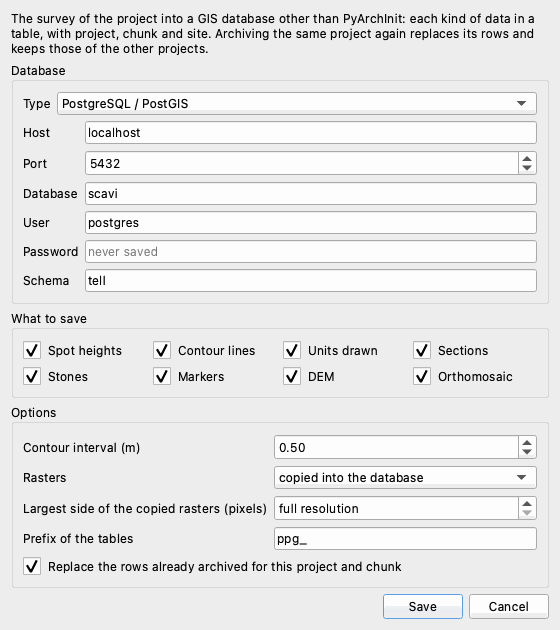

# Archivio GIS

Il plugin *Archivio GIS* copia il rilievo di un progetto in un database GIS diverso da PyArchInit: un
file GeoPackage, un database PostgreSQL/PostGIS o un file SpatiaLite. Ogni tipo di dato va in una
tabella sua - le quote, le curve di livello del DEM, le unità stratigrafiche disegnate, le sezioni, le
pietre, i marker, il DEM e l'ortofoto - e ogni riga porta il progetto, il chunk e il sito da cui viene.
Così un solo database può raccogliere i rilievi di uno scavo intero, campagna dopo campagna, e aprirsi
in QGIS o in qualsiasi GIS.

Questa pagina descrive la versione 0.1.1 del plugin, che richiede pyarchinit-photogrammetry 1.1.0 o
successiva. Il README e il codice sono nel
[repository dei plugin](https://github.com/enzococca/pyarchinit-photogrammetry-plugins/tree/main/plugins/gis-archive).

<figure markdown="span">
  
  <figcaption>La finestra di <em>Plugin > Archivio GIS > Salva in un database GIS...</em>, impostata per
  un database PostgreSQL/PostGIS: il server, che cosa salvare e le opzioni.</figcaption>
</figure>

## In breve

1. Disegna nel programma ciò che vuoi tenere - quote, US, sezioni, pietre - costruisci DEM e ortofoto e
   salva il progetto.
2. *Plugin > Archivio GIS > Salva in un database GIS...*
3. Scegli il database: un file GeoPackage, un server PostgreSQL/PostGIS o un file SpatiaLite.
4. Spunta che cosa salvare, imposta l'equidistanza delle curve e come tenere i raster, poi *Salva*.
5. Apri il database in QGIS.

## Che cosa fa

| Tabella | Che cosa contiene | Geometria |
|---|---|---|
| `ppg_quote` | le quote disegnate: quota, area, US, tipo, unità, precisione, rilievo, data, disegnatore | punto |
| `ppg_curve` | le curve di livello del DEM all'equidistanza scelta, con le direttrici | linea |
| `ppg_us` | le unità stratigrafiche disegnate: sito, area, US, tipo, i campi di `pyunitastratigrafiche`, area in m² | multipoligono |
| `ppg_sezioni` | le tracce delle sezioni del progetto: nome, lunghezza, disegno | linea |
| `ppg_pietre` | le pietre disegnate con SAM sull'ortofoto: l'immagine su cui sono state disegnate, area | poligono |
| `ppg_marker` | marker e punti di appoggio: quota, coordinate di riferimento, errore, controllo o verifica | punto |
| `ppg_raster` | il DEM e l'ortofoto: impronta, file, risoluzione e dimensioni di ciò che è archiviato, sistema di riferimento, tabella della copia | poligono |
| `ppg_dem_<progetto>_<chunk>`, `ppg_ortofoto_<progetto>_<chunk>` | le copie del DEM e dell'ortofoto, quando il database può contenere raster | raster |

Serve quando il rilievo deve vivere in un GIS suo: l'archivio di uno scavo in un GeoPackage da
consegnare o da aprire sul campo, il database PostGIS di un gruppo di lavoro, i disegni di più
campagne affiancati. Non scrive nelle tabelle di PyArchInit - per quelle è il programma stesso a
pubblicare US, quote e documentazione ([PyArchInit](../pyarchinit.md)) - e non è una copia di
sicurezza del progetto: il file del progetto resta il posto in cui il rilievo si elabora.

## Che cosa serve prima { #before }

* **Il plugin**, installato dal programma: vedi [Guide ai plugin](guides.md#install). Per il GeoPackage
  non serve altro; SpatiaLite e PostgreSQL vogliono quanto scritto qui sotto.
* **Un progetto salvato con un nome di file.** Il nome del file (senza `.ppg`) è il `progetto` di ogni
  riga. Quali righe appartengono al progetto lo dice un suo id, `progetto_id`, creato alla prima
  archiviazione e conservato nel progetto: archiviando di nuovo lo stesso progetto le sue righe vengono
  sostituite, e un altro progetto non le tocca mai - nemmeno uno con lo stesso nome di file in un'altra
  cartella. Una copia del progetto fatta con *Salva con nome* (o copiando la sua cartella) è un altro
  progetto, con un id suo. Dopo la prima archiviazione la finestra segna il progetto come modificato:
  salvalo, così tiene il suo id (se non viene salvato, il plugin ritrova l'id dalle righe scritte dallo
  stesso file di progetto).
* **Un sistema di riferimento proiettato** per il chunk (un codice EPSG, come il fuso UTM del sito): le
  tabelle lo prendono. Va bene anche un sistema locale, ma allora le tabelle non hanno un sistema di
  riferimento e il riepilogo lo segnala.
* **Il sito del progetto**, se lo vuoi nella colonna `sito`: sceglilo nel pannello *PyArchInit*
  (*Sito del progetto*). Le US e le quote disegnate tengono il loro sito, quando ce l'hanno.
* **Il database**:
    * *GeoPackage*: un file, creato se non esiste. Niente da installare.
    * *SpatiaLite*: un file, creato se non esiste. Il programma ha bisogno della libreria SpatiaLite
      (`mod_spatialite`), che trova da solo in QGIS, Homebrew o MacPorts, oppure indicata dalla variabile
      `SPATIALITE_LIBRARY_PATH`. SpatiaLite tiene i raster solo come riferimento.
    * *PostgreSQL / PostGIS*: un database esistente su un server raggiungibile, un utente che possa
      crearvi tabelle e l'estensione PostGIS. Il plugin crea l'estensione e lo schema se mancano, se
      l'utente ne ha il diritto; altrimenti chiedi all'amministratore `CREATE EXTENSION postgis;` e, per le
      copie dei raster, `CREATE EXTENSION postgis_raster;`. Il plugin si collega con il driver PostgreSQL
      che il programma ha: psycopg2, oppure psycopg 3 dove psycopg2 manca (l'applicazione Windows ARM64).

## I dati { #data }

Il plugin prende ciò che il chunk contiene: non disegna nulla da sé. Prima di archiviare, disegna e
costruisci ciò che l'archivio deve contenere, e salva.

### Che cosa va in ogni tabella { #tables }

| Tabella | Da dove viene nel programma | Colonne |
|---|---|---|
| `ppg_quote` | le quote messe con lo strumento *Quota* sull'ortofoto o sul DEM, con i campi di `pyarchinit_quote` | `area`, `us`, `tipo`, `quota`, `unita_misura`, `precisione`, `rilievo`, `data`, `disegnatore` |
| `ppg_curve` | calcolate dal DEM attivo al momento dell'archiviazione | `quota`, `principale` (1 per le direttrici, una ogni cinque), `equidistanza` |
| `ppg_us` | i poligoni disegnati con *Disegna US* (non le US caricate da PyArchInit) | `area`, `us`, `tipo`, `stratigraph_index_us`, `tipo_us_s`, `rilievo_originale`, `disegnatore`, `data`, `tipo_doc`, `nome_doc`, `area_m2`, `layer` |
| `ppg_sezioni` | le tracce disegnate con lo strumento *Sezione*, conservate con il progetto | `nome`, `lunghezza`, `disegno` (il file del disegno) |
| `ppg_pietre` | le pietre disegnate con lo strumento SAM *Pietre* sull'ortofoto (non quelle disegnate sul prospetto di un muro) | `gruppo` (l'immagine su cui sono state disegnate), `area_m2` |
| `ppg_marker` | i marker del chunk con una posizione o coordinate di riferimento | `nome`, `z`, `ref_x`, `ref_y`, `ref_z`, `errore_m`, `controllo` |
| `ppg_raster` | il DEM e l'ortofoto attivi | `tipo` (`dem` o `ortofoto`), `file`, `risoluzione`, `larghezza`, `altezza`, `crs`, `tabella` |

Ogni riga ha anche `progetto` (il nome del file del progetto), `chunk` (il suo nome), `sito` e
`archiviato` (data e ora dell'archiviazione), e le colonne che dicono di chi è: `progetto_id` (l'id del
progetto), `progetto_file` (il percorso del file del progetto) e `chunk_id` (il numero del chunk nel
progetto, che non cambia quando il chunk viene rinominato).

* **Le quote** tengono i valori scritti nella loro finestra; una quota senza posizione viene saltata.
* **Le curve di livello** si tracciano all'*Equidistanza delle curve*; lasciata *suggerita dal DEM*, il
  plugin prende un'equidistanza tonda che dia al massimo una cinquantina di livelli sul rilievo del DEM
  - 5 cm su una trincea con un metro di dislivello, 50 cm su un tell alto 20 m. Le linee vengono
  semplificate a mezza cella del DEM, e gli anelli chiusi più piccoli di 25 celle vengono lasciati
  fuori.
* **US**: solo le unità disegnate nel programma; quelle mostrate dal layer di PyArchInit non vengono
  copiate.
* **Le sezioni** appartengono al progetto (stanno nella cartella `sezioni` accanto a lui), non a un
  chunk: vengono scritte una volta per progetto, con `chunk` e `chunk_id` vuoti, e archiviando un
  qualsiasi chunk del progetto vengono sostituite. Ognuna è la retta fra i suoi due estremi.
* **Pietre**: `gruppo` è il file dell'immagine su cui sono state disegnate - `orthomosaic.tif` per
  l'ortofoto. Le pietre disegnate sul prospetto di un muro stanno nelle coordinate del prospetto (metri
  lungo il muro e quota), non della carta: restano fuori dalla tabella, e il riepilogo dice quante e su
  quale immagine (`elevation.tif`).
* **I marker** vengono messi nella posizione stimata dal rilievo (o nelle coordinate di riferimento
  quando non hanno una posizione); `errore_m` è la distanza fra le due, `controllo` vale 1 per un punto
  di appoggio (il suo riferimento è usato dalla georeferenziazione), 0 per un punto di verifica, per un
  marker il cui riferimento non è usato e per uno senza riferimento.
* **Raster**: le versioni attive del DEM e dell'ortofoto. `file` è il percorso del file su questo
  computer; `risoluzione`, `larghezza` e `altezza` sono quelle di ciò che viene archiviato: della copia
  nel database quando è ridotta, del file altrimenti.

### Archiviare di nuovo { #again }

* Con *Sostituisci i dati gia' archiviati di questo progetto e chunk* (il predefinito), le righe di
  questo progetto e chunk nelle tabelle scritte vengono cancellate e riscritte; quelle di altri progetti
  e chunk restano. Senza spunta (`--append` dalla riga di comando), le nuove righe si aggiungono accanto
  alle vecchie. Le righe si riconoscono da `progetto_id` e `chunk_id`: restano di questo progetto anche
  quando il chunk viene rinominato o il file del progetto spostato.
* Le tabelle non scelte restano come sono.
* Ogni prodotto sostituisce solo le sue righe: archiviare di nuovo solo l'ortofoto sostituisce la riga
  dell'ortofoto in `ppg_raster` e lascia com'è quella del DEM, con la sua copia.
* Le righe scritte dalla versione 0.1.0 del plugin non hanno `progetto_id`: alla prossima archiviazione
  vengono prese come righe del progetto con lo stesso nome di file (e, tranne le sezioni, lo stesso nome
  di chunk) e sostituite, a meno che i raster che registrano stiano nella cartella di un altro file di
  progetto - allora sono di quel progetto, restano, e il riepilogo lo dice.
* La finestra salva nel chunk i disegni della vista prima di archiviare. La riga di comando legge il
  progetto dal suo file: salva prima il progetto nel programma.

### Raster { #rasters }

*Raster*: *copiati nel database*, oppure *solo riferimento (file e impronta)*.

* **GeoPackage**: l'ortofoto diventa una tabella di tasselli di immagini, il DEM una copertura a
  tasselli di valori in virgola mobile; i nomi delle tabelle sono scritti in maiuscolo, come li scrive
  GDAL (`PPG_DEM_SCAVO_CHUNK_1`). QGIS li apre come layer raster del GeoPackage.
* **PostGIS**: una tabella `ppg_dem_<progetto>_<chunk>` con tasselli di 256 x 256 pixel (`rid`,
  `progetto`, `chunk`, `rast`), un indice spaziale e i vincoli raster che QGIS legge. Vuole
  l'estensione `postgis_raster`; senza, i raster restano riferimenti e il riepilogo lo dice. I tasselli
  li scrive il plugin, quindi il GDAL del server può restare disattivato.
* **SpatiaLite**: solo riferimenti.
* Una copia viene rifatta a ogni archiviazione, dalla versione attiva, nella stessa tabella. Quando un
  altro progetto con lo stesso nome di file ha già la tabella `ppg_dem_<progetto>_<chunk>`, la copia di
  questo prende dopo il nome una parte del suo id (`ppg_dem_scavo_chunk_1_3f2a9c1e`). Una tabella con quel
  nome che non sia un raster del plugin non viene mai sostituita: il raster resta un riferimento e il
  riepilogo dice perché.
* *Lato massimo dei raster copiati (pixel)*: 0 copia a piena risoluzione; un valore (8192, 4096...)
  riduce la copia a quel lato maggiore, facendo la media dei pixel. Un'ortofoto di pochi centimetri su
  un sito grande può pesare gigabyte: una copia ridotta basta per vederla in un GIS, e il file intero
  resta dove dice `file`.

## Passo per passo nel programma { #program }

### 1. Salvare in un database GIS { #dialog }

*Plugin > Archivio GIS > Salva in un database GIS...* archivia il chunk attivo.

| Campo | Che cosa fa |
|---|---|
| *Tipo* | *GeoPackage (.gpkg)*, *PostgreSQL / PostGIS* o *SpatiaLite (.sqlite)* |
| file e *Sfoglia...* | per GeoPackage e SpatiaLite: il file, nuovo o esistente (il plugin vi aggiunge le sue tabelle) |
| *Server*, *Porta*, *Database*, *Utente*, *Password*, *Schema* | per PostgreSQL: il server (5432 è la porta solita), il database, l'utente e la sua password, lo schema delle tabelle (`public` come predefinito; creato se manca). La password non viene mai salvata |
| *Cosa salvare* | *Quote*, *Curve di livello*, *US disegnate*, *Sezioni*, *Pietre*, *Marker*, *DEM*, *Ortofoto* |
| *Equidistanza delle curve (m)* | *suggerita dal DEM*, oppure l'equidistanza |
| *Raster* | *copiati nel database* o *solo riferimento (file e impronta)*; SpatiaLite: solo riferimenti |
| *Lato massimo dei raster copiati (pixel)* | *piena risoluzione*, oppure il lato maggiore delle copie |
| *Prefisso delle tabelle* | `ppg_` come predefinito: un altro prefisso fa un altro gruppo di tabelle nello stesso database |
| *Sostituisci i dati gia' archiviati di questo progetto e chunk* | spuntato come predefinito ([Archiviare di nuovo](#again)) |

Tutto tranne la password viene ricordato per la volta successiva. L'archiviazione gira in background con
la barra di avanzamento; alla fine una finestra elenca che cosa è stato scritto:

```text
Archivio GeoPackage: /Users/Shared/archivio/scavi.gpkg
  ppg_quote: 2 righe
  ppg_us: 1 righe
  ppg_pietre: 2 righe
  ppg_sezioni: 1 righe
  ppg_marker: 1 righe
  ppg_curve: 30 righe
  ppg_raster: 2 righe
  dem: tabella PPG_DEM_SCAVO_CHUNK_1
  ortofoto: tabella PPG_ORTOFOTO_SCAVO_CHUNK_1
```

In fondo seguono le note quando qualcosa è andato diversamente - un sistema di riferimento locale, un
raster tenuto come riferimento e perché, pietre di un prospetto lasciate fuori, righe della versione
0.1.0 di un altro progetto lasciate al loro posto.

### 2. Tutto in un GeoPackage { #export }

*File > Esporta > Archivio GIS (GeoPackage)...* scrive in un passo tutto il chunk attivo in un
GeoPackage: tutte le tabelle, l'equidistanza suggerita dal DEM, i raster copiati a piena risoluzione, le
righe del progetto sostituite.

### 3. In QGIS { #qgis }

* **GeoPackage**: trascina il file in QGIS, oppure *Layer > Aggiungi layer > Aggiungi layer
  vettoriale...*; le tabelle e le copie dei raster compaiono nell'elenco dei suoi layer.
* **PostGIS**: crea una connessione nel pannello *Browser* (*PostgreSQL > Nuova connessione...*) con lo
  stesso server, database e utente; le tabelle stanno nello schema scelto.
* **SpatiaLite**: *SpatiaLite > Nuova connessione...* nel pannello *Browser*.
* Per mostrare un solo progetto o un solo chunk, filtra il layer (tasto destro, *Filtro...*):
  `"progetto" = 'scavo' AND "chunk" = 'Chunk 1'`; due progetti con lo stesso nome di file si distinguono
  con `"progetto_file"` (o `"progetto_id"`).
* I raster tenuti come riferimento: apri il file scritto nella colonna `file` di `ppg_raster`.

## Dalla riga di comando { #cli }

`ppg plugin gis-archive PROGETTO DATABASE [opzioni]`: prima il progetto, poi il database - un file che
finisce in `.gpkg`, un file SpatiaLite (`.sqlite`, `.db`, o qualsiasi nome dopo `spatialite:`) oppure
un indirizzo PostgreSQL. Il progetto viene letto dal suo file; la prima volta il comando vi scrive l'id
d'archivio del progetto (`gis_archive` nei suoi metadati), e nient'altro.

```bash
ppg plugin gis-archive --help
ppg plugin gis-archive scavo.ppg archivio.gpkg
ppg plugin gis-archive scavo.ppg archivio.gpkg --what quote,us,sezioni --chunk "Chunk 2"
ppg plugin gis-archive scavo.ppg spatialite:archivio.sqlite --what quote,curve,us --interval 0.5
PGPASSWORD=... ppg plugin gis-archive scavo.ppg "postgresql://postgres@localhost:5432/scavi?schema=tell" \
    --interval 0.5 --rasters copy --max-side 8192
ppg plugin gis-archive scavo.ppg archivio.gpkg --what dem,ortofoto --rasters reference
```

| Opzione | Che cosa fa |
|---|---|
| `--what` | che cosa salvare, separato da virgole, fra `quote`, `curve`, `us`, `sezioni`, `pietre`, `marker`, `dem`, `ortofoto` (tutto, come predefinito) |
| `--chunk` | il nome del chunk (quello attivo, come predefinito) |
| `--interval` | l'equidistanza delle curve in metri (suggerita dal DEM, come predefinito) |
| `--prefix` | il prefisso delle tabelle (`ppg_`) |
| `--append` | aggiunge le righe invece di sostituire quelle di questo progetto e chunk |
| `--rasters` | `copy` (il predefinito) o `reference` |
| `--max-side` | il lato maggiore delle copie dei raster in pixel (0: piena risoluzione) |

Un indirizzo PostgreSQL si scrive `postgresql://UTENTE@SERVER:PORTA/DATABASE?schema=SCHEMA`; il driver è
quello che il programma ha (psycopg2, oppure psycopg 3), e `postgresql+psycopg://...` o
`postgresql+psycopg2://...` ne sceglie uno. La password
va nella variabile `PGPASSWORD` (o nell'indirizzo, `UTENTE:PASSWORD@SERVER`, che però resta nella
cronologia del terminale). Il comando stampa lo stesso riepilogo della finestra, nella lingua del
programma, ed `error: ...` quando il database rifiuta.

## Leggere i risultati { #reading }

* **Quali righe sono quali.** `progetto`, `chunk` e `sito` dicono da dove viene ogni riga; `archiviato`
  quando è stata scritta; `progetto_id` e `progetto_file` di quale progetto esattamente, anche quando due
  hanno lo stesso nome di file. Tutte le righe di un'archiviazione hanno lo stesso `archiviato`.
* **Quote.** Le geometrie sono bidimensionali: le quote sono colonne - `quota` delle quote e delle curve
  di livello, `z` dei marker.
* **Marker.** `errore_m` è la distanza tridimensionale fra dove il rilievo mette il marker e le sue
  coordinate di riferimento: l'errore di un punto di appoggio dopo la georeferenziazione, o di un punto
  di verifica.
* **Curve di livello.** `principale` = 1 segna le direttrici (una ogni cinque); `equidistanza` ripete
  quella usata, così archivi fatti con equidistanze diverse si distinguono.
* **Raster.** `tabella` nomina la copia nel database, vuota per un riferimento; il poligono è l'impronta
  del raster.

### Limiti { #limits }

* **Un chunk alla volta.** La finestra archivia il chunk attivo; dalla riga di comando, `--chunk`.
* **Non è PyArchInit.** Niente schede US, rapporti o documentazione: le tabelle sono una copia GIS dei
  disegni.
* **Due dimensioni.** Poligoni, linee e punti non hanno quota nella geometria.
* **Le sezioni** sono rette fra i loro due estremi.
* **Le pietre su un prospetto** non vengono archiviate: stanno nelle coordinate del prospetto, non della
  carta.
* **SpatiaLite** non contiene raster.

## File scritti { #files }

Il plugin scrive nel database scelto, e nel progetto solo il suo id d'archivio: niente nella cartella
del progetto. Un file GeoPackage o
SpatiaLite viene creato quando non esiste; un file che esiste e non è un database del tipo scelto viene
lasciato com'è e l'archiviazione si ferma (*... esiste e non e' un GeoPackage*, *... e' un GeoPackage:
scegli il tipo GeoPackage*). Le scelte della finestra restano nelle impostazioni del plugin, la password
mai.
