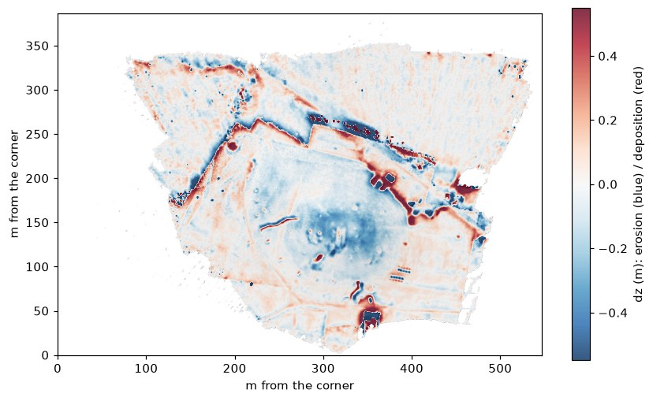
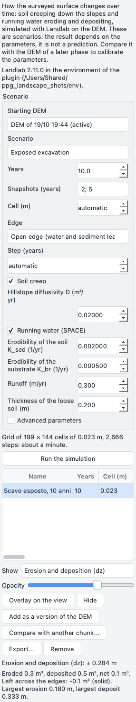
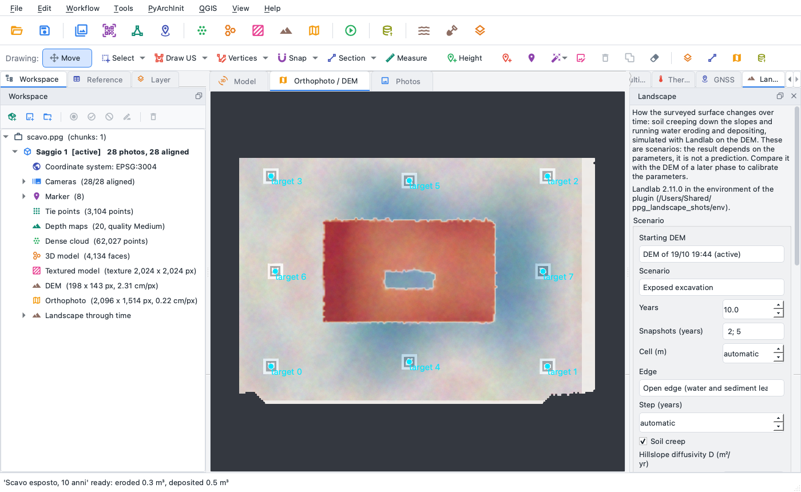
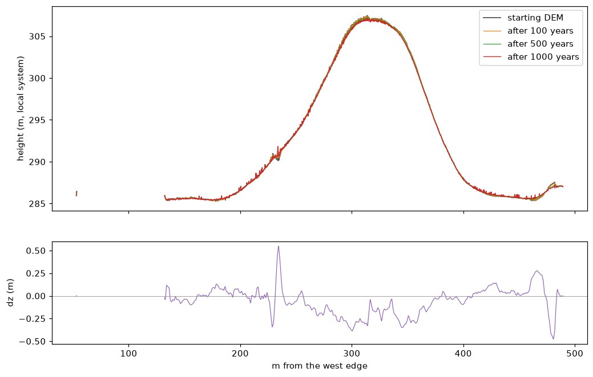
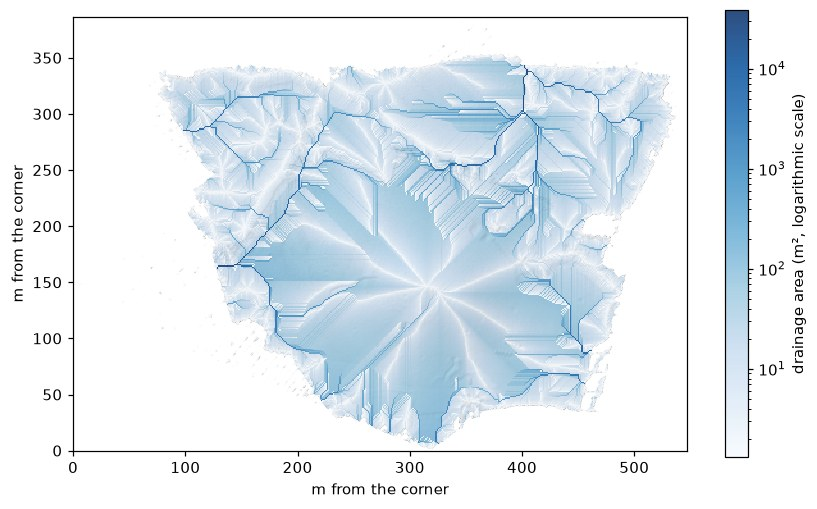

# Landscape through time

The *Landscape through time* plugin simulates on the DEM of the project how the surface changes over
the years through two slow processes: **soil creep**, the soil that slides down every slope a little
each year, and **running water**, which erodes where it gathers and lays its load down where it slows.
It answers questions like: how a mudbrick tell wears down and how far its colluvium spreads at the
foot, where an exposed excavation loses its sections in ten years, where the sediment of a slope ends
up. The simulation is made by [Landlab](https://landlab.csdms.io) (CSDMS, Community Surface Dynamics
Modeling System), run by the plugin in a process of its own; the results come back onto the grid of
the DEM: final surface, erosion and deposition, drainage area, intermediate surfaces and the balance of
the volumes moved.

This page describes version 0.1.0 of the plugin, which needs pyarchinit-photogrammetry 1.3.4 or later.
Its README and source code are in the
[plugin repository](https://github.com/enzococca/pyarchinit-photogrammetry-plugins/tree/main/plugins/landscape).

<figure markdown="span">
  
  <figcaption>The preset <em>Tell in mattoni crudi</em> (mudbrick tell) for 1,000 years: blue where the
  surface goes down, red where it rises - the colours of the pane - over the shading of the DEM. The top
  and the shoulders of the mound lose 20-40 cm, the foot of the slopes and the hollows gain as much; the
  cuts of the old excavations lose their edges and fill up. The real DEM of Tell Sultan, in a local
  reference system; colours between -0.55 and +0.55 m.</figcaption>
</figure>

!!! note "The examples on this page"
    The figures come from the DEM of Tell Sultan - the site of the [tutorial](../tutorials/tell.md) - at
    19 cm, 2,876 x 2,032 cells, in a local reference system, simulated on cells of 1.14 m; the pane was
    photographed on the demonstration project. The times were measured on a recent computer (an Apple
    M4 Pro). They show what the plugin does and are not a study of the site.

!!! warning "Scenarios, not predictions"
    The result depends on the parameters, and the parameters of a real slope are known within an order
    of magnitude at best. Read a run as "what these processes, at these rates, would do to this
    surface", compare several, and when you have the DEM of a later phase use the comparison to
    calibrate the parameters. Time runs forward only: the plugin does not rebuild an older surface by
    running the model backwards, which is not physical (diffusion run backwards amplifies every error
    of the DEM).

## In short

1. Build the DEM of the chunk (*Workflow > Build DEM...*), better from the *Ground* class only.
2. Open the *Landscape* pane (*Plugins > Landscape through time (Landlab) > Landscape through
   time...*). The first time, *Install Landlab...* puts Landlab in an environment of the plugin
   (about 500 MB, a few minutes, once).
3. Choose a preset, the years and the intermediate surfaces to keep; read the estimate of how long it
   takes; *Run the simulation*.
4. Look at the erosion and deposition over the orthophoto or the DEM; switch to the final surface, the
   drainage area or an intermediate surface; read the balance of the volumes under the table.
5. Add the final surface among the versions of the DEM, compare it with the DEM of a later chunk,
   export it as GeoTIFF.

## What it does

| Process | What it does to the surface | Landlab component | Parameters |
|---|---|---|---|
| Soil creep (hillslope diffusion) | the soil moves downslope in proportion to the slope: convex tops and edges go down, concave feet fill up; the slopes become rounder and gentler | `LinearDiffuser` | diffusivity D (m²/yr) |
| Running water (SPACE) | the water gathers along the lines of greatest drainage, erodes a layer of loose soil and, below it, the body of the mound; the sediment travels and settles where the water slows, the finest part leaves in suspension | `SpaceLargeScaleEroder` | erodibility of the soil and of the substrate, runoff, soil thickness, settling, porosity, fines |

The water follows the steepest of the eight neighbours of each cell (D8); the hollows of the surface
are filled in the routing so that the water flows on, and the sediment settles in them. Either process
can be switched off, not both. Not simulated: rain that changes over time, vegetation, wind, frost,
animals and people, gullies that move sideways, tectonics, what lies under the surface.

It serves wherever the shape of the ground changes slowly and the question is "how much, and where":
the wearing down of a tell or a tumulus, the colluvium at the foot of a slope that buries the levels
below, the sections and walls of an excavation left open, the effect of a terrace or a ditch on the
water. It is not a model of a single storm, nor of a landslide.

## What you need first { #before }

* **The plugin**, installed from the program: see [Plugin guides](guides.md#install).
* **Landlab**, a free Python library (MIT licence) with its compiled helpers (richdem for the flow
  routing, netCDF4). The program never loads it: each run happens in a separate process, with
    * the Python of the program, when Landlab is installed there (`pip install landlab` in the Python
      environment of the program);
    * otherwise an environment of the plugin: Python 3.12 and Landlab 2 from PyPI, installed with
      [uv](https://github.com/astral-sh/uv) - about 500 MB and a few minutes, with the internet that
      one time. This is how the desktop application works, since it has no pip. The pane offers it
      (*Install Landlab...*), and so do *Plugins > Landscape through time (Landlab) > Install
      Landlab...* and `ppg plugin landscape install`. The environment goes into
      `plugins/_data/landscape/env/` inside the plugin folder of the program (see
      [Plugins](../plugins.md)); the variable `PPG_LANDSCAPE_ENV` puts it elsewhere.

    Landlab has builds for macOS (Apple Silicon; Intel with macOS 15 or later), Linux (x86-64 and ARM)
    and Windows on x86-64. There is none for Windows on ARM: there the pane says the simulations are
    not available. The line under the description of the pane says which Landlab the plugin uses.

* **A chunk with a DEM** (*Workflow > Build DEM...*), or a kept version of it. The plugin needs nothing
  else: neither photos nor cloud.
* **Metres.** A projected reference system, or a local system in metres: the parameters are in metres
  and years. The comparison with another chunk needs both in the same system.

## The DEM { #dem }

### Surface or ground { #dsm-dtm }

A DEM built from all the points of the dense cloud is a surface model: bushes, trees, tents, spoil heaps
and people are part of it, and for the simulation they are ground - a tree is a mound that creeps, a
parked car a dam that the water goes round. Build the DEM from the *Ground* class (*Tools >
Classification of the cloud*, or the [terrio](terrio.md) plugin), make it the active version or choose
it as *Starting DEM*.

### The simulation grid { #cell }

The simulation runs on cells larger than those of the DEM: Landlab is iterative, and a grid of millions
of cells would take hours. By default the plugin coarsens the DEM so that its longer side has at most
500 cells (the DEM of the figures, 19 cm, becomes 480 x 339 cells of 1.14 m); *Cell (m)* sets another
one. The DEM is averaged onto that grid. At the end, what the simulation **changed** - the dz of each
cell, and each intermediate surface minus the start - is interpolated back onto the grid of the DEM and
**added to the DEM**: the final surface keeps every stone and every edge the coarser simulation could not
see, and moves them with the ground around them. Along the outermost edge of the data, where the
interpolation would need cells without a value, the DEM stays as it was (dz 0).

The cell is also a choice about the processes: creep acts on every slope at the scale of the cell,
water gathers in channels at least a cell wide. A cell of 1-2 m suits a tell or a slope; 10-50 cm an
excavation, with fewer years.

### Edges and holes { #edges }

Cells without a value are outside the simulation. At the edge of the data you choose:

* **Open edge** (default): water and sediment leave there, as on a slope that goes on beyond the
  survey. Creep also exchanges soil across it.
* **Closed edge**: nothing leaves but through the outlets. With running water every group of cells
  inside the edge keeps one outlet, its lowest edge cell: the main area, and also the islands of a few
  cells a DEM often has beside it and the parts joined to it only by a narrow neck. Use it for an enclosed area - a
  courtyard, the inside of a trench - and with creep alone, which then keeps the volume.

On Tell Sultan, *Versante in terra* (earth slope) for 1,000 years with a closed edge on cells of 2 m
(274 x 194) kept 8 outlets - the main one and seven for islands and necks - and took 59 s; 4,971 m³ of
solid material left through them. A hole inside the data (a pool, a tarpaulin left out of the cloud) is
closed: water does not leave through it. Should Landlab still meet a lake without a way out, the run is
stopped with a message (it would never end) and nothing is written.

### How long it takes { #time }

Before a run the pane gives an estimate: the grid, the steps and the minutes. The diffusion steps are
exact (no step may be longer than 0.14 dx²/D, so they grow with the square of the cell: half the cell,
four times the steps); the steps of the running water are an upper bound, from the fastest erosion
possible, and the real run is usually much shorter. Above 10 minutes the line turns orange; above 2 hours
*Run* is disabled (`--force` on the command line). On Tell Sultan the preset *Tell in mattoni crudi*
for 1,000 years on 480 x 339 cells was estimated at 9 minutes and took 46 s, with 184 steps.

## Step by step in the program { #program }

### The pane

Once the plugin is installed and the program restarted, the *Landscape* pane opens on the right of the
window, tabbed with *PyArchInit*; it can be moved, floated or closed like the other panes and opened
again from *View > Panes*, or with *Plugins > Landscape through time (Landlab) > Landscape through
time...*.

<figure markdown="span">
  
  <figcaption>The pane after a run of the preset <em>Exposed excavation</em> on the demonstration
  project: the scenario, the estimate, the run in the table, its erosion and deposition shown and the
  balance of its volumes.</figcaption>
</figure>

From the top: a short description and the note that these are scenarios; the Landlab in use (or
*Install Landlab...*); the scenario; the estimate and *Run the simulation*; the table of the runs of the
chunk; *Show* and *Opacity*; *Overlay on the view*, *Hide*, *Add as a version of the DEM*, *Compare with
another chunk...*, *Export...*, *Remove*; the values at the two ends of the colours shown, and the
balance of the run selected.

### 1. The scenario { #scenario }

| Field | Default | What it does |
|---|---|---|
| *Starting DEM* | the active one | the DEM the run starts from: the active one or a kept version (an earlier phase, the result of another run) |
| *Scenario* | *Tell in mattoni crudi* | a preset fills the fields below; changing any value makes it *Custom* |
| *Years* | the preset's | the years simulated |
| *Snapshots (years)* | a tenth and a hundredth of the years | intermediate surfaces kept, separated by `;` or spaces (`10; 100; 500`) |
| *Cell (m)* | automatic | the cell of the simulation grid (see [above](#cell)) |
| *Edge* | open | *Open edge (water and sediment leave)* or *Closed edge (out only at the lowest point)* (see [above](#edges)) |
| *Step (years)* | automatic | the longest step: by default the years / 100; the simulation shortens it by itself where stability needs it |
| *Soil creep* | on | hillslope diffusion, with *Hillslope diffusivity D (m²/yr)* |
| *Running water (SPACE)* | on | erosion and deposition, with the erodibility of the soil and of the substrate, the runoff and the thickness of the loose soil |
| *Advanced parameters* | off | shows the fraction of fines, the porosity, the thickness scale H\*, the settling velocity and the two exponents of the water |

Every field has a tooltip that says what it is. The estimate below the form changes with the values.
*Run the simulation* runs it in the background with the progress bar (*Landlab: year 384 of 1,000*);
*Cancel* stops Landlab at once and leaves nothing behind. When it ends, the run is in the table, its
erosion and deposition are laid over the view and the project is marked as modified: save it to keep
the list of the runs with the project.

### 2. The layers of a run { #layers }

Select a run in the table, then a layer in *Show*:

| Layer | What it is | Colours |
|---|---|---|
| *Erosion and deposition (dz)* | the final surface minus the starting DEM, m | blue-white-red, symmetric around zero (blue down, red up) |
| *Final surface* | the surface after the years simulated | from low to high, earth colours |
| *Drainage area* | the area that drains through each cell of the final surface, m² | water blues on a logarithmic scale |
| *Surface after N years* | each snapshot | as the final surface |
| *Difference with the DEM of 'chunk'* | after a comparison, the final surface minus that DEM | blue-white-red (blue: the simulation lower than that DEM) |

<figure markdown="span">
  
  <figcaption>Ten years of the preset <em>Exposed excavation</em> on the trench of the demonstration
  project, over the orthophoto: the floor of the trench fills (red, at most 33 cm), the ground around it
  loses material (blue; the largest erosion is 18 cm).</figcaption>
</figure>

*Overlay on the view*, a double click on the row or the choice in *Show* lays it over the orthophoto or
the DEM (the DEM is loaded if the view is empty); *Opacity* changes it at once, *Hide* (or *Plugins >
Landscape through time (Landlab) > Hide the landscape overlay*) takes it away. The colours run between
the 2nd and the 98th percentile of the values; the line under the buttons says which.

The runs are also in the *Workspace* tree, under *Landscape through time*: a double click shows the dz
of a run, the right-click menu every layer, *Add as a version of the DEM* and *Remove*. The QGIS
project of the program ([QGIS](../integrations.md)) has the final surface, the dz and the drainage area
of every run (for a georeferenced chunk); with the program 1.4.0 or later the layers are in the raster
calculator too.

### 3. A version of the DEM { #version }

*Add as a version of the DEM* copies the final surface among the kept versions of the DEM, named
*Paesaggio dopo 1.000 anni (name of the run)* (in Italian in the project, as the program's own names).
The active DEM does not change. Make the new version active - right click on it in the *Workspace* - and
contours, sections, profiles, volumes and relief work on the simulated surface; make the old one active
again to go back. A version made from a run stays when the run is removed.

### 4. Comparison with a later phase { #compare }

When the project has the DEM of a later phase - another chunk, surveyed years after - *Compare with
another chunk...* asks which chunk, and computes the final surface minus its active DEM, resampled onto
the grid of the run. The summary gives the median, the NMAD and the 95th percentile of the absolute
difference, next to the same numbers for the **starting** DEM minus the later one: the parameters go the
right way when the difference shrinks. The difference is a layer of the run (*Difference with the DEM
of ...*). Both chunks must be in the same reference system; areas that changed for other reasons (an
excavation in between, new spoil heaps) weigh on the numbers: compare on the parts that were left alone.

### 5. Export and removal { #export }

*Export...* writes the layer shown, or every layer of the run in one GeoTIFF with a named band each
(`final`, `dz`, `area`, `anni_100`...). *File > Export > Landscape through time (GeoTIFF)* exports every
layer of the latest run. *Remove* asks first, then deletes the files of the run.

## Presets and parameters { #parameters }

| Preset | Years | D (m²/yr) | K_sed | K_br | F_f | phi | H\* (m) | v_s (m/yr) | Runoff (m/yr) | Soil (m) |
|---|---|---|---|---|---|---|---|---|---|---|
| *Tell in mattoni crudi* (mudbrick tell) | 1,000 | 0.01 | 0.0005 | 0.0001 | 0.5 | 0.3 | 0.5 | 1 | 0.2 | 0.5 |
| *Versante in terra* (earth slope) | 1,000 | 0.005 | 0.001 | 0.0002 | 0.2 | 0.3 | 0.5 | 1 | 0.3 | 0.5 |
| *Scavo esposto* (exposed excavation) | 10 | 0.02 | 0.002 | 0.0005 | 0.3 | 0.3 | 0.2 | 1 | 0.3 | 0.2 |

The exponents of the erosion law are 0.5 (drainage) and 1 (slope) in every preset. The values are the
plugin's defensible starting points, in the upper part of the published ranges for loose, bare material.
They are **indicative**:

* **D, hillslope diffusivity.** The model of soil creep as diffusion goes back to Culling (1963).
  Measured on natural soil-mantled slopes, D lies mostly between 0.0001 and 0.01 m²/yr: about 0.003 in
  the Oregon Coast Range (Roering, Kirchner and Dietrich 1999), about 0.001 from the degradation of fault
  scarps and old shorelines (Hanks et al. 1984). Bare, loose material moves faster than vegetated soil:
  the presets put a mudbrick tell at 0.01 and an unprotected excavation at 0.02, above the natural range
  on purpose, and a grassed earth slope at 0.005.
* **K_sed and K_br, erodibility of the soil and of the substrate.** SPACE (Shobe, Tucker and Barnhart
  2017) erodes a layer of loose soil at `K_sed Q^m S^n (1 - e^(-H/H*))` and the material below at
  `K_br Q^m S^n e^(-H/H*)` (Q the discharge, S the slope, H the soil thickness). Their units depend on
  the exponents and on the discharge (m³/yr here): a value is comparable only with the same exponents.
  The loose soil is more erodible than what lies below (5 times in the presets). These are the least
  known values: the examples that come with SPACE use anything from 0.00001 to 1, for catchments that
  change over millennia; the presets stay low because the slopes of a tell are short and mudbrick is
  cohesive. Calibrate them.
* **F_f**, the fraction of the eroded material below the soil so fine that it leaves in suspension
  without settling: high for mudbrick and silty fills.
* **phi**, the porosity of the deposited sediment: 0.3 is common for sand and gravel (0.2-0.5).
* **H\***, the thickness of soil above which the water no longer reaches the material below.
* **v_s**, the effective settling velocity: much larger than the runoff, the sediment settles close to
  where it was eroded; much smaller, it travels far and leaves the survey (Shobe et al. 2017 discuss
  the passage between the two).
* **Runoff**, the rain that runs off the surface in a year, uniform (m/yr): 0.2-0.3 m for a semi-arid
  to Mediterranean climate after infiltration.

## From the command line { #cli }

The same with `ppg plugin landscape WHAT PROJECT ...`. The commands work on the active chunk (`--chunk
LABEL` for another one); those that change the project save it.

```bash
ppg plugin landscape status
ppg plugin landscape install
ppg plugin landscape estimate scavo.ppg --preset mudbrick_tell --years 1000
ppg plugin landscape run scavo.ppg --preset mudbrick_tell --years 1000 --snapshots 100,500 --name "Tell, 1000 years"
ppg plugin landscape run scavo.ppg --preset custom --years 50 --D 0.02 --no-water --boundary closed
ppg plugin landscape run scavo.ppg --preset earth_slope --cell 2 --K-sed 0.002 --runoff 0.4
ppg plugin landscape list scavo.ppg
ppg plugin landscape show scavo.ppg r20261030-073806
ppg plugin landscape version scavo.ppg r20261030-073806
ppg plugin landscape compare scavo.ppg r20261030-073806 --with "Phase 2"
ppg plugin landscape export scavo.ppg r20261030-073806 landscape.tif
ppg plugin landscape export scavo.ppg r20261030-073806 dz.tif --layer dz
ppg plugin landscape remove scavo.ppg r20261030-073806
```

| Command | Options |
|---|---|
| `status` | where Landlab runs, and a try of it |
| `install` | the environment of the plugin; `--force` also when Landlab is there already |
| `estimate PROJECT` | the options of `run`: grid, steps and minutes, nothing is run; `--json` |
| `run PROJECT` | `--preset` `mudbrick_tell`, `earth_slope`, `exposed_excavation` or `custom`; `--years`; `--snapshots 10,100`; `--cell` m (0: automatic); `--boundary open` or `closed`; `--dt` longest step, years; `--source` the id of a version of the DEM; `--no-diffusion`, `--no-water`; the parameters `--D --K-sed --K-br --runoff --soil-depth --F-f --phi --H-star --v-s --m-sp --n-sp`; `--name`; `--force` over two hours; `--json` the whole entry |
| `list PROJECT` | the runs with id, name, years, cell, preset, starting DEM, volumes |
| `show PROJECT ID` | a run: parameters, balance, comparisons |
| `version PROJECT ID` | the final surface among the versions of the DEM |
| `compare PROJECT ID --with LABEL` | the final surface minus the DEM of another chunk; `--other-source` one of its versions |
| `export PROJECT ID OUT` | `--layer final`, `dz`, `area`, `snap:100` or `all` (default: one band per layer) |
| `remove PROJECT ID` | the run and its files, without asking |

## Reading the results { #reading }

<figure markdown="span">
  
  <figcaption>A profile from west to east through the top of the mound: the starting DEM and the
  surfaces after 100, 500 and 1,000 years of the preset <em>Tell in mattoni crudi</em> (above), and the
  dz along it (below, metres). The top loses up to 39 cm, the convex upper slopes 20-30 cm; the step of
  an old cut on the west slope (at about 235 m) is smoothed, its foot filled by 55 cm. Distances in
  metres from the west edge of the survey.</figcaption>
</figure>

### Erosion and deposition { #reading-dz }

dz is the final surface minus the starting DEM, in metres: negative where material left, positive where
it arrived. Creep takes from what is convex (tops, shoulders, the edges of cuts and walls) and gives to
what is concave (feet, hollows, the bottoms of trenches); running water cuts lines down the slopes and
fills where it slows. On a tell the pattern is a rounding: the top lowered, the shoulders worn, an apron
growing at the foot. The largest values, often metres, sit on steps of the DEM - the vertical section
of an excavation, a wall, a pit - which creep softens first; read them as "this edge does not stay",
not as a measure.

### The volumes { #reading-balance }

Under the table, and in `balance.json`, a run gives:

* **eroded**, **deposited** and **net** volume from dz, m³ - the volumes the map shows, pores included;
* the **solid** volumes: the soil is porous (phi), the material below is not, so a cubic metre of
  mudbrick eroded becomes more than a cubic metre of deposit; the solid volumes count only the material;
* what **left the survey**: with the water as bedload and as fine wash load, and by creep across an
  open edge (negative when creep brought soil in from outside, where the edge is higher than the
  inside);
* the **closure**: solid eroded - solid deposited - everything that left. It is about zero when the books
  close, and they are checked in the tests in every combination of edge, fines and porosity.

On Tell Sultan, *Tell in mattoni crudi* for 1,000 years (open edge, 480 x 339 cells of 1.14 m):

| | m³ |
|---|---|
| Eroded / deposited (bulk) | 6,816 / 5,525 |
| Eroded / deposited (solid) | 5,169 / 3,807 |
| Left with the water (bedload + fines) | 1,418 (1,043 + 375) |
| Creep across the edge (solid) | -56 (brought in) |
| Closure | 0.0000 |

The typical change is small - the NMAD of dz over the DEM is 8 cm - while 2 % of the cells went down
more than 39 cm and 2 % went up more than 39 cm.

### Drainage area { #reading-area }

<figure markdown="span">
  
  <figcaption>The drainage area of the final surface after 1,000 years: the area that drains through each
  cell, from 1 m² (white) to 38,000 m² (dark blue), on a logarithmic scale. The water runs radially
  down the mound and gathers in the low ground and along the cuts around it; the straight lines in
  eight directions on the smooth slopes are the mark of the D8 routing.</figcaption>
</figure>

The area, in m², that drains through each cell of the final surface: the lines of high values are where
water concentrates and where running water works. It comes back onto the grid of the DEM by nearest
neighbour, so the lines keep the width of the simulation cell.

### Snapshots { #reading-snapshots }

Each snapshot is a surface on the grid of the DEM, the starting DEM plus the change up to that year.
Creep slows as the slopes ease: the first centuries change a sharp surface more than the following ones.

### Limits { #limits }

* **Scenarios.** Parameters within an order of magnitude give results within an order of magnitude.
  Compare presets, change one value at a time, calibrate with a later DEM.
* **Two processes.** No rain events, vegetation, wind, frost, animals, people, landslides or channels
  that move sideways.
* **The surface only.** The soil thickness and the substrate are uniform: the plugin does not know where
  the mudbrick ends and the natural begins.
* **The cell.** What is smaller than the simulation cell is moved with its surroundings, not simulated:
  a wall one cell wide does not wear down by itself.
* **Forward only.** No reconstruction of a past surface.

## Files written { #files }

Everything goes into the folder of the chunk, next to the project file:
`<project>.ppg.files/chunk_<n>/landscape/<id of the run>/`. The list of the runs, their parameters and
balances are kept in the project itself.

* `final.tif`, `dz.tif`, `area.tif`, `snap_<years>.tif`: float32 GeoTIFF on the grid, in the reference
  system of the DEM, with no value outside the data; `dz.tif` is the difference of the two float32
  surfaces, so final - DEM = dz holds in the files.
* `compare_<chunk>.tif`: the difference with another chunk, after a comparison.
* `balance.json`: the volumes and the counts of the run (steps, cells, router and eroder used).
* `_work/`: the files exchanged with Landlab while it runs; deleted at the end, also when the run fails
  or is cancelled.
* A version of the DEM, when added, in `versions/dem/<id>/dem.tif`.
* The environment of Landlab, when the plugin installs it: `plugins/_data/landscape/env/` in the plugin
  folder of the program, about 500 MB.

## Licences { #licences }

Landlab is released under the MIT licence; richdem, which Landlab uses for the flow routing, under the
GNU GPL version 3. The plugin is released under the GPL-3.0-or-later; the program and the other plugins
are GPL-2.0-or-later, and the "or later" lets them work together. The program never loads Landlab: it
runs it as a separate program and exchanges files with it.

**References.** Culling, W. E. H. (1963), Soil creep and the development of hillside slopes, *The
Journal of Geology* 71, 127-161. Hanks, T. C., Bucknam, R. C., Lajoie, K. R., Wallace, R. E. (1984),
Modification of wave-cut and faulting-controlled landforms, *Journal of Geophysical Research* 89,
5771-5790. Roering, J. J., Kirchner, J. W., Dietrich, W. E. (1999), Evidence for nonlinear, diffusive
sediment transport on hillslopes and implications for landscape morphology, *Water Resources Research*
35, 853-870. Shobe, C. M., Tucker, G. E., Barnhart, K. R. (2017), The SPACE 1.0 model: a Landlab
component for 2-D calculation of sediment transport, bedrock erosion, and landscape evolution,
*Geoscientific Model Development* 10, 4577-4604.
