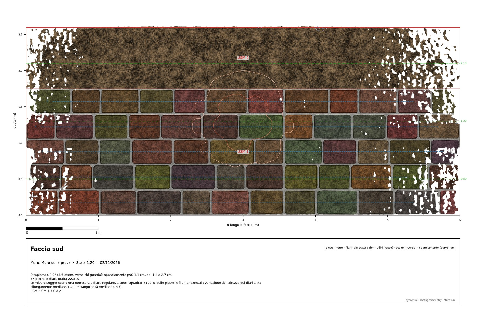
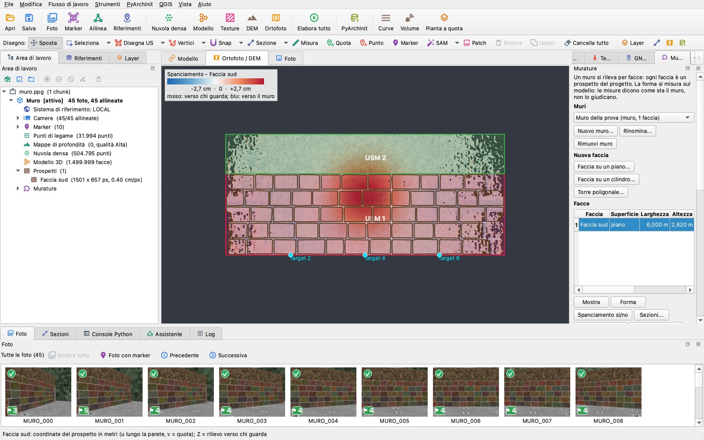
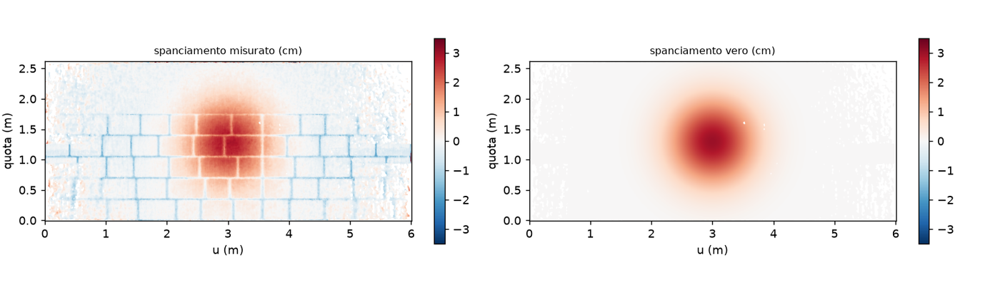
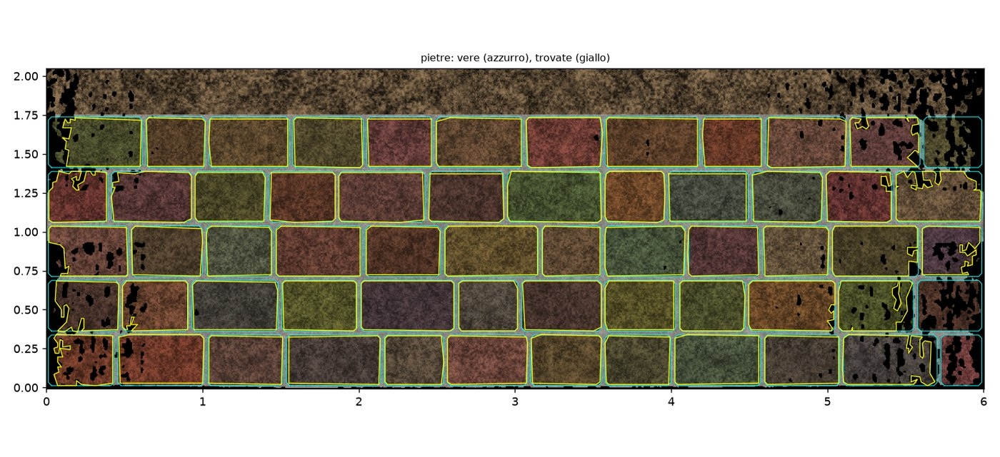

# Murature

Il plugin *Murature* rileva muri, edifici e torri in pietra **per facce**. Ogni faccia è un prospetto del programma, su
un piano o su un cilindro. Su una faccia il plugin misura:

- **la forma**: strapiombo, spanciamento, sezioni orizzontali, asse di una torre tonda, due rilievi a confronto;
- **le pietre**: misure, filari, quota di malta e una riga sul tipo di muratura che le misure suggeriscono;
- **le USM**: rapporti proposti dalla geometria, che verifichi prima che vengano scritti in PyArchInit.

Produce la tavola in scala, il DXF, le tabelle e l'IFC del muro.

Le misure dicono come sta un muro. Non lo giudicano mai: uno strapiombo è un numero con la sua direzione, e un tipo è
quello che le misure *suggeriscono*, con le regole che lo suggeriscono.

Questa pagina descrive la versione 0.1.0 del plugin, che **richiede pyarchinit-photogrammetry 1.7.0** (i disegni
tenuti con i prospetti). Il README e il codice sono nel [repository dei
plugin](https://github.com/enzococca/pyarchinit-photogrammetry-plugins/tree/main/plugins/masonry).

<figure markdown="span">
  
  <figcaption>La tavola della faccia dell'esempio in scala 1:20. Mostra l'ortofoto della faccia, le pietre trovate da
  SAM 2.1 (nero), i filari (tratteggio blu), le due USM (rosso), le linee delle sezioni orizzontali (verde), le curve
  dello spanciamento (cm) e il cartiglio con le misure.</figcaption>
</figure>

!!! note "L'esempio di questa pagina"
    Figure e numeri vengono da un **muro sintetico** di 6 × 2,6 m. In basso ci sono cinque filari di pietre di
    contorno noto (malta 12,2 %, giunti arretrati di 1,5 cm); sopra c'è un'unità di pietrame senza filari. La faccia
    strapiomba di 2° verso chi guarda e ha uno spanciamento gaussiano di 3 cm.

    Il renderer del programma lo ha fotografato (45 foto), poi il programma lo ha allineato, densificato e modellato
    come farebbe con foto vere. Le pietre sono state trovate dallo strumento Pietre del programma, con SAM 2.1. La
    verità è nota, quindi la guida può dire quanto il plugin ci si è avvicinato. Lo script è `proof/make_proof.py`
    nella cartella del plugin.

## In breve

1. **Nuovo muro...** nel pannello *Murature* (a destra): un nome e un tipo (muro, edificio, torre).
2. **Faccia su un piano...**: traccia in pianta la faccia del muro con due punti. Per una torre tonda, un pozzo o
   un'abside usa **Faccia su un cilindro...**; per una torre poligonale usa **Torre poligonale...**.
3. **Forma**: strapiombo e spanciamento, con lo spanciamento sopra il prospetto. Poi **Sezioni...** e **Asse della
   torre...**; **Confronta rilievi...** se un altro chunk contiene un secondo rilievo dello stesso muro.
4. **Trova le pietre...** (lo strumento Pietre del programma sulla faccia), poi **Misura le pietre**.
5. Disegna le USM sulla faccia con *Disegna US* del programma, poi **Proponi rapporti...** e spunta quelli che hai
   verificato. **Salva in PyArchInit** li scrive.
6. Esporta la faccia con **Tavola...** o **Esporta tutto...**, il muro con **IFC del muro...**, oppure apri la faccia
   con **Apri la faccia in QGIS**.

<figure markdown="span">
  
  <figcaption>La faccia nella vista 2D del programma con lo spanciamento sovrapposto e la sua legenda; il pannello a
  destra.</figcaption>
</figure>

## Che cosa serve a ogni passo

| Passo | Serve |
|---|---|
| Facce | un chunk con un **modello** in metri (un sistema proiettato, o un sistema locale con una scala); un'ortofoto o un DEM su cui tracciare in pianta (senza, una cornice vuota intorno al modello) |
| Forma | una faccia; nient'altro: si misura sul rilievo del prospetto, la superficie del modello sulla griglia della faccia |
| Sezioni, asse della torre | il modello (le sezioni orizzontali del programma) |
| Due rilievi | un secondo chunk del progetto con un modello, **già allineato** nello stesso sistema |
| Pietre | pietre disegnate sulla faccia: dallo strumento Pietre del programma (serve SAM 2.1, installato dal programma) o a mano; una faccia con un prospetto più grossolano di **un quarto della pietra più piccola** viene rifiutata, con i numeri |
| USM | almeno due unità disegnate sulla faccia (*Disegna US* del programma sul prospetto, `unita_tipo` USM); la regola *taglia* vuole anche le pietre misurate |
| PyArchInit | il programma collegato a PyArchInit (menu *PyArchInit*) |
| IFC | una faccia piana; per un muro rilevato da un solo lato serve lo spessore |

## Facce

Un muro è una scheda con le sue facce. Ogni faccia è un prospetto del programma, creato da *Nuova faccia*, quindi
sopra funzionano gli strumenti del programma: pietre, disegno delle US, QGIS, esportazioni.

- **Su un piano**: il piano verticale per i due punti tracciati in pianta, limitato al tratto fra i due punti, visto
  dalla parte delle foto (o dalla parte che scegli). Su questa faccia `v` è la quota.
- **Su un cilindro**: per tre o più punti in pianta, o il cerchio adattato alla sezione orizzontale del modello a una
  quota. Lo vedi da fuori (una torre tonda) o da dentro (un pozzo, un'abside).
- **Torre poligonale**: il contorno della sezione a una quota viene semplificato in un poligono. Ogni lato più lungo
  del minimo (0,5 m di base) diventa una faccia sul suo piano, vista da fuori.

Una faccia tiene solo la superficie dentro la sua **fascia di profondità** (di base 0,5 m davanti al piano e 0,3 m
dietro). Quello che sta più avanti, come un ponteggio o un testimone lasciato davanti al muro, resta fuori. Se la
superficie tocca il limite della fascia, la sintesi della forma lo dice: una parte del muro può restarne fuori, quindi
rifai la faccia con una fascia più larga.

Il pannello elenca ogni faccia con larghezza, altezza, risoluzione e i disegni che contiene (pietre, US, quote,
punti). Rimuovere una faccia la toglie dal muro. Il suo prospetto resta nel progetto, se non chiedi di toglierlo.

## Forma

- **Adattamento**: il piano (o, su un cilindro, il cilindro) viene adattato ai minimi quadrati con il peso di Huber
  alla superficie del modello dentro la faccia. Un lampione, un palo o un ciuffo d'erba contano meno del muro senza
  essere buttati via.
- **Strapiombo**: l'inclinazione del piano adattato rispetto alla verticale, in gradi e in cm/m. Viene con l'azimut
  verso cui va la sommità, e con il verso: verso chi guarda (strapiombo) o all'indietro.
- **Spanciamento**: un raster sulla griglia della faccia (`bulge.tif`, cm). È la distanza della superficie dalla
  superficie adattata, positiva verso chi guarda. Si vede sopra il prospetto con una scala divergente (rosso verso chi
  guarda, blu dentro il muro) e una legenda. La sintesi ne dà il 0,5° e il 99,5° percentile e l'rms.
- **Sezioni**: sezioni orizzontali del modello alle quote scelte, sovrapposte in un DXF (ognuna alla sua quota) e in
  un SVG (disegnato lungo la faccia, con la profondità esagerata). Gli scarti fra loro si misurano a stazioni lungo la
  faccia, dalla sezione più bassa, verso chi guarda.
- **Asse di una torre tonda**: i cerchi adattati alle sezioni a più quote. L'asse che passa per i loro centri dà
  inclinazione, direzione e cm/m; ogni quota dà il suo raggio e il fuori tondo (l'escursione del raggio fra il 0,5° e
  il 99,5° percentile).
- **Due rilievi**: la superficie del modello dell'altro chunk sulla stessa griglia della faccia. La differenza viene
  scritta come raster (cm, positiva dove l'altro rilievo sta verso chi guarda), con la mediana e il 90° percentile del
  suo valore assoluto.

Nell'esempio:

| Misura | Plugin | Verità |
|---|---|---|
| strapiombo | 2,05°, verso chi guarda, azimut 180° | 2,00°, 180° |
| spanciamento, 99,5° percentile | 2,67 cm | 3,00 cm |
| carta dello spanciamento contro la verità (sulle pietre e sul pietrame, non nei giunti) | mediana −0,12 cm, p90 del valore assoluto 0,29 cm | |

<figure markdown="span">
  
  <figcaption>La carta dello spanciamento dell'esempio (a sinistra) e la verità (a destra). Nella carta misurata i
  giunti, arretrati di 1,5 cm, si vedono come la griglia blu.</figcaption>
</figure>

## Pietre e filari

**Trova le pietre...** mostra il prospetto della faccia e avvia sopra lo strumento Pietre del programma: SAM 2.1 a
tasselli, con la pietra più piccola e la più grande che indichi. Le pietre restano con il prospetto, come qualsiasi
pietra disegnata lì, quindi puoi correggerle a mano. **Misura le pietre** poi le legge:

- **per pietra**: larghezza e altezza (l'ingombro lungo `u` e `v`), area e ellisse equivalente (asse maggiore e
  minore, allungamento = maggiore / minore, orientamento dell'asse maggiore rispetto all'orizzontale della faccia). Dà
  anche la rettangolarità: l'area divisa per l'area del rettangolo minimo che la contiene;
- **quota di malta**: 1 − l'area delle pietre divisa per l'area del muro. L'area del muro sono i limiti della faccia,
  o un poligono che disegni sulla faccia con **Area del muro...**, tenuto per le volte successive;
- **filari**: i centri delle pietre ordinati per quota e separati dove due vicini distano più di metà dell'altezza
  mediana delle pietre. Un gruppo è un filare se ha 3 pietre o più con i centri entro un quarto del suo spessore (rms)
  dalla retta che li attraversa. Ogni filare dà la quota media, il numero di pietre, lo spessore (l'altezza mediana
  delle sue pietre) e la pendenza.

Le tabelle vengono scritte in `pietre.csv`, `filari.csv`, `pietre.xlsx` (fogli *Pietre*, *Filari*, *Sintesi*) e in un
GeoPackage (`pietre_misure`, nelle `(u, v)` della faccia e in 3D sul suo piano).

### Il tipo che le misure suggeriscono

La sintesi finisce con una riga che comincia con *"Le misure suggeriscono…"*. È un suggerimento, e dice i numeri che
lo sostengono:

| Parola | Regola |
|---|---|
| **a filari** | almeno il **70 %** delle pietre sta in filari di **3 pietre o più** inclinati meno di **2°** |
| **regolare** | lo spessore dei filari varia poco: deviazione mediana assoluta / mediana **< 20 %** (non valutabile con meno di due filari) |
| **a conci squadrati** | allungamento mediano delle pietre **< 2** e rettangolarità mediana **> 0,8** |

Le parole opposte sono *senza filari evidenti*, *irregolare* e *di pietre non squadrate*. Le regole non conoscono la
pietra, la lavorazione, il periodo o la tecnica costruttiva. Dicono com'è la forma delle cose sulla faccia, e il tipo
di muratura lo decidi tu.

Nell'esempio SAM ha trovato 57 pietre su 60:

| Misura | Plugin | Verità |
|---|---|---|
| pietre trovate / abbinate / in più | 57 / 54 / 3 | 60 |
| larghezza, altezza | mediana −0,6 cm e −0,5 cm, p90 del valore assoluto 1,4 cm e 1,3 cm; IoU mediana 0,93 | |
| filari e loro quote | 5: 0,177, 0,527, 0,878, 1,221, 1,573 m | 5: 0,175, 0,525, 0,875, 1,225, 1,575 m |
| quota di malta | 22,9 % | 12,2 % |
| tipo | *a filari, regolare, a conci squadrati* | |

La quota di malta segue le pietre che le dai. Sei pietre non sono state trovate, quasi tutte agli estremi della
faccia, dove l'ortofoto del prospetto ha dei vuoti. Inoltre i contorni trovati da SAM stanno circa mezzo centimetro
dentro le pietre. Tutte e due le cose fanno crescere la malta. Con le pietre disegnate o corrette a mano la misura
segue il disegno; nei test, su pietre disegnate, sta entro il 3 %.

<figure markdown="span">
  
  <figcaption>Le pietre dell'esempio: contorni veri (azzurro) e quelli trovati da SAM 2.1 sul prospetto della faccia
  (giallo).</figcaption>
</figure>

## USM e rapporti

Disegna le unità sulla faccia con *Disegna US* del programma (`unita_tipo` USM) e compila i campi. **Proponi
rapporti...** legge la loro geometria sulla faccia (`v` verso l'alto) e propone:

| Rapporto | Regola |
|---|---|
| **si appoggia a** | un'unità sopra un'altra che la tocca per almeno il **20 %** della propria larghezza |
| **taglia** | un'unità il cui contorno interrompe un filare delle pietre di un'altra: la retta per i centri del filare, dentro l'altra unità, entra nella prima. Questa regola vuole le pietre misurate |
| **copre** | un'unità che racchiude la sommità di un'altra: ne segue almeno il 90 % della sommità e scende ai suoi lati da entrambe le parti |

Per una coppia si propone il rapporto più forte: *taglia*, poi *copre*, poi *si appoggia a*. Ognuno viene con la sua
evidenza, per esempio *"USM 13 racchiude la sommità di USM 11 (100 % della sommità) e scende ai suoi lati"*.

La finestra mostra le proposte **senza spunta**. Si tengono solo quelle che spunti, e **niente viene scritto senza la
tua verifica**. **Salva in PyArchInit** poi, attraverso il bridge del programma:

- crea le schede US delle unità che non ce l'hanno (con i campi disegnati);
- aggiunge i rapporti nei due sensi nel formato di PyArchInit, per esempio `[['Si appoggia a', '1', '1', 'Sito']]`
  con il suo inverso *Gli si appoggia*;
- registra i disegni della faccia (DXF e SVG del programma) come media collegati a quelle schede.

Salvare di nuovo non scrive niente due volte.

Nell'esempio le due unità, il muro a filari e il pietrame sopra, hanno dato la proposta attesa: *USM 2 si appoggia a
USM 1*, che la tocca per il 100 % della sua larghezza.

## Uscite

- **Tavola...**: SVG e PDF alla scala normalizzata più dettagliata in cui la faccia sta in un foglio A3 (o alla scala
  che scegli). Mostra ortofoto, pietre, filari, USM con il numero, linee delle sezioni e quote, con le curve dello
  spanciamento (lisciate su 5 cm) se le vuoi. Ha la barra di scala e il cartiglio con faccia, muro, scala, data e
  misure.
- **Esporta tutto...**, in una sola cartella:
  - la tavola;
  - `_muratura.dxf`, con i layer **PIETRE, CORSI, USM, SEZIONI, BORDO, QUOTE** nei metri `(u, v)` della faccia;
  - l'esportazione dei disegni della faccia fatta dal programma (DXF, SVG, PNG, il GeoPackage spiegato e quello in 3D),
    con la tabella `pietre_misure` aggiunta accanto a `pietre`;
  - le tabelle CSV ed Excel, le sezioni, il raster dello spanciamento, i confronti e il JSON del muro.
- **IFC del muro...**: IFC4 con le convenzioni del programma (metri, `IfcMapConversion` su un'origine tonda):
  - un **`IfcWall`** il cui solido è il contorno della faccia (l'area del muro disegnata, altrimenti i suoi limiti)
    estruso dentro il muro: fra due facce rilevate che guardano in versi opposti lo spessore è **misurato** fra i
    loro piani adattati; con una faccia sola è lo spessore che indichi;
  - **`Pset_PyArchInit_Masonry`**: strapiombo, p90 dello spanciamento, pietre, filari, quota di malta, la riga del
    tipo, i conteggi, lo spessore e la sua origine;
  - le USM come **`IfcBuildingElementPart`** del muro, con `Pset_PyArchInit_US`, e i rapporti accettati come
    `IfcRelConnectsElements`.

  L'IFC dell'esempio passa `ifcopenshell.validate` senza errori.
- **Apri la faccia in QGIS**: un progetto QGIS nelle coordinate della faccia (spiegata). Contiene l'ortofoto, lo
  spanciamento con una scala divergente, i disegni e le pietre con le misure. Anche il progetto QGIS della pianta
  riceve le misure delle pietre, in 3D sul piano della faccia.
- *File > Esporta*: **Muro (IFC)** e **Tavola della faccia (PDF)**.

Il plugin scrive solo in `<dati del chunk>/masonry/<muro>/<faccia>/` e nelle cartelle che scegli. I prospetti e i
disegni del programma non cambiano formato.

## Riga di comando

```
ppg plugin masonry face PROGETTO "Muro nord" --line X1,Y1,X2,Y2 [--side X,Y] [--resolution 0.004]
ppg plugin masonry face PROGETTO Torre --kind tower --slice 314.0 [--inside]      # oppure --circle X1,Y1,X2,Y2,X3,Y3
ppg plugin masonry face PROGETTO Torre --kind tower --polygon 314.0 [--min-side 0.5]
ppg plugin masonry shape PROGETTO "Muro nord" [FACCIA] [--sections Z1,Z2 --stations U1,U2] [--compare CHUNK]
ppg plugin masonry shape PROGETTO Torre --axis [--heights Z1,Z2,Z3]
ppg plugin masonry stones PROGETTO "Muro nord" [FACCIA] [--region "POLYGON((u v, ...))"] [--export CARTELLA]
ppg plugin masonry usm PROGETTO "Muro nord" [FACCIA] [--accept all|1,3] [--write --config config.cfg]
ppg plugin masonry plate|export PROGETTO "Muro nord" [FACCIA] --out CARTELLA [--scale 20]
ppg plugin masonry ifc PROGETTO "Muro nord" --out muro.ifc [--thickness 0.6]
ppg plugin masonry list|remove PROGETTO ["Muro nord" [FACCIA]] [--elevations]
```

## Limiti

- La **forma** si misura sul prospetto della faccia alla sua risoluzione, dentro la sua fascia di profondità. Un muro
  che strapiomba fuori dalla fascia viene tagliato, e la sintesi lo dice.
- I **filari** si trovano dalle quote dei centri delle pietre. Filari molto inclinati che si sovrappongono in quota
  lungo una faccia lunga possono fondersi in un solo gruppo, che poi non supera la prova del filare.
- La **quota di malta** e il **tipo** dipendono dalle pietre disegnate. Le pietre mancanti, agli estremi di una
  faccia o dove l'ortofoto ha dei vuoti, alzano la quota di malta.
- La regola **taglia** vuole le pietre misurate e un filare interrotto. Un taglio che corre lungo un filare senza
  interromperlo non viene trovato.
- Il **muro IFC** è un prisma: il contorno di una faccia estruso attraverso il muro. Strapiombo e spanciamento stanno
  nel suo Pset, non nella sua forma. La faccia sviluppata di una torre tonda non diventa una lastra IFC.
- Non previsti nella 0.1.0: USM automatiche, disegno dei giunti di malta, datazione, analisi strutturale, solidi 3D
  delle pietre, volte e tetti (vedi [Elementi architettonici](architecture.md)).
