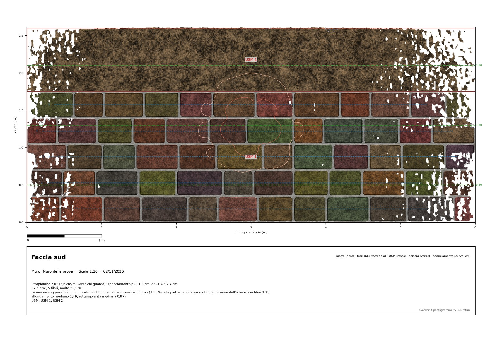
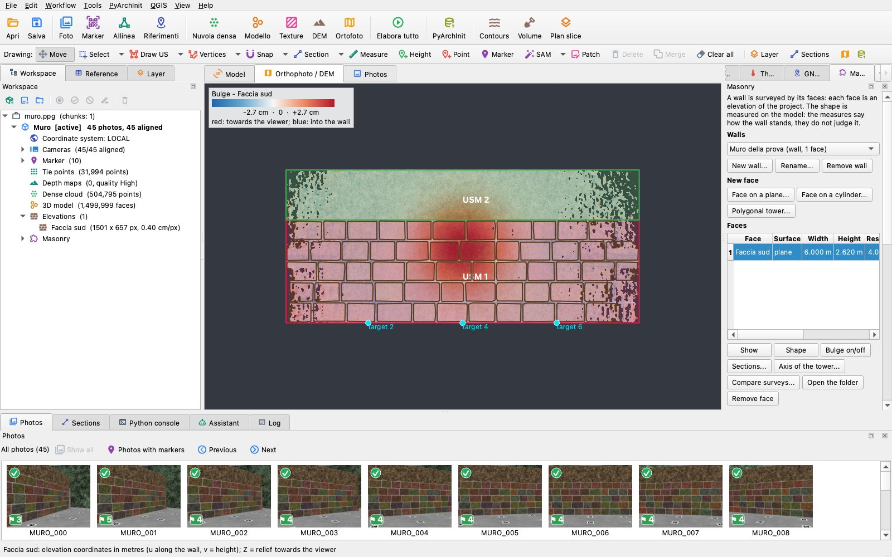
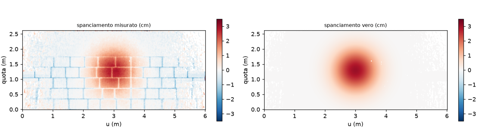
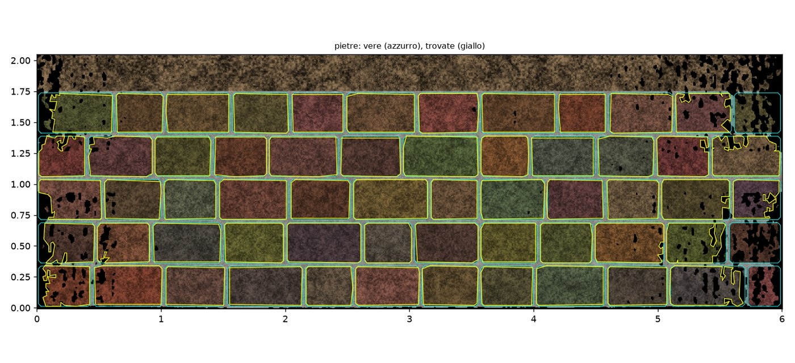

# Masonry

The *Masonry* plugin records walls, buildings and stone towers **by their faces**. Each face is an elevation of the
program, on a plane or on a cylinder. On a face the plugin measures:

- **its shape**: lean, bulge, horizontal sections, the axis of a round tower, two surveys compared;
- **its stones**: sizes, courses, mortar share, and a line on the masonry type that the measures suggest;
- **its USM**: relationships proposed from the geometry, which you check before they are written to PyArchInit.

It makes the plate at scale, the DXF, the tables and the wall's IFC.

The measures say how a wall stands. They never judge it: a lean is a number with its direction, and a type is what the
measures *suggest*, with the rules that suggest it.

This page describes version 0.1.0 of the plugin, which **requires pyarchinit-photogrammetry 1.7.0** (the drawings kept
with the elevations). The README and the code are in the [plugin
repository](https://github.com/enzococca/pyarchinit-photogrammetry-plugins/tree/main/plugins/masonry).

<figure markdown="span">
  
  <figcaption>The plate of the face of the example at 1:20. It shows the face's orthophoto, the stones found by SAM 2.1
  (black), the courses (blue dashes), the two USM (red), the lines of the horizontal sections (green), the bulge's
  contours (cm) and the title block with the measures.</figcaption>
</figure>

!!! note "The example of this page"
    The figures and the numbers come from a **synthetic wall**, 6 × 2.6 m. Below are five courses of stones with known
    outlines (12.2 % mortar, joints recessed 1.5 cm); above is a unit of rubble with no courses. The face leans 2°
    towards the viewer and has a Gaussian bulge of 3 cm.

    The program's renderer photographed it (45 photos), then the program aligned, densified and meshed it as it does
    real photos. The stones were found by the program's stone tool, with SAM 2.1. The truth is known, so the guide can
    say how close the plugin came. The script is `proof/make_proof.py` in the plugin's folder.

## In short

1. **New wall...** in the pane *Murature* / *Masonry* (on the right): a name and a kind (wall, building, tower).
2. **Face on a plane...**: trace the face of the wall on the plan with two points. For a round tower, a well or an
   apse, use **Face on a cylinder...**; for a polygonal tower, use **Polygonal tower...**.
3. **Shape**: lean and bulge, with the bulge shown over the elevation. Then **Sections...** and **Axis of the
   tower...**; **Compare surveys...** when another chunk holds a second survey of the same wall.
4. **Find the stones...** (the program's stone tool on the face), then **Measure the stones**.
5. Draw the USM on the face with the program's *Disegna US*, then **Propose relationships...** and tick those you
   checked. **Save in PyArchInit** writes them.
6. Export the face with **Plate...** or **Export all...**, the wall with **Wall IFC...**, or open the face with
   **Open the face in QGIS**.

<figure markdown="span">
  
  <figcaption>The face shown in the program's 2D view with the bulge as an overlay and its legend; the pane on the
  right.</figcaption>
</figure>

## What each step needs

| Step | Needs |
|---|---|
| Faces | a chunk with a **model** in metres (a projected CRS, or a local frame with a scale); an orthophoto or a DEM to trace on in plan (without them an empty frame around the model) |
| Shape | a face; nothing else: it is measured on the elevation's relief, the model's surface on the face's grid |
| Sections, tower axis | the model (the program's horizontal slices) |
| Two surveys | a second chunk of the project with a model, **already aligned** in the same system |
| Stones | stones drawn on the face: by the program's stone tool (needs SAM 2.1, installed by the program) or by hand; a face whose elevation is coarser than **a quarter of its smallest stone** is refused, with the numbers |
| USM | at least two units drawn on the face (the program's *Disegna US* on the elevation, `unita_tipo` USM); the rule *cuts* also needs the stones measured |
| PyArchInit | the program connected to PyArchInit (menu *PyArchInit*) |
| IFC | a plane face; a wall surveyed on one side only needs its thickness |

## Faces

A wall is a record with its faces. Each face is an elevation of the program, made by *New face*, so the program's own
tools work on it: stones, US drawing, QGIS, exports.

- **On a plane**: the vertical plane through the two points you trace on the plan, limited to the stretch between
  them, seen from the side of the photos (or the side you choose). On this face `v` is the height.
- **On a cylinder**: through three or more points of the plan, or the circle fitted to the horizontal slice of the
  model at a height. You see it from outside (a round tower) or from inside (a well, an apse).
- **Polygonal tower**: the outline of the slice at a height is simplified into a polygon. Each side longer than the
  minimum (0.5 m by default) becomes a face on its own plane, seen from outside.

A face keeps only the surface within its **depth band** (0.5 m in front of the plane and 0.3 m behind it, by default).
Whatever stands further in front, such as scaffolding or a section left in front of the wall, is left out. When the
surface touches the edge of the band, the shape's summary says so: part of the wall may be outside it, so make the
face again with a wider band.

The pane lists each face with its width, height, resolution and the drawings it holds (stones, US, spot heights,
points). Removing a face takes it out of the wall. Its elevation stays in the project unless you ask to remove it too.

## Shape

- **Fit**: the plane (or, on a cylinder, the cylinder) is fitted by least squares with Huber's weight to the model's
  surface within the face. A lamp, a pole or a patch of plants counts less than the wall without being thrown away.
- **Lean**: the tilt of the fitted plane from the vertical, in degrees and in cm/m. It comes with the azimuth the top
  goes towards, and whether that is towards the viewer (overhang) or away from them.
- **Bulge**: a raster on the face's grid (`bulge.tif`, cm). It is the distance of the surface from the fit, positive
  towards the viewer. It is shown over the elevation with a diverging palette (red towards the viewer, blue into the
  wall) and a legend. The summary gives its 0.5th and 99.5th percentiles and its rms.
- **Sections**: horizontal slices of the model at the heights you choose, stacked in one DXF (each at its height) and
  one SVG (drawn along the face, with the depth exaggerated). The offsets between them are measured at stations along
  the face, from the lowest section, towards the viewer.
- **Axis of a round tower**: the circles fitted to the slices at several heights. The axis through their centres gives
  its inclination, direction and cm/m; each height gives its radius and out-of-round (the spread of the radius,
  0.5th to 99.5th percentile).
- **Two surveys**: the surface of the other chunk's model on the same face grid. The difference is written as a raster
  (cm, positive where the other survey stands towards the viewer), with its median and the 90th percentile of its
  size.

In the example:

| Measure | Plugin | Truth |
|---|---|---|
| lean | 2.05°, towards the viewer, azimuth 180° | 2.00°, 180° |
| bulge, 99.5th percentile | 2.67 cm | 3.00 cm |
| bulge map against the truth (on the stones and the rubble, not in the joints) | median −0.12 cm, p90 of the size 0.29 cm | |

<figure markdown="span">
  
  <figcaption>The bulge map of the example (left) and the truth (right). In the measured map the joints, recessed
  1.5 cm, show as the blue grid.</figcaption>
</figure>

## Stones and courses

**Find the stones...** shows the face's elevation and starts the program's stone tool on it: SAM 2.1 in tiles, with
the smallest and the largest stone you give. The stones are kept with the elevation, like any stone drawn there, so
you can correct them by hand. **Measure the stones** then reads them:

- **per stone**: its width and height (its extent along `u` and `v`), area, and the best-fit ellipse (major and minor
  axes, elongation = major / minor, orientation of the major axis from the face's horizontal). It also gives
  rectangularity: the area over the area of the smallest enclosing rectangle;
- **mortar share**: 1 − the stones' area over the wall's area. The wall's area is the face's bounds, or a polygon you
  draw on the face with **Wall area...**, kept for the next runs;
- **courses**: the stones' centres sorted by height and split where two neighbours are further apart than half the
  median stone height. A group is a course when it has 3 stones or more whose centres lie within a quarter of its
  thickness (rms) of the line through them. Each course gives its mean height, number of stones, thickness (the median
  height of its stones) and slope.

The tables are written as `pietre.csv`, `filari.csv`, `pietre.xlsx` (the sheets *Pietre*, *Filari*, *Sintesi*) and a
GeoPackage (`pietre_misure`, in the face's `(u, v)` and in 3D on its plane).

### The type the measures suggest

The summary ends with a line that begins *"Le misure suggeriscono…"* ("the measures suggest"). It is a suggestion, and
it says the numbers behind it:

| Word | Rule |
|---|---|
| **coursed** (*a filari*) | at least **70 %** of the stones sit in courses of **3 stones or more** sloping less than **2°** |
| **regular** (*regolare*) | the courses' thickness varies little: median absolute deviation / median **< 20 %** (not assessable with fewer than two courses) |
| **squared** (*a conci squadrati*) | the stones' median elongation **< 2** and median rectangularity **> 0.8** |

The opposite words are *senza filari evidenti* (uncoursed), *irregolare* and *di pietre non squadrate*. The rules do
not know the stone, the dressing, the period or the building technique. They say what the shapes on the face are,
and the masonry type is your call.

In the example, SAM found 57 stones out of 60:

| Measure | Plugin | Truth |
|---|---|---|
| stones found / matched / extra | 57 / 54 / 3 | 60 |
| width, height | median −0.6 cm and −0.5 cm, p90 of the size 1.4 cm and 1.3 cm; median IoU 0.93 | |
| courses and their heights | 5: 0.177, 0.527, 0.878, 1.221, 1.573 m | 5: 0.175, 0.525, 0.875, 1.225, 1.575 m |
| mortar share | 22.9 % | 12.2 % |
| type | *a filari, regolare, a conci squadrati* | |

The mortar share follows the stones it is given. Six stones were not found, almost all at the ends of the face, where
the elevation's orthophoto has gaps. The outlines SAM found also lie about half a centimetre inside the stones. Both
make the mortar grow. With stones drawn or corrected by hand, the measure follows the drawing; in the tests, on drawn
stones, it is within 3 %.

<figure markdown="span">
  
  <figcaption>The stones of the example: true outlines (cyan) and those found by SAM 2.1 on the face's elevation
  (yellow).</figcaption>
</figure>

## USM and their relationships

Draw the units on the face with the program's *Disegna US* (`unita_tipo` USM) and fill their fields. **Propose
relationships...** reads their geometry on the face (`v` upwards) and proposes:

| Relationship | Rule |
|---|---|
| **si appoggia a** (abuts) | a unit above another, touching it along at least **20 %** of its own width |
| **taglia** (cuts) | a unit whose outline interrupts a course of the stones of another: the line through the course's centres, within the other unit, enters the first. This rule needs the stones measured |
| **copre** (covers) | a unit that encloses the top of another: it runs along at least 90 % of the other's top and goes down beside it on both sides |

For one pair the strongest relationship is proposed: *taglia*, then *copre*, then *si appoggia a*. Each comes with its
evidence, for example *"USM 13 encloses the top of USM 11 (100 % of the top) and goes down beside it"*.

The dialog shows the proposals **unticked**. Only those you tick are kept, and **nothing is written without your
check**. **Save in PyArchInit** then, through the program's bridge:

- creates the US forms of the units that have none (with the fields drawn);
- adds the relationships both ways in PyArchInit's format, e.g. `[['Si appoggia a', '1', '1', 'Site']]` with its
  inverse *Gli si appoggia*;
- registers the face's drawings (the program's DXF and SVG) as media linked to those forms.

Saving again writes nothing twice.

In the example the two units, the coursed wall and the rubble on top of it, gave the expected proposal: *USM 2 si
appoggia a USM 1*, touching along 100 % of its width.

## Outputs

- **Plate...**: SVG and PDF at the most detailed standard scale at which the face fits an A3 sheet (or the scale you
  choose). It shows the orthophoto, stones, courses, USM with their numbers, section lines and spot heights, with
  bulge contours (smoothed over 5 cm) if you want them. It has a scale bar and a title block with the face, the wall,
  the scale, the date and the measures.
- **Export all...**, into one folder:
  - the plate;
  - `_muratura.dxf`, with the layers **PIETRE, CORSI, USM, SEZIONI, BORDO, QUOTE** in the face's `(u, v)` metres;
  - the program's export of the face's drawings (DXF, SVG, PNG, the unfolded GeoPackage and the 3D one), with the table
    `pietre_misure` added beside `pietre`;
  - the CSV and Excel tables, the sections, the bulge raster, the comparisons and the wall's JSON.
- **Wall IFC...**: IFC4 with the program's conventions (metres, `IfcMapConversion` on a round origin):
  - an **`IfcWall`** whose solid is the outline of the face (the wall's area drawn on it, else its bounds) extruded into
    the wall: between two surveyed faces that look away from each other, the thickness is **measured** between their
    fitted planes; with one face, it is the thickness you give;
  - **`Pset_PyArchInit_Masonry`**: lean, bulge p90, stones, courses, mortar share, the type line, the counts, the
    thickness and where it came from;
  - the USM as **`IfcBuildingElementPart`** of the wall, with `Pset_PyArchInit_US`, and the accepted relationships as
    `IfcRelConnectsElements`.

  The example's IFC passes `ifcopenshell.validate` with no error.
- **Open the face in QGIS**: a QGIS project in the face's coordinates (unfolded). It holds the orthophoto, the bulge
  with a diverging ramp, the drawings and the stones with their measures. The QGIS project of the plan also gets the
  stones' measures in 3D on the face's plane.
- *File > Export*: **Wall (IFC)** and **Plate of the face (PDF)**.

The plugin writes only under `<chunk data>/masonry/<wall>/<face>/` and in the folders you choose. The program's
elevations and drawings keep their formats.

## Command line

```
ppg plugin masonry face PROJECT "North wall" --line X1,Y1,X2,Y2 [--side X,Y] [--resolution 0.004]
ppg plugin masonry face PROJECT Tower --kind tower --slice 314.0 [--inside]      # or --circle X1,Y1,X2,Y2,X3,Y3
ppg plugin masonry face PROJECT Tower --kind tower --polygon 314.0 [--min-side 0.5]
ppg plugin masonry shape PROJECT "North wall" [FACE] [--sections Z1,Z2 --stations U1,U2] [--compare CHUNK]
ppg plugin masonry shape PROJECT Tower --axis [--heights Z1,Z2,Z3]
ppg plugin masonry stones PROJECT "North wall" [FACE] [--region "POLYGON((u v, ...))"] [--export FOLDER]
ppg plugin masonry usm PROJECT "North wall" [FACE] [--accept all|1,3] [--write --config config.cfg]
ppg plugin masonry plate|export PROJECT "North wall" [FACE] --out FOLDER [--scale 20]
ppg plugin masonry ifc PROJECT "North wall" --out wall.ifc [--thickness 0.6]
ppg plugin masonry list|remove PROJECT ["North wall" [FACE]] [--elevations]
```

## Limits

- The **shape** is measured on the face's elevation at its resolution, within its depth band. A wall leaning out of
  the band is cut short, and the summary says so.
- **Courses** are found from the heights of the stones' centres. Courses that slope strongly and overlap in height
  across a long face can merge into one group, which then fails the course test.
- The **mortar share** and the **type** depend on the stones drawn. Missing stones, at the ends of a face or where the
  orthophoto has gaps, raise the mortar share.
- The rule **taglia** needs the stones measured and a course interrupted. A cut that runs along a course without
  breaking it is not found.
- The **IFC wall** is a prism: the outline of one face extruded across the wall. The lean and the bulge are in its
  Pset, not in its shape. The developed face of a round tower does not make an IFC slab.
- Not done in 0.1.0: automatic USM, mortar joints drawn, dating, structural analysis, 3D stone solids, vaults and roofs
  (see [Architectural elements](architecture.md)).
