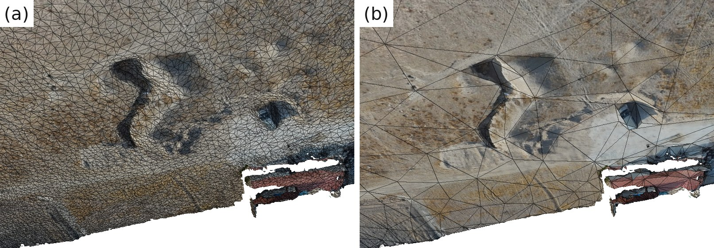
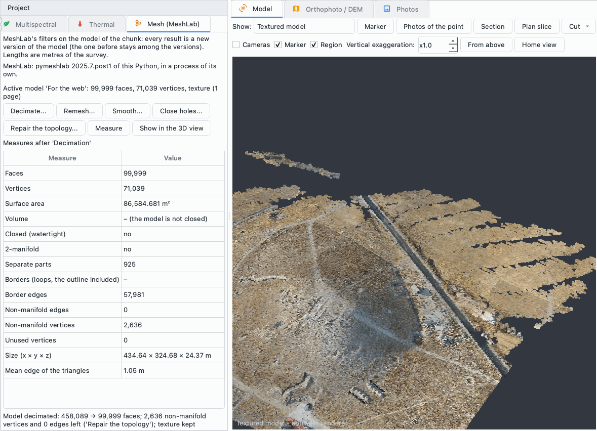
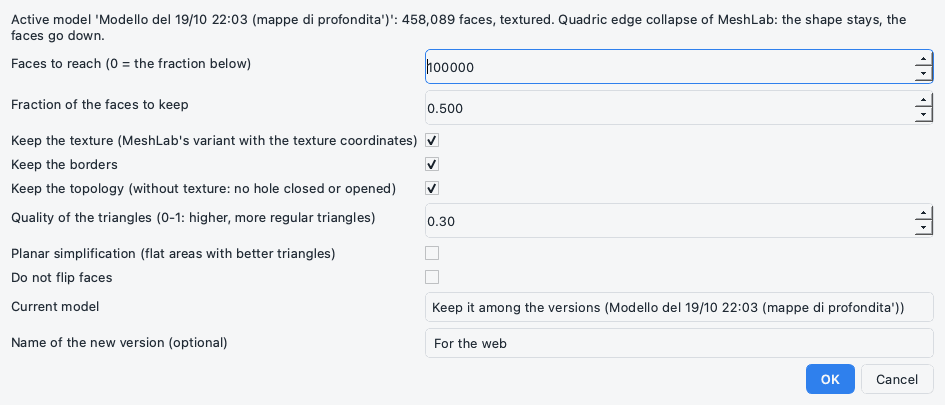
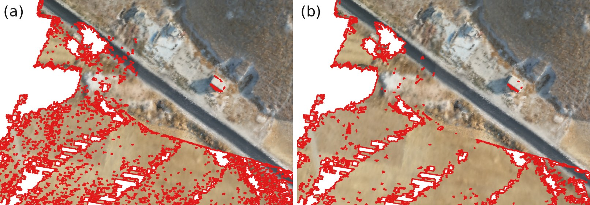

# Mesh (MeshLab)

Il plugin *Mesh (MeshLab)* applica i filtri di [MeshLab](https://www.meshlab.net) al modello 3D del
chunk: riduce il numero dei triangoli conservando la texture, rifà la superficie con triangoli
regolari, la leviga senza restringerla, ne chiude i buchi lasciando aperto il contorno, ne ripara la
topologia e la misura - area, volume di un modello chiuso, parti separate, bordi, difetti. Ogni
risultato è una nuova versione del modello: quella di prima resta tra le versioni del chunk, per
confrontarle o per tornare indietro. MeshLab lavora attraverso
[pymeshlab](https://github.com/cnr-isti-vclab/PyMeshLab), del Visual Computing Lab dell'ISTI-CNR, in
un processo separato: un filtro che fallisce, o che fa chiudere MeshLab di colpo, lascia il modello
com'era.

Questa pagina descrive la versione 0.1.0 del plugin, che richiede pyarchinit-photogrammetry 1.3.3 o
successiva. Il README e il codice sono nel
[repository dei plugin](https://github.com/enzococca/pyarchinit-photogrammetry-plugins/tree/main/plugins/mesh-tools).

<figure markdown="span">
  
  <figcaption>(a) Il modello del tutorial come l'ha costruito il programma: 458.089 facce, con il
  reticolo dei triangoli sopra la texture. (b) Lo stesso modello decimato da MeshLab a 100.000 facce
  con la texture conservata: i triangoli restano dove la superficie si piega - la trincea, le buche, il
  bordo del modello - e diventano grandi sul terreno piano; la texture è la stessa immagine di prima.
  Una trincea di Tell Sultan, resa dalle due versioni del modello.</figcaption>
</figure>

!!! note "Gli esempi di questa pagina"
    Gli esempi vengono dal modello di Tell Sultan - il sito del [tutorial](../tutorials/tell.md): 57
    foto da drone, 458.089 facce, una texture di 4.096 x 3.378 pixel, in un sistema di riferimento
    locale. I tempi sono stati misurati su un computer recente (un Apple M4 Pro). Mostrano che cosa fa
    il plugin e non sono uno studio del sito.

## In breve

1. Costruisci il modello del chunk (*Flusso di lavoro > Costruisci modello...*) e, se ti serve, la sua
   texture (*Flusso di lavoro > Costruisci texture...*); oppure porta dentro un modello fatto altrove
   (*File > Importa > Modello 3D (OBJ, PLY, GLB)...*).
2. Apri la scheda *Mesh (MeshLab)* del dock *Progetto* (*Plugin > Mesh (MeshLab) > Pannello Mesh
   (MeshLab)*). La prima volta che parte un'operazione il plugin propone di installare MeshLab (circa
   300 MB), a meno che pymeshlab non sia già nel Python del programma, e lo prova su un triangolo.
3. *Misura*: chiuso o aperto, quante parti separate, quanti difetti.
4. Scegli un'operazione - *Decima...*, *Rimaglia...*, *Leviga...*, *Chiudi i buchi...*, *Ripara la
   topologia...* - e impostala nella sua finestra. La nuova versione compare nella vista 3D, le sue
   misure nel pannello.
5. Confrontala con la versione di prima nell'*Area di lavoro* (doppio clic), tieni attiva quella che
   vuoi, esportala come al solito da *File > Esporta*.

## Che cosa fa

| Operazione | Che cosa dà | Texture | A che cosa serve |
|---|---|---|---|
| Decima | meno triangoli, fino a un numero o a una parte di quelli che ci sono; la forma resta, i bordi restano dove sono | resta | un modello leggero per il web, un visualizzatore, un PDF 3D o una presentazione; viste ed esportazioni più rapide |
| Rimaglia | una superficie nuova di triangoli regolari di una sola misura (rimaglia isotropa), con gli spigoli vivi conservati | da ricostruire | una mesh pulita per la modellazione, la stampa 3D o le analisi; triangoli uniformi su tutto il modello |
| Leviga | la superficie levigata con Taubin (non restringe) o con la laplaciana HC, i bordi fermi | resta | il rumore della fotogrammetria sulle superfici lisce: intonaco, ceramica, pietra lavorata |
| Chiudi i buchi | i buchi fino a un numero di lati chiusi con facce nuove; il contorno di ogni parte lasciato aperto | da ricostruire, se si chiudono buchi | piccoli vuoti lasciati da ombre, vegetazione o riflessi; a richiesta, il fondo di un oggetto |
| Ripara la topologia | vertici e facce doppi, facce senza area, spigoli e vertici non-manifold, vertici non usati tolti o divisi | resta | prima della rimaglia o della chiusura dei buchi; per i programmi che rifiutano una mesh difettosa (stampa 3D, alcuni visualizzatori) |
| Misura | area della superficie, volume di un modello chiuso, chiuso o no, 2-manifold o no, parti separate, bordi, difetti, dimensioni, lato medio | - | l'area di un muro o di una sezione, il volume di un reperto chiuso, un controllo prima di stampare o esportare |

Quello che il programma fa già resta del programma: la mesh dalla nuvola densa o dalle mappe di
profondità (*Flusso di lavoro > Costruisci modello...*), la pulizia del modello per confidenza, parti
staccate e triangoli stirati (*Flusso di lavoro > Pulizia e confidenza > Pulisci il modello...*), il
taglio con un piano (*Flusso di lavoro > Pulizia e confidenza > Taglia il modello con un piano (parti,
fette)...*), la texture (*Flusso di lavoro > Costruisci texture...*) e i volumi di uno scavo dal DEM
(*Strumenti > Volume scavo / riporto...*). Il plugin aggiunge ciò che MeshLab fa meglio.

## Che cosa serve prima { #before }

* **Il plugin**, installato dal programma: vedi [Guide ai plugin](guides.md#install).
* **MeshLab, attraverso pymeshlab.** Il programma non lo carica mai - pymeshlab porta con sé le sue
  librerie, che si scontrerebbero con quelle della finestra, e alcuni suoi filtri si chiudono di colpo
  su un modello che non accettano - ma lo fa girare come un programma a sé, con:
    * il Python del programma, se pymeshlab è installato lì (`pip install pymeshlab` nell'ambiente
      Python del programma);
    * altrimenti un ambiente del plugin: Python 3.12 e pymeshlab da PyPI, installati con
      [uv](https://github.com/astral-sh/uv) - circa 300 MB e qualche minuto, con internet quella volta.
      È così che funziona l'applicazione desktop, che non ha pip. Il plugin lo propone la prima volta
      che parte un'operazione; *Installa MeshLab...* nel pannello, *Plugin > Mesh (MeshLab) > Installa
      MeshLab (pymeshlab)...* o `ppg plugin mesh-tools install` lo fanno in anticipo. L'ambiente va in
      `plugins/_data/mesh-tools/env/` dentro la cartella dei plugin del programma (vedi
      [Plugin](../plugins.md)); la variabile `PPG_MESH_TOOLS_ENV` lo mette altrove.

    pymeshlab ha versioni per macOS (Apple Silicon e Intel), Linux (x86-64 e ARM) e Windows su x86-64;
    non ce n'è una per Windows su ARM, dove il plugin dice che gli strumenti MeshLab non sono
    disponibili. La riga sotto la descrizione del pannello dice quale MeshLab usa il plugin.

* **Su Linux, qualche libreria di sistema.** pymeshlab ha bisogno di librerie che i suoi pacchetti non
  portano con sé, prima di tutto `libOpenGL.so.0`: senza, si avvia ma non legge nessun modello, e ogni
  operazione fallirebbe. Installale una volta sola - su Debian e Ubuntu
  `sudo apt install libopengl0 libgl1`, su Fedora `sudo dnf install libglvnd-opengl libglvnd-glx`.

* **Un chunk con un modello**: costruito dal programma o importato. Il plugin lavora sul modello che il
  chunk mostra, la sua versione attiva.
* **Un chunk in metri** - un sistema di riferimento, barre di scala, oppure una scansione - per avere
  lunghezze e misure in metri. In un chunk senza scala sono in unità del modello, e il pannello lo dice.

## Il modello { #model }

* **Le cuciture.** Un modello con texture ripete i suoi vertici lungo le cuciture della texture. Prima
  che MeshLab veda il modello, le copie lungo una cucitura vengono contate una volta sola: altrimenti
  MeshLab prenderebbe ogni cucitura per un bordo, la levigatura la aprirebbe e le misure la
  conterebbero come un buco. Le copie che si toccano solo in un punto - un vertice non-manifold diviso
  dalla riparazione, due pezzi che si incontrano in un angolo - restano separate, così l'operazione
  successiva non disfa una riparazione.
* **Ciò che MeshLab non porta.** MeshLab riceve le posizioni, i colori dei vertici e, quando
  l'operazione la conserva, la texture. Le altre proprietà dei vertici - la confidenza, cioè quante
  mappe di profondità confermano il vertice - tornano dal vertice del modello più vicino a ogni vertice
  nuovo; i colori dei vertici nuovi sono quelli di MeshLab, interpolati.
* **La texture.** Resta valida dopo una decimazione (la variante di MeshLab che porta con sé le
  coordinate della texture degli angoli delle facce, anche con più pagine di texture), dopo la
  levigatura e dopo la riparazione. La rimaglia e la chiusura dei buchi fanno facce nuove che non ne
  hanno: il risultato ha i colori dei suoi vertici, e la texture si ricostruisce con *Flusso di lavoro >
  Costruisci texture...*.
* **Niente di cambiato, niente versione.** Quando MeshLab non trova niente da fare - nessun buco così
  piccolo, nessun difetto - il modello resta com'è, non si aggiunge nessuna versione e un messaggio
  dice perché.
* **Versioni e nomi.** La nuova versione prende il nome da ciò che ha fatto MeshLab, per esempio
  *MeshLab: decimazione a 100.000 facce (texture conservata)*, oppure quello che le dai. Come i nomi che
  il programma dà alle proprie versioni, restano in italiano nel progetto qualunque sia la lingua
  dell'interfaccia. Il progetto viene salvato con la nuova versione, come fa il programma dopo le sue
  elaborazioni, e registra ogni operazione con i suoi parametri.

## Passo per passo nel programma { #program }

### Il pannello

Dopo aver installato il plugin e riavviato il programma, la scheda *Mesh (MeshLab)* compare nel dock
*Progetto* a sinistra; se le schede non ci stanno, usa le frecce in fondo alla barra delle schede,
oppure *Plugin > Mesh (MeshLab) > Pannello Mesh (MeshLab)*.

<figure markdown="span">
  
  <figcaption>Il pannello dopo la decimazione del modello del tutorial a 100.000 facce, chiamata
  <em>Per il web</em> nella sua finestra: MeshLab gira con il pymeshlab del Python del programma, le
  misure della nuova versione sono nella tabella, l'ultima riga dice che cosa ha fatto MeshLab e quali
  difetti del modello ha lasciato. A destra la nuova versione con la sua texture nella vista
  3D.</figcaption>
</figure>

Dall'alto:

* una breve descrizione;
* quale MeshLab usa il plugin - *pymeshlab ... di questo Python* oppure *nell'ambiente del plugin* -
  oppure che non è installato, con il pulsante *Installa MeshLab...*, o che cosa gli manca quando la
  prova descritta più sotto lo ha trovato non funzionante;
* il modello attivo: nome, facce, vertici e pagine della texture;
* i pulsanti *Decima...*, *Rimaglia...*, *Leviga...*, *Chiudi i buchi...*, *Ripara la topologia...*,
  *Misura* e *Mostra nella vista 3D*;
* la tabella delle misure, del modello attivo dopo *Misura* oppure della nuova versione dopo
  un'operazione (*Misure dopo «Decimazione»*);
* in fondo, che cosa ha fatto l'ultima operazione.

Il menu *Plugin > Mesh (MeshLab)* ha le stesse operazioni - *Decima il modello...*, *Rimaglia il
modello (isotropa)...*, *Leviga il modello...*, *Chiudi i buchi del modello...*, *Ripara la topologia
del modello...*, *Misura il modello* - con *Pannello Mesh (MeshLab)* e *Installa MeshLab
(pymeshlab)...*. I pulsanti aspettano mentre il programma sta elaborando altro: un passo alla volta. Il
pannello segue il chunk attivo e il suo modello attivo: un altro progetto, un altro chunk, una versione
resa attiva, un annullamento.

Ogni operazione apre la sua finestra, con i parametri descritti più sotto e due campi in fondo:

| Campo | Che cosa fa |
|---|---|
| *Modello attuale* | *Conservalo tra le versioni (...)* (il predefinito) oppure *Sovrascrivilo* |
| *Nome della nuova versione (facoltativo)* | vuoto: il nome dice che cosa ha fatto MeshLab |

La prima operazione di una sessione comincia con una prova, in background (*Prova di MeshLab*):
MeshLab legge un triangolo ed elenca i filtri che il plugin usa. Se funziona l'operazione prosegue, e
la prova non si ripete in quella sessione. Se no, l'operazione si ferma lì e il messaggio, come la
riga del pannello, dice che cosa manca: su Linux le librerie e i pacchetti che le contengono,
altrove di installare di nuovo MeshLab. Una prova fallita si rifà all'operazione successiva: dopo aver
installato ciò che mancava, basta riprovare.

Il lavoro gira in background con la barra di avanzamento - lettura del modello, filtro, misure,
scrittura del risultato. *Annulla* ferma subito MeshLab e il modello resta com'era. Alla fine la nuova
versione è il modello attivo, la vista 3D la mostra, il pannello ne dà le misure e la barra di stato il
riassunto, per esempio *Modello decimato: 458.089 → 99.999 facce; restano 2.636 vertici e 0 spigoli
non-manifold («Ripara la topologia»); texture conservata*. La parte centrale compare quando MeshLab
lascia vertici o spigoli non-manifold: qui sono i difetti del modello come è stato costruito, che la
decimazione non tocca.

### 1. Misura { #measure }

*Misura* chiede a MeshLab le misure del modello attivo e non cambia niente. Anche ogni operazione
misura il suo risultato.

| Misura | Che cos'è |
|---|---|
| *Facce*, *Vertici* | quante sono; i vertici delle cuciture della texture contati una volta |
| *Area della superficie* | in m², la somma delle aree dei triangoli |
| *Volume* | in m³, solo per un modello chiuso; *(normali verso l'interno)* quando le facce guardano dentro |
| *Chiuso (watertight)* | sì quando il modello è 2-manifold e non ha bordi |
| *2-manifold* | sì quando ogni spigolo appartiene al massimo a due facce e le facce intorno a ogni vertice formano un solo ventaglio |
| *Parti separate* | i pezzi non uniti fra loro |
| *Bordi (anelli, il contorno compreso)* | le linee chiuse di spigoli aperti: il contorno di ogni parte e i suoi buchi; *–* quando il modello non è 2-manifold, perché allora MeshLab non li sa contare |
| *Spigoli di bordo* | gli spigoli che appartengono a una sola faccia |
| *Spigoli non-manifold*, *Vertici non-manifold* | i difetti: uno spigolo condiviso da tre o più facce, un vertice dove si toccano due ventagli di facce |
| *Vertici non usati* | vertici che nessuna faccia usa |
| *Dimensioni (x × y × z)* | il riquadro intorno al modello, nelle coordinate del chunk |
| *Lato medio dei triangoli* | la lunghezza media dei lati dei triangoli |

Il modello del tutorial, in meno di due secondi: 458.089 facce, 250.084 vertici, 87.402 m², né chiuso né
2-manifold, 925 parti separate - la superficie principale e tanti pezzetti nei campi intorno al tell -
57.981 spigoli di bordo, 2.636 vertici non-manifold, 434,64 × 324,68 × 24,42 m, lato medio 0,70 m. Un
modello di terreno aperto costruito dalle foto è raramente chiuso: il volume è per i reperti e gli
oggetti fotografati tutto intorno. Per il volume di uno scavo usa *Strumenti > Volume scavo /
riporto...* sul DEM.

### 2. Decima { #decimate }

*Decima...* riduce le facce facendo collassare gli spigoli dove la forma cambia meno (il collasso degli
spigoli con le quadriche di MeshLab): il terreno piano perde i suoi triangoli per primo, spigoli e
pieghe conservano i loro.

<figure markdown="span">
  
  <figcaption>La finestra della decimazione, impostata per 100.000 facce e una nuova versione chiamata
  <em>Per il web</em>.</figcaption>
</figure>

| Campo | Predefinito | Che cosa fa |
|---|---|---|
| *Facce da ottenere (0 = la frazione qui sotto)* | 0 | il numero di facce del risultato |
| *Frazione delle facce da tenere* | 0,5 | usata quando il numero è 0: 0,25 tiene un quarto delle facce |
| *Conserva la texture (variante di MeshLab con le coordinate della texture)* | spuntato (solo modelli con texture) | MeshLab sposta le coordinate della texture insieme ai vertici, così la texture resta valida |
| *Conserva i bordi* | spuntato | MeshLab lascia com'è il bordo aperto della superficie - il contorno di un rilievo, il margine di una sezione |
| *Conserva la topologia (senza texture: nessun buco chiuso o aperto)* | spuntato | per la variante senza texture: la decimazione non chiude né apre buchi |
| *Qualità dei triangoli (0-1: più alto, triangoli più regolari)* | 0,3 | valori più alti evitano i triangoli lunghi e sottili, a prezzo di un po' di forma |
| *Semplificazione planare (zone piane con triangoli migliori)* | non spuntato | triangoli migliori sulle zone piane: pavimenti, pareti, le facce di un blocco |
| *Non capovolgere le facce* | non spuntato | rifiuta i collassi che girerebbero una faccia |

Il modello del tutorial è passato da 458.089 a 99.999 facce in circa 5 s, con la sua texture: MeshLab
può fermarsi una faccia o due prima del numero chiesto. L'area è passata da 87.402 a 86.585 m² (-0,9 %,
i piccoli dossi spianati), gli spigoli di bordo sono rimasti gli stessi e il lato medio è cresciuto da
0,70 a 1,05 m. Un modello per misurare resta quello intero: conserva la versione di prima e decima la
copia da dare via.

### 3. Rimaglia { #remesh }

*Rimaglia...* rifà la superficie con triangoli di una sola misura (la rimaglia isotropa esplicita di
MeshLab): divide gli spigoli lunghi, fa collassare quelli corti e sposta i vertici sulla superficie,
più volte.

| Campo | Predefinito | Che cosa fa |
|---|---|---|
| *Lato dei triangoli (m)* | il lato medio del modello | la lunghezza dei lati dei nuovi triangoli |
| *Iterazioni* | 10 | quanti giri di divisione, collasso e spostamento |
| *Adattiva (triangoli più piccoli dove la superficie curva)* | non spuntato | spuntato: il lato si accorcia dove la superficie si piega |
| *Spigoli vivi da conservare: angolo (gradi)* | 30 | gli spigoli fra facce più inclinate di così restano dove sono |
| *Distanza massima dalla superficie di partenza (m, 0 = nessun controllo)* | 0 | sopra 0, un vertice non si allontana più di così dal modello di prima |
| *Ripara prima la topologia (su un modello non-manifold MeshLab si chiude)* | spuntato | la riparazione della sezione 6 prima della rimaglia, e di nuovo dopo: la rimaglia riunisce i vertici che la riparazione aveva diviso |

La texture va ricostruita dopo. Sul modello del tutorial il lato proposto, 0,70 m, ha dato 526.706
facce in 24 s, con un lato medio di 0,63 m - un po' più corto di quello chiesto - e 12 vertici
non-manifold rimasti, come dopo la sola riparazione. La rimaglia sposta ogni vertice: è il passo giusto
prima di modellare o di stampare, non prima di misurare.

### 4. Leviga { #smooth }

| Campo | Predefinito | Che cosa fa |
|---|---|---|
| *Metodo* | *Taubin (non restringe; 10 passi)* | Taubin alterna un passo che leviga e uno che gonfia di nuovo, così il modello non si restringe; *HC laplaciana (1 passo)* sposta ogni vertice verso i vicini e poi in parte verso dov'era: un passo restringe pochissimo il modello, molti passi di più |
| *Passi (0 = quelli del metodo)* | 0 | 0: 10 passi per Taubin, 1 per HC; più passi, superficie più liscia |
| *Taubin: lambda* | 0,5 | la forza del passo che leviga |
| *Taubin: mu* | -0,53 | la forza del passo che gonfia (negativa, un po' più grande di lambda) |
| *I bordi restano fermi* | spuntato | i vertici dei bordi aperti non si muovono: il contorno del rilievo resta al suo posto |

Le facce restano le stesse e la texture resta. Dieci passi di Taubin hanno preso 2,2 s sul modello del
tutorial. La levigatura toglie il rumore della fotogrammetria dalle superfici che nella realtà sono
lisce - intonaco, ceramica, un blocco lavorato; su terreno scabro, pietrame o superfici scolpite toglie
anche i dettagli.

### 5. Chiudi i buchi { #holes }

*Chiudi i buchi...* riempie i buchi fino a una certa misura con facce nuove.

| Campo | Predefinito | Che cosa fa |
|---|---|---|
| *Buchi fino a (lati del bordo)* | 30 | la misura del buco più grande che si chiude, come numero di lati che ha intorno |
| *Evita facce che si intersecano* | spuntato | le facce nuove non devono attraversare il modello: un buco che non si riesce a riempire così resta aperto |
| *Raffina le facce nuove a un lato di (m, 0 = no)* | 0 | sopra 0, le facce del riempimento vengono divise fino a questo lato |
| *Lascia aperto il contorno esterno di ogni parte (il suo bordo più lungo)* | spuntato | il contorno è il bordo più lungo di ogni parte separata |
| *Ripara prima la topologia (MeshLab chiude i buchi solo su modelli 2-manifold)* | spuntato | la riparazione della sezione 6 prima di chiudere |

Una superficie di scavo, una sezione, il rilievo di un campo sono superfici aperte: il loro contorno è
un bordo come quello di un buco, e MeshLab da solo coprirebbe tutta la superficie con un tappo. Per
questo il plugin dà a MeshLab solo i buchi - tutti gli anelli di bordo tranne il più lungo di ogni
parte separata - e il contorno resta aperto. Togli la spunta da *Lascia aperto il contorno...* per
chiudere il fondo di un oggetto fotografato dall'alto, con un numero di lati più grande del suo
contorno.

<figure markdown="span">
  
  <figcaption>I campi a sud-ovest del tell, visti dall'alto con gli spigoli di bordo in rosso. (a) Il
  modello dopo <em>Ripara la topologia</em>: i buchetti lasciati dove le foto vedevano troppo poco il
  terreno. (b) Dopo <em>Chiudi i buchi</em> con i valori predefiniti: i buchi fino a 30 lati sono
  chiusi, i più grandi e il contorno di ogni parte restano aperti. I colori sono quelli dei vertici: la
  texture va ricostruita.</figcaption>
</figure>

Sul modello del tutorial, dopo la riparazione, si sono chiusi 3.302 buchi con 13.071 facce nuove in
meno di 4 s; gli spigoli di bordo sono passati da 57.984 a 39.141. Quando non c'è nessun buco così piccolo,
il messaggio *Nessun buco fino a 30 lati da chiudere: il modello non è cambiato.* lo dice e non si
aggiunge nessuna versione.

### 6. Ripara la topologia { #repair }

Ogni passo si può lasciar fuori togliendo la spunta; girano in quest'ordine.

| Campo | Che cosa fa |
|---|---|
| *Vertici doppi* | i vertici nella stessa posizione uniti |
| *Facce doppie* | le facce ripetute sugli stessi tre vertici tolte |
| *Facce senza area* | le facce senza area (con i vertici su una linea) tolte |
| *Spigoli non-manifold* | gli spigoli condivisi da tre o più facce resi regolari, come scelto nel campo seguente |
| *Spigoli non-manifold: come* | *togli le facce di troppo* (il predefinito) oppure *dividi i vertici* |
| *Vertici non-manifold (divisi)* | un vertice dove si toccano due ventagli di facce diviso in due |
| *Vertici non usati* | i vertici che nessuna faccia usa tolti |

La texture resta. Il messaggio elenca che cosa ha cambiato ogni passo e che cosa resta; sul modello
del tutorial, in 2,4 s: *Topologia riparata: facce doppie tolte 1, vertici non-manifold divisi 2.636;
restano 12 vertici e 0 spigoli non-manifold («Ripara la topologia»); texture conservata*. I vertici
divisi restano divisi nelle operazioni successive. Finché qualche difetto resta il modello non è
2-manifold, e MeshLab non ne sa contare i bordi.

### 7. Versioni { #versions }

Ogni operazione lascia il modello di prima tra le versioni del chunk, a meno che tu non abbia scelto
*Sovrascrivilo*. Nell'*Area di lavoro*, sotto *Modello 3D*: un doppio clic su una versione conservata
la mostra nella vista 3D senza renderla attiva; tasto destro, *Rendi attiva (la usano gli altri
strumenti)* la rimette in uso. Ogni versione è un modello intero, con la sua texture se ne ha una:
diverse versioni di un modello grande occupano spazio sul disco (*Elimina* nello stesso menu).

## Dalla riga di comando { #cli }

Le stesse operazioni con `ppg plugin mesh-tools COSA PROGETTO ...`. Il progetto viene subito dopo
l'operazione; `--chunk ETICHETTA` lavora su un chunk diverso da quello attivo. Quando il modello
cambia, il progetto viene salvato.

```bash
ppg plugin mesh-tools status
ppg plugin mesh-tools install
ppg plugin mesh-tools measure scavo.ppg
ppg plugin mesh-tools decimate scavo.ppg --faces 100000 --name "Per il web"
ppg plugin mesh-tools decimate scavo.ppg --fraction 0.25 --planar
ppg plugin mesh-tools remesh scavo.ppg --edge 0.01 --max-distance 0.002
ppg plugin mesh-tools smooth scavo.ppg --method hc --steps 2
ppg plugin mesh-tools close-holes scavo.ppg --max-edges 100
ppg plugin mesh-tools close-holes vaso.ppg --max-edges 5000 --close-outline
ppg plugin mesh-tools repair scavo.ppg --split
ppg plugin mesh-tools measure scavo.ppg --json
```

| Comando | Opzioni |
|---|---|
| `status` | stampa quale MeshLab usa il plugin e lo prova su un triangolo; codice di uscita 1 quando non ce n'è o non funziona, e allora dice che cosa manca |
| `install` | installa l'ambiente del plugin e lo prova; `--force` anche quando il Python del programma ha pymeshlab, o per installarlo di nuovo. Quando al computer manca una libreria l'ambiente resta installato e il messaggio dice che cosa aggiungere |
| `measure PROGETTO` | stampa le misure; `--json` tutte, in JSON, con gli angoli del riquadro |
| `decimate PROGETTO` | `--faces` facce da ottenere (0: la frazione `--fraction`, 0.5); `--no-texture` la variante senza texture; `--quality` (0.3); `--free-borders`; `--free-topology`; `--planar`; `--keep-normals` (nessuna faccia capovolta) |
| `remesh PROGETTO` | `--edge` m (0: il lato medio del modello); `--iterations` (10); `--adaptive`; `--feature-angle` gradi (30); `--max-distance` m (0); `--no-repair` |
| `smooth PROGETTO` | `--method taubin` o `hc`; `--steps` (0: Taubin 10, HC 1); `--lambda` (0.5); `--mu` (-0.53); `--move-borders` |
| `close-holes PROGETTO` | `--max-edges` (30); `--refine` m (0); `--allow-self-intersections`; `--close-outline`; `--no-repair` |
| `repair PROGETTO` | `--split` (spigoli non-manifold dividendo i vertici); `--skip PASSO`, ripetibile: `duplicate_vertices`, `duplicate_faces`, `null_faces`, `non_manifold_edges`, `non_manifold_vertices`, `unreferenced_vertices` |

Ogni operazione accetta anche `--name` (il nome della nuova versione), `--overwrite` (nessuna versione
conservata del modello di prima) e `--json` (tutto il resoconto, con le misure). Senza `--json` stampa
l'avanzamento, che cosa ha fatto MeshLab, il nome della nuova versione e le misure. Ogni comando che usa
MeshLab prima lo prova, come fa la finestra, e si ferma con lo stesso messaggio quando non funziona.

## Limiti { #limits }

* **La geometria cambia.** Decimazione, rimaglia e levigatura spostano o tolgono vertici: misure,
  sezioni e volumi si fanno sul modello come è stato costruito, quello modificato serve per mostrare e
  dare via.
* **La texture dopo la rimaglia e la chiusura dei buchi** non c'è più: ricostruiscila sul nuovo
  modello.
* **Modelli difettosi.** Di un modello che non è 2-manifold non si possono contare i bordi, e alcuni
  filtri di MeshLab si chiudono di colpo: il plugin ripara prima, e se MeshLab si chiude
  inaspettatamente il modello resta com'era e il messaggio suggerisce *Ripara la topologia*. La rimaglia
  di MeshLab riunisce i vertici che una riparazione aveva diviso: con *Ripara prima la topologia* il
  plugin ripara ancora una volta dopo. Ogni riassunto dice i vertici e gli spigoli non-manifold che
  restano.
* **Memoria.** Il programma e MeshLab tengono entrambi tutto il modello: un modello di decine di milioni
  di facce chiede diversi gigabyte. Decima una copia prima di rimagliarla.
* **Il volume** solo per i modelli chiusi.
* **Linux** ha bisogno delle librerie di sistema di [Che cosa serve prima](#before); **Windows su
  ARM** non ha pymeshlab.

## File scritti { #files }

* Il nuovo modello sostituisce `model.ply` nella cartella del chunk, `<progetto>.ppg.files/chunk_<n>/`,
  con le sue pagine di texture (`model_texture.jpg`...) quando la texture è stata conservata.
* La versione di prima va in `versions/model/<id>/` nella stessa cartella.
* Mentre MeshLab lavora, una cartella `.mesh-tools-...` accanto al modello tiene il file che legge e
  quello che scrive; viene cancellata alla fine (una lasciata da un'elaborazione interrotta viene
  cancellata dopo sei ore).
* Il progetto conserva l'elenco delle operazioni con i parametri, le facce prima e dopo e la versione
  di pymeshlab.
* L'ambiente di MeshLab, quando lo installa il plugin: `plugins/_data/mesh-tools/env/` nella cartella
  dei plugin del programma, circa 300 MB.

## Licenze { #licences }

MeshLab e pymeshlab sono del Visual Computing Lab dell'ISTI-CNR e sono distribuiti con la licenza GNU
GPL versione 3. Poiché il plugin lavora con pymeshlab, il plugin stesso è distribuito con la licenza
GPL-3.0-or-later; il programma e gli altri plugin sono GPL-2.0-or-later, e il "or later" permette loro
di lavorare insieme. Il programma non carica mai pymeshlab: lo fa girare come un programma a sé e ci
scambia dei file.
