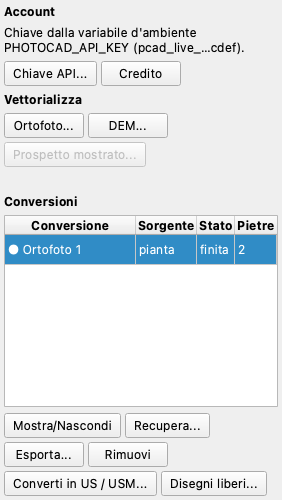

# PhotoCAD

Il plugin *PhotoCAD* invia l'**ortofoto**, il **DEM** (come ombreggiatura) o l'**ortofoto di un prospetto** a
[PhotoCAD](https://photocad.ai), che la vettorializza, e riporta il disegno **al suo posto**: nelle coordinate del
chunk sulla pianta, nei metri (u, v) del prospetto (e, se lo chiedi, in 3D sulla sua superficie). Il disegno diventa un
layer della vista 2D, un DXF georeferenziato, un GeoPackage e un SVG; i suoi contorni chiusi possono diventare US o USM.

!!! warning "Un servizio esterno a pagamento"
    L'immagine **esce dal computer** e va a photocad.ai. Ogni conversione usa **un credito** (l'account parte con
    qualche conversione gratuita). Prima di ogni invio il plugin ti dice i crediti e le conversioni gratuite rimasti e
    la dimensione dell'immagine, e aspetta il tuo sì. Non inviare ciò che non può essere condiviso.

Questa pagina descrive la versione 0.1.1 del plugin, che **richiede pyarchinit-photogrammetry 1.7.1**. Il README e il
codice sono nel [repository dei
plugin](https://github.com/enzococca/pyarchinit-photogrammetry-plugins/tree/main/plugins/photocad).

## Installazione e chiave API

```bash
ppg plugins install photocad
```

Serve una chiave API del tuo account PhotoCAD. Il plugin la cerca prima nella variabile d'ambiente
`PHOTOCAD_API_KEY`, poi nel **portachiavi di sistema** (servizio `pyarchinit-photogrammetry`, utente `photocad`). Per
tenerla nel portachiavi premi **Chiave API...** nel pannello, oppure digitala senza eco:

```bash
ppg plugin photocad key set       # status | forget
```

La chiave non viene scritta altrove: né nelle impostazioni, né nel progetto, né nei log o in un messaggio d'errore (si
vede mascherata, come `pcad_live_…abcd`). Senza portachiavi sul computer funziona solo la variabile d'ambiente.

## Il pannello

*Plugin > PhotoCAD...* apre il pannello **PhotoCAD**, agganciato a destra accanto a PyArchInit come quelli degli altri
plugin. Restano anche le voci di menu del plugin.

<figure markdown="span">
  
  <figcaption>Il pannello: l'account, i tre pulsanti <em>Vettorializza</em> e le conversioni del chunk. Il pulsante del
  prospetto è spento perché nella vista 2D non è mostrato nessun prospetto.</figcaption>
</figure>

1. **Account.** La riga dice dove si trova la chiave (ambiente o portachiavi; non usa la rete). **Chiave API...** apre
   la finestra della chiave; **Credito** chiede a PhotoCAD i crediti e le conversioni gratuite rimasti, solo al clic.
2. **Vettorializza.** **Ortofoto...** e **DEM...** richiedono che il chunk abbia quel raster; **Prospetto mostrato...**
   richiede un prospetto o una sezione mostrati nella vista 2D (dall'area di lavoro). Una finestra chiede l'area:
    - **tutto il raster**;
    - **la parte visibile nella vista**;
    - **un'area da disegnare**: trascina un riquadro, oppure clic sui vertici e doppio clic o Invio; Esc annulla;

   e le opzioni *Disegno dettagliato*, *Togli lo sfondo* e, per un prospetto, *Anche in 3D sulla superficie del
   prospetto*. Il DEM va come ombreggiatura (luce da nord-ovest).
3. **Conferma.** Prima dell'invio una finestra dice quante conversioni servono (le **tessere**, vedi sotto), i crediti
   rimasti e la dimensione dell'immagine. *Invia e non chiedere più per questo progetto* spegne la domanda per il
   progetto. Se rifiuti, non parte nulla.
4. **Conversioni.** La tabella elenca le conversioni del chunk: nome, sorgente (pianta o prospetto), stato e numero di
   pietre. Le righe del riquadro mostrato (la pianta, o il prospetto mostrato) vengono prima, segnate da un punto.
   Scegli una riga per usare i pulsanti sotto la tabella:
    - **Mostra/Nascondi**: i layer di quella conversione nella vista 2D;
    - **Recupera...**: la scarica di nuovo (vedi sotto);
    - **Esporta...**: DXF, GeoPackage o SVG;
    - **Rimuovi**: la conversione esce dal progetto, con i suoi file; le unità già fatte restano;
    - **Converti in US / USM...**: vedi sotto;
    - **Disegni liberi...**: solo con un programma che ha i disegni liberi (1.7.2).

### Immagini lunghe: le tessere

L'immagine si taglia in **tessere alla risoluzione nativa del raster**: al massimo 2400 px sul lato lungo, circa il 10 %
di sovrapposizione, **una conversione (un credito) ciascuna**. La conferma dice il numero *prima* di inviare qualsiasi
cosa, e rifiuta se l'account ha meno crediti e conversioni gratuite delle tessere. Una striscia più sottile di 600 px
si ingrandisce fino a 4 volte; più sottile di così non si invia (PhotoCAD fallisce sulle strisce sottili). Un'ortofoto
grande richiede quindi molte conversioni: invia la parte visibile o un'area disegnata, oppure alza `--max-tiles`
(predefinito 6) solo dalla riga di comando e solo quando lo vuoi davvero.

### Posizionamento per registrazione

Il disegno di PhotoCAD non arriva nel riquadro dell'immagine: arriva in millimetri, su una pagina che è il riquadro del
soggetto che ha trovato. Il plugin lo colloca **per registrazione**: la pagina sul contenuto dell'immagine, poi
spostamento e scala affinati portando le linee del disegno sui bordi dell'immagine. Il residuo (la distanza mediana
delle linee dai bordi dell'immagine, in pixel) resta in `conversion.json`.

Quando la corrispondenza non ha un picco chiaro il disegno viene **rifiutato e non si colloca nulla**; i file restano
nella cartella della conversione e puoi collocarlo di nuovo con **Recupera...** (gratis). Il metodo si regge sul fatto
che l'immagine abbia bordi dove il disegno ha linee (pietre, muri, tagli); un'immagine piatta e senza tratti può essere
rifiutata. Le tessere si uniscono tenendo da ciascuna ciò che è più vicino al proprio centro.

## I layer

Ogni conversione è un layer **"PhotoCAD: <nome>"** della vista 2D, con poligoni e linee, selezionabile e nell'elenco del
pannello Layer, sulla pianta o sul prospetto su cui è stata fatta, ridisegnato ogni volta che il raster si ricarica.

PhotoCAD disegna le pietre come linee aperte. Il plugin le **poligonizza**: gli estremi entro 2 px si uniscono, le
linee si nodano e diventano facce; le facce sotto i 50 px, quelle sottili che sono i giunti fra le pietre e quelle
quasi tutte su bianco (senza dati) restano fuori. Le pietre vanno in un secondo layer, **"PhotoCAD: <nome> (pietre)"**,
con la loro area in m². Per rifarlo con altri valori:
`ppg plugin photocad polygonize PROGETTO ID --snap-px 3 --min-area-px 80`.

## Converti in US / USM

**Converti in US / USM...** trasforma in unità stratigrafiche i poligoni che hai selezionato sulla vista, oppure un
intero layer PhotoCAD (per impostazione le pietre). Scegli il tipo (US, USM, ...) e un primo numero facoltativo (0:
senza numero). I contorni chiusi diventano unità del chunk attivo, sulla pianta o, su un prospetto, nei disegni del
prospetto mostrato; le linee aperte si saltano e si contano. Una sola voce di *Modifica > Annulla* le toglie tutte.

## Disegni liberi

Con il programma 1.7.2 o successivo, **Disegni liberi...** importa una conversione come disegni liberi 3D nel layer
*PhotoCAD*: sulla pianta alla quota del DEM (0 senza DEM), su un prospetto sulla sua superficie.

## Recuperare una conversione già pagata

**Recupera...** scarica e colloca di nuovo una conversione già pagata, senza un nuovo invio: una finita mentre la rete
cadeva, uno scaricamento interrotto, un disegno rifiutato dalla registrazione, o una annullata dopo che PhotoCAD aveva
finito. Ogni invio porta una chiave di idempotenza salvata prima di partire, quindi chiedere di nuovo **non addebita
mai due volte**. Le tessere mai inviate partono ora, dopo la domanda, una conversione ciascuna. Una tessera di cui
l'esito è sconosciuto non viene più inviata dal plugin: controllala su photocad.ai.

## Esportare e rimuovere

**Esporta...** scrive una copia del disegno come DXF (georeferenziato, con i layer di PhotoCAD), GeoPackage (tabella
`photocad`, nel CRS del chunk, o senza CRS per un prospetto; con Z per un prospetto in 3D) o SVG. I file di ogni
conversione sono in `<dati del chunk>/photocad/<id>/`.

## Riga di comando

```bash
ppg plugin photocad key set|forget|status
ppg plugin photocad credit
ppg plugin photocad list scavo.ppg                  # anche i prospetti: elevation:<id>
ppg plugin photocad convert scavo.ppg --source ortho --out pianta.dxf
ppg plugin photocad convert scavo.ppg --source elevation:<id> --3d --out prospetto.gpkg
ppg plugin photocad convert scavo.ppg --source dem --bbox xmin,ymin,xmax,ymax --simplified --yes
ppg plugin photocad fetch scavo.ppg --id <id> [--out disegno.dxf] [--search-px N] [--yes]
ppg plugin photocad polygonize scavo.ppg <id> [--snap-px 2] [--min-area-px 50]
ppg plugin photocad units scavo.ppg <id> --tipo USM --start 101 [--from lines|polygons]
ppg plugin photocad export scavo.ppg <id> disegno.svg
ppg plugin photocad remove scavo.ppg <id>
```

`convert` chiede conferma al prompt se non passi `--yes`. Altre opzioni: `--chunk NOME`, `--remove-background`, `--pdf`,
`--name`, `--max-tiles N`, `--out FILE` (`.dxf`, `.gpkg`, `.svg` o `.pdf`).

## Limiti

- Al massimo 2400 px sul lato lungo di ogni immagine inviata; le immagini più lunghe diventano tessere, un credito
  ciascuna.
- Serve internet e un account con crediti; circa 20 conversioni al minuto. Una conversione fallita viene rimborsata da
  PhotoCAD e l'errore è detto a parole.
- L'immagine va a un servizio esterno: non inviare ciò che non può essere condiviso.
- Il posizionamento si regge sul fatto che l'immagine abbia bordi dove il disegno ha linee.
