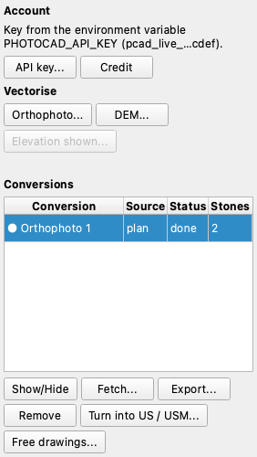

# PhotoCAD

The *PhotoCAD* plugin sends the **orthophoto**, the **DEM** (as a hillshade) or the **orthophoto of an elevation** to
[PhotoCAD](https://photocad.ai), which vectorises it, and brings the drawing back **in place**: in the coordinates of
the chunk on the plan, in the (u, v) metres of the elevation (and, if you ask, in 3D on its surface). The drawing
becomes a layer of the 2D view, a georeferenced DXF, a GeoPackage and an SVG; its closed outlines can become US or USM.

!!! warning "An external paid service"
    The image **leaves the computer** and goes to photocad.ai. Every conversion uses **one credit** (the account
    starts with a few free conversions). Before each upload the plugin tells you the credits and free conversions left
    and the size of the image, and waits for your yes. Do not send what may not be shared.

This page describes version 0.1.1 of the plugin, which **requires pyarchinit-photogrammetry 1.7.1**. The README and
the code are in the [plugin
repository](https://github.com/enzococca/pyarchinit-photogrammetry-plugins/tree/main/plugins/photocad).

## Install and the API key

```bash
ppg plugins install photocad
```

You need an API key from your PhotoCAD account. The plugin looks for it in the environment variable
`PHOTOCAD_API_KEY` first, then in the **system keychain** (service `pyarchinit-photogrammetry`, user `photocad`). To
keep it in the keychain, press **API key...** in the pane, or type it without echo:

```bash
ppg plugin photocad key set       # status | forget
```

The key is never written anywhere else: not in the settings, the project, the logs or an error message (it is shown
masked, like `pcad_live_…abcd`). Without a keychain on the computer only the environment variable works.

## The pane

*Plugin > PhotoCAD...* opens the **PhotoCAD** pane, docked on the right next to PyArchInit like the other plugins'
panes. The menu entries of the plugin stay too.

<figure markdown="span">
  
  <figcaption>The pane: the account, the three <em>Vectorise</em> buttons and the conversions of the chunk. The
  elevation button is off because no elevation is shown in the 2D view.</figcaption>
</figure>

1. **Account.** The line says where the key is (environment or keychain; it does not go to the network).
   **API key...** opens the key window; **Credit** asks PhotoCAD for the credits and free conversions left, and only
   on click.
2. **Vectorise.** **Orthophoto...** and **DEM...** need the chunk to have that raster; **Elevation shown...** needs an
   elevation or section shown in the 2D view (from the workspace). A window asks the area:
    - **the whole raster**;
    - **the part visible in the view**;
    - **an area to draw**: drag a box, or click the vertices and double click or Enter; Esc cancels;

   and the options *Detailed drawing*, *Remove the background* and, for an elevation, *Also in 3D on the surface of the
   elevation*. The DEM goes as a hillshade (light from the north-west).
3. **Confirmation.** Before sending, a window says how many conversions it takes (the **tiles**, see below), the
   credits left and the size of the image. *Send and do not ask again for this project* turns the question off for the
   project. Declined, nothing is sent.
4. **Conversions.** The table lists the conversions of the chunk: name, source (plan or elevation), status and number
   of stones. The rows of the frame shown (the plan, or the elevation shown) come first, marked with a dot. Select a
   row to use the buttons under the table:
    - **Show/Hide**: the layers of that conversion in the 2D view;
    - **Fetch...**: download it again (see below);
    - **Export...**: DXF, GeoPackage or SVG;
    - **Remove**: the conversion out of the project, with its files; the units already made from it stay;
    - **Turn into US / USM...**: see below;
    - **Free drawings...**: only with a program that has free drawings (1.7.2).

### Long images: tiles

The image is cut into **tiles at the raster's native resolution**: at most 2400 px on the long side, about 10 %
overlap, **one conversion (one credit) each**. The confirmation says the count *before* anything is sent, and refuses
when the account has fewer credits and free conversions than the tiles. A strip thinner than 600 px is enlarged up to
4 times; thinner than that it is not sent (PhotoCAD fails on thin strips). A large orthophoto therefore takes many
conversions: send the visible part or a drawn area, or raise `--max-tiles` (default 6) on the command line only when
you mean it.

### Placement by registration

PhotoCAD's drawing does not come in the image's frame: it comes in millimetres, on a page that is the box of the
subject it found. The plugin places it **by registration**: the page onto the content of the image, then offset and
scale refined by bringing the drawing's lines onto the edges of the image. The residual (the median distance of the
lines from the image's edges, in pixels) is kept in `conversion.json`.

When the match is not a clear peak, the drawing is **refused and nothing is placed**; the files stay in the
conversion's folder, and you can place it again with **Fetch...** (free). This relies on the image having edges where
the drawing has lines (stones, walls, cuts); a flat, featureless image may be refused. The tiles are merged, keeping
from each what is nearer its own centre.

## The layers

Every conversion is a layer **"PhotoCAD: <name>"** of the 2D view, with polygons and lines, selectable and listed in
the Layer pane, on the plan or on the elevation it was made on, and drawn again whenever the raster is loaded again.

PhotoCAD draws stones as open lines. The plugin **polygonises them**: line ends within 2 px are joined, the lines
noded and turned into faces; faces under 50 px, the thin faces that are the joints between stones, and faces mostly on
white (no data) are left out. The stones go to a second layer, **"PhotoCAD: <name> (pietre)"**, with their area in m².
To redo it with other values: `ppg plugin photocad polygonize PROJECT ID --snap-px 3 --min-area-px 80`.

## Turn into US / USM

**Turn into US / USM...** makes stratigraphic units of the polygons you selected on the view, or of a whole PhotoCAD
layer (by default the stones). Choose the kind (US, USM, ...) and an optional first number (0: no number). Closed
outlines become units of the active chunk, on the plan or, on an elevation, in the drawings of the elevation shown;
open lines are skipped and counted. One entry of *Edit > Undo* takes them all away.

## Free drawings

With program 1.7.2 or later, **Free drawings...** imports a conversion as 3D free drawings in the layer *PhotoCAD*:
on the plan at the height of the DEM (0 without one), on an elevation on its surface.

## Fetch a conversion already paid

**Fetch...** downloads and places again a conversion already paid for, without a new upload: one that finished while
the network failed, a download that broke, a drawing refused by the registration, or one cancelled after PhotoCAD had
finished. Each upload carries an idempotency key saved before it is sent, so asking again **never charges twice**.
Tiles that were never sent are sent now, after asking, one conversion each. A tile whose outcome is unknown is not sent
again by the plugin: check it on photocad.ai.

## Export and remove

**Export...** writes a copy of the drawing as DXF (georeferenced, PhotoCAD's layers kept), GeoPackage (table `photocad`,
in the CRS of the chunk, or without CRS for an elevation; with Z for an elevation in 3D) or SVG. The files of every
conversion are in `<chunk data>/photocad/<id>/`.

## Command line

```bash
ppg plugin photocad key set|forget|status
ppg plugin photocad credit
ppg plugin photocad list scavo.ppg                  # also the elevations: elevation:<id>
ppg plugin photocad convert scavo.ppg --source ortho --out pianta.dxf
ppg plugin photocad convert scavo.ppg --source elevation:<id> --3d --out prospetto.gpkg
ppg plugin photocad convert scavo.ppg --source dem --bbox xmin,ymin,xmax,ymax --simplified --yes
ppg plugin photocad fetch scavo.ppg --id <id> [--out disegno.dxf] [--search-px N] [--accept] [--yes]
ppg plugin photocad polygonize scavo.ppg <id> [--snap-px 2] [--min-area-px 50]
ppg plugin photocad units scavo.ppg <id> --tipo USM --start 101 [--from lines|polygons]
ppg plugin photocad export scavo.ppg <id> disegno.svg
ppg plugin photocad remove scavo.ppg <id>
```

A drawing refused only because its lines lie more than 2 px from the image's edges (a soft image: under water, mist), while the search found a clear match, leaves `overlay.jpg` in its tile folder: look at it, and if the red lines sit on the outlines place it with `fetch --accept` (in the window: *Accetta dopo il controllo*), at no charge (plugin 0.1.2).

`convert` asks for confirmation at the prompt unless you pass `--yes`. Other options: `--chunk NAME`,
`--remove-background`, `--pdf`, `--name`, `--max-tiles N`, `--out FILE` (`.dxf`, `.gpkg`, `.svg` or `.pdf`).

## Limits

- At most 2400 px on the long side of each image sent; longer images become tiles, one credit each.
- It needs the internet and an account with credits; about 20 conversions a minute. A failed conversion is refunded by
  PhotoCAD, and the error is said in plain words.
- The image goes to an external service: do not send what may not be shared.
- The placement rests on the image having edges where the drawing has lines.
