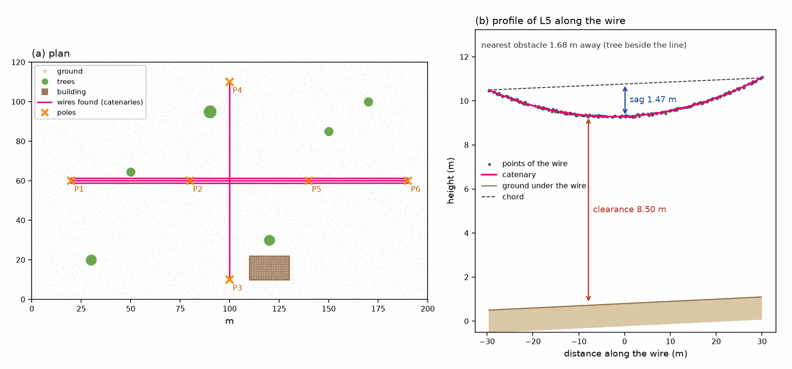

# Linee elettriche

Il plugin *Linee elettriche* trova le linee aeree - elettriche, telefoniche - nella nuvola densa di un
rilievo. Ogni conduttore diventa una curva sospesa, una catenaria, con la sua lunghezza, la sua freccia,
il suo franco minimo dal suolo e la sua distanza dall'ostacolo più vicino - un albero, un tetto; i pali
in cui i conduttori terminano vengono posizionati e misurati; i punti dei cavi e dei pali prendono classi
proprie nella nuvola. Le linee vanno sull'ortofoto e sul DEM del programma ed escono in GeoPackage 3D,
DXF e CSV.

In un rilievo archeologico una linea è parte del contesto da documentare, un ostacolo per i mezzi, le
gru e i droni dello scavo, e un oggetto sottile che rovina una mesh o un DEM: una volta classificati i
suoi punti, DEM e modello si possono costruire senza di essi, togliendo le loro classi
([DEM e modello senza i cavi](#dem)).

Questa pagina descrive la versione 0.1.1 del plugin, che richiede pyarchinit-photogrammetry 1.1.0 o
successiva. Il README e il codice sono nel
[repository dei plugin](https://github.com/enzococca/pyarchinit-photogrammetry-plugins/tree/main/plugins/powerlines).

<figure markdown="span">
  
  <figcaption>(a) Una linea di tre conduttori paralleli su tre campate e una linea più bassa che la
  incrocia, fra alberi e un edificio: i dieci conduttori trovati e i sei pali. (b) Il profilo di un
  conduttore della prima campata: i punti del cavo, la catenaria adattata, la sua freccia sotto la corda
  e il suo franco dal suolo. Dati sintetici: il rilievo con cui il plugin viene provato, in metri
  locali.</figcaption>
</figure>

## In breve

1. Vola vicino alle linee e costruisci la nuvola densa in qualità alta: i cavi devono stare nella nuvola.
2. Meglio ancora, classifica il terreno della nuvola (per esempio con il plugin [terrio](terrio.md)).
3. *Plugin > Linee elettriche > Rileva linee elettriche...*
4. Leggi il riepilogo; conduttori e pali stanno sull'ortofoto e sul DEM; *Elenco delle linee
   elettriche...* dà ogni conduttore.
5. *File > Esporta*: GeoPackage, DXF o CSV.

## Che cosa fa

| Risultato | Che cos'è | A che cosa serve |
|---|---|---|
| Conduttori | ogni cavo come catenaria: lunghezza, freccia, franco minimo dal suolo, distanza dall'ostacolo più vicino, direzione, quote, un vertice ogni metro | documentare una linea, le distanze di sicurezza dei lavori sotto di essa, la vegetazione troppo vicina |
| Linee | i conduttori affiancati sulla stessa campata, raggruppati | distinguere le linee |
| Pali | dove i conduttori terminano insieme: posizione, quota del suolo, altezza, conduttori | i sostegni della linea in pianta |
| Classi | i punti dei cavi nella classe 14, dei pali nella classe 15 | i cavi mostrati a parte nella vista 3D; un DEM o un modello costruiti senza quelle classi (da togliere: non escono da sole) |
| Esportazioni | GeoPackage con linee e punti 3D, DXF con polilinee 3D, CSV | GIS, CAD, la relazione |

## Che cosa serve prima { #before }

* **Il plugin**, installato dal programma: vedi [Guide ai plugin](guides.md#install). Nient'altro: ciò che
  usa viene con il programma.
* **Una nuvola densa in metri con la z verso l'alto**: un chunk con un sistema di riferimento, oppure
  livellato. Il rilevamento misura quote dal suolo e pendenze dei cavi: una nuvola inclinata in un
  sistema locale non dà nulla di sensato.
* **I cavi nella nuvola.** Il rilevamento lavora sui punti: un cavo che la ricostruzione non ha prodotto
  non si può trovare. La fotogrammetria perde spesso i cavi sottili visti da lontano: vedi
  [la sezione che segue](#data). Va bene anche una nuvola lidar importata con *terrio*.

## I dati { #data }

### Il volo { #flight }

* Vola vicino: voli di ispezione a 20-30 m dalle linee, o meno, invece dei voli di mappatura a 80-120 m,
  in cui un cavo è più sottile di un pixel.
* Fotografa le linee da più quote e direzioni, anche in obliquo, così ogni tratto di cavo è visto da
  molte foto.
* Costruisci le mappe di profondità in qualità alta (*Flusso di lavoro > Costruisci nuvola densa...*): le
  qualità basse cancellano i cavi lisciandoli.
* Evita il vento: un cavo che oscilla fra una foto e l'altra non viene ricostruito.
* Per franchi veri, il rilievo vuole i suoi punti di appoggio: le quote sono quelle della nuvola.

### Che cos'è un cavo per il plugin { #wire }

Il plugin tiene come candidati i punti che sono:

* ad almeno l'*Altezza minima dal suolo* (4 m) sopra il terreno;
* allineati con i vicini entro il *Raggio dell'intorno* (1 m), dritti quanto chiede la *Linearita'
  minima* (0,85), e non più ripidi di 37 gradi;
* soli accanto alla linea: non più di due altri punti entro mezzo metro (un tetto ha punti accanto a ogni
  punto, un cavo nessuno più vicino del conduttore successivo);
* liberi sotto: non più di due punti fra 0,3 e 3 m più in basso (il bordo di un tetto ha sotto il muro,
  un ramo il tronco, un cavo pende nel vuoto).

Poi i candidati vengono collegati in cavi quando ognuno sta entro la *Distanza massima fra punti di un
cavo* (2 m) dall'altro ed entro 25 cm dalla sua linea, così i conduttori paralleli non si mescolano mai; una
fila di punti che passa sopra un palo viene tagliata dove comincia la campata successiva; i cavi più corti
della *Lunghezza minima di un cavo* (5 m) o con meno punti dei *Punti minimi di un cavo* (10) vengono
scartati. A ogni cavo si adatta una catenaria; pezzi dello stesso cavo separati da un buco della
ricostruzione, fino al *Buco massimo da scavalcare* (15 m), vengono uniti quando stanno sulla stessa linea e
uno prosegue la curva dell'altro.

I **pali** vengono posti dove le estremità di più cavi si incontrano entro 3 m, lontano dal bordo del
rilievo (dove la nuvola semplicemente finisce), e confermati da una struttura verticale sottile di punti
quando la nuvola ce l'ha. In fotogrammetria i pali sottili spesso non lasciano punti: un palo senza punti
viene tenuto solo dove almeno due conduttori finiscono insieme, e viene posto dalle loro estremità.

### Il terreno { #ground }

Le quote dal suolo vengono dai punti della classe 2 quando la nuvola ne ha abbastanza (il 2 % dei punti,
almeno 1.000) - per esempio dopo la classificazione del terreno di *terrio*; altrimenti il plugin stima il
terreno da sé con un filtro morfologico (celle di 1 m, finestre fino a 40 m). L'elenco delle linee
elettriche dice quale è stato usato. In un sito pieno di trincee e cumuli di terra, un terreno
classificato dà quote migliori.

## Passo per passo nel programma { #program }

Il menu *Plugin > Linee elettriche* ha *Rileva linee elettriche...*, *Mostra le linee elettriche*,
*Elenco delle linee elettriche...* e *Dimentica le linee elettriche*; *File > Esporta* ha *Linee
elettriche (GeoPackage)...*, *Linee elettriche (DXF)...* e *Linee elettriche (CSV)...*. Il plugin non ha
un pannello.

### 1. Rilevare { #detect }

*Rileva linee elettriche...* lavora sulla nuvola densa del chunk attivo.

| Campo | Predefinito | Che cosa fa |
|---|---|---|
| *Altezza minima dal suolo (m)* | 4 | sotto quest'altezza non si cercano cavi: abbassala per le linee basse, alzala per lasciare fuori recinzioni, muri e veicoli |
| *Raggio dell'intorno (m)* | 1 | i vicini che danno la direzione di un punto: tienilo sotto la distanza fra conduttori paralleli |
| *Linearita' minima (0-1)* | 0,85 | quanto devono essere dritti i vicini: 1 è una retta perfetta; abbassala per le nuvole rumorose |
| *Distanza massima fra punti di un cavo (m)* | 2 | alzala per ricostruzioni rade |
| *Lunghezza minima di un cavo (m)* | 5 | gruppi più corti non sono cavi |
| *Punti minimi di un cavo* | 10 | gruppi più magri non sono cavi |
| *Buco massimo da scavalcare lungo un cavo (m)* | 15 | i pezzi di un cavo separati da un buco della ricostruzione vengono uniti fino a questo buco |
| *Classi 14 (conduttori) e 15 (pali) nella nuvola* | spuntato | i punti trovati prendono queste classi; i punti classificati da un rilevamento precedente riprendono prima la classe che avevano. Nessun altro punto cambia: le classi 14 e 15 di un lidar importato o di un altro strumento, e le etichette date a mano, restano |

Il rilevamento gira in background; alla fine i conduttori vengono disegnati sulle viste dell'ortofoto e
del DEM come layer *Linee elettriche* (linee magenta, con le etichette `L1`, `L2`...) e i pali come layer
*Pali* (croci arancioni, `P1`, `P2`...), il progetto viene salvato e una finestra riassume:

```text
10 conduttori in 4 linee, 602 m in tutto, 6 pali.
Franco minimo dal suolo 5.00 m (L1).
Ostacolo piu' vicino a 1.68 m (L5).
I punti dei conduttori hanno la classe 14, quelli dei pali la 15 (vista 3D: colori per classe). DEM e modello non le tolgono da soli: per costruirli senza cavi e pali togli le classi 14 e 15 nella loro finestra.
```

Con lo strumento *Sposta*, un clic su una linea o su un palo ne mostra gli attributi. Quando non trova
nulla, la finestra lo dice: la nuvola non contiene i cavi, oppure altezza minima o linearità sono troppo
severe.

### 2. Mostrare, elencare, dimenticare { #list }

* *Mostra le linee elettriche*: di nuovo i due layer - per esempio dopo aver riaperto il progetto.
* *Elenco delle linee elettriche...*: una tabella dei conduttori e dei pali:

    ```text
    10 conduttori in 4 linee, 6 pali (6 con punti); terreno dal filtro morfologico; 2,759 punti di conduttore
      id  linea  lunghezza  freccia  franco  ostacolo  azimut  punti
      L1      1      98.0 m   1.92 m   5.00 m    7.24 m  180.0     454
      L2      2      60.6 m   1.52 m   8.51 m   23.94 m   90.0     277
      ...
      P1: altezza 10.5 m, conduttori L4, L5, L6
    ```

* *Dimentica le linee elettriche*: dopo una conferma, il risultato se ne va, e i punti classificati dal
  plugin riprendono la classe che avevano. Le classi 14 e 15 di un lidar importato o di un altro
  strumento, e quelle date a mano, restano. Quando la nuvola densa è cambiata dopo il rilevamento
  (ricostruita, pulita, ritagliata), o il rilevamento è stato fatto dalla versione 0.1.0, il plugin non
  distingue più i suoi punti dagli altri: le loro classi restano come sono, e una finestra lo dice
  (correggile a mano nella vista 3D se serve).

Per vedere le classi: la vista *Modello*, *Nuvola densa*, colori *Classi*.

### DEM e modello senza i cavi { #dem }

Le classi 14 e 15 non vengono tolte da sole dal DEM o dal modello: il programma toglie solo il rumore
(7 e 18). Per un DEM o un modello senza cavi e pali, costruiscili dalla nuvola densa e togli 14 e 15
dall'elenco delle classi di *Flusso di lavoro > Costruisci DEM...* o *Flusso di lavoro > Costruisci
modello...*.

### 3. Esportazioni { #export }

* *File > Esporta > Linee elettriche (GeoPackage)...*: la tabella `linee_elettriche` (linee 3D con un
  vertice ogni metro) e la tabella `pali` (punti 3D al piede dei pali), nel sistema di riferimento del
  chunk. Un GeoPackage esistente tiene le sue altre tabelle. Un file che esiste e non è un GeoPackage non
  viene mai cancellato né scritto: l'esportazione si ferma con *... esiste e non e' un GeoPackage: il
  plugin non lo sovrascrive*.
* *File > Esporta > Linee elettriche (DXF)...*: i conduttori come polilinee 3D sul layer
  `LINEE_ELETTRICHE`, i pali come linee verticali su `PALI`, le etichette `L1`, `P1`... su `ETICHETTE`;
  metri, nelle coordinate del rilievo.
* *File > Esporta > Linee elettriche (CSV)...*: una riga per conduttore con i suoi attributi e le sue due
  estremità; i pali in `<nome>_pali.csv` accanto.

## Dalla riga di comando { #cli }

`ppg plugin powerlines COSA PROGETTO ...`, sul chunk attivo (`--chunk NOME` per un altro).

```bash
ppg plugin powerlines detect scavo.ppg
ppg plugin powerlines detect scavo.ppg --min-height 3 --linearity 0.8 --gap 3 --export linee.gpkg
ppg plugin powerlines list scavo.ppg
ppg plugin powerlines export scavo.ppg linee.dxf
ppg plugin powerlines export scavo.ppg linee.csv
ppg plugin powerlines clear scavo.ppg
```

| Comando | Opzioni |
|---|---|
| `detect PROGETTO` | `--min-height` (4); `--radius` (1); `--linearity` (0.85); `--gap` (2); `--min-length` (5); `--min-points` (10); `--merge-gap` (15); `--no-classify` lascia le classi della nuvola come sono; `--export` scrive anche un `.gpkg`, `.dxf` o `.csv` |
| `list PROGETTO` | la tabella dei conduttori e dei pali |
| `export PROGETTO USCITA` | `.gpkg`, `.dxf` o `.csv` |
| `clear PROGETTO` | dimentica il risultato; i punti classificati dal plugin riprendono la classe che avevano |

`detect` e `clear` salvano il progetto; `detect` stampa la tabella.

## Leggere i risultati { #reading }

### Conduttori { #reading-wires }

| Colonna (esportazioni) | Che cos'è |
|---|---|
| `id` | `L1`, `L2`... nella finestra: i più lunghi per primi |
| `linea` | la linea: i conduttori affiancati sulla stessa campata condividono il numero |
| `lunghezza_m` | la lunghezza lungo la curva |
| `freccia_m` | la freccia: la distanza massima del cavo sotto la retta fra le sue estremità |
| `franco_m` | il franco: la quota più bassa del cavo sopra il suolo, controllata ogni metro |
| `ostacolo_m` | la distanza dal punto più vicino che non è né un cavo né un palo e sta almeno 0,5 m sopra il suolo: un albero, un tetto, un muro |
| `z_min_m`, `z_max_m` | il punto più basso e il più alto del cavo |
| `azimut_gradi` | la sua direzione in pianta, da 0 a 180 gradi dal nord |
| `punti` | i punti della nuvola sul cavo |
| `rms_m` | quanto i punti stanno lontani dalla curva adattata |

* Una **linea** è una campata, non un'intera linea elettrica: i tre conduttori fra due pali sono una
  linea, i tre della campata successiva un'altra.
* La **freccia** cresce con la lunghezza della campata e con la temperatura: confronta campate misurate
  lo stesso giorno.
* Il **franco** si misura sul modello del terreno del plugin: sopra una siepe o un camion parcheggiato si
  misura fino al suolo, non alla cima dell'ostacolo - per quello c'è `ostacolo_m`.
* Un **`rms_m` piccolo** (pochi centimetri) e molti punti vogliono dire un cavo ben ricostruito. Lunghi
  buchi nei punti, un rms alto o un cavo molto più corto della sua campata chiedono un'occhiata alla
  nuvola.

### Pali { #reading-poles }

La tabella `pali` ha `altezza_m` (dal suolo alla cima dei punti del palo, o all'attacco più alto dei
suoi conduttori), `z_terreno_m`, `conduttori` e `linee` (i cavi e le linee che vi terminano),
`rilevato` (1 quando la nuvola contiene la struttura del palo, 0 quando il palo è posto dalle estremità
dei conduttori) e `punti`. Un palo con `rilevato` 0 sta dove i conduttori finiscono, non per forza
sull'asse del palo: la sua altezza è quella del conduttore più alto.

### Limiti { #limits }

* **Decidono i punti.** I cavi che mancano nella nuvola mancano nel risultato; un rilevamento sulle foto
  stesse sarebbe un altro strumento.
* **I fasci** di conduttori più vicini di mezzo metro non vengono separati.
* **Serve aria libera** di 0,3-3 m sotto un cavo: i cavi appoggiati su un tetto o lungo un muro non
  vengono trovati.
* **Le quote** sono quelle della nuvola: senza punti di appoggio il franco porta l'errore del rilievo.

## File scritti { #files }

Il risultato - ogni conduttore con la sua catenaria, i suoi vertici ogni metro e i suoi attributi, ogni
palo - sta nel progetto. Nella cartella del chunk il plugin scrive solo `powerlines/classified.npz`: i
punti che ha classificato, con la classe che avevano e un'impronta della nuvola densa, così un nuovo
rilevamento e *Dimentica* ridanno esattamente le loro classi. Le classi 14 e 15 vengono scritte nella
nuvola densa, e i loro nomi (*Conduttore (linea elettrica) / Wire conductor*,
*Palo o traliccio / Pole or tower*) si aggiungono alla legenda delle classi. Le esportazioni vanno dove
scegli.
