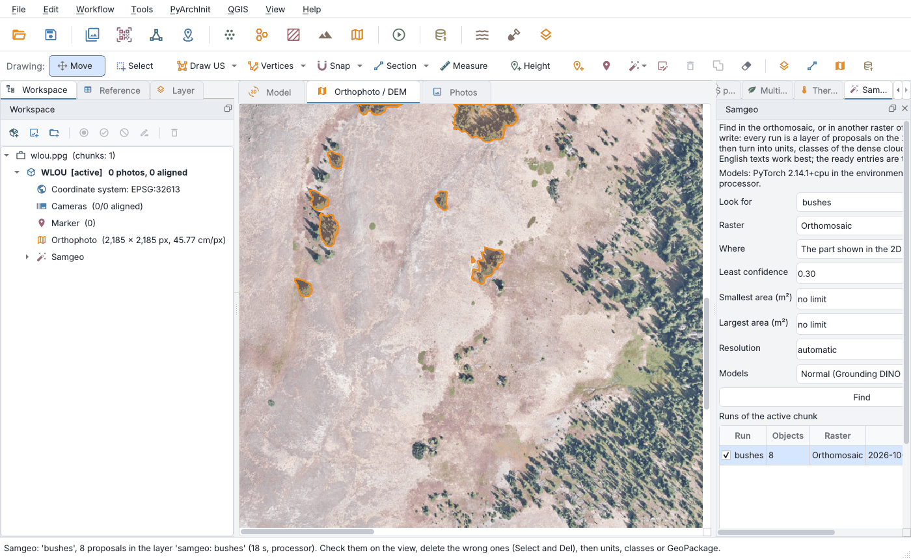

# Samgeo

The *Samgeo* plugin finds in the orthophoto what you write: *stones*, *walls*, *bricks*, *roof
tiles*, *pottery sherds*, *trees*, or any English phrase. Every search is a **layer of proposals** on
the 2D view: you check it, delete what is wrong, and only then turn it into stratigraphic units,
classes of the dense cloud or a GeoPackage. Its default engine follows the `LangSAM` recipe in
[segment-geospatial](https://github.com/opengeos/segment-geospatial):
[Grounding DINO](https://huggingface.co/IDEA-Research/grounding-dino-base) finds the boxes of what is
written, [SAM 2.1](https://github.com/facebookresearch/sam2) draws the outline inside each box.
Grounding DINO and SAM 2.1 run on your computer, with open weights and no account. You can also
choose SAM 3; it requires personal access approved by Meta, as explained below.

Version 0.2.0 adds SAM 3 as an optional engine; the plugin needs pyarchinit-photogrammetry 1.5.0 or
later. Its README and source code are in the
[plugin repository](https://github.com/enzococca/pyarchinit-photogrammetry-plugins/tree/main/plugins/samgeo).

## SAM 3 engine: license, access and token

Alongside Grounding DINO + SAM 2.1, you can choose **SAM 3 (SamGeo3 / Transformers)** to find all
instances of a concept from a short text prompt. SAM 3 and its weights use the
[Meta SAM license](https://huggingface.co/facebook/sam3/blob/main/LICENSE), separate from the
plugin's GPL. The plugin does not bundle or redistribute the weights, or accept the terms for you.

To use it, sign in to Hugging Face and [request model access from Meta](https://huggingface.co/facebook/sam3);
read and accept the terms, then wait for approval. Afterward, create your own
[Hugging Face access token](https://huggingface.co/settings/tokens) with read permission for the
model. **The token comes from Hugging Face and does not grant access on its own; Meta must also
approve your account.** Enter it in the pane's password field for the current session, or configure
`HF_TOKEN` or `hf auth login`. The plugin does not store it in projects, settings or logs.

On first use, the authorized weights download to the Hugging Face cache and can be reused locally.
For complete steps and command line examples, see the
[Samgeo README](https://github.com/enzococca/pyarchinit-photogrammetry-plugins/tree/main/plugins/samgeo#sam-3-license-access-and-your-personal-token).

<figure markdown="span">
  
  <figcaption>A search for <em>bushes</em> on the part shown of a public orthophoto: 8 proposals in
  18 seconds on the processor, outlined in orange in the 2D view, the search listed in the pane and,
  under the chunk, in the workspace. The groups of conifers on the open slope are found with good
  outlines; many single small trees, a few pixels across at this resolution (46 cm/px), are not.
  Orthophoto: NEON, site WLOU (Colorado), camera mosaic of 2017, CC0.</figcaption>
</figure>

!!! note "The example on this page"
    The figure uses a public orthophoto of the US National Ecological Observatory Network (NEON),
    released under CC0, because the photos of the tutorial are not public. It shows how the plugin
    works and what to expect from the models: proposals to check, not a finished drawing. On an
    excavation the same steps apply to stones, bricks and tiles at a resolution of a centimetre or so.

## In short

1. Build the orthophoto of the chunk (*Workflow > Build orthophoto...*).
2. Open the *Samgeo* pane (*Plugins > Samgeo > Samgeo pane*). The first time, *Install the models...*
   installs PyTorch and the selected engine's packages into a dedicated environment; weights download
   at first use.
3. Choose what to look for, the raster and where - the whole raster, a polygon you draw, or the part
   shown in the 2D view - and click *Find*.
4. Check the proposals on the view: delete the wrong ones with *Select* and Del.
5. *Units...*, *Classes of the cloud* or *GeoPackage...* for what is left.

## What it does

| From a search | What you get |
|---|---|
| The layer `samgeo: <name>` | the objects found, each with its number, the text, the phrase that found it, the selected engine's score and the area in m²; drawn again on every raster the view shows; a proposal deleted on the view leaves the search too |
| Units | the proposals - those selected on the view, those not yet units, or all - become stratigraphic units of the chunk, of the kind chosen (US, USM...), with the text and the score as attributes (`samgeo_prompt`, `samgeo_score`); one entry of *Edit > Undo* for all of them |
| Classes of the dense cloud | the points inside the proposals, in plan view, get the class `samgeo: <name>` |
| GeoPackage | the searches chosen, a layer each |
| The mask | the objects numbered in a GeoTIFF that the raster calculator reads by itself (`samgeo_<search>_mask`) |

The units made by the plugin are units as those you draw: they are in the live link with QGIS, *Tools >
Propose US and relationships (Extended Matrix)...* numbers them, and they go to the US forms of PyArchInit.

## What you need first { #before }

* **The plugin**, installed from the program: see [Plugin guides](guides.md#install).
* **PyTorch and the models.** The program never loads PyTorch - its runtime clashes with that of
  pycolmap in the same process - but runs the models in a process of their own, with:
    * the environment of the AI plugins, which the plugin installs on request with
      [uv](https://github.com/astral-sh/uv): Python 3.12, PyTorch (the build for your graphics card:
      CUDA with an NVIDIA card, Metal on Apple Silicon, otherwise the processor), transformers and
      sam2, about 2 GB, with the internet that one time. It goes into
      `pyarchinit-photogrammetry/geoai-env` in the data folder of the program (the variable
      `PPG_GEOAI_ENV` puts it elsewhere) and will be shared with the plugin geoai, so that PyTorch is
      there once. This is how the desktop application works. *Install the models...* in the pane,
      *Plugins > Samgeo > Install the models...* or `ppg plugin samgeo install`;
    * the Python of the program, when PyTorch, transformers and sam2 are installed there.

    The weights of the models (about 1 GB) are downloaded from Hugging Face at the first search and
    kept in its cache.

* **An orthophoto**, or another raster of the chunk: any raster the raster calculator lists - a
  relief visualisation of the DEM, a version of the orthophoto - can be searched (on a DEM,
  experimentally: the models were trained on photographs).
* **Time, or a graphics card.** On the processor a tile of 1024 pixels takes tens of seconds; the
  number of tiles is written in the status bar when a search starts.

## The steps in the program { #program }

### The pane

The *Samgeo* pane opens on the right of the window, tabbed with the other panes; it can be moved,
floated or closed and opened again from *Vista > Pannelli* or *Plugins > Samgeo > Samgeo pane*. From
the top:

* a short description, and where the models run - or *Install the models...* when they are not
  installed;
* **Look for**: a ready entry or your own text. The ready entries are *stones*, *walls*, *bricks*,
  *roof tiles*, *pottery sherds*, *bones*, *mosaic tesserae*, *trees*, *bushes*, *people*, *tools and
  buckets*, *tarpaulins*: the plugin gives them to the models in English (*walls* is `stone wall`).
  Your own text is read as written: English works best; several things are separated by commas
  (`stone, brick`);
* **Raster**: the orthophoto, or another raster of the chunk;
* **Where**: *The whole raster*, *A polygon to draw* (the program's drawing tool: drag a box, or click
  the vertices and double click), *The part shown in the 2D view*;
* **Least confidence** (0.30): higher, fewer and surer proposals;
* **Smallest area** and **Largest area** in m² (empty: no limit);
* **Resolution**: automatic - that of the raster, but not finer than 1 cm/px, which is plenty for
  stones - or coarser, for fewer tiles and a faster search;
* **Models**: *Normal* (Grounding DINO base, SAM 2.1 small), *Fast* (tiny, tiny), *Precise* (base,
  large);
* *Find*;
* the searches of the active chunk: the box shows or hides a layer, a double click zooms to it;
* *Units...*, *Classes of the cloud*, *GeoPackage...*, *Zoom to*, *Remove* for the search selected.

The searches are also under the chunk in the workspace (*Samgeo*), with the same actions in the menu of
the right click.

### Checking the proposals { #check }

The proposals are drawn in the colour of their search; clicking one in navigation mode shows its
number, text, score and area. Delete the wrong ones as any feature of the view (*Select*, then Del or
*Delete selected*): they leave the search, its GeoPackage and its mask. A search can be made again with
another text, threshold or resolution: each is a layer of its own (*stones*, *stones 2*...).

### Units { #units }

With application **1.5.1** and Samgeo **0.3**, *Units...* previews identifiers for proposals not yet
converted. Choose all or selected proposals, the kind (US, USM, other stratigraphic kinds or survey
**UT**), and an explicit first number or automatic numbering. Occupied identifiers in project
drawings and the connected archive are skipped.

**Progressive name** produces names such as `Grave0001`, `Grave0002`; **Shared name / group** assigns
a common name while preserving individual numeric identifiers. For UT choose a project: the TOC
shows **Topographic units**, or **Topographic units - group name**. Geometries remain separate.
UT records use `ut_table`, are excluded from `us_table`, and do not automatically receive
stratigraphic relationships or Extended Matrix nodes.

For existing units labelled `?`, open **Layers > Identify / group...**. In the **Select** button's
menu enable **Freehand selection (lasso)** and trace around the group. Shift/Cmd adds, Alt subtracts;
Esc or right-click cancels the stroke. Choose selected, unnumbered or all units in the preview.
One **Edit > Undo** restores the names, identifiers, kind and TOC group of the bulk edit.

Converted proposals remain tracked by their search; when all have become units, their proposal
layer is hidden. Older application versions retain the original conversion dialog; the new
identification workflow and freehand selection also require updating the application.

### Classes of the dense cloud { #classes }

*Classes of the cloud* gives the points of the dense cloud inside the proposals (those selected on the
view, else all) the class `samgeo: <name>`, with a code from 150 up; the cloud is shown by classes.
The points you classified by hand keep their class. Done again after deleting proposals, the class
follows those left.

## The command line { #cli }

```bash
ppg plugin samgeo status
ppg plugin samgeo install                                   # PyTorch and the models (uv)
ppg plugin samgeo segment scavo.ppg pietre                  # the whole orthophoto
ppg plugin samgeo segment scavo.ppg "roof tile" --area 2480000,4500000,2480004,4500003 --units
ppg plugin samgeo segment scavo.ppg muri --resolution 0.02 --min-area 0.5 --models precise --json
ppg plugin samgeo list scavo.ppg
ppg plugin samgeo export scavo.ppg samgeo.gpkg --run pietre
ppg plugin samgeo remove scavo.ppg pietre
```

`--chunk LABEL` works on another chunk than the active one, `--raster NAME` on another raster (its
name in the raster calculator), `--threshold` sets the least confidence, `--units` makes units of
everything found.

## How a search works { #how }

1. The area is read at the resolution of the search in tiles of 1024 pixels that overlap by 128.
   Three bands of 8 bits are read as they are; any other raster (16 bits, reflectances, one band) is
   stretched between the 2nd and the 98th percentile of the area, one band as grey.
2. Each tile goes to the models; each mask becomes a polygon in the coordinates of the chunk.
3. An object cut by the border of a tile is joined with its other part from the next tile; two boxes on
   the same object leave one proposal; with more than one tile, a box as large as a whole tile is left
   out (Grounding DINO often answers "the whole image" beside the objects). Then the score and area
   filters and, with a polygon, only what lies inside it.

## Reading the results { #results }

* **Proposals, not a drawing.** The models find most of the objects they recognise and miss others -
  small ones, a few pixels across, above all; some proposals are wrong. Check them before making
  units.
* **The score** is Grounding DINO's confidence in the box: typical values on aerial images are 0.3-0.5.
  Raising the least confidence leaves fewer, surer proposals; lowering it finds more, and more errors.
* **The resolution** matters: an object should be at least some ten pixels across. For stones of
  10-20 cm, 1 cm/px.
* **Objects, not soils.** The models find objects - stones, bricks, tiles, trees, people, tools - far
  better than the contrast between two soils: that will be the task of the plugin geoai, which learns
  from your drawings.
* **A single tile.** With a small area (one tile) Grounding DINO may answer with the whole area:
  delete that proposal, or set a largest area.

## Files { #files }

In the folder of the chunk, `samgeo/`:

* `<search>.gpkg`: the objects (table `samgeo`, multipolygons: `n`, the number in the mask; `prompt`,
  the text; `label`, the phrase that found it; `score`; `quality`, SAM's own estimate of the mask;
  `area_m2`);
* `<search>_mask.tif`: the objects numbered (0 where there is none).

The searches - text, raster, area, parameters, number of objects, time, device - are kept in the
project.
