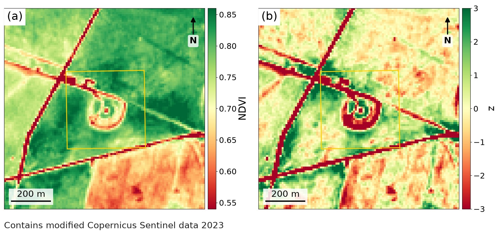
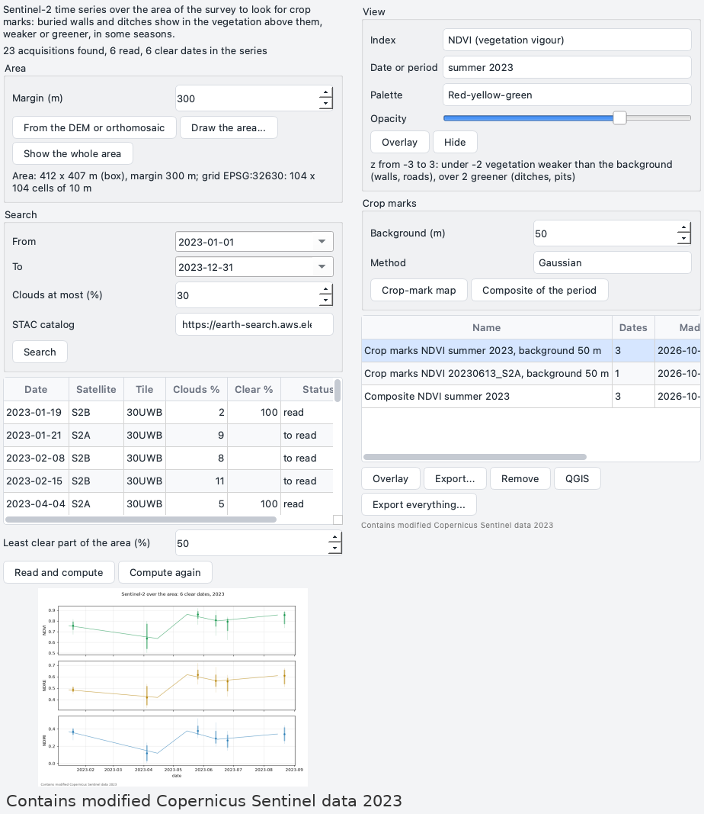
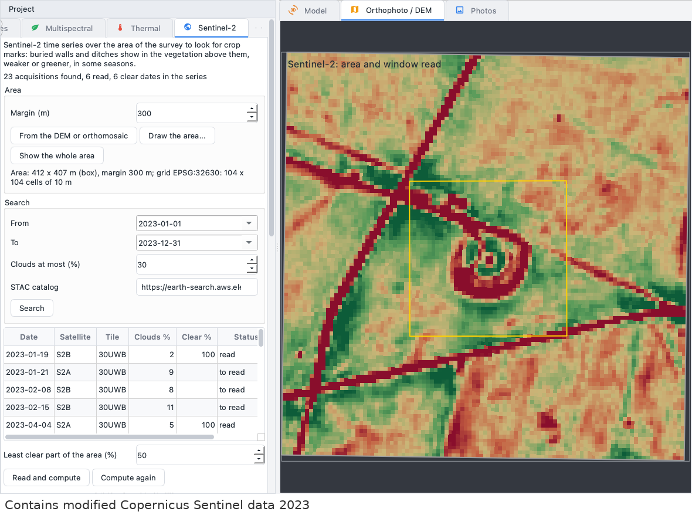
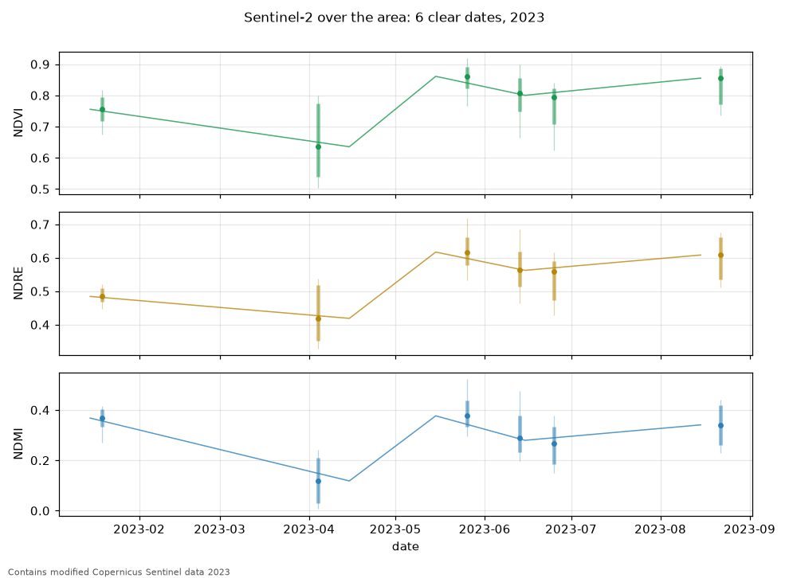
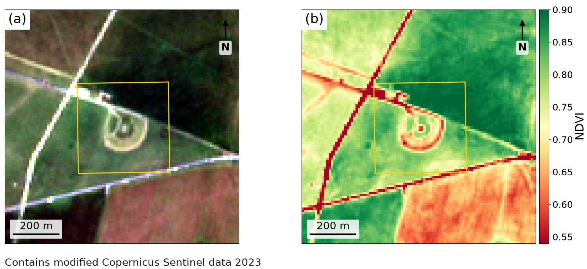

# Sentinel-2

The *Sentinel-2* plugin looks at the area of a survey through the Sentinel-2 satellites of the
European Union's Copernicus programme, date after date, to find **crop marks**: buried walls and
ditches that show through the crop above them in some weeks of some years. Over a wall the roots find
less water and the crop is weaker; over a ditch they find more and the crop is greener. The plugin
searches the images of the area in a public catalog, reads only a small window around the site,
masks clouds and shadows, computes three vegetation indices for every clear date, draws their series
through the seasons, and makes composites and crop-mark maps that lie over the orthophoto or the DEM
of the survey and go into QGIS. It needs no account and no key.

This page describes version 0.1.0 of the plugin, which needs pyarchinit-photogrammetry 1.3.3 or later.
Its README and source code are in the
[plugin repository](https://github.com/enzococca/pyarchinit-photogrammetry-plugins/tree/main/plugins/sentinel2).

<figure markdown="span">
  
  <figcaption>(a) NDVI of the summer of 2023 around Stonehenge, the median of three clear dates (13
  and 25 June, 22 August), cell by cell. (b) Its crop-mark map: the same values less their smooth
  background (50 m), divided by their spread. The differences between whole fields are gone; what is
  left are lines and spots weaker (red, under -2) or greener (green, over 2) than their surroundings:
  here the roads, the tracks and the paths around the stones, all modern. The yellow line is the area
  of the analysis, 400 m a side. Contains modified Copernicus Sentinel data 2023.</figcaption>
</figure>

!!! note "The examples on this page"
    The figures come from a project made for this page: a chunk in the British National Grid with no
    survey in it, and an area of 400 x 400 m around Stonehenge, a public monument, given as a box of
    longitudes and latitudes from the command line. The search over 2023 found 23 acquisitions; six of
    them (19 January, 4 April, 26 May, 13 and 25 June, 22 August) were read, about 110 MB in 22
    seconds. They show what the plugin does and are not a study of the monument: at 10 m a pixel, the
    strongest marks here are modern.

## In short

1. A chunk in a reference system on the Earth - a UTM zone, a national grid - with its DEM or
   orthophoto; or a box of longitudes and latitudes from the command line.
2. In the *Sentinel-2* tab of the *Project* dock: *From the DEM or orthomosaic* (or *Draw the
   area...*), with a margin around it.
3. *Search*: the first and the last day, the clouds at most. The acquisitions fill the table.
4. *Read and compute*: the window of each acquisition is read once and kept in the project; cloudy ones
   are left out; the indices, the series and its chart follow.
5. *View*: an index, a date or a period, a palette, an opacity, then *Overlay* on the orthophoto or the
   DEM.
6. *Crop-mark map* and *Composite of the period* make products to show, export, or open in QGIS.

## What it does

| Step | What it gives | Useful for |
|---|---|---|
| Area | the footprint of the DEM or orthophoto, or a polygon drawn on the view, with a margin; a grid of 10 m cells in the UTM zone of the site | the site and the fields around it, which the background of a crop-mark map needs |
| Search | the Sentinel-2 L2A acquisitions over the area between two days, with the cloud cover of their tiles | what the satellites saw, and when |
| Reading | the bands of the window and the scene classification, clouds and shadows masked, kept in the project | a series that, once read, needs no network |
| Indices | NDVI, NDRE and NDMI of every clear date, on the cells free of clouds | the vigour, the chlorophyll and the water of the vegetation |
| Series | the median and the spread of each index over the area, per date and per month, as CSV and as a chart | when the fields green up and dry, the weeks in which marks can show |
| Composites | the median of an index over a season, a year, a month, a span of days | a period without the noise of a single date |
| Crop-mark maps | the index less its smooth background, divided by its spread: a z-score | the lines and spots that differ from the field around them |
| Exports | GeoTIFF on the grid of the scenes and on the grid of the survey, CSV, PNG, the QGIS project of the program | the GIS, the report, the archive |

At 10 m a pixel, Sentinel-2 sees the larger features - enclosures, ditches and roads several metres
wide, villas, the outline of a settlement - and above all **when** the fields show them: the
satellites pass every few days, year after year since 2015. A single wall, a posthole, a narrow
ditch are smaller than a pixel: those are for the drone and its multispectral camera (see [The
Multispectral pane](../gui.md#the-multispectral-pane)).

## What you need first { #before }

* **The plugin**, installed from the program: see [Plugin guides](guides.md#install). It needs
  nothing else: it talks to the catalog with the standard library of Python (or with
  [pystac-client](https://github.com/stac-utils/pystac-client), when it is installed) and reads the
  images with the program's own GDAL.
* **The internet**, for the search and for the first reading of every acquisition: the catalog is
  [Earth Search](https://earth-search.aws.element84.com/v1) by Element 84, the images are the
  Cloud-Optimized GeoTIFFs of the [Sentinel-2 collection on the Registry of Open Data on
  AWS](https://registry.opendata.aws/sentinel-2-l2a-cogs/), read over HTTPS. What is read stays in the
  project: a second look, a new index, a new map need no network.
* **A chunk with a reference system on the Earth**: a projected system in metres, such as a UTM zone
  or a national grid. A chunk in a local system (*LOCAL*) has no place on the Earth: the plugin says so
  and cannot search it from the window. From the command line a box of longitudes and latitudes can
  still be searched for such a chunk; its products are then the GeoTIFFs in UTM, without overlay and
  without copies on the grid of the survey.
* **The area**: the DEM or the orthophoto of the chunk give it. Without them, give it the first time
  from the command line, as a box or a polygon; then an empty frame of the area can be shown, and a
  new area drawn on it (see [The area](#step-area)).

## The data { #data }

### Sentinel-2 { #sentinel-2 }

The Sentinel-2 satellites photograph the land in thirteen bands, from the blue to the short-wave
infrared. The plugin reads the *Level-2A* products - reflectance at the ground surface, corrected for
the atmosphere - in tiles of 110 x 110 km, and seven of their bands:

| Band | Light | Pixel |
|---|---|---|
| B02, B03, B04 | blue, green, red | 10 m |
| B08 | near infrared | 10 m |
| B05 | red edge | 20 m |
| B8A | narrow near infrared | 20 m |
| B11 | short-wave infrared | 20 m |

with the *scene classification* (SCL) that ESA computes for every pixel: vegetation, bare soil, water,
cloud, cirrus, cloud shadow, snow. All the tiles of one passage of a satellite over the area are one
**acquisition**, named after its day and its satellite: `20230613_S2A`.

### The area and its grid { #area }

The area is the footprint of the DEM (or else of the orthophoto) of the chunk, a polygon drawn on the
view, or a box of longitudes and latitudes. A **margin** goes around it, 300 m by default: the
background of a crop-mark map is computed from the fields around the site, and a window that stops at
the edge of the site has no background. Everything is read on one grid of 10 m cells in the UTM zone
of the centre of the area, its corners on multiples of 20 m, so that a pixel of 20 m is always four
cells of 10 m; at most 25 km a side. When a new area changes the grid, what was read for the old
grid is read again, from the network.

### Clouds and shadows { #clouds }

* **In the search**, *Clouds at most (%)* filters the acquisitions by the cloud cover of their whole
  tiles, a figure of the catalog: a tile half covered may be clear over the site, and the opposite.
* **In the reading**, the scene classification is read first, for every acquisition. Clouds (classes 8
  and 9), thin cirrus (10) and cloud shadows (3) are masked, with 20 m around them; only vegetation (4),
  bare soil (5) and water (6) are kept as clear. When less than *Least clear part of the area (%)* -
  50 % by default - is clear, the acquisition is marked *cloudy* and its other bands are never
  downloaded.
* From the command line, `--clear 4,5,6,7` keeps the unclassified pixels too, and `--buffer` changes the
  metres masked around clouds and shadows.

### From numbers to reflectance { #reflectance }

The numbers of the images become reflectance with the scale and offset the catalog gives. Since the
processing baseline 04.00 (January 2022) ESA adds 1,000 to the numbers of the L2A products, and an
offset of -0.1 takes it away; Earth Search marks the images whose numbers it has already corrected.
The plugin trusts the numbers more than the metadata: an offset that would make the blue reflectance
of the land negative is dropped.

### Crop marks { #crop-marks }

Crop marks are a matter of season and of year. They show in cereals and grass under stress - a dry
spring, early summer in temperate Europe - and can be absent in a wet year. A buried wall or road
holds less water: the crop above it is weaker, its index lower (a *negative* mark). A ditch or a pit
holds more: the crop is greener (a *positive* mark). The same field can show a mark for two weeks and
nothing for the rest of the year: this is why the series matters more than any single image.

The three indices, each from two bands (a - b) / (a + b):

| Index | Bands | Pixel | What it follows |
|---|---|---|---|
| NDVI | B08, B04 | 10 m | the vigour of the vegetation; the sharpest of the three |
| NDRE | B8A, B05 | 20 m | the chlorophyll; it saturates less over dense crops |
| NDMI | B8A, B11 | 20 m | the water in the leaves |

## Step by step in the program { #program }

### The pane

Once the plugin is installed and the program restarted, the *Sentinel-2* tab appears in the *Project*
dock on the left; if the tabs do not fit, use the arrows at the end of the tab bar, or *Plugins >
Sentinel-2 > Sentinel-2 pane*.

<figure markdown="span">
  
  <figcaption>The whole pane, in two halves side by side: on the left the area, the search, the
  acquisitions found and read and the chart of the series; on the right the view, the crop marks, the
  products made and the notice of the data. Contains modified Copernicus Sentinel data 2023.</figcaption>
</figure>

From the top:

* a short description and the state: acquisitions found, read, clear dates in the series;
* **Area**: *Margin (m)*; *From the DEM or orthomosaic*, *Draw the area...*, *Show the whole area*; the
  area, its margin and its grid in a line;
* **Search**: *From*, *To*, *Clouds at most (%)*, *STAC catalog*, *Search*;
* the table of the acquisitions: *Date*, *Satellite*, *Tile*, *Clouds %* (of the tiles), *Clear %*
  (of the area, once read), *Status* - *to read*, *read*, *cloudy*, *error* (the tooltip of the date
  gives the id of the acquisition and the error);
* *Least clear part of the area (%)*, *Read and compute*, *Compute again*;
* the chart of the series; a double click opens it full size;
* **View**: *Index*, *Date or period*, *Palette*, *Opacity*, *Overlay*, *Hide*, and the colours shown;
* **Crop marks**: *Background (m)*, *Method*, *Crop-mark map*, *Composite of the period*;
* the table of the products - *Name*, *Dates*, *Made* - with *Overlay*, *Export...*, *Remove*, *QGIS*
  and *Export everything...*;
* the notice of the data: *Contains modified Copernicus Sentinel data* and the years.

The *Plugins > Sentinel-2* menu has *Sentinel-2 pane*, *Search Sentinel-2 images...*, *Draw the
Sentinel-2 area*, *Read and compute*, *Crop-mark map...* and *Hide the overlay*; *File > Export* has
*Sentinel-2 time series (CSV)...* and *Sentinel-2 stack (GeoTIFF)...*. Every step runs in the background
with the progress bar; the buttons that would start another one wait. The pane follows the active
chunk: each chunk has its own area, acquisitions and products.

### 1. The area { #step-area }

* *From the DEM or orthomosaic*: the cells of the DEM with a value (or else of the orthophoto) as a
  convex polygon - the usual choice for a survey.
* *Draw the area...*: drag a box on the view, or click the vertices and double click or press Enter;
  Esc cancels. The view needs the orthophoto, the DEM or an empty frame to draw on.
* *Margin (m)*: set it before; it can also be changed in the search.
* *Show the whole area*: an empty frame with the area and its margin, at 2 m a pixel: the products can
  then be seen beyond the orthophoto, which usually covers only the site.

The area (yellow) and the window read (grey) are drawn in the layer *Sentinel-2: area* of the view,
and come back when the view shows another raster. The line under the buttons gives its size, its
margin and its grid - *Area: 412 x 407 m (box), margin 300 m; grid EPSG:32630: 104 x 104 cells of 10
m* in the example.

### 2. Search { #search }

| Field | Default | What it does |
|---|---|---|
| *From*, *To* | from the first of January two years ago to today | the days searched |
| *Clouds at most (%)* | 30 | the largest cloud cover of the tiles |
| *STAC catalog* | Earth Search v1 | any STAC API with the collection `sentinel-2-l2a`, by its address |

*Search* (or *Plugins > Sentinel-2 > Search Sentinel-2 images...*, which asks the same in a window
with the margin) asks the catalog for the acquisitions over the area and its margin. They replace those
of the search before; the ones already read stay read. Without an area, the search takes the
footprint of the DEM or of the orthophoto. In the example the year 2023 gave 23 acquisitions in two
seconds, all on the tile 30UWB.

A long span over a cloudy region gives many acquisitions: a few years can be hundreds. The search is
cheap; the reading is what takes time and data, and it can be done on a few dates first.

### 3. Read and compute { #read }

*Read and compute* reads the acquisitions selected in the table - all of them when none is selected -
four at a time, and then computes the indices and the series:

* the scene classification first: a *cloudy* acquisition stops there;
* then the seven bands, only the window of the area and its margin. The images are read by internal
  tiles of 1,024 pixels, so each acquisition is about 16-18 MB to download, whatever the size of the
  site, and about 10 seconds; what is kept in the project is about 100 KB;
* the acquisitions already read and those known to be cloudy are not read again;
* *Cancel* stops the readings at their next band.

The status line then gives how many acquisitions were read, found already in the project, cloudy or
in error, and how many clear dates the series has. *Compute again* makes the indices and the series
again from what was read, without the network. A new *Least clear part of the area* is used by the next
*Read and compute*: press it again, and only the acquisitions not yet read are downloaded.

### 4. On the view { #view }

| Field | What it does |
|---|---|
| *Index* | *NDVI (vegetation vigour)*, *NDRE (chlorophyll, red edge)*, *NDMI (water in the vegetation)* or *Natural colour (B04, B03, B02)* |
| *Date or period* | first the periods - each season of each year with dates, each season over every year, each year, the whole period - then the dates, the latest first, with the satellite and the clear part |
| *Palette* | *Red-yellow-green* (the one of the program's vegetation indices), *Greyscale*, *Viridis*, *Turbo*, *Diverging (blue-white-red)* |
| *Opacity* | from 10 to 100 %; it changes the overlay shown at once |

*Overlay* lays the index of the date, or the median of the period, over the orthophoto or the DEM;
natural colour shows the clearest date of the period. An index is stretched between its 2nd and 98th
percentiles, a crop-mark map between -3 and 3; the line under the buttons gives the values at the two
ends. Every pixel of Sentinel-2 stays a square of 10 m: hundreds of pixels of the orthophoto. One
overlay is shown at a time; *Hide* takes it away, and it is drawn again when the view shows another
raster of the same chunk.

<figure markdown="span">
  
  <figcaption>The crop-mark map of the summer of 2023 laid over the frame of <em>Show the whole
  area</em>, with the area of the analysis in yellow. Contains modified Copernicus Sentinel data
  2023.</figcaption>
</figure>

### 5. Composites and crop-mark maps { #products }

Both take the *Index* and the *Date or period* chosen in the *View* group (natural colour has none).

* *Composite of the period*: the median of the index over the dates of the period, cell by cell, and
  how many dates gave a value there.
* *Crop-mark map*: the index of the date, or the median of the period, less its smooth background,
  divided by the robust spread of what is left (1.4826 times the median absolute deviation): a z-score,
  near 0 over even ground, under -2 where the vegetation is weaker than around it, over 2 where it is
  greener.

| Field | Default | What it does |
|---|---|---|
| *Background (m)* | 50 | the scale of the background: the sigma of a Gaussian, which ignores the cells without a value; the median uses a window twice as wide |
| *Method* | *Gaussian* | *Gaussian* or *Median*; the median follows the edges of the fields more closely |

*Plugins > Sentinel-2 > Crop-mark map...* asks the same in a window. The product is laid over the view
at once and goes into the table; its tooltip gives, for a crop-mark map, the share of the area under -2
and over 2. A product made again with the same index, period, background and method replaces the old
one.

The periods are written as the command line writes them:

| Period | Means |
|---|---|
| `all` | every clear date |
| `summer` | the summers of every year (`spring`, `summer`, `autumn`, `winter`) |
| `2023-summer` | June, July and August 2023; `2023-winter` is December 2022, January and February 2023 |
| `2023` | the year |
| `2023-06` | the month |
| `2023-06-14` | one day |
| `2023-04-01/2023-06-30` | a span of days |
| `20230613_S2A` | one acquisition |

### 6. QGIS and exports { #export }

* *Overlay* on a product of the table (or a double click on it) shows it on the view.
* *Export...*: the product as a GeoTIFF on the grid of the scenes, with its copy on the grid of the
  survey beside it (`..._chunk.tif`).
* *Remove* asks first, then deletes the files of the product.
* *QGIS*: the QGIS project of the program ([QGIS](../integrations.md)) with the products on the grid of
  the survey, hidden at first: composites with the ramp of the vegetation indices, crop-mark maps from
  blue at -3 (weaker vegetation) through white to red at 3 (greener) - the other way round from the
  red-yellow-green of the view.
* *Export everything...*: into a folder, the stack of every index and date in one GeoTIFF
  (`sentinel2_stack.tif`, bands named like `NDVI 2023-06-13 20230613_S2A`), one GeoTIFF per index, the
  series per date and per month (CSV) with the chart, every product on both grids, and a text file with
  the notice of the data and the formulas.
* *File > Export > Sentinel-2 time series (CSV)...* writes the series per date, the monthly one beside
  it (`..._monthly.csv`) and the chart (`.png`); *Sentinel-2 stack (GeoTIFF)...* the stack.

## From the command line { #cli }

The same steps with `ppg plugin sentinel2 WHAT PROJECT ...`. The commands work on the active chunk
(`--chunk LABEL` for another one) and save the project.

```bash
ppg plugin sentinel2 --help
ppg plugin sentinel2 search scavo.ppg --start 2021-01-01 --end 2024-12-31
ppg plugin sentinel2 search scavo.ppg --max-cloud 20 --margin 500
ppg plugin sentinel2 search scavo.ppg \
    --bbox=-1.8291,51.1771,-1.8233,51.1807 --start 2023-01-01 --end 2023-12-31
ppg plugin sentinel2 fetch scavo.ppg --min-clear 0.5
ppg plugin sentinel2 fetch scavo.ppg --scenes 20230613_S2A,20230625_S2B
ppg plugin sentinel2 series scavo.ppg --monthly --index NDVI
ppg plugin sentinel2 composite scavo.ppg --index NDVI --period 2023-summer
ppg plugin sentinel2 cropmarks scavo.ppg --period 2023-summer --background 50
ppg plugin sentinel2 list scavo.ppg
ppg plugin sentinel2 export scavo.ppg sentinel2_export/
ppg plugin sentinel2 remove scavo.ppg cropmarks_NDVI_2023_summer_50m
```

| Command | Options |
|---|---|
| `search PROJECT` | `--start`, `--end` (YYYY-MM-DD; from the first of January two years ago to today); `--max-cloud` % (30); `--margin` m (300); `--area auto`, `dem`, `orthomosaic`, or `keep` the area set before; `--bbox=WEST,SOUTH,EAST,NORTH` in degrees; `--polygon "x,y;x,y;x,y"` in the coordinates of the chunk; `--catalog URL`, `--collection`; `--client auto`, `stdlib` or `pystac` |
| `fetch PROJECT` | `--scenes ID,ID` only these acquisitions; `--min-clear` 0-1 (0.5); `--clear` SCL classes kept (4,5,6); `--buffer` m (20); `--workers` acquisitions read at the same time (4); `--no-compute` |
| `compute PROJECT` | indices and series again from what was read, without the network |
| `series PROJECT` | the series per date, or `--monthly`; `--index NDVI`, `NDRE` or `NDMI` |
| `composite PROJECT` | `--index` (NDVI); `--period` (all) |
| `cropmarks PROJECT` | `--index` (NDVI); `--period` (all); `--background` m (50); `--method gaussian` or `median` |
| `list PROJECT` | the area, the grid, the search, the acquisitions, the dates and the products, as JSON |
| `export PROJECT PATH` | a folder: everything, as *Export everything...*; a `.tif`: the stack; a `.csv`: the series |
| `remove PROJECT ID` | deletes a product and its files |

Write `--bbox=` with the equals sign: a box west of Greenwich starts with a minus sign, and without the
`=` the command takes it for an option and stops with *expected one argument*. The ids of the
acquisitions are those `search` and `list` print; the ids of the products - `composite_NDVI_2023_summer`,
`cropmarks_NDVI_2023_summer_50m` - those of `list`.

## Reading the results { #reading }

### The series { #reading-series }

<figure markdown="span">
  
  <figcaption>The chart the plugin writes: for each index, a dot for the median of the area at each
  date, a thick bar from the 25th to the 75th percentile and a thin one from the 10th to the 90th; the
  line joins the monthly medians. Six dates of 2023 around Stonehenge: the vegetation lowest in early
  April, highest from late May. Contains modified Copernicus Sentinel data 2023.</figcaption>
</figure>

* The **median** says how the vegetation of the area changes through the year: green-up, ripening,
  harvest, regrowth. The **spread** says how different the fields are on that date: a long bar, as in
  April in the chart, is the time when crops, grass and bare soil part ways - and when marks are most
  likely to show.
* The CSV per date has a row per date and index: `date`, `acquisition`, `platform`, `index`,
  `clear_fraction`, `cells`, `median`, `p10`, `p25`, `p75`, `p90`, `mean`. The monthly CSV puts
  together the clear cells of the dates of each month (`month`, `index`, `dates`, `cells` and the same
  statistics).
  The first lines, starting with `#`, carry the notice of the data and the formulas.
* Only the area counts, without its margin, and only its clear cells.

### A date { #reading-date }

<figure markdown="span">
  
  <figcaption>13 June 2023. (a) Natural colour (B04, B03, B02), each band stretched between its 2nd
  and 98th percentiles. (b) NDVI of the same date: the fields differ much more from one another than
  any mark inside them does - the reason for the background removed by the crop-mark map. Contains
  modified Copernicus Sentinel data 2023.</figcaption>
</figure>

### Crop-mark maps { #reading-cropmarks }

* **z under -2** (red with the default palette): vegetation weaker than the ground around it - buried
  walls, roads, compacted surfaces, but also tracks, paths, stony patches and the edges of fields.
  **z over 2** (green): greener - ditches, pits, but also hedges, wet hollows, a strip sown later.
* **Read lines and shapes**, not single pixels: a ring, a rectangle, a straight line that crosses the
  boundaries of the fields. A mark that follows a field boundary or a tramline is agricultural.
* **The background** sets what stands out: 50 m suits features of tens of metres; larger enclosures
  need 100-200 m. Too small a background swallows the features into it; too large leaves the
  differences between fields in the map.
* **The period.** A single clear date in the right week can show more than the median of a season;
  the median of a season is steadier. Look at a few dates of the same weeks in different years: a mark
  that comes back in dry years is worth a visit.
* **Modern features** are the strongest: at Stonehenge the roads and the paths around the stones. Check
  the orthophoto, old maps and the ground before reading a mark as buried archaeology.

### Limits { #limits }

* **10 m a pixel.** Features narrower than a pixel only change its value a little: a wall of 1 m in a
  pixel of 10 m is a tenth of it. Sentinel-2 finds the large features and the right weeks; the drone
  and the excavation do the rest.
* **Clouds.** The scene classification misses some thin clouds and their shadows, which then look like
  marks for one date. A mark seen on one date only is not yet a mark.
* **The area.** At most 25 km a side; a large area means more cells to read and compute, not more data
  to download per acquisition.
* **A local chunk** cannot be searched from the window: georeference it, or work from the command line
  with a box of longitudes and latitudes.
* **The catalog.** The plugin depends on Earth Search and on the images on AWS being online; what was
  read stays in the project.

## Files written { #files }

Everything goes into the folder of the chunk, next to the project file:
`<project>.ppg.files/chunk_<n>/sentinel2/`. The area, the grid, the search, the state of every
acquisition, the dates and the products are kept in the project itself.

* `scenes.json`: the acquisitions of the last search, with the addresses of their bands.
* `scenes/<acquisition>.tif`: the window of each acquisition read - the seven bands and the scene
  classification, with their scale and offset - on the grid of the scenes; about 100 KB each.
* `indices/NDVI.tif`, `NDRE.tif`, `NDMI.tif`: a band per clear date, in time order, named after the
  acquisition; NaN where the cell was not clear.
* `series.csv`, `series_monthly.csv`, `series.png`: the series and its chart.
* `products/<id>.tif`: composites (median and number of dates) and crop-mark maps on the grid of the
  scenes, in UTM; `products/<id>_chunk.tif` the same on a grid in the reference system of the chunk,
  aligned with its DEM or orthophoto, with cells of about 2.5 m, empty where there is no value.

Every GeoTIFF carries the notice of the data (tags `ATTRIBUTION` and `TIFFTAG_COPYRIGHT`); the indices
and the products also carry the acquisitions they were made from.

## Data and licences { #licences }

Sentinel-2 data are free and open for any use under the *Legal Notice on the use of Copernicus Sentinel
Data and Service Information* of the European Union. Data that have been changed - indices, composites,
maps - must say so: **Contains modified Copernicus Sentinel data** followed by the years of the
acquisitions used. The plugin writes the notice into every GeoTIFF, at the head of the CSV files, at
the foot of the chart and in its metadata, in the pane and in the text file of *Export everything...*;
keep it under every figure or map you publish from them, as on this page. The Cloud-Optimized GeoTIFFs
are those of the [Sentinel-2 L2A collection on the Registry of Open Data on
AWS](https://registry.opendata.aws/sentinel-2-l2a-cogs/), found through Earth Search by Element 84.

The plugin is released under the GPL-2.0-or-later, like the program.
