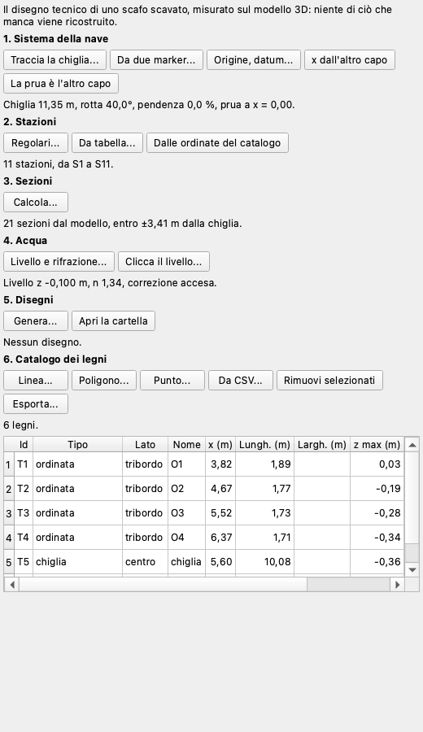
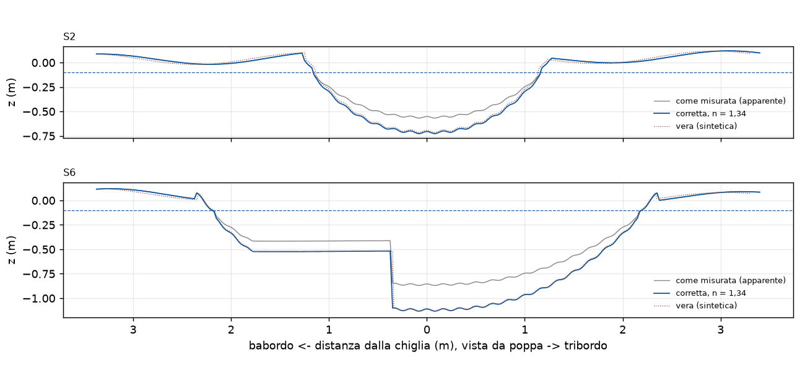
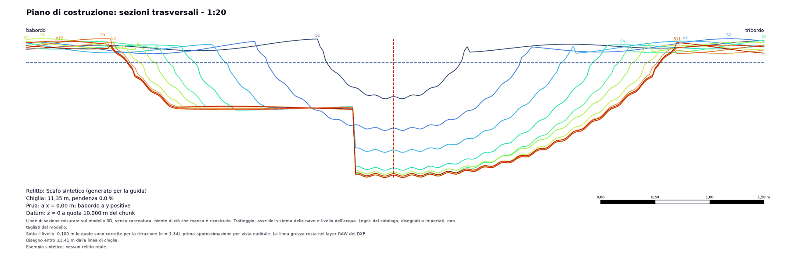
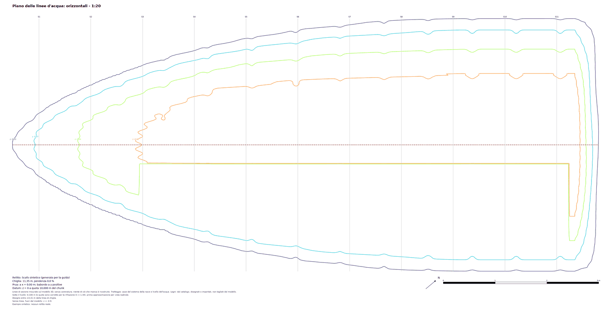

# Relitto

Il plugin *Relitto* fa il disegno tecnico di uno scafo scavato dal suo modello 3D: dove corre l'asse della nave, la forma dello
scafo a ogni stazione, i piani, e un elenco numerato dei legni con le loro misure. Oggi tutto questo si disegna a mano su un'ortofoto.
Il plugin misura quello che c'è. Non ricostruisce quello che manca e non sposta una linea dal modello per carenarla.

Questa pagina descrive la versione 0.1.0 del plugin, che richiede pyarchinit-photogrammetry 1.3.4 o successiva. Il README e il codice
sono nel [repository dei plugin](https://github.com/enzococca/pyarchinit-photogrammetry-plugins/tree/main/plugins/shipwreck).

<figure markdown="span">
  
  <figcaption>La pianta di uno scafo sintetico: la linea di chiglia a tratti, una stazione ogni metro, qualche legno, sull'ortofoto
  girata nel sistema della nave.</figcaption>
</figure>

!!! note "Gli esempi di questa pagina"
    Tutte le figure vengono da uno **scafo sintetico** generato per questa guida, non da un relitto reale: una forma lunga circa
    11 m con ordinate ogni 0,85 m, sedimento rimasto su un lato e una superficie vista attraverso l'acqua, e un'ortofoto disegnata.
    Mostrano che cosa fa il plugin; la superficie vera è nota, ed è quella con cui si confronta la figura dell'acqua.

## In breve

1. Apri il progetto con il modello dello scafo, e l'ortofoto se c'è (il pannello *Relitto* è a destra).
2. **Sistema della nave**: traccia la chiglia da un estremo all'altro, poi di' quale estremo è la prua.
3. **Stazioni**: regolari, o una tabella con i nomi del cantiere.
4. **Sezioni**: trasversali alle stazioni, longitudinali e orizzontali dove le vuoi.
5. **Acqua**: il livello, se parte dello scafo è sott'acqua, e se correggerlo.
6. **Disegni**: piano di costruzione, piano delle linee d'acqua, profilo e pianta, in SVG, PDF, PNG e DXF.
7. **Legni**: disegnali sul raster o importa una tabella; le misure si calcolano da sole; esporta in CSV, Excel o GeoPackage.

<figure markdown="span">
  
  <figcaption>Il pannello, sullo scafo sintetico: sei passi, ognuno con i suoi pulsanti e il suo stato.</figcaption>
</figure>

## Che cosa serve

Un chunk con un **modello** in metri: un sistema di coordinate proiettato, o un sistema locale con una scala (una barra di scala,
riferimenti, un modello importato in metri). Un chunk in gradi (WGS 84) viene rifiutato con un messaggio: portalo prima in un sistema
proiettato (*GNSS > Sistema e quote*). Un progetto importato da Metashape in WGS 84 è già in UTM: l'import lo converte da sé.
L'ortofoto serve solo per la pianta, il DEM per niente: le quote si leggono sul modello.

## Il sistema della nave

Coordinate della nave: **x** lungo la chiglia da un punto di partenza, **y** a babordo, **z** in alto, in metri.

* *Traccia la chiglia...* disegna una linea sulla vista raster: il primo e l'ultimo vertice sono gli estremi della linea di chiglia; x
  vale 0 al primo. *Da due marker...* usa due marker con una posizione: è così che si scelgono gli estremi nella vista 3D, con il
  pulsante *Marker* del programma.
* *La prua è l'altro capo*: la prima volta la **prua** è dove hai cominciato a tracciare. Dal modello non si vede quale capo sia,
  quindi lo dici tu: questo pulsante **scambia babordo e tribordo su tutti i disegni**, ed è l'unico a farlo.
* *x dall'altro capo*: x corre nell'altro verso. La prua resta dov'è, y e i lati non cambiano. Lo stesso una chiglia tracciata di nuovo
  nell'altro verso.
* *Origine, datum...*: il valore di x al primo estremo (0 alla prua, o una stazione scelta) e la quota di z = 0.

L'alto è la verticale del mondo e la linea di chiglia è messa in piano: x è la direzione della chiglia in pianta e z la quota sopra il
datum. Una chiglia con una sua pendenza la conserva come numero, mostrato nel pannello e sui fogli, e non tolto. Il sistema è una
trasformazione usata solo dal plugin: il chunk non cambia. In un sistema locale l'alto è l'asse z del modello, che niente verifica
come verticale: ogni foglio lo dice, e un modello non in bolla dà sezioni inclinate.

## Stazioni e sezioni

*Regolari...* dà S1, S2... a una distanza: questi nomi sono nostri, per un rilievo non ancora numerato. *Da tabella...* legge
`nome, x`, con i nomi del cantiere: `F30, 12.4` separata da virgole, col punto decimale; `F30; 12,4` separata da punto e virgola o
tabulazione, col punto o con la virgola. Una riga con troppe celle viene rifiutata col suo numero, perché `F30, 12,4` sono tre celle e
sarebbe una stazione sbagliata. *Dalle ordinate del catalogo* mette una stazione a ogni ordinata del catalogo.

*Calcola...* taglia il modello: le trasversali alle stazioni, le longitudinali alle y che elenchi, le orizzontali alle z che elenchi,
di traverso fin dove arriva il modello (o dentro la metà larghezza che dai) e poco oltre gli estremi della chiglia. Il taglio è quello
del programma, sulla mesh, in doppia precisione; le linee stanno in `<dati del chunk>/shipwreck/sections.json`. Gira in background e si
può annullare. I fogli danno la metà larghezza e dicono quali linee arrivano al suo limite; una stazione fuori dal modello non ha
linea, e pannello e fogli la nominano.

Quando cambiano il sistema della nave, il modello o la georeferenziazione del chunk, il pannello dice che le sezioni sono da rifare e i
disegni rifiutano quelle vecchie. Quando cambia il sistema di coordinate del chunk, il sistema della nave e i legni disegnati sono
ancora nelle coordinate vecchie: il plugin rifiuta finché la chiglia non viene tracciata di nuovo. I disegni già scritti vengono segnati
come da rifare nel pannello e nell'albero.

!!! tip "Piccoli anelli chiusi"
    La sezione di un modello vero non è una linea sola: un sacco di sabbia, una pietra o un buco della mesh danno un piccolo anello
    accanto alla linea principale. Stanno sul modello, quindi si disegnano.

## L'acqua

Il fondo visto attraverso l'acqua è **apparente**: in vista nadirale la profondità vera è circa quella apparente per l'indice di
rifrazione, 1,34 per l'acqua. Dai il livello, con un numero in z della nave o cliccando sul raster il pelo dell'acqua, e accendi la
correzione: un punto sotto il livello si disegna a `livello - (livello - z) * n`.

<figure markdown="span">
  
  <figcaption>Due stazioni dello scafo sintetico come misurate (grigio) e corrette (blu) sotto un livello di -0,10 m, con la
  superficie vera a puntini. Qui la correzione cade sul vero perché la superficie apparente è stata fatta con la stessa formula:
  l'acqua vera è meno gentile.</figcaption>
</figure>

È una prima approssimazione. I raggi obliqui non sono modellati (fanno sembrare il fondo ancora meno profondo: la correzione, semmai, resta
corta), né la superficie in movimento, né la riva dove il livello incontra lo scafo. La linea grezza e quella corretta restano
entrambe: il piano di costruzione e il profilo mostrano quella corretta e lo dicono, e la grezza resta nel layer `RAW` del loro DXF. Nel
piano delle linee d'acqua le linee restano dove sono e le etichette portano la quota corretta. La nota è sempre sul foglio, anche a
correzione spenta.

!!! warning "Quanto fidarsi del fondo sott'acqua"
    Leggi la forma, non le quote. Un'acqua chiara e ferma dà spesso un fondo che sta insieme, con le ordinate visibili nelle
    orizzontali. Ma le quote sono apparenti, il livello è difficile da leggere meglio di qualche centimetro, la correzione non è
    controllata da niente di misurato sott'acqua, e in uno scafo non del tutto svuotato la superficie è il sedimento, non il fasciame.
    Prima di usare una profondità, misura a mano qualche punto.

## I disegni

*Genera...* scrive ogni disegno in `<dati del chunk>/shipwreck/drawings` in SVG, PDF, PNG e DXF: lì si chiedono i campi del cartiglio e
la scala, automatica (la scala standard più dettagliata che sta in un foglio di circa A0) o scelta. Un disegno senza linee (se non
hai chiesto orizzontali, per esempio) si salta. Ogni foglio porta un cartiglio con la x della prua e la quota del datum, la metà
larghezza, la nota sull'acqua e una legenda: le linee di sezione vengono dal modello; i tratteggi sono l'asse del sistema della nave e il
livello; i legni vengono dal catalogo, disegnati o importati, e non sono tagliati dal modello.

* **Piano di costruzione**: le trasversali sovrapposte, viste da poppa, babordo a sinistra, ogni stazione col suo colore. I due lati sono
  disegnati come misurati: niente è specchiato.
* **Piano delle linee d'acqua**: le orizzontali, con le stazioni e la linea di chiglia. Sott'acqua le etichette portano la quota corretta.
* **Profilo**: le longitudinali, con le stazioni e il livello.
* **Pianta**: le stazioni e i legni sull'ortofoto girata nel sistema della nave.

Le piante sono viste dall'alto in qualunque verso corra x: non sono mai speculari. Il DXF ha un layer per tipo (`STATIONS`,
`LONGITUDINALS`, `HORIZONTALS`, `RAW`, `KEEL`, `LEVEL`, `TIMBERS`, `GRID`, `TEXT`), in metri sul foglio.

<figure markdown="span">
  
  <figcaption>Il piano di costruzione dello scafo sintetico: undici stazioni dalla prua (blu) all'estremo largo (rosso), corrette sotto il
  livello tratteggiato. Il gradino piatto a babordo è il sedimento rimasto nello scafo.</figcaption>
</figure>

<figure markdown="span">
  
  <figcaption>Le orizzontali dello scafo sintetico, da -0,10 a -0,70 m apparenti (a -0,90 m il foglio dice che non c'è linea): le ordinate si vedono come gobbe regolari.</figcaption>
</figure>

## I legni

Disegna un legno sulla vista raster come linea, poligono o punto e dai tipo (chiglia, paramezzale, ordinata, corso di fasciame, fasciame
interno, serretta, elemento di fissaggio, altro), lato e nome; oppure importa una tabella con l'intestazione: `tipo`, `lato`, `nome`, `stazione`,
`note` (anche in inglese: `kind`, `side`, `name`, `station`, `notes`) e la geometria come `x, y` (un punto) o `x1, y1, x2, y2` (una linea) in
coordinate della nave, o `wkt` nelle coordinate del chunk.

| Misura | Come |
|---|---|
| x, y | la posizione media in coordinate della nave |
| lunghezza | lungo una linea sul modello; per un poligono, il lato lungo del rettangolo che lo contiene |
| larghezza | il lato corto di quel rettangolo; una linea non ne ha |
| z min, z max | le quote del modello sul legno sopra il datum; con l'acqua accesa, anche corrette |

Le quote valgono circa un lato della mesh. Sott'acqua le lunghezze lungo una linea restano come misurate. Senza modello il catalogo funziona
lo stesso, con lunghezze in pianta e senza quote. La maglia delle ordinate viene dalle loro x, lato per lato, nel secondo foglio del file
Excel. Quando il lato di un record non concorda col segno della sua y, il pannello, la tabella e gli export lo dicono (`warning`): dopo
*La prua è l'altro capo*, per esempio. I legni sono un layer della vista raster: cancellarne uno lì lo toglie dal catalogo. *Esporta...*
scrive CSV, XLSX o GeoPackage; lo stesso le voci di *File > Esporta*.

## Riga di comando

```bash
ppg plugin shipwreck frame PROGETTO.ppg --start X,Y --end X,Y --bow start   # --flip, --other-bow
ppg plugin shipwreck stations PROGETTO.ppg --spacing 1 --count 11 --first 1
ppg plugin shipwreck sections PROGETTO.ppg --longitudinals "0;1;-1" --horizontals "-0.2;-0.5" --half-width 4.5
ppg plugin shipwreck water PROGETTO.ppg --level -0.1 --on
ppg plugin shipwreck drawings PROGETTO.ppg --scale 20
ppg plugin shipwreck timbers PROGETTO.ppg --table legni.csv
ppg plugin shipwreck export PROGETTO.ppg --out legni.xlsx
ppg plugin shipwreck status PROGETTO.ppg
```

## Che cosa non fa

Ricostruzione dello scafo, lati specchiati, superfici lofted, idrostatica, sviluppo del fasciame, riconoscimento automatico dei legni, rifrazione
oltre l'approssimazione nadirale, unione di più giornate. Tutto quello che scrive sta in `<dati del chunk>/shipwreck/`, salvo quello che esporti; la
trasformazione, il modello e i prodotti del chunk non cambiano mai.
