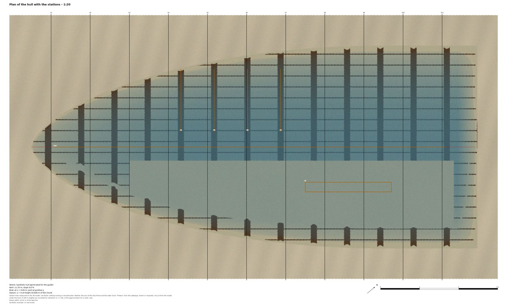
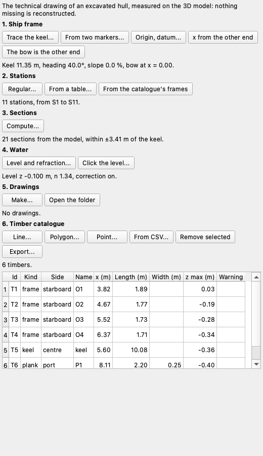
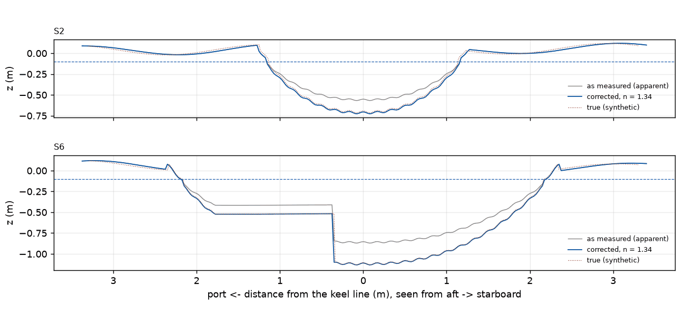
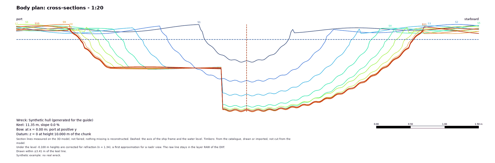
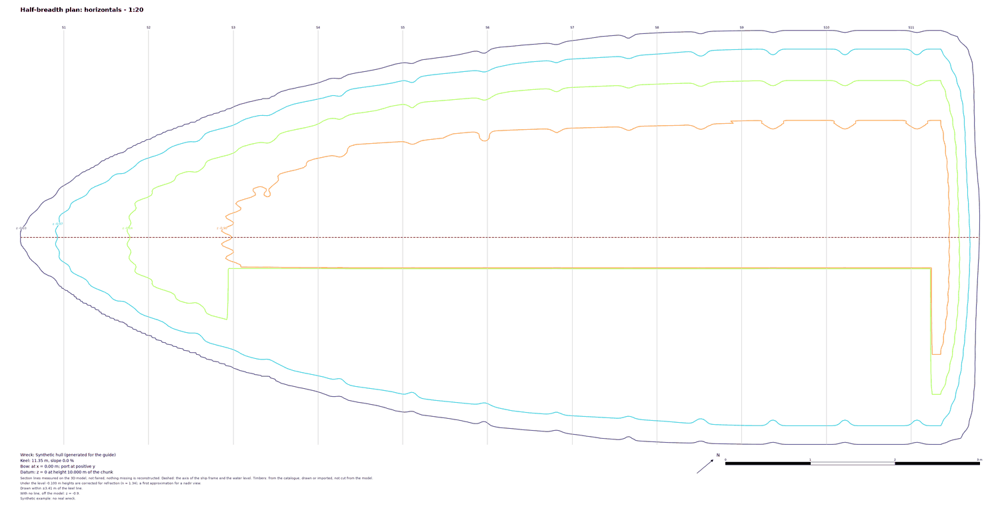

# Shipwreck

The *Shipwreck* plugin makes the technical drawing of an excavated hull from its 3D model: where the ship's axis runs, the
shape of the hull at each station, the plans, and a numbered list of the timbers with their measures. Today this is
drawn by hand on an orthophoto. The plugin measures what is there. It does not reconstruct what is missing, and it does not
fair a line away from the model.

This page describes version 0.1.0 of the plugin, which needs pyarchinit-photogrammetry 1.3.4 or later. The README and the
code are in the [plugin repository](https://github.com/enzococca/pyarchinit-photogrammetry-plugins/tree/main/plugins/shipwreck).

<figure markdown="span">
  
  <figcaption>The plan of a synthetic hull: the keel line in dashes, a station every metre, a few timbers, over the
  orthophoto turned into the ship frame.</figcaption>
</figure>

!!! note "The examples of this page"
    All the figures come from a **synthetic hull** generated for this guide, not from a real wreck: a shape about 11 m long
    with frames every 0.85 m, sediment left on one side and a surface seen through water, and a drawn orthophoto. They show
    what the plugin does; the true surface is known, which is what the water figure compares with.

## In short

1. Open the project with the model of the hull, and the orthophoto if there is one (the pane *Relitto* / *Shipwreck* is on the right).
2. **Ship frame**: trace the keel from one end to the other, then say which end is the bow.
3. **Stations**: regular, or a table with the field's names.
4. **Sections**: cross-sections at the stations, longitudinals and horizontals where you want them.
5. **Water**: the level, if part of the hull is under water, and whether to correct it.
6. **Drawings**: body plan, half-breadth plan, profile and plan, in SVG, PDF, PNG and DXF.
7. **Timbers**: draw them on the raster or import a table; the measures are computed; export to CSV, Excel or GeoPackage.

<figure markdown="span">
  
  <figcaption>The pane, on the synthetic hull: six steps, each with its buttons and its state.</figcaption>
</figure>

## What you need

A chunk with a **model** in metres: a projected coordinate system, or a local frame with a scale (a scale bar, references,
a model imported in metres). A chunk in degrees (WGS 84) is refused with a message: bring it to a projected system first (*GNSS >
System and heights*). A project imported from Metashape in WGS 84 is already in UTM: the import converts it by itself. An
orthophoto is only needed for the plan, and the DEM for nothing: heights are read on the model.

## The ship frame

Ship coordinates: **x** along the keel from a start point, **y** to port, **z** up, in metres.

* *Trace the keel...* draws a line on the raster view: the first and the last vertex are the ends of the keel line; x is 0 at
  the first. *From two markers...* uses two markers that have a position: this is how you pick the ends in the 3D view, with
  the program's *Marker* button.
* *The bow is the other end*: the first time, the **bow** is where you started tracing. The model does not show which end it
  is, so you say it: this button **exchanges port and starboard on every drawing**, and only this one does.
* *x from the other end*: x runs the other way. The bow stays where it is, y and the sides do not change. A keel traced again the
  other way does the same.
* *Origin, datum...*: the value of x at the first end (0 at the stem, or a chosen station) and the height of z = 0.

Up is the world's vertical and the keel line is levelled: x is the direction of the keel in plan and z the height over the
datum. A keel with a slope of its own keeps it as a number, shown in the pane and on the sheets, and not taken out. The frame is
a transform used by the plugin only: the chunk does not change. In a local frame up is the z axis of the model, which nothing
verifies as vertical: every sheet says so, and a model that is not level gives tilted sections.

## Stations and sections

*Regular...* gives S1, S2... at a spacing: these names are ours, for a survey with no numbering yet. *From a table...* reads
`name, x`, with the names of the field: `F30, 12.4` separated by commas, with the decimal point; `F30; 12,4` separated by semicolons
or tabs, with the point or the comma. A row with too many cells is refused with its number, because `F30, 12,4` is three cells and
would be a wrong station. *From the catalogue's frames* puts a station at each frame of the catalogue.

*Compute...* cuts the model: the cross-sections at the stations, the longitudinals at the y you list, the horizontals at the z
you list, as far across the keel as the model goes (or inside the half width you give) and a little beyond the ends of the keel.
The cut is the program's, on the mesh, in double precision; the lines are stored in `<chunk data>/shipwreck/sections.json`. It runs
in the background and can be cancelled. The sheets give the half width and say which lines reach its limit; a station off the
model has no line, and pane and sheets name it.

When the frame, the model or the chunk's georeference changes, the pane says that the sections are to be computed again and the drawings
refuse the old ones. When the coordinate system of the chunk changes, the frame and the timbers drawn are still in the old
coordinates: the plugin refuses until the keel is traced again. Drawings already written are marked as to make again in the pane and in the tree.

!!! tip "Small closed loops"
    A section of a real model is not one line: a sandbag, a stone or a hole in the mesh gives a small loop beside the main line.
    They are on the model, so they are drawn.

## Water

The bottom seen through water is **apparent**: for a nadir view the true depth is about the apparent depth times the
refractive index, 1.34 for water. Give the level, as a number in ship z or by clicking the waterline on the raster, and switch the
correction on: a point under the level is drawn at `level - (level - z) * n`.

<figure markdown="span">
  
  <figcaption>Two stations of the synthetic hull as measured (grey) and corrected (blue) under a level of -0.10 m, with the
  true surface dotted. Here the correction lands on the truth because the apparent surface was made with the same formula:
  real water is less kind.</figcaption>
</figure>

This is a first approximation. Oblique rays are not modelled (they make the bottom look still shallower, so the correction, if
anything, stays short), nor is a moving surface, nor the shore where the level meets the hull. Both the raw and the corrected line are
kept: the body plan and the profile show the corrected one and say so, and the raw one stays in the layer `RAW` of their DXF. On
the half-breadth plan the lines stay where they are and their labels carry the corrected height. The note is always on the sheet, also
with the correction off.

!!! warning "How far to trust the bottom under water"
    Read the shape, not the heights. Clear, still water often gives a bottom that holds together, with the frames visible in
    the horizontals. But the heights are apparent, the level is hard to read to better than a few centimetres, the correction
    is not checked by anything measured under water, and in a hull not fully emptied the surface is the sediment, not the planking.
    Before using a depth, measure a few points by hand.

## The drawings

*Make...* writes each drawing in `<chunk data>/shipwreck/drawings` as SVG, PDF, PNG and DXF: the title block fields are asked there,
and the scale, automatic (the most detailed standard scale that fits about an A0 sheet) or chosen. A drawing of a kind with no
lines (no horizontals asked, for instance) is left out. Every sheet carries a title block with the bow's x and the datum's height, the
half width, the water note and a legend: section lines come from the model; the dashed lines are the axis of the ship frame and the level;
timbers come from the catalogue, drawn or imported, and are not cut from the model.

* **Body plan**: the cross-sections overlaid, seen from aft, port on the left, each station in its colour. The sides are drawn as
  measured: nothing is mirrored.
* **Half-breadth plan**: the horizontals, with the stations and the keel line. Under water the labels carry the corrected height.
* **Profile**: the longitudinals, with the stations and the level.
* **Plan**: the stations and the timbers over the orthophoto turned into the ship frame.

Plans are seen from above whichever way x runs: they are never mirror images. The DXF has a layer per kind (`STATIONS`,
`LONGITUDINALS`, `HORIZONTALS`, `RAW`, `KEEL`, `LEVEL`, `TIMBERS`, `GRID`, `TEXT`), in metres on the sheet.

<figure markdown="span">
  
  <figcaption>The body plan of the synthetic hull: eleven stations from the bow (blue) to the wide end (red), corrected under the
  dashed level. The flat step on the port side is the sediment left in the hull.</figcaption>
</figure>

<figure markdown="span">
  
  <figcaption>The horizontals of the synthetic hull, from -0.10 to -0.70 m apparent (at -0.90 m the sheet says there is no line): the frames show as regular bumps.</figcaption>
</figure>

## The timbers

Draw a timber on the raster view as a line, a polygon or a point and give its kind (keel, keelson, frame, plank, ceiling, stringer,
fastening, other), side and name; or import a table with a header: `kind`, `side`, `name`, `station`, `notes` (in Italian too:
`tipo`, `lato`, `nome`, `stazione`, `note`) and the geometry as `x, y` (a point) or `x1, y1, x2, y2` (a line) in ship coordinates, or `wkt` in the
coordinates of the chunk.

| Measure | How |
|---|---|
| x, y | the mean position in ship coordinates |
| length | along a line over the model; for a polygon, the long side of the rectangle around it |
| width | the short side of that rectangle; a line has none |
| z min, z max | the model's heights on the timber above the datum; with the water on, also corrected |

Heights are good to about one edge of the mesh. Under water lengths along a line are as measured. Without a model the catalogue still
works, with lengths in plan and no heights. The room and space of the frames comes from their x, side by side, in the second sheet of
the Excel file. When the side of a record disagrees with the sign of its y, the pane, the table and the exports say so (`warning`): after
*The bow is the other end*, for instance. Timbers are a layer of the raster view: deleting one there takes it out of the catalogue.
*Export...* writes CSV, XLSX or GeoPackage; so do the entries in *File > Export*.

## Command line

```bash
ppg plugin shipwreck frame PROJECT.ppg --start X,Y --end X,Y --bow start   # --flip, --other-bow
ppg plugin shipwreck stations PROJECT.ppg --spacing 1 --count 11 --first 1
ppg plugin shipwreck sections PROJECT.ppg --longitudinals "0;1;-1" --horizontals "-0.2;-0.5" --half-width 4.5
ppg plugin shipwreck water PROJECT.ppg --level -0.1 --on
ppg plugin shipwreck drawings PROJECT.ppg --scale 20
ppg plugin shipwreck timbers PROJECT.ppg --table timbers.csv
ppg plugin shipwreck export PROJECT.ppg --out timbers.xlsx
ppg plugin shipwreck status PROJECT.ppg
```

## What it does not do

Hull reconstruction, mirrored sides, lofted surfaces, hydrostatics, plank expansion, automatic detection of timbers, refraction beyond the
nadir approximation, merging several days. Everything it writes stays in `<chunk data>/shipwreck/`, apart from what you export; the
transform, the model and the products of the chunk are never changed.
