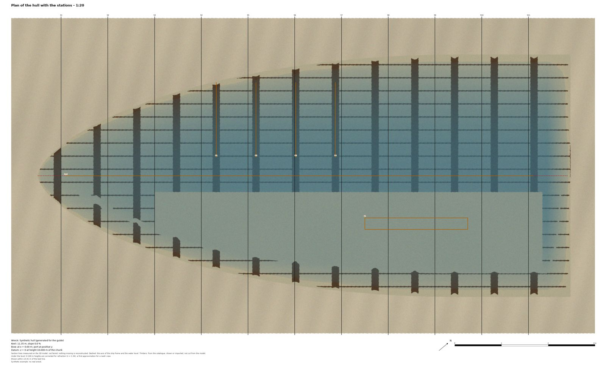
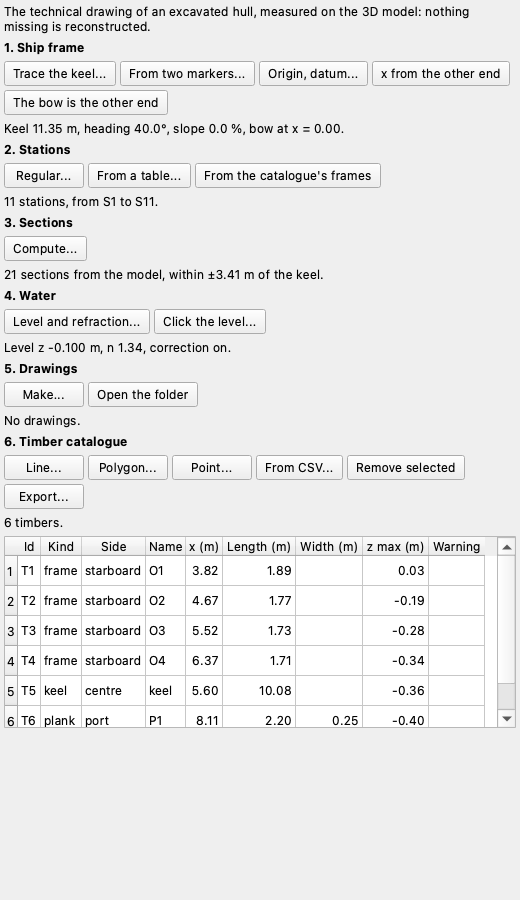
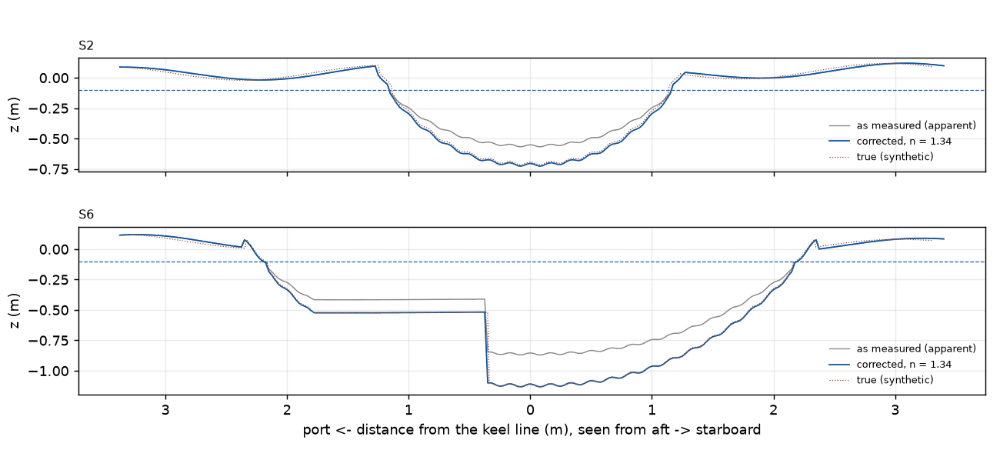
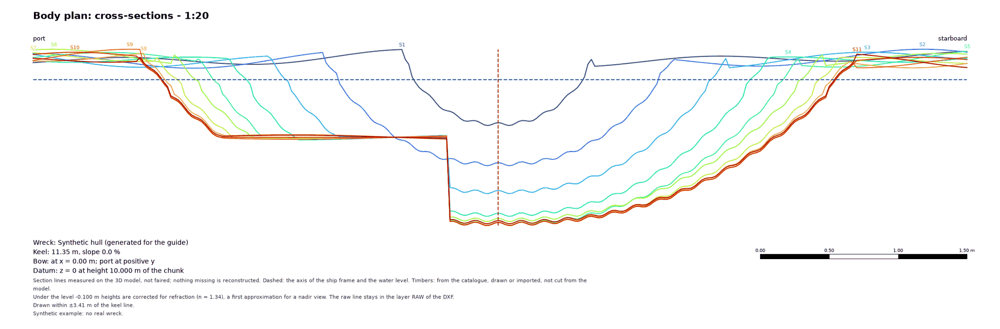
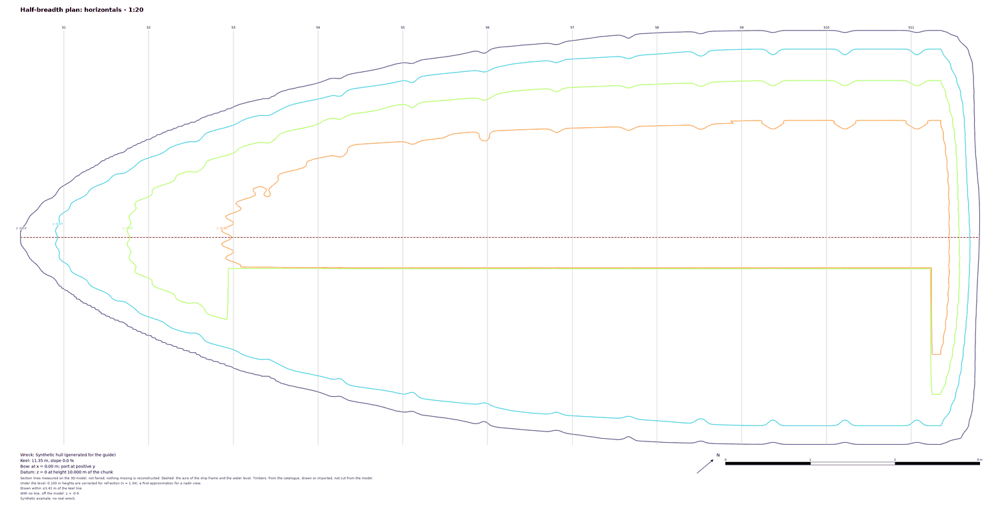
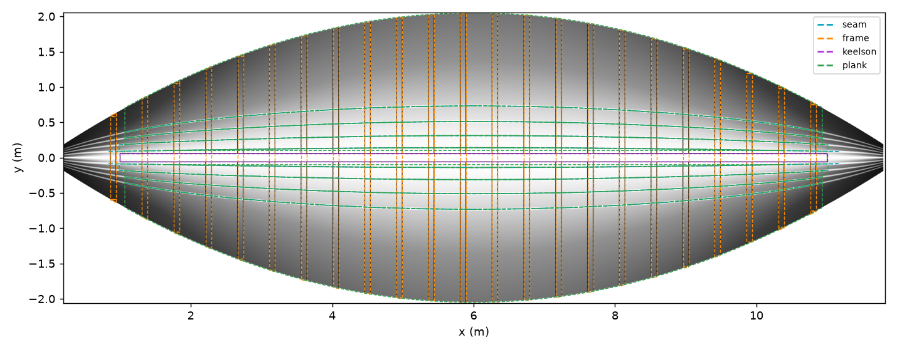
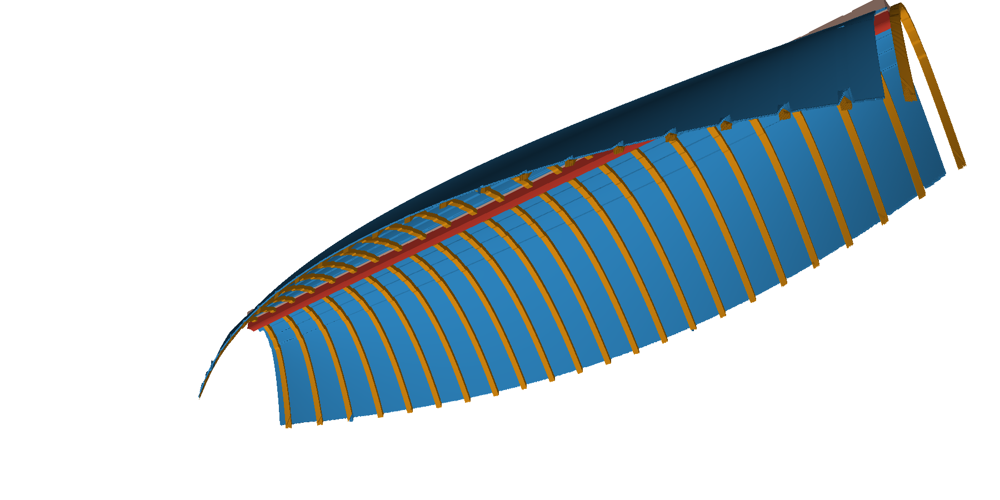
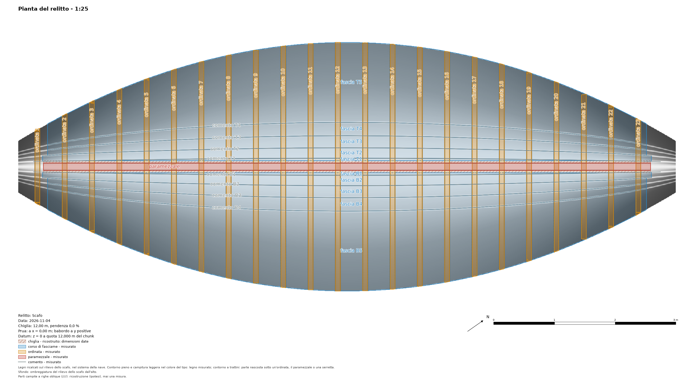
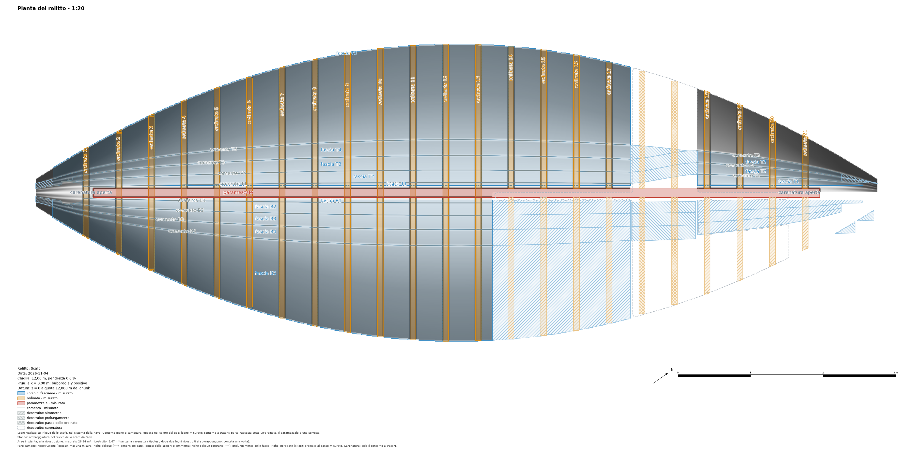
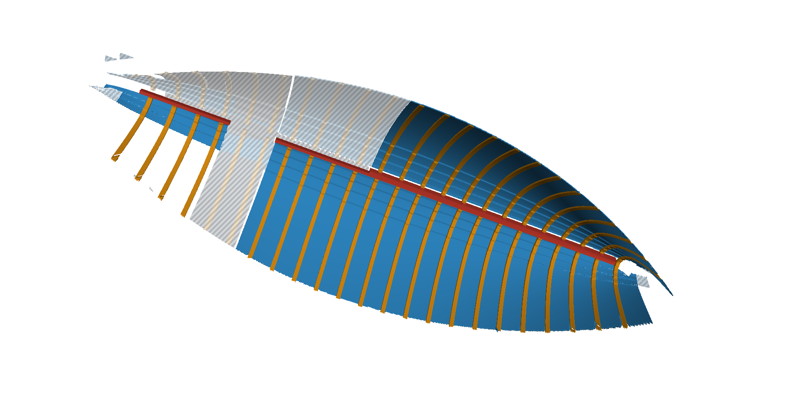

# Shipwreck

The *Shipwreck* plugin makes the technical drawing of an excavated hull from its 3D model: where the ship's axis runs, the
shape of the hull at each station, the plans, and a numbered list of the timbers with their measures. Today this is
drawn by hand on an orthophoto. The plugin measures what is there. It does not reconstruct what is missing, and it does not
fair a line away from the model.

This page describes version 0.5.0 of the plugin, which needs pyarchinit-photogrammetry 1.7.1 or later (1.7.7 for the classified drawings and the water level of the chunk). The README and the
code are in the [plugin repository](https://github.com/enzococca/pyarchinit-photogrammetry-plugins/tree/main/plugins/shipwreck).

<figure markdown="span">
  
  <figcaption>The plan of a synthetic hull: the keel line in dashes, a station every metre, a few timbers, over the
  orthophoto turned into the ship frame.</figcaption>
</figure>

!!! note "The examples of this page"
    All the figures come from a **synthetic hull** generated for this guide, not from a real wreck: a shape about 11 m long
    with frames every 0.85 m, sediment left on one side and a surface seen through water, and a drawn orthophoto. They show
    what the plugin does; the true surface is known, which is what the water figure compares with.

## In short

1. Open the project with the model of the hull, and the orthophoto if there is one (the pane *Relitto* / *Shipwreck* is on the right).
2. **Ship frame**: trace the keel from one end to the other, then say which end is the bow.
3. **Stations**: regular, or a table with the field's names.
4. **Sections**: cross-sections at the stations, longitudinals and horizontals where you want them.
5. **Water**: the level, if part of the hull is under water, and whether to correct it.
6. **Drawings**: body plan, half-breadth plan, profile and plan, in SVG, PDF, PNG and DXF.
7. **Timbers**: draw them on the raster or import a table; the measures are computed; export to CSV, Excel or GeoPackage.

<figure markdown="span">
  
  <figcaption>The pane, on the synthetic hull: six steps, each with its buttons and its state.</figcaption>
</figure>

## What you need

A chunk with a **model** in metres: a projected coordinate system, or a local frame with a scale (a scale bar, references,
a model imported in metres). A chunk in degrees (WGS 84) is refused with a message: bring it to a projected system first (*GNSS >
System and heights*). A project imported from Metashape in WGS 84 is already in UTM: the import converts it by itself. An
orthophoto is only needed for the plan, and the DEM for nothing: heights are read on the model.

## The ship frame

Ship coordinates: **x** along the keel from a start point, **y** to port, **z** up, in metres.

* *Trace the keel...* draws a line on the raster view: the first and the last vertex are the ends of the keel line; x is 0 at
  the first. *From two markers...* uses two markers that have a position: this is how you pick the ends in the 3D view, with
  the program's *Marker* button.
* *The bow is the other end*: the first time, the **bow** is where you started tracing. The model does not show which end it
  is, so you say it: this button **exchanges port and starboard on every drawing**, and only this one does.
* *x from the other end*: x runs the other way. The bow stays where it is, y and the sides do not change. A keel traced again the
  other way does the same.
* *Origin, datum...*: the value of x at the first end (0 at the stem, or a chosen station) and the height of z = 0.

Up is the world's vertical and the keel line is levelled: x is the direction of the keel in plan and z the height over the
datum. A keel with a slope of its own keeps it as a number, shown in the pane and on the sheets, and not taken out. The frame is
a transform used by the plugin only: the chunk does not change. In a local frame up is the z axis of the model, which nothing
verifies as vertical: every sheet says so, and a model that is not level gives tilted sections.

## Stations and sections

*Regular...* gives S1, S2... at a spacing: these names are ours, for a survey with no numbering yet. *From a table...* reads
`name, x`, with the names of the field: `F30, 12.4` separated by commas, with the decimal point; `F30; 12,4` separated by semicolons
or tabs, with the point or the comma. A row with too many cells is refused with its number, because `F30, 12,4` is three cells and
would be a wrong station. *From the catalogue's frames* puts a station at each frame of the catalogue.

*Compute...* cuts the model: the cross-sections at the stations, the longitudinals at the y you list, the horizontals at the z
you list, as far across the keel as the model goes (or inside the half width you give) and a little beyond the ends of the keel.
The cut is the program's, on the mesh, in double precision; the lines are stored in `<chunk data>/shipwreck/sections.json`. It runs
in the background and can be cancelled. The sheets give the half width and say which lines reach its limit; a station off the
model has no line, and pane and sheets name it.

When the frame, the model or the chunk's georeference changes, the pane says that the sections are to be computed again and the drawings
refuse the old ones. When the coordinate system of the chunk changes, the frame and the timbers drawn are still in the old
coordinates: the plugin refuses until the keel is traced again. Drawings already written are marked as to make again in the pane and in the tree.

!!! tip "Small closed loops"
    A section of a real model is not one line: a sandbag, a stone or a hole in the mesh gives a small loop beside the main line.
    They are on the model, so they are drawn.

## Water

The bottom seen through water is **apparent**: for a nadir view the true depth is about the apparent depth times the
refractive index, 1.34 for water. Give the level, as a number in ship z or by clicking the waterline on the raster, and switch the
correction on: a point under the level is drawn at `level - (level - z) * n`.

From version 0.5.0, with pyarchinit-photogrammetry 1.7.7 or later, a water level set for the chunk in the program
(*Water*: by hand, from the edge of the water or a click) is taken as the default of *Level and refraction...* while the plugin
has no level of its own: the state of the step says so ("the water level of the chunk"), the correction stays off, and the
level becomes the plugin's own when you confirm the form. A level of the plugin always wins.

<figure markdown="span">
  
  <figcaption>Two stations of the synthetic hull as measured (grey) and corrected (blue) under a level of -0.10 m, with the
  true surface dotted. Here the correction lands on the truth because the apparent surface was made with the same formula:
  real water is less kind.</figcaption>
</figure>

This is a first approximation. Oblique rays are not modelled (they make the bottom look still shallower, so the correction, if
anything, stays short), nor is a moving surface, nor the shore where the level meets the hull. Both the raw and the corrected line are
kept: the body plan and the profile show the corrected one and say so, and the raw one stays in the layer `RAW` of their DXF. On
the half-breadth plan the lines stay where they are and their labels carry the corrected height. The note is always on the sheet, also
with the correction off.

!!! warning "How far to trust the bottom under water"
    Read the shape, not the heights. Clear, still water often gives a bottom that holds together, with the frames visible in
    the horizontals. But the heights are apparent, the level is hard to read to better than a few centimetres, the correction
    is not checked by anything measured under water, and in a hull not fully emptied the surface is the sediment, not the planking.
    Before using a depth, measure a few points by hand.

## The drawings

*Make...* writes each drawing in `<chunk data>/shipwreck/drawings` as SVG, PDF, PNG and DXF: the title block fields are asked there,
and the scale, automatic (the most detailed standard scale that fits about an A0 sheet) or chosen. A drawing of a kind with no
lines (no horizontals asked, for instance) is left out. Every sheet carries a title block with the bow's x and the datum's height, the
half width, the water note and a legend: section lines come from the model; the dashed lines are the axis of the ship frame and the level;
timbers come from the catalogue, drawn or imported, and are not cut from the model.

* **Body plan**: the cross-sections overlaid, seen from aft, port on the left, each station in its colour. The sides are drawn as
  measured: nothing is mirrored.
* **Half-breadth plan**: the horizontals, with the stations and the keel line. Under water the labels carry the corrected height.
* **Profile**: the longitudinals, with the stations and the level.
* **Plan**: the stations and the timbers over the orthophoto turned into the ship frame.

Plans are seen from above whichever way x runs: they are never mirror images. The DXF has a layer per kind (`STATIONS`,
`LONGITUDINALS`, `HORIZONTALS`, `RAW`, `KEEL`, `LEVEL`, `TIMBERS`, `GRID`, `TEXT`), in metres on the sheet.

<figure markdown="span">
  
  <figcaption>The body plan of the synthetic hull: eleven stations from the bow (blue) to the wide end (red), corrected under the
  dashed level. The flat step on the port side is the sediment left in the hull.</figcaption>
</figure>

<figure markdown="span">
  
  <figcaption>The horizontals of the synthetic hull, from -0.10 to -0.70 m apparent (at -0.90 m the sheet says there is no line): the frames show as regular bumps.</figcaption>
</figure>

## The timbers

Draw a timber on the raster view as a line, a polygon or a point and give its kind (keel, keelson, frame, plank, ceiling, stringer,
fastening, other), side and name; or import a table with a header: `kind`, `side`, `name`, `station`, `notes` (in Italian too:
`tipo`, `lato`, `nome`, `stazione`, `note`) and the geometry as `x, y` (a point) or `x1, y1, x2, y2` (a line) in ship coordinates, or `wkt` in the
coordinates of the chunk.

| Measure | How |
|---|---|
| x, y | the mean position in ship coordinates |
| length | along a line over the model; for a polygon, the long side of the rectangle around it |
| width | the short side of that rectangle; a line has none |
| z min, z max | the model's heights on the timber above the datum; with the water on, also corrected |

Heights are good to about one edge of the mesh. Under water lengths along a line are as measured. Without a model the catalogue still
works, with lengths in plan and no heights. The room and space of the frames comes from their x, side by side, in the second sheet of
the Excel file. When the side of a record disagrees with the sign of its y, the pane, the table and the exports say so (`warning`): after
*The bow is the other end*, for instance. Timbers are a layer of the raster view: deleting one there takes it out of the catalogue.
*Export...* writes CSV, XLSX or GeoPackage; so do the entries in *File > Export*.

## Clinker strakes

Step 7 of the pane, **Strakes (clinker)**, reads the planking of a clinker hull on the sections: where each strake laps
over the one below, and from that the strakes themselves. It needs the ship frame and the sections at the stations
(steps 1 to 3); a station every metre or less is a good start.

| Button | What it does |
|---|---|
| *Find the strakes...* | The lands on every station's section, the land lines along the hull, the layer "Fasce" in the raster view and the drawings, `lands.dxf` and `lands.gpkg`. |
| *Strake model...* | A strake between two land lines: widths, length, thickness and lap, a mesh per strake, the tables. |
| *Into the catalogue* | A `plank` record of the timber catalogue per strake, its outline in plan, noted *strake model (hypothesis)*. |
| *For the Clinker Boat Tool...* | The files for Fröhlich and Nielsen's Houdini asset, in a folder you choose. |
| *Planks from Houdini...* | The planks that asset exports, back in the catalogue with their distance from the scan. |
| *Open the folder* | `<chunk data>/shipwreck/clinker`. |

### How the lands are found

On each station the plugin takes the **raw** section (never the water-corrected one) and splits it at the keel: port
(y > 0) and starboard. Each side is read from the rabbet, the top of the keel's side, out to the sheer, and ends where
the profile turns back round the sheer or bends into sediment, a trench or the seabed. A moving average over 12 cm of
the profile is the hull "without planks"; the raw profile's offset from it is a saw tooth on a clinker hull, rising
gently inside a strake and dropping by the step at each land. A land is where that offset changes by more than the
**least step** within 3 cm; two lands are at least the **least strake width** apart. Each land has its position along the
section from the rabbet and its step in millimetres.

Across the stations, the count of lands found most often is the hull's on that side. A station with another count (a
stealer, a drop strake, an eroded sheer, damage) is **uncertain**, and so is a station whose rabbet or garboard lies
more than 2 cm from the curve through its neighbours (looked for with five stations or more on a side: the curve is
a parabola through four neighbours, and with fewer a true jump is not caught). The lands of an uncertain station are matched to the lines by
their position along the section; a land on no line is listed. Nothing is faired or filled: a side with a gap, a loose
piece or no readable keel gives no lands and is listed with the reason.

| Parameter | Default | When to change it |
|---|---|---|
| Least step (mm) | 8 | Lower for thin planking or a worn hull, higher if the noise of the model makes false lands. |
| Least strake width (m) | 0.08 | Lower for very narrow strakes. |
| Half width of the keel (m) | 0.10 | How far from the keel's middle its side may reach. |
| Least width of the sole (m) | 0.02 | Lower it when a narrow, worn keel leaves the sides not read at every station. |

The pane says how many strakes each side has, which stations are uncertain and why, the lands on no line and the sides
not read. When the sections are cut again after the lands were found, the pane says the lands must be found again, and
the land lines are drawn dashed in the raster view.

### The strake model: a hypothesis

The lands are measured. The land lines that join them, and the strakes between them, are **a hypothesis from the
sections, not a measure**: every file says so (*modello delle fasce: ipotesi dalle sezioni, non una misura*), and the
model is never mixed with the sections.

For each side, strake 1 is the garboard, between the rabbet and the first land line; the last strake runs to the sheer.
Per strake: its width at every station (the length along the section between its two lines) with an uncertainty in
millimetres, nothing where the station is uncertain or not read; its length along the upper line; its thickness (the
median step of the land where it laps over the one below, or the value you give); the lap you give (20 mm by default).
The strakes are named `B1, B2, ...` on port (babordo) and `T1, T2, ...` on starboard (tribordo). Files in
`<chunk data>/shipwreck/clinker/`: `strakes.obj` (ship coordinates, one object per strake), `strakes.ply` (the chunk's
coordinates, double precision), `strakes.csv` and `strakes.xlsx`.

The model is refused when a side with lands has fewer than three stations with a width: it would be all interpolation.
When the lands are found again, the files of the earlier model (and their copies in the last folder exported for the
Clinker Boat Tool) are renamed `.old`, its strakes are taken out of the timber catalogue, and the pane says so. If a
file cannot be renamed (open in another program), nothing changes and the message names it.

### The Clinker Boat Tool

The Clinker Boat Tool by Fred Fröhlich and Sigurd Solhaug Nielsen is a Houdini Digital Asset that builds a clinker boat
plank by plank from a scan. *For the Clinker Boat Tool...* writes `clinker_boat_tool/` in the folder you choose, in the
ship frame turned so that Y is up (Houdini's up axis) and the keel runs along X: `hull.obj`, `sections.obj`,
`stations.json`, `frame.json`, `lands.obj` and `strakes.obj` with the strake tables when they exist, and a
`README.txt`. In Houdini, with the asset's six steps:

1. **Import the scan**: `hull.obj`; `sections.obj`, `lands.obj` and `strakes.obj` as references.
2. **Calibrate and align**: already done, in metres with the keel along X and Y up.
3. **Define sections**: the stations' x are in `stations.json`; `sections.obj` shows the cuts there.
4. **Generate the plank layout**: read widths, thickness and lap per strake from `lands.obj` and `strakes.xlsx`.
5. **Bend and align** the planks on the scan.
6. **Presets and export**: export the planks as OBJ, one object or group per plank, under a name of your own
   (`planks.obj`): never `strakes.obj` or `lands.obj` in the export folder, which a new detection sets aside.

*Planks from Houdini...* reads that OBJ back: each plank becomes a `plank` record of the catalogue (its outline in plan,
its side from the mean y or from B/T in its name), with the distance of its vertices from the scan, median and 90th
percentile in millimetres, in `<file>_scostamenti.csv` and `.xlsx`. Importing the same file again replaces its planks,
never yours. A group that holds all the others (such as *all*) is not a plank and is left out, whether or not it also
holds the faces outside any group.

The plugin writes files that the asset's own steps take in, and reads back the planks it exports: nothing of the asset
is copied or used. Please cite:

- Fröhlich, F., Nielsen, S. S. *From Photogrammetry to Construction Knowledge: 3D Documentation and Parametric
  Reconstruction of Historic Clinker Boats*. CC BY 4.0. [10.5281/zenodo.23422398](https://doi.org/10.5281/zenodo.23422398)
- Fröhlich, F., Nielsen, S. S. *Clinker Boat Tool* (Houdini Digital Asset). MIT License.
  [10.5281/zenodo.17488549](https://doi.org/10.5281/zenodo.17488549)

### Limits of the strakes

- On sections of a mesh noisier than about 0.5 mm the widths are good to about a centimetre. At 1 mm of noise about one
  side in fifteen may get a wrong count of lands; it is flagged as an uncertain station.
- The jumps are looked for only with five stations or more on a side. A jump of 2-2.5 cm of the rabbet at an end
  station is not caught. Three or more adjacent stations shifted together,
  or a gradual step, are not flagged.
- A permanent step of the keel (a broken or displaced hull, a scarf) flags every station on one side of it. Above about
  3 mm of scatter on the rabbet a station may be flagged wrongly.
- Without a sole, a V of planking steeper than 80° within the keel's half width is read as keel until it flattens. A
  keel side in line with the garboard is a side not read (`keel_unclear`).
- A hull seen from inside (the planking under the frames, as on many excavated wrecks) shows the inner face: the keel is
  hidden by the keelson and the reading per station gives uncertain stations. The next version will trace the lands on
  the hull's relief.

## Relief, tracing, 3D timbers and the plan of the wreck

Step 8 of the pane, **Relief and tracing**, turns the 3D model of an excavated hull into the drawing a field
archaeologist makes: every timber outlined, named and typed on a plan, and every timber a 3D object. It needs the ship
frame (step 1); the stations and the sections are not needed.

| Button | What it does |
|---|---|
| *Relief of the hull...* | The hull seen from above in the ship frame: an elevation of the program on a horizontal plane (u = x, v = sign × y: y to the left of x, whichever end is the bow), its heights, hillshade and local relief model. |
| *Show* | The relief in the raster view, with the heights, the hillshade or the local relief in grey over it. |
| *Propose...* | Seams, frames, keelson, stringers and strakes read on the relief: proposals, dashed, a colour per kind. |
| *Accept* / *Reject* | The proposals selected on the view into the timber catalogue / thrown away for good (*Delete* on the view rejects too). |
| *Correct...* / *Add...* | A timber traced again, or a new one traced by hand, on the relief, with the program's drawing tools and snap. |
| *Names from a table...* | A table `name, x`: the frames take the field's names. |
| *Loose* | The selected timbers flagged as out of place. |
| *Keel (dimensions)...* | A keel from a given siding and moulding: a hypothesis. |
| *3D timbers...* | Every traced polygon a closed 3D object. |
| *Export 3D...* | OBJ, GLB or IFC, one object per timber, with the tables. |
| *Plan of the wreck...* | The plan with every timber outlined, coloured by kind and named: SVG, PDF, PNG, DXF. |

Every change of the catalogue, the proposals or the keel is a step of *Edit > Undo* (deleting proposals and timbers
together on the view is one step).

### The relief of the hull

The model is read from above in the ship frame: per cell the highest surface of the model (the inside of a hull lying
on its bottom), a GeoTIFF in ship metres with the frame in its tags, and a north-up copy in the chunk's system for GIS.
Its hillshade from four directions and its local relief model are shown in grey over it, as the program does for a DEM.
The cell comes from the model's density; 5 mm suits a close-range model of a hull (a model of 15 million faces takes
about a minute). The drawings made on the relief stay with it when you build it again, also after the ship frame
changed.

The relief is a height field: one height per cell, the highest. Whatever cannot be seen from above in the ship frame is
not in it, and so not in the proposals nor in the 3D timbers: an undercut, a side steeper than vertical, the underside of
a timber, a timber lying under another, the outer face of the planking. For a wreck seen from inside this means: the
planking is its inner face (its thickness comes from the steps of the seams, the strake model or the value you type),
the keel is not seen (hence the keel of given dimensions), the frames are their visible part above the planking, and
whatever lies under the frames is interpolated. A hull lying on its side needs a ship frame of its own so that the part
you want is seen from above.

### The proposals



The plugin reads on the height raster:

- **seams** (the lands of a clinker planking): steps across the hull, followed along x, broken at gaps, a line each;
  numbered from the keel (`comento B1`, `B2`, ... to port, `T1`, ... to starboard); a piece that falls between two lands
  already there is a doubtful `comento B?` with a score of 0.1;
- **frames**, the **keelson** and the **stringers**: what stands above the planking (the heights above an opening along
  x, on the floor's rise along x taken out first, so that a frame keeps its whole outline where the hull rises toward
  stem and stern), as polygons, classified by length and direction; the frames named from the bow, with their room and
  the frame space per side. A transverse item that fails only the elongation test (between 1.8 and 3 times as long as
  wide: most often a frame merged with its neighbour or with raised planking) is a doubtful `ordinata ?` with a score of
  0.1: accept it and correct its outline;
- **strakes**: the bands between consecutive seams, a polygon each, `fascia B1`, ...; band 1 runs from the keel line
  (offset by the keel's half width) to seam 1, and each band starts and stops where the pieces of its seams do, so where
  the inner seams are not read the bands are boxes. A band more than 1.5 times as wide as the side's other bands
  between seams, or lying mostly over the proposed keelson and stringers, is a doubtful `fascia B?` with a score of 0.1.

| Parameter | Default | When to change it |
|---|---|---|
| The model shows | the inside | *The outside* for a lifted hull: it decides which way a land's step goes. |
| Least step of a seam (mm) | 8 | Lower for thin planking or a worn hull; higher if the noise of the model makes false seams. |
| Opening (m) | 0.3 | Longer than the room between two frames, shorter than the planking between two frames. |
| Least height of a timber over the planking (mm) | 20 | Lower for worn frames, higher if lumps of sediment are proposed. |

Everything is a **proposal**: accept, correct or reject it by hand. A new reading never touches the catalogue and never
proposes again what was accepted or rejected. The limits, plainly:

- a loose timber of which only one edge is read gives a seam that is not one;
- a timber narrower than 5 cm beside a land may be missed;
- a model showing the outside of the hull needs *The outside*, otherwise every seam is doubtful;
- a long timber lying flush along almost the whole length of a land renames the lands beyond it;
- a remnant in a strake of normal width is proposed as `comento ?`: accepting it splits the strake in two;
- a land missing along the whole hull gives one band over two strakes;
- noise of the model beyond 2 mm breaks the seams into pieces and may add a strake;
- strays at the bow may take rank 1;
- on a real wreck frames lying close together, or with planking between them, are read as one wide item, proposed as
  `ordinata ?` (or *other* when even shorter): correct the outline, or trace the frames by hand with *Add...*; splitting
  merged frames is planned for version 0.4.0; flat patches of sediment may be proposed as a keelson;
- the strakes are bands between the seams read, not the outlines of the planks: where seams are missing they are boxes
  over whatever lies there (sediment, longitudinal timbers); correct or trace them by hand.

### A drawing classified by orientation

From version 0.5.0, with pyarchinit-photogrammetry 1.7.7 or later (the button is hidden with an older program), a tracing
of your own can fill the catalogue: *Classified drawing...* in step 8 reads a layer of free drawings of the chunk, or a
GeoPackage, GeoJSON or DXF file (put in the chunk's system as the import of free drawings does), turns it into the ship
plan and has the program classify it along the keel line ([A drawing classified by orientation](../gui/drawing.md#a-drawing-classified-by-orientation)). The plugin gives the groups their meaning:

| Group of the program | Timber | Geometry |
|---|---|---|
| pairs across the axis | frame | polygon |
| lines along the axis | seam | line |
| pairs along the axis | strake (plank) | polygon |

Single lines across the keel and lines in other directions are not timbers and stay out (the plate shows them with their
numbers). The side comes from the mean y, as for a timber traced by hand; the names are the plugin's: `ordinata N` from the
bow (both sides of one frame share N), `comento B1`, `B2`, ... and `fascia T1`, ... numbered from the keel on each side.

Nothing enters the catalogue before the **check plate**: it shows every element coloured by group with the plugin's names,
and a box per kind with its count. *Into the catalogue* adds the kinds ticked as measured timbers (source `orient:<id>`),
one step of *Edit > Undo*; *Cancel* leaves the catalogue as it was. The plate is kept in `shipwreck/classified/plate.png`.

!!! tip "Frames drawn as loose lines"
    A traced polygon is always one element: draw frames and strakes as polygons when you can. Frames drawn as **two loose
    lines each, close together** (for instance 12 cm sided with 13 cm between them) look like evenly spaced lines and come out
    as single lines across, not frames: set **Pair isolation** to 1 (`--pair-isolation 1`), or draw them as polygons. Lower
    it only for such drawings and check the plate: with 1 a loose seam may pair with the end of a frame polygon nearby.

The form also takes the pairs' distance (from 2 cm to 50 cm by default) and the shortest piece read (5 cm). From the
command line:

```bash
ppg plugin shipwreck classified PROJECT.ppg --layer "Rilievo" --plate plate.png          # the counts and the list; nothing saved
ppg plugin shipwreck classified PROJECT.ppg --layer "Rilievo" --accept                   # all into the catalogue
ppg plugin shipwreck classified PROJECT.ppg --file drawing.dxf --pair-isolation 1 --accept --kinds frame,plank
ppg plugin shipwreck classified PROJECT.ppg --layer "Rilievo" --param pair_max=0.4 --accept 7 8 9
```

Without `--accept` nothing is written; `--accept` with ids takes those elements, with none all of them (of `--kinds`).

### The 3D timbers



*3D timbers...* makes every timber traced as a polygon a closed object in the ship frame, one PLY per timber in
`<chunk data>/shipwreck/timbers/`:

- a **strake** is the model's surface inside its outline with its thickness (its own, that of the strake model of the
  sections, or the step of its seams; the value you type only for the strakes with none). Where a frame, the keelson or
  a stringer lies on it, the surface is interpolated from the strake on both sides and flagged hidden;
- a **frame**, the **keelson**, a **stringer**, the ceiling and any other polygon is a solid from the planking under it
  (interpolated from a ring of cells around it) up to its top (the model's surface).

Limits: trace every timber touching the one you build (an untraced one ends up in the ring the planking under it is read
from); the files are large on long hulls (see the sizes below); a hidden span with cells on one side
only is held constant; a timber traced where nothing stands on the hull gives a mesh of zero thickness. Across a long
timber the hull under it is a curve through the heights and slopes of the planking on both sides (a chord where the
slopes are those of another timber's side). On the synthetic hull all 23 frames, from stem to stern, come within 2 %
of their true volume, the keelson within 1 %, the strakes within 1.4 % of the clinker surface's (the garboard, a strip
2 cm wide seen from above, within 10 %). A cancelled build is said in the pane and the tree (*interrupted*): its
files are partial. When the catalogue, the keel or the relief changes after the build the pane says *to build again*,
and an export warns that the files say what the catalogue said then.

### The keel: a hypothesis

The model of an excavated hull shows its inside: the keel is not seen. *Keel (dimensions)...* makes one from a siding and
a moulding you give: a box along the keel line, under the keelson's bottom (else under the hull at y = 0), along the
whole keelson (else the whole relief) or between two x you give. Its status is *reconstructed: given dimensions*: it is
hatched in the drawings, lighter and translucent (`_ric`) in the 3D files and a row of its own in the tables; its x
range is fixed when you set it. A keel record traced on a chunk that shows the outside replaces it. *No keel* removes it.

### Export 3D

One object per timber with its name, in the ship frame or in the chunk's coordinates:

- **OBJ**: `o <name>` per timber, a material per kind in the `.mtl`;
- **GLB**: a node per timber, a colour per kind;
- **IFC4**: an element per timber (IfcPlate for planks and ceiling, IfcMember for the others) with
  `Pset_PyArchInit_Timber` (name, kind, side, chunk, status, length, width, heights, volume, thickness in metres). A
  chunk in a local or geographic system gets no map conversion, and the file says so. An IFC of a long hull takes from
  tens of seconds to minutes (below);
- the tables `timbers_3d.csv` and `.xlsx` beside it (thickness in millimetres).

Sizes at 5 mm, measured on a 12 m synthetic hull (1.9 million cells): proposals 1 s and about 0.45 GB of memory,
3D timbers about 0.75 GB while building (the two strakes at the edges 1.5 million faces each), PLY files 160 MB, IFC
about 20 s and 290 MB. A 20 m hull at 5 mm has about 16 million cells: count on several GB of memory for the proposals
(about 3.5 GB) and the 3D timbers, an IFC of a few GB taking minutes, and about ten minutes for the relief of a
photogrammetric model. For the 3D exports of a long hull build the relief at 1 cm (four times fewer cells); the
decimation of the solids is planned for version 0.4.0.

Hypotheses end in `_ric`, lighter and half transparent, with their status in the Pset.

### The plan of the wreck



*Plan of the wreck...* draws every timber of the catalogue over the hillshade of the relief, the orthophoto or nothing:
outlined and lightly filled in its kind's colour, the planking lighter so that the relief under it stays readable,
named along its length (a frame across, near its end away from the keel); the parts of a strake under a frame, the
keelson or a stringer dashed; reconstructions (the given keel, the strakes of the sections, the planks imported from the
Clinker Boat Tool) hatched with oblique lines (`////`). Legend per kind and status, scale bar, north, title block; SVG,
PDF, PNG and DXF with a layer per kind (`LEGNI_<KIND>`, `RICOSTRUZIONE_<KIND>`) in `<chunk data>/shipwreck/drawings`.
With traced timbers the body plan marks the strakes at each station and the profile shows the keelson and the keel.
When the relief is stale the pane offers to build it again first.

The strake model of the sections (version 0.2.0) stays available as a hypothesis layer: a strake of the sections is not
drawn where a traced strake has its name.

Limits of the drawings: narrow strakes or several stringers ending at one x may crowd their names; a frame crossing the
keel line is named at its top end; a measured keel record has no box on the profile; the station names of the body plan
may overlap.

## Reconstruction (hypothesis)

Step 9 of the pane, **Reconstruction (hypothesis)** (version 0.4.0), completes what the wreck has lost. Every part of
it is a hypothesis built from what was traced and measured: hatched in the drawings, lighter and translucent (`_ric`)
in the 3D files, a status of its own in the tables; the catalogue of the measured timbers is never changed. It needs
the relief of the hull and the timbers traced on it (step 8); the faired hull also needs the stations and their
sections (steps 2 and 3).

| Button | What it does |
|---|---|
| *Stem and stern...* | How far the reconstruction may go past the surveyed length: a ship x for the stem, for the stern, or none. |
| *Reconstruct...* | The mirror, the extension of the strakes, the frames at the measured spacing and the faired hull, each of them optional, in one build. |
| *Use the ship frame of...* | The ship frame (and the stations) of another chunk of the same wreck; the sections cut again on this model. |
| *Table...* | What is measured and what is reconstructed, timber by timber: `tabella.csv` and `.xlsx`. |
| *Export 3D...* | The timbers in 3D with the reconstruction (OBJ, GLB, IFC), and the table beside them. |
| *Plan with reconstruction...* | The plan of the wreck with the reconstruction hatched. |

Elsewhere the reconstruction is drawn or exported only when asked for: *Drawings* (step 5), *Plan of the wreck* and
*Export 3D* (step 8) have a box **With the reconstruction (hypothesis)**, off by default (the drawings and files of
0.3.0); on the command line `drawings`, `plan` and `export3d` take `--reconstruction`. The body plan and the profile
are drawn without the faired hull unless the box is ticked.

**Out of date.** The reconstruction remembers what it was built from: the ship frame, the catalogue, the given keel
and the relief of this chunk and of the other chunks it read, the stem and the stern given. When one of them changes
after the build (a strake corrected, the bow swapped, the relief built again...), the state of step 9, the notes under
its buttons and the tree (*Reconstruction (n, hypothesis, to build again)*) say **to reconstruct again** and why; the
table marks the reconstructed rows (column `stale`, the workbook's title), the plan drawn with it carries a note, and
the 3D export says it. Built in another ship frame its timbers in 3D would stand elsewhere: the 3D export refuses them
until you reconstruct, and the plan leaves the faired hull out.

Each build, and each change of the stem and the stern, is a step of *Edit > Undo*: undoing a build brings back the
earlier reconstruction, records and files. For that the reconstruction folder is copied once per build into
`shipwreck/reconstruction.undo/` (removed at the next session); the copies are hard links and take almost no space,
but on a disk without hard links (FAT, exFAT, some network shares) each is a full copy of the folder. The workspace tree shows *Reconstruction (n, hypothesis)*; while the relief
is shown, the layer *Ricostruzione (ipotesi)* draws the reconstructed timbers hatched and dashed over it (they are not
edited by hand: deleting them there is refused with a word on how to remove them).



### What is reconstructed, and its limits

- **Mirror.** A timber of the preserved side is reflected across the keel plane where the other side has neither the
  model nor a record of its kind: as the wreck lies, so a hull that is twisted or flattened is mirrored twisted. Where
  both sides are measured nothing is mirrored and their difference is listed (the table of the disagreements of the two
  sides, per station): a deformed wreck gives disagreements, not mirrored pieces. Pieces smaller than 25 cm², narrower
  than 5 cm (unless the timber itself is narrow) or lying over the model are not mirrored.
- **Extension of the strakes.** A strake traced over part of the hull is continued along its two seams: within the
  surveyed length (the relief of the chunks), and beyond it only to a stem or a stern you give. The seams follow the
  land lines of the sections (step 7) where there are some, else the bending of the seam's own points for at most a
  metre, then held straight: those pieces are flagged `uncertain`. An extended piece is cut where it grows wider than
  1.5 times the strake's measured width, or where its outer edge passes the hull's half-breadth at that x (the relief's
  farthest cell on that side; where that side is lost, the other side's at the same x, as the mirror assumes) by more
  than that width: noisy land lines no
  longer fan a strake out of the wreck. A cut piece is `uncertain` and named in the warnings.
- **Frames at the measured spacing.** Where the space between two traced frames is more than 1.5 times the median
  space of their side, the missing frames are put back at that spacing, standing on the hull (from the relief, the
  mirrored solids or the faired hull) as high as their two neighbours.
- **Faired hull.** A surface lofted through the stations' sections (a half-section with too few points takes the
  other side's), kept only where the wreck shows nothing. Past the last station it narrows to the given end on a
  quadratic from the last station's breadth and slope, its height that of the last section: a hypothesis of the
  breadth only. With no stem or stern given, that end stays open at the last station (the plan writes *faired hull
  open*). Untraced timbers lying on the planking enter the sections: trace them (the keelson above all), or the hull
  is lofted over them.
- **The keel** typed in step 8 stays a solid of its own; it is never lofted.
- **The profile** shows no sheer over a span lost on both sides: the faired hull's top edge is not drawn as a sheer.
- **Without the mirror** (the box off, `--no-mirror`) the extension still leaves to the mirror the stretches where one
  side is lost and the other preserved: there only the faired hull is reconstructed, and the build says so.

### Several chunks of the same wreck

Other campaigns or other parts of the wreck in other chunks feed the reconstruction of the active chunk when they are
compatible: aligned to it (*Workflow > Align chunks*) with the same ship frame (*Use the ship frame of...* copies it),
or with a ship frame taken from markers of the same names. Each needs its own relief and its traced timbers; the frames
must carry the field's numbers (*Names from a table...*). The records of the same kind, side and name are merged in
the ship plan, the better-measured chunk's outline kept where both surveyed; frames numbered differently are merged by
place; the heights come from a merged relief, each cell from the finest chunk that has it (a close-range model of the
bow wins over the whole wreck surveyed coarser; between chunks of the same cell, the one covering more); the faired
hull goes through every
chunk's stations. The chunks left out are listed with the reason (`chunks` on the command line), and the warnings of
the merge are said after the build. Only the active chunk's files are written.

### The table

`tabella.csv` (codes) and `tabella.xlsx` (titles): one row per measured record, then per reconstructed record, then the
faired hull, with `id`, `name`, `kind`, `side`, `status`, `measured_length`, `measured_area` (a measured record),
`reconstructed_length`, `reconstructed_area` (any other), `length_kind`: `3D` for a line measured along the model,
`pianta` for a length in the ship plan (a polygon's long side, a record merged from several chunks, the
reconstruction), `stale` (why the reconstruction is to be built again, on its rows; empty while it is current). Areas
are in the ship plan. With several chunks the table lists the merged records, as the build and the files use them.
The reconstructed total (in the table's totals and on the plan, "reconstructed: x m² without the faired hull") is the
area of the union of the reconstructed timbers: the faired hull, which lies under them, is given apart in its own row,
and where two reconstructed timbers overlap (a mirrored frame over a mirrored strake) the area is counted once.

### Hatches and 3D files

On the plan, a hatch per way of reconstructing: oblique lines `////` for the mirror (and the given keel and the strakes
of the sections), opposite oblique lines `\\\\` for the extension, crossed lines `xxxx` for the frames at the spacing,
horizontal lines `----` for the planks imported from the Clinker Boat Tool; the faired hull is a dashed outline only.
The DXF has `RICOSTRUZIONE_<KIND>` layers with ANSI31, ANSI32, ANSI37 and ANSI33 hatches and `RICOSTRUZIONE_HULL`. In
the 3D files every reconstructed object ends in `_ric`, lighter and translucent; in the IFC its status is in the Pset,
and a mesh that is not closed (the faired hull) is written with `Closed=False`.



On the synthetic hull (the tests' framed clinker hull, port lost aft of midship and both sides over 0.9 m): the
mirrored strakes' outlines lie within 1.1 mm (median; p95 4.3 mm) of the strakes traced on the whole hull, 99 % within
1 cm, their faces within 4 mm (p95 8 mm) of its surface; strakes traced over x 2-9 extended to the surveyed ends with
their edges within 1 mm (p95 3 mm) across and 1 mm (p95 7 mm) in height of the true lands; the four missing frames put
back where they were; the faired hull within 0.6 mm (p95) of the true section; one build of the whole reconstruction
1.4 s, its IFC (68 elements, 33 of them `_ric`) 7 s. Two chunks of the same hull (0-7 m and 6-12 m) give one
reconstruction over the whole surveyed length.

## Command line

```bash
ppg plugin shipwreck frame PROJECT.ppg --start X,Y --end X,Y --bow start   # --flip, --other-bow
ppg plugin shipwreck stations PROJECT.ppg --spacing 1 --count 11 --first 1
ppg plugin shipwreck sections PROJECT.ppg --longitudinals "0;1;-1" --horizontals "-0.2;-0.5" --half-width 4.5
ppg plugin shipwreck water PROJECT.ppg --level -0.1 --on
ppg plugin shipwreck drawings PROJECT.ppg --scale 20
ppg plugin shipwreck timbers PROJECT.ppg --table timbers.csv
ppg plugin shipwreck export PROJECT.ppg --out timbers.xlsx
ppg plugin shipwreck status PROJECT.ppg
ppg plugin shipwreck clinker detect PROJECT.ppg [--min-step MM] [--min-strake M]   # prints the uncertain stations
ppg plugin shipwreck clinker strakes PROJECT.ppg [--lap MM] [--thickness MM] [--catalogue]
ppg plugin shipwreck clinker export PROJECT.ppg --out FOLDER
ppg plugin shipwreck clinker import PROJECT.ppg --obj PLANKS.obj [--side-from y|name] [--no-deviation]
ppg plugin shipwreck clinker status PROJECT.ppg                                     # says when the lands are stale
ppg plugin shipwreck relief build PROJECT.ppg [--cell MM]
ppg plugin shipwreck relief export PROJECT.ppg --kind height|hillshade|slrm --out FILE.tif [--world]
ppg plugin shipwreck propose PROJECT.ppg [--view inside|outside] [--min-step MM] [--opening M] [--top-hat MM]
ppg plugin shipwreck trace list PROJECT.ppg
ppg plugin shipwreck trace accept PROJECT.ppg ID... [--name NAME]      # or --kind frame [--min-score 0.5]
ppg plugin shipwreck trace reject PROJECT.ppg ID...
ppg plugin shipwreck trace names PROJECT.ppg --table FILE              # name, x: the names of the frames
ppg plugin shipwreck keel PROJECT.ppg --siding MM --moulding MM [--from X --to X]   # or --none
ppg plugin shipwreck solids PROJECT.ppg [--thickness MM]
ppg plugin shipwreck export3d PROJECT.ppg --out FILE.obj|.glb|.ifc [--world] [--no-tables]
ppg plugin shipwreck plan PROJECT.ppg [--background relief|ortho|none] [--scale N] [--out FOLDER]
ppg plugin shipwreck status PROJECT.ppg                                # with the counts of the 3D timbers
ppg plugin shipwreck ends PROJECT.ppg [--stem X] [--stern X]           # or --none: within the surveyed length only
ppg plugin shipwreck frame-of PROJECT.ppg CHUNK [--chunk THIS]         # the ship frame of another chunk of the wreck
ppg plugin shipwreck chunks PROJECT.ppg                                # the chunks feeding the reconstruction, and why not
ppg plugin shipwreck reconstruct PROJECT.ppg [--no-mirror] [--no-extension] [--no-frames] [--no-loft]
ppg plugin shipwreck reconstruct table PROJECT.ppg [--out FOLDER]      # tabella.csv and .xlsx
ppg plugin shipwreck classified PROJECT.ppg --layer NAME | --file FILE [--pair-isolation 1] [--plate FILE] [--accept [ID ...]] [--kinds frame,seam,plank]
ppg plugin shipwreck export3d PROJECT.ppg --out FILE.obj|.glb|.ifc --reconstruction
ppg plugin shipwreck plan PROJECT.ppg --reconstruction [--out FOLDER]
ppg plugin shipwreck drawings PROJECT.ppg --reconstruction [--out FOLDER]   # body plan and profile with the faired hull
```

## What it does not do

Hydrostatics, plank expansion, automatic detection of timbers beyond the proposals read on the relief, which you accept or reject by hand, refraction beyond the
nadir approximation, merging several days. Everything it writes stays in `<chunk data>/shipwreck/`, apart from what you export; the
transform, the model and the products of the chunk are never changed.
