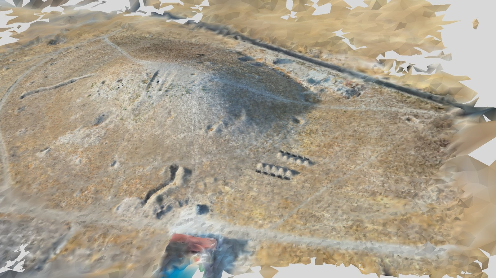

# Spirula

Il plugin *Spirula* addestra un Gaussian splatting 3D delle foto allineate con
[Spirula Studio](https://github.com/harry7557558/spirula-studio), un programma libero di Gaussian
splatting (GPL-3) che lavora sulla scheda grafica dei computer Apple, NVIDIA, AMD e Intel. Uno splat è
una nuvola di milioni di piccole macchie colorate e semitrasparenti che, viste da qualsiasi punto di
vista vicino alle foto, somigliano alle foto: erba, cespugli, recinzioni, il bordo che si sgretola di una
sezione, le forme morbide che una mesh spezza in triangoli, vengono come appaiono. Il plugin prepara i
dati del chunk - le foto allineate con le loro camere, le maschere, la nuvola densa come punto di
partenza - fa partire l'addestramento con il suo avanzamento, tiene lo splat come prodotto del chunk, ne
ricava una mesh, lo apre nel visualizzatore di Spirula Studio e, quando Spirula Studio manca, lo
installa.

Questa pagina descrive la versione 0.1.2 del plugin, che richiede pyarchinit-photogrammetry 1.1.0 o
successiva e Spirula Studio (è stato provato con la release 2026.10.16). Il README e il codice sono nel
[repository dei plugin](https://github.com/enzococca/pyarchinit-photogrammetry-plugins/tree/main/plugins/spirula).

<figure markdown="span">
  
  <figcaption>La mesh ricavata da Spirula dallo splat di 57 foto di drone di Tell Sultan, il sito del
  tutorial: 336.000 facce con un colore per vertice, vista dal punto di vista di
  una delle foto. Lo splat è stato addestrato in qualità <em>low</em> sulle foto dimezzate (15.000
  passi, 200.000 splat, 13 minuti su un Apple M4 Pro); la mesh ha richiesto 14 secondi. Fuori dall'area
  coperta dalle foto la superficie si rompe in grandi triangoli.</figcaption>
</figure>

## In breve

1. Allinea le foto, e meglio ancora costruisci la nuvola densa: gli splat partono da quella.
2. *Plugin > Spirula > Addestra Gaussian splatting...*: preset, qualità, riduzione delle foto. La prima
   volta il plugin propone di scaricare e installare Spirula Studio.
3. Aspetta: da minuti a ore sulla scheda grafica; la barra di avanzamento conta i passi; se vuoi, segui
   l'addestramento nel browser.
4. *Plugin > Spirula > Apri lo splat in Spirula Studio* per guardarlo, *File > Esporta > Splat (PLY 3D
   Gaussian Splatting)...* per darlo, nelle coordinate del rilievo, a un altro visualizzatore.
5. *Plugin > Spirula > Mesh dallo splat...*: PLY, OBJ, glTF, GLB o STL; il PLY anche fra le versioni del
   modello.

## Che cosa fa

| Passo | Che cosa dà | A che cosa serve |
|---|---|---|
| Addestramento | `splat.ply`, il PLY standard del Gaussian splatting 3D che ogni visualizzatore di splat legge, come prodotto *splat* del chunk | mostrare un sito o un reperto come appare, da qualsiasi punto di vista: visite, presentazioni, didattica, il pubblico |
| Mesh dallo splat | una mesh in PLY, OBJ, glTF, GLB o STL accanto allo splat, con colori per vertice o una texture; il PLY come versione del modello | una mesh di ciò che lo splat mostra, per programmi 3D, il web, la stampa |
| Esportazione | lo splat nelle coordinate del rilievo (o come Spirula l'ha addestrato) | altri visualizzatori ed editor di splat, lo splat accanto agli altri prodotti del rilievo |
| Visualizzatore | lo splat nella finestra di Spirula Studio | guardare il risultato |
| Installazione | l'ultima release di Spirula Studio per questo computer | avere il programma senza cercarlo |

Uno splat è fatto per sembrare giusto dai punti di vista delle foto; non è un rilievo. Misure, sezioni,
piante e volumi vengono dalla nuvola densa, dal modello, dal DEM e dall'ortofoto del programma.

## Che cosa serve prima { #before }

* **Il plugin**, installato dal programma: vedi [Guide ai plugin](guides.md#install).
* **Spirula Studio.** Le sue release coprono macOS su Apple Silicon (un'applicazione, `Spirula
  Studio.app`), Windows su x86-64 e Linux su x86-64 (uno zip con un solo eseguibile, `spirula`); i Mac
  Intel e i computer ARM con Windows o Linux non hanno una versione. Il plugin lo trova da solo - in
  `/Applications/Spirula Studio.app`, nelle cartelle solite di Windows e Linux, nel PATH, o dove dice la
  variabile `PPG_SPIRULA` - e quando non lo trova propone di scaricarlo (circa 50-60 MB da GitHub,
  controllati con lo SHA-256 che GitHub pubblica) e installarlo: in `/Applications` su macOS (o in
  `~/Applications` quando `/Applications` non è scrivibile), in `%LOCALAPPDATA%\Programs\Spirula Studio`
  su Windows, in `~/.local/share/spirula-studio` su Linux. Puoi anche installarlo da te e dire al plugin
  dove sta (*Plugin > Spirula > Dove sta Spirula Studio...*).
* **Una scheda grafica con Vulkan**: i chip Apple (M1 e successivi), le schede NVIDIA, AMD e Intel con
  driver recenti. L'addestramento gira su di essa; un computer senza non può addestrare.
* **Un chunk con le foto allineate**, *Flusso di lavoro > Allinea foto...*: senza, la finestra, la riga
  di comando e l'addestramento stesso si fermano con *Le foto del chunk ... non sono allineate: allineale
  prima (Flusso di lavoro > Allinea foto, o ppg align).*
* **Le foto dove il progetto le aspetta**: Spirula legge i file originali (ne toglie la distorsione da
  solo). Se sono state spostate, ricollegale (*Flusso di lavoro > Ricollega foto (altra cartella)...*).
* **Meglio, una nuvola densa** (*Flusso di lavoro > Costruisci nuvola densa...*): gli splat partono dai
  suoi punti.
* **Spazio su disco**: un addestramento occupa da cento megabyte a qualche gigabyte, a seconda del
  numero di splat.

## I dati { #data }

### Le foto { #photos }

* **Dimensioni.** Spirula addestra alla risoluzione delle foto che riceve, e memoria e tempo crescono
  con essa. *Riduzione delle foto* divide i loro lati: il plugin suggerisce il divisore che le porta a
  circa 4 megapixel - 2 per foto da 9 a 25 megapixel, 3 per 48 megapixel, 1 per foto piccole.
* **Foto nitide e ben esposte** danno uno splat nitido; foto mosse danno splat sfocati dove sono le
  sole.
* **La luce.** Una luce che cambia fra le foto - nuvole, ore del giorno, voli in giorni diversi - dà
  chiazze e colori che galleggiano: il preset *in-the-wild* è fatto per questo.
* **Cose che si muovono.** Persone, veicoli, ombre che si spostano fra le foto lasciano fantasmi:
  mascherali nelle foto (*Strumenti > Maschere delle foto*), oppure passa l'opzione di Spirula
  `--distraction-robustness strong` dalla [riga di comando](#cli).
* **Punti di vista.** Uno splat è giusto vicino ai punti da cui sono state scattate le foto: un volo
  nadirale dà una buona vista dall'alto e scarse viste di lato; gira intorno a ciò che vuoi vedere di
  lato.

### Punti di partenza e maschere { #seed }

* **Punti di partenza**: la nuvola densa del chunk - fino a 2 milioni dei suoi punti, scelti a caso -
  oppure i punti di legame dell'allineamento. La nuvola densa dà una partenza più veloce e pulita.
* **Maschere**: le maschere delle foto del chunk vanno a Spirula con le foto, a meno che *Usa le
  maschere delle foto* non sia spuntato; le parti mascherate restano fuori dall'addestramento.

## Passo per passo nel programma { #program }

Il menu *Plugin > Spirula* ha *Addestra Gaussian splatting...*, *Mesh dallo splat...*, *Apri lo splat
in Spirula Studio*, *Installa Spirula Studio...* e *Dove sta Spirula Studio...*; *File > Esporta* ha
*Splat (PLY 3D Gaussian Splatting)...* e *Splat (PLY, sistema dell'addestramento)...*. Il plugin non ha un
pannello.

### 1. Spirula Studio { #spirula-studio }

* *Installa Spirula Studio...*: la cartella (quella del sistema, come predefinito); l'ultima release
  viene scaricata, controllata, installata, e il plugin ricorda dove sta. La stessa finestra compare da
  sola - con *Scarica e installa*, *Indica dove sta* e *Annulla* - la prima volta che un passo ha bisogno
  di Spirula e non lo trova.
* *Dove sta Spirula Studio...*: l'eseguibile `spirula`, l'applicazione (`Spirula Studio.app`) o la
  cartella che lo contiene.

### 2. Addestrare { #train }

*Addestra Gaussian splatting...*

| Campo | Predefinito | Che cosa fa |
|---|---|---|
| *Preset* | *3dgs (standard)* | il tipo di addestramento, dalla tabella qui sotto |
| *Qualita' (iterazioni)* | *medium (30.000)* | *low*, *medium*, *high*, *ultra*: passi di addestramento e numero massimo di splat |
| *Iterazioni (vuoto = della qualita')* | vuoto | un numero di passi a tua scelta |
| *Riduzione delle foto (1 = piena risoluzione)* | quella suggerita | i lati delle foto divisi per questo |
| *Grado delle armoniche sferiche (0-3)* | 3 | quanto il colore di uno splat può cambiare con il punto di vista: 0 un colore solo (un file più piccolo), 3 riflessi e lucentezza |
| *Punti di partenza* | *nuvola densa del chunk* | oppure *punti di legame* |
| *Usa le maschere delle foto* | spuntato | |
| *Visualizzatore web di Spirula durante l'addestramento* | non spuntato | l'addestramento mostrato dal vivo nel browser |
| *Porta del visualizzatore* | 7007 | la porta del visualizzatore web |

| Preset | Per |
|---|---|
| *3dgs* | la maggior parte delle serie di foto: rilievi da drone, scavi, edifici |
| *in-the-wild* | luce che cambia fra le foto, cose non mascherate che vi si muovono, focali lunghe |
| *centered-object* | un oggetto fotografato tutto intorno, con le maschere, di cui lo sfondo non interessa: un reperto su un piatto girevole |
| *360-camera* | le immagini fisheye originali di una camera 360, con il cerchio nero intorno |
| *hdr* | tenere tutta la gamma di luce delle foto |
| *synthetic* | immagini generate con esposizione costante |
| *meshing* | uno splat fatto per la sua mesh più che per il suo aspetto: addestra con questo prima di *Mesh dallo splat* |

| Qualità | Passi | Numero massimo di splat |
|---|---|---|
| *low* | 15.000 | 200.000 |
| *medium* | 30.000 | 1.000.000 |
| *high* | 50.000 | 3.000.000 |
| *ultra* | 80.000 | 10.000.000 |

L'addestramento gira in background. La barra si muove ogni cento passi con *Spirula: passo 1.001 di
15.000, 200.000 splat*, nella lingua del programma; *Annulla* ferma Spirula. Con il visualizzatore
web, il browser si apre su `http://localhost:7007/` (o la porta scelta) appena Spirula lo avvia: lo
splat cresce mentre si addestra, e il visualizzatore si chiude con l'addestramento. Il visualizzatore risponde su tutte le interfacce di
rete del computer, quindi gli altri computer della stessa rete possono aprirlo all'indirizzo di questo
computer.

Alla fine una finestra riassume:

```text
Splat: .../spirula/runs/20261020-215810/step-000015000.ckpt/splat.ply
  preset 3dgs, qualita' low, 15.000 passi, 200.000 splat, 57 foto
  punti di partenza: dense (2.000.000), maschere: no, tempo 767.3 s
```

Lo splat diventa il prodotto *splat* del chunk e il progetto viene salvato. Un nuovo addestramento
sostituisce il prodotto; ogni addestramento tiene la sua cartella.

### 3. Guardare lo splat { #view }

* *Apri lo splat in Spirula Studio*: la finestra di Spirula Studio, con i suoi comandi.
* *File > Esporta > Splat (PLY 3D Gaussian Splatting)...*: lo splat nelle coordinate del rilievo - il
  sistema di riferimento del chunk, o il suo sistema locale - per altri visualizzatori ed editor di
  splat, accanto agli altri prodotti del chunk.
* *File > Esporta > Splat (PLY, sistema dell'addestramento)...*: `splat.ply` così come Spirula l'ha
  scritto.

Spirula sposta, ruota e scala la scena prima di addestrarla: `splat.ply` sta in quel sistema, centrato
sulla scena. Il progetto tiene la matrice (`world_from_train`, dallo `scene_transform.json`
dell'addestramento) che lo riporta nel sistema dell'allineamento, e la trasformazione del chunk porta
quello nelle coordinate del rilievo. L'esportazione le applica entrambe a ogni splat: la posizione, la
rotazione, la dimensione (per la scala della trasformazione) e i colori che cambiano con il punto di
vista - le armoniche sferiche, ruotate in modo che ogni splat mostri da ogni direzione il colore che
mostrava prima. Opacità e colore di base non cambiano. Le coordinate di un sistema proiettato (centinaia
di chilometri) non stanno nei numeri a 32 bit di un file di splat senza perdere centimetri: oltre 10 km
le posizioni vengono scritte come numeri a 64 bit, che qualche visualizzatore non legge - per quelli
esporta nel sistema dell'addestramento. Un addestramento senza `scene_transform.json` si può esportare
solo nel sistema dell'addestramento.

### 4. Mesh dallo splat { #mesh }

*Mesh dallo splat...*, dopo aver addestrato uno splat.

| Campo | Predefinito | Che cosa fa |
|---|---|---|
| *Formati* | PLY | uno o più fra PLY, OBJ, GLTF, GLB, STL |
| *Colore* | *per vertice* | *per vertice*, *texture (OBJ, glTF, GLB)* o *nessuno* |
| *Lato della texture (0 = di Spirula)* | 0 | il lato dell'immagine della texture in pixel |

I file vengono scritti accanto allo splat dell'ultimo addestramento; un PLY viene tenuto anche fra le
versioni del modello, come *Mesh dallo splat (Spirula, ...)*: nell'*Area di lavoro*, sotto il modello
3D, tasto destro, *Mostra*, oppure *Rendi attiva (la usano gli altri strumenti)*. La mesh sta nel sistema
dell'allineamento, come il modello del programma: come modello attivo sta con gli altri prodotti, ed
esportando il modello viene scritta nelle coordinate del rilievo.

## Dalla riga di comando { #cli }

`ppg plugin spirula COSA ...`. I comandi che lavorano su un progetto prendono il chunk attivo (`--chunk
NOME` per un altro) e salvano il progetto.

```bash
ppg plugin spirula install
ppg plugin spirula where
ppg plugin spirula where --set "/Applications/Spirula Studio.app"
ppg plugin spirula train scavo.ppg --preset 3dgs --quality medium
ppg plugin spirula train scavo.ppg --preset in-the-wild --quality high --divisor 2 --viewer
ppg plugin spirula train scavo.ppg --quality low --no-masks --name prova -- --cap-max 500000
ppg plugin spirula train scavo.ppg --distraction-robustness strong
ppg plugin spirula mesh scavo.ppg --format ply,glb --color texture
ppg plugin spirula open scavo.ppg
ppg plugin spirula export scavo.ppg splat.ply
ppg plugin spirula export scavo.ppg splat_spirula.ply --frame training
```

| Comando | Opzioni |
|---|---|
| `install` | `--dir` la cartella (quella del sistema, come predefinito) |
| `where` | stampa l'eseguibile in uso; `--set PERCORSO` ne ricorda un altro |
| `train PROGETTO` | si ferma con un errore quando le foto del chunk non sono allineate; `--preset` (3dgs); `--quality` low, medium, high, ultra (medium); `--iterations`; `--divisor` (0: quello suggerito, 1: piena risoluzione); `--sh-degree` (3); `--seed` dense o sparse; `--no-masks`; `--viewer`, `--port` (7007), `--no-browser`; `--name` dell'addestramento (data e ora, come predefinito); `--spirula` l'eseguibile |
| `mesh PROGETTO` | `--format` fra ply, obj, gltf, glb, stl, separati da virgole (ply); `--color` none, vertex, texture (vertex); `--texture-size`; `--run` la cartella di un altro addestramento (l'ultimo, come predefinito) |
| `open PROGETTO` | apre lo splat in Spirula Studio |
| `export PROGETTO USCITA` | lo splat come PLY: `--frame survey` (il predefinito: le coordinate del rilievo) o `--frame training` (come Spirula l'ha scritto) |

Le opzioni che `train` non conosce vanno a `spirula train` così come sono - dopo `--` oppure no - quindi
si può usare ogni opzione di Spirula: `--cap-max` (il numero massimo di splat),
`--distraction-robustness off|mild|strong` (persone e veicoli che si spostano fra le foto), e le altre
elencate da `spirula train --help`.

## Leggere i risultati { #reading }

* **Passi e splat.** Il numero di splat cresce durante l'addestramento fino al massimo che la qualità
  permette; più splat, più dettaglio, un file più grande. 200.000 splat bastano per un'occhiata, milioni
  per le viste da vicino.
* **Dove è buono.** Vicino ai punti di vista delle foto lo splat somiglia alle foto. Allontanandosi - più
  in basso di dove volava il drone, dietro ciò che le foto non hanno visto - si riempie di macchie sfocate
  o sospese: sono il limite di ciò che le foto dicono.
* **Macchie sospese** sopra la scena vengono spesso dal cielo, da cose che si muovono o dalla luce che
  cambia fra le foto: aiutano le maschere, il preset *in-the-wild* o `--distraction-robustness`.
* **La mesh** segue bene le superfici dove molte foto le vedono e si rompe in grandi triangoli piatti ai
  bordi, come nella figura. Per una mesh, addestra con il preset *meshing*.
* **Tempo.** Su un Apple M4 Pro, 57 foto di drone da 9 megapixel, dimezzate, in qualità *low* hanno
  richiesto 13 minuti; *high* e *ultra* richiedono ore. Foto grandi a piena risoluzione vogliono molta
  più memoria sulla scheda grafica.

### Limiti { #limits }

* **Non è un rilievo.** Lo splat riproduce come la scena appare; non ha barre di scala, curve di livello
  o classi. Esportato, sta nelle coordinate del rilievo, ma resta un'immagine della scena, non una sua
  misura.
* **Decide la scheda grafica** quanti splat e quanto grandi possono essere le foto.
* **Spirula Studio cambia.** Il plugin esegue Spirula come programma separato; una release successiva
  può rinominare un'opzione o un file. Il plugin cerca lo splat e i file della mesh ovunque Spirula li
  scriva nella cartella dell'addestramento.

## File scritti { #files }

Tutto va nella cartella del chunk, accanto al file del progetto:
`<progetto>.ppg.files/chunk_<n>/spirula/`.

* `dataset/`: ciò che Spirula legge, rifatto a ogni addestramento - `sparse/0/` (camere e punti
  dell'allineamento come modello COLMAP in testo), `images` (un collegamento alla cartella delle foto: un
  collegamento simbolico, una junction su Windows, o una copia quando non si può fare né l'uno né
  l'altra), `masks/`, `seed.ply` (i punti di partenza).
* `runs/<nome>/`: una cartella per addestramento, chiamata con data e ora se non le dai un nome: il
  `config.json` di Spirula, `scene_transform.json`, `splat.ply` (Spirula 2026.10 lo scrive in una
  cartella `step-...ckpt/`) e, dopo *Mesh dallo splat*, i file della mesh.
* `versions/model/<id>/model.ply`, nella cartella del chunk: la mesh PLY tenuta come versione del
  modello.
* Il progetto registra lo splat, i parametri, passi, splat e tempo dell'addestramento, il comando dato a
  Spirula, la matrice della scena e i file della mesh.
