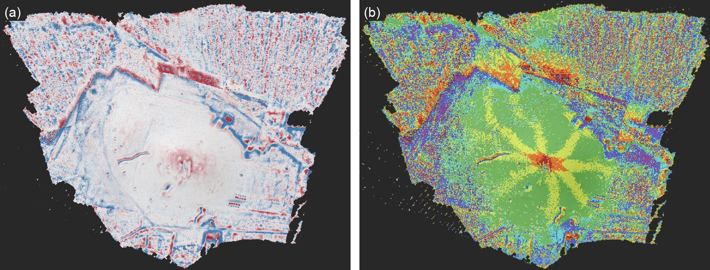
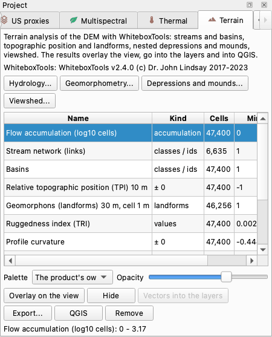
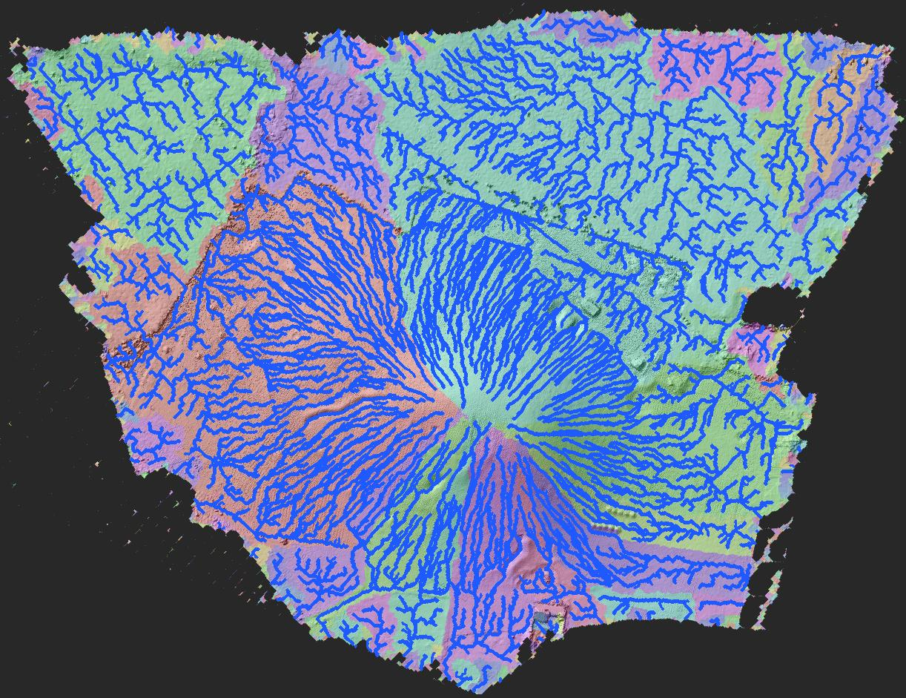
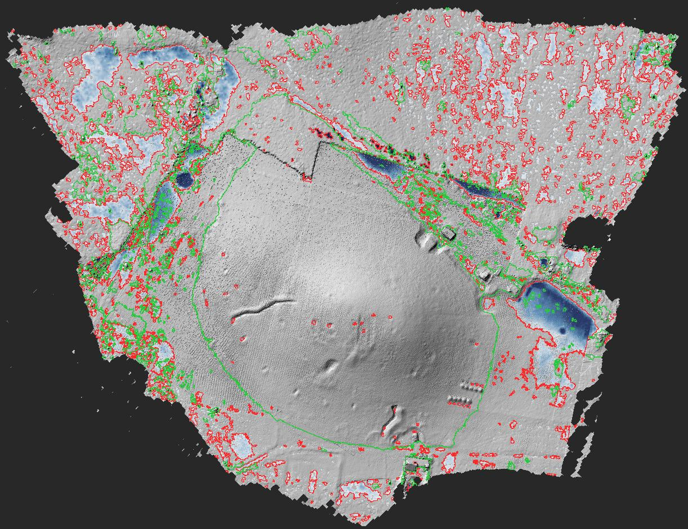

# Terrain

The *Terrain* plugin runs the terrain analyses of [WhiteboxTools](https://www.whiteboxgeo.com/) on the
DEM of the project and brings the results back into it: where the water runs and gathers, the stream
network and the basins; how much higher or lower every place is than its surroundings, and the
landform it belongs to; the curvature and the roughness of the ground; the hollows and the mounds,
nested one inside the other, with their depth and volume; what can be seen from a point. Every result
lies on the grid of the DEM, in the reference system of the chunk, over the orthophoto or the DEM of
the view.

This page describes version 0.1.1 of the plugin, which needs pyarchinit-photogrammetry 1.2.2 or later.
Its README and source code are in the
[plugin repository](https://github.com/enzococca/pyarchinit-photogrammetry-plugins/tree/main/plugins/terrain).

<figure markdown="span">
  
  <figcaption>(a) Relative topographic position on a 10 m window: blue lower, red higher than the
  surroundings - banks, cuts, pits and heaps stand out from the general slope of the mound.
  (b) Geomorphons with a search distance of 30 m, computed on 1 m cells: the radial spurs of the mound,
  its top as a peak and ridge, the fields around as a mixture of small forms. The real DEM of Tell
  Sultan, in a local reference system.</figcaption>
</figure>

!!! note "The examples on this page"
    The figures of the results come from the DEM of Tell Sultan - the site of the
    [tutorial](../tutorials/tell.md) - at 19 cm, 2,876 x 2,032 cells, in a local reference system; the
    pane was photographed on a small synthetic DEM. They show what the plugin does and are not a study
    of the site.

## In short

1. Build the DEM of the chunk (*Workflow > Build DEM...*); for water, hollows and mounds on the bare
   ground, a DEM of the *Ground* class only.
2. Open the *Terrain* tab of the *Project* dock (*Plugins > Terrain > Terrain analysis...*).
3. Choose an analysis: *Hydrology...*, *Geomorphometry...*, *Depressions and mounds...* or
   *Viewshed...*. The first one downloads WhiteboxTools (about 40 MB) once.
4. Look at the result over the orthophoto or the DEM, with the palette and the opacity you like; put
   the streams, the basins and the hollows into the layers of the view.
5. Export a result as GeoTIFF, the lines and polygons as GeoPackage, or open everything in QGIS.

## What it does

| Analysis | What it gives | Useful for |
|---|---|---|
| Hydrology | flow accumulation, the stream network as lines with their drained area and length, the drainage basins as polygons | the gullies that erode a tell, where the rain goes on an excavation, the runoff of a slope, old water courses |
| Relative topographic position (TPI), deviation from the mean | how much higher or lower each cell is than the cells around it within a window | walls, banks, ditches, trenches, robber trenches: the micro-relief, freed from the general slope |
| Geomorphons | ten landforms: flat, peak, ridge, shoulder, spur, slope, hollow, footslope, valley, pit | the shape of a tell, of terraces, the edges of a mound, a map of the landforms of a field |
| Curvatures, ruggedness | convex or concave along the slope and across it; how rough the surface is | breaks of slope, the edges of terraces and trenches, collapse and rubble against smooth ground |
| Time in daylight | the share of the daylight hours of the year that every cell spends out of the shadow of the relief | the exposure of a slope, of a terrace, of an entrance |
| Depressions and mounds | the hollows and the mounds, each one sliced into nested levels, with level, depth or height, area, volume, elongation | pits, cisterns, kilns, robber pits, burrows; tumuli, spoil heaps, mounds in a field |
| Viewshed | the cells visible from a point, with the eye at a height above the ground | what a tower, a tomb or a hilltop overlooks |

It helps wherever the shape of the ground tells something: an earthwork under the grass, the
erosion of a mound, the hollows of a field before an excavation, the visibility of a monument. The
analyses describe the surface: a hollow is a hollow, whether it is a pit, a bomb crater or a modern
trench. What the forms mean stays the archaeologist's call, made with the orthophoto, the survey and
the excavation.

## What you need first { #before }

* **The plugin**, installed from the program: see [Plugin guides](guides.md#install).
* **WhiteboxTools**, a free program by John Lindsay (University of Guelph, MIT licence). The plugin
  downloads the build for your computer from whiteboxgeo.com the first time an analysis runs (about
  40 MB, so that time it needs the internet) and keeps it in its own folder; the state line of the pane
  says which version it uses. There are builds for macOS (Apple Silicon and Intel), Windows (the
  x86-64 build, downloaded also on ARM computers) and Linux on x86-64. The plugin also takes a copy it
  finds: the program named by the variable `PPG_WBT` (or its folder), the copy of the `whitebox` Python
  package when it is installed in the environment of the program, `whitebox_tools` on the PATH. On
  Linux on ARM, which has no build, install WhiteboxTools yourself and set `PPG_WBT`. From the command
  line `ppg plugin terrain install` downloads it beforehand.
* **A project with a chunk processed up to the DEM** (*Workflow > Build DEM...*). The plugin works on
  the DEM the chunk shows, its active version, and needs nothing else: neither photos nor cloud.
* **A projected reference system, in metres**, for the chunk - for example the UTM zone of the site.
  The plugin also works in a local system (a project not georeferenced), with three differences: the
  time in daylight cannot be computed (it needs the latitude), the GeoTIFFs have no reference system and
  the QGIS project of the program leaves the products out.

## The DEM { #dem }

The plugin has no data of its own: it reads the DEM. What the DEM holds decides what the analyses say.

### Surface or ground { #dsm-dtm }

A DEM built from all the points of the dense cloud is a surface model: trees, bushes, buildings,
vehicles, people, tents and the spoil heaps of the excavation are part of it. For the viewshed of the
site as it is today that is right; for the water, the hollows, the mounds and the micro-relief of the
ground it is not: a tree becomes a mound, a parked car a dam across a gully.

* Classify the dense cloud - *Tools > Classification of the cloud*, or the ground classification of the
  [terrio](terrio.md) plugin - and build a DEM from the *Ground* class only (*Workflow > Build DEM...*,
  classes). That DEM is a terrain model (DTM): the places under trees and buildings are interpolated.
* Make it the active version - right click on it in the *Workspace*, *Make active (the other tools use
  it)* - before running the analyses; keep the surface model as another version for the viewshed.

### The cell { #cell }

Every size you give is in metres, and the plugin turns it into cells of the DEM: a window of 10 m on
a DEM of 19 cm is 53 cells; a least drained area of 50 m² is 1,383 cells. A detailed DEM (2-5 cm)
shows every clod, furrow and footprint: the curvatures and the geomorphons read those instead of the
landforms. For them the *Geomorphometry* dialog has a *Cell of the computation*: the metric is computed
on a copy of the DEM resampled to that cell (0.5-1 m for the landforms of a field or a tell) and brought
back onto the grid of the DEM. Any cell larger than the DEM's is used; the product has the cell in its
name, so the same metric on two cells stays side by side.

### Holes and borders { #holes }

Cells without a value stay without a value in every product. The edge of the DEM - and the edge of
every hole inside it - is where the water leaves the survey: streams end there and the basins are the
areas that drain to one point of it. A hole in the middle of the area studied (a pool of water, a
tarpaulin left out of the cloud) is an outlet that the water runs into: build the DEM without holes
there, or read the network around them with care.

### How long it takes { #time }

On the DEM of the figures (2,876 x 2,032 cells of 19 cm) every analysis took from under a second to
six seconds on a recent computer (an Apple M4 Pro). On a DEM of 151 million cells (5.5 cm over a
large tell) the hydrology took 70 s, the topographic position 56 s, the depressions 87 s, the mounds
107 s, the geomorphons at 1 m a few seconds, with about 6 GB of memory. The progress bar follows each tool
of WhiteboxTools while it runs, with the phase it is in (*FillDepressions: Filling depressions 35%*), and
*Cancel* stops the tool while it runs, not at its end.

## Step by step in the program { #program }

### The pane

Once the plugin is installed and the program restarted, the *Terrain* tab appears in the *Project*
dock on the left; if the tabs do not fit, use the arrows at the end of the tab bar, or *Plugins >
Terrain > Terrain analysis...*. The *Plugins > Terrain* menu has the four analyses too, and *Hide the
overlay*.

<figure markdown="span">
  
  <figcaption>The pane after the analyses of a synthetic DEM: the flow accumulation selected and laid
  over the view.</figcaption>
</figure>

From the top: a short description; the WhiteboxTools in use (or the notice that it will be downloaded
at the first analysis); the buttons *Hydrology...*, *Geomorphometry...*, *Depressions and mounds...*
and *Viewshed...*; the table of the products of the chunk; *Palette* and *Opacity*; *Overlay on the
view*, *Hide*, *Vectors into the layers*, *Export...*, *QGIS* and *Remove*; at the bottom, the values at
the two ends of the colours shown.

The table has a row per product: *Name*, *Kind* (*accumulation*, *classes / ids*, *± 0* for the values
around zero, *values*, *yes / no*, *landforms*), *Cells* with a value, *Min*, *Max* and *Made* (date
and time). The tooltip of a name gives the id of the product and its parameters (and a note, when the
cell of the computation asked for was not used). A product made again with the same parameters
replaces the old one: the hydrology, the depressions and the mounds have one set of products each, the
other metrics one per window and cell, the viewshed one per point.

The names are shown in the language of the interface, in the pane, in the layers of the view and in the
QGIS project. The project keeps them in Italian, as data (like the names of the program's own layers), so
it reads the same in both languages; the GeoTIFFs and the GeoPackages keep the Italian names too.

| Name in the table | Values |
|---|---|
| *Flow accumulation (log10 cells)* | log10 of the number of cells that drain into the cell |
| *Stream network (links)* | the number of the link (the stretch between two junctions) |
| *Basins* | the number of the basin |
| *Relative topographic position (TPI) 10 m* | from -1 to +1 |
| *Deviation from the mean height 10 m* | standard deviations |
| *Geomorphons (landforms) 30 m, cell 1 m* | the landform, 1 to 10 (computed on cells of 1 m) |
| *Ruggedness index (TRI)* | metres |
| *Profile curvature* | 1/m |
| *Plan curvature* | 1/m |
| *Time in daylight (fraction of the year)* | fraction, 0 to 1 |
| *Depth of the depressions* | metres below the level the hollow fills to |
| *Levels of the depressions* | how many nested depressions hold the cell |
| *Height of the mounds* | metres above the level that closes around the mound |
| *Levels of the mounds* | how many nested mounds hold the cell |
| *Viewshed from (x, y), eye at 1.7 m* | 1 visible, 0 hidden |

The analyses run in the background with the progress bar. When one ends, its main product is laid
over the view at once and the project is marked as modified: save it (*File > Save*) to keep the list
of the products with the project.

### 1. Hydrology { #hydrology }

*Hydrology...*

| Field | Default | What it does |
|---|---|---|
| *Least drained area of a stream (m²)* | 50 | a cell belongs to the stream network when at least this area drains into it: smaller values give a denser network |
| *Breaching of the depressions: largest distance (m)* | 10 | how far the plugin may dig a channel to let the water out of a hollow |

Water does not stop in the hollows of a DEM: first the plugin opens each hollow by the cheapest
channel out of it (a breach, up to the distance given) and fills what cannot be opened; then every
cell gives its water to the lowest of its eight neighbours (the D8 method) and the plugin counts how
many cells drain into each one. The cells with enough drained area are the network, cut into links at
the junctions; the basins are the areas draining to the same point of the edge of the DEM.

At the end the flow accumulation is laid over the view and the network is drawn as the layer *Terrain:
streams*; the status bar says how many links and basins were found. To see the basins, select
*Stream network (links)* or *Basins* in the table and press *Vectors into the layers*: the layer *Terrain:
basins* joins the network. Read the [results](#reading-hydrology).

### 2. Geomorphometry { #geomorphometry }

*Geomorphometry...*

| Field | Default | What it does |
|---|---|---|
| *Metric* | *Relative topographic position (TPI)* | the metric, from the table below |
| *Window or search distance (m)* | 10 | the side of the window for the topographic position and the deviation; the search distance for the geomorphons; the other metrics do not use it |
| *Geomorphons: flatness angle (degrees)* | 1 | slopes under this angle count as flat |
| *Cell of the computation (m, 0 = the DEM's; 1 m for the landforms of a field)* | 0 | the metric is computed on a copy of the DEM with cells of this size and brought back onto the grid of the DEM; any cell larger than the DEM's is used, a smaller one leaves the DEM's own cell and the message at the end says so |

| Metric | Window | Values | Product |
|---|---|---|---|
| *Relative topographic position (TPI)* | yes | -1 at the lowest cell of the window, +1 at the highest, 0 at its mean | `tpi_<size>` |
| *Deviation from the mean height* | yes | the difference from the mean of the window divided by its standard deviation | `dev_<size>` |
| *Geomorphons (landforms)* | search distance | 1 flat, 2 peak, 3 ridge, 4 shoulder, 5 spur, 6 slope, 7 hollow, 8 footslope, 9 valley, 10 pit | `geomorphons_<size>` |
| *Ruggedness index (TRI)* | no | metres: how much a cell differs from its eight neighbours | `ruggedness` |
| *Profile curvature* | no | 1/m along the slope: positive convex, negative concave | `profile_curvature` |
| *Plan curvature* | no | 1/m across the slope: positive where the contours bulge out (ridges, spurs), negative where they bend in (valleys, hollows) | `plan_curvature` |
| *Time in daylight (fraction of the year)* | no | the share of the daylight time of the year in which the cell is not in the shadow of the relief within 100 m | `daylight` |

The size in the name of a product is the window (`tpi_10` is the topographic position on 10 m, `tpi_2_5`
on 2.5 m), and a cell of the computation larger than the DEM's is there too (`geomorphons_30_c1` is
computed on cells of 1 m, `plan_curvature_c0_5` on 0.5 m): windows and cells of different sizes stay
side by side.

The time in daylight needs a georeferenced chunk: it takes the latitude of the centre of the DEM and
follows the sun through the year, every 10 minutes. For each direction of the sun, in steps of 15
degrees, WhiteboxTools gives the angle of the horizon of every cell within 100 m (its *HorizonAngle*
tool), and the cell is in the shadow while the sun stands lower than that. The plugin does not use
WhiteboxTools' own *TimeInDaylight*: in version 2.4 its solar almanac takes the time in the wrong unit
(microseconds where it expects milliseconds), so its sun positions are not those of the hours of the
day, and open, level ground came out at about 0.79 at 40 degrees north instead of 1.

### 3. Depressions and mounds { #depressions }

*Depressions and mounds...*

| Field | Default | What it does |
|---|---|---|
| *Mounds (hills, tumuli) instead of depressions* | off | ticked: the same search on the DEM turned upside down |
| *Least area (m²)* | 1 | smaller hollows (or mounds) are not kept as polygons |
| *Least depth (height) (m)* | 0.05 | shallower ones are not kept |
| *Interval of the levels (m, 0 = a tenth of the depth)* | 0 | the height between two slices; with 0 each hollow is cut into about ten slices, never thinner than the least depth |

The DEM is filled as water would fill it; every place where the filled surface stands above the ground
is a hollow. Each hollow is then sliced from the level at which it would overflow (its spill level)
down to its bottom: at each level the parts of the ground below it, joined together, are the
depressions of that level, nested inside the ones of the level above. A hollow with two pits at the
bottom becomes one polygon at the top level and two polygons further down. The mounds are found in the
same way on the DEM turned upside down: their slices go from the lowest contour that still closes
around the mound up to the top.

At most 20 levels per hollow and the 2,000 largest hollows of the DEM are sliced. At the end the depth
(or height) is laid over the view, the polygons are drawn as the layer *Terrain: depressions* (red) or
*Terrain: mounds* (green), and the status bar says how many hollows and nested polygons were found.
A new search replaces the previous one of the same kind.

### 4. Viewshed { #viewshed }

*Viewshed...*

| Field | Default | What it does |
|---|---|---|
| *X of the point (DEM coordinates)* | the centre of the DEM | in the reference system of the chunk: move the mouse over the view and read the coordinates in the status bar |
| *Y of the point* | the centre of the DEM | |
| *Height of the eye above the ground (m)* | 1.7 | the observer stands on the DEM at the point, the eye this high above it |

The product is 1 where the ground of the cell can be seen from the eye, 0 where it is hidden; the status
bar gives the share of the ground visible. A product is made for every point.

### 5. Products on the view { #overlay }

Select a product in the table, then:

* *Palette*: *The product's own* (blue-white-red for the values around zero, water blues for the flow
  accumulation, a colour per value for streams, basins and levels, the landform colours for the
  geomorphons, black to white for visible and hidden, greys for the rest), *Greys*, *Greys inverted*,
  *Diverging (blue-red)*, *Earth*, *Heat*, *Water*, *Classes (a colour per value)*, *Landforms
  (geomorphons)*;
* *Opacity*: changes the product shown at once;
* *Overlay on the view*, or a double click on the row: the product over the orthophoto or the DEM
  (the DEM is loaded if the view is empty). A new palette takes effect with the next *Overlay on the
  view*. The colours run between the 2nd and the 98th percentile of the values - symmetric around zero
  for the values with a sign, from 0 to 1 for the viewshed, over all the numbers for streams, basins,
  levels and landforms - and the line at the bottom of the pane says which. One product is shown at a
  time; *Hide* (or *Plugins > Terrain > Hide the overlay*) takes it away;
* *Vectors into the layers*, for the products that have lines or polygons (the stream network, the
  basins, the depths and levels of depressions and mounds): the layers *Terrain: streams* (blue lines),
  *Terrain: basins* (brown), *Terrain: depressions* (red) and *Terrain: mounds* (green) in the view and in
  the *Layers* pane (*Terreno: reticolo*, *Terreno: bacini*... in the Italian interface). With the *Move*
  tool a click on a line or a polygon shows its attributes. The network stays when the view changes
  between DEM and orthophoto; the polygons do not - press the button again - and at most 5,000 polygons
  per layer are drawn (the GeoPackage has them all);
* *Export...*: the product as a GeoTIFF;
* *QGIS*: the QGIS project of the program ([QGIS](../integrations.md)) with every product (hidden at
  first, in greys or blue-red) and the lines and polygons; for a georeferenced chunk only;
* *Remove*: asks first, then deletes the GeoTIFF of the product. The network and the basins share one
  GeoPackage, and so do the depth and the levels of the depressions (or of the mounds): the GeoPackage is
  deleted with the last of the two - the window says when the other one still uses it - and then its
  layers leave the view.

*File > Export > Terrain analyses (GeoPackage)...* writes every line and polygon of the chunk -
network, basins, depressions, mounds - into one GeoPackage.

## From the command line { #cli }

The same analyses with `ppg plugin terrain WHAT PROJECT ...`. The commands work on the active chunk
(`--chunk LABEL` for another one); those that change the project save it.

```bash
ppg plugin terrain --help
ppg plugin terrain install
ppg plugin terrain hydrology scavo.ppg --threshold 20 --breach 10
ppg plugin terrain geomorph scavo.ppg tpi --size 10
ppg plugin terrain geomorph scavo.ppg geomorphons --size 30 --cell 1 --flatness 1
ppg plugin terrain geomorph scavo.ppg profile_curvature --cell 0.5
ppg plugin terrain depressions scavo.ppg --min-area 1 --min-depth 0.1
ppg plugin terrain depressions scavo.ppg --min-area 1 --min-depth 0.3 --mounds
ppg plugin terrain viewshed scavo.ppg 500120.5 4500812.0 --height 1.7
ppg plugin terrain list scavo.ppg
ppg plugin terrain export scavo.ppg tpi_10 tpi_10m.tif
ppg plugin terrain export scavo.ppg terreno.gpkg
ppg plugin terrain remove scavo.ppg tpi_10
```

| Command | Options |
|---|---|
| `install` | downloads WhiteboxTools now and prints where it is |
| `hydrology PROJECT` | `--threshold` least drained area of a stream, m² (50); `--breach` largest breaching distance, m (10) |
| `geomorph PROJECT METRIC` | `METRIC`: `tpi`, `dev`, `geomorphons`, `ruggedness`, `profile_curvature`, `plan_curvature`, `daylight`; `--size` window or search distance, m (10); `--flatness` geomorphons, degrees (1); `--cell` cell of the computation, m, used when larger than the DEM's (0: the DEM's) |
| `depressions PROJECT` | `--min-area` m² (1); `--min-depth` m (0.05); `--interval` m (0: a tenth of the depth); `--mounds` |
| `viewshed PROJECT X Y` | the point in the reference system of the chunk; `--height` of the eye, m (1.7) |
| `list PROJECT` | every product with its id, name, kind, file, parameters and statistics |
| `export PROJECT [ID] OUT` | `OUT` ending in `.gpkg`: every line and polygon in a GeoPackage; otherwise the product `ID` as a GeoTIFF |
| `remove PROJECT ID` | deletes the product without asking, and its GeoPackage when no other product uses it; prints the files deleted |

Each analysis prints its result: the number of links and basins, the entry of the new product, the
largest depression or mound found (and a note when the cell asked for was not used). The ids of the
products - `flow_accumulation`, `streams`, `basins`, `depth`, `depression_levels`, `mound_height`,
`mound_levels`, `tpi_10`, `geomorphons_30`, `geomorphons_30_c1`, `viewshed_<x>_<y>`... - are those `list`
shows.

## Reading the results { #reading }

### Flow accumulation, network and basins { #reading-hydrology }

<figure markdown="span">
  
  <figcaption>The hydrology of the DEM with a least drained area of 20 m²: the network in blue, thicker
  where more ground drains into it, the basins in pale colours. The gullies run radially down the
  mound; in the flat fields around, the network follows the furrows of ploughing. The real DEM of Tell
  Sultan, in a local reference system.</figcaption>
</figure>

* **Flow accumulation** is the base-10 logarithm of the number of cells draining into each cell, the
  cell itself included: 0 is a cell that receives no water, 2 is 100 cells, 4 is 10,000. Multiply the
  number of cells by the area of a cell for the drained area (100 cells of 19 cm drain 3.6 m²). The
  highest values draw the lines where water concentrates; the faint ones show the patterns of the
  slope.
* **The network** in the GeoPackage has a line per link, from the first cell of the link to the first
  cell of the next one, so that the lines join: `link` (its number), `cells` and `area_m2` (the cells
  and the area draining to its end), `length_m`.
* **The basins** have `basin` and `area_m2`. They are the areas that drain to the same point of the
  edge of the DEM, so many small basins line the border of the survey: on a site the larger ones are the
  ones to read.
* The least drained area sets how far up the slopes the network climbs: a few square metres give a
  line in every rill, hundreds only the main gullies. Run the hydrology with two or three values.
* A surface model routes the water around trees and over roofs, and every clod or furrow of a very
  detailed DEM steers it: the network of a DTM, or of a DEM of a few decimetres, is the one to read for
  the landscape.

### Topographic position and deviation { #reading-tpi }

The relative topographic position compares each cell with the cells of a square window around it: +1
is the highest cell of the window, -1 the lowest, 0 the mean height of the window. The deviation from
the mean is the difference from the mean height of the window divided by its standard deviation (a
value of 2 is two standard deviations above the mean). Both remove the general slope: a wall on a
slope is positive along its whole length, a ditch negative.

The window decides what stands out: a window a few times wider than the features sought - 2-5 m for
walls and ditches, 10-20 m for buildings and mounds, more for the shape of a whole site. Small windows
on a detailed DEM pick up every stone; large ones blur the small features into their surroundings. In
the figure at the top of the page, 10 m bring out the banks, the cuts and the heaps on the slopes of
the mound.

### Geomorphons { #reading-geomorphons }

The geomorphons look from every cell along eight directions up to the search distance and compare the
horizon with the flatness angle: higher, lower or level. The pattern of the eight answers gives one of
ten landforms, drawn in the pane with these colours:

| Value | Landform | Colour |
|---|---|---|
| 1 | flat | <span style="display:inline-block;width:1.4em;height:0.9em;background:#c8c8c8"></span> light grey |
| 2 | peak | <span style="display:inline-block;width:1.4em;height:0.9em;background:#a00000"></span> dark red |
| 3 | ridge | <span style="display:inline-block;width:1.4em;height:0.9em;background:#f05a00"></span> orange |
| 4 | shoulder | <span style="display:inline-block;width:1.4em;height:0.9em;background:#fabe00"></span> amber |
| 5 | spur | <span style="display:inline-block;width:1.4em;height:0.9em;background:#dcf03c"></span> yellow-green |
| 6 | slope | <span style="display:inline-block;width:1.4em;height:0.9em;background:#5ab43c"></span> green |
| 7 | hollow | <span style="display:inline-block;width:1.4em;height:0.9em;background:#5adcdc"></span> light blue |
| 8 | footslope | <span style="display:inline-block;width:1.4em;height:0.9em;background:#5a96f0"></span> blue |
| 9 | valley | <span style="display:inline-block;width:1.4em;height:0.9em;background:#2846c8"></span> dark blue |
| 10 | pit | <span style="display:inline-block;width:1.4em;height:0.9em;background:#781ea0"></span> purple |

The search distance is the scale of the landforms: a few metres for terraces and banks, tens of metres
for a tell and its valleys. Compute them on cells of 0.5-1 m (*Cell of the computation*): on a DEM of
a few centimetres the landforms are those of the clods. On nearly level ground every small bump becomes
a form, as in the fields of the figure; raise the flatness angle to 2-3 degrees to see them as flat.

### Curvatures and ruggedness { #reading-curvature }

* **Profile curvature**, in 1/m, along the direction of the slope: positive where the slope steepens
  downwards (the convex upper edge of a bank, the top of a terrace wall, the shoulder of a mound),
  negative where it eases (the foot of a slope, the bottom of a ditch). 0.1 is a bend with a radius of
  10 m.
* **Plan curvature**, in 1/m, across the slope: positive where the contours bulge outwards and water
  spreads (ridges, spurs, the flanks of a mound), negative where they bend inwards and water gathers
  (gullies, hollows, the line of a ditch).
* **Ruggedness**, in metres: the root-mean-square difference between a cell and its eight neighbours.
  Rubble, collapsed walls and spoil heaps are rough; ploughed or levelled ground is smooth.

All three are computed from a cell and its neighbours: on a detailed DEM they measure the noise of the
survey as much as the ground. Use the *Cell of the computation* (0.25-1 m) for the shape of the ground.

### Time in daylight { #reading-daylight }

The share of the daylight time of the year - the time the sun is above the horizon - in which the cell
is not shaded by the relief within 100 m of it. Open, level ground is 1; a real DEM, with its small
irregularities, a little less (a clod hides the sun for a few minutes at sunrise and sunset). The north
side of a wall or of a mound, the bottom of a trench or of a pit are lower: on the synthetic DEM of the
tests, at 40 degrees north, the bottom of a pit 2 m deep and 4 m in radius is at 0.58, the north flank of
a mound 0.79 against 0.95 on its south flank.

### Depressions and mounds { #reading-depressions }

<figure markdown="span">
  
  <figcaption>The outer polygons of the depressions (red, at least 1 m² and 10 cm deep) and of the
  mounds (green, at least 30 cm high) over the depth of the depressions in blue. The mound itself is
  the largest green polygon; the depressions are the cuts on the mound, the hollows of the fields and
  the low ground along the edges of the survey. The real DEM of Tell Sultan, in a local reference
  system.</figcaption>
</figure>

The polygons of `depressioni.gpkg` (and `rilievi.gpkg`) have these attributes:

| Column | What it is |
|---|---|
| `id` | the number of the polygon |
| `sink` | the hollow it belongs to |
| `rank` | its level, from 1 at the spill level downwards (for the mounds, from the base upwards) |
| `parent` | the polygon of the level above that holds it; 0 for the outer polygon of a hollow |
| `level` | the elevation of the slice, in the height system of the DEM |
| `depth_max`, `depth_mean` | the largest and the mean depth below the level (for the mounds: height above it), m |
| `area_m2` | its area |
| `volume_m3` | the volume between the level and the ground: the water the hollow would hold up to that level; for a mound, the earth above its base |
| `elongation` | the length of the polygon divided by its width (from the spread of its cells): 1 round, 3 a long trench |
| `x`, `y` | the centre of its cells |

* The outer polygon of a hollow (`rank` 1) is the whole hollow at the level at which it would
  overflow; the polygons with a higher `rank` are its deeper parts. A cistern gives a stack of nearly
  equal polygons, a pit inside a larger basin a small stack inside a larger one, two pits in one hollow
  two branches. Select `rank = 1` in QGIS for the outlines of the hollows.
* The depth raster (*Depth of the depressions*) covers every hollow of the DEM, also those smaller
  or shallower than the minimum, which have no polygon; *Levels of the depressions* counts how many nested
  polygons hold each cell.
* A mound is measured from the lowest contour that still closes around it: on a slope that contour is
  on the uphill side, and the height is smaller than the height of the mound seen from below.
* The least depth matters: on a surface model, or a detailed DEM, every footprint is a hollow. 5-10 cm
  and one or a few square metres suit an excavation; 30-50 cm and tens of square metres a landscape.

### Viewshed { #reading-viewshed }

A cell is visible when the ground of the cell can be seen from the eye. A person or a wall standing on
a cell that is hidden may still be seen from farther away: the viewshed shows the ground, not what
stands on it. On a surface model trees and buildings block the view, as they do today; for the view of
another time, use a terrain model and imagine what stood on it. In the demonstration, from the top of
the mound with the eye at 1.7 m, 44 % of the ground was visible: the convex slopes hide their own lower
parts, and the fields beyond become visible again.

### Limits { #limits }

* **The surface, not the meaning.** A hollow, a ridge or a gully is a shape: modern and ancient,
  natural and made by people look alike.
* **The DEM decides.** Holes, noise and vegetation of the DEM go into every product: build the DEM for
  the question asked (cell, ground class).
* **One computer, one DEM in memory.** The rasters are read whole: a DEM of hundreds of millions of
  cells needs several gigabytes of memory.

## Files written { #files }

Everything goes into the folder of the chunk, next to the project file:
`<project>.ppg.files/chunk_<n>/terrain/`. The list of the products and their parameters are kept in the
project itself.

* `<id>.tif`: every product on the grid of the DEM, as GeoTIFF: float32 with no value outside the data,
  or 32-bit integers with 0 as no value for streams, basins, levels and geomorphons.
* `hydrology.gpkg`: tables `reticolo` (lines: `link`, `cells`, `area_m2`, `length_m`) and `bacini`
  (polygons: `basin`, `area_m2`).
* `depressioni.gpkg`, `rilievi.gpkg`: one table each (`depressioni`, `rilievi`) with the nested
  polygons and the columns described above.
* `_work/`: the copies of the DEM WhiteboxTools reads (float32, with a reference system: a stand-in one
  for a local project) and the intermediate rasters. It can be several times the size of the DEM; it can
  be deleted, and is made again when needed.

WhiteboxTools itself is in the plugin's own folder, `plugins/_data/terrain/wbt/` inside the plugin
folder of the program (see [Plugins](../plugins.md)).
