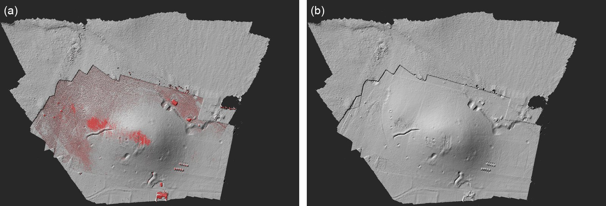

# terrio

Il plugin *terrio* porta nel progetto ciò che fanno altri strumenti e altri programmi, e manda fuori i
prodotti del progetto nei loro formati. È costruito su [terrio](https://github.com/opengeos/terrio), una
libreria di lettura e scrittura di dati geografici scritta in Rust: non c'è altro - GDAL, PROJ, PDAL - da
installare. Importa nuvole di punti di tutti i formati più comuni, da un file o dal web; separa il
terreno dal resto della nuvola densa con i filtri usati per il lidar aereo; pulisce la nuvola dai punti
isolati e dai gruppi staccati; dà ai punti i colori di un'ortofoto, o un valore di un raster - una
temperatura, un indice, una quota; sposta un DEM o una nuvola fra quote ellissoidiche (GNSS) e quote sul
geoide; prende un raster di riferimento - un DEM regionale, un'ortofoto più vecchia, il DEM Copernicus del
Planetary Computer di Microsoft - sopra il rilievo; esporta la nuvola per i programmi di laser scanning e
l'ortofoto come tasselli per le mappe web.

Questa pagina descrive la versione 0.2.0 del plugin, che richiede pyarchinit-photogrammetry 1.1.0 o
successiva (1.3.4 o successiva per vedere nella vista 3D i punti trovati e i valori) e terrio 0.5. Un
terrio più vecchio (la 0.3.2 e le versioni 0.4) fa ancora l'importazione, la classificazione del terreno, i
raster di riferimento da un URL e le esportazioni; gli altri passi dicono che serve terrio 0.5 e propongono
di scaricarlo. Il README e il codice sono nel
[repository dei plugin](https://github.com/enzococca/pyarchinit-photogrammetry-plugins/tree/main/plugins/terrio).

<figure markdown="span">
  
  <figcaption>Il terreno di una nuvola densa di 3,1 milioni di punti da 57 foto di drone, classificata
  con SMRF (cella 0,5 m, pendenza 0,2, soglia 0,3 m, prima il rumore basso). (a) La superficie di tutti
  i punti, con i 74.536 punti lasciati fuori dal terreno in rosso; (b) la superficie dei soli punti del
  terreno: le case e gran parte della macchia sui versanti non ci sono più. Ombreggiature dei punti messi
  su una griglia di 30 cm, in un sistema locale; Tell Sultan, il sito del
  tutorial.</figcaption>
</figure>

## In breve

1. Installa il plugin; la prima volta che un passo ha bisogno di terrio, il programma propone di
   scaricarlo (circa 20 MB), oppure *Plugin > terrio > Installa terrio...*.
2. *Importa nuvola di punti...*: un file LAS, LAZ, COPC, EPT, PLY o E57, o un indirizzo web, in un nuovo
   chunk o al posto della nuvola densa di quello attivo.
3. *Classifica il terreno (SMRF, CSF, PMF)...*: i punti senza un'altra classe diventano terreno (classe 2)
   o resto (classe 1); poi
   costruisci un DEM della classe *Terreno*: un modello del terreno.
4. *Pulisci la nuvola (LOF, DBSCAN)...*: punti isolati in classe 7, gruppi staccati (uccelli, persone,
   frammenti sospesi) rimossi o in una classe - contati e mostrati prima di cambiare qualcosa.
5. *Colori e valori da un raster...*: i colori dell'ortofoto per i punti, o un valore (temperatura,
   indice, quota) come loro dimensione; *Valori dei punti nella vista 3D...* lo mostra.
6. *Quote ellissoidiche e sul geoide...*: il DEM o la nuvola dalle quote GNSS alle quote su EGM2008,
   EGM96 o un geoide nazionale, o viceversa, come nuova versione.
7. *Raster di riferimento dal web...*: un DEM regionale o un'ortofoto sopra il rilievo - da un URL o dal
   Planetary Computer - tenuti come versione del DEM o dell'ortofoto, con le quote portate in quelle del
   rilievo se chiesto, da confrontare con i tuoi.
8. *File > Esporta*: la nuvola densa in E57 o EPT, l'ortofoto in PMTiles o MBTiles.

## Che cosa fa

| Passo | Che cosa dà | A che cosa serve |
|---|---|---|
| Importa nuvola di punti | una nuvola LAS, LAZ, COPC, EPT, PLY o E57 - anche in uno zip, anche sul web - come nuvola densa di un nuovo chunk o di quello attivo, con i suoi colori (o l'intensità come grigi) e le sue classi | una scansione laser, il lidar di un rilievo regionale, la nuvola di un altro programma, accanto alla fotogrammetria |
| Classifica il terreno | terreno (classe 2) e altri punti (classe 1), rumore basso (7), vegetazione per altezza (3, 4, 5); i punti di altre classi restano come sono | un DTM sotto alberi ed edifici, il terreno per i plugin [Terreno](terrain.md) e [Linee elettriche](powerlines.md) |
| Pulisci la nuvola | punti isolati in classe 7, gruppi staccati rimossi o in una classe (18 di base); la nuvola di prima tenuta come versione | DEM e mesh senza punte, uccelli e frammenti sospesi di profondità sbagliate |
| Colori e valori | i colori di un'ortofoto (o di qualsiasi raster) per i punti; oppure una banda come dimensione dei punti, esportata con loro | un lidar senza colori; la temperatura o un indice sulla nuvola 3D, anche in altri programmi |
| Quote | un DEM o una nuvola fra quote ellissoidiche e quote sul geoide, come nuova versione | mettere sulle stesse quote un rilievo da drone e un DEM nazionale, o due rilievi |
| Raster di riferimento | un raster sul web, sul disco o nel Planetary Computer, letto solo sopra il rilievo, riproiettato nel sistema del chunk, con le quote spostate se chiesto, tenuto come versione | confrontare il rilievo con un DEM regionale o un'ortofoto più vecchia, il paesaggio intorno al sito |
| Esportazioni | E57 ed EPT della nuvola (LAS, LAZ, COPC e PLY dalla riga di comando), PMTiles e MBTiles dell'ortofoto | i programmi di laser scanning, i visualizzatori web di nuvole, le mappe web, le mappe su un tablet sul campo |

## Che cosa serve prima { #before }

* **Il plugin**, installato dal programma: vedi [Guide ai plugin](guides.md#install).
* **terrio stesso.** Installato con pip, il plugin se lo porta dietro. L'applicazione desktop non ha
  pip: la prima volta che un passo ha bisogno di terrio, il programma chiede se scaricarlo da PyPI (circa
  20 MB, controllato con il suo SHA-256) nella cartella propria del plugin; dopo lo scaricamento, rifai
  il passo. *Plugin > terrio > Installa terrio...* fa lo stesso in ogni momento, `ppg plugin terrio
  install` dalla riga di comando. terrio esiste per macOS (Apple Silicon e Intel), Windows (x64 e ARM64)
  e Linux (x86-64 e ARM64). Se il terrio presente è più vecchio della 0.5, i passi che la richiedono lo
  dicono e propongono di scaricarla: la nuova va accanto e da allora si usa quella.
* **Un progetto.** Un'importazione in un nuovo chunk non vuole altro; la classificazione e
  l'esportazione della nuvola vogliono un chunk con una nuvola densa; i tasselli un'ortofoto; il raster
  di riferimento un chunk con un sistema di riferimento (altrimenti *the chunk needs a reference system
  (align it with GPS or markers first)*).
* **Memoria.** I filtri del terreno lavorano su tutta la nuvola insieme: decine di milioni di punti
  vogliono qualche gigabyte.
* **Internet**, per le sorgenti sul web, il Planetary Computer e le griglie del geoide che non sono
  ancora sul computer.

## I dati { #data }

### File di nuvole di punti { #clouds }

| Formato | File | Note |
|---|---|---|
| LAS, LAZ | `.las`, `.laz` | i formati del lidar aereo e della maggior parte dei programmi; compresso in LAZ |
| COPC | `.copc.laz` | un LAZ ordinato per leggerne delle parti: sul web si leggono solo le parti che servono |
| EPT | l'`ept.json` di una cartella EPT | il formato di Entwine e di molti archivi lidar aperti; letto sul posto dal web |
| PLY | `.ply` | le nuvole della fotogrammetria e di molti programmi |
| E57 | `.e57` | laser scanner: ogni scansione posizionata con la sua posa, tutte in una nuvola |
| ZIP | `.zip` | uno di questi dentro |

* **Sul web**: un indirizzo che comincia con `https://`, `s3://`, `gs://` (Google Cloud) o `az://`
  (Azure) al posto di un file.
* **Che cosa entra**: le coordinate, i colori (i colori a 16 bit vengono portati a 8 bit), oppure
  l'intensità come grigi quando il file non ha colori, e i codici di classificazione. Gli altri
  attributi (ritorni, tempo GPS) non vengono tenuti.
* **Sistema di riferimento**: LAS, LAZ, COPC ed EPT di solito portano il loro; E57 e PLY spesso no.
  Dallo nella finestra di importazione (per esempio `EPSG:32633`) quando il file non ce l'ha; senza, il
  nuovo chunk è locale.
* **Punti al massimo**: una nuvola più grande di quanto serve - un tassello di lidar regionale, una
  scansione densa - si può sfoltire all'importazione: da COPC ed EPT si leggono meno livelli, poi i punti
  vengono scelti a caso.
* **Solo le classi**: i codici ASPRS delle classi da tenere, per esempio `2` per il terreno di un lidar
  classificato, `2,6` terreno ed edifici.

### Nuovo chunk o al posto della nuvola { #destination }

* **Un nuovo chunk**, chiamato come il file (o con il nome dato), nel sistema di riferimento del file o
  in quello dato. Nella finestra diventa il chunk attivo; dalla riga di comando il chunk attivo del
  progetto resta quello di prima (`--activate` rende attivo il nuovo). I suoi punti sono tenuti da
  un'origine tonda, l'intero sotto le loro coordinate più piccole, come fa il programma per le scansioni
  laser.
* **Al posto della nuvola densa del chunk attivo**: la nuvola che c'era resta come versione
  (nell'*Area di lavoro*, sotto la nuvola densa; tasto destro, *Rendi attiva (la usano gli altri
  strumenti)*, per tornarci). Quando il file ha un altro sistema di riferimento i punti vengono
  riproiettati in quello del chunk; un chunk senza sistema di riferimento rifiuta un file che ne ha uno
  (*... has no reference system and the file has one (EPSG:...): import it into a new chunk*).

### Prima di classificare { #before-ground }

* La classificazione cambia solo i punti delle classi **0** (mai classificati), **1** (non classificati)
  e **2** (terreno) - e **3, 4, 5** quando si chiedono le classi della vegetazione: il terreno prende il 2,
  il resto l'1 (7 il rumore basso, 3, 4 e 5 la vegetazione se richiesto). Ogni altra classe resta com'è:
  gli edifici (6), l'acqua (9), i muri e le altre classi archeologiche del programma (dal 64 in su), il
  rumore già trovato (7 e 18, lasciati anche fuori dai filtri: un punto sbagliato molto sotto il terreno
  non può tirarlo giù), le classi di un lidar importato; e così i punti classificati a mano. Una nuvola
  arrivata già classificata tiene ciò che ha: per riclassificarla tutta, dai prima ai suoi punti la
  classe 1.
* Con le classi di vegetazione, ogni punto sopra il terreno che non ha un'altra classe viene classificato
  per l'altezza sul punto di terreno più vicino - sotto 0,5 m vegetazione bassa (3), sotto 2 m media (4),
  più in alto alta (5): anche muri in piedi, sezioni, cumuli di terra ed edifici non classificati
  altrimenti diventano "vegetazione" (lo dice anche il suggerimento dell'opzione). Classificali prima - i
  muri nella classe 64, gli edifici nella 6: quelle classi restano - o correggi a mano dopo. Usala per le
  piante di un campo, e guarda il risultato.
* La nuvola deve essere in metri con la z verso l'alto: un chunk con un sistema di riferimento, oppure
  livellato.

### Raster di riferimento { #reference-data }

* **Un Cloud Optimized GeoTIFF sul web**, con il suo indirizzo `https://`: si legge solo la parte sopra
  il rilievo. Molti DEM nazionali e globali (Copernicus, per esempio) sono pubblicati come COG.
* **Una ricerca STAC**, scritta `STACIT:...` come la vuole terrio (vedi la documentazione di terrio).
* **Un file** sul disco, qualsiasi GeoTIFF.
* L'area letta è l'estensione del rilievo - del DEM, altrimenti dell'ortofoto, della nuvola densa o
  delle foto allineate - più il margine; il raster viene riproiettato nel sistema del chunk.
* **Quote.** Un DEM nazionale o globale può dare quote sul geoide (sul livello del mare) mentre un
  rilievo da drone con il GNSS dà quote sull'ellissoide, o il contrario: la differenza è l'ondulazione del
  geoide, decine di metri in molti luoghi (in una prova un DEM globale di 30 m stava 37,6 m sotto il DEM
  del drone). La finestra porta le quote di un DEM in quelle del rilievo durante la lettura: il catalogo
  conosce le quote dei suoi DEM, per un URL dille tu (vedi [Quote](#heights-data)).
* **Planetary Computer di Microsoft**: una collezione per nome - *Copernicus DEM GLO-30* e *GLO-90* (quote
  EGM2008), *ALOS World 3D* e *NASADEM* (EGM96), *USGS 3DEP* (solo Stati Uniti, NAVD88), *Sentinel-2 L2A*
  a colori naturali (l'immagine più recente con meno del 10 % di nuvole nelle date date) e *NAIP* (solo
  Stati Uniti) - o qualsiasi altra collezione e asset del suo catalogo. Il catalogo viene cercato sopra il
  rilievo e i suoi file letti a finestre, con gli indirizzi firmati da terrio. Non serve un account;
  l'accesso anonimo ha dei limiti (una chiave nella variabile d'ambiente `PC_SDK_SUBSCRIPTION_KEY` viene
  mandata se c'è). Un'immagine Sentinel-2 è lenta: terrio ne scarica circa 200 MB per una finestra, per
  questo se ne legge una sola.

### Quote { #heights-data }

Un sistema di quote è:

* **l'ellissoide** (quote GNSS): del datum del sistema del chunk - WGS 84 per l'UTM, ETRS89 per i sistemi
  ETRS89 - oppure WGS 84 quando il sistema è su un datum più vecchio (Monte Mario, OSGB36), su cui le
  quote GNSS non stanno mai;
* **un geoide**: EGM2008 (`EPSG:3855`), EGM96 (`EPSG:5773`), o qualsiasi sistema verticale dell'EPSG
  (`EPSG:5701` ODN, `EPSG:5703` NAVD88...): terrio usa il modello del geoide e le trasformazioni che
  userebbe PROJ;
* **un file di griglia del geoide** (`.gtx`, o una griglia GeoTIFF di PROJ `.tif`): un geoide nazionale
  che il CDN di PROJ non ha (l'ITALGEO italiano, per esempio, lo distribuisce l'IGM): quote sopra di esso.

Le griglie vengono dal CDN di PROJ (`https://cdn.proj.org`) la prima volta che servono - EGM2008 è 80 MB,
EGM96 3 MB - e restano in `plugins/_data/terrio/grids/` dentro la cartella dei plugin del programma (`ppg
plugin terrio version` la scrive), dove servono di nuovo anche senza rete; le griglie già sul computer (una
cartella data nella finestra, le cartelle di PROJ) si usano per prime. Una quota che nessuna griglia ha
spostato - la griglia manca e non c'è rete, o il rilievo è fuori dal modello - è un errore (*Nessun modello
ha spostato le quote da ... a ...*), mai una copia delle quote com'erano.

## Passo per passo nel programma { #program }

Il menu *Plugin > terrio* ha *Importa nuvola di punti...*, *Classifica il terreno (SMRF, CSF, PMF)...*,
*Pulisci la nuvola (LOF, DBSCAN)...*, *Colori e valori da un raster...*, *Valori dei punti nella vista
3D...*, *Quote ellissoidiche e sul geoide...*, *Raster di riferimento dal web...* e *Installa terrio...*; *File > Esporta* ha *Nuvola di punti E57
(terrio)...*, *Nuvola di punti EPT (terrio)...*, *Ortofoto PMTiles (terrio)...* e *Ortofoto MBTiles
(terrio)...*. I passi che cambiano il progetto girano in background con la barra di avanzamento, poi il
progetto viene salvato e le viste aggiornate. La maggior parte dei campi tiene il valore usato l'ultima
volta.

### 1. Importare una nuvola di punti { #import }

*Importa nuvola di punti...*

| Campo | Che cosa fa |
|---|---|
| *File* | LAS, LAZ, COPC, PLY, E57, uno zip di questi o l'`ept.json` di un EPT |
| *Oppure URL (https, s3, gs, az)* | una nuvola sul web, al posto del file |
| *Destinazione* | *un nuovo chunk*, oppure *la nuvola densa del chunk attivo (quella di ora resta fra le versioni)* |
| *Nome del nuovo chunk (vuoto = nome del file)* | |
| *Punti al massimo (0 = tutti)* | |
| *Solo le classi (es. 2,6; vuoto = tutte)* | i codici ASPRS delle classi da tenere |
| *Sistema di riferimento se il file non lo dice (es. EPSG:32633)* | |

Alla fine una finestra dà i punti importati e il chunk (*7.400 punti in laser.*); un nuovo chunk
diventa quello attivo. Per vedere la nuvola: la vista *Modello*, *Nuvola densa*.

### 2. Classificare il terreno { #ground }

*Classifica il terreno (SMRF, CSF, PMF)...* lavora sulla nuvola densa del chunk attivo.

| Campo | Predefinito | Che cosa fa |
|---|---|---|
| *Filtro* | SMRF | *SMRF (Simple Morphological Filter)*, *CSF (Cloth Simulation Filter)* o *PMF (Progressive Morphological Filter)* |
| *Cella (m) - SMRF e PMF* | 1,0 | la griglia su cui si costruisce la superficie più bassa |
| *Pendenza - SMRF* | 0,15 | il terreno più ripido che ci si aspetta, come rapporto fra salita e distanza (0,15 = 15 %) |
| *Soglia di quota (m) - SMRF e CSF* | 0,5 | quanto sopra il terreno stimato un punto può stare ed essere ancora terreno (SMRF), la sua distanza dal telo (CSF) |
| *Pendenza - PMF* | 1,0 | la pendenza di PMF, che dice quanto in fretta la sua soglia di quota cresce con le finestre |
| *Distanza iniziale (m) - PMF* | 0,15 | il primo gradino di quota di PMF |
| *Finestra massima (m; vuoto = del filtro)* | vuoto | SMRF e PMF: la misura dell'oggetto più grande da togliere, come l'edificio più grande |
| *Risoluzione del telo (m) - CSF* | 1,0 | la misura delle celle del telo |
| *Rigidita' del telo (1-3) - CSF* | 3 | 3 per il terreno piano, 2 per il rilievo, 1 per i versanti ripidi |
| *Prima il rumore basso (classe 7, ELM)* | no | i punti isolati sotto il terreno (profondità sbagliate, riflessi) trovati per primi e lasciati fuori dal terreno |
| *Altri punti in classi 3/4/5 per altezza dal suolo (0,5 e 2 m)* | no | le classi della vegetazione, [con cautela](#before-ground): anche muri, sezioni e cumuli senza un'altra classe diventano vegetazione |

I tre filtri sono quelli dell'elaborazione del lidar aereo (PDAL), eseguiti da terrio:

* **SMRF** costruisce la superficie più bassa su una griglia e ne allarga le finestre passo dopo passo,
  tenendo come terreno i punti entro la soglia. Un buon inizio per una nuvola fotogrammetrica: una cella
  da mezzo metro a un metro, la pendenza del terreno vero più ripido (0,2-0,3 per i versanti di un tell),
  una soglia di qualche decimetro.
* **CSF** capovolge la nuvola e vi lascia cadere sopra un telo: i punti vicini al telo sono terreno. Poco
  da impostare: la risoluzione del telo e la sua rigidità.
* **PMF** apre la superficie con finestre sempre più grandi e una soglia di quota che cresce con esse;
  ha campi suoi, con i suoi predefiniti - pendenza 1,0, distanza iniziale 0,15 m - separati da quelli di
  SMRF.

Alla fine una finestra conta le classi, con i nomi che usa il programma, nella sua lingua:

```text
Filtro SMRF: 7.400 punti, 7.350 cambiati
  50 punti di altre classi o classificati a mano lasciati come erano
  2 Terreno: 6.105
  3 Vegetazione bassa: 140
  4 Vegetazione media: 553
  5 Vegetazione alta: 550
  7 Rumore (basso): 2
  64 Struttura muraria: 50
```

### 3. Pulire la nuvola { #clean }

*Pulisci la nuvola (LOF, DBSCAN)...* lavora sulla nuvola densa del chunk attivo, in due tempi: prima i
punti vengono trovati e contati, poi decidi.

| Campo | Predefinito | Che cosa fa |
|---|---|---|
| *Punti isolati in classe 7 (LOF)* | sì | il fattore di anomalia locale di ogni punto: la densità dei vicini su quella del punto, circa 1 su una superficie |
| *Vicini per il LOF* | 20 | |
| *Soglia del LOF* | 3 | sopra, il punto è isolato; più bassa = più punti |
| *Gruppi staccati (DBSCAN)* | sì | |
| *Raggio di DBSCAN (m; vuoto = 4 volte la distanza fra i punti)* | vuoto | due punti più vicini di così stanno nello stesso gruppo; la distanza fra i punti è la mediana della distanza di ogni punto dal più vicino |
| *Punti minimi di un nucleo di DBSCAN* | 6 | |
| *Staccato se ha meno del (% della nuvola)* | 1 | il gruppo più grande non è mai staccato |
| *I gruppi staccati* | in una classe | *in una classe (sotto)* o *rimossi dalla nuvola* |
| *Classe dei gruppi staccati* | 18 | 18 rumore alto, 7 rumore basso: il programma li lascia entrambi fuori da DEM e mesh |

Un gruppo è staccato quando DBSCAN lo trova piccolo ed è anche a più di 4 raggi da ogni altro punto (lo
dice un secondo raggruppamento, per distanza): i margini radi di un rilievo da drone, che DBSCAN spezza in
piccoli gruppi al raggio del centro denso, restano attaccati al resto. L'analisi gira in background; poi,
con il programma 1.3.4 o successivo, la vista 3D mostra la nuvola con i punti isolati rossi e i gruppi
staccati arancioni, e una finestra dà i conteggi:

```text
7.352.132 punti, distanza media fra i punti 0.00799 m
  Punti isolati (LOF > 3, 20 vicini): 910
  Gruppi staccati (DBSCAN, raggio 0.032 m, sotto il 1 % della nuvola, a oltre 0.128 m dal resto): 824 con 10.301 punti
    i piu' grandi: 586, 426, 186, 167, 156
```

*Applica* cambia la nuvola: quella di prima va fra le versioni (*Area di lavoro*, sotto la nuvola densa:
*Rendi attiva* per tornare indietro), la nuova si chiama *Nuvola pulita con terrio del <data>*. I punti
classificati a mano non cambiano mai e non vengono mai rimossi; i punti già nelle classi 7 e 18 restano
fuori dall'analisi. I valori che il plugin ha dato ai punti (sotto) vanno con loro.

### 4. Colori e valori da un raster { #colours }

*Colori e valori da un raster...* lavora sulla nuvola densa del chunk attivo.

| Campo | Che cosa fa |
|---|---|
| *Raster* | i raster del chunk: l'ortofoto attiva e le sue versioni, il DEM e le sue versioni, la temperatura dell'ortofoto termica, gli indici e le bande della riflettanza (multispettrale); oppure *un altro raster (file o URL, sotto)* |
| *File*, *Oppure URL (COG, STACIT:...)* | un altro raster, in qualsiasi sistema di riferimento |
| *Che cosa prendere* | *secondo il raster* (colori da un'ortofoto, un valore dagli altri), *i colori (bande 1, 2, 3)*, *un valore, come dimensione dei punti* |
| *Banda del valore (file)* | per un altro raster |
| *Nome della dimensione (vuoto = dal raster)* | lettere minuscole, cifre e `_`: `temperature`, `ndvi`, `height` |
| *Poi mostrare il valore nella vista 3D con* | una tavolozza, oppure no |

* **Colori.** I punti coperti dal raster prendono i suoi colori (le bande a 16 bit o in virgola mobile
  stirate fra il 2° e il 98° percentile; i pixel trasparenti e senza dato non ne danno); gli altri tengono
  i loro, grigi se non ne avevano - un lidar importato senza colori. La nuvola di prima resta come
  versione.
* **Un valore.** Una banda diventa una dimensione dei punti: una proprietà dei vertici della PLY della
  nuvola densa (un `float`, NaN dove il raster non ha valore), come il programma tiene la sua confidenza;
  CloudCompare la mostra come campo scalare. I colori non cambiano. Le esportazioni del plugin (E57, EPT,
  e LAS, LAZ, COPC, PLY dalla riga di comando) la portano come dimensione in più, e i suoi passi la
  conservano.
* Il raster viene letto a tasselli sopra i punti - un'ortofoto grande non viene mai letta intera - e,
  quando è in un altro sistema, riproiettato in quello del chunk (bilineare).

*Valori dei punti nella vista 3D...* sceglie una di queste dimensioni e mostra la nuvola colorata secondo
essa (*turbo*, *viridis*, *inferno*, *grey*, *rdylgn*, *coolwarm*, *terrain*; fra il 2° e il 98°
percentile, o fra i limiti dati) accanto alla lista *Mostra* della vista 3D; può anche togliere la
dimensione.

### 5. Quote ellissoidiche e sul geoide { #heights }

*Quote ellissoidiche e sul geoide...*

| Campo | Predefinito | Che cosa fa |
|---|---|---|
| *Che cosa* | DEM | *DEM* o *Nuvola densa (attiva)* |
| *Quale DEM* | il DEM attivo | o una versione (un raster di riferimento, per esempio) |
| *Quote di ora* | Ellissoide (quote GNSS) | *Geoide EGM2008 (EPSG:3855)*, *Geoide EGM96 (EPSG:5773)* o *altro (scritto sotto)* |
| *Altro sistema di ora* | | un CRS verticale (`EPSG:5703`) o un file del geoide (`.gtx`, `.tif`) |
| *Quote volute* | Geoide EGM2008 | come sopra |
| *Farne la versione attiva* | no | |
| *Scaricare le griglie che mancano dal CDN di PROJ* | sì | |
| *Tenere le griglie scaricate nella cartella del plugin (poi anche senza rete)* | sì | no: le griglie vengono lette dalla rete, sul posto, ogni volta |
| *Cartella con altre griglie (facoltativa)* | | griglie tue, cercate per prime |

Il risultato è una nuova versione del DEM o della nuvola, con il nome di quella convertita (*DEM del 24/10
17:27 (quote EGM2008)*); quella convertita non cambia. Una finestra dà lo spostamento:

```text
"DEM del 24/10 17:27 (quote EGM2008)" (fra le versioni)
Quote da Ellissoide (quote GNSS) a Geoide EGM2008 (EPSG:3855): spostate di -47,896 m (da -47,903 a -47,890)
Griglie scaricate in: .../plugins/_data/terrio/grids
```

### 6. Raster di riferimento { #reference }

*Raster di riferimento dal web...*

| Campo | Predefinito | Che cosa fa |
|---|---|---|
| *URL del COG, ricerca STAC (STACIT:...) o file* | | la sorgente |
| *Oppure Microsoft Planetary Computer* | nessuna | una collezione del catalogo (vedi [Raster di riferimento](#reference-data)) o *un'altra collezione (sotto)* |
| *Altra collezione e asset* | | es. `esa-worldcover map` |
| *Date (immagini)* | | `2024-06-01/2024-09-30`: Sentinel-2 e NAIP |
| *Tenerlo come versione di* | DEM | *DEM* o *Ortofoto*; per le collezioni del catalogo lo decide il catalogo |
| *Margine intorno al rilievo (m)* | 20 | fin dove oltre il rilievo il raster viene letto |
| *Risoluzione (m; vuoto = della sorgente)* | vuoto | la cella del risultato |
| *Quote del raster (DEM)* | come dice il catalogo | le quote della sorgente |
| *Convertire le quote in* | non convertire | le quote del rilievo: l'ellissoide per un drone con GNSS |
| *Nome della versione (vuoto = dal file)* | vuoto | `Riferimento: <nome del file>` se vuoto (`Reference: ...` quando il programma parla inglese) |

Il raster viene letto sopra il rilievo e il margine, riproiettato nel sistema del chunk (bilineare per un
DEM, cubico per un'ortofoto) e tenuto come versione: il DEM o l'ortofoto attivi non cambiano. Una
finestra ne dà le dimensioni (*Versione "Riferimento: dem_regionale.tif": 60 x 60 pixel a 1 m.*). La
versione sta nell'*Area di lavoro* sotto il DEM (o l'ortofoto): tasto destro, *Mostra*; per un DEM anche
*Differenza con il DEM attivo*. Con le quote convertite il nome lo dice (*Riferimento: cop-dem-glo-30
(quote ellissoidiche)*) e la finestra dà lo spostamento.

### 7. Esportazioni { #exports }

* *File > Esporta > Nuvola di punti E57 (terrio)...*: la nuvola densa nelle coordinate del rilievo, con
  colori e classi, come una scansione sola.
* *File > Esporta > Nuvola di punti EPT (terrio)...*: un dataset EPT - una cartella con `ept.json`,
  `ept-data/` ed `ept-hierarchy/` - per i visualizzatori web e per QGIS.
* *File > Esporta > Ortofoto PMTiles (terrio)...* e *... MBTiles (terrio)...*: l'ortofoto attiva come
  tasselli di mappa web, in Web Mercator. PMTiles è un solo file per le mappe web; MBTiles si legge in
  QGIS, QField e molte applicazioni di mappe.
* LAS, LAZ, COPC e PLY: dalla riga di comando (`export`).

## Dalla riga di comando { #cli }

`ppg plugin terrio COSA PROGETTO ...`. I comandi lavorano sul chunk attivo (`--chunk NOME` per un
altro); quelli che cambiano il progetto lo salvano.

```bash
ppg plugin terrio version
ppg plugin terrio install
ppg plugin terrio import scavo.ppg scansione.e57 --label laser --crs EPSG:32633
ppg plugin terrio import scavo.ppg https://host/lidar.copc.laz --chunk rilievo --max-points 5000000 --classes 2
ppg plugin terrio ground scavo.ppg --method smrf --cell 0.5 --slope 0.2 --threshold 0.3 --noise
ppg plugin terrio ground scavo.ppg --method pmf
ppg plugin terrio ground scavo.ppg --method csf --resolution 0.5 --rigidness 2
ppg plugin terrio reference scavo.ppg https://host/dem_regionale.tif --product dem --margin 50 --resolution 1
ppg plugin terrio reference scavo.ppg ortofoto_2010.tif --product orthomosaic --name "Ortofoto 2010"
ppg plugin terrio reference scavo.ppg --collection cop-dem-glo-30 --margin 100 --heights-to ellipsoid
ppg plugin terrio reference scavo.ppg --collection sentinel-2-l2a --datetime 2024-06-01/2024-09-30
ppg plugin terrio catalogue
ppg plugin terrio clean scavo.ppg --dry-run
ppg plugin terrio clean scavo.ppg --remove
ppg plugin terrio colour scavo.ppg --list
ppg plugin terrio colour scavo.ppg orthomosaic
ppg plugin terrio colour scavo.ppg thermal
ppg plugin terrio colour scavo.ppg index:NDVI
ppg plugin terrio values scavo.ppg
ppg plugin terrio heights scavo.ppg --from ellipsoid --to EPSG:3855
ppg plugin terrio heights scavo.ppg --product point_cloud --from ellipsoid --to italgeo.gtx --activate
ppg plugin terrio export scavo.ppg nuvola.e57
ppg plugin terrio export scavo.ppg nuvola.ept
ppg plugin terrio export scavo.ppg nuvola.copc.laz
ppg plugin terrio export scavo.ppg ortofoto.pmtiles
```

| Comando | Opzioni |
|---|---|
| `version` | il terrio in uso (codice di uscita 1 se non c'è) e la cartella delle griglie |
| `install` | scarica terrio nella cartella del plugin |
| `import PROGETTO SORGENTE` | un file o un indirizzo web; senza `--chunk` un nuovo chunk (`--label` il suo nome) - il chunk attivo del progetto resta, `--activate` rende attivo il nuovo; `--chunk NOME`: al posto della nuvola densa di quel chunk; `--max-points`; `--classes 2,6`; `--crs EPSG:...` |
| `ground PROGETTO` | `--method` smrf, csf o pmf; `--cell` (1.0); `--slope` (del filtro: SMRF 0.15, PMF 1.0); `--threshold` (del filtro: SMRF e CSF 0.5, PMF 0.15 - la sua distanza iniziale); `--window`; `--resolution` (1.0, CSF); `--rigidness` (3, CSF); `--noise`; `--vegetation` |
| `clean PROGETTO` | `--no-lof`; `--lof-neighbours` (20); `--lof-threshold` (3); `--no-dbscan`; `--eps` (4 volte la distanza fra i punti); `--min-points` (6); `--max-share` (1 %); `--remove`, altrimenti `--detached-class` (18); `--dry-run`: solo i conteggi |
| `colour PROGETTO SORGENTE` | `orthomosaic`, `dem`, `thermal`, `index:NDVI`, `reflectance:N`, `version:dem:ID`... (`--list` li elenca) o un file o URL; `--rgb` o `--value`; `--band`; `--name` |
| `values PROGETTO` | le dimensioni dei punti; `--remove NOME` |
| `heights PROGETTO` | `--from`, `--to`: `ellipsoid`, `EPSG:3855`, `EPSG:5773`, qualsiasi CRS verticale o un file del geoide; `--product` dem o point_cloud; `--version ID`; `--activate`; `--name`; `--no-network`; `--no-keep-grids`; `--grids CARTELLA` |
| `reference PROGETTO [URL]` | `--collection` (Planetary Computer), `--asset`, `--datetime`, `--max-items`, `--cloud`; `--product` dem o orthomosaic; `--margin` (20); `--resolution`; `--name`; `--heights-from`, `--heights-to`; `--no-network` |
| `catalogue` | le collezioni del Planetary Computer offerte per nome |
| `export PROGETTO USCITA` | `.e57`, `.ept` (una cartella), `.las`, `.laz`, `.copc.laz`, `.ply`: la nuvola densa; `.pmtiles`, `.mbtiles`: l'ortofoto |

## Leggere i risultati { #reading }

### Le classi { #reading-classes }

* La finestra - o il comando - conta i punti di ogni classe, quanti sono cambiati e quanti di altre
  classi (o classificati a mano) sono rimasti come erano.
* Guardali: la vista *Modello*, *Nuvola densa*, colori *Classi*.
* Poi il modello del terreno: *Flusso di lavoro > Costruisci DEM...* con la sola classe *Terreno*;
  rendilo la versione attiva per gli strumenti che vogliono il suolo nudo.
* Leggi il DTM come ombreggiatura o con il plugin *Terreno*. Dossi dove c'erano edifici o alberi vogliono
  dire che alcuni dei loro punti sono rimasti terreno: abbassa la soglia, dai una finestra più grande
  (SMRF, PMF) o un telo più fine (CSF). Buchi e gradini su terreno ripido vero - i versanti di un tell, le
  pareti di una trincea - vogliono dire che del terreno è stato tolto: alza la pendenza o la soglia,
  oppure usa CSF con rigidità 1 o 2.
* Strutture sottili sul terreno nudo - un muretto basso, un argine - spesso vengono classificate come
  terreno: per il modello del terreno può andare bene, per una pianta dei muri no.

### La pulizia { #reading-clean }

* Il LOF è un rapporto di densità: su una nuvola fotogrammetrica la cui densità cambia molto - foto prese
  da due quote, un centro denso e margini radi - segna anche punti lungo il bordo fra una parte densa e una
  rada. Una soglia di 3 ne lascia fuori quasi tutti (con 2, in una prova su una nuvola vera, li segnava lungo
  tutto quel bordo); guarda i punti rossi prima di applicare.
* Anche le chiome degli alberi di cui le foto non hanno visto il tronco sono gruppi staccati, come uccelli
  e persone: per questo la scelta di base è una classe, non la rimozione. Una classe si cambia di nuovo; i
  punti rimossi tornano solo con la versione.
* Su un ritaglio a piena risoluzione di 7,4 milioni di punti di un rilievo da drone (40 x 40 m) l'analisi
  ha preso circa un minuto: 910 punti isolati e 824 gruppi staccati con 10.301 punti.

### Valori e quote { #reading-values }

* Il programma non conosce le dimensioni del plugin: quando riscrive la nuvola - la sua pulizia e
  classificazione, un ritaglio - spariscono, e *Valori dei punti...* non le elenca più: prendile di nuovo
  dal raster.
* Una conversione delle quote aggiunge lo stesso spostamento a tutte le quote di un luogo: la forma del DEM
  non cambia. Sopra un sito lo spostamento è quasi costante (pochi millimetri su qualche centinaio di metri);
  confrontalo con la differenza che vedi fra due DEM: quello che resta è l'errore di uno dei due o un
  cambiamento vero.
* Su un rilievo nell'Italia meridionale lo spostamento dall'ellissoide a EGM2008 è stato -47,896 m, il valore
  di PROJ al millimetro; il DEM Copernicus del Planetary Computer, portato in quote ellissoidiche, è venuto a
  15 m dal DEM di quel rilievo invece che a 63 m - il resto sono le quote proprie del drone, non GNSS.

### Raster di riferimento { #reading-reference }

La versione mostra la sorgente sopra il rilievo sulla griglia che hai chiesto. *Differenza con il DEM
attivo* mostra dove i due DEM differiscono: una differenza uniforme è un diverso sistema delle quote o
uno spostamento del rilievo; un disegno è un cambiamento vero (scavo, erosione, un edificio) o l'errore
di uno dei due. Un DEM regionale di decine di metri riduce un sito a poche celle: descrive il paesaggio
intorno, non il sito.

### Limiti { #limits }

* **Tutto in memoria.** Importazione e classificazione tengono tutta la nuvola.
* **Una classificazione per tutta la nuvola.** Parti diverse di un sito possono volere parametri
  diversi: classifica chunk separati, oppure correggi a mano (il programma tiene le classi date a mano).
* **E57 in un pezzo.** Le scansioni di un E57 vengono unite in una nuvola all'importazione e scritte
  come una scansione all'esportazione; l'importazione E57 del programma le tiene separate.
* **I valori non sono dati del programma.** Vedi [Valori e quote](#reading-values).
* **terrio è giovane.** Le sue funzioni possono ancora cambiare prima della versione 1.0; il plugin
  accetta le versioni con cui è stato provato.

## File scritti { #files }

* Una nuvola importata è la nuvola densa del suo chunk, nella cartella del chunk
  (`<progetto>.ppg.files/chunk_<n>/point_cloud.ply`); una nuvola sostituita resta in
  `versions/point_cloud/`.
* Un raster di riferimento: `versions/dem/<id>/dem.tif` o `versions/orthomosaic/<id>/orthomosaic.tif`
  nella cartella del chunk, un GeoTIFF a tasselli, compresso, con le panoramiche.
* Le classi vengono scritte nella nuvola densa; una nuvola pulita o ricolorata tiene quella di prima in
  `versions/point_cloud/`, un DEM o una nuvola convertiti sono una nuova cartella di `versions/dem/` o
  `versions/point_cloud/`.
* I valori dei punti sono proprietà dei vertici di `point_cloud.ply`.
* Le griglie del geoide e dei datum scaricate: `plugins/_data/terrio/grids/`; le nuvole mostrate nella
  vista 3D (i punti trovati, i valori a colori): `plugins/_data/terrio/preview/`.
* Il progetto registra la sorgente di un'importazione, i parametri e i conteggi dell'ultima
  classificazione e pulizia, le sorgenti dei valori dei punti, e la sorgente e le quote di ogni versione
  fatta dal plugin.
* terrio, quando lo scarica il plugin, va in `plugins/_data/terrio/lib/` dentro la cartella dei plugin
  del programma (vedi [Plugin](../plugins.md)).
* Le esportazioni vanno dove scegli; un'esportazione EPT è una cartella.
