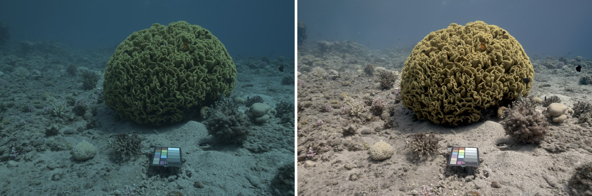
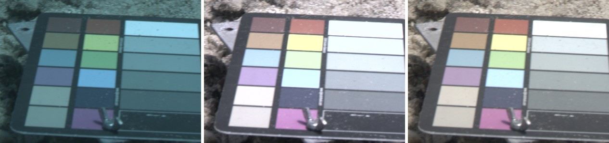
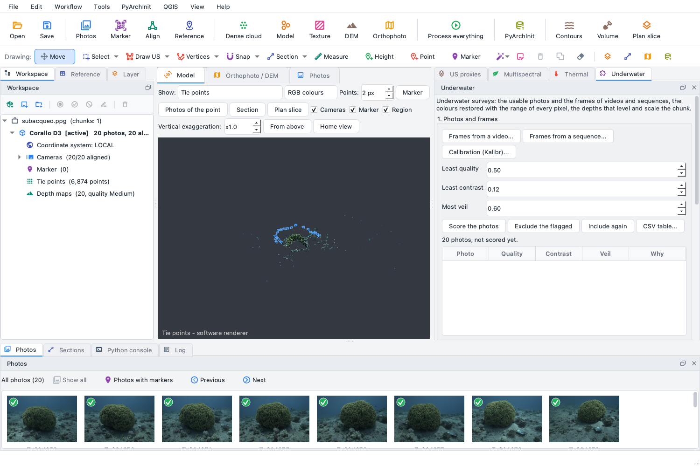
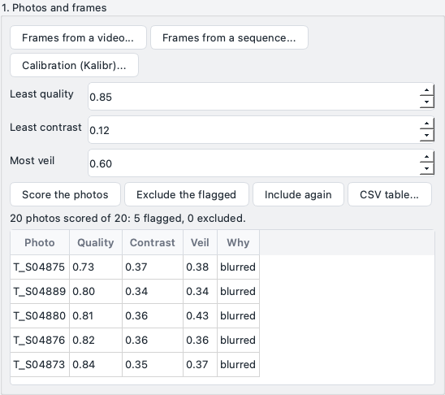
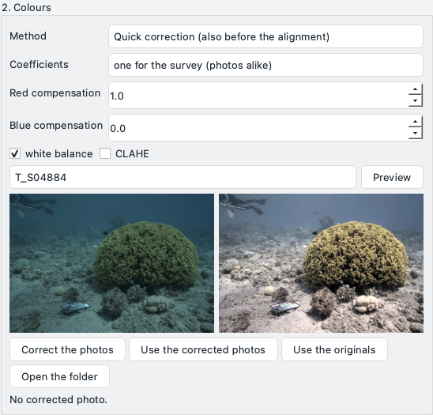
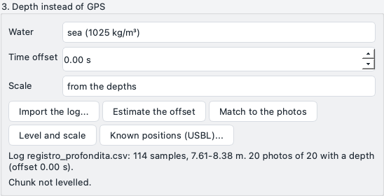
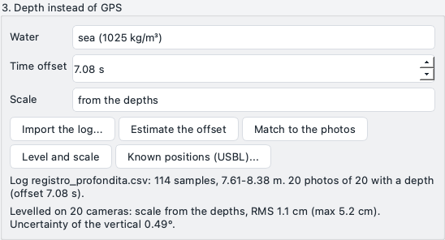
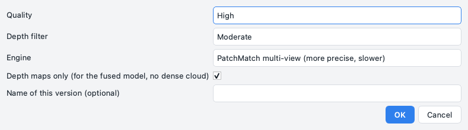
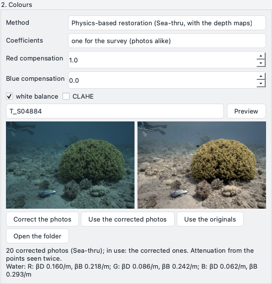
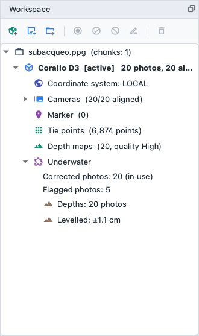

# Subacqueo

Il plugin *Subacqueo* aiuta nei rilievi fatti sott'acqua - un relitto, una struttura sommersa, reperti sul fondale -
con le foto di un subacqueo o le immagini di un ROV. Fa tre cose che il resto del programma non fa: restituisce i
colori che l'acqua toglie, dice quali foto e quali fotogrammi di un video vale la pena usare, e usa la profondità
della camera, letta da un sensore di pressione o da un computer subacqueo, dove un rilievo a terra userebbe il GPS.

Questa pagina descrive la versione 0.1.1 del plugin, che richiede pyarchinit-photogrammetry 1.3.4 o successiva. Il
README e il codice sorgente sono nel
[repository dei plugin](https://github.com/enzococca/pyarchinit-photogrammetry-plugins/tree/main/plugins/underwater).

<figure markdown="span">
  
  <figcaption>Una formazione di corallo a 1-3 m dalla camera nel Mar Rosso (dataset Sea-thru D3, Akkaynak e
  Treibitz): la foto come l'ha sviluppata la camera, e con i colori ripristinati dal plugin con la distanza di ogni
  pixel. Foto: D. Akkaynak, T. Treibitz, [dataset Sea-thru](https://www.kaggle.com/datasets/colorlabeilat/seathru-dataset),
  [CC BY-NC-SA 4.0](https://creativecommons.org/licenses/by-nc-sa/4.0/); sviluppata e ripristinata da noi, la figura ha la stessa licenza.</figcaption>
</figure>

## In breve

1. Porta dentro le foto: *Plugin > Subacqueo > Fotogrammi da un video...* o *Fotogrammi da una sequenza di
   immagini...* per i video e le registrazioni dei ROV, *Aggiungi foto* del programma per le foto. Una camera di
   ROV calibrata con Kalibr: il suo YAML con *Calibrazione (Kalibr)...*.
2. *Valuta le foto* nel pannello *Subacqueo*, guarda le foto segnate, *Escludi le segnate*.
3. Se le foto sono scure, lattiginose o molto blu, fai la *correzione rapida* (con *CLAHE* per l'allineamento) e
   *Usa le foto corrette* prima di allinearle.
4. Allinea le foto (*Flusso di lavoro > Allinea foto*). Per una sequenza, togliere la *Preselezione generica* nel
   dialogo dell'allineamento (tutte le coppie) aiuta sulla sabbia e sulle superfici con poca tessitura.
5. Importa il registro di profondità, *Associa alle foto*, *Stima lo scarto* se gli orologi sono diversi, *Metti in
   bolla e in scala*.
6. Costruisci le mappe di profondità (*Flusso di lavoro > Costruisci nuvola densa...*, motore *PatchMatch
   multi-vista*, *Solo le mappe di profondità*), poi *Ripristino fisico*: *Correggi le foto* e *Usa le foto
   corrette*.
7. Costruisci nuvola densa, DEM, ortofoto e modello con texture come sempre: usano le foto ripristinate, in metri,
   con le quote sotto la superficie dell'acqua.

## Che cosa fa

| Parte | Che cosa dà | Utile per |
|---|---|---|
| Punteggi delle foto | tre numeri per foto - qualità (nitidezza), contrasto, velo - le segnalazioni con il motivo, le foto segnate escluse o riattivate con un clic | lasciare fuori le foto mosse dall'onda, quelle scattate in una nuvola di sedimento, quelle troppo scure |
| Fotogrammi da video e sequenze | i fotogrammi da tenere, scelti per quanto si è spostata la vista e per nitidezza, ognuno con la sua ora | i video GoPro di un subacqueo, le 10-30 immagini al secondo di un ROV |
| Correzione rapida | il rosso ricostruito dal verde, bilanciamento del bianco, contrasto, a scelta contrasto locale (CLAHE) | foto da allineare, uno sguardo al sito prima dell'elaborazione, foto senza mappe di profondità |
| Ripristino fisico | i colori che la superficie avrebbe senza l'acqua fra lei e la camera, dalla distanza di ogni pixel | ortofoto e modello con texture di un sito con i suoi colori veri, lo stesso colore per lo stesso oggetto vicino e lontano |
| Registri di profondità | la profondità di ogni foto da un sensore di pressione o da un computer subacqueo, associata per ora | un rilievo senza GPS |
| Messa in bolla | il chunk in bolla (la verticale della gravità), in metri, con le quote uguali a meno la profondità | DEM, sezioni e misure in metri, confrontabili da un'immersione all'altra |
| Posizioni note | X e Y da un sistema di posizionamento acustico (USBL) o da alcune foto posizionate a mano | collocare il rilievo su una carta |

## Che cosa serve prima { #before }

* **Il plugin**, installato dal programma: vedi [Guide dei plugin](guides.md#install). Non chiede altro.
* **Foto o video** del rilievo. Il plugin legge JPEG, PNG e TIFF (8 o 16 bit); i file RAW vanno sviluppati prima,
  con meno elaborazione possibile (niente matrice di colore forte: una camera che porta a zero il canale rosso non
  lascia niente da ripristinare).
* Per il ripristino, **un chunk allineato con le sue mappe di profondità** (*Flusso di lavoro > Costruisci
  nuvola densa...* con *Solo le mappe di profondità*, o la nuvola densa stessa; vedi il [passo 5](#program)). La correzione rapida non chiede niente.
* Per la messa in bolla, **un registro di profondità** e **l'ora delle foto**: i fotogrammi estratti dal plugin la
  hanno; le foto la hanno nell'EXIF o nel nome.

## 1. Foto e fotogrammi { #photos }

### I punteggi

*Valuta le foto* misura ogni foto su una copia larga al massimo 1000 pixel:

* **Qualità** - la nitidezza del programma (il dettaglio più fine rispetto a quello largo qualche pixel, nelle
  celle di una griglia che hanno un po' di tessitura) rispetto a quella delle foto più nitide del chunk. Sotto 0,5
  la foto è mossa rispetto alle altre: movimento, messa a fuoco, onda.
* **Contrasto** - quanto sono lontane le parti scure da quelle chiare (fra il 2° e il 98° percentile della
  luminosità, 0-1). Basso in un'acqua lattiginosa e nelle foto troppo scure.
* **Velo** - quanta luce aggiunge l'acqua fra la camera e la scena. In una foto limpida ogni zona ha qualche pixel
  scuro (ombre, fessure); in una velata anche i più scuri sono sollevati dalla retrodiffusione. È la mediana del più
  scuro fra verde e blu in finestre di 15 pixel, rispetto alla luce più forte della foto, 0-1.

Le tre soglie restano nel pannello (0,5, 0,12, 0,6 all'inizio); cambiandole le foto vengono segnate di nuovo
subito, senza misurarle di nuovo. La tabella elenca le foto segnate con il motivo; *Escludi le segnate* le disattiva,
come *Disattiva foto* - l'allineamento e tutti i prodotti le lasciano fuori - e *Riattiva le escluse* riattiva le
foto disattivate dal plugin. *Tabella CSV...* scrive punteggi, ore e profondità di ogni foto. Le soglie sono un
punto di partenza: su un fondo di sabbia senza tessitura la nitidezza è bassa dappertutto, e una foto che tiene
insieme l'allineamento vale la pena tenerla anche se non è la più nitida.

### Fotogrammi da una sequenza

Un ROV registra immagini molte volte al secondo: centinaia di fotogrammi per ognuno che serve a una ricostruzione,
molti mossi. *Fotogrammi da una sequenza...* chiede:

* la **cartella** delle immagini (nell'ordine dei nomi, frame2 prima di frame10);
* la **tabella dei tempi** (facoltativa): un CSV con l'ora di ogni fotogramma - il nome del file o il numero del
  fotogramma, e l'ora in secondi Unix (s, ms, us o ns) o come data. Senza, l'ora viene dai nomi dei file
  (`1542883311752336025.png`, `20190312_142355_123.jpg`) o dall'EXIF;
* la **sovrapposizione** fra i fotogrammi tenuti (0,8: il fotogramma dopo viene tenuto quando la vista si è
  spostata di un quinto della larghezza dall'ultimo); la **nitidezza minima** rispetto ai vicini (0,6); il
  **passo** (analizza un fotogramma ogni N); un limite di tempo (un fotogramma almeno ogni tanti secondi, anche
  quando la vista si muove appena).

Ogni fotogramma viene abbinato al precedente (punti ORB e una similitudine trovata con RANSAC su una copia larga 480
pixel), così i fotogrammi di un tratto sono concatenati e il plugin sa quanto si è spostata la vista dall'ultimo
fotogramma tenuto, anche quando il ROV gira o si avvicina. Il fotogramma tenuto dopo è il più nitido fra quelli che
si sono spostati da metà a tutto il passo, lasciando fuori quelli molto meno nitidi dei vicini. Un ROV fermo non dà
fotogrammi nuovi; dove i fotogrammi non si possono abbinare (un salto, una nuvola di sedimento, le luci spente)
comincia un nuovo tratto. I fotogrammi non vengono copiati: diventano foto del chunk attivo dove sono, con la loro
ora.

### Fotogrammi da un video

*Fotogrammi da un video...* usa l'estrazione del programma (un fotogramma ogni volta che la vista si è spostata, il
più nitido dei momenti dopo) e dà a ogni fotogramma la sua ora: l'ora di creazione scritta nel file MP4 o MOV -
l'orologio della camera, spesso l'ora locale scritta come UTC - o un'ora di inizio scritta a mano, più il tempo nel
video. I fotogrammi vengono scritti in una cartella accanto al video.

### La calibrazione della camera di un ROV

Le camere dei ROV sono spesso calibrate con [Kalibr](https://github.com/ethz-asl/kalibr). *Calibrazione (Kalibr)...*
ne legge lo YAML (pinhole con distorsione radtan, o equidistant per gli obiettivi fisheye) e la dà alle foto della
stessa dimensione, tenuta fissa nell'allineamento. Kalibr, come OpenCV, mette il centro del primo pixel a 0, il
programma a 0,5: il plugin sposta il punto principale di mezzo pixel.

## 2. Colori { #colours }

L'acqua assorbe la luce rossa in pochi metri, poi la verde; e le particelle che contiene rimandano verso la camera
la luce del sole o delle lampade, un velo azzurrino che cresce con la distanza. Una foto sott'acqua quindi non è solo
più blu della stessa scena all'aria: è più blu e più velata quanto più ogni superficie è lontana dalla camera. La
stessa anfora è rossiccia da vicino e grigio-blu a qualche metro, e un'ortofoto fatta di foto scattate a distanze
diverse è un mosaico di toni.

### Il ripristino fisico

Con la **distanza di ogni pixel** - quanto è lontana, lungo il suo raggio, la superficie che mostra - l'effetto
dell'acqua si può stimare e togliere. Il plugin segue il modello di formazione dell'immagine di Sea-thru (D. Akkaynak
e T. Treibitz, CVPR 2019), scritto a partire dall'articolo:

* le distanze vengono dalle mappe di profondità del programma. Sono mappe delle foto senza distorsione: il plugin
  porta ogni pixel della foto al suo raggio con il modello della camera, poi alla mappa. Sono in metri quando lo è
  il chunk (georeferenziato, in scala con le barre di scala, o messo in bolla con le profondità); altrimenti nelle
  unità dell'allineamento, che bastano al ripristino;
* in ogni fascia di distanze i pixel più scuri sono quasi solo la luce dell'acqua: la **retrodiffusione** di ogni
  canale di colore viene stimata su di loro, come una curva che cresce con la distanza, e tolta dalla foto;
* quello che resta è la luce che viene dalle superfici. La sua media locale fra i pixel a distanza simile è la luce
  che arriva a quella distanza; come cala con la distanza dà l'**attenuazione** di ogni canale e l'esposizione di
  ogni foto;
* la media locale mescola l'acqua con i colori della scena quando cambiano con la distanza - un corallo giallo
  vicino alla camera, sabbia chiara lontano. Così, dove più foto vedono la stessa scena, il plugin ne abbina i punti
  e confronta il colore di ogni punto visto da due distanze: il rapporto fra i canali non dipende dal colore del
  punto né dall'esposizione, solo dall'acqua. Questi **punti visti due volte** danno le differenze di attenuazione
  fra rosso, verde e blu; la media locale dà solo l'attenuazione del verde;
* l'attenuazione viene tolta pixel per pixel (al massimo dodici volte: i pixel lontani sono soprattutto rumore); il
  colore della luce viene preso dai bordi delle foto ripristinate (l'ipotesi del *grey edge* di van de Weijer e
  colleghi: il bordo medio è grigio - molto meno ingannato del colore medio da una grande superficie di un colore
  solo), e il risultato viene portato a una luminosità media.

I coefficienti si possono stimare **una volta per il rilievo** - su un campione fino a 30 foto insieme: l'acqua è la
stessa, quindi ogni foto di un'immersione ha la stessa correzione, e ortofoto e texture non hanno cuciture di colore,
mentre l'esposizione e l'intensità della retrodiffusione di ogni foto restano sue - oppure **per ogni foto**, che
segue un'acqua che cambia (un'altra immersione, una nuvola di sedimento) al prezzo di foto che si accordano meno; le
differenze fra i canali vengono comunque dai punti che le foto del rilievo hanno in comune. Le foto del campione
vengono abbinate con le più vicine quando il chunk è allineato, altrimenti con quelle accanto nell'elenco (una
sequenza, un video).

I pixel che le mappe di profondità non raggiungono (l'acqua aperta sopra l'orizzonte, i margini) prendono la distanza
della superficie più vicina, ammorbidita: lì il ripristino è solo plausibile.

<figure markdown="span">
  
  <figcaption>La tabella dei colori di una foto di Sea-thru D3 a 0,9 m: come sviluppata, con la correzione rapida,
  ripristinata. La colonna di destra è una scala di grigi: ripristinati, i suoi tasselli sono grigi. Foto:
  D. Akkaynak, T. Treibitz, [dataset Sea-thru](https://www.kaggle.com/datasets/colorlabeilat/seathru-dataset),
  [CC BY-NC-SA 4.0](https://creativecommons.org/licenses/by-nc-sa/4.0/); ritagliata, sviluppata e corretta da noi, la figura ha la stessa licenza.</figcaption>
</figure>

### La correzione rapida

Senza distanze - prima dell'allineamento, o su foto senza mappe di profondità - la correzione rapida ricostruisce il
rosso dal verde dove il rosso manca (C. O. Ancuti e colleghi, IEEE TIP 2018), a scelta il blu in acqua verde,
bilancia il bianco perché la media sia grigia, estende la luminosità, e a scelta alza il contrasto locale (CLAHE).
Medie e guadagni vengono da un campione del rilievo insieme, così le foto restano simili. Non sa distinguere il
vicino dal lontano: una superficie lontana resta più blu della stessa vicina.

CLAHE cambia i colori, ma può rendere possibile l'allineamento: sulle foto scure e poco contrastate di un sito
profondo i punti chiave del programma vengono ritrovati anche sulla sabbia. Sulla sequenza AQUALOC più sotto,
l'allineamento ha registrato 63 fotogrammi su 139 con le immagini originali e 136 su 139 con la correzione rapida con
CLAHE.

### Anteprima, copie e foto in uso

*Anteprima* mostra una foto prima e dopo, con il metodo e le opzioni scelti. *Correggi le foto* scrive una copia di
ogni foto - stesso nome, dimensioni e formato, l'EXIF conservato - nella cartella `underwater/colour` del chunk; gli
originali non vengono mai toccati. *Usa le foto corrette* fa puntare le foto del chunk alle copie: ortofoto, texture,
mappe di profondità e un nuovo allineamento le leggono da quel momento. *Usa le originali* le fa puntare di nuovo
agli originali. Correggere di nuovo scrive sopra le copie.

## 3. Profondità invece del GPS { #depth }

Sott'acqua non c'è GPS. La profondità della camera, misurata dal sensore di pressione di un ROV o dal computer
subacqueo del sub, è la misura che resta.

### Il registro di profondità

*Importa il registro...* legge:

* tabelle CSV e di testo con una colonna del tempo - tempo Unix in s, ms, us o ns, date ISO, ore con una colonna
  della data, secondi dall'inizio - e una colonna della profondità in metri o piedi, oppure della pressione (bar,
  mbar, dbar, kPa, Pa, psi), trasformata in profondità con la densità dell'acqua di mare (1025 kg/m³) o dolce
  (1000 kg/m³) scelta nel pannello;
* le esportazioni dei computer subacquei, come le scrive Subsurface (date, time, sample time, sample depth);
* i file UDDF, il formato di scambio dei registri di immersione;
* i file delle profondità del dataset AQUALOC.

Le profondità vengono associate alle foto per ora: l'ora dei fotogrammi estratti dal plugin, l'ora nei nomi dei file,
o l'ora dell'EXIF con le frazioni di secondo e il fuso. Lo **scarto di tempo** è quanto aggiungere all'orologio della
camera per leggere quello del registro (una camera un'ora avanti: -3600). Quando gli orologi non erano sincronizzati,
*Stima lo scarto* prova ogni scarto per un quarto d'ora prima e dopo e tiene quello con cui le quote delle camere
allineate spiegano meglio i cambi di profondità - non la differenza più piccola in metri: uno scarto che mette le
foto su un tratto piatto del registro (il subacqueo fermo, il fondo) dà profondità quasi uguali, che si adattano a
qualsiasi cosa. Si confrontano solo gli scarti che danno una profondità a (quasi) tutte le foto.

### In bolla e in scala

Le profondità di tre o più camere allineate dicono come è girato il chunk (la verticale è la direzione lungo cui
cambia la profondità delle camere), quanto è grande (quanti metri di profondità vale un'unità dell'allineamento) e
quanto è profondo (la quota di ogni camera è meno la sua profondità). Il plugin trova le tre cose insieme, con pesi
che lasciano fuori qualche associazione sbagliata, e mette il chunk in un sistema locale in metri: **Z =
-profondità**, la superficie dell'acqua a 0. X, Y e la direzione del nord sono arbitrari - la profondità non dice
niente di loro - e restano come erano. Il pannello mostra lo scarto quadratico medio fra le quote delle camere e le
loro profondità, il più grande, le camere fuori linea e l'incertezza della verticale.

I riferimenti delle camere del programma sono posizioni in tre coordinate con una sola accuratezza per tutte e tre:
un riferimento con la sola quota non ci sta. Così la messa in bolla la fa il plugin, che la tiene nel progetto; un
nuovo allineamento la azzera, e il pannello e l'area di lavoro dicono *Bolla da rifare*.

Quando la profondità delle camere cambia troppo poco - un rilievo a profondità costante - le profondità non possono
dare la scala: allora la danno le barre di scala di controllo del chunk (*Scala: dalle barre di scala*), e la
verticale il piano delle camere.

### Posizioni note

Un sistema di posizionamento acustico (USBL) o alcune foto posizionate a mano danno X e Y: *Posizioni note
(USBL)...* legge una tabella per nome della foto o per ora (interpolate), in un sistema di riferimento dato come
codice EPSG. Dopo la messa in bolla una similitudine orizzontale mette il chunk su di loro: il nord e la posizione
sulla carta.

## Passo passo nel programma { #program }

Le immagini di questa sezione vengono da 20 foto del dataset Sea-thru D3 (una formazione di corallo nel Mar Rosso,
fotografata da 1-3 m; D. Akkaynak, T. Treibitz, [CC BY-NC-SA 4.0](https://creativecommons.org/licenses/by-nc-sa/4.0/))
e da un registro di profondità **simulato per l'esempio**: il dataset non ne ha, quindi il registro è stato ricavato
dalle quote delle camere allineate, con 1,5 cm di rumore, un campione al secondo e l'orologio 7 secondi avanti
rispetto a quello della camera.

### Il pannello

Si apre con *Plugin > Subacqueo > Pannello Subacqueo* e resta a destra della finestra, fra i pannelli degli
strumenti (*Proxy US*, *Multispettrale*, *Termico*). Ha tre riquadri, nell'ordine del lavoro - **1. Foto e
fotogrammi**, **2. Colori**, **3. Profondità invece del GPS** - e sotto i pulsanti di ogni riquadro una riga dice a
che punto è il chunk attivo.

<figure markdown="span">
  
  <figcaption>La finestra con il pannello <em>Subacqueo</em> aperto a destra, prima di fare qualsiasi cosa: 20 foto allineate del dataset Sea-thru D3.</figcaption>
</figure>


### 1. Valutare le foto

1. Fai clic su *Valuta le foto*. Ogni foto riceve tre numeri: *qualità* (nitidezza rispetto alle foto più nitide
   del chunk), *contrasto* (estensione della luminosità), *velo* (la foschia del sedimento in sospensione).
2. Le tre soglie sopra i pulsanti decidono quali foto vengono segnate. Cambiandone una le foto vengono segnate di
   nuovo subito, senza valutarle un'altra volta.
3. La tabella elenca le foto segnate con il motivo. *Escludi le segnate* le disattiva: restano nel chunk, in
   grigio, e *Riattiva le escluse* le rimette. *Tabella CSV...* scrive i punteggi di tutte le foto.

<figure markdown="span">
  
  <figcaption>Le foto valutate, con la <em>Qualità minima</em> alzata a 0,85: cinque foto segnate come mosse. Con lo 0,50 predefinito nessuna di queste foto viene segnata: D3 è un buon set.</figcaption>
</figure>


### 2. Un primo sguardo ai colori

1. Metti *Metodo* su *Correzione rapida*, scegli una foto nell'elenco sotto le opzioni, fai clic su *Anteprima*: la
   foto com'è e corretta.
2. Se le foto sono troppo blu o troppo scure per allinearle, spunta *CLAHE*, poi *Correggi le foto* e *Usa le foto
   corrette* **prima** dell'allineamento. Le foto dell'esempio si allineano così come sono, quindi qui ci si ferma
   all'anteprima.

<figure markdown="span">
  
  <figcaption>L'anteprima della correzione rapida su una foto con la tabella dei colori: rosso ricostruito dal verde, bilanciamento del bianco.</figcaption>
</figure>


### 3. Allineare le foto

*Flusso di lavoro > Allinea foto...* come per ogni rilievo (vedi [In breve](#in-breve), passo 4). Le 20 foto
dell'esempio si allineano in pochi secondi.

### 4. Il registro di profondità, lo scarto di tempo, la messa in bolla

1. Nel riquadro *3. Profondità invece del GPS* scegli l'*Acqua* (mare o dolce, per i registri di pressione) e
   lascia *Scarto di tempo* a 0 se non lo conosci.
2. *Importa il registro...* e scegli il file. Le profondità vengono associate subito alle foto con lo scarto del
   riquadro. Ogni foto riceve una profondità anche con lo scarto sbagliato - quella di un altro momento - quindi
   passa al passo successivo.

<figure markdown="span">
  
  <figcaption>Il registro importato con lo scarto a 0: 114 campioni fra 7,61 e 8,38 m, una profondità per ognuna delle 20 foto, il chunk non ancora in bolla.</figcaption>
</figure>


3. *Stima lo scarto* prova gli scarti entro un quarto d'ora da quello del riquadro e tiene quello con cui le
   quote delle camere spiegano meglio le profondità; lo scrive nel riquadro e associa di nuovo le profondità.
   Nell'esempio trova 7,08 secondi per un orologio avanti di 7 secondi.
4. *Metti in bolla e in scala*: il chunk va in bolla, in metri, con Z = -profondità. La riga sotto i pulsanti dà lo
   scarto quadratico fra le quote delle camere e le loro profondità (qui 1,1 cm), il massimo (5,2 cm) e
   l'incertezza della verticale (0,49°).

<figure markdown="span">
  
  <figcaption>Lo scarto stimato (7,08 s) e il chunk messo in bolla e in scala su 20 camere: scarto quadratico 1,1 cm, incertezza della verticale 0,49°.</figcaption>
</figure>


Nell'esempio le camere restano entro 0,8 m di profondità e la scala trovata differisce del 7 % da quella delle mappe
di profondità metriche del dataset: meno cambia la profondità, meno dice sulla scala. Con piccoli cambi di
profondità fanno meglio una barra di scala sul sito e *Scala: dalle barre di scala*.

### 5. Le mappe di profondità per il ripristino

Il ripristino prende la distanza di ogni pixel dalle mappe di profondità del programma. Costruiscile con *Flusso di
lavoro > Costruisci nuvola densa...*, **Motore: PatchMatch multi-vista** e **Solo le mappe di profondità**
spuntato.

<figure markdown="span">
  
  <figcaption><em>Flusso di lavoro > Costruisci nuvola densa...</em> impostato per il ripristino: PatchMatch, solo le mappe di profondità.</figcaption>
</figure>


Il motore automatico, per le foto scattate vicino al soggetto, usa lo stereo a coppie di foto: veloce, ma sulle foto
dell'esempio copre circa un quinto di ogni foto, PatchMatch tre quarti (in 9 secondi su 20 foto). Dove le mappe non
arrivano la distanza viene dalla superficie più vicina e i colori sono solo plausibili: dopo il ripristino il plugin
avverte quando le mappe coprono meno del 40 % delle foto.

### 6. Ripristinare i colori

1. Metti *Metodo* su *Ripristino fisico* e *Coefficienti* su *uno per il rilievo* (la stessa correzione per tutte
   le foto: niente cuciture di colore nell'ortofoto).
2. *Correggi le foto*: il modello dell'acqua viene stimato sul rilievo, poi ogni foto viene ripristinata.
   *Anteprima* mostra una foto prima e dopo con quel modello.
3. *Usa le foto corrette*: da quel momento ortofoto, texture e mappe di profondità leggono le copie; *Usa le
   originali* torna indietro.

La riga sotto i pulsanti dice quante foto sono corrette, quali sono in uso e i coefficienti dell'acqua al metro -
attenuazione βD e retrodiffusione βB di rosso, verde e blu - quando il chunk è in bolla e in metri.

<figure markdown="span">
  
  <figcaption>Il ripristino: l'anteprima di una foto, 20 foto corrette in uso, l'attenuazione dai punti visti due volte e i coefficienti dell'acqua al metro.</figcaption>
</figure>


### 7. I prodotti

Sotto il chunk, nell'*Area di lavoro*, il nodo *Subacqueo* riassume quello che è stato fatto: le foto corrette e se
sono in uso, le foto segnate, le foto con la profondità, la messa in bolla. Le sue voci aprono il pannello; il menu
del tasto destro ripete le azioni principali. Nuvola densa, DEM, ortofoto e modello con texture si costruiscono poi
come sempre: usano le foto ripristinate, in metri.

<figure markdown="span">
  
  <figcaption>Il nodo <em>Subacqueo</em> sotto il chunk nell'area di lavoro.</figcaption>
</figure>

## Dalla riga di comando

```bash
ppg plugin underwater frames-sequence scavo.ppg raw_data/images_sequence_6 --times raw_data/img_sequence_6.csv --overlap 0.9
ppg plugin underwater calibration scavo.ppg archaeo_camera_calib.yaml
ppg plugin underwater score scavo.ppg --quality 0.5 --contrast 0.12 --veil 0.6 --exclude
ppg plugin underwater quick scavo.ppg --clahe --alpha 0 --no-balance --use
ppg plugin underwater restore scavo.ppg --per survey --use
ppg plugin underwater use scavo.ppg original
ppg plugin underwater depth scavo.ppg depth_sequence_6.csv --offset 0
ppg plugin underwater offset scavo.ppg --span 900
ppg plugin underwater level scavo.ppg --positions usbl.csv --crs 32633
ppg plugin underwater status scavo.ppg
```

## Provato su dati veri { #tests }

**AQUALOC, sito archeologico, sequenza 6** (M. Ferrera, V. Creuze, J. Moras, P. Trouvé-Peloux, *AQUALOC: An
Underwater Dataset for Visual-Inertial-Pressure Localization*, The International Journal of Robotics Research,
2019): un ROV su un relitto di anfore a 387-391 m, 3385 fotogrammi monocromatici di 968 x 608 pixel a 20 al secondo,
la profondità del suo sensore di pressione e una traiettoria calcolata con COLMAP come riferimento.

* 139 fotogrammi scelti su 3385 in 8,5 secondi, con sovrapposizione 0,9; la calibrazione Kalibr tenuta fissa.
* Allineati: 63 su 139 con i fotogrammi originali, 136 su 139 dopo la correzione rapida con CLAHE.
* In bolla e in scala con le profondità: le quote delle camere differiscono dalle loro profondità di 2,3 cm (scarto
  quadratico medio; 6,1 cm al massimo) su 3,9 m di dislivello; la scala è nota allo 0,5 %; la verticale sta entro
  0,18° da quella che le stesse profondità danno alla traiettoria di riferimento, e le posizioni delle camere stanno
  entro 5,8 cm dal riferimento su 38 m di percorso.
* Un orologio della camera spostato apposta di 7,3 secondi: lo scarto trovato è 7,33 secondi.
* DEM e ortofoto, in metri, stanno fra 389,7 e 394,2 m sotto la superficie.


**Sea-thru D3** (D. Akkaynak, T. Treibitz, CVPR 2019): 68 foto RAW di una formazione di corallo nel Mar Rosso, con
una tabella dei colori, e mappe di profondità in metri fatte con Metashape. Sviluppate con il bilanciamento del
bianco della camera e senza matrice di colore, 23 foto sono state ripristinate con le loro mappe di profondità, i
coefficienti stimati sulle 23 insieme (2,8 minuti).

* La scala dei grigi della tabella, a 0,9 m dalla camera, ha una saturazione media (CIELAB a*b*, 0 = grigio perfetto)
  di 3,7 dopo il ripristino, contro 16,9 nelle foto come sviluppate e 6,1 con la correzione rapida; con un modello per
  foto, 4,0.
* Con la sola media locale (l'illuminante di Sea-thru, prima dei punti visti due volte e dei bordi grigi) il blu
  risultava il colore più attenuato e la tabella stava a 19: il corallo giallo vicino alla camera e la sabbia chiara
  lontano mescolano i colori della scena con l'acqua.
* A 1-3 m dalla scena i colori cambiano poco con la distanza: gli stessi punti visti da distanze diverse almeno del
  25 % differiscono di un ΔE a*b* mediano di 1,56 come sviluppati e 1,67 ripristinati. Il guadagno sta soprattutto nel
  colore della luce.
* La catena intera nel programma su 20 delle foto: allineate 20 su 20 in 26 secondi, mappe di profondità in 3
  secondi. Le nostre mappe e quelle di Metashape si accordano a meno della scala, con uno scarto dello 0,4 %.
  Ripristinate con le nostre distanze la scala dei grigi ha una saturazione media di 7,4; con le mappe di Metashape
  sulle stesse foto 4,2 (le differenze fra i canali lì si trovano su più punti).
* D3 è stato ripreso da una camera che gira intorno a un corallo a 1-3 m: un'ortofoto non ha senso, ma quella delle
  foto ripristinate ha gli stessi colori da una foto all'altra.

## Limiti

* Il ripristino suppone la luce del sole dall'alto, la stessa in ogni punto della foto. Le lampade di un ROV
  illuminano più le cose vicine delle lontane e più il centro dei bordi: il modello ne prende una parte come
  attenuazione, ma un sito profondo illuminato da lampade non è quello per cui è fatto.
* Il rosso assorbito del tutto - una camera che ha scritto zero nel canale rosso - non si può restituire.
* Il colore della luce viene dai bordi della scena: una scena quasi tutta di un colore e senza dettagli resta
  difficile.
* La profondità dà la verticale e la scala, non il nord né la posizione: senza posizioni note il rilievo resta in un
  sistema locale.

## Riferimenti

* D. Akkaynak, T. Treibitz, *Sea-thru: A Method for Removing Water From Underwater Images*, CVPR 2019.
* C. O. Ancuti, C. Ancuti, C. De Vleeschouwer, P. Bekaert, *Color Balance and Fusion for Underwater Image and Video
  Enhancement*, IEEE Transactions on Image Processing 27(1), 2018.
* J. van de Weijer, T. Gevers, A. Gijsenij, *Edge-Based Color Constancy*, IEEE Transactions on Image Processing
  16(9), 2007.
* P. Drews Jr., E. do Nascimento, F. Moraes, S. Botelho, M. Campos, *Transmission Estimation in Underwater Single
  Images*, ICCV Workshops 2013.
* M. Ferrera, V. Creuze, J. Moras, P. Trouvé-Peloux, *AQUALOC: An Underwater Dataset for Visual-Inertial-Pressure
  Localization*, The International Journal of Robotics Research, 2019.
