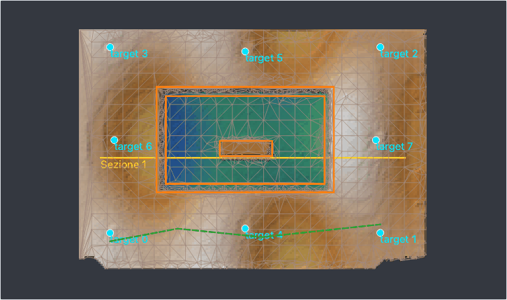

# TIN e linee di rottura

Un DEM è una griglia: il piede di un muro, il bordo di un taglio o la cresta di un gradino cadono tra le sue celle e
vengono arrotondati. Un **TIN** (rete di triangoli irregolari) è la superficie fatta di triangoli tra punti misurati:
le quote puntuali diventano vertici con la loro quota misurata e le **linee di rottura** disegnate lungo quegli
spigoli diventano lati di triangoli che nessun triangolo attraversa, così la superficie li tiene vivi. Dal TIN si
ricavano un DEM, curve di livello che non tagliano un muro di traverso, volumi esatti e la superficie per i programmi
CAD e di progettazione stradale (DXF, LandXML).



*La trincea del progetto demo: il bordo e il piede del taglio e il muro al suo interno disegnati come linee di rottura
(arancio), una linea morbida (verde, tratteggiata), gli spigoli del TIN in grigio - triangoli piccoli dove la
superficie piega, grandi dove è piana.*

## Costruire il TIN

*Strumenti > TIN...* (anche in *Strumenti > TIN e linee di rottura*). **Punti del TIN**:

* **DEM: triangoli raffinati fino alla tolleranza** - il TIN parte dagli angoli del DEM e aggiunge, giro dopo giro, le
  celle da cui i triangoli si allontanano di più, finché ogni cella del DEM è entro la **tolleranza**. Lasciata vuota,
  la tolleranza è il doppio del rumore del DEM (l'NMAD del DEM attorno a una mediana 3 x 3, misurato su tutto il
  rilievo) e mai meno di un quinto di cella (celle da 5 cm: 1 cm): un DEM molto liscio non riceve un triangolo per
  cella. Al massimo 2 milioni di vertici.
* **Terreno della nuvola densa** - i punti del terreno (classe 2 se la nuvola è classificata, o le classi scelte),
  diradati alla loro spaziatura.
* **Solo quote puntuali e linee di rottura** - un TIN da ciò che è stato misurato sul campo, senza la superficie
  fotogrammetrica.

**Quote puntuali come vertici** (attivo di default): le quote puntuali della pianta sono vertici con la loro quota
misurata, che vale più di quella del DEM. **Linee di rottura disegnate**: le linee della pianta (sotto). Con un
poligono selezionato, **Contorno: il poligono selezionato**: nessun triangolo fuori da esso.

Alla fine una finestra e il log dicono quanti vertici, triangoli e spigoli vincolati ha il TIN, la tolleranza e
quanti giri ci sono voluti, e quanto si scosta dal DEM (lo scarto massimo e quello entro cui sta il 95 % delle celle).
Il TIN resta nel progetto (`tin/tin.npz` e `tin.json` nella cartella del chunk) ed è elencato nell'area di lavoro: un
doppio clic lo mostra nella vista 3D, colorato per quota (anche *TIN* in *Mostra* della vista 3D); il tasto destro ha
curve di livello, volume, DEM dal TIN, esporta e rimuovi. Sulla pianta i suoi spigoli sono disegnati nel layer *TIN*,
quelli vincolati più spessi.

## Linee di rottura

Lo strumento **Linee** della barra di disegno (o *Strumenti > TIN e linee di rottura > Disegna linee di rottura*) le
disegna sull'ortofoto o sul DEM: un clic per vertice, doppio clic o ++enter++ per finire, ++backspace++ toglie l'ultimo
vertice, ++esc++ annulla. Il menu del pulsante sceglie il tipo delle linee successive:

| Tipo | Nel TIN | Colore |
| --- | --- | --- |
| **Linea di rottura** | uno spigolo che i triangoli non attraversano mai, con le sue quote | arancio |
| **Linea morbida** | solo i suoi vertici: i triangoli possono attraversarla | verde, tratteggiata |
| **Contorno** | una linea chiusa: il TIN si ferma lì | rosso |

Ogni vertice prende la quota del DEM sotto di sé quando viene disegnato (a piena risoluzione); il log dice la lunghezza
e quanti vertici sono caduti fuori dal DEM. Dove due linee di rottura si incrociano, il TIN mette un vertice
all'incrocio. Le linee sono salvate con i disegni del progetto, nel layer *Linee di rottura*: selezionane una (strumento
*Seleziona*) ed *Elimina* la toglie.

Servono anche **fuori dal TIN**:

* *Modifica DEM* (*Strumenti > Disegno su ortofoto*) propone *Usa le linee di rottura disegnate che toccano l'area o
  il suo bordo*: le loro quote restano quando l'area viene riempita ([Modificare il DEM](gui/processing.md#modificare-il-dem));
* *Strumenti > TIN e linee di rottura > Esporta le linee di rottura...* le scrive in DXF (layer `LINEE`, una polilinea
  3D quando ogni vertice ha la quota, il colore del suo tipo), GeoPackage (tabella `linee`, con Z) o GeoJSON (proprietà
  `kind`, come le legge `ppg tin build --breaklines`);
* il collegamento dal vivo con QGIS e il pacchetto QField le portano come layer, da consultare.

Le linee disegnate mentre è aperto un [prospetto](gui/processing.md#disegni-sui-prospetti-e-sulle-sezioni) appartengono
a lui, nei suoi metri, e non entrano nel TIN della pianta.

## Cosa si ricava dal TIN

* **Curve di livello dal TIN...**: esatte sui triangoli (un segmento dritto attraverso ciascuno), così una curva corre
  lungo una linea di rottura invece di tagliarla. Equidistanza, curva direttrice ogni N livelli e, se serve, un file
  (DXF, GeoPackage, GeoJSON); le curve diventano un layer della pianta, come le
  [curve di livello del DEM](gui/drawing.md#curve-di-livello-e-volumi).
* **Volume dal TIN...**: il volume esatto dei prismi sotto i triangoli rispetto a una superficie di riferimento - il
  vertice più basso (il deposito sopra di esso), un piano orizzontale a una quota data o un piano inclinato
  z = a x + b y + c. Lo scavo è ciò che sta sotto il riferimento (asportato), il riporto ciò che sta sopra (aggiunto),
  con l'area e le quote.
* **DEM dal TIN**: il TIN rasterizzato sulla griglia del DEM diventa il DEM attivo; il DEM di prima resta tra le
  [versioni](gui/processing.md#versioni) e il nuovo si chiama "DEM dal TIN". Ortofoto, curve, volumi e sezioni usano
  allora la superficie con i suoi spigoli vivi.
* **Esporta TIN...**: DXF (`3DFACE` sul layer `TIN`, gli spigoli vincolati come linee 3D su `LINEE_DI_ROTTURA`, le
  quote puntuali come punti su `QUOTE`), PLY o OBJ (una mesh in coordinate mondo, in doppia precisione nella PLY),
  GeoPackage (tabelle `tin_triangoli`, `tin_spigoli`, `tin_quote`, tutte con Z) o LandXML 1.2 (`.xml`: una
  `<Surface>` con il suo TIN e le linee di rottura, per i programmi stradali e di movimento terra).

## Senza il nucleo nativo

La triangolazione vincolata è nel nucleo nativo (`pyarchinit-photogrammetry-core` 0.7 o successivo, installato con
l'extra `fast` e nell'applicazione pacchettizzata). Senza di esso il TIN si costruisce lo stesso, con la triangolazione
di Delaunay di SciPy, che non sa tenere i vincoli: le linee di rottura e il contorno sono vertici del TIN ma i
triangoli possono attraversarli. Il rapporto del TIN e il log lo dicono con un avviso; curve, volumi e DEM dal TIN
funzionano allo stesso modo.

## Dalla riga di comando

```bash
ppg tin build scavo.ppg [--source dem|cloud|spots] [--max-error 0.01] [--breaklines linee.geojson]
              [--drawn/--no-drawn] [--boundary area.geojson] [--spots/--no-spots] [--classes 2,8]
ppg tin dem scavo.ppg [--resolution 0.02] [--name "DEM dal TIN"]
ppg tin contours scavo.ppg curve.dxf [--interval 0.05] [--index-every 5]
ppg tin volume scavo.ppg [--reference 99.6 | --plane a,b,c]
ppg tin export scavo.ppg tin.xml          # .dxf, .ply, .obj, .gpkg o .xml (LandXML)
```

Ogni comando accetta `--chunk` (predefinito il chunk attivo). `--breaklines` legge un GeoJSON di LineString con la
proprietà `kind` (`breakline`, `soft`, `boundary`); senza file si usano le linee disegnate sulla pianta (`--drawn`).
Le funzioni che ci stanno dietro sono nell'[API Python](api.md#tin-e-linee-di-rottura).
