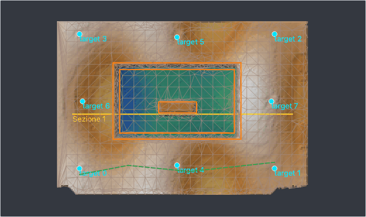

# TIN and break lines

A DEM is a grid: the foot of a wall, the edge of a cut or the top of a step fall between its cells and come out
rounded. A **TIN** (triangulated irregular network) is the surface as triangles between measured points: the spot
heights become vertices with their measured height, and the **break lines** drawn along those edges become sides of
triangles that no triangle crosses, so the surface keeps them sharp. From the TIN come a DEM, contour lines that do
not wander across a wall, exact volumes and the surface for CAD and road-design programs (DXF, LandXML).



*The trench of the demo project: the edge and the foot of the cut and the wall inside it drawn as break lines
(orange), a soft line (green, dashed), the edges of the TIN in grey - small triangles where the surface bends, large
ones where it is flat.*

## Building the TIN

*Tools > TIN...* (also in *Tools > TIN and break lines*). **Points of the TIN**:

* **DEM: triangles refined to the tolerance** - the TIN starts from the corners of the DEM and adds, round after round,
  the cells the triangles miss the most, until every cell of the DEM is within the **tolerance**. Left empty, the
  tolerance is twice the noise of the DEM (the NMAD of the DEM around a 3 x 3 median, measured over the whole survey)
  and never less than a fifth of a cell (5 cm cells: 1 cm): a very smooth DEM does not get a triangle per cell. At most
  2 million vertices.
* **Ground of the dense cloud** - the points of the ground (class 2 when the cloud is classified, or the classes
  chosen), thinned to their spacing.
* **Spot heights and break lines only** - a TIN from what was measured in the field, without the photogrammetric
  surface.

**Spot heights as vertices** (on by default): the spot heights of the plan are vertices with their measured height,
which wins over the DEM. **Break lines drawn**: the lines of the plan (below). With a polygon selected,
**Boundary: the selected polygon**: no triangle outside it.

When it is done, a window and the log say how many vertices, triangles and constrained edges the TIN has, the
tolerance and how many rounds it took, and how far it is from the DEM (the largest difference and the one 95 % of the
cells are within). The TIN is kept in the project (`tin/tin.npz` and `tin.json` in the folder of the chunk) and listed
in the workspace: a double click shows it in the 3D view, coloured by height (also *TIN* in *Show* of the 3D view);
the right click has contour lines, volume, DEM from the TIN, export and remove. On the plan its edges are drawn in the
layer *TIN*, the constrained ones thicker.

## Break lines

The **Lines** tool of the drawing bar (or *Tools > TIN and break lines > Draw break lines*) draws them on the
orthophoto or the DEM: a click for each vertex, double click or ++enter++ to finish, ++backspace++ removes the last
vertex, ++esc++ cancels. The menu of the button chooses the kind of the next lines:

| Kind | In the TIN | Colour |
| --- | --- | --- |
| **Break line** | an edge the triangles never cross, with its heights | orange |
| **Soft line** | its vertices only: the triangles may cross it | green, dashed |
| **Boundary** | a closed line: the TIN stops there | red |

Each vertex takes the height of the DEM under it when it is drawn (at full resolution); the log says the length and
how many vertices fell outside the DEM. Where two break lines cross, the TIN makes a vertex at the crossing. The lines
are saved with the drawings of the project, in the layer *Break lines*: select one (*Select* tool) and *Delete* removes it.

They serve also **outside the TIN**:

* *Edit DEM* (*Tools > Drawing on the orthophoto*) offers *Use the break lines drawn that touch the area or its edge*:
  their heights stay when the area is filled ([Editing the DEM](gui/processing.md#editing-the-dem));
* *Tools > TIN and break lines > Export the break lines...* writes them as DXF (layer `LINEE`, a 3D polyline when
  every vertex has a height, the colour of its kind), GeoPackage (table `linee`, with Z) or GeoJSON (property `kind`,
  as `ppg tin build --breaklines` reads them);
* the live link with QGIS and the QField package carry them as a layer, to look at.

Lines drawn while an [elevation](gui/processing.md#drawings-on-elevations-and-sections) is shown belong to it, in its
metres, and are not used by the TIN of the plan.

## What comes from the TIN

* **Contour lines from the TIN...**: exact on the triangles (a straight segment across each one), so a contour runs
  along a break line instead of cutting across it. Interval, index contour every N levels, and a file (DXF, GeoPackage,
  GeoJSON) if you want one; the lines become a layer of the plan, as the [contour lines of the DEM](gui/drawing.md#contour-lines-and-volumes).
* **Volume from the TIN...**: the exact volume of the prisms under the triangles against a reference surface - the
  lowest vertex (the deposit above it), a horizontal plane at a given height, or a sloping plane z = a x + b y + c. Cut
  is what lies below the reference (removed), fill what lies above it (added), with the area and the heights.
* **DEM from the TIN**: the TIN rasterised on the grid of the DEM becomes the active DEM; the DEM as it was stays among
  the [versions](gui/processing.md#versions) and the new one is named "DEM dal TIN". Orthophoto, contour lines,
  volumes and sections then use the surface with its sharp edges.
* **Export TIN...**: DXF (`3DFACE` on layer `TIN`, the constrained edges as 3D lines on `LINEE_DI_ROTTURA`, the spot
  heights as points on `QUOTE`), PLY or OBJ (a mesh in world coordinates, double precision in the PLY), GeoPackage
  (tables `tin_triangoli`, `tin_spigoli`, `tin_quote`, all with Z) or LandXML 1.2 (`.xml`: a `<Surface>` with its TIN
  and its break lines, for road and earthwork programs).

## Without the native core

The constrained triangulation is in the native core (`pyarchinit-photogrammetry-core` 0.7 or later, installed with
the extra `fast` and in the packaged application). Without it the TIN is still built, with SciPy's Delaunay
triangulation, which cannot hold constraints: the break lines and the boundary are vertices of the TIN but the
triangles may cross them. The report of the TIN and the log say so with a warning; contours, volumes and the DEM from
the TIN work the same.

## From the command line

```bash
ppg tin build scavo.ppg [--source dem|cloud|spots] [--max-error 0.01] [--breaklines linee.geojson]
              [--drawn/--no-drawn] [--boundary area.geojson] [--spots/--no-spots] [--classes 2,8]
ppg tin dem scavo.ppg [--resolution 0.02] [--name "DEM dal TIN"]
ppg tin contours scavo.ppg curve.dxf [--interval 0.05] [--index-every 5]
ppg tin volume scavo.ppg [--reference 99.6 | --plane a,b,c]
ppg tin export scavo.ppg tin.xml          # .dxf, .ply, .obj, .gpkg or .xml (LandXML)
```

Every command takes `--chunk` (default the active one). `--breaklines` reads a GeoJSON of LineStrings with the
property `kind` (`breakline`, `soft`, `boundary`); the lines drawn on the plan are used when no file is given
(`--drawn`). The functions behind them are in the [Python API](api.md#tin-and-break-lines).
